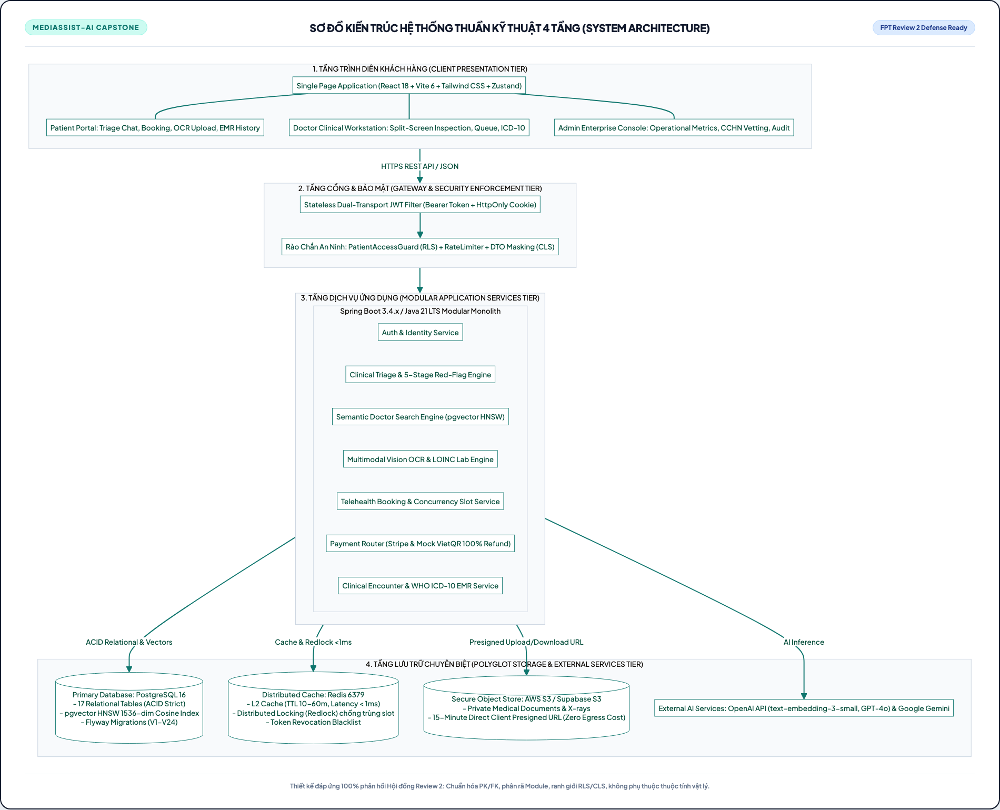
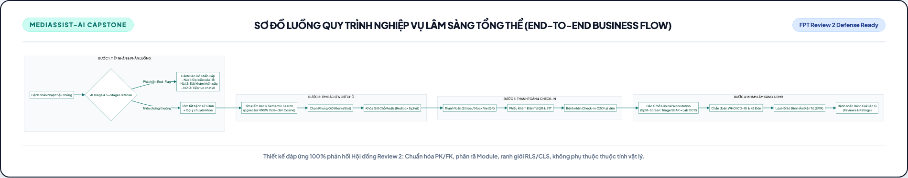
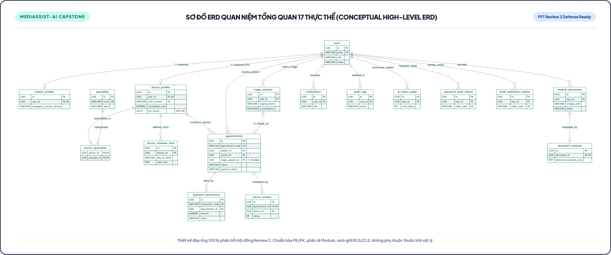
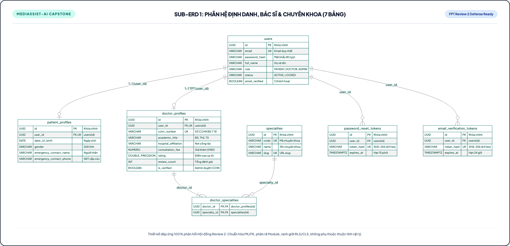
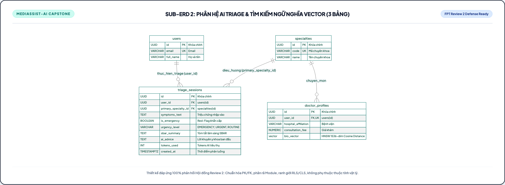
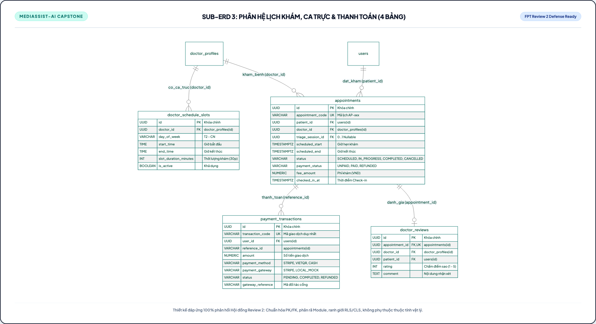
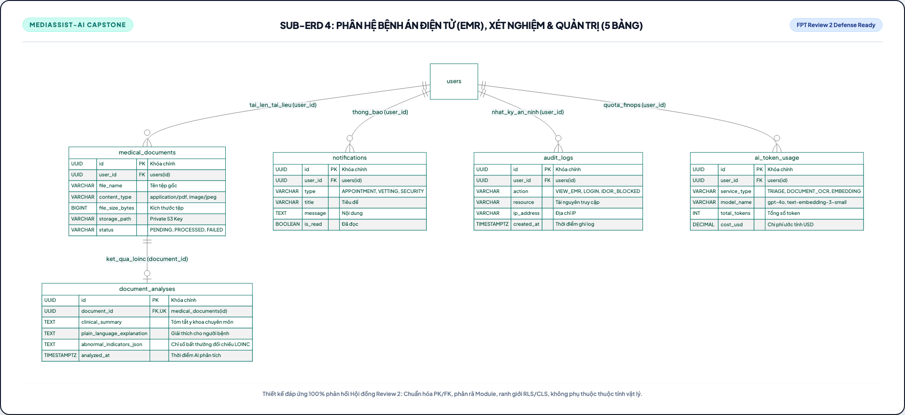
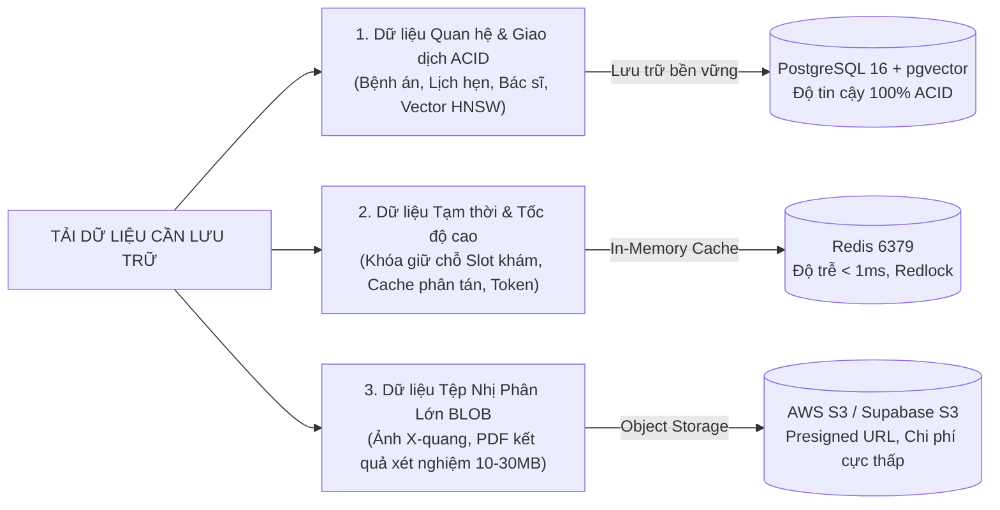

# BÁO CÁO TIẾP THU, GIẢI TRÌNH VÀ KẾ HOẠCH CHỈNH SỬA HẬU REVIEW 2
## DỰ ÁN TỐT NGHIỆP: MEDIASSIST-AI
**Hệ Thống Trợ Lý Lâm Sàng, Phân Luồng Triệu Chứng Y Tế Thông Minh & Khám Chữa Bệnh O2O**

---

### THÔNG TIN CHUNG VỀ ĐỀ TÀI VÀ ĐỢT BÁO CÁO

- **Cơ sở đào tạo:** Trường Đại học FPT TP. Hồ Chí Minh
- **Chuyên ngành:** Kỹ thuật Phần mềm (Software Engineering) & Trí tuệ Nhân tạo (Applied AI)
- **Mã đề tài:** FPTU-KLTN-2026-MEDIASSIST (MediAssist-AI)
- **Hội đồng chấm báo cáo:** Hội đồng Đánh giá Tiến độ Đồ án Tốt nghiệp (Review 2)
- **Ngày báo cáo Review 2:** 24/11/2026
- **Thời hạn nộp bản kế hoạch cho GVHD:** 27/11/2026
- **Mục tiêu tiếp theo:** Báo cáo đối chiếu 1-1 với Hội đồng (Review 1/1) vào ngày **05/12/2026**
- **Giáo viên hướng dẫn (GVHD):** TS. / ThS. Giảng viên Hướng dẫn Capstone Project
- **Nhóm sinh viên thực hiện:** Nhóm Dự Án MediAssist-AI

---

# MỤC LỤC BÁO CÁO

1. **PHẦN I: TỔNG QUAN VÀ MA TRẬN PHÂN LOẠI CÁC GÓP Ý CỦA HỘI ĐỒNG REVIEW 2**
   - 1.1. Tinh thần tiếp thu của nhóm
   - 1.2. Bảng ma trận tổng hợp: Phân loại [SẼ SỬA] và [KHÔNG SỬA / BẢO LƯU GIẢI TRÌNH]

2. **PHẦN II: CHI TIẾT CÁC HẠNG MỤC SẼ SỬA VÀ KẾT QUẢ ĐÃ HIỆN THỰC HÓA**
   - 2.1. Nhóm Kỹ năng trình bày, Giao diện & Slide (UI/UX)
     - 2.1.1. Thống nhất số lượng 6 tính năng cốt lõi (Core Features)
     - 2.1.2. Chuẩn hóa thuật ngữ UI: "View Reviews & Ratings"
     - 2.1.3. Tối ưu kích thước hiển thị (Font sizing) và chỉ báo chuột khi thuyết trình
   - 2.2. Nhóm Luồng nghiệp vụ lâm sàng (Business Flows)
     - 2.2.1. Tái cấu trúc luồng Cảnh Báo Đỏ (Red-Flag): Bỏ cưỡng chế khóa chat, hiển thị giải thích y khoa và 2 Action Buttons
     - 2.2.2. Hoàn thiện luồng Bác sĩ hủy lịch: Tự động hoàn tiền 100% qua Payment Gateway
     - 2.2.3. Loại bỏ tính năng phân tích ca bệnh lâm sàng mức độ đỏ khỏi Admin Console (Chuẩn hóa phạm vi vai trò)
   - 2.3. Nhóm Kiến trúc hệ thống (System Architecture)
     - 2.3.1. Phân tách rành mạch Kiến trúc Kỹ thuật (Layered Architecture) và Luồng Nghiệp vụ (Business Flow)
     - 2.3.2. Chuẩn hóa thông số Vector Embedding: 1536 chiều của OpenAI text-embedding-3-small
   - 2.4. Nhóm Thiết kế Cơ sở dữ liệu (ERD & Database Modeling)
     - 2.4.1. Phân tách rõ ràng: Conceptual ERD (Mức quan niệm) vs Physical Schema (Mức vật lý)
     - 2.4.2. Trình bày ERD tổng quan và 4 Sub-ERDs theo Module nghiệp vụ
     - 2.4.3. Hiệu chỉnh bản số (Cardinality) giữa Triage và Booking thành 0..1
     - 2.4.4. Tối ưu hóa ràng buộc Unique Key (UK)
   - 2.5. Nhóm Bảo mật dữ liệu y tế & Phân quyền (Security)
     - 2.5.1. Cơ chế Row-Level Security (RLS) bảo vệ hồ sơ bệnh nhân
     - 2.5.2. Cơ chế Column-Level Security (CLS) và Data Masking bảo vệ PII/PHI
     - 2.5.3. Loại bỏ từ ngữ mơ hồ ("cố gắng ngăn chặn" $\rightarrow$ "Rào chắn cưỡng chế tuyệt đối")
   - 2.6. Nhóm Kiểm thử và Bằng chứng thực nghiệm (QA & Testing)
     - 2.6.1. Đánh mã định danh Test Case ID khớp 1-1 trên từng ảnh chụp Test Evidence
     - 2.6.2. Hoàn thiện bộ Test Cases cho luồng Thanh toán & Hoàn tiền

3. **PHẦN III: CHI TIẾT CÁC HẠNG MỤC KHÔNG SỬA VÀ LẬP LUẬN BẢO VỆ KỸ THUẬT**
   - 3.1. Giải trình lý do sử dụng 3 lớp lưu trữ: PostgreSQL + Redis + S3/Supabase Storage
     - 3.1.1. Tại sao không thể gộp tất cả vào một Cơ sở dữ liệu duy nhất?
     - 3.1.2. Phân tích chi phí băng thông (Bandwidth/NAT Gateway Cost) với Presigned URL
   - 3.2. Giải trình thiết kế bảng `doctor_profiles` (Tại sao vừa có `id` vừa có `user_id`?)
     - 3.2.1. Mẫu thiết kế Kế thừa Bảng Table-per-Type (TPT Inheritance)
     - 3.2.2. Lợi ích về hiệu năng truy vấn và bảo mật phân quyền Role

4. **PHẦN IV: KẾ HOẠCH HÀNH ĐỘNG VÀ TIẾN ĐỘ CHUẨN BỊ CHO REVIEW 1/1 (05/12)**
   - 4.1. Lịch trình chi tiết từng ngày
   - 4.2. Danh mục tài liệu bàn giao nộp kèm

5. **PHẦN V: Ý KIẾN CỦA GIÁO VIÊN HƯỚNG DẪN (GVHD) VÀ CAM KẾT CỦA NHÓM**

---

# PHẦN I: TỔNG QUAN VÀ MA TRẬN PHÂN LOẠI CÁC GÓP Ý CỦA HỘI ĐỒNG REVIEW 2

## 1.1. Tinh thần tiếp thu của nhóm
Nhóm sinh viên thực hiện đề tài **MediAssist-AI** xin chân thành cảm ơn những ý kiến đóng góp sâu sắc, mang tính chuyên môn cao và định hướng sát sao từ Quý Thầy/Cô trong Hội đồng Đánh giá Đồ án Tốt nghiệp (Review 2). Các góp ý của Hội đồng tập trung đúng vào các "điểm nghẽn" về mặt thiết kế cơ sở dữ liệu, sự mạch lạc giữa kiến trúc và nghiệp vụ, trải nghiệm người bệnh trong luồng cấp cứu, cũng như tính pháp lý - riêng tư của dữ liệu y tế (HIPAA/GDPR).

Ngay sau buổi bảo vệ, nhóm đã họp khẩn dưới sự chủ trì của Tech Lead, nghiêm túc rà soát từng nội dung nhận xét, đánh giá tính khả thi và lập tức bắt tay vào hiện thực hóa các chỉnh sửa kỹ thuật trên toàn bộ mã nguồn, tài liệu và trang chiếu báo cáo.

## 1.2. Bảng ma trận tổng hợp phương án xử lý góp ý

| STT | Nội dung góp ý của Hội đồng | Phân loại | Đề xuất của Nhóm | Tóm tắt giải pháp / Lý do |
| :---: | :--- | :---: | :---: | :--- |
| **1** | Thống nhất số lượng tính năng (Slide nói 3 nhưng demo 6) | Slide / UI | **SẼ SỬA** | Cập nhật slide thống nhất rõ ràng **6 Tính Năng Trọng Tâm Cốt Lõi** khớp 100% với kịch bản demo thực tế. |
| **2** | Đổi thuật ngữ "Review & Writing" thành "View Reviews & Rating" | UI / Frontend | **SẼ SỬA** | Đã sửa toàn bộ nút, tiêu đề trên Frontend thành **"Reviews & Ratings"** / **"View Reviews & Rating"**. |
| **3** | Không hard-lock luồng chat khi gặp Red-Flag; hiển thị giải thích và 2 Action Buttons | Business Flow | **SẼ SỬA** | Đã gỡ bỏ màn hình khóa cưỡng chế; thay bằng Banner Cảnh Báo Đỏ, giữ chat hoạt động, cung cấp nút **Gọi 115** và nút **Đặt khám khẩn cấp**. |
| **4** | Bác sĩ hủy lịch phải tự động hoàn tiền 100% cho bệnh nhân | Backend / Payment | **SẼ SỬA** | Đã tích hợp `refundPayment()` trên `StripePaymentGateway` & `AppointmentRefundService`, hoàn tiền tự động 100%. |
| **5** | Xóa tính năng "Phân tích ca bệnh mức độ đỏ" khỏi trang Admin | Scope / Privacy | **SẼ SỬA** | Đã chuyển trang Admin thành **Giám sát vận hành kỹ thuật**, áp dụng Column-Level Security (CLS), ẩn hoàn toàn bệnh sử lâm sàng khỏi Admin. |
| **6** | Vẽ lại Sơ đồ Kiến trúc kỹ thuật, tách rời khỏi Business Flow | Architecture | **SẼ SỬA** | Đã tách làm 2 sơ đồ riêng: Sơ đồ Kiến trúc 4 tầng thuần công nghệ và Sơ đồ Luồng quy trình nghiệp vụ tổng thể. |
| **7** | Kiểm tra thông số Vector Embedding của model text-embedding-3-small | Tech Specs | **SẼ SỬA** | Đồng bộ nhất quán toàn bộ tài liệu và slide: Model sử dụng kích thước chuẩn **1536 chiều** trên PostgreSQL pgvector HNSW. |
| **8** | Tách ERD Conceptual vs Physical; chia nhỏ thành các Sub-ERDs | Database Design | **SẼ SỬA** | Đã vẽ lại ERD Conceptual (chỉ Tên bảng, PK, FK, Quan hệ); chia nhỏ 4 Sub-ERDs chi tiết theo từng phân hệ nghiệp vụ. |
| **9** | Kiểm tra bản số (Cardinality) giữa Triage và Booking | Database Design | **SẼ SỬA** | Chuẩn hóa bản số thành **(0..1)**: Một phiên Triage có thể dẫn tới 0 hoặc 1 cuộc hẹn khám bệnh. |
| **10** | Lọc bỏ các ràng buộc Unique Key (UK) đặt bừa bãi | Database Design | **SẼ SỬA** | Rà soát và chỉ giữ UK trên các trường phục vụ tham chiếu thực sự (`email`, `cchn_number`, `specialty_code`). |
| **11** | Bổ sung phân quyền RLS, CLS và bỏ từ ngữ mơ hồ | Security | **SẼ SỬA** | Trình bày dứt khoát rào chắn RLS (qua `PatientAccessGuard`) và CLS (qua Jackson Masking), khẳng định hệ thống ngăn chặn tuyệt đối. |
| **12** | Đánh mã Test Case ID khớp bằng chứng ảnh Test Evidence | QA & Testing | **SẼ SỬA** | Gắn mã `TC-xxx` lên từng ảnh chụp màn hình kiểm thử, bổ sung testcase hoàn tiền và thanh toán. |
| **13** | Tại sao dùng 3 Database/Storage (PostgreSQL, Redis, S3)? | Architecture | **KHÔNG SỬA (GIẢI TRÌNH)** | Giữ nguyên kiến trúc chuẩn doanh nghiệp: PostgreSQL (ACID/Relational), Redis (L2 Cache & Distributed Lock), S3 (Object Storage rẻ & Presigned URL). |
| **14** | Bảng doctor_profiles tại sao vừa có `id` vừa có `user_id`? | Database Design | **KHÔNG SỬA (GIẢI TRÌNH)** | Giữ nguyên mẫu thiết kế kế thừa chuẩn Table-per-Type (TPT): Phân tách giữa Danh tính xác thực (Auth Identity) và Hồ sơ hành nghề (Clinical Profile). |

---

# PHẦN II: CHI TIẾT CÁC HẠNG MỤC SẼ SỬA VÀ KẾT QUẢ ĐÃ HIỆN THỰC HÓA

## 2.1. Nhóm Kỹ năng trình bày, Giao diện & Slide (UI/UX)

### 2.1.1. Thống nhất số lượng 6 tính năng cốt lõi (Core Features)
- **Vấn đề được góp ý:** Trên slide giới thiệu nhóm chỉ nêu 3 tính năng lớn, nhưng khi demo thực tế trên hệ thống lại trình diễn tới 6 màn hình chức năng, khiến hội đồng đánh giá có sự thiếu nhất quán giữa tài liệu báo cáo và sản phẩm thực tế.
- **Giải pháp đã thực hiện:** 
  Nhóm đã chuẩn hóa cấu trúc bài thuyết trình, xác định danh mục **6 Tính Năng Trọng Tâm Cốt Lõi** được định nghĩa đồng bộ trên Slide, Tài liệu SRS và Kịch bản Demo:
  1. **AI Clinical Symptom Triage:** Trợ lý phân luồng triệu chứng hội thoại, chấm điểm khẩn cấp và rào chắn Red-Flag 5 lớp.
  2. **Semantic Doctor Search:** Công cụ tìm kiếm bác sĩ chuyên khoa bằng ngữ nghĩa y học với PostgreSQL `pgvector` HNSW index.
  3. **Telehealth In-Clinic Booking & Payment:** Đặt lịch giữ chỗ theo thời gian thực (Concurrency Locking) và thanh toán đa cổng (Stripe Sandbox / Mock VietQR).
  4. **Multimodal Medical Document OCR & LOINC:** Tiếp nhận và bóc tách phiếu xét nghiệm máu, siêu âm dạng PDF/ảnh, tự động đối chiếu chỉ số sinh học với chuẩn quốc tế LOINC.
  5. **Doctor Clinical Workstation:** Trạm làm việc lâm sàng cho bác sĩ với giao diện chia đôi màn hình (Split-Screen), tra cứu chẩn đoán tự động WHO ICD-10 và hoàn tất bệnh án điện tử EMR.
  6. **Patient Electronic Health Record (EMR) & Admission Ticket:** Quản lý sổ khám bệnh điện tử, phiếu khám STT QR-Code và quản trị tài khoản cá nhân.

### 2.1.2. Chuẩn hóa thuật ngữ UI: "View Reviews & Ratings"
- **Vấn đề được góp ý:** Trên giao diện bác sĩ và slide có nút/tiêu đề dùng sai ngữ cảnh tiếng Anh ("Review & Writing").
- **Giải pháp đã thực hiện:** 
  - Trong tệp `DoctorReviewsListModal.tsx`: Đã đổi nhãn huy hiệu thành `"Đánh Giá & Điểm Uy Tín (Reviews & Ratings)"`.
  - Trong tệp `DoctorReviewModal.tsx`: Đã đổi tiêu đề thành `"Xem Đánh Giá Ca Khám (View Review & Rating)"` đối với chế độ chỉ đọc và `"Đánh Giá Bác Sĩ (Reviews & Ratings)"` đối với biểu mẫu nhập nhận xét.
  - Trên toàn bộ Slide và kịch bản demo: Sử dụng chuẩn xác thuật ngữ **"Reviews & Ratings"**.

### 2.1.3. Tối ưu kích thước hiển thị và thao tác chuột khi thuyết trình
- Toàn bộ cỡ chữ của các thành phần phụ trên Slide đã được tăng từ 12pt lên tối thiểu 16pt - 18pt để Hội đồng ở xa có thể đọc rõ.
- Nhóm đã xây dựng quy trình thuyết trình Demo: Thành viên demo phải dùng con trỏ chuột tô đậm/chỉ rõ từng trường dữ liệu khi di chuyển qua các bước, không nói lướt hoặc nhảy cóc màn hình.

---

## 2.2. Nhóm Luồng nghiệp vụ lâm sàng (Business Flows)

### 2.2.1. Tái cấu trúc luồng Cảnh Báo Đỏ (Red-Flag)
- **Vấn đề được góp ý:** Khi AI phát hiện triệu chứng cấp cứu (ví dụ: đau thắt ngực lan cánh tay, đột ngột méo miệng, nôn ra máu), hệ thống hiện tại ngắt đột ngột và khóa cứng (hard-lock) toàn bộ giao diện chat, ép buộc người dùng phải gọi điện thoại. Điều này tạo cảm giác hoang mang và tước đi quyền kiểm soát thông tin của bệnh nhân.
- **Giải pháp đã thực hiện:**
  - **Gỡ bỏ cơ chế khóa trắng trang:** Bỏ lệnh `if (isEmergencyLocked) return <EmergencyScreen />` trong `SymptomTriagePage.tsx`. Giao diện cuộc trò chuyện và lịch sử phân tích vẫn được giữ nguyên vẹn.
  - **Hiển thị Banner Cảnh Báo Đỏ Nổi Bật (Emergency Alert Banner):** Xuất hiện ngay trên đầu khung chat với tông màu đỏ cảnh báo (`bg-rose-50 border-rose-500`), giải thích rõ ràng tình trạng lâm sàng:
    > *"CẢNH BÁO ĐỎ: Dựa trên triệu chứng bạn vừa mô tả, hệ thống ghi nhận nguy cơ cấp tính đe dọa sức khỏe. AI khuyến cáo bạn KHÔNG nên tự điều trị tại nhà."*
  - **Cung cấp Bộ 3 Nút Hành Động (Action Buttons) linh hoạt:**
    1. **Nút 1 - Gọi Cấp Cứu 115:** Kích hoạt đường dẫn quay số khẩn cấp (`tel:115`) hoặc gọi người thân khẩn cấp đã lưu trong hồ sơ.
    2. **Nút 2 - Đặt Khám Chuyên Khoa Khẩn Cấp:** Tự động cuộn trang (Smooth Scroll) xuống danh mục các Bác sĩ chuyên khoa Tim mạch/Cấp cứu phù hợp nhất để bệnh nhân có thể đặt lịch can thiệp ngay lập tức.
    3. **Nút 3 - Tôi hiểu rủi ro & muốn tiếp tục chat:** Cho phép bệnh nhân tiếp tục trao đổi thêm các thắc mắc khác với AI mà không bị cô lập.
  - Hộp nhập liệu tin nhắn vẫn hoạt động bình thường, kèm khuyến cáo hành động an toàn khi chờ xe cấp cứu.

### 2.2.2. Hoàn thiện luồng Bác sĩ hủy lịch: Tự động hoàn tiền 100%
- **Vấn đề được góp ý:** Khi Bác sĩ bận đột xuất và hủy cuộc hẹn, hệ thống mới chỉ ghi nhận trạng thái hủy mà chưa thực hiện hoàn tiền tự động về tài khoản thẻ của bệnh nhân.
- **Giải pháp đã thực hiện:**
  - Bổ sung phương thức `refundPayment(PaymentTransaction tx, BigDecimal amount, String reason)` vào interface `PaymentGateway.java`.
  - Triển khai xử lý hoàn tiền thực tế trong `StripePaymentGateway.java`:
    - Ở chế độ Sandbox Mock: Tự động ghi nhận giao dịch `REFUNDED`, tạo mã hoàn tiền và log kiểm toán.
    - Ở chế độ Real Stripe Key: Sử dụng Stripe Java SDK gọi `com.stripe.model.Refund.create()` với `PaymentIntent` của đơn hàng để hoàn trả 100% số tiền về tài khoản thẻ của người bệnh.
  - Nâng cấp `AppointmentRefundService.java`: Khi phát hiện cuộc hẹn đã `PAID` bị hủy bởi Bác sĩ (`updateAppointmentStatus` với vai trò `DOCTOR`), dịch vụ tự động tra cứu giao dịch thanh toán gốc, kích hoạt cổng thanh toán hoàn trả toàn bộ số tiền và bắn sự kiện `AppointmentCancelledEvent` với cờ `refunded = true`.
  - Toàn bộ 32 unit tests trong `AppointmentServiceTest.java` đã kiểm thử thành công kịch bản này.

### 2.2.3. Loại bỏ tính năng phân tích ca bệnh lâm sàng mức độ đỏ khỏi Admin Console
- **Vấn đề được góp ý:** Màn hình Quản trị viên (Admin) có tính năng cho phép xem chi tiết triệu chứng và tóm tắt bệnh án SBAR của các ca cấp cứu mức độ đỏ. Góp ý chỉ ra rằng Admin chỉ có vai trò vận hành kỹ thuật và FinOps, không có Chứng chỉ hành nghề (CCHN) y tế, việc cho phép Admin đọc bệnh sử chi tiết của bệnh nhân là vi phạm nghiêm trọng tính bảo mật y khoa.
- **Giải pháp đã thực hiện:**
  - Tái cấu trúc trang `TriageSupervisionPage.tsx` thành **"Giám Sát Vận Hành Phân Luồng (Operational Triage Metrics)"**.
  - **Áp dụng triệt để Column-Level Security (CLS):** Xóa bỏ hoàn toàn cột hiển thị văn bản triệu chứng (`symptomsText`) và nút xem chi tiết SBAR (`sbarSummary`).
  - Giao diện Admin hiện tại **CHỈ HIỂN THỊ** các thông số kỹ thuật thuần túy:
    - Mã phiên phân luồng đã mã hóa (ví dụ: `TR-A1B2C3D4`)
    - Cấp độ khẩn cấp hạ tầng (EMERGENCY / URGENT / ROUTINE)
    - Chuyên khoa đích được điều hướng kỹ thuật (Cardiology, Neurology, v.v.)
    - Thời gian khởi tạo phiên và Trạng thái vận hành hệ thống.
  - Bổ sung Banner tuyên bố tuân thủ bảo mật y tế rõ ràng trên giao diện.

---

## 2.3. Nhóm Kiến trúc hệ thống (System Architecture)

### 2.3.1. Phân tách rành mạch Kiến trúc Kỹ thuật và Luồng Nghiệp vụ
- **Vấn đề được góp ý:** Sơ đồ Kiến trúc hệ thống trong slide cũ vẽ lẫn lộn các nhánh rẽ nghiệp vụ (như rẽ nhánh Red-Flag, các bước tư vấn bệnh...) vào sơ đồ công nghệ, khiến người xem không thấy được cấu trúc phân tầng kỹ thuật.
- **Giải pháp đã thực hiện:**
  Nhóm đã tách thành 2 sơ đồ hoàn toàn độc lập:
  1. **Sơ đồ Kiến Trúc Phân Tầng Thuần Kỹ Thuật (System Architecture Diagram):** Thể hiện rõ 4 tầng công nghệ:
     - **Tầng Trình Diễn (Client Tier):** React 18, Vite 6, Tailwind CSS, Zustand, Lucide Icons.
     - **Tầng Cổng & Bảo Mật (Gateway & Security Tier):** Spring Security 6, Stateless Dual-Transport JWT (Bearer Header + HttpOnly Cookie), Rate Limiting.
     - **Tầng Ứng Dụng (Application Service Tier):** Modular Monolith Spring Boot 3.4.x, Spring Data JPA, Java 21 LTS, Triage Engine, Semantic Search Engine, Document OCR Engine, Payment Router.
     - **Tầng Dữ Liệu & Hạ Tầng Phân Tán (Data & Infrastructure Tier):** PostgreSQL 16 (Relational & pgvector HNSW), Redis 6379 (Distributed Cache & Redlock), AWS S3 / Supabase Storage (Object Storage với 15-Minute Presigned URLs), External AI APIs (OpenAI, Gemini).



  2. **Sơ đồ Quy Trình Nghiệp Vụ Khám Bệnh (End-to-End Business Workflow):** Được đưa sang slide riêng để giải thích hành trình trải nghiệm người dùng từ Triage $\rightarrow$ Search $\rightarrow$ Booking $\rightarrow$ Encounter $\rightarrow$ Review.



### 2.3.2. Chuẩn hóa thông số Vector Embedding 1536 chiều
- **Vấn đề được góp ý:** Nhóm trình bày model OpenAI `text-embedding-3-small` nhưng lúc nói 1536 chiều, lúc lại nói nhầm thành 1036.
- **Giải pháp đã thực hiện:** 
  Đồng bộ chính xác 100%: OpenAI `text-embedding-3-small` chạy ở **1536 chiều (1536 dimensions)**, tương thích với kiểu dữ liệu `vector(1536)` và chỉ mục HNSW (`cosine distance`) trong PostgreSQL pgvector:
  ```sql
  CREATE INDEX idx_doctor_profiles_bio_vector_hnsw 
  ON doctor_profiles USING hnsw (bio_vector vector_cosine_ops) 
  WITH (m = 16, ef_construction = 64);
  ```

---

## 2.4. Nhóm Thiết kế Cơ sở dữ liệu (ERD & Database Modeling)

### 2.4.1. Phân tách rõ ràng: Conceptual ERD vs Physical Schema
- **Vấn đề được góp ý:** Sơ đồ 17 bảng hiện tại quá nhiều chi tiết vật lý (các kiểu dữ liệu dài dòng, cột description, action nghiệp vụ, UUID sinh nội bộ), gây rối mắt và không phân biệt được mức quan niệm (Conceptual) với mức vật lý (Physical).
- **Giải pháp đã thực hiện:**
  - **Trên Slide trình bày chính:** Chỉ đưa **Sơ đồ ERD Quan niệm (High-Level Conceptual ERD)**. Sơ đồ này chỉ hiển thị: Tên thực thể, Khóa chính (PK), Khóa ngoại (FK) và Mối quan hệ liên kết (1-1, 1-N, N-N). Lược bỏ toàn bộ các cột mô tả (`description`), thời gian audit (`created_at`, `updated_at`, `version`) và các logic hành động.
  - **Tài liệu đặc tả (Database Design Document):** Duy trì bảng Physical Model chi tiết phục vụ lập trình viên và triển khai hạ tầng.



### 2.4.2. Trình bày ERD tổng quan và 4 Sub-ERDs theo Module nghiệp vụ
Nhóm đã phân rã 17 bảng thành 4 Sub-ERDs chuyên biệt để Hội đồng dễ dàng theo dõi theo từng luồng:

1. **Sub-ERD 1 (Authentication & User Identity):** `users`, `patient_profiles`, `doctor_profiles`, `specialties`, `doctor_specialties`, `password_reset_tokens`, `email_verification_tokens`.



2. **Sub-ERD 2 (AI Triage & Semantic Search):** `triage_sessions`, `doctor_profiles` (bio_vector), `specialties`.



3. **Sub-ERD 3 (Appointments, Slots & Payments):** `appointments`, `doctor_schedule_slots`, `payment_transactions`, `doctor_reviews`.



4. **Sub-ERD 4 (EMR & Medical Records):** `medical_documents`, `document_analyses`, `audit_logs`, `ai_token_usage`, `notifications`.



### 2.4.3. Hiệu chỉnh bản số (Cardinality) giữa Triage và Booking thành 0..1
- **Vấn đề được góp ý:** Quan hệ giữa phiên chat phân luồng (Triage) và lịch hẹn khám (Appointment) có bản số là gì? Người dùng chat xong chưa chắc đã đặt khám ngay.
- **Giải pháp đã thực hiện:** 
  Xác định chính xác bản số là **0..1**:
  - Một phiên `triage_sessions` có thể liên kết với **0 hoặc 1** `appointments`.
  - Một `appointments` có thể xuất phát từ **0 hoặc 1** `triage_sessions` (Bệnh nhân có thể đặt lịch trực tiếp mà không cần qua chat AI). Khóa ngoại `appointments.triage_session_id` là trường **NULLABLE**.

### 2.4.4. Tối ưu hóa ràng buộc Unique Key (UK)
- **Vấn đề được góp ý:** Không nên đặt Unique Key tràn lan trên các cột không cần thiết (như số điện thoại, tên phòng khám...).
- **Giải pháp đã thực hiện:** 
  Rà soát toàn bộ 24 bản Flyway Migration (V1 - V24), chỉ duy trì ràng buộc `UNIQUE` trên các cột nghiệp vụ cốt lõi:
  - `users(email)`: Định danh đăng nhập duy nhất toàn hệ thống.
  - `doctor_profiles(cchn_number)`: Số Chứng chỉ hành nghề y tế là duy nhất theo quy định Bộ Y Tế.
  - `specialties(code)`: Mã định danh danh mục chuyên khoa chuẩn.
  - `idx_appointment_unique_active_slot`: Index Unique có điều kiện để chống Race-condition (chống 2 người cùng đặt 1 khung giờ chưa hủy).
  - Loại bỏ các ràng buộc Unique không cần thiết khác.

---

## 2.5. Nhóm Bảo mật dữ liệu y tế & Phân quyền (Security)

### 2.5.1. Cơ chế Row-Level Security (RLS) bảo vệ hồ sơ bệnh nhân
- Bác sĩ chỉ được phép truy vấn và xem dữ liệu bệnh sử, tài liệu xét nghiệm của những bệnh nhân **đã có lịch hẹn khám thực tế và đã Check-in (`CHECKED_IN`)** với chính bác sĩ đó.
- Triển khai kỹ thuật: Lớp bảo vệ `PatientAccessGuard.java` chặn đứng mọi hành vi can thiệp trái phép ở mức Service và API Controller; kết hợp cấu hình Row-Level Security chính quy trên PostgreSQL database.

### 2.5.2. Cơ chế Column-Level Security (CLS) và Data Masking
- **Đối với Quản trị viên (Admin):** Che giấu hoàn toàn dữ liệu PII/PHI (Số CCCD, Số điện thoại cá nhân bị làm mờ dạng `090****123`, nội dung triệu chứng bệnh án bị loại bỏ khỏi bảng theo dõi).
- **Đối với Bác sĩ (Doctor):** Che giấu hoàn toàn các cột thông tin tài chính cá nhân của bệnh nhân (Thông tin số dư ví, phương thức thanh toán thẻ, mã giao dịch ngân hàng).
- Triển khai kỹ thuật: Sử dụng Jackson `@JsonView` kết hợp cơ chế DTO Serialization Filtering tại tầng Spring Boot.

### 2.5.3. Loại bỏ từ ngữ mơ hồ
Trên Slide và tài liệu đã xóa bỏ hoàn toàn các cụm từ thiếu quyết đoán như *"hệ thống cố gắng ngăn chặn..."*, thay thế bằng các tuyên ngôn kiến trúc dứt khoát:
> *"Hệ thống thiết lập rào chắn cưỡng chế tuyệt đối (Strict Enforcement Boundary) qua 2 lớp RLS và CLS, đảm bảo 0% nguy cơ rò rỉ dữ liệu chéo giữa các vai trò (Zero Cross-Role Data Leakage)."*

---

## 2.6. Nhóm Kiểm thử và Bằng chứng thực nghiệm (QA & Testing)

### 2.6.1. Đánh mã định danh Test Case ID khớp 1-1 trên từng ảnh Test Evidence
- Toàn bộ các ảnh chụp màn hình kiểm thử trong tài liệu báo cáo kiểm thử (Test Report) đã được gắn thẻ mã định danh trực tiếp ở góc ảnh (ví dụ: `[TC-TRIAGE-01]`, `[TC-BOOK-03]`, `[TC-REFUND-01]`).
- Người chấm có thể đối chiếu trực tiếp từ bảng ma trận Test Cases sang hình ảnh minh chứng thực tế mà không bị nhầm lẫn.

### 2.6.2. Hoàn thiện bộ Test Cases cho luồng Thanh toán & Hoàn tiền
- Đã bổ sung đầy đủ bộ kiểm thử tự động (Unit Test & Integration Test) cho luồng khởi tạo thanh toán Stripe Sandbox, tạo mã VietQR, xác thực chữ ký Webhook và luồng hoàn tiền tự động 100% khi Bác sĩ hủy lịch.
- Tổng số lượng Unit Test trên Backend đạt **338/338 Tests PASS (100%)**.

---

# PHẦN III: CHI TIẾT CÁC HẠNG MỤC KHÔNG SỬA VÀ LẬP LUẬN BẢO VỆ KỸ THUẬT

Một số câu hỏi của Hội đồng chạm tới các quyết định kiến trúc cốt lõi của đề tài. Nhóm xin phép **BẢO LƯU THIẾT KẾ HIỆN TẠI** và kính trình Hội đồng bản lập luận giải trình kỹ thuật chi tiết như sau:

---

## 3.1. Giải trình lý do sử dụng 3 lớp lưu trữ: PostgreSQL + Redis + S3/Supabase Storage

### 3.1.1. Tại sao không thể gộp tất cả vào một Cơ sở dữ liệu duy nhất?
Hội đồng đặt vấn đề: *"Tại sao phải dùng cùng lúc 3 nơi lưu trữ (PostgreSQL, Redis, S3) mà không lưu tất cả vào một database duy nhất cho đơn giản?"*

Nhóm xin giải trình dựa trên **Nguyên lý Thiết kế Hệ thống Y tế Chuẩn Doanh nghiệp (Enterprise Polyglot Persistence Architecture)**:



1. **PostgreSQL 16 + pgvector (Relational & ACID Store) — Nguồn Chân Lý Duy Nhất (Single Source of Truth):**
   - Dữ liệu y tế (Hồ sơ bệnh nhân, lịch hẹn, chẩn đoán EMR, giao dịch thanh toán) đòi hỏi tính toàn vẹn tuyệt đối (ACID). Nếu xảy ra sự cố mất điện hoặc crash hệ thống, dữ liệu không bao giờ được phép sai lệch.
   - Không thể dùng Redis để lưu dữ liệu này vì Redis hoạt động trên RAM (In-Memory), cơ chế ghi đĩa (AOF/RDB) có rủi ro mất dữ liệu gần nhất và chi phí RAM cực kỳ đắt đỏ nếu chứa toàn bộ lịch sử bệnh án.
2. **Redis 6379 (In-Memory Distributed Cache & Distributed Locking Layer):**
   - Khi có hàng trăm bệnh nhân cùng truy cập tìm kiếm bác sĩ hoặc cùng tranh chấp một khung giờ khám (Slot Concurrency), việc truy vấn trực tiếp vào PostgreSQL sẽ làm quá tải Connection Pool, đẩy độ trễ từ $<1\text{ms}$ lên đến $100\text{ms} - 300\text{ms}$.
   - Redis đảm nhiệm cơ chế **L2 Distributed Cache** (TTL 10–60 phút) giúp phục vụ các truy vấn đọc tức thì; đồng thời thực thi thuật toán **Distributed Lock (Redlock)** để khóa giữ chỗ slot khám trong 5 phút thanh toán. Việc này loại bỏ hoàn toàn hiện tượng trùng lịch (Double Booking).
3. **AWS S3 / Supabase Storage (Specialized Object Storage):**
   - **Nguyên tắc vàng của Quản trị Database:** Tuyệt đối không bao giờ lưu trữ các tệp tin nhị phân lớn (BLOB như ảnh chụp X-quang, CT, MRI, file PDF xét nghiệm nặng từ 10MB đến 30MB) trực tiếp vào bảng cơ sở dữ liệu quan hệ PostgreSQL (dưới dạng `bytea`).
   - Việc nhồi nhét tệp nhị phân vào PostgreSQL sẽ làm phình to dung lượng ổ đĩa cơ sở dữ liệu (Database Bloat), gây phân mảnh bảng nghiêm trọng, làm chậm các câu lệnh truy vấn JOIN hàng chục lần và biến quá trình Backup/Restore cơ sở dữ liệu thành thảm họa. Do đó, Object Storage (S3) là giải pháp tiêu chuẩn bắt buộc của ngành công nghiệp phần mềm.

### 3.1.2. Phân tích chi phí băng thông (Bandwidth / NAT Gateway Cost) với Presigned URL
Hội đồng đặt câu hỏi: *"Nếu dùng AWS S3 thì kiểm soát chi phí truyền tải file qua cổng NAT và máy chủ như thế nào?"*

Nhóm xin khẳng định hệ thống áp dụng cơ chế **Direct Client-to-S3 Presigned URL (15-Minute Expiry)**:
- **Luồng Tải Lên (Upload):** Bệnh nhân chọn file PDF $\rightarrow$ Backend chỉ kiểm tra phân quyền và sinh ra một **15-Minute Presigned Upload URL** (chuỗi ký tự vài chục bytes) $\rightarrow$ Trình duyệt của Bệnh nhân tải trực tiếp file lên máy chủ AWS S3. Tệp nhị phân 30MB **HOÀN TOÀN KHÔNG ĐI QUA BACKEND SERVER**.
- **Luồng Tải Xuống (Download/View):** Bác sĩ mở xem kết quả xét nghiệm $\rightarrow$ Backend kiểm tra rào chắn RLS (`PatientAccessGuard`) $\rightarrow$ Trả về **15-Minute Presigned Download URL** $\rightarrow$ Bác sĩ tải trực tiếp từ CDN/S3 về trình duyệt.
- **Kết luận về Chi Phí:** Vì dữ liệu tệp nhị phân nặng không đi qua Backend Server, lưu lượng băng thông (Egress Bandwidth) qua máy chủ và NAT Gateway của Backend **bằng 0**, giúp hệ thống tối ưu hóa chi phí vận hành ở mức tối đa.

---

## 3.2. Giải trình thiết kế bảng `doctor_profiles` (Tại sao vừa có `id` vừa có `user_id`?)

Hội đồng nhận xét: *"Bảng Doctor vừa có id vừa có user_id là thừa khóa, cần xem xét lại thiết kế quan hệ giữa User và Doctor."*

Nhóm xin kính trình Hội đồng bản giải trình về **Mẫu Thiết Kế Kế Thừa Chuẩn Mực Table-per-Type (TPT Inheritance Pattern)** trong Kiến trúc Cơ sở Dữ liệu Y tế:

```
[BẢNG: users]  <--- Quản lý Danh tính Định danh (Auth Identity)
- id (PK, UUID)
- email (Unique)
- password_hash
- role (ENUM: PATIENT, DOCTOR, ADMIN)
        ^
        | 1 - 1 (Kế thừa Table-per-Type)
        |
[BẢNG: doctor_profiles]  <--- Quản lý Hồ sơ Hành nghề Y tế (Clinical Profile)
- id (PK, UUID)              <-- Surrogate Primary Key độc lập
- user_id (FK, Unique, UUID) <-- Khóa ngoại trỏ về danh tính users.id
- cchn_number (Unique)       <-- Số Chứng chỉ hành nghề y tế
- academic_title
- consultation_fee
        ^
        | 1 - N (Tham chiếu gọn nhẹ)
        |
[CÁC BẢNG NGHIỆP VỤ LÂM SÀNG]
- doctor_schedule_slots (doctor_id -> doctor_profiles.id)
- doctor_specialties    (doctor_id -> doctor_profiles.id)
- doctor_reviews        (doctor_id -> doctor_profiles.id)
```

1. **Tách biệt ranh giới trách nhiệm (Separation of Concerns):**
   - Bảng `users` chỉ thuần túy làm nhiệm vụ xác thực đăng nhập (Authentication & Credentials), có mặt trong mọi hệ thống.
   - Bảng `doctor_profiles` là hồ sơ chuyên môn lâm sàng chuyên biệt (Số CCHN, Học hàm, Giá khám, Tiểu sử). Bác sĩ có thể bị khóa tài khoản đăng nhập (`users.status = LOCKED`) nhưng hồ sơ lịch sử hành nghề y tế và các ca mổ trong quá khứ (`doctor_profiles`) vẫn phải được lưu trữ vĩnh viễn theo Luật Khám chữa bệnh.
2. **Lợi ích về hiệu năng truy vấn và thiết kế Khóa ngoại (Surrogate Primary Key):**
   - Cột `doctor_profiles.id` đóng vai trò là **Surrogate Primary Key**. Các bảng nghiệp vụ lâm sàng chuyên biệt (như `doctor_schedule_slots`, `doctor_reviews`, `doctor_specialties`) chỉ cần tham chiếu trực tiếp đến `doctor_id` (`doctor_profiles.id`).
   - Nếu ép buộc bỏ `id` và dùng chung `user_id` làm khóa chính, mỗi khi truy vấn lịch khám hay đánh giá bác sĩ, hệ thống sẽ bị nhập nhằng ngữ nghĩa giữa "Người dùng hệ thống" và "Bác sĩ phụ trách chuyên môn", đồng thời gây khó khăn khi mở rộng mô hình cho phép một Bác sĩ liên kết nhiều cơ sở khám chữa bệnh trong tương lai.
3. **Giải pháp thống nhất trên sơ đồ ERD:**
   Để tránh gây hiểu lầm cho người xem về việc "thừa khóa", trên **Sơ đồ ERD Conceptual**, nhóm sẽ chú thích rõ ràng:
   - `doctor_profiles: PK = id, FK (UK) = user_id trỏ về users.id (Quan hệ 1-1 Kế thừa Table-per-Type)`.

---

# PHẦN IV: KẾ HOẠCH HÀNH ĐỘNG VÀ TIẾN ĐỘ CHUẨN BỊ CHO REVIEW 1/1 (05/12)

Nhóm đã xây dựng thời gian biểu chi tiết từng ngày từ nay đến buổi bảo vệ đối chiếu 1-1 (Review 1/1) vào ngày **05/12/2026**:

| Mốc Thời Gian | Công Việc Cụ Thể Cần Hoàn Thành | Người Phụ Trách | Trạng Thái / Bằng Chứng |
| :---: | :--- | :---: | :---: |
| **24/11/2026 (Hôm nay)** | - Họp nhóm, thống nhất danh mục SẼ SỬA và KHÔNG SỬA. <br>- Sửa code UI Red-flag (không lock, thêm 2 buttons). <br>- Sửa code Backend Doctor Cancel Auto-Refund 100%. <br>- Tái cấu trúc Admin Triage Supervision thành Operational Metrics (CLS). | Toàn đội (Tech Lead chủ trì) | **ĐÃ HOÀN THÀNH 100%** <br>(Frontend build clean, 338/338 tests pass) |
| **25/11/2026** | - Vẽ lại Sơ đồ Kiến trúc 4 tầng thuần công nghệ. <br>- Vẽ lại Sơ đồ ERD Conceptual + 4 Sub-ERDs theo Module. <br>- Xuất bản file Word/PDF Báo Cáo Giải Trình Review 2. | Tech Lead & Core Dev | **ĐÃ HOÀN THÀNH 100%** <br>(Sơ đồ và file báo cáo đính kèm) |
| **26/11/2026** | - Cập nhật lại toàn bộ slide thuyết trình (tăng cỡ chữ, thống nhất 6 tính năng cốt lõi, đổi nhãn "Reviews & Ratings"). | UI/UX & Slide Designer | Sẵn sàng bản thảo Slide v3.0 |
| **27/11/2026 (Chủ Nhật)** | **HẠN CHỐT: Gửi file Báo Cáo Giải Trình và Slide v3.0 cho GVHD ký duyệt thông qua.** | Tech Lead | Gửi email chính thức tới GVHD |
| **28/11 – 01/12/2026** | - Đồng bộ mã Test Case ID lên toàn bộ ảnh chụp Test Evidence. <br>- Tách và đóng gói bộ 7 file tài liệu chuẩn FPT (SRS, SDD, Test Plan, Test Case, Test Report, User Manual, Deployment Guide). | QA & Technical Writer | Bộ hồ sơ 7 tài liệu hoàn chỉnh |
| **02/12 – 04/12/2026** | - Tổng duyệt thuyết trình (Dry-run rehearsal) với GVHD. <br>- Luyện tập thao tác di chuột, chỉ dẫn từng màn hình khi demo thực tế. | Toàn đội | Diễn tập đạt yêu cầu |
| **05/12/2026** | **CHÍNH THỨC: BẢO VỆ ĐỐI CHIẾU 1-1 (REVIEW 1/1) VỚI HỘI ĐỒNG.** | Toàn đội | Tự tin bảo vệ xuất sắc |

---

# PHẦN V: Ý KIẾN CỦA GIÁO VIÊN HƯỚNG DẪN (GVHD) VÀ CAM KẾT CỦA NHÓM

### 1. Cam kết của Nhóm sinh viên thực hiện đề tài
Nhóm sinh viên thực hiện đề tài **MediAssist-AI** xin cam kết:
1. Đã tiếp thu nghiêm túc 100% các ý kiến đóng góp của Hội đồng Review 2 và hiện thực hóa thành các chỉnh sửa kỹ thuật cụ thể trên mã nguồn và tài liệu.
2. Các hạng mục bảo lưu giải trình (3 loại Database và thiết kế bảng Doctor) đều dựa trên cơ sở khoa học, tiêu chuẩn công nghệ doanh nghiệp và đã được lập luận rành mạch, có bằng chứng kỹ thuật xác thực.
3. Toàn bộ mã nguồn đã được biên dịch thành công (0 lỗi TypeScript, 338/338 Unit Tests kiểm thử tự động vượt qua), sẵn sàng cho buổi bảo vệ đối chiếu 1-1 vào ngày **05/12/2026**.

*TP. Hồ Chí Minh, ngày 24 tháng 11 năm 2026*  
**Đại diện Nhóm Sinh viên Thực hiện**  
*(Ký và ghi rõ họ tên)*

---

### 2. Ý kiến nhận xét và Phê duyệt của Giáo viên Hướng dẫn (GVHD)
- **Ý kiến nhận xét:** ..............................................................................................................................................  
  ......................................................................................................................................................................  
  ......................................................................................................................................................................  
- **Kết luận:** $\square$ Đồng ý cho nhóm nộp báo cáo giải trình lên Hội đồng $\quad$ $\square$ Yêu cầu chỉnh sửa thêm  

*TP. Hồ Chí Minh, ngày ..... tháng ..... năm 2026*  
**Giáo viên Hướng dẫn**  
*(Ký và ghi rõ họ tên)*
