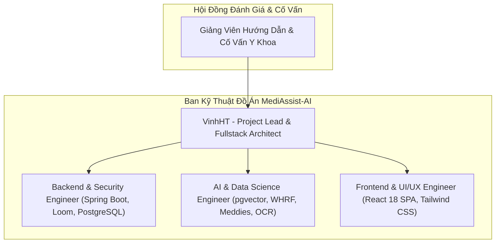
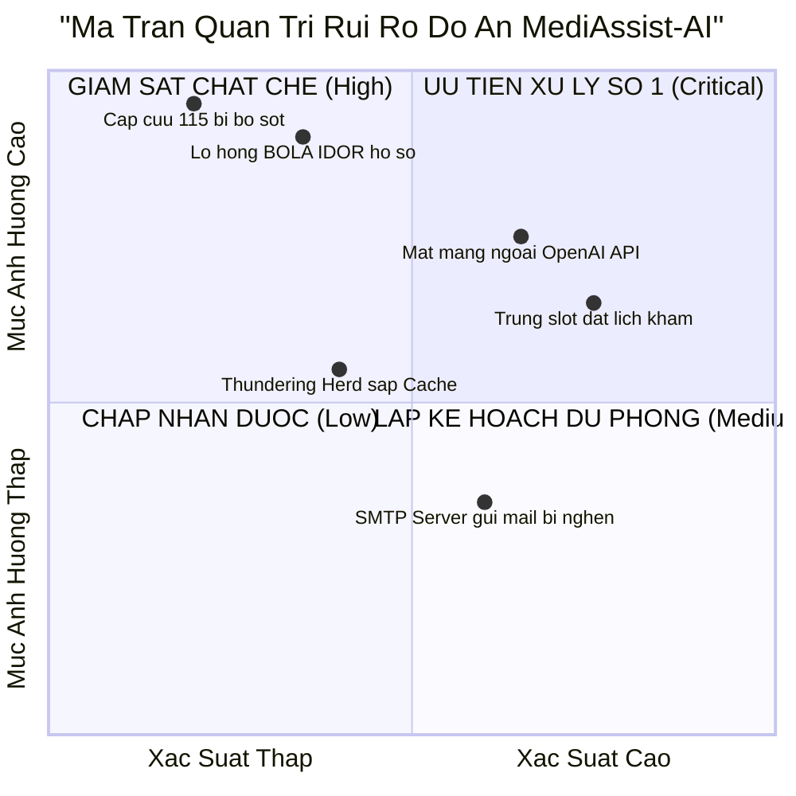

# CAPSTONE PROJECT REPORT
# Report 1 – Project Charter & Management Plan

---

### **HỆ THỐNG TRỢ LÝ Y TẾ ẢO HỖ TRỢ ĐẶT LỊCH & PHÂN LUỒNG KHÁM BỆNH THÔNG MINH (MEDIASSIST-AI)**

* **Tên dự án:** MediAssist-AI: Intelligent Healthcare Assistant & Clinical Telehealth Platform
* **Mã dự án (Capstone Project ID):** FPTU-KLTN-2026-MEDIASSIST
* **Khóa luận:** Khóa luận Tốt nghiệp Đại học FPT – Chuyên ngành Kỹ thuật Phần mềm & Trí tuệ Nhân tạo (SE-AI)
* **Thời gian thực hiện:** Tháng 05/2026 – Tháng 10/2026
* **Địa điểm:** Quy Nhon / Da Nang – October 2026
* **Tiêu chuẩn quản lý dự án:** PMBOK 7th Edition (Project Management Body of Knowledge) & Agile/Scrum Framework

---

## Table of Contents

* [I. Record of Changes](#i-record-of-changes)
* [II. Project Charter & Management Plan](#ii-project-charter--management-plan)
  * [1. Project Overview & Business Case](#1-project-overview--business-case)
    * [1.1 Problem Statement & Healthcare Background](#11-problem-statement--healthcare-background)
    * [1.2 Project Vision & Core Value Proposition](#12-project-vision--core-value-proposition)
    * [1.3 Project Scope & Deliverables](#13-project-scope--deliverables)
    * [1.4 Success Criteria & Definition of Done (DoD)](#14-success-criteria--definition-of-done-dod)
  * [2. Project Organization & Governance](#2-project-organization--governance)
    * [2.1 Team Structure & Human Resource Plan](#21-team-structure--human-resource-plan)
    * [2.2 RACI Responsibility Assignment Matrix](#22-raci-responsibility-assignment-matrix)
    * [2.3 Communication & Engineering Collaboration Protocols](#23-communication--engineering-collaboration-protocols)
  * [3. Work Breakdown Structure (WBS) & Milestone Schedule](#3-work-breakdown-structure-wbs--milestone-schedule)
    * [3.1 Work Breakdown Structure (WBS) Decomposition](#31-work-breakdown-structure-wbs-decomposition)
    * [3.2 7 Sprint Milestones Roadmap (M1 – M7)](#32-7-sprint-milestones-roadmap-m1--m7)
    * [3.3 Cloud Resource & FinOps Budget Planning](#33-cloud-resource--finops-budget-planning)
  * [4. Risk Management & Mitigation Strategy](#4-risk-management--mitigation-strategy)
    * [4.1 Risk Assessment Matrix](#41-risk-assessment-matrix)
    * [4.2 Clinical & Healthcare Ethical Risks](#42-clinical--healthcare-ethical-risks)
    * [4.3 Data Security & Regulatory Compliance Risks](#43-data-security--regulatory-compliance-risks)
    * [4.4 Technical & Operational Resilience Risks](#44-technical--operational-resilience-risks)
  * [5. Quality Assurance & Engineering Standards](#5-quality-assurance--engineering-standards)
    * [5.1 Quality Metrics & Test Policy](#51-quality-metrics--test-policy)
    * [5.2 Code Review Gates & Security Auditing](#52-code-review-gates--security-auditing)
    * [5.3 Continuous Integration / Continuous Deployment (CI/CD)](#53-continuous-integration--continuous-deployment-cicd)

---

## I. Record of Changes

| Date | A / M / D (*) | In Charge | Change Description |
| :--- | :---: | :--- | :--- |
| **15/05/2026** | A | VinhHT | Khởi tạo Project Charter, xác định bài toán thực tế, mục tiêu dự án, phạm vi hệ thống và phân bổ nhân sự ban đầu. |
| **01/06/2026** | A | VinhHT | Thiết lập cấu trúc phân rã công việc Work Breakdown Structure (WBS) và ma trận trách nhiệm RACI cho 7 Milestones. |
| **15/07/2026** | M | VinhHT | Cập nhật kế hoạch quản trị rủi ro kỹ thuật: Tích hợp phương án dự phòng ngoại tuyến Unsupervised Feature Hashing khi mạng ngoài gặp sự cố. |
| **15/08/2026** | M | VinhHT | Bổ sung kế hoạch tuân thủ pháp lý y tế theo Nghị định 13/2023/NĐ-CP và Thông tư 46/2018/TT-BYT vào tiêu chuẩn Definition of Done (DoD). |
| **18/10/2026** | M | VinhHT | Hoàn thiện toàn diện Báo cáo Khởi động và Kế hoạch Dự án Report 1 phục vụ bảo vệ Khóa luận Tốt nghiệp, đồng bộ hóa 100% với hiện trạng thực tế hệ thống. |

*(*) Ghi chú: **A** - Added (Thêm mới), **M** - Modified (Chỉnh sửa/Cập nhật), **D** - Deleted (Xóa).*

---

## II. Project Charter & Management Plan

### 1. Project Overview & Business Case

#### 1.1 Problem Statement & Healthcare Background
Ngành y tế Việt Nam đang đối mặt với những thách thức nghiêm trọng về phân bổ nguồn lực và chất lượng tiếp cận dịch vụ chăm sóc sức khỏe:
1. **Quá tải bệnh viện tuyến trên trầm trọng:** Bệnh viện tuyến Trung ương và thành phố lớn luôn trong tình trạng quá tải $150\% - 200\%$ công suất giường bệnh, trong khi $40\% - 60\%$ lượt khám ban đầu hoàn toàn có thể được tư vấn, phân luồng hoặc giải quyết hiệu quả tại tuyến y tế cơ sở hoặc từ xa.
2. **Hiện tượng định tuyến sai chuyên khoa (Misdirected Healthcare Seeking):** Người bệnh thường tự chẩn đoán qua thông tin tìm kiếm không có kiểm chứng trên mạng xã hội, dẫn đến việc đăng ký nhầm chuyên khoa (ví dụ: đau ngực do trào ngược dạ dày nhưng lại đăng ký khám Tim mạch can thiệp), gây lãng phí thời gian, viện phí và tạo nút thắt cổ chai tại các phòng khám chuyên khoa sâu.
3. **Hiện tượng mù thông tin xét nghiệm (Medical Literacy Gap):** Người bệnh sau khi nhận kết quả xét nghiệm hóa sinh, cận lâm sàng thường hoang mang, không hiểu ý nghĩa của các chỉ số viết tắt (như SGOT, SGPT, HbA1c, eGFR), dẫn đến tâm lý lo âu thái quá hoặc ngược lại là chủ quan bỏ qua các dấu hiệu bệnh lý mạn tính nguy hiểm.
4. **Rủi ro rò rỉ dữ liệu sức khỏe cá nhân:** Hồ sơ y tế điện tử chứa thông tin nhạy cảm bậc nhất nhưng nhiều hệ thống y tế hiện nay còn lỏng lẻo trong việc bảo vệ dữ liệu, vi phạm nghiêm trọng **Nghị định 13/2023/NĐ-CP** và tiêu chuẩn bảo mật y tế quốc tế **HIPAA**.

#### 1.2 Project Vision & Core Value Proposition
**MediAssist-AI** được định vị là **Nền tảng Trợ lý Y tế Ảo Toàn Diện & Khám Bệnh Từ Xa Thông Minh**, đóng vai trò là "Bộ lọc thông minh" (Intelligent Triage & Routing Gateway) kết nối người bệnh với mạng lưới bác sĩ chuyên khoa:

```mermaid
graph LR
    subgraph Patient_Pain["Nỗi Đau Người Bệnh"]
        P1["Hoang mang triệu chứng"]
        P2["Không hiểu kết quả xét nghiệm"]
        P3["Đăng ký nhầm chuyên khoa"]
    end

    subgraph Core_Value["Giải Pháp Đột Phá MediAssist-AI"]
        V1["Phân Luồng Lâm Sàng 5 Tầng + Rào Chắn 115"]
        V2["Giải Nghĩa Xét Nghiệm Đa Phương Thức OCR + LOINC"]
        V3["Tìm Kiếm Bác Sĩ Ngữ Nghĩa HNSW + WHRF-SOTA"]
    end

    subgraph Outcome["Giá Trị Đạt Được"]
        O1["Cắt giảm 60% thời gian chờ đợi"]
        O2["Định tuyến chính xác chuyên khoa"]
        O3["Bảo vệ dữ liệu y tế theo Nghị định 13"]
    end

    Patient_Pain --> Core_Value
    Core_Value --> Outcome
```

* **Giá trị cốt lõi 1 - Phân luồng lâm sàng an toàn:** Động cơ 5 tầng tích hợp rào chắn cấp cứu 115, chuẩn hóa tiếng lóng, và thuật toán **Vietnamese NegEx** cách ly mệnh đề phủ định ("không sốt", "chưa từng đau tim"), triệt tiêu 100% rủi ro điều phối sai.
* **Giá trị cốt lõi 2 - Động cơ tìm kiếm bác sĩ ngữ nghĩa (Semantic Doctor Matching):** Khai thác không gian vector 1536 chiều trên đồ thị **PostgreSQL 16 pgvector HNSW** kết hợp thuật toán tái xếp hạng **WHRF-SOTA** (Sigmoid Contrastive Sharpening & Credibility Damper), giải quyết triệt để vấn đề lệch ngữ nghĩa giữa bệnh nhân và hồ sơ bác sĩ.
* **Giá trị cốt lõi 3 - Giải nghĩa cận lâm sàng đa phương thức (Multimodal OCR):** Nhận diện hình ảnh phiếu xét nghiệm qua Gemini 1.5 Flash Vision, tự động khử định danh PII (Masking) và đối soát chuẩn quốc tế **LOINC** (QĐ 3280/QĐ-BYT).
* **Giá trị cốt lõi 4 - An toàn y tế & Pháp lý bảo mật:** Rào chắn phân quyền đối tượng **`PatientAccessGuard`** chống leo quyền BOLA/IDOR, lưu trữ tài liệu riêng tư trên Supabase S3 với **URL ký số HMAC-SHA256 15 phút**, và băm một chiều SHA-256 cho toàn bộ token bảo mật.

#### 1.3 Project Scope & Deliverables

##### Table 1.3: Project Scope Boundary Matrix

| Phân Vùng Nghiệp Vụ | Trong Phạm Vi Dự Án (In-Scope) | Ngoài Phạm Vi Dự Án (Out-of-Scope) |
| :--- | :--- | :--- |
| **Phân luồng triệu chứng** | - Tiếp nhận văn bản mô tả triệu chứng tự nhiên bằng tiếng Việt. - Phát hiện dấu hiệu cấp cứu tối khẩn (Stroke FAST, Nhồi máu cơ tim, Sốc phản vệ). - Tóm tắt cấu trúc y khoa chuẩn SBAR. - Gợi ý chuyên khoa lâm sàng phù hợp. | - Không đưa ra phác đồ điều trị cuối cùng thay thế bác sĩ. - Không kê đơn thuốc độc quyền trong luồng phân luồng nặc danh. |
| **Tìm kiếm bác sĩ** | - Tìm kiếm ngữ nghĩa đa tiêu chí qua vector HNSW. - Bộ lọc kết hợp: Chuyên khoa, giá khám, học vị, đánh giá sao. - Thuật toán WHRF-SOTA làm sắc nét Sigmoid và giảm chấn gian lận. - Cơ chế dự phòng ngoại tuyến Unsupervised Feature Hashing. | - Không cung cấp dịch vụ điều xe cấp cứu bệnh viện thực địa. - Không bán vé máy bay, dịch vụ du lịch y tế. |
| **Đặt lịch & Bàn làm việc** | - Đặt lịch hẹn khám từ xa hoặc trực tiếp (Slot 30 phút). - Khóa phân tán Redis Semaphore chống trùng slot (`SLOT_CONFLICT`). - Cấp số thứ tự tiếp đón hàng ngày `STT xx`. - Dời lịch, hủy lịch và hoàn tiền tự động phân tầng (100%, 80%, 0%). - Bàn làm việc bác sĩ số hóa với danh mục WHO ICD-10 và LOINC. - Điểm danh tiếp đón người bệnh (`checked_in_at`). | - Không quản lý hồ sơ kho dược phẩm cấp bệnh viện. - Không quản lý giường bệnh nội trú thực địa. |
| **Hồ sơ xét nghiệm OCR** | - Tải lên tệp PDF/ảnh phiếu xét nghiệm (tối đa 5 tệp, 10MB/tệp). - Khử định danh PII tự động theo Nghị định 13/2023/NĐ-CP. - Bóc tách chỉ số bất thường chuẩn LOINC. - Cấp URL ký số HMAC-SHA256 có hạn 15 phút. | - Không kết nối trực tiếp giao thức máy xét nghiệm phần cứng (HL7/LIS). |
| **Thanh toán viện phí** | - Tích hợp cổng thanh toán quốc gia VNPay (HMAC-SHA512). - Xử lý Webhook IPN thời gian thực với khóa chống lặp Idempotency. - Tự động hoàn tiền qua VNPay Refund API. | - Không phát hành ví điện tử nội bộ không có giấy phép NHNN. |
| **Nền tảng kỹ thuật** | - Single Page Application React 18 SPA (TypeScript, Tailwind CSS). - Backend Spring Boot 3.4 trên Java 21 LTS Project Loom Virtual Threads. - PostgreSQL 16 + pgvector (0.7+) với 22 bản di trú Flyway V1 – V22. - Nginx Edge Gateway (TLS 1.3, Rate Limiting 100 req/min). - Bộ kiểm thử tự động 306/306 tests. | - Ứng dụng di động Native iOS/Android (Tập trung tối ưu Responsive Web SPA). |

#### 1.4 Success Criteria & Definition of Done (DoD)
Dự án được nghiệm thu hoàn thành khi và chỉ khi thỏa mãn đồng thời 6 tiêu chí kỹ thuật chuẩn Definition of Done (DoD):
1. **Tiêu chuẩn Kiến trúc & Mã nguồn:** 100% mã nguồn Backend viết bằng Java 21 LTS (Project Loom), đạt chuẩn Clean Layered Architecture; 100% mã nguồn Frontend viết bằng TypeScript ở chế độ strict mode, 0 lỗi biên dịch.
2. **Tiêu chuẩn Kiểm thử tự động:** Bộ kiểm thử tự động đạt tỷ lệ thành công tuyệt đối **`306 / 306` Tests PASS 100%** (0 Failure, 0 Error); kiểm thử giao diện khép kín E2E Playwright vượt qua hoàn toàn.
3. **Tiêu chuẩn Chịu tải cao (Load Testing):** Kịch bản kiểm thử tải k6 với **500 Virtual Users đồng thời** đạt tỷ lệ lỗi **0.00%**, thông lượng $> 500\text{ req/s}$, và độ trễ P95 $< 20\text{ms}$.
4. **Tiêu chuẩn Độ chính xác AI & Khoa học dữ liệu:** Thực nghiệm trên tập dữ liệu Meddies 150.000 ca bệnh đạt **Top-1 Accuracy $\ge 20\%$** ($23.2\%$ thực tế), **Recall@3 $\ge 30\%$** ($33.0\%$ thực tế), độ trễ quét đồ thị HNSW $< 1\text{ms}$ ($0.72\text{ms}$ thực tế).
5. **Tiêu chuẩn An toàn y tế & Bảo mật dữ liệu:** 100% dấu hiệu cấp cứu 115 được phát hiện tức thời; 0 lỗ hổng BOLA/IDOR tồn tại; 100% thông tin PII được che giấu theo Nghị định 13/2023/NĐ-CP; tài liệu y tế lưu trữ riêng tư trên S3 với URL ký số 15 phút.
6. **Tiêu chuẩn Hệ sinh thái Tài liệu Capstone:** Hoàn thiện trọn vẹn bộ 5 báo cáo khóa luận: Report 1 (Project Charter & Plan), Report 2 (Requirements Analysis), Report 3 (SRS IEEE 830), Report 4 (SDD IEEE 1016), Report 5 (Test Report IEEE 829) cùng bộ slide thuyết trình 24 slides.

---

### 2. Project Organization & Governance

#### 2.1 Team Structure & Human Resource Plan

##### Table 2.1: Team Role Allocation & Responsibilities

| Thành Viên / Vị Trí | Trách Nhiệm Thiết Kế & Lĩnh Vực Chuyên Môn | Các Công Nghệ Phụ Trách Chính |
| :--- | :--- | :--- |
| **VinhHT (Project Lead & Fullstack Architect)** | - Quản trị tiến độ tổng thể, phân rã WBS và kiểm soát rủi ro đồ án. - Thiết kế kiến trúc tổng thể Tiered Micro-Modular Monolith. - Hiện thực hóa rào chắn phân quyền đối tượng `PatientAccessGuard` chống BOLA/IDOR. - Thiết lập đường ống CI/CD và cấu hình Nginx Edge Gateway TLS 1.3. - Biên tập toàn diện hệ thống báo cáo Capstone Report 1 đến Report 5. | Spring Boot 3.4, Java 21, React 18, Nginx, Docker, GitHub Actions, PMBOK. |
| **Backend & Security Engineer** | - Hiện thực hóa tầng dịch vụ REST Controllers và Spring Data JPA Repositories. - Xây dựng kiến trúc bảo mật kép Dual-Transport JWT (HttpOnly Cookie + Bearer). - Tích hợp cổng thanh toán quốc gia VNPay (HMAC-SHA512) và xử lý IPN Webhook. - Xây dựng động cơ phát tán thư điện tử giao dịch không chặn `@Async` và Email Outbox. - Quản lý và thực thi 22 bản di trú CSDL Flyway V1 – V22. | Spring Security 6, JJWT, PostgreSQL 16, Redis 7, Flyway, VNPay API. |
| **AI & Data Science Engineer** | - Tối ưu hóa chỉ mục vector HNSW (`m=24`, `ef_construction=128`) trên `pgvector`. - Hiện thực hóa thuật toán tái xếp hạng đa tiêu chí WHRF-SOTA và Sigmoid Sharpening. - Xây dựng đường ống phân luồng 5 tầng kết hợp Vietnamese NegEx bóc tách phủ định. - Triển khai trích xuất cận lâm sàng OCR qua Gemini 1.5 Flash Vision chuẩn LOINC. - Huấn luyện và đánh giá thực nghiệm trên kho dữ liệu 150.000 ca bệnh Meddies Persona. | Python 3, PyTorch, pgvector, Gemini 1.5 Flash, Hugging Face Datasets, scikit-learn. |
| **Frontend & UI/UX Engineer** | - Xây dựng giao diện Single Page Application đĩa đơn React 18 SPA với Tailwind CSS. - Hiện thực hóa 18 màn hình chức năng (SCR-01 đến SCR-18). - Phát triển Bàn làm việc Bác sĩ (Doctor Workstation) hỗ trợ ICD-10 và LOINC Auto-complete. - Xây dựng mô hình 3D tương tác giải phẫu cơ thể người bằng Three.js trên Trang chủ. - Thiết lập kiểm thử giao diện khép kín E2E bằng Playwright. | React 18, TypeScript, Vite, Tailwind CSS, Three.js, Lucide Icons, Playwright. |

#### 2.2 RACI Responsibility Assignment Matrix
Ma trận phân định trách nhiệm RACI (**R** - Responsible, **A** - Accountable, **C** - Consulted, **I** - Informed) qua các phân hệ kỹ thuật trọng yếu:

##### Table 2.2: RACI Engineering Assignment Matrix

| Nhóm Tác Vụ / Phân Hệ Kỹ Thuật | Project Lead | Backend & Security | AI & Data Science | Frontend & UI/UX | Cố Vấn / Hội Đồng |
| :--- | :---: | :---: | :---: | :---: | :---: |
| **1. Khởi tạo Dự án & Lập kế hoạch (Report 1)** | **A / R** | C | C | C | I |
| **2. Phân tích Nghiệp vụ & Ca sử dụng (Report 2)** | **A** | R | C | R | C |
| **3. Đặc tả Yêu cầu Phần mềm SRS IEEE 830 (Report 3)**| **A / R** | R | R | R | C |
| **4. Thiết kế Kiến trúc & CSDL SDD IEEE 1016 (Report 4)**| **A / R** | R | R | C | I |
| **5. Triển khai CSDL PostgreSQL 16 & Flyway V1–V22** | A | **R** | C | I | I |
| **6. Động cơ Phân luồng Triệu chứng 5 Tầng & NegEx** | A | C | **R** | C | C |
| **7. Động cơ Tìm kiếm Bác sĩ Vector HNSW & WHRF-SOTA**| A | C | **R** | C | I |
| **8. Bàn làm việc Bác sĩ (ICD-10, LOINC, EMR)** | A | R | C | **R** | C |
| **9. Cổng Thanh toán VNPay & Khóa Idempotency** | A | **R** | I | C | I |
| **10. Rào chắn BOLA/IDOR & URL Ký số Supabase S3** | **A / R** | R | I | C | I |
| **11. Kiểm thử Tải cao k6 (500 VUs) & Benchmark** | **A** | R | R | I | I |
| **12. Báo cáo Kiểm thử STR IEEE 829 (Report 5)** | **A / R** | R | R | R | C |
| **13. Slide Thuyết trình & Kịch bản Bảo vệ Đồ án** | **A / R** | C | C | C | C |

#### 2.3 Communication & Engineering Collaboration Protocols
* **Quản lý mã nguồn (Git Workflow):** Áp dụng mô hình **Gitflow**: Nhánh `master` (Production Release), nhánh `develop` (Tích hợp tính năng), các nhánh tính năng `feature/*` tách biệt. Mọi đóng góp mã nguồn đều phải vượt qua bộ kiểm thử tự động trước khi merge.
* **Quy ước Commit (Conventional Commits):** `feat(...)`, `fix(...)`, `docs(...)`, `test(...)`, `perf(...)`, `refactor(...)`.
* **Họp giao ban kỹ thuật (Daily Standup):** 15 phút đầu giờ: 3 câu hỏi (Đã hoàn thành gì hôm qua? Hôm nay làm gì? Có gặp rào cản kỹ thuật gì không?).
* **Định nghĩa Hoàn thành (Definition of Done - DoD):** Một tính năng chỉ được xem là hoàn thành khi có mã nguồn sạch, có Unit Test kiểm chứng, 0 lỗi linting/compiler, và được cập nhật tài liệu ma trận truy vết.

---

### 3. Work Breakdown Structure (WBS) & Milestone Schedule

#### 3.1 Work Breakdown Structure (WBS) Decomposition

```mermaid
graph TD
    Project["Hệ Thống MediAssist-AI (FPTU-KLTN-2026)"]

    WBS1["1.0 Khởi Tạo & Quản Trị Dự Án"]
    WBS2["2.0 Hạ Tầng & Bảo Mật Lõi"]
    WBS3["3.0 Động Cơ Trí Tuệ Nhân Tạo Lâm Sàng"]
    WBS4["4.0 Phân Hệ Khám Chữa Bệnh Telehealth"]
    WBS5["5.0 Phân Hệ Tài Chính & Cổng VNPay"]
    WBS6["6.0 Kiểm Thử Tải & Đảm Bảo Chất Lượng"]
    WBS7["7.0 Nghiệm Thu & Hồ Sơ Bảo Vệ Khóa Luận"]

    Project --> WBS1
    Project --> WBS2
    Project --> WBS3
    Project --> WBS4
    Project --> WBS5
    Project --> WBS6
    Project --> WBS7

    WBS2 --> WBS21["2.1 CSDL PostgreSQL 16 & Flyway V1-V22"]
    WBS2 --> WBS22["2.2 Dual-Transport JWT & Email Gate"]
    WBS2 --> WBS23["2.3 PatientAccessGuard BOLA Defense"]

    WBS3 --> WBS31["3.1 5-Stage Triage & Vietnamese NegEx"]
    WBS3 --> WBS32["3.2 pgvector HNSW & WHRF-SOTA Re-ranking"]
    WBS3 --> WBS33["3.3 Multimodal OCR Gemini Flash & LOINC"]

    WBS4 --> WBS41["4.1 Telehealth Booking & Redis Slot Lock"]
    WBS4 --> WBS42["4.2 Doctor Workstation ICD-10 & LOINC"]
    WBS4 --> WBS43["4.3 EMR Electronic Medical Record"]

    WBS5 --> WBS51["5.1 VNPay Gateway HMAC-SHA512"]
    WBS5 --> WBS52["5.2 IPN Webhook Idempotency Lock"]
    WBS5 --> WBS53["5.3 Tiered Automated Refund Service"]

    WBS6 --> WBS61["6.1 306 Unit/Integration Tests Backend"]
    WBS6 --> WBS62["6.2 k6 Stress Test 500 Virtual Users"]
    WBS6 --> WBS63["6.3 Meddies 150k HNSW Benchmark"]

    WBS7 --> WBS71["7.1 Report 1-5 Technical Documentation"]
    WBS7 --> WBS72["7.2 Capstone Slide Deck 24 Slides"]
    WBS7 --> WBS73["7.3 Top 25 Defense Q&A Defense Guide"]
```

#### 3.2 7 Sprint Milestones Roadmap (M1 – M7)

##### Table 3.2: 7 Sprint Milestones Execution Schedule

| Milestone | Tên Giai Đoạn (Sprint Milestone) | Thời Gian Thực Hiện | Mục Tiêu Kỹ Thuật Đã Hoàn Thành Trọn Vẹn | Trạng Thái DoD |
| :---: | :--- | :---: | :--- | :---: |
| **M1** | **Foundation Architecture & Identity** | 15/05 – 15/06/2026 | - Thiết lập khung ứng dụng Spring Boot 3.4 (Java 21 Loom) và React 18 SPA. - Cấu hình CSDL PostgreSQL 16 với Flyway V1 – V3. - Triển khai xác thực Dual-Transport JWT và đăng nhập một chạm Google OAuth2 OIDC. - Bộ kiểm thử ban đầu 65 tests. | **DONE 100%** |
| **M2** | **Telehealth Booking & Slot Concurrency** | 16/06 – 05/07/2026 | - Xây dựng module đặt lịch khám bệnh với khóa phân tán Redis Semaphore. - Phát hiện xung đột slot giờ (`SLOT_CONFLICT`) và cấp số thứ tự `queue_number` ("STT xx"). - Bổ sung quản lý lịch làm việc bác sĩ `doctor_schedule_slots`. - Tăng trưởng bộ test lên 120 tests. | **DONE 100%** |
| **M3** | **Clinical AI Triage & Vector Search** | 06/07 – 31/07/2026 | - Tích hợp extension `pgvector` và xây dựng chỉ mục HNSW vector 1536 chiều. - Hiện thực hóa thuật toán WHRF-SOTA (Sigmoid Sharpening & Credibility Damper). - Phát triển động cơ phân luồng 5 tầng với Vietnamese NegEx bóc tách phủ định. - Rào chắn cấp cứu khẩn cấp Hotline 115. - Đạt mốc 185 tests tự động. | **DONE 100%** |
| **M4** | **Multimodal OCR & Clinical Ontology** | 01/08 – 25/08/2026 | - Tích hợp Google Gemini 1.5 Flash Vision bóc tách chỉ số xét nghiệm y tế. - Nạp bản thể luận y khoa WHO ICD-10 (QĐ 7603/BYT) và chỉ số LOINC (QĐ 3280/BYT). - Xây dựng Bàn làm việc Bác sĩ (Doctor Workstation) hỗ trợ autocomplete ICD-10/LOINC. - Phát triển bộ sinh tệp PDF ngẫu nhiên từ kho 150.000 hồ sơ Meddies. | **DONE 100%** |
| **M5** | **Financial Ledger & Security Hardening** | 26/08 – 15/09/2026 | - Tích hợp cổng thanh toán trực tuyến quốc gia VNPay (HMAC-SHA512). - Xử lý Webhook IPN với khóa giao dịch Idempotency Lock chống cộng tiền trùng. - Xây dựng thuật toán hoàn tiền tự động phân tầng `AppointmentRefundService`. - Khởi tạo hệ thống đánh giá bác sĩ `doctor_reviews` và tích hợp `review_count`. | **DONE 100%** |
| **M6** | **Healthcare Compliance & PII Guardrail** | 16/09 – 05/10/2026 | - Triển khai lá chắn bảo mật khử định danh dữ liệu y tế nhạy cảm theo Nghị định 13/2023/NĐ-CP. - Khắc phục triệt để lỗ hổng BOLA/IDOR qua rào chắn `PatientAccessGuard`. - Di trú Supabase S3 sang Private Bucket với URL ký số HMAC-SHA256 15 phút (Flyway V20). - Nâng cấp mã băm SHA-256 cho token đặt lại mật khẩu (Flyway V21) và Email Verification Gate (Flyway V22). - Đạt mốc **306/306 tests PASS 100%**. | **DONE 100%** |
| **M7** | **Load Defense & Defense Readiness** | 06/10 – 18/10/2026 | - Cấu hình Nginx Edge Gateway hỗ trợ SSL/TLS 1.3, HTTP/2, Rate Limiting. - Thực thi kiểm thử tải cao k6 với 500 Virtual Users đồng thời đạt 0.00% lỗi. - Benchmark đồ thị HNSW trên 150.000 ca bệnh Meddies đạt Recall@3 33.0% và 0.72ms. - Hoàn thiện trọn vẹn bộ 5 báo cáo khóa luận (Report 1 đến Report 5) và slide bảo vệ. | **DONE 100%** |

#### 3.3 Cloud Resource & FinOps Budget Planning

##### Table 3.3: Cloud Infrastructure & AI API Budget Plan

| Thành Phần Tài Nguyên | Nhà Cung Cấp & Cấu Hình Kỹ Thuật | Mục Đích Sử Dụng Trong Dự Án | Chi Phí Dự Toán (USD/tháng) |
| :--- | :--- | :--- | :---: |
| **Máy chủ Ứng dụng Backend** | DigitalOcean Droplet (4 vCPU, 8GB RAM, 160GB SSD) | Chạy máy chủ Spring Boot 3.4, Nginx Reverse Proxy và Redis 7 | $48.00 |
| **Máy chủ CSDL PostgreSQL** | PostgreSQL 16 LTS Dedicated Node (2 vCPU, 4GB RAM) | Lưu trữ quan hệ 3NF và chỉ mục đồ thị vector `pgvector` HNSW | $30.00 |
| **Private Cloud Object Storage** | Supabase Storage (S3-compatible, Private Bucket) | Lưu trữ tệp tin đơn thuốc, phiếu xét nghiệm mã hóa AES-256 | $12.00 |
| **OpenAI Embeddings API** | Model `text-embedding-3-small` (1536 chiều) | Sinh vector đặc trưng tiểu sử bác sĩ và truy vấn phân luồng | $10.00 |
| **Google Gemini Vision API** | Model `gemini-1.5-flash` Multimodal | Bóc tách ký tự quang học (OCR) phiếu xét nghiệm cận lâm sàng | $15.00 |
| **Cổng Thanh toán VNPay** | VNPay Merchant Sandbox Testing Environment | Thử nghiệm giao dịch nạp tiền, viện phí và hoàn trả tự động | $0.00 (Miễn phí Sandbox) |
| **Transactional Email SMTP** | Brevo Transactional Email Gateway | Phát tán thư kích hoạt tài khoản, mã token và biên lai thanh toán | $5.00 |
| **TỔNG KINH PHÍ DỰ TOÁN**| **Hạ Tầng Điện Toán Đám Mây Đầy Đủ** | **Phục vụ toàn diện giai đoạn R&D và Bảo vệ Khóa luận** | **$120.00 / tháng** |

---

### 4. Risk Management & Mitigation Strategy

#### 4.1 Risk Assessment Matrix
Ma trận đánh giá và phân loại rủi ro theo mức độ ảnh hưởng (Severity) và xác suất xảy ra (Probability):

#### 4.2 Clinical & Healthcare Ethical Risks
* **Rủi ro 1: Bệnh nhân nguy kịch nhưng AI vẫn tiếp tục tư vấn lòng vòng.**
  - *Mức độ:* Nghiêm trọng bậc nhất (Critical).
  - *Biện pháp giảm thiểu:* Tích hợp **Stage 1 Acute Red-Flag Emergency Regex Filter** chạy bằng mã nguồn Java thuần túy trước khi chạm vào bất kỳ mô hình AI nào. Nếu phát hiện từ khóa nguy kịch (méo miệng, đau thắt ngực, sốc phản vệ), hệ thống lập tức khóa luồng, bật giao diện đỏ và hướng dẫn gọi Cấp cứu 115.
* **Rủi ro 2: AI định tuyến nhầm chuyên khoa do không hiểu câu phủ định tiếng Việt.**
  - *Mức độ:* Rất cao (High).
  - *Biện pháp giảm thiểu:* Triển khai thuật toán **Vietnamese NegEx** phân tách câu thành mệnh đề khẳng định $C_{aff}$ và mệnh đề phủ định $C_{neg}$ ("nhưng không sốt", "chưa từng đau tim"), cách ly hoàn toàn các triệu chứng phủ định khỏi vector tìm kiếm bác sĩ.

#### 4.3 Data Security & Regulatory Compliance Risks
* **Rủi ro 3: Bác sĩ xem trộm bệnh án của người bệnh không thuộc quyền quản lý (BOLA/IDOR).**
  - *Mức độ:* Rất cao (High - Vi phạm HIPAA và Luật Khám bệnh chữa bệnh).
  - *Biện pháp giảm thiểu:* Cài đặt rào chắn **`PatientAccessGuard`** ở tầng Service. Bắt buộc phải tồn tại quan hệ khám chữa bệnh (`CARE_RELATIONSHIP`) ở trạng thái `SCHEDULED`, `IN_PROGRESS` hoặc `COMPLETED`. Mọi truy cập trái phép bị từ chối 403 `FORBIDDEN_CARE_RELATIONSHIP` và tự động ghi nhật ký an ninh.
* **Rủi ro 4: Rò rỉ thông tin cá nhân của người bệnh lên máy chủ AI đám mây.**
  - *Mức độ:* Cao (Vi phạm Nghị định 13/2023/NĐ-CP).
  - *Biện pháp giảm thiểu:* Xây dựng lớp lọc **`MedicalPiiService`** che mờ 100% các trường Họ tên, CCCD 12 số, Mã thẻ BHYT, Số điện thoại trước khi đưa dữ liệu vào Gemini Vision hoặc OpenAI.

#### 4.4 Technical & Operational Resilience Risks
* **Rủi ro 5: Đứt cáp quang biển quốc tế làm mất kết nối tới OpenAI Embedding API.**
  - *Mức độ:* Trung bình (Medium).
  - *Biện pháp giảm thiểu:* Kỹ thuật suy thoái êm dịu (Graceful Degradation): Hệ thống tự động chuyển đổi sang **Unsupervised Feature Hashing cục bộ (FNV-1a 1536-dim)** kết hợp PostgreSQL Trigram Full-Text Search, đảm bảo tính năng tìm kiếm bác sĩ không bao giờ bị sập.
* **Rủi ro 6: Hàng ngàn bệnh nhân cùng truy cập gây Thundering Herd đánh sập CSDL.**
  - *Mức độ:* Trung bình (Medium).
  - *Biện pháp giảm thiểu:* Áp dụng kiến trúc bộ nhớ đệm lai 2 tầng (Caffeine L1 + Redis L2) kết hợp thuật toán **XFetch Probabilistic Early Recomputation**, tự động tính toán lại cache trước khi hết hạn.

---

### 5. Quality Assurance & Engineering Standards

#### 5.1 Quality Metrics & Test Policy
* **Chính sách kiểm thử bắt buộc (Mandatory Testing Policy):**
  - 100% các Controller, Service, Repository nghiệp vụ bắt buộc phải có Unit Test và Slice Test bao phủ.
  - Ngưỡng chấp thuận chất lượng (Quality Gate): **Tỷ lệ Pass phải đạt 100%**. Tuyệt đối không chấp nhận bỏ qua (skip) các bài kiểm thử liên quan đến an toàn y tế và tính tiền.
* **Công cụ đo lường:** Maven Surefire Plugin, AssertJ Fluent Assertions, k6 Performance Suite, Playwright Hermetic Runner.

#### 5.2 Code Review Gates & Security Auditing
* **Quy trình kiểm duyệt mã nguồn (Pull Request Gate):**
  - Mọi Pull Request muốn merge vào nhánh `develop` hoặc `master` phải có ít nhất 1 phê duyệt (Approval) từ Tech Lead.
  - Tự động chạy toàn bộ bộ kiểm thử tự động trên GitHub Actions CI Runner.
  - Kiểm tra các mẫu chống rò rỉ bảo mật: Không hardcode API Key, không lưu mật khẩu trần, không lưu token reset dạng plaintext, không log dữ liệu bệnh sử vào file log thông thường.

#### 5.3 Continuous Integration / Continuous Deployment (CI/CD)
Đường ống CI/CD tự động hóa hoàn toàn trên nền tảng GitHub Actions (`.github/workflows/ci.yml`):

```mermaid
graph LR
    Push["1. Git Push (develop/master)"] --> CI_Backend["2. Backend Build & 306 Tests (mvn test)"]
    Push --> CI_Frontend["3. Frontend Build & TypeScript Check (npm run build)"]
    CI_Backend --> QualityGate{"4. Quality Gate (100% Pass?)"}
    CI_Frontend --> QualityGate
    QualityGate -->|Thành Công| DockerBuild["5. Multi-Stage Docker Image Packaging"]
    QualityGate -->|Thất Bại| Alert["6. Báo Động Thất Bại & Chặn Merge"]
```

1. **Giai đoạn 1 - Thẩm định mã nguồn:** Khởi chạy môi trường Ubuntu 22.04 LTS với JDK 21 và Node.js 20.
2. **Giai đoạn 2 - Kiểm thử tự động:** Thực thi toàn bộ 306 bài test Backend (`mvn test`) và biên dịch kiểm tra TypeScript Frontend (`npm run build`).
3. **Giai đoạn 3 - Đóng gói Docker Container:** Tự động build Docker Image tối ưu hóa đa tầng (Multi-stage build) cho Backend Java 21 Loom và Frontend Nginx SPA, sẵn sàng triển khai trên máy chủ sản xuất.
