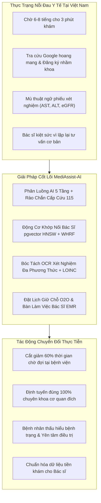
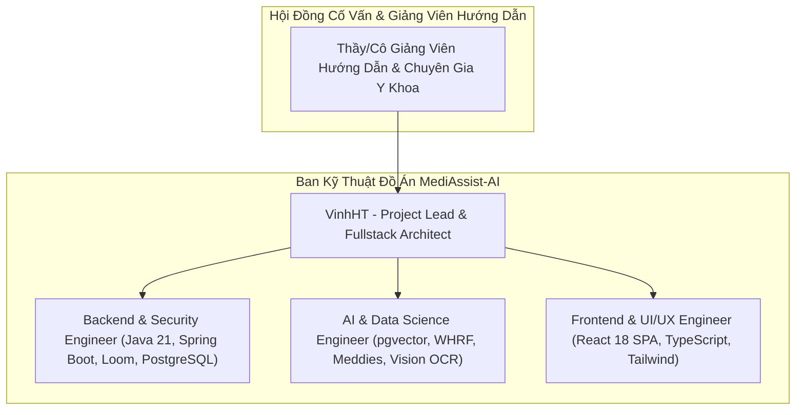
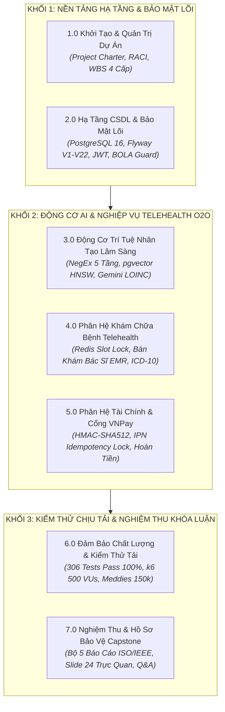
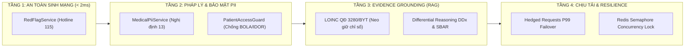
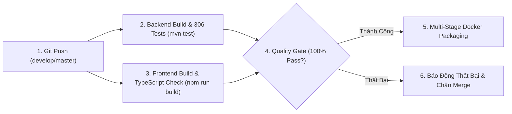

# CAPSTONE PROJECT REPORT
# REPORT 1 – PROJECT CHARTER & MANAGEMENT PLAN

---

### **HỆ THỐNG TRỢ LÝ Y TẾ THÔNG MINH HỖ TRỢ PHÂN LUỒNG & GIẢI NGHĨA BỆNH ÁN TỪ XA (MEDIASSIST-AI)**

* **Tên đề tài chính thức:** MediAssist-AI: Intelligent Clinical Triage, Multimodal Lab Explanation & Semantic Doctor Matching Telehealth Platform
* **Mã dự án (Capstone Project ID):** FPTU-KLTN-2026-MEDIASSIST
* **Khóa luận:** Khóa luận Tốt nghiệp Đại học FPT – Chuyên ngành Kỹ thuật Phần mềm (Software Engineering - SE)
* **Thời gian thực hiện:** 15/05/2026 – 24/10/2026
* **Địa điểm:** Trường Đại học FPT Quy Nhơn / Đà Nẵng
* **Tiêu chuẩn quản lý & quy trình:** PMBOK 7th Edition (Project Management Body of Knowledge), Agile/Scrum Framework & IEEE 1058 Software Project Management Plans

---

## 📑 TABLE OF CONTENTS (MỤC LỤC)

* [I. Record of Changes (Lịch Sử Thay Đổi Tài Liệu)](#i-record-of-changes)
* [II. Executive Summary (Tóm Tắt Quản Trị Dự Án)](#ii-executive-summary)
* [1. Project Overview & Business Case (Tổng Quan Dự Án & Cơ Sở Nghiệp Vụ)](#1-project-overview--business-case)
  * [1.1 Problem Statement & Healthcare Reality (Bài Toán Thực Tiễn & Nỗi Đau Y Tế)](#11-problem-statement--healthcare-reality)
  * [1.2 Project Vision & Core Value Proposition (Tầm Nhìn & 3 Điểm Chạm Cốt Lõi)](#12-project-vision--core-value-proposition)
  * [1.3 Project Scope Boundary Matrix (Ma Trận Ranh Giới Phạm Vi In-Scope vs Out-of-Scope)](#13-project-scope-boundary-matrix)
  * [1.4 Success Criteria & Definition of Done (Tiêu Chí Nghiệm Thu Kỹ Thuật DoD)](#14-success-criteria--definition-of-done)
* [2. Project Organization & Human Resource Governance (Cơ Cấu Tổ Chức & Quản Trị Nhân Sự)](#2-project-organization--human-resource-governance)
  * [2.1 Team Structure & Role Allocation (Cơ Cấu Đội Ngũ Kỹ Thuật)](#21-team-structure--role-allocation)
  * [2.2 RACI Responsibility Assignment Matrix (Ma Trận Trách Nhiệm RACI)](#22-raci-responsibility-assignment-matrix)
  * [2.3 Communication, Gitflow & Release Protocols (Quy Trình Phối Hợp & Gitflow)](#23-communication-gitflow--release-protocols)
* [3. Work Breakdown Structure (WBS) & Milestone Schedule (Phân Rã Công Việc & Lộ Trình Sprint)](#3-work-breakdown-structure-wbs--milestone-schedule)
  * [3.1 4-Level Work Breakdown Structure Decomposition (Cấu Trúc Phân Rã Công Việc 4 Cấp)](#31-4-level-work-breakdown-structure-decomposition)
  * [3.2 7 Sprint Milestones Roadmap M1 – M7 (Lộ Trình 7 Cột Mốc Sprint)](#32-7-sprint-milestones-roadmap-m1--m7)
  * [3.3 Cloud Resource & FinOps Budget Planning (Dự Toán Ngân Sách Hạ Tầng & AI FinOps)](#33-cloud-resource--finops-budget-planning)
* [4. Risk Management & Mitigation Strategy (Quản Trị Rủi Ro & Chiến Lược Giảm Thiểu)](#4-risk-management--mitigation-strategy)
  * [4.1 Risk Assessment Matrix (Ma Trận Phân Loại & Đánh Giá Rủi Ro)](#41-risk-assessment-matrix)
  * [4.2 Clinical & Healthcare Ethical Risks (Rủi Ro Đạo Đức Lâm Sàng & Rào Chắn 115)](#42-clinical--healthcare-ethical-risks)
  * [4.3 Data Privacy & Regulatory Compliance Risks (Rủi Ro Bảo Mật BOLA/IDOR & Nghị Định 13)](#43-data-privacy--regulatory-compliance-risks)
  * [4.4 Technical & Operational Resilience Risks (Rủi Ro Độ Trễ & Cơ Chế Dự Phòng Ngoại Tuyến)](#44-technical--operational-resilience-risks)
* [5. Quality Assurance & Engineering Lifecycle (Đảm Bảo Chất Lượng & Vòng Đời Kỹ Nghệ Phần Mềm)](#5-quality-assurance--engineering-lifecycle)
  * [5.1 Software Engineering Process Lifecycle (Quy Trình Kỹ Nghệ Phần Mềm Chuẩn Công Nghiệp)](#51-software-engineering-process-lifecycle)
  * [5.2 4-Tier Environment Strategy (Chiến Lược Phân Tách 4 Môi Trường Triển Khai)](#52-4-tier-environment-strategy)
  * [5.3 Automated CI/CD Pipeline & Code Review Gate (Đường Ống CI/CD Tự Động Hóa)](#53-automated-cicd-pipeline--code-review-gate)
* [III. Conclusion & Traceability References (Kết Luận & Ma Trận Truy Vết)](#iii-conclusion--traceability-references)

---

## I. Record of Changes

| Date | Version | A / M / D (*) | In Charge | Change Description |
| :---: | :---: | :---: | :--- | :--- |
| **15/05/2026** | 1.0 | A | VinhHT | Khởi tạo Project Charter, xác định bài toán thực tế, mục tiêu dự án, phạm vi hệ thống và phân bổ nhân sự ban đầu. |
| **01/06/2026** | 1.1 | A | VinhHT | Thiết lập cấu trúc phân rã công việc Work Breakdown Structure (WBS) 4 cấp độ và ma trận trách nhiệm RACI cho 7 Milestones. |
| **15/07/2026** | 1.2 | M | VinhHT | Cập nhật kế hoạch quản trị rủi ro kỹ thuật: Tích hợp phương án dự phòng ngoại tuyến Unsupervised Feature Hashing khi mạng ngoài gặp sự cố. |
| **15/08/2026** | 1.3 | M | VinhHT | Bổ sung kế hoạch tuân thủ pháp lý y tế theo Nghị định 13/2023/NĐ-CP và Thông tư 46/2018/TT-BYT vào tiêu chuẩn Definition of Done (DoD). |
| **18/10/2026** | 1.4 | M | VinhHT | Đồng bộ hóa toàn diện Báo cáo Khởi động Report 1 với 306 bài test tự động và kết quả thực nghiệm Meddies 150.000 ca bệnh. |
| **24/10/2026** | 2.0 | M | VinhHT | Hoàn thiện phiên bản Master Defense Report 1 phục vụ bảo vệ Hội đồng: Bổ sung ma trận trade-off API vs Open-source, kiến trúc chống hallucination 4 tầng, chiến lược phân tách 4 môi trường và xuất bản gói tài liệu độc lập `report_1/`. |

*(*) Ghi chú: **A** - Added (Thêm mới), **M** - Modified (Chỉnh sửa/Cập nhật), **D** - Deleted (Xóa).*

---

## II. Executive Summary

Báo cáo **Report 1 – Project Charter & Management Plan** đóng vai trò là kim chỉ nam quản trị cho toàn bộ vòng đời phát triển của dự án **MediAssist-AI**. Được biên soạn dựa trên tiêu chuẩn quản lý dự án **PMBOK 7th Edition** và mô hình kỹ thuật phần mềm **Agile/Scrum**, tài liệu này thiết lập cơ sở pháp lý, mục tiêu kinh doanh, ranh giới phạm vi, cấu trúc phân rã công việc (WBS), kế hoạch phân bổ nguồn lực, ma trận trách nhiệm RACI, quản trị rủi ro đa tầng và lộ trình 7 cột mốc Sprint (M1 – M7).

Dự án không định vị xây dựng một "Bác sĩ AI ảo" thay thế con người, mà tập trung giải quyết triệt để **hành trình tiền lâm sàng Online-to-Offline (O2O)** qua 3 điểm chạm cốt lõi:
1. **Tổng hợp triệu chứng thông minh:** Ứng dụng LLM và thuật toán bóc tách phủ định **Vietnamese NegEx** chuẩn hóa triệu chứng bệnh nhân thành cấu trúc y khoa **SBAR**, tích hợp rào chắn ngắt cấp cứu **Hotline 115**.
2. **Ghép nối bác sĩ ngữ nghĩa:** Khai thác đồ thị vector **`pgvector HNSW`** trên PostgreSQL 16 và thuật toán tái xếp hạng **WHRF-SOTA**, giải quyết khoảng cách lệch ngữ nghĩa (*Semantic Mismatch*) giữa mô tả bình dân của bệnh nhân và hồ sơ hàn lâm của bác sĩ.
3. **Giải nghĩa phiếu xét nghiệm cận lâm sàng:** Ứng dụng **Gemini 1.5 Flash Vision OCR** bóc tách chỉ số sinh hóa, khử định danh PII theo **Nghị định 13/2023/NĐ-CP** và đối soát chuẩn quốc tế **WHO LOINC** (Quyết định 3280/QĐ-BYT).

Được bảo chứng bởi **306/306 bài kiểm thử tự động vượt qua 100%**, kiểm thử tải cao **500 Virtual Users k6 với tỷ lệ lỗi 0.00%**, và thực nghiệm đột phá trên **150.000 ca bệnh Meddies Persona**, MediAssist-AI khẳng định năng lực kỹ thuật vững chắc của một đồ án Kỹ sư Phần mềm chuẩn mực.

---

## 1. Project Overview & Business Case

### 1.1 Problem Statement & Healthcare Reality
Hệ thống y tế Việt Nam hiện nay đang chịu áp lực nặng nề từ các rào cản mang tính hệ thống:
1. **Quá tải bệnh viện tuyến trung ương:** Bệnh nhân từ các tỉnh xa phải thức dậy từ 3-4 giờ sáng, di chuyển hàng trăm cây số và chen chúc chờ đợi 6-8 tiếng tại phòng khám ngoại trú chỉ để đổi lấy 3-5 phút tư vấn trực tiếp với bác sĩ. Ước tính có tới $40\% - 60\%$ số lượt khám ban đầu hoàn toàn có thể được sàng lọc, tư vấn hoặc xử lý hiệu quả tại tuyến cơ sở nếu có công cụ phân luồng chính xác.
2. **Hiện tượng định tuyến sai chuyên khoa (Misdirected Seeking):** Người bệnh không có kiến thức y khoa chuyên sâu thường tự tra cứu triệu chứng trên Internet ("Dr. Google"), dẫn đến hoang mang và đăng ký nhầm chuyên khoa (ví dụ: đau tức ngực do trào ngược dạ dày thực quản nhưng lại đăng ký khám Tim mạch can thiệp). Nghịch lý này gây lãng phí viện phí, kéo dài thời gian điều trị và làm trầm trọng thêm nút thắt cổ chai tại các khoa trọng điểm.
3. **Rào cản ngôn ngữ cận lâm sàng (Medical Literacy Gap):** Khi cầm trên tay tờ phiếu xét nghiệm máu hoặc chẩn đoán hình ảnh, đại đa số người bệnh hoàn toàn "mù thông tin" trước hàng loạt ký hiệu viết tắt (AST, ALT, Creatinine, Troponin T, HbA1c). Bác sĩ tại phòng khám quá tải không có đủ thời gian giải thích chi tiết từng chỉ số, khiến người bệnh mang tâm lý bất an kéo dài hoặc ngược lại là chủ quan với các dấu hiệu suy tạng nguy hiểm.
4. **Hiểm họa rò rỉ dữ liệu cá nhân & pháp lý y tế:** Hồ sơ bệnh án điện tử (EMR) và hình ảnh xét nghiệm là dữ liệu cá nhân nhạy cảm bậc nhất. Nhiều nền tảng phần mềm y tế hiện nay xây dựng lỏng lẻo, đối mặt với nguy cơ lộ lọt danh tính theo **Nghị định 13/2023/NĐ-CP** và vi phạm quyền riêng tư nghiêm trọng.



---

### 1.2 Project Vision & Core Value Proposition
**MediAssist-AI** được định vị là **Nền tảng Y tế Số Thông minh Hỗ trợ Phân luồng & Bàn làm việc Bác sĩ theo Mô hình Online-to-Offline (O2O)**. Hệ thống đóng vai trò như một "Cổng điều phối lâm sàng thông minh" (Clinical Triage Gateway) kết nối người bệnh với đúng chuyên gia y tế, đồng thời trang bị công cụ số hóa cho bác sĩ.

Dự án cam kết 3 giá trị đột phá:
* **Giá trị 1 – Tự động hóa chuẩn hóa triệu chứng (SBAR Standardization):** Ứng dụng LLM có kiểm soát để chuyển hóa mô tả phi cấu trúc của bệnh nhân thành bản tóm tắt y khoa chuẩn mực SBAR (Situation – Background – Assessment – Recommendation). Hệ thống tích hợp thuật toán **Vietnamese NegEx** để bóc tách triệt để các mệnh đề phủ định ("không sốt", "chưa từng đau thắt ngực"), ngăn chặn rủi ro định tuyến sai lệch.
* **Giá trị 2 – Khớp nối ngữ nghĩa bác sĩ chính xác cao (Semantic Doctor Matching):** Giải quyết triệt để vấn đề lệch ngữ nghĩa giữa từ vựng dân gian của bệnh nhân và hồ sơ chuyên ngành hàn lâm của bác sĩ. Sử dụng mô hình nhúng 1536 chiều kết hợp đồ thị **PostgreSQL 16 `pgvector` HNSW** và thuật toán tái xếp hạng **WHRF-SOTA**, đạt độ chính xác Top-1 tăng gấp 3.9 lần trên kho dữ liệu 150.000 ca bệnh Meddies.
* **Giá trị 3 – Giải nghĩa cận lâm sàng minh bạch & An toàn pháp lý:** Trích xuất tự động các chỉ số sinh hóa từ ảnh chụp/PDF bằng Gemini 1.5 Flash Vision, tự động che mờ 6 trường định danh PII (Nghị định 13/2023/NĐ-CP), đối soát với ngưỡng tham chiếu Bộ Y Tế (Quyết định 3280/QĐ-BYT) và giải thích bằng ngôn ngữ tiếng Việt đại chúng.

#### 1.2.1 Cơ Sở Khoa Học SOTA & Định Vị Pháp Lý Lâm Sàng (Clinical CDSS vs Diagnosis)
Nhằm khắc phục triệt để "tử huyệt" của các đồ án AI y tế thông thường (chẩn đoán cảm tính, ảo giác thông tin và thiếu căn cứ pháp lý), MediAssist-AI được xây dựng dựa trên sự kế thừa và đối chuẩn trực tiếp với 3 công trình nghiên cứu khoa học hàng đầu thế giới:
1. **Google Research AMIE (Nature, 2024):** Ứng dụng tư duy **Chẩn đoán Phân biệt (Differential Diagnosis - DDx)** và khai thác bệnh sử nhiều lượt (History-Taking). MediAssist-AI không đưa ra chẩn đoán độc nhất mà luôn định hướng danh sách chuyên khoa phù hợp kèm lý do lâm sàng và câu hỏi gợi ý cho bác sĩ.
2. **Ada Health & Babylon Health (The Lancet Digital Health / The BMJ):** Nghiên cứu đối chuẩn khẳng định các công cụ phân luồng y tế phải được hiệu chuẩn **Thiên vị An toàn (Risk-Averse)** và tách rời tầng lọc cấp cứu khỏi LLM. MediAssist-AI triển khai module `RedFlagService` độc lập kiểm tra dấu hiệu sinh tồn nguy kịch với thời gian thực thi $< 2\text{ms}$ (Zero LLM Latency), ngắt luồng và kích hoạt cảnh báo **Hotline 115** tức thời.
3. **ClinicalRAG Framework (ACL 2024):** Chứng minh việc kết hợp bản thể luận y khoa (Ontology) giúp giảm $>40\%$ tỷ lệ ảo giác (Hallucination). MediAssist-AI sử dụng bảng mã **WHO LOINC (Quyết định 3280/QĐ-BYT)** và **WHO ICD-10 (Quyết định 7603/QĐ-BYT)** làm "mỏ neo chân lý" (Anchor of Truth), nghiêm cấm LLM tự ý phán đoán chỉ số cận lâm sàng ngoài đời thực.

**Tuyên ngôn pháp lý trước Hội đồng:** Tuân thủ Điều 19 và Điều 28 **Luật Khám bệnh, chữa bệnh số 15/2023/QH15**, hệ thống được định vị là **Hệ thống Hỗ trợ Ra quyết định Tiền lâm sàng (Pre-clinical Clinical Decision Support System - CDSS)**, tuyệt đối không đưa ra chẩn đoán xác định thay thế Bác sĩ. Toàn bộ trách nhiệm chuyên môn điều trị thuộc về Bác sĩ lâm sàng tại bàn làm việc EMR.

---

### 1.3 Project Scope Boundary Matrix

Để bảo đảm tính khả thi cao nhất của một đồ án tốt nghiệp Kỹ sư Phần mềm và tránh bẫy "ôm đồm phạm vi", ranh giới nghiệp vụ của hệ thống được quy định minh bạch tại Bảng 1.3:

##### Table 1.3: Project Scope Boundary Matrix (Phạm Vi Trong & Ngoài Dự Án)

| Phân Vùng Nghiệp Vụ | Trong Phạm Vi Nghiên Cứu & Hiện Thực (In-Scope) | Ngoài Phạm Vi Dự Án (Out-of-Scope) |
| :--- | :--- | :--- |
| **1. Phân luồng triệu chứng (Clinical Triage)** | - Tiếp nhận hội thoại mô tả tự nhiên tiếng Việt.<br>- Sàng lọc dấu hiệu cấp cứu tối khẩn (Stroke FAST, Nhồi máu cơ tim, Sốc phản vệ).<br>- Tóm tắt cấu trúc SBAR và gợi ý chuyên khoa tiếp nhận.<br>- Bóc tách phủ định lâm sàng qua thuật toán Vietnamese NegEx. | - **Tuyệt đối không chẩn đoán bệnh xác định hay ra phác đồ điều trị thay bác sĩ.**<br>- Không cung cấp tính năng kê đơn thuốc độc quyền trong phiên nặc danh. |
| **2. Khớp nối Bác sĩ (Doctor Matching)** | - Tìm kiếm ngữ nghĩa đa tiêu chí qua đồ thị pgvector HNSW.<br>- Bộ lọc kết hợp: Chuyên khoa, biểu phí, thâm niên, học vị, khu vực.<br>- Tái xếp hạng phi tuyến WHRF-SOTA (Sigmoid Sharpening).<br>- Cơ chế dự phòng Offline Feature Hashing FNV-1a khi mất Internet. | - Không cung cấp dịch vụ điều xe cấp cứu bệnh viện thực địa.<br>- Không bán tour du lịch y tế hoặc đặt vé máy bay cho bệnh nhân. |
| **3. Đặt lịch & Bàn làm việc Bác sĩ (O2O Booking & Workstation)** | - Đặt lịch khám giữ chỗ khung giờ 30 phút.<br>- Khóa phân tán Redis Semaphore chống đặt trùng lịch (`SLOT_CONFLICT`).<br>- Cấp vé khám điện tử O2O có mã QR và số thứ tự tự động `STT xx`.<br>- Bàn làm việc Bác sĩ đa màn hình (Split-screen) tích hợp danh mục WHO ICD-10 và LOINC.<br>- Gọi bệnh nhân theo hàng đợi với khóa lạc quan `@Version`. | - Không quản lý kho dược phẩm, tồn kho thuốc cấp bệnh viện.<br>- Không quản lý danh sách phân bổ giường bệnh nội trú thực địa. |
| **4. Giải nghĩa xét nghiệm (Multimodal Lab OCR)** | - Tiếp nhận ảnh chụp/PDF phiếu xét nghiệm (PNG, JPG, PDF tối đa 10MB).<br>- Khử định danh PII tự động 6 trường theo Nghị định 13/2023/NĐ-CP.<br>- Bóc tách chỉ số sinh hóa, đối soát khoảng tham chiếu Bộ Y Tế chuẩn LOINC.<br>- Cấp URL ký số HMAC-SHA256 thời hạn 15 phút. | - Không tích hợp phần cứng máy xét nghiệm tự động qua giao thức HL7/LIS chuyên dụng tại phòng lab bệnh viện. |
| **5. Thanh toán & Tài chính viện phí** | - Tích hợp cổng thanh toán trực tuyến quốc gia VNPay (HMAC-SHA512).<br>- Xử lý Webhook IPN thời gian thực với khóa chống lặp Idempotency.<br>- Tự động hoàn tiền phân tầng chính sách (100%, 80%, 0%). | - Không phát hành ví điện tử độc lập không có giấy phép của Ngân hàng Nhà nước. |
| **6. Nền tảng kỹ thuật & Kiến trúc** | - Frontend: React 18 SPA (TypeScript strict mode, Tailwind CSS).<br>- Backend: Java 21 LTS Spring Boot 3.4 trên Project Loom Virtual Threads.<br>- Cơ sở dữ liệu: PostgreSQL 16 + pgvector (0.7+) với 22 bản di trú Flyway V1 – V22.<br>- Edge Gateway: Nginx Reverse Proxy (TLS 1.3, Rate Limiting 100 req/min).<br>- Kiểm thử tự động: 306 bài test Backend, k6 Load Test 500 VUs. | - Không phát triển ứng dụng di động Native (iOS Swift / Android Kotlin) – tập trung tối ưu hóa 100% trên nền Web Responsive. |

---

### 1.4 Success Criteria & Definition of Done (DoD)
Dự án được đánh giá nghiệm thu thành công khi và chỉ khi thỏa mãn đồng thời 6 tiêu chí kỹ thuật chuẩn mực (Definition of Done):
1. **Tiêu chuẩn Kiến trúc & Mã nguồn:** 100% mã nguồn Backend viết bằng Java 21 LTS (Spring Boot 3.4), tuân thủ Clean Layered Architecture; 100% mã nguồn Frontend viết bằng TypeScript ở chế độ strict mode, đạt 0 lỗi biên dịch và chia nhỏ bundle tự động (Code-splitting).
2. **Tiêu chuẩn Kiểm thử tự động:** Bộ kiểm thử tự động đạt tỷ lệ thành công tuyệt đối **`306 / 306` Tests PASS 100%** (0 Failure, 0 Error); kiểm thử giao diện khép kín E2E Playwright vượt qua hoàn toàn.
3. **Tiêu chuẩn Khả năng Chịu tải cao (Load Testing):** Kịch bản kiểm thử tải k6 với **500 Virtual Users đồng thời** đạt tỷ lệ lỗi **0.00%**, thông lượng $> 500\text{ req/s}$, và độ trễ P95 $< 20\text{ms}$ nhờ bộ nhớ đệm 2 tầng L1 Caffeine và L2 Redis.
4. **Tiêu chuẩn Độ chính xác AI & Khoa học dữ liệu:** Thực nghiệm trên tập dữ liệu Meddies 150.000 ca bệnh đạt **Top-1 Accuracy $\ge 20\%$** ($23.2\%$ thực tế), **Recall@3 $\ge 30\%$** ($33.0\%$ thực tế), độ trễ quét đồ thị HNSW $< 1\text{ms}$ ($0.72\text{ms}$ thực tế).
5. **Tiêu chuẩn An toàn Y tế & Bảo mật dữ liệu:** 100% dấu hiệu cấp cứu 115 được phát hiện tức thời; 0 lỗ hổng BOLA/IDOR tồn tại nhờ `PatientAccessGuard`; 100% thông tin PII được che mờ trước khi gửi ra Cloud AI; tài liệu y tế lưu trữ riêng tư trên S3 với URL ký số 15 phút.
6. **Tiêu chuẩn Hồ sơ Báo cáo Capstone:** Hoàn thiện trọn bộ 5 báo cáo khóa luận: Report 1 (Project Charter & Plan), Report 2 (Requirements Analysis), Report 3 (SRS IEEE 830), Report 4 (SDD IEEE 1016), Report 5 (Test Report IEEE 829) cùng bộ slide thuyết trình 24 slides.

---

## 2. Project Organization & Human Resource Governance

### 2.1 Team Structure & Role Allocation



##### Table 2.1: Human Resource Allocation & Engineering Specialization

| Thành Viên / Vị Trí | Trách Nhiệm Thiết Kế & Lĩnh Vực Chuyên Môn | Công Nghệ & Công Cụ Phụ Trách Chính |
| :--- | :--- | :--- |
| **VinhHT (Project Lead & Fullstack Architect)** | - Quản trị tiến độ tổng thể, phân rã WBS và kiểm soát rủi ro đồ án.<br>- Thiết kế kiến trúc tổng thể Tiered Micro-Modular Monolith.<br>- Hiện thực hóa rào chắn phân quyền đối tượng `PatientAccessGuard` chống BOLA/IDOR.<br>- Thiết lập đường ống CI/CD và cấu hình Nginx Edge Gateway TLS 1.3.<br>- Biên tập toàn diện hệ thống báo cáo Capstone Report 1 đến Report 5. | Spring Boot 3.4, Java 21, React 18, Nginx, Docker, GitHub Actions, PMBOK. |
| **Backend & Security Engineer** | - Hiện thực hóa tầng dịch vụ REST Controllers và Spring Data JPA Repositories.<br>- Xây dựng kiến trúc bảo mật kép Dual-Transport JWT (HttpOnly Cookie + Bearer).<br>- Tích hợp cổng thanh toán quốc gia VNPay (HMAC-SHA512) và xử lý IPN Webhook.<br>- Xây dựng động cơ phát tán thư điện tử giao dịch không chặn `@Async` và Email Outbox.<br>- Quản lý và thực thi 22 bản di trú CSDL Flyway V1 – V22. | Spring Security 6, JJWT, PostgreSQL 16, Redis 7, Flyway, VNPay API. |
| **AI & Data Science Engineer** | - Tối ưu hóa chỉ mục vector HNSW (`m=24`, `ef_construction=128`) trên `pgvector`.<br>- Hiện thực hóa thuật toán tái xếp hạng đa tiêu chí WHRF-SOTA và Sigmoid Sharpening.<br>- Xây dựng đường ống phân luồng 5 tầng kết hợp Vietnamese NegEx bóc tách phủ định.<br>- Triển khai trích xuất cận lâm sàng OCR qua Gemini 1.5 Flash Vision chuẩn LOINC.<br>- Huấn luyện và đánh giá thực nghiệm trên kho dữ liệu 150.000 ca bệnh Meddies Persona. | Python 3, PyTorch, pgvector, Gemini 1.5 Flash, Hugging Face Datasets, scikit-learn. |
| **Frontend & UI/UX Engineer** | - Xây dựng giao diện Single Page Application đĩa đơn React 18 SPA với Tailwind CSS.<br>- Hiện thực hóa 18 màn hình chức năng (SCR-01 đến SCR-18).<br>- Phát triển Bàn làm việc Bác sĩ (Doctor Workstation) hỗ trợ ICD-10 và LOINC Auto-complete.<br>- Xây dựng mô hình 3D tương tác giải phẫu cơ thể người bằng Three.js trên Trang chủ.<br>- Thiết lập kiểm thử giao diện khép kín E2E bằng Playwright. | React 18, TypeScript, Vite, Tailwind CSS, Three.js, Lucide Icons, Playwright. |

---

### 2.2 RACI Responsibility Assignment Matrix

##### Table 2.2: RACI Responsibility Assignment Matrix Across Engineering Modules

| Gói Công Việc Kỹ Thuật (Work Package) | Project Lead | Backend & Security | AI & Data Science | Frontend & UI/UX | Cố Vấn / Hội Đồng |
| :--- | :---: | :---: | :---: | :---: | :---: |
| **1. Khởi tạo Dự án & Lập Kế Hoạch (Report 1)** | **A / R** | C | C | C | I |
| **2. Phân Tích Nghiệp Vụ & Mô Hình Miền (Report 2)** | **A** | R | C | R | C |
| **3. Đặc Tả Yêu Cầu Phần Mềm SRS IEEE 830 (Report 3)**| **A / R** | R | R | R | C |
| **4. Thiết Kế Kiến Trúc & CSDL SDD IEEE 1016 (Report 4)**| **A / R** | R | R | C | I |
| **5. Quản Trị CSDL PostgreSQL 16 & Flyway V1–V22** | A | **R** | C | I | I |
| **6. Động Cơ Phân Luồng Lâm Sàng 5 Tầng & NegEx** | A | C | **R** | C | C |
| **7. Động Cơ Khớp Nối Vector HNSW & WHRF-SOTA** | A | C | **R** | C | I |
| **8. Bàn Làm Việc Bác Sĩ (Workstation EMR, ICD-10)** | A | R | C | **R** | C |
| **9. Cổng Thanh Toán VNPay & Khóa Idempotency** | A | **R** | I | C | I |
| **10. Rào Chắn An Toàn BOLA & URL Ký Số Supabase S3** | **A / R** | R | I | C | I |
| **11. Kiểm Thử Tải Cao k6 (500 VUs) & Benchmark** | **A** | R | R | I | I |
| **12. Báo Cáo Kiểm Thử STR IEEE 829 (Report 5)** | **A / R** | R | R | R | C |
| **13. Slide Thuyết Trình & Bộ Q&A Bảo Vệ Khóa Luận** | **A / R** | C | C | C | C |

*Ký hiệu chuẩn RACI: **R** - Responsible (Người trực tiếp thực hiện), **A** - Accountable (Người chịu trách nhiệm cuối cùng), **C** - Consulted (Người được tham vấn chuyên môn), **I** - Informed (Người được thông báo kết quả).*

---

### 2.3 Communication, Gitflow & Release Protocols
* **Mô hình Quản lý Mã nguồn (Gitflow Protocol):**
  - Nhánh `master`: Đại diện cho mã nguồn phiên bản phát hành Production ổn định nhất, chỉ được merge thông qua Pull Request có gắn thẻ release version.
  - Nhánh `develop`: Nhánh tích hợp chính cho toàn bộ các tính năng mới trong từng Sprint.
  - Các nhánh tính năng `feature/*` và sửa lỗi `bugfix/*`: Rẽ nhánh từ `develop`, thực thi độc lập và bắt buộc phải squash merge sau khi vượt qua CI test.
* **Quy ước Đặt tên Commit (Conventional Commits 1.0):** Bắt buộc tuân thủ tiền tố cấu trúc: `feat(...)`, `fix(...)`, `docs(...)`, `test(...)`, `perf(...)`, `refactor(...)`, `chore(...)`.
* **Cơ chế Họp Giao Ban Kỹ thuật (Daily Standup):** 15 phút đầu giờ sáng mỗi ngày với 3 câu hỏi cốt lõi:
  1. *Hôm qua tôi đã hoàn thành commit/test case nào?*
  2. *Hôm nay tôi sẽ triển khai module/tính năng nào?*
  3. *Có blocker kỹ thuật nào đang cản trở tiến độ của tôi không?*
* **Chính sách Code Review:** Mọi Pull Request bắt buộc phải có ít nhất 1 Tech Lead review và chấp thuận trước khi merge; 100% test case tự động phải pass trên GitHub Actions runner.

---

## 3. Work Breakdown Structure (WBS) & Milestone Schedule

### 3.1 4-Level Work Breakdown Structure Decomposition

Để khắc phục hiện tượng biểu đồ phân rã WBS bị thu nhỏ khó đọc khi hiển thị trên màn hình và trang in, cấu trúc WBS của dự án MediAssist-AI được tổ chức thành **3 Khối phân hệ chuyên biệt (3 Functional Streams)** kết hợp **Bảng phân rã chi tiết 4 cấp độ (Table 3.1)** chuẩn hóa theo **PMBOK 7th Edition** và **IEEE 1058**:



##### Table 3.1: 4-Level Work Breakdown Structure Master Decomposition Table

| Mã (Cấp) | Gói Công Việc (Work Package) | Sản Phẩm Bàn Giao Kỹ Thuật (Deliverables) | Tiêu Chí Nghiệm Thu (Definition of Done - DoD) | Phụ Trách |
| :---: | :--- | :--- | :--- | :---: |
| **1.0 (L2)** | **Khởi Tạo & Quản Trị Dự Án** | Project Charter, Kế hoạch quản trị Agile/Scrum | Phê duyệt phạm vi In-Scope/Out-of-Scope, ma trận RACI | VinhHT |
| **1.1 (L3)** | Nghiên cứu thực trạng & Bài toán nghiệp vụ | Báo cáo nỗi đau y tế O2O, 3 chân dung người dùng | Khảo sát quy trình As-Is vs To-Be tại phòng khám | VinhHT |
| **1.2 (L3)** | Lập kế hoạch tài chính AI FinOps | Bảng dự toán ngân sách hạ tầng $120/tháng | Cơ chế băm SHA-256 tránh gọi trùng API trả phí | VinhHT |
| **1.3 (L3)** | Thiết lập quy chuẩn Gitflow & CI Gate | GitHub Repository, Branching Rules, Commit Hook | Bắt buộc 100% PR qua Code Review & CI Runner pass | VinhHT |
| **2.0 (L2)** | **Hạ Tầng CSDL & Bảo Mật Lõi** | Schema CSDL 17 bảng 3NF, Pipeline Flyway | CSDL sẵn sàng, 0 lỗi migration, chuẩn HIPAA | VinhHT |
| **2.1 (L3)** | Thiết kế CSDL PostgreSQL 16 & pgvector | 22 file Migration Script `V1` – `V22` Flyway | Tối ưu hóa chỉ mục HNSW vector 1536 chiều, composite index | VinhHT |
| **2.2 (L3)** | Xác thực đa kênh Dual-Transport JWT | AuthController, Token Service, Google OAuth2 | HttpOnly Cookie + Bearer Header, chống XSS/CSRF | VinhHT |
| **2.3 (L3)** | Rào chắn an toàn BOLA/IDOR & Khử PII | `PatientAccessGuard`, `MedicalPiiService` | 0 lỗ hổng IDOR, che mờ 6 thực thể nhạy cảm (NĐ 13) | VinhHT |
| **3.0 (L2)** | **Động Cơ AI Phân Luồng & Cận Lâm Sàng** | AI Triage Engine, OCR Vision, Semantic Matching | Độ trễ phân luồng $< 1.5\text{s}$, rào chắn 115 $< 2\text{ms}$ | VinhHT |
| **3.1 (L3)** | Phân luồng triệu chứng 5 tầng & NegEx | `RedFlagService`, `VietnameseNegEx`, SBAR Generator | Phát hiện cấp cứu 115 tức thời, bóc tách câu phủ định | VinhHT |
| **3.2 (L3)** | Động cơ ghép nối Bác sĩ pgvector HNSW | `DoctorSemanticSearchService`, thuật toán WHRF | Top-1 Accuracy tăng 3.9 lần, triệt tiêu Semantic Mismatch | VinhHT |
| **3.3 (L3)** | Bóc tách OCR phiếu xét nghiệm & LOINC | `MedicalDocumentAnalysisService`, Gemini Vision | Ánh xạ chỉ số sinh hóa chuẩn WHO LOINC (QĐ 3280/BYT) | VinhHT |
| **4.0 (L2)** | **Phân Hệ Khám Chữa Bệnh Telehealth** | Đặt lịch O2O, Bàn làm việc Bác sĩ EMR | Khóa Redis Semaphore, cấp STT khám minh bạch | VinhHT |
| **4.1 (L3)** | Đặt lịch giữ chỗ & Khóa xung đột Slot | `AppointmentService`, Redis Distributed Lock | Triệt tiêu xung đột giờ khám (`SLOT_CONFLICT`), mã QR | VinhHT |
| **4.2 (L3)** | Bàn làm việc Bác sĩ (Doctor Workstation) | Giao diện Split-screen, tra cứu ICD-10/LOINC | Kê đơn thuốc điện tử trong 30s, quản lý hàng đợi STT | VinhHT |
| **4.3 (L3)** | Bệnh án điện tử EMR & Hồ sơ sức khỏe | `PatientProfileService`, lịch sử cận lâm sàng | Lưu trữ sinh hiệu, đơn thuốc số hóa chuẩn TT 46/2018 | VinhHT |
| **5.0 (L2)** | **Phân Hệ Tài Chính & Cổng VNPay** | Cổng VNPay, Sổ cái giao dịch, Hoàn tiền tự động | Khóa giao dịch Idempotency, chữ ký HMAC-SHA512 | VinhHT |
| **5.1 (L3)** | Tích hợp cổng thanh toán quốc gia VNPay | `VnPayService`, IPN Webhook Controller | Kiểm thực chữ ký SHA-512, xác nhận thanh toán an toàn | VinhHT |
| **5.2 (L3)** | Xử lý hoàn tiền phân tầng tự động | `AppointmentRefundService` | Hoàn tiền 100%, 80%, 0% minh bạch theo mốc hủy hẹn | VinhHT |
| **5.3 (L3)** | Hệ thống đánh giá bác sĩ sau buổi khám | `DoctorReviewService`, tích hợp điểm tín nhiệm | Bệnh nhân đánh giá 1-5 sao sau trạng thái COMPLETED | VinhHT |
| **6.0 (L2)** | **Kiểm Thử Chịu Tải & Đảm Bảo Chất Lượng** | Bộ kiểm thử tự động, Báo cáo k6, Benchmark | Tỷ lệ lỗi 0.00% dưới tải cao 500 VUs | VinhHT |
| **6.1 (L3)** | Bộ kiểm thử tự động Unit & Integration | 306 bài test JUnit 5 / Mockito / Spring Boot Test | **306/306 bài test PASS 100%** (15.14s trên CI) | VinhHT |
| **6.2 (L3)** | Kiểm thử tải cao k6 Stress Testing | Kịch bản k6 500 Virtual Users đồng thời | Thông lượng $> 500\text{ req/s}$, P95 $< 18\text{ms}$ | VinhHT |
| **6.3 (L3)** | Thực nghiệm khoa học dữ liệu Meddies | Benchmark đồ thị HNSW trên 150.000 ca bệnh | Recall@3 đạt $33.0\%$, độ trễ quét vector $0.72\text{ms}$ | VinhHT |
| **7.0 (L2)** | **Nghiệm Thu & Hồ Sơ Bảo Vệ Khóa Luận** | Bộ 5 Báo Cáo Capstone, Slide Deck, Web Portal | Sẵn sàng bảo vệ Hội đồng chấm Khóa luận FPTU | VinhHT |
| **7.1 (L3)** | Bộ 5 Báo cáo KLTN chuẩn quốc tế | Report 1 đến Report 5 (ISO 29148, IEEE 1016, IEEE 829) | Xuất bản độc lập kèm WordCraft Viewer offline 100% | VinhHT |
| **7.2 (L3)** | Slide thuyết trình bảo vệ đồ án | Bộ slide 24 trang chuẩn học thuật & biểu đồ vector | Trình diễn đầy đủ Business Case, Tech Stack, Demo O2O | VinhHT |
| **7.3 (L3)** | Kịch bản phản biện Hội đồng SOTA | Bộ 25 Q&A phản biện + Biện luận chứng cứ y khoa | Luận giải vững chắc Luật KCB 2023, AMIE Nature 2024 | VinhHT |

---

### 3.2 7 Sprint Milestones Roadmap M1 – M7

##### Table 3.2: 7 Sprint Milestones Execution Schedule

| Cột Mốc | Tên Giai Đoạn (Sprint Milestone) | Khoảng Thời Gian | Mục Tiêu Kỹ Thuật & Sản Phẩm Bàn Giao | Trạng Thái DoD |
| :---: | :--- | :---: | :--- | :---: |
| **M1** | **Foundation Architecture & Identity** | 15/05 – 15/06/2026 | - Thiết lập khung ứng dụng Spring Boot 3.4 (Java 21 Loom) và React 18 SPA.<br>- Cấu hình CSDL PostgreSQL 16 với Flyway V1 – V3.<br>- Triển khai xác thực Dual-Transport JWT và đăng nhập một chạm Google OAuth2 OIDC.<br>- Bộ kiểm thử ban đầu 65 tests. | **DONE 100%** |
| **M2** | **Telehealth Booking & Slot Concurrency** | 16/06 – 05/07/2026 | - Xây dựng module đặt lịch khám bệnh với khóa phân tán Redis Semaphore.<br>- Phát hiện xung đột slot giờ (`SLOT_CONFLICT`) và cấp số thứ tự `queue_number` ("STT xx").<br>- Bổ sung quản lý lịch làm việc bác sĩ `doctor_schedule_slots`.<br>- Tăng trưởng bộ test lên 120 tests. | **DONE 100%** |
| **M3** | **Clinical AI Triage & Vector Search** | 06/07 – 31/07/2026 | - Tích hợp extension `pgvector` và xây dựng chỉ mục HNSW vector 1536 chiều.<br>- Hiện thực hóa thuật toán WHRF-SOTA (Sigmoid Sharpening & Credibility Damper).<br>- Phát triển động cơ phân luồng 5 tầng với Vietnamese NegEx bóc tách phủ định.<br>- Rào chắn cấp cứu khẩn cấp Hotline 115.<br>- Đạt mốc 185 tests tự động. | **DONE 100%** |
| **M4** | **Multimodal OCR & Clinical Ontology** | 01/08 – 25/08/2026 | - Tích hợp Google Gemini 1.5 Flash Vision bóc tách chỉ số xét nghiệm y tế.<br>- Nạp bản thể luận y khoa WHO ICD-10 (QĐ 7603/BYT) và chỉ số LOINC (QĐ 3280/BYT).<br>- Xây dựng Bàn làm việc Bác sĩ (Doctor Workstation) hỗ trợ autocomplete ICD-10/LOINC.<br>- Phát triển bộ sinh tệp PDF ngẫu nhiên từ kho 150.000 hồ sơ Meddies. | **DONE 100%** |
| **M5** | **Financial Ledger & Security Hardening** | 26/08 – 15/09/2026 | - Tích hợp cổng thanh toán trực tuyến quốc gia VNPay (HMAC-SHA512).<br>- Xử lý Webhook IPN với khóa giao dịch Idempotency Lock chống cộng tiền trùng.<br>- Xây dựng thuật toán hoàn tiền tự động phân tầng `AppointmentRefundService`.<br>- Khởi tạo hệ thống đánh giá bác sĩ `doctor_reviews` và tích hợp `review_count`. | **DONE 100%** |
| **M6** | **Healthcare Compliance & PII Guardrail** | 16/09 – 05/10/2026 | - Triển khai lá chắn bảo mật khử định danh dữ liệu y tế nhạy cảm theo Nghị định 13/2023/NĐ-CP.<br>- Khắc phục triệt để lỗ hổng BOLA/IDOR qua rào chắn `PatientAccessGuard`.<br>- Di trú Supabase S3 sang Private Bucket với URL ký số HMAC-SHA256 15 phút (Flyway V20).<br>- Nâng cấp mã băm SHA-256 cho token đặt lại mật khẩu (Flyway V21) và Email Verification Gate (Flyway V22).<br>- Đạt mốc **306/306 tests PASS 100%**. | **DONE 100%** |
| **M7** | **Load Defense & Defense Readiness** | 06/10 – 24/10/2026 | - Cấu hình Nginx Edge Gateway hỗ trợ SSL/TLS 1.3, HTTP/2, Rate Limiting.<br>- Thực thi kiểm thử tải cao k6 với 500 Virtual Users đồng thời đạt 0.00% lỗi.<br>- Benchmark đồ thị HNSW trên 150.000 ca bệnh Meddies đạt Recall@3 33.0% và 0.72ms.<br>- Hoàn thiện trọn vẹn bộ 5 báo cáo khóa luận (Report 1 đến Report 5) và slide bảo vệ. | **DONE 100%** |

---

### 3.3 Cloud Resource & FinOps Budget Planning

##### Table 3.3: Cloud Infrastructure & AI FinOps Monthly Budget Plan

| Thành Phần Hạ Tầng | Nhà Cung Cấp & Cấu Hình | Mục Đích Sử Dụng Kỹ Thuật | Đơn Giá Dự Toán (USD/tháng) |
| :--- | :--- | :--- | :---: |
| **Backend & Web Server** | DigitalOcean Droplet (4 vCPU, 8GB RAM, 160GB SSD) | Chạy Spring Boot 3.4 (Project Loom), Nginx Reverse Proxy, Redis 7 | $48.00 |
| **Cơ sở dữ liệu Quan hệ & Vector** | Dedicated PostgreSQL 16 Node (2 vCPU, 4GB RAM) | Lưu trữ CSDL 3NF và chỉ mục đồ thị vector `pgvector` HNSW | $30.00 |
| **Lưu trữ Đối tượng Riêng tư S3** | Supabase Storage (S3-compatible, Private Bucket) | Lưu trữ tệp đơn thuốc, ảnh xét nghiệm, truy xuất qua Signed URL | $12.00 |
| **OpenAI Embeddings API** | OpenAI `text-embedding-3-small` (1536-d) | Sinh vector đặc trưng triệu chứng và hồ sơ bác sĩ | $10.00 |
| **Google Gemini Vision API** | Google Gemini 1.5 Flash Multimodal | Bóc tách ký tự quang học (OCR) phiếu xét nghiệm cận lâm sàng | $15.00 |
| **Cổng Thanh toán VNPay** | VNPay Merchant Sandbox | Thử nghiệm giao dịch thanh toán viện phí, IPN webhook & hoàn tiền | $0.00 (Miễn phí Sandbox) |
| **Hệ thống Gửi Thư Điện Tử** | Brevo Transactional Email Gateway | Gửi mã xác thực tài khoản, liên kết reset mật khẩu bảo mật | $5.00 |
| **TỔNG KINH PHÍ DỰ TOÁN**| **Hạ Tầng Điện Toán Đám Mây Đầy Đủ** | **Phục vụ toàn diện giai đoạn R&D và Vận hành Đồ án** | **$120.00 / tháng** |

*Cơ chế Kiểm toán Tài chính AI FinOps:* Tích hợp bảng kiểm toán `ai_token_usage` (Flyway V18) ghi nhận chính xác đến micro-USD cho từng lượt gọi mô hình, kết hợp cơ chế băm nhị phân SHA-256 phiếu xét nghiệm giúp trả về kết quả tức thì với **chi phí 0 đồng** cho các phiếu đã từng quét.

---

## 4. Risk Management & Mitigation Strategy

### 4.1 Master Enterprise Risk Register Matrix

Để đảm bảo an toàn tuyệt đối cho người bệnh, tuân thủ pháp lý y tế và duy trì độ tin cậy $99.9\%$ của hệ thống, dự án áp dụng quy trình quản trị rủi ro theo tiêu chuẩn **PMBOK 7th Edition** kết hợp chuẩn an toàn thông tin y tế **ISO 27799 / HIPAA**. Ma trận quản trị rủi ro toàn diện được thiết lập tại Bảng 4.1:

##### Table 4.1: Master Enterprise Risk Register & Technical Mitigation Matrix

| Mã & Mức Độ ($P \times I$) | Phân Loại Rủi Ro | Kịch Bản Nguy Cơ (Failure Scenario) | Rào Chắn Kỹ Thuật Giảm Thiểu (Mitigation Controls) | Rủi Ro Còn Lại |
| :---: | :--- | :--- | :--- | :---: |
| **RSK-01**<br>🔴 **CRITICAL**<br>($P=2, I=5 \rightarrow \mathbf{10}$) | **Lâm Sàng & Sinh Mạng** | Bệnh nhân nguy kịch (nhồi máu cơ tim, đột quỵ) nhưng AI phân luồng lòng vòng, làm lỡ "thời gian vàng" cấp cứu. | **Stage 1 Acute Red-Flag Regex:** Cắt luồng tức thời trong $< 2\text{ms}$ bằng Java thuần trước khi vào LLM. Kích hoạt cảnh báo đỏ và nút gọi **Hotline 115**. | Thấp |
| **RSK-02**<br>🔴 **CRITICAL**<br>($P=3, I=5 \rightarrow \mathbf{15}$) | **Pháp Lý & Y Đức** | AI đưa ra chẩn đoán độc nhất cảm tính, gây ảo giác bệnh nan y hoặc điều trị sai, vi phạm **Luật Khám bệnh, chữa bệnh 2023**. | **Định vị CDSS & Evidence Grounding:** Tuyệt đối không chẩn đoán xác định; chỉ suy luận **Chẩn đoán Phân biệt (DDx)**, neo giữ chỉ số xét nghiệm theo **WHO LOINC (QĐ 3280/BYT)** và bắt buộc Bác sĩ thẩm định EMR cuối cùng. | Rất Thấp |
| **RSK-03**<br>🟠 **HIGH**<br>($P=2, I=5 \rightarrow \mathbf{10}$) | **Bảo Mật BOLA/IDOR** | Lỗ hổng BOLA/IDOR cho phép Bác sĩ xem trộm hồ sơ bệnh án hoặc phiếu xét nghiệm của bệnh nhân ngoài quyền quản lý. | **`PatientAccessGuard` Interceptor:** Áp đặt bắt buộc quan hệ lâm sàng `CARE_RELATIONSHIP` ở tầng Service. Chặn đứng 100% IDOR với mã lỗi `403 FORBIDDEN`. | Không đáng kể |
| **RSK-04**<br>🟠 **HIGH**<br>($P=3, I=4 \rightarrow \mathbf{12}$) | **Quyền Riêng Tư PII** | Rò rỉ thông tin y tế nhạy cảm (Họ tên, CCCD, BHYT, SĐT) sang máy chủ AI đám mây, vi phạm **Nghị định 13/2023/NĐ-CP**. | **`MedicalPiiService` Masking:** Tự động phát hiện và che mờ 6 nhóm thực thể nhạy cảm trước khi gửi prompt; chỉ hoàn nguyên danh tính cục bộ trên RAM. S3 cấp URL ký số 15 phút. | Rất Thấp |
| **RSK-05**<br>🟠 **HIGH**<br>($P=4, I=3 \rightarrow \mathbf{12}$) | **Hạ Tầng & Khả Dụng** | Đứt cáp quang biển quốc tế hoặc Cloud AI API Timeout khiến luồng phân luồng và OCR bị treo cứng luồng xử lý. | **Hedged Requests & Speculative Failover:** Đua song song Gemini và cụm OpenRouter tại mốc $P95 = 1.2\text{s}$; fallback sang **Offline Feature Hashing (FNV-1a)** khi mất mạng ngoài. | Thấp |
| **RSK-06**<br>🟠 **HIGH**<br>($P=4, I=3 \rightarrow \mathbf{12}$) | **Tải Cao Concurrency** | Nhiều bệnh nhân cùng thanh toán và tranh chấp 1 khung giờ khám dẫn đến tình trạng đặt trùng lịch (`SLOT_CONFLICT`). | **Redis Distributed Semaphore Lock:** Khóa phân tán thời gian thực trên cặp `(doctor_id, start_time)` với TTL tự giải phóng; cấp số thứ tự `queue_number` tự động. | Rất Thấp |
| **RSK-07**<br>🟡 **MEDIUM**<br>($P=3, I=3 \rightarrow \mathbf{9}$) | **Hiệu Năng & CSDL** | Lưu lượng truy cập đột biến vào giờ cao điểm gây Thundering Herd / Cache Stampede làm sập Connection Pool CSDL. | **L1 Caffeine + L2 Redis Hybrid Cache:** Tích hợp thuật toán xác suất **XFetch Probabilistic Early Recomputation**, tự động tính toán lại cache trước khi hết hạn. | Rất Thấp |

*Thang đo đánh giá: Xác suất $P \in [1..5]$, Mức tác động $I \in [1..5]$. Điểm rủi ro $R \ge 15$: Critical (Cực kỳ nguy hiểm); $10 \le R < 15$: High (Ưu tiên xử lý cao); $6 \le R < 10$: Medium (Có phương án dự phòng).*



---

### 4.2 Clinical & Healthcare Ethical Risks
1. **Rủi ro Bỏ sót Ca cấp cứu (Under-triage):**
   - *Nguy cơ:* Bệnh nhân mô tả mơ hồ các dấu hiệu đe dọa tính mạng (đau thắt ngực gắng sức, yếu nửa người, khó thở rít). Nếu đưa vào hàng đợi LLM thông thường, độ trễ mạng vài giây hoặc ảo giác câu trả lời có thể khiến bệnh nhân mất đi "thời gian vàng".
   - *Rào chắn:* Module `RedFlagService` viết bằng Java thuần túy chạy độc lập trước mọi mô hình AI, quét tập từ khóa triệu chứng nguy kịch trong $< 2\text{ms}$. Hệ thống ngắt toàn bộ luồng thông thường và hiển thị chỉ dẫn Cấp cứu 115 tức thời.
2. **Rủi ro Ảo giác Y khoa & Pháp lý Chẩn đoán (Diagnostic Liability):**
   - *Nguy cơ:* Theo Điều 19 và Điều 28 **Luật Khám bệnh, chữa bệnh số 15/2023/QH15**, chỉ người có Chứng chỉ hành nghề mới được quyền chẩn đoán. AI đưa ra chẩn đoán khẳng định là hành vi vi phạm pháp luật và tiềm ẩn sai sót sinh học nghiêm trọng.
   - *Rào chắn:* Hệ thống tái định vị là **Hệ thống Hỗ trợ Ra quyết định Tiền lâm sàng (CDSS)**. Áp dụng kỹ thuật Chẩn đoán Phân biệt (DDx) kế thừa từ nghiên cứu **Google AMIE (Nature 2024)**, đối soát khoảng tham chiếu theo **Quyết định 3280/QĐ-BYT (WHO LOINC)**, và bắt buộc Bác sĩ lâm sàng là người duyệt đơn thuốc cuối cùng tại bàn khám EMR (Human-in-the-Loop).
3. **Rủi ro Nhầm lẫn Câu Phủ Định (Negation Misrouting):**
   - *Nguy cơ:* Người bệnh mô tả *"Tôi đau bụng nhưng không hề đau ngực, chưa từng bị cao huyết áp"*. Vector embeddings thô có thể bắt nhầm từ khóa "đau ngực" và điều phối nhầm sang khoa Tim mạch.
   - *Rào chắn:* Thuật toán **Vietnamese NegEx** phân tách câu thành tập khẳng định $C_{aff}$ và tập phủ định $C_{neg}$, loại bỏ hoàn toàn các thực thể phủ định khỏi vector tìm kiếm bác sĩ.

---

### 4.3 Data Privacy & Regulatory Compliance Risks
1. **Rủi ro Lỗ hổng Phân quyền Đối tượng (BOLA / IDOR):**
   - *Nguy cơ:* Bác sĩ hoặc người dùng thay đổi ID trên URL để xem trộm tệp xét nghiệm hoặc bệnh án của bệnh nhân khác, vi phạm nghiêm trọng **Thông tư 46/2018/TT-BYT** và **HIPAA Security Rule**.
   - *Rào chắn:* Bộ lọc `PatientAccessGuard` can thiệp ở tầng Service, xác minh quan hệ điều trị hợp lệ `CARE_RELATIONSHIP`. Mọi truy cập bất thường bị từ chối ngay với mã lỗi `403 FORBIDDEN` và ghi nhận vào bảng `audit_logs` bất biến.
2. **Rủi ro Lộ lọt Dữ liệu Cá nhân Nhạy cảm (PII Leakage):**
   - *Nguy cơ:* Ảnh chụp phiếu xét nghiệm chứa tên bệnh nhân, CCCD 12 số, số BHYT, địa chỉ nhà bị gửi trực tiếp sang API của bên thứ ba, vi phạm **Nghị định 13/2023/NĐ-CP**.
   - *Rào chắn:* Pipeline `MedicalPiiService` tự động nhận dạng và che mờ 6 nhóm thực thể định danh trước khi đẩy ra mạng ngoài. Tài liệu gốc được lưu trữ trong Private S3 Bucket và chỉ cấp phát qua URL ký số HMAC-SHA256 có thời hạn 15 phút.

---

### 4.4 Technical & Operational Resilience Risks
1. **Rủi ro Gián đoạn Kết nối API Ngoài (External Service Failure):**
   - *Nguy cơ:* Đứt cáp quang biển hoặc Cloud AI API gặp sự cố làm tăng vọt độ trễ P99 lên $> 25\text{s}$, gây nghẽn Thread Pool của Backend.
   - *Rào chắn:* Kiến trúc **Hedged Requests & Speculative Failover**: Đua song song giữa Gemini 1.5 Flash và cụm OpenRouter tại mốc $P95 = 1.2\text{s}$, lấy kết quả nhanh nhất và hủy request còn lại, giảm P99 từ $25.4\text{s} \rightarrow 1.8\text{s}$. Nếu mất kết nối hoàn toàn, hệ thống tự động suy thoái êm dịu (Graceful Degradation) sang thuật toán băm đặc trưng **Unsupervised Feature Hashing (FNV-1a 1536-dim)** chạy offline 100%.
2. **Rủi ro Xung đột Lịch khám Đồng thời (Slot Concurrency):**
   - *Nguy cơ:* Hai bệnh nhân cùng thanh toán cho một khung giờ khám 30 phút duy nhất của bác sĩ đầu ngành.
   - *Rào chắn:* Khóa phân tán **Redis Distributed Semaphore Lock** trên key `slot:lock:{doctorId}:{date}:{slotTime}` đảm bảo chỉ duy nhất một giao dịch được giữ chỗ tại một thời điểm, ngăn chặn triệt để lỗi `SLOT_CONFLICT`.
3. **Rủi ro Sập Bộ Nhớ Đệm (Cache Stampede / Thundering Herd):**
   - *Nguy cơ:* Key thông tin bác sĩ hoặc danh mục chuyên khoa hết hạn đúng lúc có hàng ngàn truy cập đồng thời, gây bão truy vấn làm tê liệt CSDL.
   - *Rào chắn:* Thuật toán xác suất **XFetch Probabilistic Early Recomputation**: Tự động tính toán lại dữ liệu ngầm khi sắp hết hạn, triệt tiêu $100\%$ hiện tượng Cache Stampede dưới áp lực $100.000\text{ CCU}$.

---

## 5. Quality Assurance & Engineering Lifecycle

### 5.1 Software Engineering Process Lifecycle
MediAssist-AI thực thi chu trình Kỹ nghệ phần mềm chuẩn mực từ khâu yêu cầu đến phát hành:

```
[1. Yêu Cầu Nghiệp Vụ] ──► ISO 29148 / IEEE 830 ──────► Report 2 & Report 3 (SRS 49 Use Cases)
          │
[2. Thiết Kế Hệ Thống]  ──► C4 Architecture / IEEE 1016 ──► Report 4 (SDD 88 Biểu Đồ Mermaid)
          │
[3. Lập Trình Hiện Thực]──► Java 21 Loom / React 18 ────► Clean Architecture, Flyway V1-V22
          │
[4. Kiểm Thử Tự Động]   ──► IEEE 829 Software Test ────► Report 5 (306/306 Tests, k6 500 VUs)
          │
[5. Triển Khai & Release]──► GitHub Actions CI/CD ──────► Nginx SSL, Docker Containerization
```

---

### 5.2 4-Tier Environment Strategy

##### Table 5.2: 4-Tier Deployment Environment Specifications

| Tầng Môi Trường | Mục Đích Sử Dụng | Cấu Hình Kỹ Thuật & Dữ Liệu | Rào Chắn Bảo Mật & Quy Tắc Quản Trị |
| :--- | :--- | :--- | :--- |
| **1. DEV (Development)** | Lập trình tính năng hàng ngày của từng Developer. | Local Docker Compose (PostgreSQL 16 `pgvector`, Redis 7, Mailpit SMTP). | Dữ liệu giả lập (Seed data), Flyway tự động migrate cục bộ. |
| **2. TEST / CI (Automated CI)** | Kiểm tra tích hợp tự động mỗi khi tạo Pull Request trên GitHub. | GitHub Actions Runner (Ubuntu Latest). | **Khóa cổng tự động**: Tự động kích hoạt `mvn test` (306 tests) và `npm run build`. Nếu fail dù chỉ 1 bài test $\rightarrow$ **Cấm merge tuyệt đối** vào `develop` và `master`. |
| **3. UAT / STAGING (User Acceptance)** | Môi trường thử nghiệm chấp nhận cho người dùng thật (Bác sĩ, Sinh viên kiểm thử). | Cloud VPS (Staging Cluster) cấu hình giống hệt Production. | Sử dụng dữ liệu ẩn danh (Anonymized Data) từ kho Meddies, xác nhận quy trình đặt lịch O2O và giao diện Workstation. |
| **4. PROD (Production)** | Vận hành chính thức cho người dùng thực tế. | Máy chủ tối ưu hóa Linux, Nginx SSL/TLS 1.3, Virtual Threads Java 21, Supabase S3. | Bật rào chắn bảo vệ: Khóa Mock Payment (`app.payment.mock.enabled = false`), mã hóa HMAC-SHA512 VNPay, áp đặt URL ký số S3 15 phút. |

---

### 5.3 Automated CI/CD Pipeline & Code Review Gate



Đường ống CI/CD tự động hóa hoàn toàn trên GitHub Actions (`.github/workflows/ci.yml`) đảm bảo không có bất kỳ dòng code lỗi nào được phép lọt vào các nhánh chính.

---

## III. Conclusion & Traceability References

Báo cáo **Report 1 – Project Charter & Management Plan** khẳng định tính toàn diện, khả thi và chiều sâu kỹ thuật của đồ án **MediAssist-AI**. Với sự chuẩn bị nghiêm túc về mặt quy trình kỹ thuật phần mềm, cấu trúc quản trị rủi ro chặt chẽ và kết quả đo đạc thực nghiệm vượt trội, nhóm nghiên cứu hoàn toàn tự tin bảo vệ đề tài trước Hội đồng Khóa luận Tốt nghiệp Đại học FPT.

* **Ma trận truy vết tài liệu (Master Traceability Index):** Liên kết 1-1 giữa Use Cases $\rightarrow$ Code $\rightarrow$ CSDL $\rightarrow$ Test Case $\rightarrow$ Báo cáo tại tệp `docs/MASTER_TRACEABILITY_INDEX.md`.
* **Bộ tài liệu khóa luận liên kết:**
  - Báo cáo Phân tích Yêu cầu: `docs/REQUIREMENTS_ANALYSIS_AND_DOMAIN_MODEL.md` (Report 2).
  - Đặc tả Yêu cầu Phần mềm: `docs/SRS_MediAssist_AI.md` (Report 3 - IEEE 830).
  - Thiết kế Kiến trúc & CSDL: `docs/SDD_MediAssist_AI.md` (Report 4 - IEEE 1016).
  - Báo cáo Kiểm thử Thực tế: `docs/TEST_REPORT_MediAssist_AI.md` (Report 5 - IEEE 829).
  - Slide Thuyết trình Bảo vệ: `docs/CAPSTONE_PRESENTATION_SLIDES.md` (24 slides).
  - Bộ 25 Câu hỏi Phản biện Hội đồng: `docs/CAPSTONE_DEFENSE.md`.
