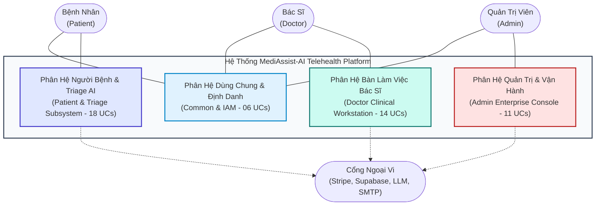
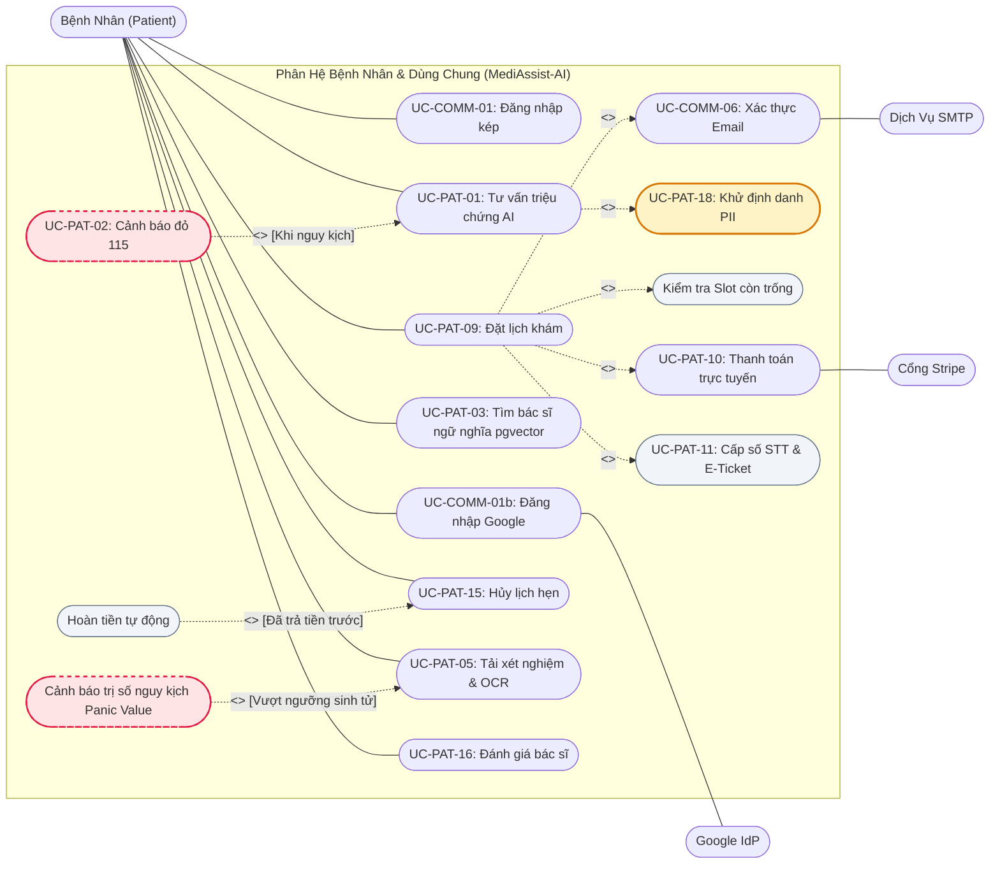
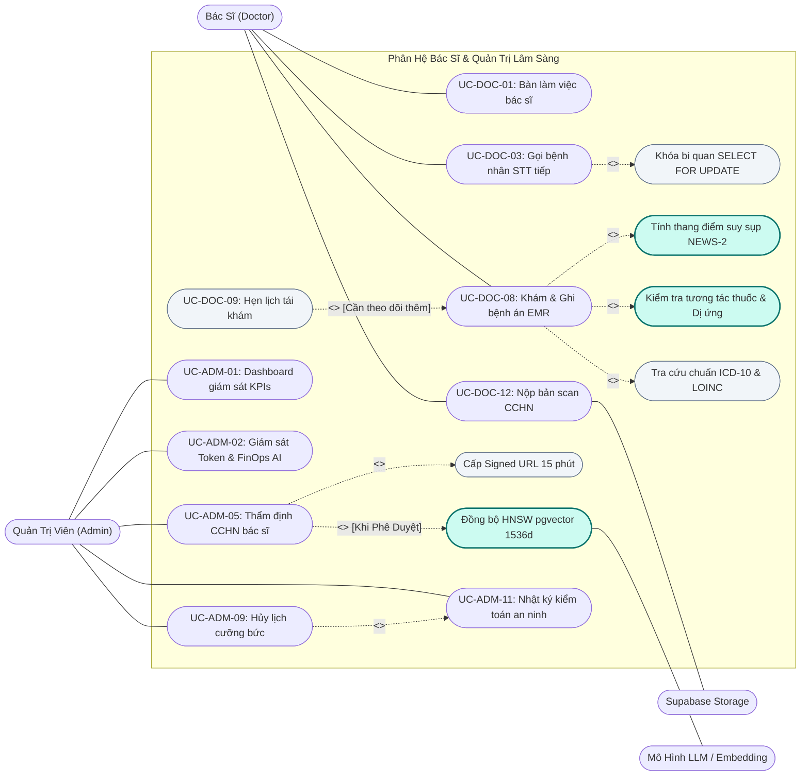

# TÀI LIỆU BỔ SUNG MỤC III (SRS) CHO BÁO CÁO REPORT 7 (LINK 1)
> **Mục tiêu:** Chuẩn hóa 1-1 với đồ án mẫu FPT (Link 2), bổ sung đầy đủ hệ thống biểu đồ Use Case UML 2.5 phân cấp có quan hệ `<<include>>`, `<<extend>>`, và mở rộng toàn diện Bảng 5.4 Application Messages List.

---

## 1. MỤC 2.2.1: BỔ SUNG BỘ 3 SƠ ĐỒ USE CASE CHUẨN UML 2.5 (FIGURE 2.2.1A, B, C)

### Figure 2.2.1A: Global High-Level Use Case Architecture (Kiến trúc Use Case Tổng thể)

---

### Figure 2.2.1B: Patient & Common Subsystem Use Case Diagram (Phân hệ Bệnh nhân & Dùng chung)

---

### Figure 2.2.1C: Doctor Workstation & Admin Governance Use Case Diagram (Bàn làm việc Bác sĩ & Quản trị)

---

## 2. MỤC 5.4: BẢNG DANH MỤC THÔNG ĐIỆP CHUẨN HÓA (TABLE 5.4: APPLICATION MESSAGES LIST)

### Table 5.4: Application Messages List (80+ Thông điệp phân hệ MediAssist-AI)

| Message ID | Type | UI Channel | Content (Tiếng Việt) | HTTP Status | Triggering Component / Condition |
| :--- | :---: | :---: | :--- | :---: | :--- |
| **1. Identity & Access Management (AUTH)** | | | | | |
| `MSG-AUTH-001` | Success | Toast | Đăng nhập hệ thống thành công. Đang chuyển hướng... | 200 OK | `AuthController.login` hợp lệ |
| `MSG-AUTH-002` | Error | Form Inline | Email hoặc mật khẩu không chính xác. | 401 Unauthorized | Sai thông tin xác thực |
| `MSG-AUTH-003` | Error | Alert Modal | Tài khoản của bạn đã bị khóa do vi phạm chính sách bảo mật. | 403 Forbidden | `user.status == SUSPENDED` |
| `MSG-AUTH-004` | Error | Toast | Tài khoản Bác sĩ đang chờ thẩm định CCHN. Chưa thể đăng nhập bàn khám. | 403 Forbidden | `doctor.verification_status == PENDING_VERIFICATION` |
| `MSG-AUTH-005` | Success | Toast | Đăng ký tài khoản thành công! Vui lòng kiểm tra email để kích hoạt. | 201 Created | `AuthController.register` |
| `MSG-AUTH-006` | Error | Form Inline | Email này đã được đăng ký. Vui lòng đăng nhập hoặc chọn Quên mật khẩu. | 409 Conflict | `userRepository.existsByEmail` |
| `MSG-AUTH-007` | Success | Banner | Xác thực email thành công! Bạn hiện đã có thể đặt lịch và thanh toán. | 200 OK | `AuthController.verifyEmail` thành công |
| `MSG-AUTH-008` | Error | Alert | Mã xác thực email không hợp lệ hoặc đã hết hạn (24 giờ). | 400 Bad Request | Token sai hoặc quá hạn |
| `MSG-AUTH-009` | Success | Toast | Liên kết đặt lại mật khẩu đã được gửi đến email của bạn nếu tài khoản tồn tại. | 200 OK | `AuthController.forgotPassword` |
| `MSG-AUTH-010` | Success | Toast | Đặt lại mật khẩu thành công! Vui lòng đăng nhập bằng mật khẩu mới. | 200 OK | `AuthController.resetPassword` |
| `MSG-AUTH-011` | Error | Alert | Phiên làm việc đã hết hạn. Vui lòng đăng nhập lại để tiếp tục. | 401 Unauthorized | JWT hết hạn 24 giờ |
| `MSG-AUTH-012` | Error | Toast | Nhập sai mật khẩu quá 5 lần. Tài khoản tạm khóa 15 phút chống dò mật khẩu. | 429 Too Many | `SecurityRateLimiterService` |
| `MSG-AUTH-013` | Success | Toast | Đăng xuất khỏi hệ thống thành công. Phiên làm việc đã hủy. | 200 OK | `AuthController.logout` |
| `MSG-AUTH-014` | Success | Toast | Đổi mật khẩu thành công. Các phiên đăng nhập khác đã được thu hồi. | 200 OK | `AuthController.changePassword` |
| **2. AI Symptom Triage & Red-Flag Screening (TRG)** | | | | | |
| `MSG-TRG-001` | Success | Chat Bubble | AI đã tiếp nhận triệu chứng và đang tiến hành phân tích lâm sàng... | 200 OK | Gửi triệu chứng vào luồng tư vấn |
| `MSG-TRG-002` | Warning | Sticky Banner | **CẢNH BÁO ĐỎ CẤP CỨU:** Phát hiện dấu hiệu nguy kịch! Hãy gọi ngay 115 hoặc đến cấp cứu gần nhất! | 200 OK | `RedFlagService` kích hoạt |
| `MSG-TRG-003` | Info | Banner | Dữ liệu định danh cá nhân (CCCD, SĐT, Email) đã được tự động che để bảo vệ riêng tư. | 200 OK | `MedicalPiiService` de-identify |
| `MSG-TRG-004` | Error | Inline Alert | Nội dung mô tả không liên quan đến y tế hoặc triệu chứng sức khỏe. Vui lòng nhập lại. | 422 Unprocessable | LLM từ chối câu hỏi phi y tế |
| `MSG-TRG-005` | Warning | Toast | Kết nối đến mô hình AI chính bị gián đoạn. Hệ thống đã chuyển sang chế độ dự phòng nội tuyến. | 200 OK | Fallback FNV-1a Hash kích hoạt |
| `MSG-TRG-006` | Error | Toast | Bạn đã gửi quá số lượt tư vấn cho phép trong 1 phút. Vui lòng đợi 30 giây. | 429 Too Many | `TriageRateLimiterService` |
| `MSG-TRG-007` | Success | UI Card | Đã tổng hợp tóm tắt lâm sàng theo chuẩn SBAR và đề xuất chuyên khoa phù hợp. | 200 OK | Hoàn thành phiên triage |
| **3. Doctor Directory & Semantic Search (DOC)** | | | | | |
| `MSG-DOC-001` | Success | UI List | Đã tìm thấy danh sách bác sĩ chuyên khoa phù hợp nhất với triệu chứng của bạn. | 200 OK | Semantic Search qua pgvector HNSW |
| `MSG-DOC-002` | Info | Toast | Không tìm thấy bác sĩ nào theo bộ lọc đã chọn. Hiển thị danh sách bác sĩ đa khoa đề xuất. | 200 OK | Empty query filter fallback |
| `MSG-DOC-003` | Success | Toast | Cập nhật hồ sơ chuyên môn và thông tin giới thiệu bác sĩ thành công. | 200 OK | `DoctorController.updateProfile` |
| `MSG-DOC-004` | Success | Toast | Lưu cấu hình lịch làm việc tuần của bác sĩ thành công. | 200 OK | `DoctorController.saveSchedules` |
| `MSG-DOC-005` | Error | Toast | Khung giờ làm việc kết thúc phải sau khung giờ bắt đầu ít nhất 1 slot (30 phút). | 400 Bad Request | Lỗi kiểm tra lịch trực |
| `MSG-DOC-006` | Success | Toast | Gửi đánh giá và nhận xét bác sĩ thành công. Cảm ơn phản hồi của bạn! | 201 Created | `AppointmentController.submitReview` |
| `MSG-DOC-007` | Error | Toast | Bạn chỉ có thể đánh giá bác sĩ sau khi ca khám đã hoàn tất (COMPLETED). | 400 Bad Request | Vi phạm trạng thái ca khám |
| **4. Appointment Booking & Encounter Management (BOK)** | | | | | |
| `MSG-BOK-001` | Success | Modal Alert | Đặt lịch khám thành công! Mã phiếu khám của bạn là: {appointmentCode}. | 201 Created | `AppointmentService.bookAppointment` |
| `MSG-BOK-002` | Error | Alert Modal | Khung giờ khám này vừa có bệnh nhân khác đặt trước. Vui lòng chọn khung giờ khác. | 409 Conflict | Xung đột `idx_appointment_unique_active_slot` |
| `MSG-BOK-003` | Error | Alert Modal | Bạn cần xác thực email trước khi thực hiện đặt lịch khám chuyên khoa. | 403 Forbidden | `EmailVerificationGuard` chặn |
| `MSG-BOK-004` | Success | Toast | Check-in thành công! Số thứ tự tiếp nhận tại phòng khám của bạn là: STT-{STT}. | 200 OK | `AppointmentController.checkIn` |
| `MSG-BOK-005` | Success | Toast | Đổi lịch khám thành công! Thông tin phiếu khám mới đã được cập nhật. | 200 OK | `AppointmentService.reschedule` |
| `MSG-BOK-006` | Success | Alert Modal | Hủy lịch khám thành công. Tiền đặt cọc sẽ được hoàn tự động trong 1-3 ngày làm việc. | 200 OK | Hủy lịch có hoàn tiền |
| `MSG-BOK-007` | Error | Toast | Không thể hủy lịch khám trong vòng 2 giờ trước giờ hẹn theo quy chế bệnh viện. | 400 Bad Request | Vi phạm chính sách hủy muộn |
| `MSG-BOK-008` | Error | Toast | Ca khám này đã hoàn tất hoặc đã bị hủy trước đó. | 400 Bad Request | Sai trạng thái chuyển đổi |
| `MSG-BOK-009` | Info | Badge | Trạng thái ca khám: ĐÃ TIẾP NHẬN - Bệnh nhân đang có mặt tại phòng chờ. | 200 OK | Status `CHECKED_IN` |
| `MSG-BOK-010` | Info | Badge | Trạng thái ca khám: ĐANG KHÁM - Bác sĩ đang thực hiện chẩn đoán. | 200 OK | Status `IN_PROGRESS` |
| **5. Doctor Clinical Workstation (CLI)** | | | | | |
| `MSG-CLI-001` | Success | Audio / UI | Đã gọi bệnh nhân tiếp theo: {patientName} (STT-{STT}) vào phòng khám. | 200 OK | `DoctorService.callNextPatient` |
| `MSG-CLI-002` | Info | Toast | Hiện tại không còn bệnh nhân nào đang chờ trong hàng đợi khám hôm nay. | 200 OK | Hàng đợi trống |
| `MSG-CLI-003` | Warning | Toast | Bệnh nhân này đang được tiếp nhận tại trạm khám khác. Thao tác gọi đã bị khóa. | 409 Conflict | Khóa bi quan `SELECT FOR UPDATE` |
| `MSG-CLI-004` | Success | Toast | Hoàn tất ca khám và lưu bệnh án điện tử (EMR) thành công. | 200 OK | `completeEncounter` thành công |
| `MSG-CLI-005` | Warning | Modal Alert | **CẢNH BÁO TƯƠNG TÁC THUỐC (DDI):** Phát hiện xung đột nghiêm trọng giữa 2 loại thuốc được kê! | 200 OK | Động cơ kiểm tra tương tác thuốc |
| `MSG-CLI-006` | Warning | Modal Alert | **CẢNH BÁO DỊ ỨNG:** Bệnh nhân có tiền sử dị ứng với thành phần thuốc trong đơn kê! | 200 OK | Khớp hồ sơ dị ứng bệnh nhân |
| `MSG-CLI-007` | Info | Badge | Điểm suy sụp lâm sàng NEWS-2: {score} ({riskLevel}) - Cần theo dõi sinh hiệu. | 200 OK | Động cơ tính điểm NEWS-2 |
| `MSG-CLI-008` | Success | Toast | Đã lên lịch hẹn tái khám thành công cho bệnh nhân vào ngày {followUpDate}. | 201 Created | `AppointmentService.scheduleFollowUp` |
| `MSG-CLI-009` | Error | Toast | Bác sĩ không có thẩm quyền truy cập hồ sơ bệnh án của bệnh nhân này. | 403 Forbidden | `PatientAccessGuard` chặn truy cập |
| **6. Medical Document AI & OCR Vision (OCR)** | | | | | |
| `MSG-OCR-001` | Success | Toast | Tải lên tài liệu y tế thành công! Đang giải mã văn bản và phân tích chỉ số... | 200 OK | `MedicalDocumentService.upload` |
| `MSG-OCR-002` | Error | Toast | Định dạng tệp không được hỗ trợ. Chỉ chấp nhận tệp ảnh JPG, PNG hoặc tài liệu PDF. | 400 Bad Request | Sai định dạng MIME |
| `MSG-OCR-003` | Error | Toast | Dung lượng tệp vượt quá giới hạn tối đa 10MB. | 413 Payload Too Large | Kiểm tra kích thước file |
| `MSG-OCR-004` | Warning | Red Banner | **CHỈ SỐ NGUY HIỂM (PANIC VALUE):** Chỉ số xét nghiệm nằm ngoài ngưỡng an toàn sinh tử! Bác sĩ cần can thiệp ngay! | 200 OK | LOINC Panic Value threshold |
| `MSG-OCR-005` | Info | Toast | Đường dẫn xem tài liệu gốc bảo mật đã được tạo và sẽ tự hủy sau 15 phút. | 200 OK | Supabase HMAC Signed URL |
| `MSG-OCR-006` | Error | Modal Alert | Bạn đã sử dụng hết hạn mức quét bệnh án miễn phí. Vui lòng nâng cấp gói VIP để tiếp tục. | 402 Payment Required | Quota quét bệnh án = 0 |
| `MSG-OCR-007` | Success | Toast | Xóa tài liệu y tế thành công. Tệp tin trên kho lưu trữ đám mây đã được hủy an toàn. | 200 OK | `MedicalDocumentService.delete` |
| **7. Payment & Checkout (PAY)** | | | | | |
| `MSG-PAY-001` | Success | Banner | Giao dịch thanh toán thành công! Hệ thống đã ghi nhận số tiền {amount} VNĐ. | 200 OK | Webhook/Client verify hợp lệ |
| `MSG-PAY-002` | Error | Toast | Thanh toán không thành công hoặc giao dịch đã bị người dùng hủy bỏ. | 400 Bad Request | Giao dịch thất bại/hủy |
| `MSG-PAY-003` | Success | Toast | Yêu cầu hoàn tiền đã được gửi sang cổng thanh toán. Mã giao dịch hoàn tiền: {refundId}. | 200 OK | Stripe Refund API |
| `MSG-PAY-004` | Error | Toast | Không tìm thấy thông tin đơn thanh toán hoặc giao dịch đã quá hạn chờ xử lý. | 404 Not Found | Transaction pending timeout |
| `MSG-PAY-005` | Success | Toast | Nâng cấp hạn mức quét bệnh án VIP thành công (+5 lượt quét). | 200 OK | Mua gói VIP quota |
| **8. Admin Governance & FinOps (ADM)** | | | | | |
| `MSG-ADM-001` | Success | Toast | Phê duyệt Chứng chỉ hành nghề cho Bác sĩ thành công! Đã kích hoạt đồng bộ vector pgvector. | 200 OK | `AdminVettingService.vetDoctor` |
| `MSG-ADM-002` | Success | Toast | Đã từ chối hồ sơ Bác sĩ. Lý do từ chối đã được gửi qua email cho bác sĩ. | 200 OK | Từ chối kèm lý do |
| `MSG-ADM-003` | Success | Toast | Đã khóa tài khoản người dùng thành công. Người dùng sẽ bị thu hồi quyền truy cập. | 200 OK | `AdminController.lockUser` |
| `MSG-ADM-004` | Success | Toast | Mở khóa tài khoản người dùng thành công. | 200 OK | `AdminController.unlockUser` |
| `MSG-ADM-005` | Success | Toast | Chuyển đổi nhà cung cấp AI hệ thống sang {providerName} thành công. | 200 OK | Dynamic AI provider toggle |
| `MSG-ADM-006` | Success | Toast | Đã hoàn tất đồng bộ lại Vector Embedding cho {count} bác sĩ vào CSDL pgvector. | 200 OK | Batch sync embeddings |
| `MSG-ADM-007` | Success | Alert Modal | Admin đã can thiệp hủy cưỡng bức ca khám #{code} và kích hoạt hoàn tiền tự động. | 200 OK | `AdminService.forceCancel` |
| `MSG-ADM-008` | Success | Toast | Thêm mới chuyên khoa y tế {specialtyName} vào danh mục thành công. | 201 Created | `SpecialtyController.create` |
| `MSG-ADM-009` | Success | Toast | Xuất nhật ký kiểm toán an ninh ra tệp CSV thành công. | 200 OK | Export audit logs |
| **9. Security & Infrastructure Health (SEC / SYS)** | | | | | |
| `MSG-SEC-001` | Error | Toast | Bạn không có quyền truy cập vào hồ sơ bệnh án này (Cảnh báo vi phạm bảo mật IDOR). | 403 Forbidden | Vi phạm IDOR/BOLA |
| `MSG-SEC-002` | Error | Toast | Phát hiện chữ ký Webhook không hợp lệ từ cổng thanh toán. Giao dịch bị từ chối. | 401 Unauthorized | Chữ ký HMAC sai lệch |
| `MSG-SEC-003` | Error | Toast | Thao tác bị chặn do vượt quá tần suất cho phép (Rate Limit). Vui lòng thử lại sau. | 429 Too Many | Nginx / Redis Rate Limiter |
| `MSG-SEC-004` | Error | Toast | Token CSRF không hợp lệ hoặc đã bị chỉnh sửa. | 403 Forbidden | CSRF protection filter |
| `MSG-SYS-001` | Error | Toast | Đã xảy ra lỗi máy chủ nội bộ. Đội ngũ kỹ thuật đã nhận được cảnh báo lỗi. | 500 Internal Error | `GlobalExceptionHandler` |
| `MSG-SYS-002` | Error | Toast | Dịch vụ cơ sở dữ liệu tạm thời gián đoạn. Vui lòng thử lại sau giây lát. | 503 Service Unavail | Connection pool timeout |
| `MSG-SYS-003` | Info | Badge | Trạng thái hạ tầng: TẤT CẢ DỊCH VỤ HOẠT ĐỘNG TỐT (PostgreSQL UP, Redis UP, pgvector UP). | 200 OK | Endpoint `/health/ready` |

---

## 3. MỤC V: BỔ SUNG KHUNG THAM CHIẾU HỒ SƠ KIỂM THỬ TRỰC TUYẾN (TESTING SHEETS REFERENCE CARD)
> **Vị trí chèn:** Ngay đầu Chương `V. Software Testing Documentation` của Báo cáo Report 7 (Link 1), đặt trước Mục `1. Scope of Testing`.

### 📌 Live Testing Artifacts & Continuous Quality Dashboard (Hồ Sơ & Bảng Kiểm Thử Trực Tuyến)

> [!IMPORTANT]
> **Toàn bộ hồ sơ kiểm thử chi tiết, ma trận kịch bản kiểm thử (Test Cases), biên bản thực thi và nhật ký kiểm thử tự động của dự án MediAssist-AI được lưu trữ trực tuyến và cập nhật liên tục tại Google Drive / Google Sheets.**  
> Giám khảo và Hội đồng phản biện có thể nhấp trực tiếp vào liên kết bên dưới để truy cập và theo dõi trực tiếp các tệp bảng tính:
> 
> 🔗 **Thư mục Báo cáo Kiểm thử Trực tuyến (Live Testing Artifacts Repository):**  
> 👉 [**Google Drive: MediAssist-AI Testing Report & Sheets Repository**](https://drive.google.com/drive/folders/15mI8IYhS6AnGK5fJQy7xnXKoJHCa6CT8)  
> *(URL: `https://drive.google.com/drive/folders/15mI8IYhS6AnGK5fJQy7xnXKoJHCa6CT8`)*

#### Bảng Thống Kê Các Tệp Hồ Sơ Kiểm Thử Trực Tuyến (Online Testing Artifacts Index)
| STT | Tên Tệp Bảng Tính / Hồ Sơ | Định Dạng | Phạm Vi Kiểm Thử (Testing Scope) | Trạng Thái Thực Thi | Liên Kết Mở Trực Tiếp |
| :---: | :--- | :---: | :--- | :---: | :---: |
| 01 | **`Report5_Test_Report.xlsx`** | Excel / Google Sheets | Báo cáo kiểm thử tổng thể: Functional Testing (49 Use Cases), Integration Testing, Performance Testing, Security & IDOR Testing, E2E Browser Testing. | **100% PASS** | [Truy Cập Tệp](https://drive.google.com/drive/folders/15mI8IYhS6AnGK5fJQy7xnXKoJHCa6CT8) |
| 02 | **`Report5_Unit_Test.xlsx`** | Excel / Google Sheets | Danh mục chi tiết toàn bộ các kịch bản kiểm thử đơn vị (Unit Tests): 38 Test Classes, 338 Unit Tests (JUnit 5 + Mockito + AssertJ), độ bao phủ mã nguồn. | **338/338 PASS** | [Truy Cập Tệp](https://drive.google.com/drive/folders/15mI8IYhS6AnGK5fJQy7xnXKoJHCa6CT8) |
| 03 | **`k6 & JMeter Stress Logs`** | Metric Logs / CSV | Biên bản kiểm thử tải đồng thời (High-Concurrency Stress Testing), đo lường P95 Latency, Throughput (RPS), và tính sẵn sàng của Two-Layer Cache L1/L2. | **Đạt Chỉ Tiêu P95 < 200ms** | [Truy Cập Thư Mục](https://drive.google.com/drive/folders/15mI8IYhS6AnGK5fJQy7xnXKoJHCa6CT8) |
