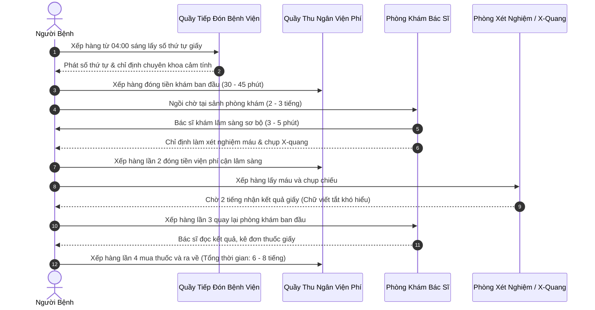
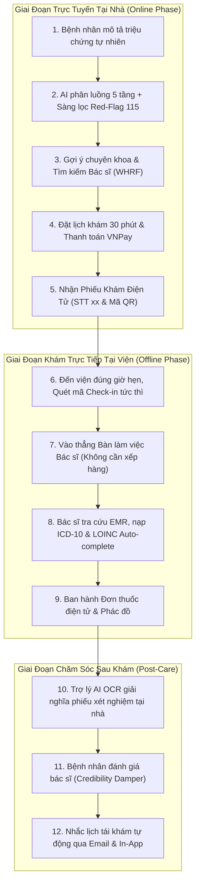
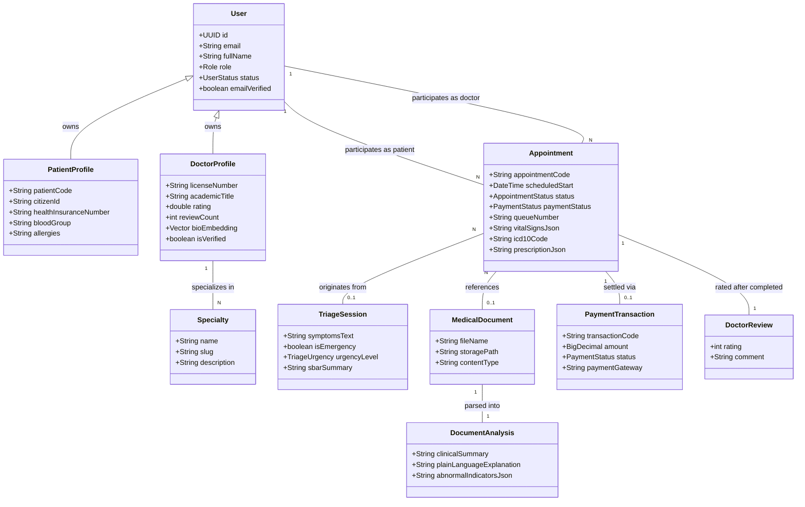
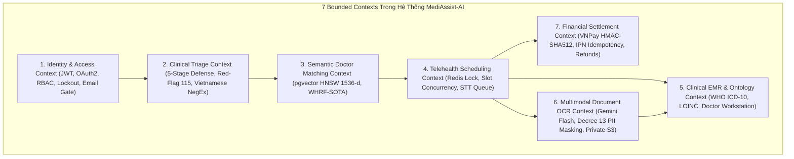

# CAPSTONE PROJECT REPORT
# Report 2 – Requirements Analysis & Domain Modeling

---

### **HỆ THỐNG TRỢ LÝ Y TẾ ẢO HỖ TRỢ ĐẶT LỊCH & PHÂN LUỒNG KHÁM BỆNH THÔNG MINH (MEDIASSIST-AI)**

* **Tên dự án:** MediAssist-AI: Intelligent Healthcare Assistant & Clinical Telehealth Platform
* **Mã dự án (Capstone Project ID):** FPTU-KLTN-2026-MEDIASSIST
* **Khóa luận:** Khóa luận Tốt nghiệp Đại học FPT – Chuyên ngành Kỹ thuật Phần mềm & Trí tuệ Nhân tạo (SE-AI)
* **Thời gian thực hiện:** Tháng 05/2026 – Tháng 10/2026
* **Địa điểm:** Quy Nhon / Da Nang – October 2026
* **Tiêu chuẩn tài liệu:** ISO/IEC/IEEE 29148:2018 (Systems and Software Engineering – Life Cycle Processes – Requirements Engineering)

---

## Table of Contents

* [I. Record of Changes](#i-record-of-changes)
* [II. Requirements Analysis & Domain Modeling](#ii-requirements-analysis--domain-modeling)
  * [1. Business Workflow & Operational Healthcare Models](#1-business-workflow--operational-healthcare-models)
    * [1.1 As-Is Traditional Clinical Workflow & Pain Points](#11-as-is-traditional-clinical-workflow--pain-points)
    * [1.2 To-Be Modern Telehealth Ecosystem (O2O Architecture)](#12-to-be-modern-telehealth-ecosystem-o2o-architecture)
    * [1.3 Stakeholder & Actor Identification](#13-stakeholder--actor-identification)
  * [2. User Personas & Clinical Empathy Mapping](#2-user-personas--clinical-empathy-mapping)
    * [2.1 Persona 1: Nguyễn Văn Nam – Bệnh Nhân Tỉnh Xa](#21-persona-1-nguyễn-văn-nam--bệnh-nhân-tỉnh-xa)
    * [2.2 Persona 2: Bác Sĩ CKII Lê Hoàng Mai – Trưởng Khoa Lâm Sàng](#22-persona-2-bác-sĩ-ckii-lê-hoàng-mai--trưởng-khoa-lâm-sàng)
    * [2.3 Persona 3: Quản Trị Viên Bệnh Viện Trần Thị Hương](#23-persona-3-quản-trị-viên-bệnh-viện-trần-thị-hương)
  * [3. Clinical Domain Modeling & Conceptual Architecture](#3-clinical-domain-modeling--conceptual-architecture)
    * [3.1 Ubiquitous Domain Language & Medical Glossary](#31-ubiquitous-domain-language--medical-glossary)
    * [3.2 Conceptual Domain Model Diagram](#32-conceptual-domain-model-diagram)
    * [3.3 7 Bounded Contexts Decomposition (Domain-Driven Design)](#33-7-bounded-contexts-decomposition-domain-driven-design)
  * [4. Use Case Model & Macro System Interactions](#4-use-case-model--macro-system-interactions)
    * [4.1 Global High-Level Use Case Diagram](#41-global-high-level-use-case-diagram)
    * [4.2 Actor-to-Feature Traceability Matrix](#42-actor-to-feature-traceability-matrix)
    * [4.3 System Operational Constraints & Regulatory Framework](#43-system-operational-constraints--regulatory-framework)

---

## I. Record of Changes

| Date | A / M / D (*) | In Charge | Change Description |
| :--- | :---: | :--- | :--- |
| **01/06/2026** | A | VinhHT | Khởi tạo tài liệu phân tích nghiệp vụ, mô hình quy trình As-Is vs To-Be và xây dựng 3 chân dung người dùng (Personas). |
| **20/06/2026** | A | VinhHT | Thiết kế mô hình miền lâm sàng Conceptual Domain Model và phân chia 7 Bounded Contexts theo Domain-Driven Design (DDD). |
| **15/07/2026** | M | VinhHT | Bổ sung phân tích bài toán Lệch Ngữ Nghĩa (Semantic Mismatch) trong tìm kiếm bác sĩ và sơ đồ ca sử dụng toàn hệ thống. |
| **18/10/2026** | M | VinhHT | Hoàn thiện toàn diện Báo cáo Phân tích Nghiệp vụ và Mô hình hóa Miền Report 2, đồng bộ hóa 100% với 49 Use Cases và CSDL 17 bảng thực tế. |

*(*) Ghi chú: **A** - Added (Thêm mới), **M** - Modified (Chỉnh sửa/Cập nhật), **D** - Deleted (Xóa).*

---

## II. Requirements Analysis & Domain Modeling

### 1. Business Workflow & Operational Healthcare Models

#### 1.1 As-Is Traditional Clinical Workflow & Pain Points
Quy trình khám chữa bệnh ngoại trú truyền thống tại các bệnh viện công lập và phòng khám đa khoa tại Việt Nam hiện đang bộc lộ nhiều điểm nghẽn nghiêm trọng:

##### Những Nỗi Đau Lớn (Pain Points) Trong Mô Hình Cũ:
1. **Lãng phí thời gian chờ đợi vô ích (Waiting Waste):** Người bệnh phải xếp hàng 4 lần tại các quầy thủ tục khác nhau. Thời gian chờ đợi chiếm tới **$90\%$** tổng thời gian ở bệnh viện, trong khi thời gian được bác sĩ thăm khám và tư vấn trực tiếp chỉ vỏn vẹn **$3 - 5\text{ phút}$**.
2. **Nguy cơ lây nhiễm chéo cao:** Tập trung đông người trong không gian kín sảnh chờ nhiều giờ làm tăng vọt nguy cơ lây nhiễm chéo các bệnh đường hô hấp truyền nhiễm.
3. **Mù mờ thông tin chỉ số y khoa:** Phiếu kết quả xét nghiệm chỉ in các thông số viết tắt kỹ thuật (như SGOT, SGPT, Ure, Creatinine) mà không có diễn giải bằng ngôn ngữ phổ thông, khiến bệnh nhân hoang mang hoặc tự tìm kiếm trên Google dẫn đến lo âu bệnh tật quá mức (Cyberchondria).
4. **Hồ sơ bệnh án phân mảnh:** Bệnh nhân giữ đơn thuốc và phim chụp bằng giấy, dễ bị thất lạc hoặc hư hỏng sau vài tháng, khiến các lần khám sau bác sĩ không nắm được tiền sử diễn biến bệnh.

---

#### 1.2 To-Be Modern Telehealth Ecosystem (O2O Architecture)
**MediAssist-AI** tái định hình toàn bộ hành trình chăm sóc sức khỏe của bệnh nhân theo mô hình **O2O (Online-to-Offline)** khép kín và số hóa:

##### Lợi Ích Vượt Trội Của Mô Hình To-Be:
* **Cắt giảm 75% thời gian tại bệnh viện:** Người bệnh chỉ cần có mặt trước giờ hẹn 10 phút, quét mã QR điểm danh tiếp đón và vào thẳng phòng khám theo đúng số thứ tự `queue_number` ("STT 04") đã được hệ thống giữ chỗ.
* **Định tuyến chuẩn xác ngay từ đầu:** Động cơ AI phân luồng 5 tầng hướng dẫn người bệnh đăng ký đúng chuyên khoa lâm sàng, giảm thiểu tối đa tình trạng đăng ký nhầm khoa.
* **Bệnh án điện tử EMR tập trung:** Toàn bộ lịch sử các lần khám, đơn thuốc, chỉ số sinh hiệu và kết quả cận lâm sàng được lưu trữ trọn đời trong tài khoản cá nhân, được bảo vệ qua rào chắn `PatientAccessGuard` và URL ký số S3 15 phút.

---

#### 1.3 Stakeholder & Actor Identification

##### Table 1.3: Stakeholder Analysis & Requirements Matrix

| Tác Nhân (Actor) | Bản Chất & Vai Trò Trong Hệ Thống | Mục Tiêu & Nhu Cầu Cốt Lõi | Thách Thức Nghiệp Vụ Cần Giải Quyết |
| :--- | :--- | :--- | :--- |
| **Patient (Người Bệnh)** | Người dùng cuối cá nhân tìm kiếm dịch vụ tư vấn sức khỏe, đặt lịch khám và quản lý bệnh án. | - Hiểu rõ triệu chứng đang gặp phải. - Tìm đúng bác sĩ giỏi, uy tín, minh bạch về giá khám. - Đặt lịch nhanh chóng, không phải xếp hàng chờ đợi. - Hiểu ý nghĩa các chỉ số trong phiếu xét nghiệm. | - Dễ bị hoang mang bởi các thông tin y tế sai lệch trên mạng. - Lo ngại lộ lọt thông tin bệnh lý nhạy cảm. |
| **Doctor (Bác Sĩ Lâm Sàng)** | Nhân viên y tế có Chứng chỉ hành nghề, phụ trách khám bệnh, kê đơn và tư vấn điều trị. | - Nắm bắt nhanh tiền sử bệnh và triệu chứng tóm tắt (SBAR) của bệnh nhân trước khi vào phòng. - Kê đơn thuốc và chẩn đoán bệnh theo danh mục chuẩn quốc tế WHO ICD-10 nhanh chóng. - Quản lý hàng đợi khám bệnh trong ngày trật tự, minh bạch. | - Quá tải số lượng bệnh nhân, áp lực ghi chép bệnh án thủ công. - Rủi ro chẩn đoán sai khi bệnh nhân không nhớ tiền sử dùng thuốc. |
| **Admin (Quản Trị Bệnh Viện)** | Bộ phận quản lý vận hành, thanh tra chất lượng và phụ trách pháp lý an toàn y tế. | - Thẩm định và phê duyệt chứng chỉ hành nghề của bác sĩ trước khi cho phép khám. - Giám sát hàng đợi khám và phân bổ chuyên khoa theo thời gian thực. - Truy vết toàn bộ nhật ký an ninh theo tiêu chuẩn HIPAA và Nghị định 13/2023/NĐ-CP. - Quản lý danh mục chuyên khoa và đối soát viện phí. | - Nguy cơ rò rỉ dữ liệu y tế gây hậu quả pháp lý nghiêm trọng. - Áp lực điều phối nhân lực khi có dịch bệnh đột biến. |
| **External AI & Financial Services** | Các dịch vụ đám mây bên thứ ba: OpenAI, Gemini Vision, VNPay Gateway, SMTP Brevo. | - Xử lý tính toán vector ngữ nghĩa, trích xuất hình ảnh cận lâm sàng OCR, giao dịch tài chính an toàn. | - Rủi ro đứt cáp quang biển, mạng ngoài gặp sự cố Timeout hoặc Webhook bị can thiệp chữ ký. |

---

### 2. User Personas & Clinical Empathy Mapping

#### 2.1 Persona 1: Nguyễn Văn Nam – Bệnh Nhân Tỉnh Xa
* **Độ tuổi:** 45 tuổi | **Nghề nghiệp:** Kỹ sư xây dựng | **Nơi cư trú:** Huyện miền núi tỉnh Bình Định.
* **Bối cảnh:** Thường xuyên bị đau tức ngực âm ỉ kèm cảm giác hụt hơi khi lao động nặng. Muốn đi khám tại bệnh viện lớn ở Quy Nhơn nhưng sợ cảnh xếp hàng từ 4 giờ sáng và không biết nên đăng ký khám Khoa Tim mạch hay Khoa Hô hấp.
* **Nhu cầu cốt lõi:**
  - Nhập triệu chứng vào trợ lý ảo để được giải thích sơ bộ xem tình trạng có nguy hiểm không.
  - Đặt lịch khám chính xác với một Bác sĩ Chuyên khoa Tim mạch uy tín vào khung giờ cố định ngày Thứ Bảy.
  - Tải ảnh chụp phiếu xét nghiệm máu từ đợt khám năm ngoái lên để bác sĩ xem trước tiền sử mỡ máu.
* **Nỗi sợ:** Sợ tốn tiền đi lại xa nhưng đăng ký nhầm khoa; sợ thông tin sức khỏe của mình bị lộ ra ngoài cho đồng nghiệp biết.

#### 2.2 Persona 2: Bác Sĩ CKII Lê Hoàng Mai – Trưởng Khoa Lâm Sàng
* **Độ tuổi:** 52 tuổi | **Học vị:** Bác sĩ Chuyên khoa II | **Nơi công tác:** Bệnh viện Đa khoa Tỉnh.
* **Bối cảnh:** Mỗi ngày phải tiếp nhận từ $60 - 80\text{ bệnh nhân}$ tại phòng khám ngoại trú. Áp lực thời gian khiến bác sĩ chỉ có thể dành trung bình 3 - 5 phút cho mỗi ca, trong đó mất tới 2 phút để hỏi han lại những triệu chứng cơ bản và gõ tay mã bệnh.
* **Nhu cầu cốt lõi:**
  - Xem ngay bản tóm tắt lâm sàng chuẩn cấu trúc **SBAR** do AI tổng hợp sẵn trước khi bệnh nhân bước vào phòng.
  - Có thanh công cụ tìm kiếm chẩn đoán tự động hoàn thiện (Autocomplete) theo mã quốc tế **WHO ICD-10** và chỉ số cận lâm sàng **LOINC** để kê đơn điện tử trong 30 giây.
  - Hệ thống hàng đợi tự động gọi lượt tiếp theo (`call-next`), kiểm soát bệnh nhân đã có mặt tại sảnh (`checked_in_at`).
* **Nỗi sợ:** Bệnh nhân tự ý mua thuốc kháng sinh uống bừa bãi trước khi đến khám; hệ thống phần mềm chậm chạp làm gián đoạn buổi khám.

#### 2.3 Persona 3: Quản Trị Viên Bệnh Viện Trần Thị Hương
* **Độ tuổi:** 34 tuổi | **Vị trí:** Trưởng phòng Công nghệ Thông tin & Đảm bảo Chất lượng.
* **Bối cảnh:** Chịu trách nhiệm trực tiếp trước Giám đốc Bệnh viện và Sở Y Tế về an toàn dữ liệu y tế điện tử (EMR) và chất lượng dịch vụ tiếp đón bệnh nhân.
* **Nhu cầu cốt lõi:**
  - Bảng điều khiển giám sát thời gian thực (Executive Supervision Dashboard) đếm số lượng ca khám, số ca cấp cứu khẩn cấp 115 trong ngày.
  - Kiểm tra và thẩm định hồ sơ chứng chỉ hành nghề của các bác sĩ mới nộp đơn.
  - Báo cáo kiểm toán an ninh bất biến (Audit Trail) phục vụ đoàn thanh tra y tế: Biết chính xác ai đã mở xem bệnh án của bệnh nhân X vào lúc mấy giờ, từ địa chỉ IP nào.
  - Tự động hoàn tiền viện phí sòng phẳng, minh bạch cho người bệnh khi ca khám bị hủy.
* **Nỗi sợ:** Bị tấn công rò rỉ dữ liệu bệnh nhân (Data Breach) dẫn đến bị xử phạt theo Nghị định 13/2023/NĐ-CP; hệ thống bị sập khi lượng truy cập tăng đột biến.

---

### 3. Clinical Domain Modeling & Conceptual Architecture

#### 3.1 Ubiquitous Domain Language & Medical Glossary
Để đảm bảo tính nhất quán tuyệt đối giữa đội ngũ phát triển phần mềm, bác sĩ cố vấn và hội đồng đánh giá, hệ thống thiết lập bộ từ điển thuật ngữ miền y tế (Ubiquitous Language):

##### Table 3.1: Clinical Ubiquitous Domain Glossary

| Thuật Ngữ Y Khoa | Định Nghĩa Nghiệp Vụ Chuẩn Xác Trong Hệ Thống | Hiện Thực Hóa Kỹ Thuật (Implementation) |
| :--- | :--- | :--- |
| **Clinical Triage** | Quy trình phân loại mức độ khẩn cấp y tế của bệnh nhân dựa trên triệu chứng ban đầu. | `SymptomTriageService` phân thành 3 cấp: `ROUTINE`, `URGENT`, `EMERGENCY`. |
| **Red-Flag Emergency** | Dấu hiệu cờ đỏ y tế: Tình trạng đe dọa tính mạng cấp tính cần can thiệp y tế tức thời (Đột quỵ, Nhồi máu cơ tim, Sốc phản vệ). | `RedFlagService`: Khóa luồng khám thường, bật cảnh báo đỏ và hướng dẫn gọi Cấp cứu 115. |
| **Vietnamese NegEx** | Thuật toán bóc tách mệnh đề phủ định trong ngôn ngữ tự nhiên tiếng Việt y khoa. | Cách ly các triệu chứng đi sau từ phủ định ("không sốt", "chưa từng đau tim") để tránh định tuyến sai chuyên khoa. |
| **SBAR Communication** | Chuẩn giao tiếp cấu trúc y tế quốc tế gồm: Tình huống (Situation), Bối cảnh (Background), Đánh giá (Assessment), Khuyến nghị (Recommendation). | Cấu trúc dữ liệu JSON lưu trong cột `sbar_summary` của bảng `triage_sessions`. |
| **WHO ICD-10** | Hệ thống phân loại bệnh tật quốc tế phiên bản 10 do Tổ chức Y tế Thế giới ban hành (Bộ Y Tế áp dụng theo QĐ 7603/QĐ-BYT). | Bảng danh mục tra cứu gồm mã bệnh (ví dụ: `I10`) và tên bệnh tiếng Việt (`Tăng huyết áp vô căn`). |
| **LOINC Standard** | Hệ thống mã hóa định danh xét nghiệm và quan sát cận lâm sàng quốc tế (Bộ Y Tế áp dụng theo QĐ 3280/QĐ-BYT). | Chuẩn hóa các chỉ số xét nghiệm (ví dụ: `1558-6` cho Glucose máu) và khoảng giá trị tham chiếu sinh học. |
| **EMR Passport** | Hộ chiếu bệnh án điện tử cá nhân lưu trữ tiền sử bệnh mạn tính, dị ứng thuốc và sinh hiệu. | Lưu trữ cấu trúc trong bảng `patient_profiles` và các cột JSON trên bảng `appointments`. |
| **Care Relationship** | Quan hệ khám chữa bệnh hợp lệ giữa một bác sĩ và một bệnh nhân được xác lập qua lịch hẹn. | Rào chắn `PatientAccessGuard` kiểm tra trạng thái cuộc hẹn (`SCHEDULED`, `IN_PROGRESS`, `COMPLETED`). |

---

#### 3.2 Conceptual Domain Model Diagram
Mô hình miền khái niệm thể hiện mối quan hệ giữa các thực thể cốt lõi trong hệ sinh thái Telehealth của MediAssist-AI:

---

#### 3.3 7 Bounded Contexts Decomposition (Domain-Driven Design)
Hệ thống được thiết kế theo phương pháp **Domain-Driven Design (DDD)** với 7 ranh giới ngữ cảnh (Bounded Contexts) hoàn toàn độc lập về mặt nghiệp vụ:

1. **Identity & Access Management Context:** Quản lý vòng đời tài khoản người dùng, phân quyền vai trò (Admin, Doctor, Patient), xác thực kép Dual-Transport JWT, bảo vệ Brute-Force khóa 15 phút và cổng kích hoạt email.
2. **Clinical Triage Context:** Tiếp nhận ngôn ngữ tự nhiên, bóc tách phủ định NegEx, phát hiện cấp cứu 115, chuẩn hóa teen-code và sinh cấu trúc SBAR.
3. **Semantic Doctor Matching Context:** Quản lý không gian vector nhúng 1536 chiều, chỉ mục đồ thị HNSW, và bộ tái xếp hạng đa tiêu chí WHRF-SOTA kết hợp đánh giá uy tín.
4. **Telehealth Scheduling Context:** Quản lý lịch khám bệnh, khung giờ slot 30 phút, phân bổ số thứ tự tiếp đón `queue_number`, khóa chống trùng slot và thuật toán hoàn tiền phân tầng.
5. **Clinical EMR & Ontology Context:** Bệnh án điện tử EMR, lưu trữ sinh hiệu, tra cứu mã chẩn đoán quốc tế WHO ICD-10 và danh mục xét nghiệm LOINC của Bộ Y Tế.
6. **Multimodal Document OCR Context:** Tiếp nhận ảnh chụp phiếu xét nghiệm, khử định danh PII theo Nghị định 13/2023/NĐ-CP, trích xuất chỉ số cận lâm sàng và cấp URL ký số S3 15 phút.
7. **Financial Settlement Context:** Sổ cái giao dịch tài chính, kết nối cổng thanh toán quốc gia VNPay, kiểm soát Webhook IPN chống lặp và tự động hoàn trả viện phí.

---

### 4. Use Case Model & Macro System Interactions

#### 4.1 Global High-Level Use Case Diagram
Sơ đồ tổng quan phân bổ các nhóm ca sử dụng theo 4 tác nhân chính:

```mermaid
graph TD
    Patient((Bệnh Nhân))
    Doctor((Bác Sĩ))
    Admin((Quản Trị Viên))
    ExternalGateway[External AI & Banking Gateway]

    subgraph "Hệ Thống MediAssist-AI (49 Use Cases)"
        subgraph Common_Group["Nhóm Chung (UC-COM)"]
            UC_Auth["UC-COM-01: Đăng nhập Dual-Transport JWT"]
            UC_OAuth["UC-COM-02: Đăng nhập Google OAuth2 SSO"]
            UC_Pwd["UC-COM-03: Khôi phục mật khẩu SHA-256"]
            UC_Prof["UC-COM-04: Cập nhật hồ sơ cá nhân"]
        end

        subgraph Patient_Group["Nhóm Người Bệnh (UC-PAT)"]
            UC_Triage["UC-PAT-01: Phân luồng triệu chứng AI & 115"]
            UC_Search["UC-PAT-02: Tìm kiếm Bác sĩ ngữ nghĩa (WHRF)"]
            UC_Book["UC-PAT-03: Đặt lịch khám & Chống trùng Slot"]
            UC_Checkin["UC-PAT-04: Điểm danh tiếp đón STT"]
            UC_DocUpload["UC-PAT-05: Tải lên xét nghiệm & Giải nghĩa OCR"]
            UC_Pay["UC-PAT-06: Thanh toán viện phí VNPay"]
            UC_Review["UC-PAT-07: Đánh giá & Phản hồi Bác sĩ"]
        end

        subgraph Doctor_Group["Nhóm Bác Sĩ (UC-DOC)"]
            UC_Desk["UC-DOC-01: Bàn làm việc Bác sĩ (Doctor Workstation)"]
            UC_CallNext["UC-DOC-02: Gọi bệnh nhân tiếp theo (Call Next)"]
            UC_EMR["UC-DOC-03: Kê đơn & Chẩn đoán WHO ICD-10/LOINC"]
            UC_Schedule["UC-DOC-04: Cấu hình lịch làm việc tuần"]
        end

        subgraph Admin_Group["Nhóm Quản Trị (UC-ADM)"]
            UC_Vet["UC-ADM-01: Thẩm định CCHN Bác sĩ & Sync Vector"]
            UC_Supervise["UC-ADM-02: Giám sát toàn viện thời gian thực"]
            UC_Audit["UC-ADM-03: Nhật ký kiểm toán HIPAA & Nghị định 13"]
            UC_Taxonomy["UC-ADM-04: Quản lý danh mục chuyên khoa"]
        end
    end

    Patient --> UC_Auth
    Patient --> UC_OAuth
    Patient --> UC_Pwd
    Patient --> UC_Prof
    Patient --> UC_Triage
    Patient --> UC_Search
    Patient --> UC_Book
    Patient --> UC_Checkin
    Patient --> UC_DocUpload
    Patient --> UC_Pay
    Patient --> UC_Review

    Doctor --> UC_Auth
    Doctor --> UC_Desk
    Doctor --> UC_CallNext
    Doctor --> UC_EMR
    Doctor --> UC_Schedule

    Admin --> UC_Auth
    Admin --> UC_Vet
    Admin --> UC_Supervise
    Admin --> UC_Audit
    Admin --> UC_Taxonomy

    UC_Triage -.-> ExternalGateway
    UC_Search -.-> ExternalGateway
    UC_DocUpload -.-> ExternalGateway
    UC_Pay -.-> ExternalGateway
```

---

#### 4.2 Actor-to-Feature Traceability Matrix

##### Table 4.2: Actor-to-Use Case Traceability Matrix

| Mã Phân Hệ | Nhóm Chức Năng Chính | Patient | Doctor | Admin | System / AI Gateway | Rào Chắn Kiểm Soát An Ninh |
| :---: | :--- | :---: | :---: | :---: | :---: | :--- |
| **UC-COM-01**| Đăng nhập mật khẩu & Dual-Transport Token | **X** | **X** | **X** | - | Khóa 15 phút sau 5 lần sai mật khẩu |
| **UC-COM-02**| Đăng nhập một chạm Google OAuth2 SSO | **X** | **X** | - | Google OIDC | Tự động kích hoạt cờ `email_verified=true` |
| **UC-COM-03**| Quên mật khẩu & Token băm SHA-256 | **X** | **X** | **X** | SMTP Server | Mã băm SHA-256 một chiều, Anti-User Enumeration |
| **UC-PAT-01**| Phân luồng triệu chứng 5 tầng | **X** | - | - | Gemini 1.5 Flash | Rào chắn cấp cứu 115 & Vietnamese NegEx |
| **UC-PAT-02**| Tìm kiếm bác sĩ ngữ nghĩa đa tiêu chí | **X** | - | - | pgvector HNSW | Thuật toán WHRF-SOTA & Sigmoid Sharpening |
| **UC-PAT-03**| Đặt lịch hẹn khám & Cấp số thứ tự STT | **X** | - | - | Redis Cache | Khóa phân tán chống trùng slot `SLOT_CONFLICT` |
| **UC-PAT-04**| Điểm danh tiếp đón tại phòng khám | **X** | - | - | - | Kiểm tra đúng ngày hẹn khám `checked_in_at` |
| **UC-PAT-05**| Giải nghĩa xét nghiệm OCR & Khử PII | **X** | - | - | Gemini Vision | Khử định danh theo Nghị định 13/2023/NĐ-CP |
| **UC-PAT-06**| Thanh toán viện phí VNPay trực tuyến | **X** | - | - | VNPay Gateway | Ký số HMAC-SHA512 & Webhook Idempotency |
| **UC-PAT-07**| Đánh giá bác sĩ sau ca khám hoàn tất | **X** | - | - | - | Chỉ cho phép đánh giá ca khám `COMPLETED` |
| **UC-DOC-01**| Bàn làm việc Bác sĩ (Doctor Workstation) | - | **X** | - | - | Bác sĩ phải có cờ `is_verified=true` |
| **UC-DOC-02**| Gọi lượt bệnh nhân tiếp theo (Call Next) | - | **X** | - | - | Tự động chuyển trạng thái sang `IN_PROGRESS` |
| **UC-DOC-03**| Ban hành bệnh án EMR & Đơn thuốc điện tử | - | **X** | - | WHO ICD-10 | Rào chắn phân quyền đối tượng `PatientAccessGuard` |
| **UC-ADM-01**| Thẩm định CCHN Bác sĩ & Đồng bộ Vector | - | - | **X** | OpenAI API | Tự động tính toán vector `bio_embedding` khi duyệt |
| **UC-ADM-02**| Giám sát toàn viện thời gian thực | - | - | **X** | - | Partial Indexing tăng tốc truy vấn $O(1)$ |
| **UC-ADM-03**| Nhật ký kiểm toán an ninh y tế | - | - | **X** | - | Bất biến (Immutable Audit), chuẩn HIPAA |

---

#### 4.3 System Operational Constraints & Regulatory Framework
1. **Tuân thủ pháp lý y tế Việt Nam:**
   - **Thông tư 46/2018/TT-BYT:** Quy định về hồ sơ bệnh án điện tử, bắt buộc áp dụng danh mục mã chẩn đoán WHO ICD-10 và lưu trữ đơn thuốc điện tử.
   - **Quyết định 7603/QĐ-BYT:** Danh mục mã bệnh ICD-10 chuẩn hóa của Bộ Y Tế Việt Nam.
   - **Quyết định 3280/QĐ-BYT:** Danh mục và khoảng tham chiếu các chỉ số xét nghiệm cận lâm sàng chuẩn LOINC.
2. **Tuân thủ pháp lý bảo vệ dữ liệu cá nhân:**
   - **Nghị định 13/2023/NĐ-CP:** Dữ liệu sức khỏe và bệnh án là **Dữ liệu cá nhân nhạy cảm**. Bắt buộc phải có biện pháp khử định danh trước khi gửi sang hệ thống thứ ba và kiểm soát quyền truy cập chặt chẽ.
   - **HIPAA Security Rule:** Bắt buộc ghi vết kiểm toán cho mọi lượt đọc/sửa hồ sơ bệnh án điện tử và mã hóa dữ liệu tĩnh (At-Rest) bằng AES-256.
3. **Ràng buộc hiệu năng vận hành:**
   - Độ trễ tìm kiếm vector HNSW không được vượt quá **5 mili-giây** trên tập dữ liệu 100.000 hồ sơ.
   - Khả năng sẵn sàng của hệ thống đạt **99.9% High Availability**.
