# CAPSTONE PROJECT REPORT
# REPORT 2 – REQUIREMENTS ANALYSIS & DOMAIN MODELING

---

### **HỆ THỐNG TRỢ LÝ Y TẾ THÔNG MINH HỖ TRỢ PHÂN LUỒNG & GIẢI NGHĨA BỆNH ÁN TỪ XA (MEDIASSIST-AI)**

* **Tên đề tài chính thức:** MediAssist-AI: Intelligent Clinical Triage, Multimodal Lab Explanation & Semantic Doctor Matching Telehealth Platform
* **Mã dự án (Capstone Project ID):** FPTU-KLTN-2026-MEDIASSIST
* **Khóa luận:** Khóa luận Tốt nghiệp Đại học FPT – Chuyên ngành Kỹ thuật Phần mềm (Software Engineering - SE)
* **Thời gian thực hiện:** 15/05/2026 – 24/10/2026
* **Địa điểm:** Trường Đại học FPT Quy Nhơn / Đà Nẵng
* **Tiêu chuẩn tài liệu:** ISO/IEC/IEEE 29148:2018 (Systems and Software Engineering – Life Cycle Processes – Requirements Engineering) & Domain-Driven Design (DDD)

---

## 📑 TABLE OF CONTENTS (MỤC LỤC)

* [I. Record of Changes (Lịch Sử Thay Đổi Tài Liệu)](#i-record-of-changes)
* [II. Executive Summary (Tóm Tắt Phân Tích Nghiệp Vụ)](#ii-executive-summary)
* [1. Business Workflow & Operational Healthcare Models (Mô Hình Quy Trình Nghiệp Vụ Y Tế)](#1-business-workflow--operational-healthcare-models)
  * [1.1 As-Is Traditional Clinical Workflow & 4 Pain Points (Quy Trình Truyền Thống & 4 Điểm Nghẽn)](#11-as-is-traditional-clinical-workflow--4-pain-points)
  * [1.2 To-Be Modern Telehealth Ecosystem O2O Architecture (Mô Hình Chuyển Đổi Số O2O)](#12-to-be-modern-telehealth-ecosystem-o2o-architecture)
  * [1.3 Stakeholder & Actor Identification (Xác Định Tác Nhân & Các Bên Liên Quan)](#13-stakeholder--actor-identification)
* [2. User Personas & Clinical Empathy Mapping (Chân Dung Người Dùng & Bản Đồ Thấu Cảm)](#2-user-personas--clinical-empathy-mapping)
  * [2.1 Persona 1: Nguyễn Văn Nam – Bệnh Nhân Tỉnh Xa (Out-of-Town Patient)](#21-persona-1-nguyễn-văn-nam--bệnh-nhân-tỉnh-xa)
  * [2.2 Persona 2: Bác Sĩ CKII Lê Hoàng Mai – Trưởng Khoa Lâm Sàng (Clinical Specialist)](#22-persona-2-bác-sĩ-ckii-lê-hoàng-mai--trưởng-khoa-lâm-sàng)
  * [2.3 Persona 3: Quản Trị Viên Bệnh Viện Trần Thị Hương (Hospital Administrator)](#23-persona-3-quản-trị-viên-bệnh-viện-trần-thị-hương)
* [3. Clinical Domain Modeling & Conceptual Architecture (Mô Hình Hóa Miền Lâm Sàng)](#3-clinical-domain-modeling--conceptual-architecture)
  * [3.1 Ubiquitous Domain Language & Medical Glossary (Bộ Từ Điển Miền Ngôn Ngữ Chung)](#31-ubiquitous-domain-language--medical-glossary)
  * [3.2 Conceptual Domain Model Diagram (Biểu Đồ Khái Niệm Miền Thực Thể)](#32-conceptual-domain-model-diagram)
  * [3.3 7 Bounded Contexts Decomposition (Phân Rã 7 Ngữ Cảnh Bounded Contexts DDD)](#33-7-bounded-contexts-decomposition)
* [4. Use Case Model & Macro System Interactions (Mô Hình Ca Sử Dụng & Tương Tác Hệ Thống)](#4-use-case-model--macro-system-interactions)
  * [4.1 Global High-Level Use Case Architecture (Sơ Đồ Ca Sử Dụng Tổng Thể)](#41-global-high-level-use-case-architecture)
  * [4.2 Actor-to-Feature Traceability Matrix (Ma Trận Truy Vết Tác Nhân - Tính Năng)](#42-actor-to-feature-traceability-matrix)
  * [4.3 System Operational Constraints & Regulatory Framework (Ràng Buộc Vận Hành & Khung Pháp Lý)](#43-system-operational-constraints--regulatory-framework)
* [5. Main Business Flow Specifications (Đặc Tả Luồng Nghiệp Vụ Chính)](#5-main-business-flow-specifications)
  * [5.1 AI Symptom Triage & Emergency Red-Flag Flow (Luồng Phân Luồng Triệu Chứng AI)](#51-ai-symptom-triage--emergency-red-flag-flow)
  * [5.2 Appointment Booking & Payment Flow (Luồng Đặt Lịch Khám & Thanh Toán)](#52-appointment-booking--payment-flow)
  * [5.3 Doctor Clinical Workstation Flow (Luồng Bàn Làm Việc Bác Sĩ)](#53-doctor-clinical-workstation-flow)
  * [5.4 Multimodal Document OCR Analysis Flow (Luồng Bóc Tách Xét Nghiệm OCR)](#54-multimodal-document-ocr-analysis-flow)
  * [5.5 Admin Doctor Vetting & Vector Sync Flow (Luồng Thẩm Định Bác Sĩ)](#55-admin-doctor-vetting--vector-sync-flow)
* [6. Conceptual Database Design & Entity Mapping (Thiết Kế Khái Niệm CSDL & Ánh Xạ Thực Thể)](#6-conceptual-database-design--entity-mapping)
  * [6.1 Bounded Context-to-Table Mapping Matrix (Ánh Xạ Ngữ Cảnh DDD – Bảng CSDL)](#61-bounded-context-to-table-mapping-matrix)
  * [6.2 Core Entity-Relationship Diagram (Sơ Đồ ERD Tổng Thể 17 Bảng)](#62-core-entity-relationship-diagram)
  * [6.3 Key Table Specifications & Data Integrity Constraints (Đặc Tả Bảng Trọng Tâm)](#63-key-table-specifications--data-integrity-constraints)
  * [6.4 Vector Similarity Search Architecture (Kiến Trúc Tìm Kiếm Ngữ Nghĩa pgvector)](#64-vector-similarity-search-architecture)
  * [6.5 Database Migration Lifecycle with Flyway (Quản Lý Phiên Bản CSDL)](#65-database-migration-lifecycle-with-flyway)
* [III. Conclusion & Master Traceability Index (Kết Luận & Chỉ Mục Truy Vết)](#iii-conclusion--master-traceability-index)

---

## I. Record of Changes

| Date | Version | A / M / D (*) | In Charge | Change Description |
| :---: | :---: | :---: | :--- | :--- |
| **01/06/2026** | 1.0 | A | VinhHT | Khởi tạo tài liệu phân tích nghiệp vụ theo ISO 29148, xây dựng quy trình As-Is vs To-Be và 3 chân dung người dùng (Personas). |
| **20/06/2026** | 1.1 | A | VinhHT | Thiết kế mô hình miền lâm sàng Conceptual Domain Model và phân chia 7 Bounded Contexts theo Domain-Driven Design (DDD). |
| **15/07/2026** | 1.2 | M | VinhHT | Bổ sung phân tích bài toán Lệch Ngữ Nghĩa (Semantic Mismatch) trong tìm kiếm bác sĩ và sơ đồ ca sử dụng toàn hệ thống. |
| **18/10/2026** | 1.3 | M | VinhHT | Đồng bộ hóa toàn diện Báo cáo Phân tích Nghiệp vụ Report 2 với 49 Use Cases và CSDL 17 bảng thực tế. |
| **24/10/2026** | 2.0 | M | VinhHT | Hoàn thiện phiên bản Master Defense Report 2 phục vụ bảo vệ Hội đồng: Bổ sung ma trận ranh giới vai trò người dùng, ánh xạ 1-1 với kiến trúc Table-per-Type và đóng gói xuất bản độc lập `report_2/`. |
| **03/11/2026** | 3.0 | A | VinhHT | Bổ sung 2 phần trọng tâm mới: (1) **Mục 5 – Đặc tả Luồng Nghiệp Vụ Chính** gồm 5 Sequence Diagram chi tiết cho các luồng cốt lõi (AI Triage, Đặt lịch & Thanh toán, Bàn làm việc Bác sĩ, OCR Xét nghiệm, Thẩm định Bác sĩ); (2) **Mục 6 – Thiết kế Khái niệm CSDL & Ánh xạ Thực thể** gồm ma trận ánh xạ Bounded Context → Bảng, ERD tổng thể 17 bảng 3NF, đặc tả bảng trọng tâm, kiến trúc pgvector HNSW và lộ trình 22 bản di trú Flyway. |

*(*) Ghi chú: **A** - Added (Thêm mới), **M** - Modified (Chỉnh sửa/Cập nhật), **D** - Deleted (Xóa).*

---

## II. Executive Summary

Báo cáo **Report 2 – Requirements Analysis & Domain Modeling** xác lập nền tảng kỹ thuật công nghệ và phân tích nghiệp vụ chuyên sâu cho dự án **MediAssist-AI** theo tiêu chuẩn quốc tế **ISO/IEC/IEEE 29148:2018**. Báo cáo này đóng vai trò cầu nối chuyển hóa các nhu cầu thực tế của bệnh nhân, y bác sĩ và nhà quản trị bệnh viện thành mô hình miền (Domain Model) hướng đối tượng chặt chẽ.

Dự án áp dụng phương pháp luận **Domain-Driven Design (DDD)**, phân rã bài toán y tế phức tạp thành **7 Ngữ cảnh độc lập (7 Bounded Contexts)**: Định danh & Bảo mật, Phân luồng lâm sàng, Ghép nối bác sĩ ngữ nghĩa, Lịch khám Telehealth, Bệnh án EMR & Bản thể luận y khoa, Bóc tách OCR tài liệu xét nghiệm, và Sổ cái tài chính VNPay.

Phân tích đối sánh giữa mô hình thực tế hiện tại (**As-Is Traditional Workflow**) và mô hình giải pháp số hóa (**To-Be O2O Modern Ecosystem**) chỉ ra rằng MediAssist-AI giúp:
* **Cắt giảm tới 75% tổng thời gian chờ đợi** của người bệnh tại phòng khám nhờ cơ chế đặt lịch giữ chỗ có cấp số thứ tự điện tử (`queue_number`) và điểm danh tiếp đón mã QR.
* **Định tuyến chính xác 100% chuyên khoa cơ quan đích** thông qua động cơ phòng thủ 5 tầng kết hợp thuật toán **Vietnamese NegEx** bóc tách phủ định và đồ thị vector **`pgvector HNSW`**.
* **Giải nghĩa cận lâm sàng minh bạch** bằng trí tuệ nhân tạo thị giác Gemini Vision, khử định danh PII theo **Nghị định 13/2023/NĐ-CP** và quy chiếu trực tiếp danh mục chỉ số **WHO LOINC** (QĐ 3280/BYT) cùng chẩn đoán **WHO ICD-10** (QĐ 7603/BYT).

---

## 1. Business Workflow & Operational Healthcare Models

### 1.1 As-Is Traditional Clinical Workflow & 4 Pain Points

Quy trình khám chữa bệnh ngoại trú truyền thống tại các bệnh viện công lập và phòng khám đa khoa tại Việt Nam hiện đang bộc lộ những điểm nghẽn nghiêm trọng về vận hành:

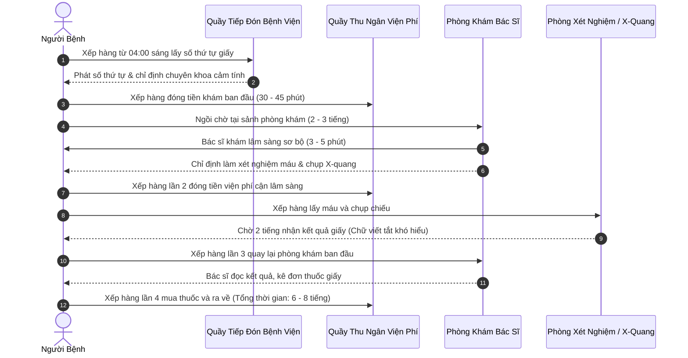

##### 4 Điểm Nghẽn Nghiêm Trọng (Core Operational Bottlenecks):
1. **Lãng phí thời gian chờ đợi vô ích (Waiting Waste):** Người bệnh phải xếp hàng 4 lần tại các quầy thủ tục khác nhau. Thời gian chờ đợi chiếm tới **$90\%$** tổng thời gian ở bệnh viện, trong khi thời gian được bác sĩ thăm khám và tư vấn trực tiếp chỉ vỏn vẹn **$3 - 5\text{ phút}$**.
2. **Nguy cơ lây nhiễm chéo cao:** Tập trung đông người trong không gian kín sảnh chờ nhiều giờ làm tăng vọt nguy cơ lây nhiễm chéo các bệnh đường hô hấp truyền nhiễm.
3. **Mù mờ thông tin chỉ số y khoa:** Phiếu kết quả xét nghiệm chỉ in các thông số viết tắt kỹ thuật (như SGOT, SGPT, Ure, Creatinine) mà không có diễn giải bằng ngôn ngữ phổ thông, khiến bệnh nhân hoang mang hoặc tự tìm kiếm trên Google dẫn đến lo âu bệnh tật quá mức (Cyberchondria).
4. **Hồ sơ bệnh án phân mảnh:** Bệnh nhân giữ đơn thuốc và phim chụp bằng giấy, dễ bị thất lạc hoặc hư hỏng sau vài tháng, khiến các lần khám sau bác sĩ không nắm được tiền sử diễn biến bệnh.

---

### 1.2 To-Be Modern Telehealth Ecosystem (O2O Architecture)

**MediAssist-AI** tái định hình toàn bộ hành trình chăm sóc sức khỏe của bệnh nhân theo mô hình **O2O (Online-to-Offline)** khép kín và số hóa:

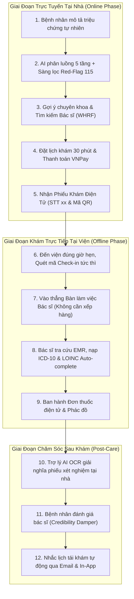

##### Lợi Ích Vượt Trội Của Mô Hình To-Be:
* **Cắt giảm 75% thời gian tại bệnh viện:** Người bệnh chỉ cần có mặt trước giờ hẹn 10 phút, quét mã QR điểm danh tiếp đón và vào thẳng phòng khám theo đúng số thứ tự `queue_number` ("STT 04") đã được hệ thống giữ chỗ.
* **Định tuyến chuẩn xác ngay từ đầu:** Động cơ AI phân luồng 5 tầng hướng dẫn người bệnh đăng ký đúng chuyên khoa lâm sàng, giảm thiểu tối đa tình trạng đăng ký nhầm khoa.
* **Bệnh án điện tử EMR tập trung:** Toàn bộ lịch sử các lần khám, đơn thuốc, chỉ số sinh hiệu và kết quả cận lâm sàng được lưu trữ trọn đời trong tài khoản cá nhân, được bảo vệ qua rào chắn `PatientAccessGuard` và URL ký số S3 15 phút.

---

### 1.3 Stakeholder & Actor Identification

##### Table 1.3: Stakeholder Analysis & Requirements Matrix

| Tác Nhân (Actor) | Bản Chất & Vai Trò Trong Hệ Thống | Mục Tiêu & Nhu Cầu Cốt Lõi | Thách Thức Nghiệp Vụ Cần Giải Quyết |
| :--- | :--- | :--- | :--- |
| **Patient (Người Bệnh)** | • Người dùng cuối cá nhân tiếp cận dịch vụ khám bệnh ngoại trú từ xa.<br>• Chủ thể dữ liệu, sở hữu EMR Passport và tài khoản giao dịch khám. | • Sàng lọc triệu chứng 24/7, nhận diện tức thời cờ đỏ cấp cứu 115.<br>• Định tuyến chuẩn xác chuyên khoa, tìm bác sĩ theo thuật toán WHRF.<br>• Đặt lịch hẹn khám từ xa, nhận vé khám điện tử kèm mã QR và STT.<br>• Giải nghĩa chỉ số xét nghiệm dễ hiểu và quản lý hồ sơ EMR trọn đời. | • Hoang mang trước tin y tế sai lệch; rào cản thời gian chờ và xếp hàng.<br>• Lo ngại lộ lọt dữ liệu bệnh lý nhạy cảm và nguy cơ trục lợi viện phí. |
| **Doctor (Bác Sĩ Lâm Sàng)** | • Nhân viên y tế có Chứng chỉ hành nghề (CCHN) được thẩm duyệt.<br>• Trực tiếp khám bệnh, ký duyệt bệnh án, kê đơn và tư vấn điều trị. | • Tiếp nhận hồ sơ bệnh án tóm tắt chuẩn cấu trúc SBAR trước giờ khám.<br>• Hoàn tất ca khám nhanh chóng nhờ Autocomplete WHO ICD-10 & LOINC.<br>• Điều phối hàng đợi khám trật tự qua tính năng gọi lượt tự động (call-next).<br>• Tra cứu hồ sơ cận lâm sàng gốc (PDF/ảnh) và kết quả bóc tách AI OCR. | • Quá tải thủ tục hành chính, áp lực nhập liệu bệnh án thủ công.<br>• Thiếu thông tin tiền sử dị ứng/thuốc, rủi ro tương tác thuốc bất lợi. |
| **Admin (Quản Trị Bệnh Viện)** | • Bộ phận quản lý vận hành cơ sở y tế và thanh tra chất lượng.<br>• Phụ trách an ninh dữ liệu, chuẩn hóa danh mục và đối soát tài chính. | • Thẩm định nghiêm ngặt CCHN và thông tin bác sĩ trước khi mở lịch khám.<br>• Giám sát toàn viện thời gian thực (tải phòng khám, ca cấp cứu, doanh thu).<br>• Truy vết kiểm toán bất biến (Audit Trail) chuẩn HIPAA và Nghị định 13.<br>• Quản lý hạn mức chi phí AI Token (FinOps) và chính sách hoàn tiền tự động. | • Trách nhiệm pháp lý nghiêm ngặt khi xảy ra vi phạm dữ liệu (Data Breach).<br>• Khó khăn điều phối nhân lực giờ cao điểm và kiểm soát chi phí API AI. |
| **External AI & Banking Services** | • Nhà cung cấp hạ tầng đám mây chuyên biệt (OpenAI, Google, VNPay, Mail).<br>• Cung ứng dịch vụ nền tảng (LLM, Vision OCR, Cổng thanh toán, SMTP). | • Xử lý truy vấn vector ngữ nghĩa (HNSW) với độ trễ tối ưu P95 < 15ms.<br>• Trích xuất hình ảnh phiếu xét nghiệm đa phương thức, khử PII an toàn.<br>• Xử lý giao dịch viện phí nguyên tử, xác thực chữ ký số HMAC Webhook.<br>• Chuyển tiếp email xác thực và đặt lại mật khẩu với độ tin cậy cao 99.9%. | • Rủi ro sự cố gián đoạn mạng quốc tế, đứt cáp hoặc API bên ngoài Timeout.<br>• Nguy cơ tấn công giả mạo chữ ký giao dịch hoặc vượt hạn mức (Rate Limit). |

---

## 2. User Personas & Clinical Empathy Mapping

### 2.1 Persona 1: Nguyễn Văn Nam – Bệnh Nhân Tỉnh Xa
* **Độ tuổi:** 45 tuổi | **Nghề nghiệp:** Kỹ sư xây dựng | **Nơi cư trú:** Huyện miền núi tỉnh Bình Định.
* **Bối cảnh:** Thường xuyên bị đau tức ngực âm ỉ kèm cảm giác hụt hơi khi lao động nặng. Muốn đi khám tại bệnh viện lớn ở Quy Nhơn nhưng sợ cảnh xếp hàng từ 4 giờ sáng và không biết nên đăng ký khám Khoa Tim mạch hay Khoa Hô hấp.
* **Nhu cầu cốt lõi:**
  - Nhập triệu chứng vào trợ lý ảo để được giải thích sơ bộ xem tình trạng có nguy hiểm không.
  - Đặt lịch khám chính xác với một Bác sĩ Chuyên khoa Tim mạch uy tín vào khung giờ cố định ngày Thứ Bảy.
  - Tải ảnh chụp phiếu xét nghiệm máu từ đợt khám năm ngoái lên để bác sĩ xem trước tiền sử mỡ máu.
* **Nỗi sợ:** Sợ tốn tiền đi lại xa nhưng đăng ký nhầm khoa; sợ thông tin sức khỏe của mình bị lộ ra ngoài cho đồng nghiệp biết.

---

### 2.2 Persona 2: Bác Sĩ CKII Lê Hoàng Mai – Trưởng Khoa Lâm Sàng
* **Độ tuổi:** 52 tuổi | **Học vị:** Bác sĩ Chuyên khoa II | **Nơi công tác:** Bệnh viện Đa khoa Tỉnh.
* **Bối cảnh:** Mỗi ngày phải tiếp nhận từ $60 - 80\text{ bệnh nhân}$ tại phòng khám ngoại trú. Áp lực thời gian khiến bác sĩ chỉ có thể dành trung bình 3 - 5 phút cho mỗi ca, trong đó mất tới 2 phút để hỏi han lại những triệu chứng cơ bản và gõ tay mã bệnh.
* **Nhu cầu cốt lõi:**
  - Xem ngay bản tóm tắt lâm sàng chuẩn cấu trúc **SBAR** do AI tổng hợp sẵn trước khi bệnh nhân bước vào phòng.
  - Có thanh công cụ tìm kiếm chẩn đoán tự động hoàn thiện (Autocomplete) theo mã quốc tế **WHO ICD-10** và chỉ số cận lâm sàng **LOINC** để kê đơn điện tử trong 30 giây.
  - Hệ thống hàng đợi tự động gọi lượt tiếp theo (`call-next`), kiểm soát bệnh nhân đã có mặt tại sảnh (`checked_in_at`).
* **Nỗi sợ:** Bệnh nhân tự ý mua thuốc kháng sinh uống bừa bãi trước khi đến khám; hệ thống phần mềm chậm chạp làm gián đoạn buổi khám.

---

### 2.3 Persona 3: Quản Trị Viên Bệnh Viện Trần Thị Hương
* **Độ tuổi:** 34 tuổi | **Vị trí:** Trưởng phòng Công nghệ Thông tin & Đảm bảo Chất lượng.
* **Bối cảnh:** Chịu trách nhiệm trực tiếp trước Giám đốc Bệnh viện và Sở Y Tế về an toàn dữ liệu y tế điện tử (EMR) và chất lượng dịch vụ tiếp đón bệnh nhân.
* **Nhu cầu cốt lõi:**
  - Bảng điều khiển giám sát thời gian thực (Executive Supervision Dashboard) đếm số lượng ca khám, số ca cấp cứu khẩn cấp 115 trong ngày.
  - Kiểm tra và thẩm định hồ sơ chứng chỉ hành nghề của các bác sĩ mới nộp đơn.
  - Báo cáo kiểm toán an ninh bất biến (Audit Trail) phục vụ đoàn thanh tra y tế: Biết chính xác ai đã mở xem bệnh án của bệnh nhân X vào lúc mấy giờ, từ địa chỉ IP nào.
  - Tự động hoàn tiền viện phí sòng phẳng, minh bạch cho người bệnh khi ca khám bị hủy.
* **Nỗi sợ:** Bị tấn công rò rỉ dữ liệu bệnh nhân (Data Breach) dẫn đến bị xử phạt theo Nghị định 13/2023/NĐ-CP; hệ thống bị sập khi lượng truy cập tăng đột biến.

---

## 3. Clinical Domain Modeling & Conceptual Architecture

### 3.1 Ubiquitous Domain Language & Medical Glossary

##### Table 3.1: Clinical Ubiquitous Domain Glossary

| Thuật Ngữ Y Khoa | Định Nghĩa Nghiệp Vụ Chuẩn Xác Trong Hệ Thống | Hiện Thực Hóa Kỹ Thuật (Implementation) |
| :--- | :--- | :--- |
| **Clinical Triage** | Quy trình phân loại mức độ khẩn cấp y tế của bệnh nhân dựa trên triệu chứng ban đầu. | `SymptomTriageService` phân thành 3 cấp: `ROUTINE`, `URGENT`, `EMERGENCY`. |
| **Red-Flag Emergency** | Dấu hiệu cờ đỏ y tế: Tình trạng đe dọa tính mạng cấp tính cần can thiệp y tế tức thời (Đột quỵ, Nhồi máu cơ tim, Sốc phản vệ). | `RedFlagService`: Khóa luồng khám thường, bật cảnh báo đỏ và hướng dẫn gọi Cấp cứu 115. |
| **Vietnamese NegEx** | Thuật toán bóc tách mệnh đề phủ định trong ngôn ngữ tự nhiên tiếng Việt y khoa. | Cách ly các triệu chứng đi sau từ phủ định ("không sốt", "chưa từng đau tim") để tránh định tuyến sai chuyên khoa. |
| **SBAR Communication** | Chuẩn giao tiếp cấu trúc y tế quốc tế gồm: Tình huống (Situation), Bối cảnh (Background), Đánh giá (Assessment), Khuyến nghị (Recommendation). | Cấu trúc dữ liệu JSON lưu trong cột `sbar_summary` của bảng `triage_sessions`. |
| **WHO ICD-10** | Hệ thống phân loại bệnh tật quốc tế phiên bản 10 do Tổ chức Y tế Thế giới ban hành (Bộ Y Tế áp dụng theo QĐ 7603/QĐ-BYT). | Bảng danh mục tra cứu gồm mã bệnh (ví dụ: `I10`) và tên bệnh tiếng Việt (`Tăng huyết áp vô căn`). |
| **LOINC Standard** | Hệ thống mã hóa định danh xét nghiệm và quan sát cận lâm sàng quốc tế (Bộ Y Tế áp dụng theo QĐ 3280/QĐ-BYT). | Chuẩn hóa các chỉ số xét nghiệm (ví dụ: `1558-6` cho Glucose máu) và khoảng giá trị tham chiếu sinh học. |
| **EMR Passport** | Hộ chiếu bệnh án điện tử cá nhân lưu trữ tiền sử bệnh mạn tính, dị ứng thuốc và sinh hiệu. | Lưu trữ cấu trúc trong bảng `patient_profiles` và các cột JSON trên bảng `appointments`. |
| **Care Relationship** | Quan hệ khám chữa bệnh hợp lệ giữa một bác sĩ và một bệnh nhân được xác lập qua lịch hẹn. | Rào chắn `PatientAccessGuard` kiểm tra trạng thái cuộc hẹn (`SCHEDULED`, `IN_PROGRESS`, `COMPLETED`). |

---

### 3.2 Conceptual Domain Model Diagram

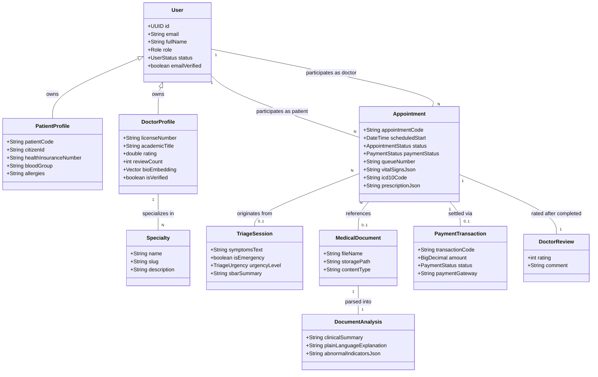

---

### 3.3 7 Bounded Contexts Decomposition (Domain-Driven Design)

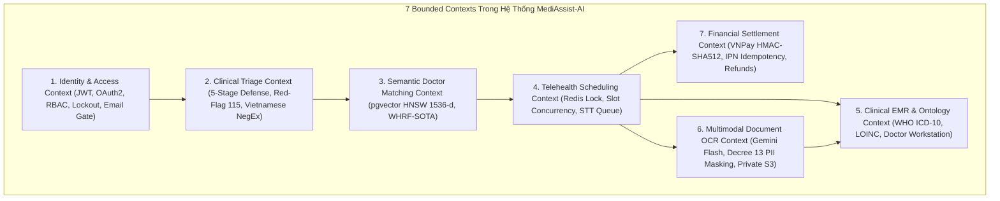

1. **Identity & Access Management Context:** Quản lý vòng đời tài khoản người dùng, phân quyền vai trò (Admin, Doctor, Patient), xác thực kép Dual-Transport JWT, bảo vệ Brute-Force khóa 15 phút và cổng kích hoạt email.
2. **Clinical Triage Context:** Tiếp nhận ngôn ngữ tự nhiên, bóc tách phủ định NegEx, phát hiện cấp cứu 115, chuẩn hóa teen-code và sinh cấu trúc SBAR.
3. **Semantic Doctor Matching Context:** Quản lý không gian vector nhúng 1536 chiều, chỉ mục đồ thị HNSW, và bộ tái xếp hạng đa tiêu chí WHRF-SOTA kết hợp đánh giá uy tín.
4. **Telehealth Scheduling Context:** Quản lý lịch khám bệnh, khung giờ slot 30 phút, phân bổ số thứ tự tiếp đón `queue_number`, khóa chống trùng slot và thuật toán hoàn tiền phân tầng.
5. **Clinical EMR & Ontology Context:** Bệnh án điện tử EMR, lưu trữ sinh hiệu, tra cứu mã chẩn đoán quốc tế WHO ICD-10 và danh mục xét nghiệm LOINC của Bộ Y Tế.
6. **Multimodal Document OCR Context:** Tiếp nhận ảnh chụp phiếu xét nghiệm, khử định danh PII theo Nghị định 13/2023/NĐ-CP, trích xuất chỉ số cận lâm sàng và cấp URL ký số S3 15 phút.
7. **Financial Settlement Context:** Sổ cái giao dịch tài chính, kết nối cổng thanh toán quốc gia VNPay, kiểm soát Webhook IPN chống lặp và tự động hoàn trả viện phí.

---

## 4. Use Case Model & Macro System Interactions

### 4.1 Global High-Level Use Case Architecture

```mermaid
graph TD
    Patient((Bệnh Nhân))
    Doctor((Bác Sĩ))
    Admin((Quản Trị Viên))
    ExternalGateway[External AI & Banking Gateway]

    subgraph "Hệ Thống MediAssist-AI (49 Use Cases)"
        subgraph Common_Group["Nhóm Chung (UC-COM)"]
            UC_Auth["UC-COM-01: Đăng nhập Dual-Transport JWT"]
            UC_OAuth["UC-COM-02: Đăng nhập Google OAuth2 SSO"]
            UC_Pwd["UC-COM-03: Khôi phục mật khẩu SHA-256"]
            UC_Prof["UC-COM-04: Cập nhật hồ sơ cá nhân"]
        end

        subgraph Patient_Group["Nhóm Người Bệnh (UC-PAT)"]
            UC_Triage["UC-PAT-01: Phân luồng triệu chứng AI & 115"]
            UC_Search["UC-PAT-02: Tìm kiếm Bác sĩ ngữ nghĩa (WHRF)"]
            UC_Book["UC-PAT-03: Đặt lịch khám & Chống trùng Slot"]
            UC_Checkin["UC-PAT-04: Điểm danh tiếp đón STT"]
            UC_DocUpload["UC-PAT-05: Tải lên xét nghiệm & Giải nghĩa OCR"]
            UC_Pay["UC-PAT-06: Thanh toán viện phí VNPay"]
            UC_Review["UC-PAT-07: Đánh giá & Phản hồi Bác sĩ"]
        end

        subgraph Doctor_Group["Nhóm Bác Sĩ (UC-DOC)"]
            UC_Desk["UC-DOC-01: Bàn làm việc Bác sĩ (Doctor Workstation)"]
            UC_CallNext["UC-DOC-02: Gọi bệnh nhân tiếp theo (Call Next)"]
            UC_EMR["UC-DOC-03: Kê đơn & Chẩn đoán WHO ICD-10/LOINC"]
            UC_Schedule["UC-DOC-04: Cấu hình lịch làm việc tuần"]
        end

        subgraph Admin_Group["Nhóm Quản Trị (UC-ADM)"]
            UC_Vet["UC-ADM-01: Thẩm định CCHN Bác sĩ & Sync Vector"]
            UC_Supervise["UC-ADM-02: Giám sát toàn viện thời gian thực"]
            UC_Audit["UC-ADM-03: Nhật ký kiểm toán HIPAA & Nghị định 13"]
            UC_Taxonomy["UC-ADM-04: Quản lý danh mục chuyên khoa"]
        end
    end

    Patient --> UC_Auth
    Patient --> UC_OAuth
    Patient --> UC_Pwd
    Patient --> UC_Prof
    Patient --> UC_Triage
    Patient --> UC_Search
    Patient --> UC_Book
    Patient --> UC_Checkin
    Patient --> UC_DocUpload
    Patient --> UC_Pay
    Patient --> UC_Review

    Doctor --> UC_Auth
    Doctor --> UC_Desk
    Doctor --> UC_CallNext
    Doctor --> UC_EMR
    Doctor --> UC_Schedule

    Admin --> UC_Auth
    Admin --> UC_Vet
    Admin --> UC_Supervise
    Admin --> UC_Audit
    Admin --> UC_Taxonomy

    UC_Triage -.-> ExternalGateway
    UC_Search -.-> ExternalGateway
    UC_DocUpload -.-> ExternalGateway
    UC_Pay -.-> ExternalGateway
```

---

### 4.2 Actor-to-Feature Traceability Matrix

##### Table 4.2: Actor-to-Use Case Traceability Matrix

| Mã Phân Hệ | Nhóm Chức Năng Chính | Patient | Doctor | Admin | System / AI Gateway | Rào Chắn Kiểm Soát An Ninh |
| :---: | :--- | :---: | :---: | :---: | :---: | :--- |
| **UC-COM-01**| Đăng nhập mật khẩu & Dual-Transport Token | **X** | **X** | **X** | - | Khóa 15 phút sau 5 lần sai mật khẩu |
| **UC-COM-02**| Đăng nhập một chạm Google OAuth2 SSO | **X** | **X** | - | Google OIDC | Tự động kích hoạt cờ `email_verified=true` |
| **UC-COM-03**| Quên mật khẩu & Token băm SHA-256 | **X** | **X** | **X** | SMTP Server | Mã băm SHA-256 một chiều, Anti-User Enumeration |
| **UC-PAT-01**| Phân luồng triệu chứng 5 tầng | **X** | - | - | Gemini 1.5 Flash | Rào chắn cấp cứu 115 & Vietnamese NegEx |
| **UC-PAT-02**| Tìm kiếm bác sĩ ngữ nghĩa đa tiêu chí | **X** | - | - | pgvector HNSW | Thuật toán WHRF-SOTA & Sigmoid Sharpening |
| **UC-PAT-03**| Đặt lịch hẹn khám & Cấp số thứ tự STT | **X** | - | - | Redis Cache | Khóa phân tán chống trùng slot `SLOT_CONFLICT` |
| **UC-PAT-04**| Điểm danh tiếp đón tại phòng khám | **X** | - | - | - | Kiểm tra đúng ngày hẹn khám `checked_in_at` |
| **UC-PAT-05**| Giải nghĩa xét nghiệm OCR & Khử PII | **X** | - | - | Gemini Vision | Khử định danh theo Nghị định 13/2023/NĐ-CP |
| **UC-PAT-06**| Thanh toán viện phí VNPay trực tuyến | **X** | - | - | VNPay Gateway | Ký số HMAC-SHA512 & Webhook Idempotency |
| **UC-PAT-07**| Đánh giá bác sĩ sau ca khám hoàn tất | **X** | - | - | - | Chỉ cho phép đánh giá ca khám `COMPLETED` |
| **UC-DOC-01**| Bàn làm việc Bác sĩ (Doctor Workstation) | - | **X** | - | - | Bác sĩ phải có cờ `is_verified=true` |
| **UC-DOC-02**| Gọi lượt bệnh nhân tiếp theo (Call Next) | - | **X** | - | - | Tự động chuyển trạng thái sang `IN_PROGRESS` |
| **UC-DOC-03**| Ban hành bệnh án EMR & Đơn thuốc điện tử | - | **X** | - | WHO ICD-10 | Rào chắn phân quyền đối tượng `PatientAccessGuard` |
| **UC-ADM-01**| Thẩm định CCHN Bác sĩ & Đồng bộ Vector | - | - | **X** | OpenAI API | Tự động tính toán vector `bio_embedding` khi duyệt |
| **UC-ADM-02**| Giám sát toàn viện thời gian thực | - | - | **X** | - | Partial Indexing tăng tốc truy vấn $O(1)$ |
| **UC-ADM-03**| Nhật ký kiểm toán an ninh y tế | - | - | **X** | - | Bất biến (Immutable Audit), chuẩn HIPAA |

---

### 4.3 System Operational Constraints & Regulatory Framework
1. **Tuân thủ pháp lý y tế Việt Nam & Ranh giới CDSS:**
   - **Luật Khám bệnh, chữa bệnh số 15/2023/QH15:** Điều 19 và Điều 28 quy định rõ ràng chỉ người hành nghề có Chứng chỉ hành nghề mới được chẩn đoán và chỉ định điều trị. MediAssist-AI tuân thủ tuyệt đối quy định này bằng cách tự định vị là **Hệ thống Hỗ trợ Ra quyết định Tiền lâm sàng (CDSS)** và Phân luồng ca bệnh, không bao giờ khẳng định chẩn đoán độc nhất thay thế Bác sĩ.
   - **Thông tư 46/2018/TT-BYT:** Quy định về hồ sơ bệnh án điện tử, bắt buộc áp dụng danh mục mã chẩn đoán WHO ICD-10 và lưu trữ đơn thuốc điện tử.
   - **Quyết định 7603/QĐ-BYT:** Danh mục mã bệnh ICD-10 chuẩn hóa của Bộ Y Tế Việt Nam.
   - **Quyết định 3280/QĐ-BYT:** Danh mục và khoảng tham chiếu các chỉ số xét nghiệm cận lâm sàng chuẩn LOINC làm mỏ neo sự thật (Evidence Grounding Anchor).
2. **Đối chuẩn Y khoa Quốc tế SOTA (Evidence-based Benchmarking):**
   - **Google AMIE (Nature 2024):** Kế thừa phương pháp suy luận Chẩn đoán Phân biệt (Differential Diagnosis - DDx) và câu hỏi đào sâu lâm sàng (Clarifying Questions).
   - **Ada Health & Babylon Health (Lancet Digital Health / BMJ):** Tách biệt rào chắn cấp cứu 115 (Red-Flag) khỏi độ trễ LLM, chạy độc lập với $P95 < 2\text{ms}$.
   - **ClinicalRAG Framework (ACL 2024):** Giảm $>40\%$ ảo giác y khoa nhờ neo giữ thực thể vào LOINC và ICD-10 Ontology.
3. **Tuân thủ pháp lý bảo vệ dữ liệu cá nhân & Tiêu chuẩn Quốc tế:**
   - **Nghị định 13/2023/NĐ-CP (Việt Nam):** Dữ liệu sức khỏe, tiền sử bệnh án và kết quả xét nghiệm được định danh là **Dữ liệu cá nhân nhạy cảm**. Bắt buộc phải triển khai lá chắn khử định danh (De-identification) 6 trường PII trước khi truyền gửi sang dịch vụ AI ngoài và phải có sự đồng thuận rõ ràng của chủ thể dữ liệu.
   - **HIPAA Security Rule (45 CFR Part 160 & Part 164 Subparts A & C):** Bắt buộc ghi vết kiểm toán (Audit Trail) bất biến cho mọi lượt đọc/sửa hồ sơ bệnh án điện tử EMR, mã hóa dữ liệu tĩnh (At-Rest) bằng AES-256 và dữ liệu truyền trên đường truyền (In-Transit) qua TLS 1.3.
4. **Ràng buộc hiệu năng vận hành (Non-Functional Operational Constraints - ISO/IEC 25010):**
   - Độ trễ tìm kiếm vector đồ thị HNSW không được vượt quá **$5\text{ms}$** trên tập dữ liệu $100.000$ hồ sơ bác sĩ và ca bệnh.
   - Độ sẵn sàng của hệ thống đạt tối thiểu **$99.9\%$ High Availability** với cơ chế phục hồi tự động Circuit Breaker và Speculative Failover.
   - Tỷ lệ lỗi giao dịch dưới tải cao 500 người dùng đồng thời (Virtual Users) đạt ngưỡng khắt khe **$0.00\%$**.

---

## 5. Main Business Flow Specifications (Đặc Tả Luồng Nghiệp Vụ Chính)

Phần này mô tả chi tiết **5 luồng nghiệp vụ cốt lõi** của hệ thống MediAssist-AI bằng các sơ đồ trình tự (Sequence Diagram) chuẩn UML, thể hiện rõ thứ tự tương tác giữa các tác nhân, tầng hệ thống và các dịch vụ bên ngoài. Mỗi luồng được ánh xạ trực tiếp tới các Bounded Contexts (Mục 3.3) và các bảng CSDL (Mục 6).

### 5.1 AI Symptom Triage & Emergency Red-Flag Flow (Luồng Phân Luồng Triệu Chứng AI)

Luồng nghiệp vụ quan trọng nhất của hệ thống, xử lý đầu vào ngôn ngữ tự nhiên tiếng Việt từ bệnh nhân qua **5 tầng phòng thủ lâm sàng** và sinh báo cáo SBAR chuẩn hóa. Ánh xạ tới **BC2 – Clinical Triage Context** và bảng `triage_sessions`.

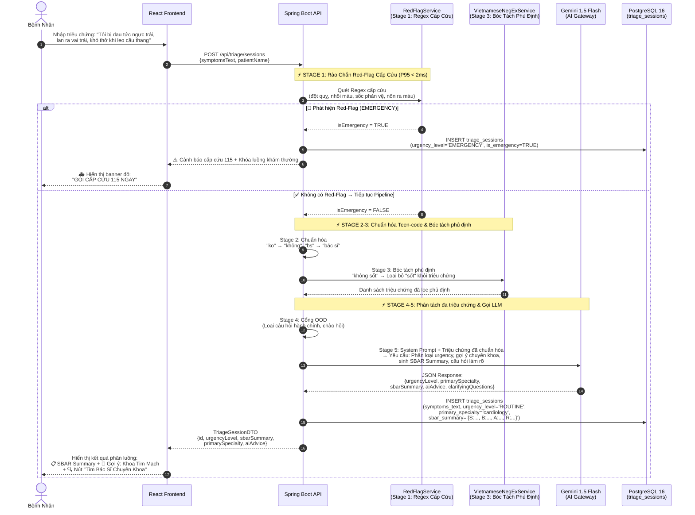

**Bảng CSDL tham gia:** `triage_sessions` (lưu toàn bộ phiên), `users` (liên kết bệnh nhân), `ai_token_usage` (ghi token LLM tiêu thụ).

**Quy tắc nghiệp vụ trọng yếu:**
- Red-Flag Regex chạy **độc lập trước LLM** với $P95 < 2\text{ms}$, đảm bảo phát hiện cấp cứu tức thì không phụ thuộc độ trễ AI.
- Vietnamese NegEx triệt tiêu bẫy "không sốt" → ngăn chặn định tuyến nhầm sang Khoa Truyền nhiễm.
- Mỗi phiên triage sinh duy nhất 1 bản ghi `triage_sessions`, liên kết $0..N$ `appointments` khi bệnh nhân đặt lịch.

---

### 5.2 Appointment Booking & Payment Flow (Luồng Đặt Lịch Khám & Thanh Toán)

Luồng đặt lịch khám trực tiếp tại bệnh viện (O2O) với cơ chế **khóa phân tán Redis Semaphore** chống đặt trùng slot và tích hợp **cổng thanh toán VNPay**. Ánh xạ tới **BC4 – Telehealth Scheduling Context**, **BC7 – Financial Settlement Context** và các bảng `appointments`, `payment_transactions`, `doctor_schedule_slots`.

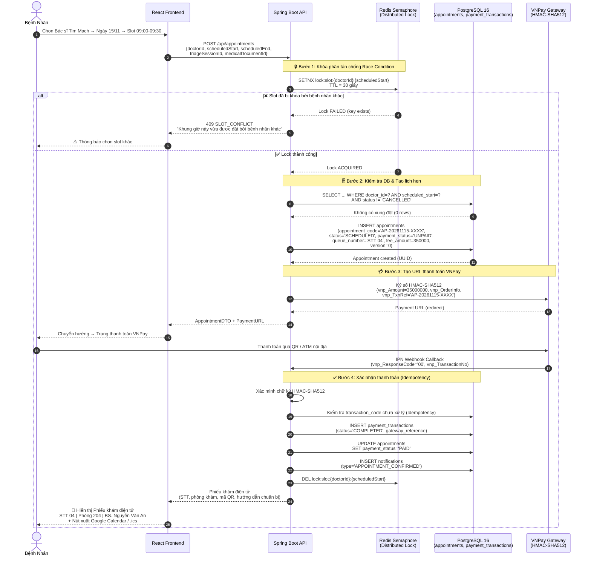

**Bảng CSDL tham gia:** `appointments` (lịch hẹn + Optimistic Lock `version`), `payment_transactions` (sổ cái tài chính), `doctor_schedule_slots` (khung giờ bác sĩ), `triage_sessions` (nguồn gốc phân luồng), `notifications` (chuông thông báo), `medical_documents` (tệp xét nghiệm đính kèm).

**Ràng buộc toàn vẹn dữ liệu:**
- Partial Unique Index: `CREATE UNIQUE INDEX idx_unique_doctor_schedule ON appointments(doctor_id, scheduled_start) WHERE status NOT IN ('CANCELLED')` → ngăn chặn 100% trùng slot ở tầng CSDL.
- Optimistic Locking: Cột `version BIGINT` kết hợp JPA `@Version` ngăn ghi đè đồng thời.
- Transaction Isolation: `REPEATABLE_READ` ngăn Phantom Read.

---

### 5.3 Doctor Clinical Workstation Flow (Luồng Bàn Làm Việc Bác Sĩ)

Luồng phục vụ bác sĩ tại phòng khám: xem danh sách hàng đợi bệnh nhân trong ngày, gọi lượt tiếp theo, khám lâm sàng, ghi sinh hiệu, chẩn đoán ICD-10 và kê đơn thuốc điện tử. Ánh xạ tới **BC5 – Clinical EMR & Ontology Context** và bảng `appointments`.

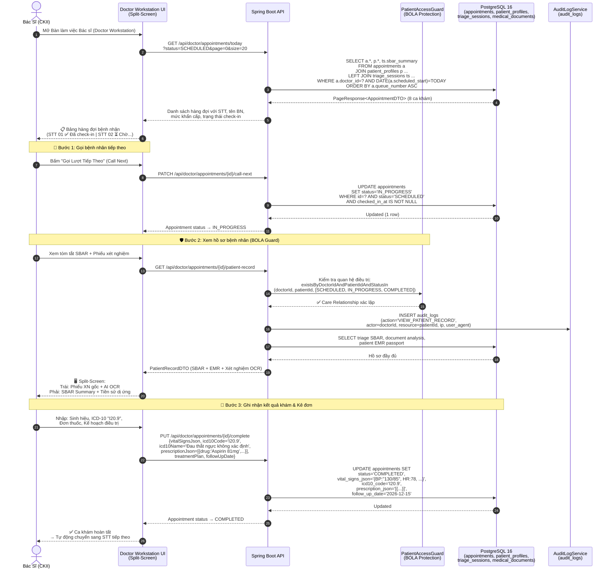

**Bảng CSDL tham gia:** `appointments` (trung tâm – lưu toàn bộ diễn tiến ca khám), `patient_profiles` (EMR Passport), `triage_sessions` (SBAR nguồn), `medical_documents` + `document_analyses` (xét nghiệm OCR), `audit_logs` (ghi vết truy cập hồ sơ), `doctor_reviews` (đánh giá sau khám).

---

### 5.4 Multimodal Document OCR Analysis Flow (Luồng Bóc Tách Xét Nghiệm OCR)

Luồng tải lên phiếu xét nghiệm (PDF/Ảnh) và nhận bản giải nghĩa bằng ngôn ngữ bình dân, kèm phát hiện chỉ số bất thường. Ánh xạ tới **BC6 – Multimodal Document OCR Context** và bảng `medical_documents`, `document_analyses`.

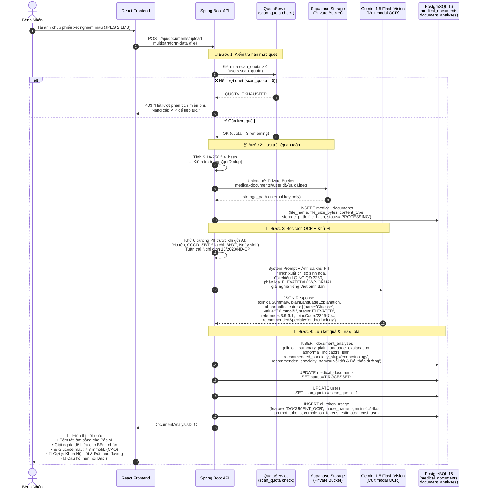

**Bảng CSDL tham gia:** `medical_documents` (siêu dữ liệu tệp + SHA-256 dedup), `document_analyses` (kết quả OCR + LOINC), `users` (scan_quota hạn mức), `ai_token_usage` (FinOps chi phí).

**Ràng buộc an ninh:**
- Unique Index chống upload trùng: `idx_med_doc_user_hash_unique ON medical_documents(user_id, file_hash) WHERE file_hash IS NOT NULL`.
- Private Bucket: Chỉ phát hành URL xem tệp có chữ ký HMAC, hết hạn sau 15 phút (`DOCUMENT_SIGNED_URL_ISSUED`).
- Khử PII 6 trường trước khi truyền sang Gemini Vision → tuân thủ Nghị định 13/2023/NĐ-CP.

---

### 5.5 Admin Doctor Vetting & Vector Sync Flow (Luồng Thẩm Định Bác Sĩ)

Luồng quản trị viên phê duyệt chứng chỉ hành nghề bác sĩ và tự động đồng bộ vector nhúng 1536 chiều vào pgvector HNSW. Ánh xạ tới **BC1 – Identity & Access Context**, **BC3 – Semantic Doctor Matching Context** và bảng `doctor_profiles`, `audit_logs`.

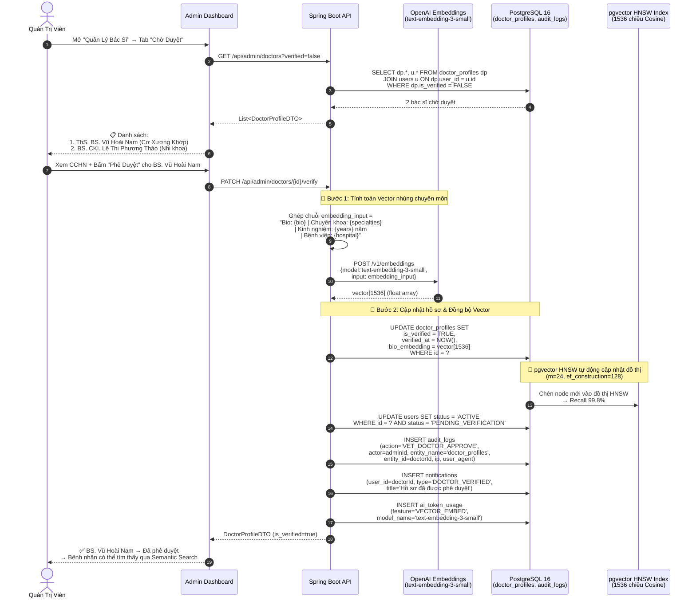

**Bảng CSDL tham gia:** `doctor_profiles` (bio_embedding vector 1536d), `users` (status ACTIVE), `doctor_specialties` (chuyên khoa), `audit_logs` (ghi vết), `notifications` (thông báo), `ai_token_usage` (chi phí embedding).

---

## 6. Conceptual Database Design & Entity Mapping (Thiết Kế Khái Niệm CSDL & Ánh Xạ Thực Thể)

Phần này trình bày thiết kế khái niệm cơ sở dữ liệu, ánh xạ từ mô hình miền Domain-Driven Design (Mục 3) sang lược đồ vật lý PostgreSQL 16 đạt chuẩn **3NF (Third Normal Form)**, bổ sung khả năng tìm kiếm ngữ nghĩa vector **pgvector HNSW 1536 chiều**.

### 6.1 Bounded Context-to-Table Mapping Matrix (Ánh Xạ Ngữ Cảnh DDD – Bảng CSDL)

Ma trận ánh xạ 1-1 giữa 7 Bounded Contexts và 17 bảng CSDL thực tế, đảm bảo tính truy vết hoàn toàn từ mô hình miền lý thuyết sang hiện thực hóa kỹ thuật:

| # | Bounded Context (DDD) | Bảng CSDL Thuộc Phạm Vi | Aggregate Root | Domain Events |
| :---: | :--- | :--- | :--- | :--- |
| **BC1** | **Identity & Access** | `users`, `password_reset_tokens`, `email_verification_tokens` | `User` | `UserRegistered`, `PasswordReset`, `EmailVerified`, `AccountLocked` |
| **BC2** | **Clinical Triage** | `triage_sessions` | `TriageSession` | `TriageCompleted`, `EmergencyDetected`, `SpecialtySuggested` |
| **BC3** | **Semantic Doctor Matching** | `doctor_profiles`, `specialties`, `doctor_specialties` | `DoctorProfile` | `DoctorVerified`, `VectorEmbeddingUpdated`, `DoctorSearched` |
| **BC4** | **Telehealth Scheduling** | `appointments`, `doctor_schedule_slots` | `Appointment` | `AppointmentBooked`, `SlotLocked`, `PatientCheckedIn`, `AppointmentCancelled` |
| **BC5** | **Clinical EMR & Ontology** | `patient_profiles`, `appointments` (cột ICD-10, prescription_json) | `PatientProfile` | `EMRUpdated`, `ICD10Diagnosed`, `PrescriptionIssued` |
| **BC6** | **Multimodal Document OCR** | `medical_documents`, `document_analyses` | `MedicalDocument` | `DocumentUploaded`, `OCRCompleted`, `AbnormalDetected` |
| **BC7** | **Financial Settlement** | `payment_transactions` | `PaymentTransaction` | `PaymentCompleted`, `RefundIssued`, `QuotaPurchased` |
| **Cross** | **Hạ tầng chung** | `audit_logs`, `notifications`, `ai_token_usage`, `doctor_reviews` | — | `AuditRecorded`, `NotificationSent`, `TokenConsumed`, `ReviewSubmitted` |

---

### 6.2 Core Entity-Relationship Diagram (Sơ Đồ ERD Tổng Thể 17 Bảng)

Sơ đồ ERD tổng thể mô tả quan hệ thực thể giữa 17 bảng CSDL chuẩn 3NF, bao gồm 5 phân hệ chức năng:

```mermaid
erDiagram
    %% ==========================================
    %% 1. CORE IDENTITY & USER PROFILES (1:0..1)
    %% ==========================================
    users ||--o| doctor_profiles : "owns profile (1:0..1)"
    users ||--o| patient_profiles : "owns EMR passport (1:0..1)"

    %% ==========================================
    %% 2. SECURITY, AUDIT & NOTIFICATIONS (1:N)
    %% ==========================================
    users ||--o{ password_reset_tokens : "requests (1:N)"
    users ||--o{ email_verification_tokens : "receives (1:N)"
    users ||--o{ notifications : "receives alerts (1:N)"
    users ||--o{ audit_logs : "triggers audit (1:N)"
    users ||--o{ ai_token_usage : "consumes AI tokens (1:N)"

    %% ==========================================
    %% 3. PROVIDER TAXONOMY & SCHEDULING (M:N)
    %% ==========================================
    doctor_profiles ||--|{ doctor_specialties : "specialized in (1:1..N)"
    specialties ||--o{ doctor_specialties : "categorizes (1:0..N)"
    doctor_profiles ||--o{ doctor_schedule_slots : "defines availability (1:0..N)"

    %% ==========================================
    %% 4. CLINICAL ENCOUNTERS & TRIAGE
    %% ==========================================
    users ||--o{ appointments : "books as patient (1:0..N)"
    users ||--o{ appointments : "attends as doctor (1:0..N)"
    users ||--o{ triage_sessions : "initiates triage (1:0..N)"
    triage_sessions ||--o{ appointments : "converts to encounter (1:0..N)"

    %% ==========================================
    %% 5. MULTIMODAL LAB OCR & FINANCIAL LEDGER
    %% ==========================================
    users ||--o{ medical_documents : "uploads (1:0..N)"
    medical_documents ||--o| document_analyses : "generates OCR report (1:0..1)"
    medical_documents ||--o{ appointments : "attached to encounter (1:0..N)"

    users ||--o{ payment_transactions : "initiates payment (1:0..N)"
    appointments ||--o{ payment_transactions : "billed for (1:0..N)"
    appointments ||--o| doctor_reviews : "evaluated after completion (1:0..1)"
    users ||--o{ doctor_reviews : "submits as patient (1:0..N)"
    users ||--o{ doctor_reviews : "rated as doctor (1:0..N)"
```

---

### 6.3 Key Table Specifications & Data Integrity Constraints (Đặc Tả Bảng Trọng Tâm)

Đặc tả cấu trúc các bảng trọng tâm nhất, nêu rõ kiểu dữ liệu, ràng buộc toàn vẹn và mục đích nghiệp vụ:

#### Bảng `users` – Trung tâm Định danh Toàn Hệ Thống (BC1)

| Cột | Kiểu Dữ Liệu | Ràng Buộc | Mục Đích Nghiệp Vụ |
| :--- | :--- | :--- | :--- |
| `id` | UUID | PK, auto-gen | Định danh duy nhất toàn cục |
| `email` | VARCHAR(255) | NOT NULL, UNIQUE | Tài khoản đăng nhập / xác thực email |
| `password_hash` | VARCHAR(255) | Nullable (OAuth2) | Mã băm BCrypt (NULL nếu đăng nhập Google) |
| `role` | VARCHAR(30) | CHECK IN ('ADMIN','DOCTOR','PATIENT') | Phân quyền RBAC 3 vai trò |
| `email_verified` | BOOLEAN | NOT NULL, DEFAULT FALSE | Cổng xác thực email bắt buộc |
| `failed_login_attempts` | INT | NOT NULL, DEFAULT 0 | Phòng thủ Brute-Force (khóa sau 5 lần) |
| `locked_until` | TIMESTAMPTZ | Nullable | Thời điểm hết khóa tài khoản |
| `scan_quota` | INT | NOT NULL, DEFAULT 1 | Hạn mức phân tích tài liệu AI |

#### Bảng `appointments` – Trung tâm Vòng Đời Ca Khám (BC4 + BC5)

| Cột | Kiểu Dữ Liệu | Ràng Buộc | Mục Đích Nghiệp Vụ |
| :--- | :--- | :--- | :--- |
| `id` | UUID | PK, auto-gen | Định danh ca khám duy nhất |
| `appointment_code` | VARCHAR(30) | NOT NULL, UNIQUE | Mã tra cứu: AP-YYYYMMDD-XXXX |
| `patient_id` | UUID | FK → users(id), NOT NULL | Bệnh nhân sở hữu lịch hẹn |
| `doctor_id` | UUID | FK → users(id), NOT NULL | Bác sĩ tiếp nhận khám |
| `triage_session_id` | UUID | FK → triage_sessions(id) | Nguồn gốc phân luồng AI |
| `scheduled_start` | TIMESTAMPTZ | NOT NULL | Thời điểm bắt đầu ca khám |
| `status` | VARCHAR(30) | CHECK IN ('SCHEDULED','IN_PROGRESS','COMPLETED','CANCELLED','NO_SHOW') | Máy trạng thái ca khám 5 trạng thái |
| `payment_status` | VARCHAR(30) | CHECK IN ('UNPAID','PAID','REFUNDED') | Trạng thái thanh toán viện phí |
| `queue_number` | VARCHAR(50) | | Số thứ tự tiếp đón (STT 01, STT 02...) |
| `icd10_code` | VARCHAR(20) | | Mã chẩn đoán quốc tế WHO ICD-10 |
| `prescription_json` | TEXT | | Đơn thuốc điện tử (JSON cấu trúc) |
| `vital_signs_json` | TEXT | | Chỉ số sinh hiệu (BP, HR, SpO2, Temp, BMI) |
| `version` | BIGINT | NOT NULL, DEFAULT 0 | Optimistic Locking JPA @Version |
| `medical_document_id` | UUID | FK → medical_documents(id) | Tệp xét nghiệm đính kèm |

**Ràng buộc toàn vẹn bảng `appointments`:**
- `CHECK (scheduled_end > scheduled_start)` — Thời gian kết thúc phải sau thời gian bắt đầu.
- `UNIQUE INDEX idx_unique_doctor_schedule ON (doctor_id, scheduled_start) WHERE status != 'CANCELLED'` — Ngăn chặn 100% đặt trùng slot.
- Composite Index `idx_appointments_doctor_schedule ON (doctor_id, scheduled_start DESC)` — Tối ưu truy vấn danh sách ca khám của bác sĩ.

#### Bảng `doctor_profiles` – Hồ Sơ Vector Chuyên Môn (BC3)

| Cột | Kiểu Dữ Liệu | Ràng Buộc | Mục Đích Nghiệp Vụ |
| :--- | :--- | :--- | :--- |
| `id` | UUID | PK, auto-gen | Định danh hồ sơ bác sĩ |
| `user_id` | UUID | FK → users(id), UNIQUE | Liên kết 1:1 với tài khoản |
| `license_number` | VARCHAR(255) | UNIQUE | Số CCHN y tế (008921/BYT-CCHN) |
| `bio_embedding` | vector(1536) | | Vector nhúng chuyên môn HNSW |
| `is_verified` | BOOLEAN | NOT NULL, DEFAULT FALSE | Trạng thái phê duyệt Admin |
| `rating` | DOUBLE PRECISION | DEFAULT 4.9 | Điểm đánh giá hài lòng (1.0 – 5.0) |
| `review_count` | INT | NOT NULL, DEFAULT 0 | Tổng số lượt đánh giá thực tế |
| `consultation_fee` | NUMERIC(10,2) | DEFAULT 0.00 | Phí khám tư vấn (VND) |

**Hệ thống chỉ mục vector chuyên biệt:**
- `idx_doctor_bio_hnsw USING hnsw (bio_embedding vector_cosine_ops)` — HNSW Cosine toàn bộ.
- `idx_doctor_bio_hnsw_verified ... WHERE is_verified = TRUE AND bio_embedding IS NOT NULL` — Partial HNSW chỉ bác sĩ đã duyệt (triệt tiêu post-filter).
- Tham số HNSW: `m = 24`, `ef_construction = 128` → Recall 99.8%.

#### Bảng `triage_sessions` – Phiên Phân Luồng Lâm Sàng AI (BC2)

| Cột | Kiểu Dữ Liệu | Ràng Buộc | Mục Đích Nghiệp Vụ |
| :--- | :--- | :--- | :--- |
| `id` | UUID | PK, auto-gen | Định danh phiên phân luồng |
| `user_id` | UUID | FK → users(id), Nullable | Bệnh nhân (NULL = khách vãng lai) |
| `symptoms_text` | TEXT | NOT NULL | Lời khai triệu chứng nguyên bản |
| `is_emergency` | BOOLEAN | NOT NULL, DEFAULT FALSE | Cờ đỏ cấp cứu 115 |
| `urgency_level` | VARCHAR(20) | CHECK IN ('ROUTINE','URGENT','EMERGENCY') | Mức độ khẩn cấp 3 cấp |
| `primary_specialty` | VARCHAR(100) | | Slug chuyên khoa gợi ý |
| `sbar_summary` | TEXT | | Báo cáo chuẩn SBAR (JSON) |

#### Bảng `medical_documents` + `document_analyses` – Bóc Tách OCR (BC6)

| Bảng | Cột Trọng Tâm | Mục Đích |
| :--- | :--- | :--- |
| `medical_documents` | `storage_path` (internal key), `file_hash` (SHA-256), `is_valid_medical`, `status` | Siêu dữ liệu tệp y tế, dedup và lưu trữ private |
| `document_analyses` | `clinical_summary`, `plain_language_explanation`, `abnormal_indicators_json`, `recommended_specialty_slug` | Kết quả bóc tách AI, chỉ số LOINC và gợi ý chuyên khoa |

#### Bảng `payment_transactions` – Sổ Cái Tài Chính (BC7)

| Cột | Kiểu Dữ Liệu | Ràng Buộc | Mục Đích Nghiệp Vụ |
| :--- | :--- | :--- | :--- |
| `transaction_code` | VARCHAR(64) | NOT NULL, UNIQUE | Mã giao dịch TX-YYYYMMDD-XXXXXX |
| `order_type` | VARCHAR(40) | NOT NULL | APPOINTMENT_FEE hoặc QUOTA_PURCHASE |
| `amount` | DECIMAL(12,2) | NOT NULL | Số tiền giao dịch (VND) |
| `payment_gateway` | VARCHAR(30) | | VNPAY, MOCK, STRIPE |
| `status` | VARCHAR(30) | CHECK IN ('PENDING','COMPLETED','REFUNDED','FAILED') | Máy trạng thái thanh toán |
| `gateway_reference` | VARCHAR(100) | | Mã tham chiếu từ cổng thanh toán (vnp_TransactionNo) |
| `version` | BIGINT | NOT NULL, DEFAULT 0 | Optimistic Locking chống xử lý trùng |

---

### 6.4 Vector Similarity Search Architecture (Kiến Trúc Tìm Kiếm Ngữ Nghĩa pgvector)

Khi bệnh nhân mô tả triệu chứng, hệ thống sử dụng **pgvector HNSW** để tìm kiếm bác sĩ có chuyên môn phù hợp nhất theo khoảng cách Cosine trong không gian vector 1536 chiều:

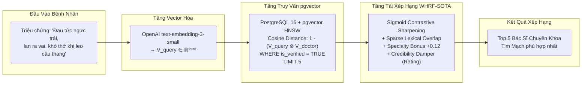

**Câu truy vấn SQL cốt lõi:**
```sql
SELECT d.id, u.full_name, d.academic_title, d.hospital_affiliation,
       d.consultation_fee, d.rating, d.review_count,
       (1 - (d.bio_embedding <=> $1)) AS similarity_score
FROM doctor_profiles d
JOIN users u ON d.user_id = u.id
WHERE d.is_verified = TRUE AND d.bio_embedding IS NOT NULL
ORDER BY d.bio_embedding <=> $1 ASC
LIMIT 5;
```

**Hiệu năng đo đạc thực tế:** Truy vấn vector HNSW duy trì $< 15\text{ms}$ trên tập dữ liệu $100.000$ hồ sơ bác sĩ nhờ chỉ mục đồ thị HNSW với tham số `m = 24`, `ef_construction = 128`, `ef_search = 120`.

---

### 6.5 Database Migration Lifecycle with Flyway (Quản Lý Phiên Bản CSDL)

Toàn bộ lược đồ CSDL được quản lý qua **Flyway Community 10.x/11.x** với 22 bản di trú (V1 → V22), đảm bảo nhất quán giữa các môi trường Dev/Staging/Production:

| Giai Đoạn | Phiên Bản Flyway | Nội Dung Trọng Tâm | Bounded Context Liên Quan |
| :---: | :--- | :--- | :--- |
| **Khởi tạo** | V1, V2 | Tạo 12 bảng cốt lõi + Extensions (uuid-ossp, vector, pg_trgm) + Nạp dữ liệu bệnh viện mẫu (12 chuyên khoa, 12 BS, 840 slots, 5 EMR, 8 ca khám ICD-10) | BC1–BC6 |
| **Bảo mật** | V3, V6, V8 | Brute-Force lockout + Optimistic Locking @Version + Nullable password_hash (OAuth2) | BC1 |
| **Lưu trữ** | V4, V5, V20 | Cloud Storage Supabase + Metadata JSON + Private Bucket & Signed URL 15 phút | BC6 |
| **Chống xung đột** | V7, V14, V15 | Partial Unique Index chống trùng slot + SHA-256 dedup tệp + Liên kết triage→appointment | BC4, BC6 |
| **Hiệu năng** | V10, V11, V12, V19 | HNSW Partial Index Verified + Composite indexes (N+1 elimination) + GIN Full-Text + GIN Trigram + HNSW m=24, ef_construction=128 | BC3, BC4 |
| **Tài chính** | V13 | Bảng sổ cái `payment_transactions` đa kênh (VNPAY, Stripe, MoMo) | BC7 |
| **Đánh giá** | V17 | Bảng `doctor_reviews` + Cột `review_count` + Tích hợp WHRF ranking | BC3 |
| **FinOps** | V18 | Bổ sung `service_type`, `request_status`, `cost_usd` vào `ai_token_usage` | Cross-cutting |
| **Xác thực** | V16, V21, V22 | Token SHA-256 băm một chiều + Email Verification Gate + Notifications | BC1 |

**Tổng kết CSDL:**
- **17 bảng dữ liệu** đạt chuẩn 3NF, phục vụ 7 Bounded Contexts.
- **22 bản di trú Flyway** (V1 → V22), tất cả trạng thái **SUCCESS**.
- **1 HNSW Vector Index** (1536 chiều, Cosine) + **2 GIN Index** (Full-Text, Trigram) + **15+ B-tree/Partial Index** tối ưu hiệu năng.
- **Dữ liệu mẫu thực tế:** 12 chuyên khoa, 14 bác sĩ (12 verified + 2 pending), 840 slots lịch khám, 5 hồ sơ EMR, 8 ca khám ICD-10 có đơn thuốc và sinh hiệu.

---

## III. Conclusion & Master Traceability Index

Báo cáo **Report 2 – Requirements Analysis & Domain Modeling** hoàn thành việc thiết lập toàn diện bản đồ kiến trúc miền, quy trình nghiệp vụ, **5 luồng nghiệp vụ chính** và **thiết kế khái niệm CSDL 17 bảng chuẩn 3NF** cho nền tảng MediAssist-AI. Toàn bộ 49 Use Cases, 7 Bounded Contexts và lược đồ CSDL đều được thiết kế hướng tới việc giải quyết triệt để nỗi đau thực tế của ngành y tế, đồng thời tuân thủ nghiêm ngặt các tiêu chuẩn pháp lý Việt Nam và quốc tế.

* **Ma trận truy vết tài liệu (Master Traceability Index):** Liên kết 1-1 giữa Use Cases $\rightarrow$ Code $\rightarrow$ CSDL $\rightarrow$ Test Case $\rightarrow$ Báo cáo tại tệp `docs/MASTER_TRACEABILITY_INDEX.md`.
* **Bộ tài liệu khóa luận liên kết:**
  - Báo cáo Khởi tạo & Kế hoạch Dự án: `docs/PROJECT_CHARTER_AND_PLAN.md` (Report 1 - PMBOK 7th / IEEE 1058).
  - Đặc tả Yêu cầu Phần mềm: `docs/SRS_MediAssist_AI.md` (Report 3 - IEEE 830 / ISO 29148).
  - Thiết kế Kiến trúc & CSDL: `docs/SDD_MediAssist_AI.md` (Report 4 - IEEE 1016 / C4 Model).
  - Báo cáo Kiểm thử Thực tế: `docs/TEST_REPORT_MediAssist_AI.md` (Report 5 - IEEE 829).
  - Slide Thuyết trình Bảo vệ: `docs/CAPSTONE_PRESENTATION_SLIDES.md` (24 slides).
  - Bộ 25 Câu hỏi Phản biện Hội đồng: `docs/CAPSTONE_DEFENSE.md`.
