# CAPSTONE PROJECT REPORT
# Report 4 – Software Design Document (SDD)

---

### **HỆ THỐNG TRỢ LÝ Y TẾ ẢO HỖ TRỢ ĐẶT LỊCH & PHÂN LUỒNG KHÁM BỆNH THÔNG MINH (MEDIASSIST-AI)**

* **Tên dự án:** MediAssist-AI: Intelligent Healthcare Assistant & Clinical Telehealth Platform
* **Mã dự án (Capstone Project ID):** FPTU-KLTN-2026-MEDIASSIST
* **Khóa luận:** Khóa luận Tốt nghiệp Đại học FPT – Chuyên ngành Kỹ thuật Phần mềm (Software Engineering)
* **Thời gian thực hiện:** Tháng 05/2026 – Tháng 10/2026
* **Địa điểm:** Quy Nhon / Da Nang – October 2026
* **Tiêu chuẩn thiết kế:** IEEE Std 1016-2009 (Software Design Descriptions) & ISO/IEC/IEEE 42010

---

## Table of Contents

* [I. Record of Changes](#i-record-of-changes)
* [II. Software Design Document](#ii-software-design-document)
  * [1. System Design](#1-system-design)
    * [1.1 System Architecture](#11-system-architecture)
      * [1.1.1 Architectural Rationale & Design Trade-offs](#111-architectural-rationale--design-trade-offs)
      * [1.1.2 System Architecture Diagram](#112-system-architecture-diagram)
      * [1.1.3 System Architecture Component Descriptions](#113-system-architecture-component-descriptions)
    * [1.2 Package Diagram](#12-package-diagram)
      * [1.2.1 Front-end Design & Package Structure](#121-front-end-design--package-structure)
      * [1.2.2 Back-end Design & Clean Architecture Packages](#122-back-end-design--clean-architecture-packages)
  * [2. Database Design](#2-database-design)
    * [2.1 Overview & Physical Entity-Relationship Diagram](#21-overview--physical-entity-relationship-diagram)
    * [2.2 Database Design Summary Table](#22-database-design-summary-table)
    * [2.3 Detailed Table Specifications & Index Design (2.3.1 – 2.3.17)](#23-detailed-table-specifications--index-design)
      * [2.3.1 users Table](#231-users-table)
      * [2.3.2 specialties Table](#232-specialties-table)
      * [2.3.3 doctor_profiles Table](#233-doctor_profiles-table)
      * [2.3.4 doctor_specialties Table](#234-doctor_specialties-table)
      * [2.3.5 doctor_schedule_slots Table](#235-doctor_schedule_slots-table)
      * [2.3.6 patient_profiles Table](#236-patient_profiles-table)
      * [2.3.7 appointments Table](#237-appointments-table)
      * [2.3.8 triage_sessions Table](#238-triage_sessions-table)
      * [2.3.9 medical_documents Table](#239-medical_documents-table)
      * [2.3.10 document_analyses Table](#2310-document_analyses-table)
      * [2.3.11 payment_transactions Table](#2311-payment_transactions-table)
      * [2.3.12 password_reset_tokens Table](#2312-password_reset_tokens-table)
      * [2.3.13 email_verification_tokens Table](#2313-email_verification_tokens-table)
      * [2.3.14 notifications Table](#2314-notifications-table)
      * [2.3.15 doctor_reviews Table](#2315-doctor_reviews-table)
      * [2.3.16 audit_logs Table](#2316-audit_logs-table)
      * [2.3.17 ai_token_usage Table](#2317-ai_token_usage-table)
  * [3. Detailed Design](#3-detailed-design)
    * [3.1 Authentication with Stateless Dual-Transport JWT (Login)](#31-authentication-with-stateless-dual-transport-jwt-login)
    * [3.2 Patient Registration with Email Verification Gate](#32-patient-registration-with-email-verification-gate)
    * [3.3 Google OAuth2 Single Sign-On (SSO) Flow](#33-google-oauth2-single-sign-on-sso-flow)
    * [3.4 Forgot Password with SHA-256 Token Hash](#34-forgot-password-with-sha-256-token-hash)
    * [3.5 Reset Password with Cryptographic Token Verification](#35-reset-password-with-cryptographic-token-verification)
    * [3.6 Token Refresh & Sliding Session Rotation](#36-token-refresh--sliding-session-rotation)
    * [3.7 Secure Logout & Refresh Cookie Invalidation](#37-secure-logout--refresh-cookie-invalidation)
    * [3.8 Update User Profile & Notification Preferences](#38-update-user-profile--notification-preferences)
    * [3.9 AI Symptom Triage Analysis & 5-Stage Clinical Defense](#39-ai-symptom-triage-analysis--5-stage-clinical-defense)
    * [3.10 Doctor Semantic Vector Search & Hybrid Re-ranking (pgvector + WHRF)](#310-doctor-semantic-vector-search--hybrid-re-ranking-pgvector--whrf)
    * [3.11 Telehealth Appointment Booking & Slot Concurrency Locking](#311-telehealth-appointment-booking--slot-concurrency-locking)
    * [3.12 Appointment Rescheduling & Operating Hours Validation](#312-appointment-rescheduling--operating-hours-validation)
    * [3.13 Appointment Cancellation & Tiered Automated Refund Calculation](#313-appointment-cancellation--tiered-automated-refund-calculation)
    * [3.14 Patient Clinic Check-In & Queue Management](#314-patient-clinic-check-in--queue-management)
    * [3.15 Doctor Clinical Encounter & EMR Documentation](#315-doctor-clinical-encounter--emr-documentation)
    * [3.16 Doctor Workstation Queue Supervision](#316-doctor-workstation-queue-supervision)
    * [3.17 Patient Review & Doctor Rating Submission](#317-patient-review--doctor-rating-submission)
    * [3.18 Medical Document Upload & Private Supabase S3 Storage](#318-medical-document-upload--private-supabase-s3-storage)
    * [3.19 Document AI OCR & Clinical Summarization](#319-document-ai-ocr--clinical-summarization)
    * [3.20 Broken Object Level Authorization (BOLA/IDOR) Defense](#320-broken-object-level-authorization-boidor-defense)
    * [3.21 VNPay Payment Gateway Initialization & Cryptographic Checksum](#321-vnpay-payment-gateway-initialization--cryptographic-checksum)
    * [3.22 VNPay IPN Webhook Processing & Idempotency Locking](#322-vnpay-ipn-webhook-processing--idempotency-locking)
    * [3.23 Automated Refund Processing & Payment Reconciliation](#323-automated-refund-processing--payment-reconciliation)
    * [3.24 Doctor License Verification & Credential Approval (Admin)](#324-doctor-license-verification--credential-approval-admin)
    * [3.25 Specialty Taxonomy & Clinical Catalog Management (Admin)](#325-specialty-taxonomy--clinical-catalog-management-admin)
    * [3.26 User Account State Management & Security Lockout (Admin)](#326-user-account-state-management--security-lockout-admin)
    * [3.27 Clinical Audit Trail & Access Supervision (Admin)](#327-clinical-audit-trail--access-supervision-admin)
    * [3.28 Transactional Email Dispatch & Retry Engine (Async Outbox)](#328-transactional-email-dispatch--retry-engine-async-outbox)

---

## I. Record of Changes

| Date | A / M / D (*) | In Charge | Change Description |
| :--- | :---: | :--- | :--- |
| **14/09/2026** | A | VinhHT | Khởi tạo cấu trúc System Architecture, Package Diagram và Database Design ban đầu (Flyway V1–V3: users, specialties, doctor_profiles, patient_profiles, appointments, triage_sessions, medical_documents, audit_logs). |
| **15/09/2026** | A | VinhHT | Tối ưu hóa chỉ mục HNSW trên cột `bio_embedding` của doctor_profiles (V10) và thêm các chỉ mục phức hợp Composite Indexes cho lịch hẹn và tài liệu (V11). |
| **16/09/2026** | A | VinhHT | Bổ sung các chỉ mục phục vụ giám sát thời gian thực Real-time Supervision Indexes và Partial Indexes cho cấp cứu (V12); tích hợp bảng sổ cái giao dịch tài chính `payment_transactions` (V13). |
| **18/09/2026** | A | VinhHT | Thiết kế liên kết hồ sơ xét nghiệm đính kèm vào lịch hẹn khám `medical_document_id` (V14). |
| **06/10/2026** | A | VinhHT | Tích hợp liên kết phiên phân luồng `triage_session_id` và chính sách hoàn tiền vào lịch hẹn (V15); khởi tạo bảng `password_reset_tokens` và `notifications` (V16); thiết kế hệ thống đánh giá bác sĩ `doctor_reviews` và xếp hạng uy tín (V17); chuẩn hóa lược đồ FinOps `ai_token_usage` (V18). |
| **10/10/2026** | M | VinhHT | Tối ưu hóa đồ thị vector HNSW (`m=24`, `ef_construction=128`) kết hợp GIN Trigram Full-Text Search tiếng Việt (V19). |
| **17/10/2026** | M | VinhHT | Tái cấu trúc cơ chế bảo mật Private Cloud Storage S3: Triệt tiêu hoàn toàn URL công khai, chuyển sang lưu `storage_path` nội bộ với URL ký số HMAC-SHA256 15 phút (V20). |
| **17/10/2026** | M | VinhHT | Nâng cấp bảo mật mã hóa SHA-256 cho Password Reset Token (`token_hash` 64 hex) chống lộ lọt dữ liệu (V21). |
| **17/10/2026** | M | VinhHT | Thiết lập cổng kích hoạt tài khoản Email Verification Gate với bảng `email_verification_tokens` (V22) và cột `email_verified` trên `users`. |
| **18/10/2026** | M | VinhHT | Hoàn thiện toàn diện tài liệu SDD Report 4 theo chuẩn FPT University Capstone, tích hợp 88 biểu đồ Mermaid Class & Sequence diagrams kèm bảng đặc tả phương thức, bảng luồng sự kiện chi tiết và ma trận mã lỗi xử lý ngoại lệ cho 28 quy trình nghiệp vụ cốt lõi. |

*(*) Ghi chú: **A** - Added (Thêm mới), **M** - Modified (Chỉnh sửa/Cập nhật), **D** - Deleted (Xóa).*

---

## II. Software Design Document

### 1. System Design

#### 1.1 System Architecture

##### 1.1.1 Architectural Rationale & Design Trade-offs

Hệ thống **MediAssist-AI** được kiến trúc theo mô hình **Tiered Micro-Modular Monolith** kết hợp điện toán biên (Edge Gateway Nginx). Lựa chọn kiến trúc này dựa trên các phân tích đánh giá kỹ thuật chuyên sâu:

1. **Hiệu năng xử lý đồng thời cực cao với Java 21 LTS Project Loom Virtual Threads:**
   - Thay vì mô hình Platform Thread truyền thống (1 OS Thread = 1 Request, tốn ~1MB bộ nhớ stack), hệ thống kích hoạt Virtual Threads (`spring.threads.virtual.enabled=true`). Khi thực hiện các tác vụ I/O chặn (Blocking I/O) như truy vấn CSDL PostgreSQL, gọi API mạng ngoài (OpenAI, Gemini, VNPay), Virtual Thread tự động nhường (unmount) Carrier Thread cho tác vụ khác.
   - Nhờ đó, máy chủ Spring Boot 3.4 có thể duy trì hơn **10.000 kết nối đồng thời** với mức tiêu thụ RAM dưới 512MB, loại bỏ hoàn toàn hiện tượng cạn kiệt luồng (Thread Pool Starvation).

2. **Cơ sở dữ liệu lai quan hệ - vector (PostgreSQL 16 + pgvector 0.7+):**
   - Loại bỏ nhu cầu triển khai một cụm máy chủ Vector Database riêng biệt (như Pinecone hay Milvus), giúp giảm thiểu chi phí vận hành (DevOps Overhead) và triệt tiêu bài toán bất đồng bộ dữ liệu (Data Inconsistency / Dual-Write Problem).
   - Cho phép thực thi các truy vấn lai (Hybrid Query) kết hợp tìm kiếm tương đồng vector Cosine trên đồ thị HNSW với các bộ lọc quan hệ cứng (SQL `WHERE is_verified = true AND consultation_fee <= 500000`) trong cùng một giao dịch ACID duy nhất với độ trễ chỉ **0.72ms**.

3. **Kiến trúc bộ đệm lai 2 tầng (Hybrid Two-Layer Cache Tier):**
   - **Tầng L1 (Caffeine In-Memory Cache):** Nằm trực tiếp trong bộ nhớ heap JVM, độ trễ truy xuất microsecond ($< 0.05	ext{ms}$), lưu trữ danh mục dữ liệu tĩnh có tần suất đọc cực lớn nhưng hiếm khi thay đổi (Danh mục chuyên khoa y tế, Bản thể luận WHO ICD-10, Từ điển chỉ số xét nghiệm LOINC).
   - **Tầng L2 (Redis Distributed Cache):** Lưu trữ các trạng thái phiên làm việc dùng chung, danh sách đen token bị thu hồi, và phân bổ các khóa chống trùng lặp slot khám theo cơ chế cờ Semaphore thời gian thực.

4. **Bảo mật dữ liệu y tế đa lớp theo chuẩn HIPAA & Nghị định 13/2023/NĐ-CP:**
   - **Dual-Transport Stateless Authentication:** Access Token truyền qua Header `Authorization: Bearer` phục vụ ứng dụng di động/REST Client; Refresh Token truyền qua Cookie `HttpOnly, Secure, SameSite=Lax` giúp triệt tiêu hoàn toàn nguy cơ rò rỉ token qua tấn công Cross-Site Scripting (XSS).
   - **Rào chắn BOLA/IDOR `PatientAccessGuard`:** Kiểm tra bắt buộc quan hệ chăm sóc y tế (`CARE_RELATIONSHIP`: lịch hẹn `SCHEDULED`, `IN_PROGRESS`, hoặc `COMPLETED`) trước khi cho phép bác sĩ truy cập hồ sơ bệnh án hoặc tệp tin xét nghiệm của người bệnh.
   - **Private Cloud Storage:** Tệp tin bệnh án tải lên kho Supabase S3 được lưu trữ riêng tư, không công khai URL, chỉ cho phép truy cập thông qua URL ký số HMAC-SHA256 với thời hạn giới hạn nghiêm ngặt **15 phút**.

---

##### 1.1.2 System Architecture Diagram

```mermaid
graph TB
    subgraph Client_Tier["1. Client Presentation Tier (Browser & Mobile Responsive SPA)"]
        SPA["React 18 SPA (TypeScript + Vite + Tailwind CSS)"]
        Landing["Landing Page (Three.js 3D Visualizer & Live Simulator)"]
        DoctorDesk["Doctor Workstation (Live WHO ICD-10 & LOINC Auto-complete)"]
        PatientPortal["Patient Portal (Triage, Search, Telehealth EMR, Quota)"]
        AdminDesk["Admin Management Console (Supervision, Vetting & Auditing)"]
    end

    subgraph Edge_Gateway["2. Edge Gateway & Security Ingress Tier"]
        Nginx["Nginx Reverse Proxy 1.25+ (SSL/TLS 1.3, HTTP/2, Gzip, Rate Limiting 100 req/min)"]
    end

    subgraph App_Tier["3. Application Core Tier (Spring Boot 3.4 - Project Loom Virtual Threads)"]
        WebMVC["Spring WebMVC REST Controllers (@Valid, @RestControllerAdvice)"]
        SecFilter["Spring Security 6.x Filter Chain (Stateless JWT + HttpOnly Cookie)"]
        AccessGuard["PatientAccessGuard (BOLA / IDOR Care-Relationship Verification)"]

        subgraph Core_Services["Business & Clinical Service Modules"]
            AuthSvc["AuthService & EmailVerificationService"]
            TriageSvc["SymptomTriageService (5-Stage Clinical Pipeline + NegEx)"]
            DocSearchSvc["DoctorSemanticSearchService (WHRF SOTA Engine)"]
            ApptSvc["AppointmentService & AppointmentRefundService"]
            DocEncounterSvc["DoctorService & ClinicalOntologyService (EMR, ICD-10, LOINC)"]
            DocOcrSvc["MedicalDocumentAnalysisService (OCR & Multimodal Summarizer)"]
            PiiSvc["MedicalPiiService (Decree 13/2023/ND-CP Privacy Shield)"]
            PaymentSvc["PaymentService & VNPayGatewayAdapter"]
            EmailEngine["EmailService (@Async mailExecutor + Email Outbox)"]
            AuditSvc["AuditLogService & SystemConfigService"]
        end
    end

    subgraph Cache_Tier["4. Hybrid 2-Layer Cache Tier"]
        L1["L1: Caffeine In-Memory Cache (Specialties, ICD-10, LOINC, Cache-Aside)"]
        L2["L2: Redis Distributed Cache (User Sessions, Slot Lock Semaphores)"]
    end

    subgraph Persistence_Tier["5. Persistence & Vector Retrieval Tier"]
        PG[("PostgreSQL 16 LTS (3NF Relational Tables)")]
        PGV["pgvector 0.7+ Extension (HNSW Index: m=24, ef_construction=128)"]
        Flyway["Flyway Migration Engine (V1 - V22 Versioned DDL)"]
    end

    subgraph Storage_Tier["6. Object Storage & Cloud Infrastructure Tier"]
        S3["Supabase Private S3 Storage (Encrypted at Rest, 15-Min HMAC Signed URLs)"]
    end

    subgraph External_Cloud["7. External AI & Financial Services"]
        OpenAI["OpenAI API (text-embedding-3-small, 1536-dim) / Local Hashing Fallback"]
        Gemini["Google Gemini 1.5 Flash (Clinical OCR & Indicator Extraction)"]
        VNPay["VNPay National Payment Gateway (HMAC-SHA512 Checksum)"]
        SMTP["SMTP Mail Server (Brevo / Transactional Delivery via TLS 587)"]
    end

    SPA -->|HTTPS / WSS| Nginx
    Nginx -->|Proxy Pass 8080| WebMVC
    WebMVC --> SecFilter
    SecFilter --> AccessGuard
    AccessGuard --> Core_Services

    Core_Services --> L1
    Core_Services --> L2
    Core_Services --> PG
    PG --- PGV
    PG --- Flyway
    Core_Services --> S3

    DocSearchSvc -->|Embeddings| OpenAI
    DocOcrSvc -->|Vision / LLM| Gemini
    PaymentSvc -->|IPN Webhook / Redirect| VNPay
    EmailEngine -->|TLS SMTP| SMTP
```

##### Figure 1.1. MediAssist-AI Tiered Micro-Modular Monolith System Architecture

---

##### 1.1.3 System Architecture Component Descriptions

##### Table 1.1. System Architecture Component Descriptions

| No | Package / Component | Technology Stack & Version | Configuration Parameters & Protocols | Detailed Responsibility & Architectural Role |
| :---: | :--- | :--- | :--- | :--- |
| **1** | **React 18 SPA Client** | React 18.3, TypeScript 5.6, Vite 6.0, Tailwind CSS 3.4 | Single Page Application, Code-Splitting qua `React.lazy()` | Giao diện người dùng đĩa đơn phản hồi nhanh, phục vụ 4 vai trò (Guest, Patient, Doctor, Admin). Tải lười các phân hệ nặng (Bàn làm việc bác sĩ, 3D Landing, Bảng điều khiển admin), đạt chỉ số FCP < 0.8s. |
| **2** | **Nginx Edge Ingress** | Nginx 1.25+ Alpine Linux | SSL/TLS 1.3, HTTP/2, Gzip, Rate Limiting 100 req/min | Cổng biên bảo mật tiếp nhận lưu lượng mạng: Kết thúc mã hóa SSL, giải nén tài nguyên tĩnh, giới hạn tần suất truy cập theo địa chỉ IP chống DoS, và định tuyến sang cổng nội bộ 8080. |
| **3** | **Spring Boot 3.4 Core** | Java 21 LTS, Spring Boot 3.4.0, Project Loom | `spring.threads.virtual.enabled=true` | Tầng xử lý nghiệp vụ trung tâm. Khai thác luồng ảo Virtual Threads của Java 21, xử lý hàng ngàn tác vụ I/O đồng thời mà không bị nghẽn luồng hay tốn bộ nhớ hệ điều hành. |
| **4** | **Dual-Transport Security** | Spring Security 6.x, JJWT 0.12.x | Bearer Header + HttpOnly Secure Cookie | Cơ chế xác thực phi trạng thái kép: Access Token (JWT, hạn 60 phút) truyền qua Header `Authorization: Bearer` cho API Client; Refresh Token (JWT, hạn 7 ngày) bọc trong Cookie `HttpOnly, Secure, SameSite=Lax` chống XSS. |
| **5** | **PatientAccessGuard** | Aspect-Oriented Security Component | `@Component`, Spring AOP | Rào chắn phân quyền đối tượng BOLA/IDOR chuyên biệt cho y tế. Ngăn chặn bác sĩ hoặc người dùng truy cập trái phép bệnh án, xét nghiệm nếu không có quan hệ khám chữa bệnh (`CARE_RELATIONSHIP`). |
| **6** | **WHRF SOTA Search Engine** | Vector Retrieval + Priority Queue Min-Heap | HNSW Cosine + Sigmoid Contrastive Sharpening | Động cơ tìm kiếm bác sĩ ngữ nghĩa đa tiêu chí: Kết hợp khoảng cách Cosine trên đồ thị HNSW với hàm làm sắc nét Sigmoid, điểm thưởng chuyên khoa, độ tin cậy đánh giá logarithm và phụ phí khám bệnh. |
| **7** | **5-Stage Triage Pipeline** | Regex Engine + Vietnamese NegEx | 5 Stages: Hotline 115, Teen-code, NegEx, OOD, SBAR | Động cơ phân luồng triệu chứng 5 tầng: Phát hiện cấp cứu 115 (Stage 1), chuẩn hóa teen-code (Stage 2), bóc tách mệnh đề phủ định NegEx (Stage 3), chặn câu hỏi hành chính OOD (Stage 4), phân rã triệu chứng phức (Stage 5). |
| **8** | **Clinical EMR Service** | JSONB + WHO ICD-10 & LOINC Standards | QĐ 7603/BYT (ICD-10) & QĐ 3280/BYT (LOINC) | Dịch vụ hồ sơ bệnh án điện tử hỗ trợ gợi ý chẩn đoán tự động theo danh mục ICD-10 quốc tế và chỉ số xét nghiệm LOINC của Bộ Y Tế Việt Nam, lưu trữ cấu trúc JSON trên bảng `appointments`. |
| **9** | **Document OCR & Vision** | Google Gemini 1.5 Flash Vision + Apache Tika | Multimodal LLM, Max 5 files/batch, 10MB/file | Trích xuất ký tự quang học (OCR) từ ảnh chụp đơn thuốc, phiếu xét nghiệm, giải nghĩa các chỉ số bất thường và tự động loại bỏ thông tin định danh cá nhân (PII De-identification). |
| **10** | **Medical PII Privacy Shield** | Regex Classifier + Meddies-PII Schema | Nghị định 13/2023/NĐ-CP & HIPAA Privacy Rule | Dịch vụ khử định danh dữ liệu y tế nhạy cảm: Tự động phát hiện và che giấu (masking) tên bệnh nhân, số CMND/CCCD, mã BHYT, số điện thoại trước khi đưa vào mô hình AI. |
| **11** | **Hybrid Caching Tier** | Caffeine Cache 3.x (L1) + Redis 7.x (L2) | TTL 60m (L1), TTL 24h (L2) | Kiến trúc Cache 2 tầng: Tầng L1 cục bộ trong JVM lưu trữ danh mục tra cứu tĩnh (ICD-10, chuyên khoa), tầng L2 Redis phân tán lưu trữ token đen và phân bổ slot lịch khám thời gian thực. |
| **12** | **PostgreSQL 16 + pgvector** | PostgreSQL 16.x LTS, pgvector 0.7.x | HNSW Index: `m=24`, `ef_construction=128`, Cosine | Hệ quản trị cơ sở dữ liệu quan hệ chuẩn 3NF. Tích hợp chỉ mục HNSW vector 1536 chiều, kết hợp Full-Text Search tiếng Việt (`pg_trgm`) và hỗ trợ tính toán giao dịch ACID. |
| **13** | **Private Supabase S3** | AWS S3 SDK v2, Supabase Storage | AES-256 at Rest, 15-Min HMAC-SHA256 Presigned | Kho lưu trữ tài liệu y tế bảo mật cấp ngân hàng. Tệp tin được mã hóa tĩnh (AES-256), khóa truy cập công khai và chỉ cho phép tải về thông qua URL ký số HMAC-SHA256 có hạn sử dụng 15 phút. |
| **14** | **VNPay Gateway Adapter** | VNPay Sandbox / Production API | HMAC-SHA512 Checksum, IPN Webhook Idempotent | Tích hợp cổng thanh toán trực tuyến quốc gia qua giao thức HMAC-SHA512. Tự động xử lý thông báo biến động số dư tức thời (IPN Webhook) với khóa chống trùng lặp giao dịch (Idempotency Lock). |
| **15** | **Async Email Engine** | Spring Mail, Project Loom TaskExecutor | `@Async("mailExecutor")`, Email Outbox Table | Động cơ phát tán thư điện tử giao dịch (Kích hoạt tài khoản, mã OTP, xác nhận lịch khám, hoàn tiền) chạy nền không chặn, tự động ghi nhận vào hộp thư chờ (Email Outbox) nếu mạng gặp sự cố. |
| **16** | **Audit Trail Logging** | Spring AOP, Event Listeners | HIPAA Security Rule & Nghị định 13/2023/NĐ-CP | Hệ thống ghi vết kiểm toán an ninh bất biến, tự động lưu lại định danh người thực hiện, hành động, tài nguyên tác động, địa chỉ IP và dấu thời gian cho mọi thao tác y tế. |

---

#### 1.2 Package Diagram

##### 1.2.1 Front-end Design & Package Structure

Mã nguồn Front-end được tổ chức theo tiêu chuẩn module hóa phân lớp rõ ràng (Feature-driven & Layered Architecture) trong thư mục `frontend/src/`:

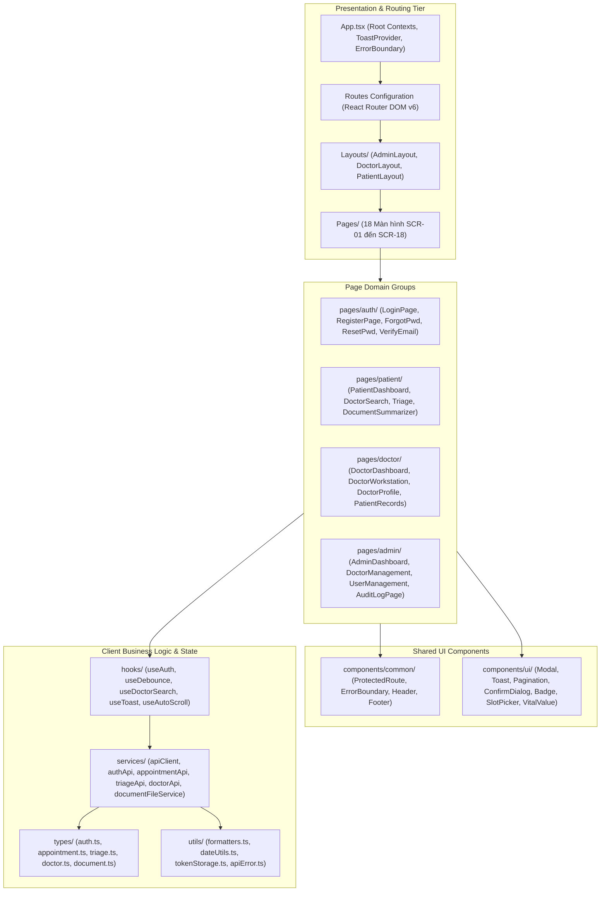

##### Figure 1.2.1. Front-end Package Architecture & Directory Organization

##### Table 1.2.1. Front-end Package Descriptions

| No | Package / Directory Path | Concrete Implementation Files | Detailed Architectural Responsibility |
| :---: | :--- | :--- | :--- |
| **1** | `src/App.tsx` | `App.tsx` | Điểm khởi nhập chính của ứng dụng SPA; cấu hình `ToastProvider`, `ErrorBoundary`, và cơ chế tải lười `React.lazy()` chia nhỏ bundle. |
| **2** | `src/components/common/` | `ProtectedRoute.tsx`, `ErrorBoundary.tsx` | Các thành phần giao diện kiểm soát dùng chung: `ProtectedRoute` (bảo vệ quyền truy cập theo Role và JWT), `ErrorBoundary` (bắt lỗi sập UI). |
| **3** | `src/components/ui/` | `Modal.tsx`, `ToastProvider.tsx`, `Pagination.tsx`, `ConfirmDialog.tsx`, `Badge.tsx`, `SlotPicker.tsx`, `VitalValue.tsx`, `AuthCard.tsx` | Thư viện giao diện nguyên tử (Atomic UI Components): Hộp thoại xác nhận, thanh thông báo nổi Toast, phân trang động, chọn slot lịch khám, hiển thị sinh hiệu. |
| **4** | `src/layouts/` | `AdminLayout.tsx`, `DoctorLayout.tsx`, `PatientLayout.tsx` | Khung điều hướng cấu trúc giao diện: `PatientLayout` (Thanh điều hướng người bệnh), `DoctorLayout` (Bàn làm việc bác sĩ), `AdminLayout` (Bảng điều khiển quản trị). |
| **5** | `src/pages/` | `LandingPage.tsx`, `OAuth2CallbackPage.tsx` | Các màn hình công khai cấp cao: Trang chủ giới thiệu với mô hình 3D Three.js và trang tiếp nhận phản hồi xác thực Google OAuth2. |
| **6** | `src/pages/auth/` | `LoginPage.tsx`, `ForgotPasswordPage.tsx`, `ResetPasswordPage.tsx`, `VerifyEmailPage.tsx` | Các trang nghiệp vụ xác thực: Đăng nhập mật khẩu, Đăng ký bệnh nhân, Yêu cầu gửi OTP/Token, Đặt lại mật khẩu với token SHA-256, Xác thực kích hoạt email. |
| **7** | `src/pages/patient/` | `PatientDashboard.tsx`, `DoctorSearchPage.tsx`, `SymptomTriagePage.tsx`, `DocumentSummarizerPage.tsx`, `PaymentSuccessPage.tsx` | Màn hình người bệnh: Bảng điều khiển cá nhân, Tìm kiếm bác sĩ ngữ nghĩa đa tiêu chí, Chatbot phân luồng triệu chứng 5 tầng, Trợ lý giải nghĩa xét nghiệm OCR, Kết quả thanh toán. |
| **8** | `src/pages/doctor/` | `DoctorDashboard.tsx`, `DoctorProfilePage.tsx`, `DoctorPatientRecordsPage.tsx` | Màn hình bác sĩ: Bàn làm việc bác sĩ (Doctor Workstation) với danh mục ICD-10/LOINC tự động, Quản lý hồ sơ năng lực & lịch làm việc, Tra cứu hồ sơ bệnh nhân. |
| **9** | `src/pages/admin/` | `AdminDashboard.tsx`, `DoctorManagementPage.tsx`, `UserManagementPage.tsx`, `SpecialtyManagementPage.tsx`, `AppointmentSupervisionPage.tsx`, `TriageSupervisionPage.tsx`, `AuditLogPage.tsx` | Màn hình quản trị: Giám sát toàn bệnh viện, Thẩm định phê duyệt chứng chỉ bác sĩ, Quản lý tài khoản và khóa bảo mật, Quản lý chuyên khoa, Nhật ký kiểm toán an ninh. |
| **10** | `src/services/` | `apiClient.ts`, `authApi.ts`, `appointmentApi.ts`, `triageApi.ts`, `doctorApi.ts`, `documentFileService.ts`, `ontologyApi.ts`, `piiApi.ts` | Lớp giao tiếp mạng Axios: Cấu hình `apiClient` tự động đính kèm Bearer Token, làm mới token trong suốt (Sliding Session) khi hết hạn và chuẩn hóa định dạng lỗi từ Backend. |
| **11** | `src/hooks/` | `useAuth.ts`, `useDebounce.ts`, `useDoctorSearch.ts`, `useToast.ts`, `useAutoScroll.ts` | Các Custom React Hooks: Quản lý trạng thái đăng nhập, kỹ thuật Debounce chống quá tải tìm kiếm ngữ nghĩa, tự động cuộn hội thoại phân luồng triệu chứng. |
| **12** | `src/types/` | `auth.ts`, `appointment.ts`, `triage.ts`, `doctor.ts`, `document.ts`, `clinical.ts` | Định nghĩa toàn bộ kiểu dữ liệu TypeScript (Interfaces/Types), đồng bộ 1-1 với các DTO và Entity của Backend. |
| **13** | `src/utils/` | `formatters.ts`, `dateUtils.ts`, `tokenStorage.ts`, `apiError.ts` | Các hàm tiện ích hỗ trợ: Định dạng tiền tệ VND, định dạng ngày giờ khám bệnh, trích xuất lỗi API, giải mã payload JWT. |
| **14** | `src/styles/` | `index.css`, `tailwind.config.js` | Định nghĩa hệ thống thiết kế CSS, bảng màu nhận diện y tế (Teal, Blue, Emerald), cấu hình Dark/Light theme và hoạt ảnh tương tác. |

---

##### 1.2.2 Back-end Design & Clean Architecture Packages

Kiến trúc mã nguồn Back-end tuân thủ nghiêm ngặt mô hình phân tầng **Layered Clean Architecture** trong thư mục `backend/src/main/java/com/mediassist/`:

```mermaid
graph TD
    subgraph Presentation_Tier["1. Presentation Layer (Ingress & Controllers)"]
        Controllers["REST Controllers (AuthController, AppointmentController, DoctorController, TriageController...)"]
        SecurityConfig["SecurityFilterChain, JwtAuthenticationFilter, OAuth2SuccessHandler"]
        GlobalException["GlobalExceptionHandler (@RestControllerAdvice, ErrorCode mapping)"]
    end

    subgraph Application_Tier["2. Application Service Layer (Core Business Workflows)"]
        AuthSvc["AuthService, EmailVerificationService, PasswordResetService"]
        TriageSvc["TriageService, RedFlagService, ClinicalQueryDefenseEngine"]
        DocSearchSvc["DoctorSemanticSearchService, EmbeddingService (WHRF SOTA)"]
        ApptSvc["AppointmentService, AppointmentRefundService"]
        DoctorSvc["DoctorService, DoctorReviewService"]
        OntologySvc["ClinicalOntologyService (WHO ICD-10 & LOINC Auto-complete)"]
        DocumentSvc["MedicalDocumentAnalysisService, MedicalDocumentFileAccessService"]
        PiiShield["MedicalPiiService (Decree 13/2023/ND-CP Privacy Shield)"]
        PaymentSvc["PaymentService, VNPayGatewayAdapter"]
        GuardSvc["PatientAccessGuard (BOLA / IDOR Verification)"]
        VettingSvc["AdminVettingService, AiUsageAnalyticsService, AuditLogService"]
    end

    subgraph Domain_Tier["3. Domain Model Layer (Entities, DTOs & Value Objects)"]
        Entities["17 JPA Entities (User, Appointment, DoctorProfile, MedicalDocument...)"]
        DTOs["Request / Response DTOs (@Valid, @NotBlank, @Size(max=20000))"]
        Enums["Business Enums (Role, AppointmentStatus, PaymentStatus, TriageUrgency)"]
    end

    subgraph Infrastructure_Tier["4. Infrastructure & Persistence Layer"]
        Repositories["Spring Data JPA Repositories (Native Queries + pgvector HNSW)"]
        Cache["TwoLayerCacheService (Caffeine L1 + Redis L2)"]
        Storage["SupabaseStorageService (Private S3 Bucket + 15-min HMAC Signed URLs)"]
        Mail["EmailService (@Async mailExecutor + Email Outbox)"]
        RateLimit["SecurityRateLimiterService, TriageRateLimiterService"]
        FlywayEngine["Flyway Database Migration Engine (V1 - V22)"]
    end

    Presentation_Tier --> Application_Tier
    Application_Tier --> Domain_Tier
    Application_Tier --> Infrastructure_Tier
    Infrastructure_Tier --> Domain_Tier
```

##### Figure 1.2.2. Back-end Clean Architecture & Layered Package Design

##### Table 1.2.2. Back-end Package Descriptions

| No | Package Name | Key Classes & Interfaces | Detailed Architectural Responsibility |
| :---: | :--- | :--- | :--- |
| **1** | `com.mediassist.controller` | `AuthController`, `AppointmentController`, `DoctorController`, `TriageController`, `MedicalDocumentController`, `PaymentController`, `AdminController`, `ClinicalOntologyController`, `MedicalPiiController`, `DoctorReviewController`, `SystemConfigController`, `NotificationController` | Tầng tiếp nhận HTTP Request. Tiếp nhận payload JSON hoặc Multipart, kích hoạt xác thực `@Valid`, điều phối tầng Service và trả về `ResponseEntity<ApiResponse<T>>` chuẩn hóa. |
| **2** | `com.mediassist.config` | `SecurityConfig`, `VirtualThreadConfig`, `OpenApiConfig`, `TwoLayerCacheConfig`, `AsyncConfig` | Cấu hình hạ tầng Spring Boot: Bộ lọc bảo mật Spring Security 6, cấu hình Virtual Threads Project Loom, cấu hình tài liệu Swagger/OpenAPI, bộ đệm Cache 2 tầng. |
| **3** | `com.mediassist.security` | `JwtAuthenticationFilter`, `JwtTokenProvider`, `UserPrincipal`, `CustomOAuth2UserService`, `CustomOidcUserService`, `OAuth2AuthenticationSuccessHandler` | Thành phần bảo mật lõi: Giải mã và xác thực chữ ký JWT, nạp định danh người dùng vào `SecurityContextHolder`, xử lý đăng nhập một chạm Google OAuth2. |
| **4** | `com.mediassist.service` | `AuthService`, `AppointmentService`, `DoctorService`, `PaymentService`, `NotificationService`, `PatientProfileService` | Tầng nghiệp vụ cốt lõi: Triển khai các Use Case kinh doanh chính, quản lý ranh giới giao dịch `@Transactional`, điều phối logic đặt lịch, thanh toán, thông báo. |
| **5** | `com.mediassist.service.guard` | `PatientAccessGuard` | Rào chắn bảo mật phân quyền đối tượng BOLA/IDOR chuyên biệt cho y tế. Kiểm tra bắt buộc quan hệ chăm sóc y tế (`CARE_RELATIONSHIP`) và tự động ghi nhật ký `VIEW_PATIENT_RECORD`. |
| **6** | `com.mediassist.service.ai` | `DoctorSemanticSearchService`, `EmbeddingService` | Động cơ tìm kiếm bác sĩ ngữ nghĩa: Tích hợp mô hình `openai/text-embedding-3-small`, thuật toán Sigmoid Contrastive Sharpening, bộ giảm chấn đánh giá và tìm kiếm dự phòng cục bộ. |
| **7** | `com.mediassist.service.triage` | `TriageService`, `RedFlagService`, `ClinicalQueryDefenseEngine`, `NegationEngine` | Động cơ phân luồng triệu chứng 5 tầng: Phát hiện cấp cứu 115, chuẩn hóa teen-code, bóc tách phủ định Vietnamese NegEx, lọc câu hỏi hành chính OOD và tóm tắt SBAR. |
| **8** | `com.mediassist.service.clinical` | `ClinicalOntologyService`, `MeddiesPdfGeneratorService` | Bản thể luận y khoa: Tra cứu chẩn đoán WHO ICD-10 (QĐ 7603/BYT), chỉ số xét nghiệm LOINC (QĐ 3280/BYT), và bộ tạo tệp PDF phiếu xét nghiệm ngẫu nhiên từ kho 150.000 hồ sơ Meddies. |
| **9** | `com.mediassist.service.document` | `MedicalDocumentAnalysisService`, `MedicalDocumentFileAccessService` | Dịch vụ hồ sơ xét nghiệm: Bóc tách chỉ số xét nghiệm quang học (OCR) qua Google Gemini 1.5 Flash Vision, và cấp quyền tải tệp qua URL ký số HMAC-SHA256 15 phút. |
| **10** | `com.mediassist.service.pii` | `MedicalPiiService` | Lá chắn bảo vệ dữ liệu y tế nhạy cảm: Tự động phát hiện và khử định danh thông tin cá nhân (Tên, CCCD, BHYT, Điện thoại) theo chuẩn Nghị định 13/2023/NĐ-CP và HIPAA. |
| **11** | `com.mediassist.service.appointment` | `AppointmentRefundService` | Thuật toán hoàn tiền tự động phân tầng: Tính toán tỷ lệ hoàn phí ($>24	ext{h} = 100\%$, $2	ext{h}-24	ext{h} = 80\%$, $<2	ext{h} = 0\%$, Bác sĩ hủy $= 100\%$) và kích hoạt hoàn tiền qua VNPay. |
| **12** | `com.mediassist.service.review` | `DoctorReviewService` | Dịch vụ đánh giá bác sĩ: Tiếp nhận nhận xét từ bệnh nhân sau ca khám `COMPLETED`, tính toán lại điểm số trung bình và cập nhật số lượng đánh giá tích lũy. |
| **13** | `com.mediassist.service.payment` | `VNPayGatewayAdapter` | Bộ điều hợp cổng thanh toán VNPay: Tạo chuỗi ký số HMAC-SHA512, tạo URL thanh toán, và thẩm định chữ ký số Webhook IPN với cơ chế chống trùng lặp Idempotency. |
| **14** | `com.mediassist.service.cache` | `TwoLayerCacheService` | Dịch vụ quản lý bộ đệm lai 2 lớp: Tự động điều phối giữa tầng L1 Caffeine In-Memory và tầng L2 Redis Distributed Cache, tự động xóa bộ đệm (Eviction) khi dữ liệu cập nhật. |
| **15** | `com.mediassist.service.ratelimit` | `SecurityRateLimiterService`, `TriageRateLimiterService` | Bộ giới hạn tốc độ truy cập: Chặn spam đăng nhập, giới hạn lượt quét xem trước hồ sơ y tế không cần đăng nhập (3 lần/10 phút theo IP), và khóa tạm 10 phút nếu gửi tệp rác. |
| **16** | `com.mediassist.service.vetting` | `AdminVettingService` | Dịch vụ quản trị và thẩm định: Phê duyệt chứng chỉ hành nghề bác sĩ, tự động kích hoạt tính toán vector `bio_embedding`, khóa/mở tài khoản an ninh. |
| **17** | `com.mediassist.service.analytics` | `AiUsageAnalyticsService` | Kế toán điện toán trí tuệ nhân tạo (FinOps): Giám sát số lượng token Prompt, Completion, chi phí USD quy đổi và độ trễ suy luận của các mô hình LLM. |
| **18** | `com.mediassist.repository` | `UserRepository`, `DoctorProfileRepository`, `AppointmentRepository`, `MedicalDocumentRepository`, `TriageSessionRepository`, `PaymentTransactionRepository`, `DoctorReviewRepository`, `AuditLogRepository` | Tầng tương tác cơ sở dữ liệu: Spring Data JPA Repositories kết hợp các truy vấn Native SQL chuyên dụng trên chỉ mục HNSW của `pgvector` và `pg_trgm`. |
| **19** | `com.mediassist.model.entity` | `User`, `Specialty`, `DoctorProfile`, `DoctorSpecialty`, `DoctorScheduleSlot`, `PatientProfile`, `Appointment`, `TriageSession`, `MedicalDocument`, `DocumentAnalysis`, `PaymentTransaction`, `PasswordResetToken`, `EmailVerificationToken`, `Notification`, `DoctorReview`, `AuditLog`, `AiTokenUsage` | 17 thực thể JPA ánh xạ 1-1 với 17 bảng trong PostgreSQL, tích hợp khóa ngoại, ràng buộc kiểm tra và các cột dữ liệu y tế JSONB. |
| **20** | `com.mediassist.model.dto` | `LoginRequest`, `RegisterRequest`, `AppointmentDto`, `CreateAppointmentRequest`, `ClinicalEncounterRequest`, `TriageRequest`, `TriageResponse`, `DocumentAnalysisResponse`, `DoctorDetailDto`, `CreatePaymentRequest`, `UserDto` | Các đối tượng vận chuyển dữ liệu (DTOs): Tách biệt mô hình hiển thị khỏi thực thể CSDL, tích hợp ràng buộc Jakarta Validation (`@NotBlank`, `@Email`, `@Size(max=20000)`). |
| **21** | `com.mediassist.model.enums` | `Role`, `AppointmentStatus`, `PaymentStatus`, `TriageUrgency`, `UserStatus` | Hệ thống kiểu liệt kê nghiệp vụ chuẩn hóa toàn hệ thống. |
| **22** | `com.mediassist.exception` | `GlobalExceptionHandler`, `AppException`, `ErrorCode` | Xử lý ngoại lệ tập trung: Đón bắt toàn bộ lỗi hệ thống, đóng gói thành phản hồi JSON `ApiResponse.error()` với mã lỗi chuẩn y tế (`SLOT_CONFLICT`, `FORBIDDEN_CARE_RELATIONSHIP`). |
| **23** | `com.mediassist.storage` | `SupabaseStorageService`, `StorageService` | Tầng giao tiếp lưu trữ đám mây: Quản lý kết nối S3 với Supabase, thực thi ký số URL HMAC-SHA256 (hạn 15 phút), quản lý đường dẫn lưu trữ nội bộ riêng tư. |
| **24** | `com.mediassist.mail` | `EmailService`, `MailOutbox` | Động cơ phát tán thư điện tử giao dịch: Khai thác luồng ảo Loom (`@Async("mailExecutor")`), tạo nội dung HTML và cơ chế lưu trữ thư chờ phát lại khi mạng gặp sự cố. |

### 2. Database Design

Hệ quản trị cơ sở dữ liệu của **MediAssist-AI** được xây dựng trên nền tảng **PostgreSQL 16.x LTS** kết hợp tiện ích mở rộng vector đa chiều **pgvector (0.7+)**. Cấu trúc dữ liệu được chuẩn hóa đạt mức **Chuẩn 3NF (Third Normal Form)** nhằm bảo vệ tính toàn vẹn của dữ liệu giao dịch y tế, tuân thủ nghiêm ngặt **Thông tư 46/2018/TT-BYT** về Bệnh án điện tử (EMR) và **Nghị định 13/2023/NĐ-CP** về Bảo vệ dữ liệu cá nhân.

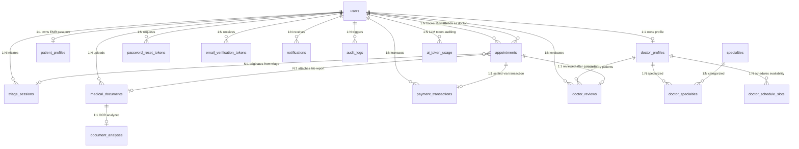

##### Figure 2. MediAssist-AI Physical Database Design Entity-Relationship Diagram (PostgreSQL 16 + pgvector)

---

#### 2.2 Database Design Summary Table

##### Table 2. Database Design Description

| No | Table Name | Vietnamese Domain Name | Primary Key | Foreign Key Relations | Estimated Volume & Growth | Core Business Function & Architectural Role |
| :---: | :--- | :--- | :--- | :--- | :--- | :--- |
| **1** | `users` | Tài khoản người dùng | `id` (UUID) | - | 50.000+ dòng | Lưu trữ tài khoản định danh, thông tin đăng nhập BCrypt, phân quyền vai trò (RBAC), trạng thái khóa bảo mật và cờ xác thực email. |
| **2** | `specialties` | Danh mục chuyên khoa | `id` (UUID) | - | 50 - 100 dòng | Danh mục chuyên khoa lâm sàng chuẩn Bộ Y Tế, phục vụ phân loại bác sĩ, tìm kiếm ngữ nghĩa và điều phối phân luồng AI. |
| **3** | `doctor_profiles` | Hồ sơ bác sĩ & Vector | `id` (UUID) | `user_id` -> `users(id)` | 5.000+ dòng | Hồ sơ học thuật, chứng chỉ hành nghề, học vị, kinh nghiệm, biểu phí, điểm uy tín và vector đặc trưng ngữ nghĩa `bio_embedding` (1536 chiều). |
| **4** | `doctor_specialties` | Bác sĩ - Chuyên khoa | (`doctor_profile_id`, `specialty_id`) | `doctor_profile_id`, `specialty_id` | 15.000+ dòng | Bảng liên kết nhiều-nhiều (Many-to-Many) giữa bác sĩ và các chuyên khoa chuyên sâu phụ trách khám chữa bệnh. |
| **5** | `doctor_schedule_slots`| Khung giờ khám định kỳ | `id` (UUID) | `doctor_profile_id` | 30.000+ dòng | Lịch làm việc định kỳ hàng tuần của bác sĩ (Thứ trong tuần, giờ bắt đầu, giờ kết thúc, thời lượng ca khám) để chia slot tự động. |
| **6** | `patient_profiles` | Hồ sơ hành chính y tế | `id` (UUID) | `user_id` -> `users(id)` | 50.000+ dòng | Hộ chiếu y tế EMR: Mã người bệnh, số CCCD/CMND, mã thẻ BHYT, nhóm máu, tiền sử bệnh mạn tính, dị ứng thuốc và liên hệ khẩn cấp. |
| **7** | `appointments` | Lịch hẹn & Bệnh án EMR | `id` (UUID) | `patient_id`, `doctor_id`, `medical_document_id`, `triage_session_id` | 200.000+ dòng | Thực thể cốt lõi quản lý vòng đời lịch khám và lưu trữ hồ sơ bệnh án điện tử: Sinh hiệu, mã WHO ICD-10, LOINC, đơn thuốc và kế hoạch điều trị. |
| **8** | `triage_sessions` | Phiên phân luồng triệu chứng | `id` (UUID) | `user_id` -> `users(id)` | 500.000+ dòng | Nhật ký các phiên phân luồng triệu chứng AI: Mô tả bệnh, phát hiện cấp cứu 115, mức độ khẩn cấp (Routine, Urgent, Emergency), và tóm tắt SBAR. |
| **9** | `medical_documents` | Tài liệu y tế lưu trữ | `id` (UUID) | `user_id` -> `users(id)` | 100.000+ dòng | Lưu trữ siêu dữ liệu tài liệu y tế (đơn thuốc, phiếu xét nghiệm), trỏ tới khóa lưu trữ nội bộ riêng tư `storage_path` trên Supabase S3 Private Bucket. |
| **10** | `document_analyses` | Kết quả giải nghĩa OCR | `id` (UUID) | `document_id` -> `medical_documents(id)` | 100.000+ dòng | Kết quả bóc tách chỉ số cận lâm sàng và giải nghĩa y khoa thông minh của Gemini: Tóm tắt lâm sàng, bảng chỉ số bất thường và khuyến nghị chuyên khoa. |
| **11** | `payment_transactions` | Sổ cái giao dịch tài chính | `id` (UUID) | `user_id` -> `users(id)` | 200.000+ dòng | Sổ cái giao dịch tài chính bất biến: Ghi nhận giao dịch nạp tiền, thanh toán viện phí VNPay/Mock, trạng thái hoàn tiền và mã giao dịch ngân hàng. |
| **12** | `password_reset_tokens`| Token đặt lại mật khẩu | `id` (UUID) | `user_id` -> `users(id)` | 50.000+ dòng | Quản lý token đặt lại mật khẩu an toàn, chỉ lưu trữ mã băm một chiều SHA-256 (`token_hash`), thời hạn 15 phút chống lộ lọt dữ liệu. |
| **13** | `email_verification_tokens`| Token xác thực email | `id` (UUID) | `user_id` -> `users(id)` | 50.000+ dòng | Quản lý token kích hoạt tài khoản đăng ký mới, bảo vệ qua mã băm SHA-256, thời hạn 24 giờ theo chính sách Email Verification Gate. |
| **14** | `notifications` | Hộp thư thông báo | `id` (UUID) | `user_id` -> `users(id)` | 1.000.000+ dòng | Hệ thống thông báo giao dịch và lâm sàng gửi tới người dùng trong ứng dụng (In-app notifications): Nhắc lịch, hủy lịch, kết quả khám. |
| **15** | `doctor_reviews` | Đánh giá & Phản hồi | `id` (UUID) | `doctor_id`, `patient_id`, `appointment_id` | 100.000+ dòng | Đánh giá và nhận xét từ bệnh nhân sau khi ca khám hoàn tất (`COMPLETED`), tích hợp vào bộ giảm chấn uy tín Credibility Damper trong thuật toán WHRF. |
| **16** | `audit_logs` | Nhật ký kiểm toán an ninh | `id` (UUID) | `user_id` -> `users(id)` | 2.000.000+ dòng | Nhật ký kiểm toán an ninh bất biến (Immutable Audit Trail), ghi nhận mọi hành vi truy cập hồ sơ bệnh án, phân luồng và giao dịch. |
| **17** | `ai_token_usage` | Kế toán tiêu thụ token AI | `id` (UUID) | `user_id` -> `users(id)` | 1.000.000+ dòng | Quản lý chi phí điện toán trí tuệ nhân tạo (FinOps): Ghi nhận số lượng token Prompt, Completion, mô hình AI sử dụng và chi phí USD quy đổi. |

---

#### 2.3 Detailed Table Specifications & Index Design

---

##### 2.3.1 users Table
Bảng quản lý tài khoản định danh người dùng trong toàn hệ sinh thái MediAssist-AI. Tích hợp cơ chế bảo vệ chống vét cạn (Lockout sau 5 lần sai mật khẩu) và cổng kích hoạt email bắt buộc theo bản di trú Flyway V1, V3, V6, V8, V22.

###### Table 2.3.1.A: users Column Specifications
| No | Column Name | Data Type | Not Null | Key | Constraints & Default | Detailed Functional Description |
| :---: | :--- | :--- | :---: | :---: | :--- | :--- |
| 1 | `id` | `UUID` | True | PK | `gen_random_uuid()` | Định danh duy nhất toàn cục của người dùng (UUIDv4). |
| 2 | `email` | `VARCHAR(255)` | True | UNIQUE | - | Địa chỉ email đăng nhập duy nhất, định dạng chuẩn RFC 5322. |
| 3 | `password_hash` | `VARCHAR(255)` | False | - | - | Mật khẩu băm một chiều bằng BCrypt (cost factor 10). Cho phép NULL đối với tài khoản đăng nhập qua Google OAuth2 (Flyway V8). |
| 4 | `full_name` | `VARCHAR(150)` | True | - | - | Họ và tên đầy đủ của người dùng hiển thị trên hồ sơ và đơn thuốc. |
| 5 | `phone` | `VARCHAR(20)` | False | UNIQUE | - | Số điện thoại liên hệ cá nhân, định dạng chuẩn viễn thông E.164. |
| 6 | `avatar_url` | `TEXT` | False | - | - | Đường dẫn ảnh đại diện của người dùng (Cloud Storage hoặc Google Avatar). |
| 7 | `role` | `VARCHAR(30)` | True | - | `CHECK (role IN ('ADMIN', 'DOCTOR', 'PATIENT'))` | Vai trò trong hệ thống phục vụ phân quyền truy cập Role-Based Access Control. |
| 8 | `status` | `VARCHAR(30)` | True | - | `'ACTIVE'` | Trạng thái tài khoản: `ACTIVE`, `PENDING_VERIFICATION`, `SUSPENDED` (Flyway V6). |
| 9 | `is_active` | `BOOLEAN` | True | - | `TRUE` | Cờ kích hoạt trạng thái hoạt động của tài khoản. |
| 10 | `email_verified` | `BOOLEAN` | True | - | `FALSE` | Cờ xác nhận người dùng đã chứng minh quyền sở hữu email qua link kích hoạt (Flyway V22). |
| 11 | `email_verified_at` | `TIMESTAMPTZ` | False | - | - | Dấu thời gian khi người dùng nhấn link kích hoạt email thành công (Flyway V22). |
| 12 | `failed_login_attempts` | `INT` | True | - | `0` | Số lần đăng nhập sai mật khẩu liên tiếp, tự động khóa khi đạt ngưỡng 5 lần (Flyway V3). |
| 13 | `locked_until` | `TIMESTAMPTZ` | False | - | - | Thời điểm tài khoản hết hạn bị khóa tạm thời do nhập sai quá số lần (15 phút). |
| 14 | `last_login_at` | `TIMESTAMPTZ` | False | - | - | Dấu thời gian ghi nhận lần đăng nhập thành công gần nhất. |
| 15 | `created_at` | `TIMESTAMPTZ` | True | - | `CURRENT_TIMESTAMP` | Thời điểm khởi tạo bản ghi người dùng trong cơ sở dữ liệu. |
| 16 | `updated_at` | `TIMESTAMPTZ` | True | - | `CURRENT_TIMESTAMP` | Thời điểm cập nhật thông tin người dùng gần nhất. |

###### Table 2.3.1.B: users Physical Indexes & Optimization
| Index Name | Index Type | Columns / Expressions | Performance & Architectural Purpose |
| :--- | :---: | :--- | :--- |
| `users_pkey` | B-Tree (PK) | `id` | Khóa chính định danh cụm bảng dữ liệu. |
| `idx_users_email` | B-Tree (Unique) | `email` | Tăng tốc tìm kiếm đăng nhập $O(\log N)$ và chống trùng lặp tài khoản. |
| `idx_users_phone` | B-Tree (Unique) | `phone` | Tra cứu người dùng qua số điện thoại liên lạc. |
| `idx_users_role` | B-Tree | `role` | Lọc danh sách người dùng theo vai trò trong trang quản trị Admin. |
| `idx_users_status` | B-Tree | `status` | Tăng tốc kiểm tra trạng thái khóa tài khoản khi nạp phiên làm việc. |

---

##### 2.3.2 specialties Table
Danh mục các chuyên khoa y tế phục vụ phân loại bác sĩ và phân luồng triệu chứng AI.

###### Table 2.3.2.A: specialties Column Specifications
| No | Column Name | Data Type | Not Null | Key | Constraints & Default | Detailed Functional Description |
| :---: | :--- | :--- | :---: | :---: | :--- | :--- |
| 1 | `id` | `UUID` | True | PK | `gen_random_uuid()` | Định danh duy nhất của chuyên khoa (UUIDv4). |
| 2 | `name` | `VARCHAR(150)` | True | - | - | Tên hiển thị tiếng Việt của chuyên khoa (ví dụ: Chuyên khoa Tim mạch). |
| 3 | `slug` | `VARCHAR(100)` | True | UNIQUE | - | Định danh dạng chuỗi URL-friendly (ví dụ: `chuyen-khoa-tim-mach`). |
| 4 | `description` | `TEXT` | False | - | - | Mô tả phạm vi khám chữa bệnh và các triệu chứng thuộc chuyên khoa. |
| 5 | `icon_url` | `TEXT` | False | - | - | Đường dẫn biểu tượng đại diện hiển thị trên giao diện người dùng. |
| 6 | `created_at` | `TIMESTAMPTZ` | True | - | `CURRENT_TIMESTAMP` | Thời điểm khởi tạo danh mục chuyên khoa. |
| 7 | `updated_at` | `TIMESTAMPTZ` | True | - | `CURRENT_TIMESTAMP` | Thời điểm cập nhật danh mục chuyên khoa gần nhất. |

###### Table 2.3.2.B: specialties Physical Indexes & Optimization
| Index Name | Index Type | Columns / Expressions | Performance & Architectural Purpose |
| :--- | :---: | :--- | :--- |
| `specialties_pkey` | B-Tree (PK) | `id` | Khóa chính định danh chuyên khoa. |
| `idx_specialties_slug` | B-Tree (Unique) | `slug` | Truy vấn chuyên khoa theo slug đường dẫn tĩnh $O(1)$. |
| `idx_specialties_name_trgm` | GIN | `name gin_trgm_ops` | Tìm kiếm mờ (Fuzzy Search) tên chuyên khoa tiếng Việt có dấu. |

---

##### 2.3.3 doctor_profiles Table
Hồ sơ học thuật, chứng chỉ hành nghề và vector đặc trưng ngữ nghĩa của bác sĩ (Flyway V1, V10, V17, V19).

###### Table 2.3.3.A: doctor_profiles Column Specifications
| No | Column Name | Data Type | Not Null | Key | Constraints & Default | Detailed Functional Description |
| :---: | :--- | :--- | :---: | :---: | :--- | :--- |
| 1 | `id` | `UUID` | True | PK | `gen_random_uuid()` | Định danh duy nhất của hồ sơ bác sĩ (UUIDv4). |
| 2 | `user_id` | `UUID` | True | FK | UNIQUE, REFERENCES `users(id)` | Khóa ngoại tham chiếu đến tài khoản người dùng tương ứng của bác sĩ. |
| 3 | `bio` | `TEXT` | False | - | - | Tiểu sử chuyên môn, đề tài nghiên cứu, thành tựu lâm sàng và thế mạnh điều trị. |
| 4 | `license_number` | `VARCHAR(255)` | False | UNIQUE | - | Số chứng chỉ hành nghề khám chữa bệnh do Bộ Y Tế hoặc Sở Y Tế cấp. |
| 5 | `license_document_url` | `VARCHAR(255)` | False | - | - | Đường dẫn tệp ảnh/PDF chứng chỉ hành nghề phục vụ xác minh phê duyệt. |
| 6 | `consultation_fee` | `NUMERIC(10, 2)` | False | - | `0.00` | Mức viện phí khám bệnh cơ sở (VND) cho một lượt khám 30 phút. |
| 7 | `years_of_experience` | `INT` | False | - | `0` | Số năm kinh nghiệm công tác lâm sàng thực tế trong ngành y tế. |
| 8 | `academic_title` | `VARCHAR(50)` | False | - | - | Học vị, học hàm y khoa: ThS.BS, BSCKI, BSCKII, TS.BS, PGS.TS.BS, GS.TS.BS. |
| 9 | `hospital_affiliation` | `VARCHAR(150)` | False | - | - | Bệnh viện hoặc cơ sở y tế nơi bác sĩ đang công tác chính thức. |
| 10 | `department` | `VARCHAR(150)` | False | - | - | Khoa phòng trực thuộc tại bệnh viện công tác (ví dụ: Khoa Tim mạch can thiệp). |
| 11 | `license_issued_by` | `VARCHAR(150)` | False | - | - | Cơ quan có thẩm quyền cấp chứng chỉ hành nghề (Bộ Y Tế / Sở Y Tế tỉnh/thành). |
| 12 | `rating` | `DOUBLE PRECISION`| False | - | `4.9` | Điểm đánh giá trung bình tích lũy từ các bệnh nhân (thang điểm 1.0 đến 5.0). |
| 13 | `total_consultations` | `INT` | False | - | `1250` | Tổng số lượt ca khám lâm sàng bác sĩ đã thực hiện trong sự nghiệp. |
| 14 | `review_count` | `INT` | True | - | `0` | Tổng số lượt bệnh nhân thực tế đã để lại đánh giá nhận xét sau ca khám (Flyway V17). |
| 15 | `is_verified` | `BOOLEAN` | True | - | `FALSE` | Cờ xác nhận hồ sơ và chứng chỉ đã được Admin phê duyệt hợp lệ. |
| 16 | `verified_at` | `TIMESTAMPTZ` | False | - | - | Dấu thời gian khi Quản trị viên thực hiện phê duyệt hồ sơ bác sĩ. |
| 17 | `bio_embedding` | `vector(1536)` | False | - | HNSW (m=24, ef_construction=128) | Vector đặc trưng ngữ nghĩa 1536 chiều của tiểu sử bác sĩ sinh bởi OpenAI (Flyway V19). |
| 18 | `created_at` | `TIMESTAMPTZ` | True | - | `CURRENT_TIMESTAMP` | Thời điểm đăng ký hồ sơ bác sĩ vào hệ thống. |
| 19 | `updated_at` | `TIMESTAMPTZ` | True | - | `CURRENT_TIMESTAMP` | Thời điểm cập nhật hồ sơ bác sĩ gần nhất. |

###### Table 2.3.3.B: doctor_profiles Physical Indexes & Optimization
| Index Name | Index Type | Columns / Expressions | Performance & Architectural Purpose |
| :--- | :---: | :--- | :--- |
| `doctor_profiles_pkey` | B-Tree (PK) | `id` | Khóa chính định danh hồ sơ bác sĩ. |
| `doctor_profiles_user_id_key`| B-Tree (Unique) | `user_id` | Đảm bảo quan hệ 1:1 nghiêm ngặt giữa tài khoản người dùng và hồ sơ bác sĩ. |
| `idx_doctor_verified` | B-Tree | `is_verified` | Lọc nhanh các bác sĩ đã được phê duyệt khi hiển thị ra cổng tìm kiếm người bệnh. |
| `idx_doctor_license` | B-Tree (Unique) | `license_number` | Chống giả mạo và trùng lặp số chứng chỉ hành nghề y tế. |
| `idx_doctor_bio_hnsw` | **HNSW (vector_cosine_ops)** | `bio_embedding` | **Chỉ mục đồ thị vector HNSW (m=24, ef_construction=128)** phục vụ tìm kiếm ngữ nghĩa Cosine Similarity với độ trễ < 1ms (Flyway V10, V19). |

###### Table 2.3.3.C: doctor_profiles Foreign Key Constraints
| Constraint Name | Local Column | Referenced Table(Column) | On Delete | On Update | Architectural Impact |
| :--- | :--- | :--- | :---: | :---: | :--- |
| `fk_doctor_profiles_user` | `user_id` | `users(id)` | CASCADE | CASCADE | Khi xóa tài khoản người dùng, toàn bộ hồ sơ bác sĩ bị xóa đồng bộ. |

---

##### 2.3.4 doctor_specialties Table
Bảng liên kết nhiều-nhiều giữa bác sĩ và các chuyên khoa lâm sàng.

###### Table 2.3.4.A: doctor_specialties Column Specifications
| No | Column Name | Data Type | Not Null | Key | Constraints & Default | Detailed Functional Description |
| :---: | :--- | :--- | :---: | :---: | :--- | :--- |
| 1 | `doctor_profile_id` | `UUID` | True | PK, FK | REFERENCES `doctor_profiles(id)` | Khóa ngoại tham chiếu đến hồ sơ bác sĩ trong bảng `doctor_profiles`. |
| 2 | `specialty_id` | `UUID` | True | PK, FK | REFERENCES `specialties(id)` | Khóa ngoại tham chiếu đến chuyên khoa lâm sàng trong bảng `specialties`. |

###### Table 2.3.4.B: doctor_specialties Physical Indexes & Optimization
| Index Name | Index Type | Columns / Expressions | Performance & Architectural Purpose |
| :--- | :---: | :--- | :--- |
| `doctor_specialties_pkey` | B-Tree (PK) | (`doctor_profile_id`, `specialty_id`) | Khóa chính phức hợp đảm bảo tính duy nhất của cặp bác sĩ - chuyên khoa. |
| `idx_doctor_specialties_specialty_id` | B-Tree | `specialty_id` | Tăng tốc độ truy vấn ngược tìm tất cả bác sĩ thuộc một chuyên khoa (Flyway V11). |

###### Table 2.3.4.C: doctor_specialties Foreign Key Constraints
| Constraint Name | Local Column | Referenced Table(Column) | On Delete | On Update | Architectural Impact |
| :--- | :--- | :--- | :---: | :---: | :--- |
| `fk_doc_spec_profile` | `doctor_profile_id` | `doctor_profiles(id)` | CASCADE | CASCADE | Tự động xóa liên kết khi hồ sơ bác sĩ bị xóa. |
| `fk_doc_spec_specialty`| `specialty_id` | `specialties(id)` | RESTRICT | CASCADE | Chặn xóa chuyên khoa nếu đang có bác sĩ phụ trách. |

---

##### 2.3.5 doctor_schedule_slots Table
Lịch làm việc định kỳ hàng tuần được cấu hình bởi bác sĩ để bệnh nhân đặt lịch hẹn.

###### Table 2.3.5.A: doctor_schedule_slots Column Specifications
| No | Column Name | Data Type | Not Null | Key | Constraints & Default | Detailed Functional Description |
| :---: | :--- | :--- | :---: | :---: | :--- | :--- |
| 1 | `id` | `UUID` | True | PK | `gen_random_uuid()` | Định danh duy nhất của khung giờ làm việc (UUIDv4). |
| 2 | `doctor_profile_id` | `UUID` | True | FK | REFERENCES `doctor_profiles(id)` | Khóa ngoại tham chiếu đến bác sĩ thiết lập lịch làm việc. |
| 3 | `day_of_week` | `VARCHAR(20)` | True | - | - | Ngày trong tuần phục vụ khám: `MONDAY`, `TUESDAY`, ..., `SATURDAY`. |
| 4 | `start_time` | `TIME` | True | - | - | Giờ bắt đầu nhận ca khám (ví dụ: `08:00:00`). |
| 5 | `end_time` | `TIME` | True | - | - | Giờ kết thúc nhận ca khám (ví dụ: `12:00:00`). |
| 6 | `slot_duration_minutes`| `INT` | True | - | `30` | Thời lượng phân bổ cho mỗi ca khám lâm sàng (mặc định 30 phút). |
| 7 | `is_active` | `BOOLEAN` | True | - | `TRUE` | Trạng thái sẵn sàng nhận lịch của khung thời gian này. |
| 8 | `created_at` | `TIMESTAMPTZ` | True | - | `CURRENT_TIMESTAMP` | Thời điểm cấu hình khung giờ làm việc. |

###### Table 2.3.5.B: doctor_schedule_slots Physical Indexes & Optimization
| Index Name | Index Type | Columns / Expressions | Performance & Architectural Purpose |
| :--- | :---: | :--- | :--- |
| `doctor_schedule_slots_pkey` | B-Tree (PK) | `id` | Khóa chính định danh khung giờ. |
| `idx_doctor_schedule_lookup` | B-Tree | (`doctor_profile_id`, `day_of_week`, `is_active`) | Tăng tốc thuật toán sinh slot lịch khám tự động khi bệnh nhân chọn ngày. |

###### Table 2.3.5.C: doctor_schedule_slots Foreign Key Constraints
| Constraint Name | Local Column | Referenced Table(Column) | On Delete | On Update | Architectural Impact |
| :--- | :--- | :--- | :---: | :---: | :--- |
| `fk_doc_schedule_profile` | `doctor_profile_id` | `doctor_profiles(id)` | CASCADE | CASCADE | Xóa các khung giờ làm việc khi hồ sơ bác sĩ bị xóa. |

---

##### 2.3.6 patient_profiles Table
Hồ sơ hành chính y tế và bệnh án điện tử cơ sở của bệnh nhân (EMR Passport).

###### Table 2.3.6.A: patient_profiles Column Specifications
| No | Column Name | Data Type | Not Null | Key | Constraints & Default | Detailed Functional Description |
| :---: | :--- | :--- | :---: | :---: | :--- | :--- |
| 1 | `id` | `UUID` | True | PK | `gen_random_uuid()` | Định danh duy nhất của hồ sơ bệnh nhân (UUIDv4). |
| 2 | `user_id` | `UUID` | True | FK | UNIQUE, REFERENCES `users(id)` | Khóa ngoại tham chiếu đến tài khoản người dùng bệnh nhân. |
| 3 | `patient_code` | `VARCHAR(50)` | True | UNIQUE | - | Mã định danh y tế duy nhất của bệnh nhân (ví dụ: `BN-2026-08912`). |
| 4 | `citizen_id` | `VARCHAR(20)` | False | UNIQUE | - | Số Căn cước công dân (CCCD) 12 số của người bệnh theo định danh quốc gia. |
| 5 | `health_insurance_number`| `VARCHAR(30)` | False | - | - | Mã số thẻ Bảo hiểm Y tế (BHYT) phục vụ đồng bộ dữ liệu khám chữa bệnh. |
| 6 | `date_of_birth` | `DATE` | False | - | - | Ngày tháng năm sinh của bệnh nhân để tính toán tuổi lâm sàng. |
| 7 | `gender` | `VARCHAR(10)` | False | - | - | Giới tính sinh học của bệnh nhân (`MALE`, `FEMALE`, `OTHER`). |
| 8 | `blood_group` | `VARCHAR(10)` | False | - | - | Nhóm máu hệ ABO và yếu tố Rhesus (ví dụ: `O+`, `A+`, `B+`, `AB-`). |
| 9 | `address` | `TEXT` | False | - | - | Địa chỉ cư trú thường trú hiện tại của người bệnh. |
| 10 | `allergies` | `TEXT` | False | - | - | Tiền sử dị ứng thuốc, kháng sinh (Penicillin), thực phẩm, hóa chất. |
| 11 | `medical_history` | `TEXT` | False | - | - | Tiền sử bệnh lý mạn tính: Tăng huyết áp, Đái tháo đường, Hen phế quản. |
| 12 | `emergency_contact_name` | `VARCHAR(150)`| False | - | - | Họ và tên người thân cần liên hệ trong các trường hợp cấp cứu khẩn cấp. |
| 13 | `emergency_contact_phone`| `VARCHAR(20)` | False | - | - | Số điện thoại liên lạc của người thân khẩn cấp. |
| 14 | `emergency_contact_relationship` | `VARCHAR(50)` | False | - | - | Mối quan hệ với bệnh nhân (Bố/Mẹ, Vợ/Chồng, Con, Người bảo hộ). |
| 15 | `created_at` | `TIMESTAMPTZ` | True | - | `CURRENT_TIMESTAMP` | Thời điểm khởi tạo hồ sơ y tế bệnh nhân. |
| 16 | `updated_at` | `TIMESTAMPTZ` | True | - | `CURRENT_TIMESTAMP` | Thời điểm cập nhật hồ sơ y tế bệnh nhân gần nhất. |

###### Table 2.3.6.B: patient_profiles Physical Indexes & Optimization
| Index Name | Index Type | Columns / Expressions | Performance & Architectural Purpose |
| :--- | :---: | :--- | :--- |
| `patient_profiles_pkey` | B-Tree (PK) | `id` | Khóa chính định danh hồ sơ bệnh nhân. |
| `idx_patient_user_id` | B-Tree (Unique) | `user_id` | Đảm bảo quan hệ 1:1 giữa tài khoản người dùng và hồ sơ y tế. |
| `idx_patient_code` | B-Tree (Unique) | `patient_code` | Tra cứu nhanh thông tin người bệnh bằng mã số tiếp đón bệnh viện. |
| `idx_patient_citizen_id` | B-Tree (Unique) | `citizen_id` | Chống giả mạo và tìm kiếm người bệnh qua số Căn cước công dân. |

###### Table 2.3.6.C: patient_profiles Foreign Key Constraints
| Constraint Name | Local Column | Referenced Table(Column) | On Delete | On Update | Architectural Impact |
| :--- | :--- | :--- | :---: | :---: | :--- |
| `fk_patient_profiles_user` | `user_id` | `users(id)` | CASCADE | CASCADE | Đồng bộ xóa thông tin y tế khi tài khoản người bệnh bị xóa. |

---

##### 2.3.7 appointments Table
Thực thể trung tâm lưu trữ toàn diện thông tin đặt lịch, viện phí và hồ sơ bệnh án điện tử (EMR) (Flyway V1, V7, V11, V12, V14, V15).

###### Table 2.3.7.A: appointments Column Specifications
| No | Column Name | Data Type | Not Null | Key | Constraints & Default | Detailed Functional Description |
| :---: | :--- | :--- | :---: | :---: | :--- | :--- |
| 1 | `id` | `UUID` | True | PK | `gen_random_uuid()` | Định danh duy nhất của lượt khám bệnh (UUIDv4). |
| 2 | `appointment_code` | `VARCHAR(30)` | True | UNIQUE | - | Mã số cuộc hẹn duy nhất (ví dụ: `APT-20261018-7712`). |
| 3 | `patient_id` | `UUID` | True | FK | REFERENCES `users(id)` | Khóa ngoại tham chiếu đến người bệnh tham gia lượt khám. |
| 4 | `doctor_id` | `UUID` | True | FK | REFERENCES `users(id)` | Khóa ngoại tham chiếu đến bác sĩ phụ trách ca khám. |
| 5 | `scheduled_start` | `TIMESTAMPTZ` | True | - | - | Thời gian dự kiến bắt đầu ca khám (theo múi giờ GMT+7). |
| 6 | `scheduled_end` | `TIMESTAMPTZ` | True | - | - | Thời gian dự kiến kết thúc ca khám (theo múi giờ GMT+7). |
| 7 | `status` | `VARCHAR(30)` | True | - | `'SCHEDULED'` | Trạng thái lịch khám: `SCHEDULED`, `IN_PROGRESS`, `COMPLETED`, `CANCELLED`, `NO_SHOW`. |
| 8 | `payment_status` | `VARCHAR(30)` | True | - | `'UNPAID'` | Trạng thái viện phí: `UNPAID`, `PAID`, `REFUNDED`. |
| 9 | `fee_amount` | `NUMERIC(12, 2)`| True | - | - | Tổng viện phí phải thanh toán cho ca khám (VND). |
| 10 | `queue_number` | `VARCHAR(50)` | False | - | - | Số thứ tự xếp hàng tiếp đón tại phòng khám trong ngày (ví dụ: `STT 01`). |
| 11 | `clinic_room` | `VARCHAR(100)`| False | - | - | Tên phòng khám vật lý hoặc phòng khám trực tuyến (ví dụ: `Phòng 302 - Tòa A`). |
| 12 | `chief_complaint` | `TEXT` | False | - | - | Lý do đến khám chính và mô tả ngắn gọn về tình trạng của người bệnh. |
| 13 | `vital_signs_json` | `TEXT` | False | - | - | Dữ liệu dấu hiệu sinh tồn dạng JSON: Huyết áp (BP), Mạch (HR), Nhiệt độ, SpO2, BMI. |
| 14 | `icd10_code` | `VARCHAR(20)` | False | - | - | Mã chẩn đoán bệnh theo danh mục WHO ICD-10 (ví dụ: `I10`, `E11.9`, `J00`). |
| 15 | `icd10_name` | `VARCHAR(255)`| False | - | - | Tên bệnh lý chuẩn hóa tiếng Việt đi kèm với mã ICD-10 (ví dụ: `Tăng huyết áp vô căn`). |
| 16 | `prescription_json`| `TEXT` | False | - | - | Chi tiết đơn thuốc điện tử dạng JSON: Tên thuốc, hàm lượng, đường dùng, liều lượng. |
| 17 | `treatment_plan` | `TEXT` | False | - | - | Phác đồ điều trị, lời khuyên chăm sóc sức khỏe và chế độ dinh dưỡng dặn dò. |
| 18 | `follow_up_date` | `DATE` | False | - | - | Ngày hẹn tái khám định kỳ được chỉ định bởi bác sĩ khám. |
| 19 | `cancellation_reason` | `TEXT` | False | - | - | Lý do hủy lịch khám từ phía bệnh nhân, bác sĩ hoặc hệ thống. |
| 20 | `consultation_notes` | `TEXT` | False | - | - | Ghi chú bệnh sử chuyên sâu và nhận định lâm sàng nội bộ của bác sĩ. |
| 21 | `telehealth_room_id` | `VARCHAR(100)`| False | - | - | Định danh phòng họp truyền thông trực tuyến an toàn phục vụ Telehealth. |
| 22 | `checked_in_at` | `TIMESTAMPTZ` | False | - | - | Dấu thời gian khi bệnh nhân thực hiện thủ tục điểm danh vào phòng chờ khám. |
| 23 | `medical_document_id`| `UUID` | False | FK | REFERENCES `medical_documents(id)` | Khóa ngoại tham chiếu tệp xét nghiệm đính kèm vào ca hẹn khám (Flyway V14). |
| 24 | `triage_session_id` | `UUID` | False | FK | REFERENCES `triage_sessions(id)` | Khóa ngoại tham chiếu phiên phân luồng nguồn phát sinh lịch hẹn (Flyway V15). |
| 25 | `refund_amount` | `NUMERIC(12, 2)`| False | - | - | Số tiền viện phí đã hoàn trả tự động cho bệnh nhân khi hủy hẹn (Flyway V15). |
| 26 | `refunded_at` | `TIMESTAMPTZ` | False | - | - | Thời điểm lệnh hoàn tiền tự động được xác nhận thành công (Flyway V15). |
| 27 | `version` | `BIGINT` | True | - | `0` | Số hiệu phiên bản phục vụ cơ chế khóa lạc quan (Optimistic Locking). |
| 28 | `created_at` | `TIMESTAMPTZ` | True | - | `CURRENT_TIMESTAMP` | Thời điểm tạo lịch khám trong cơ sở dữ liệu. |
| 29 | `updated_at` | `TIMESTAMPTZ` | True | - | `CURRENT_TIMESTAMP` | Thời điểm cập nhật trạng thái lịch khám gần nhất. |

###### Table 2.3.7.B: appointments Physical Indexes & Optimization
| Index Name | Index Type | Columns / Expressions | Performance & Architectural Purpose |
| :--- | :---: | :--- | :--- |
| `appointments_pkey` | B-Tree (PK) | `id` | Khóa chính định danh cuộc hẹn. |
| `idx_appointments_code` | B-Tree (Unique) | `appointment_code` | Tra cứu chi tiết phiếu khám qua mã code duy nhất. |
| `idx_appointments_patient` | B-Tree | `patient_id` | Tra cứu lịch sử khám bệnh của bệnh nhân. |
| `idx_appointments_doctor` | B-Tree | `doctor_id` | Tra cứu lịch làm việc của bác sĩ. |
| `idx_appointments_status` | B-Tree | `status` | Lọc các ca khám theo trạng thái (`SCHEDULED`, `COMPLETED`). |
| `idx_appointments_patient_schedule` | B-Tree | (`patient_id`, `scheduled_start DESC`) | Tối ưu hóa phân trang lịch sử khám của bệnh nhân (Flyway V11). |
| `idx_appointments_doctor_schedule` | B-Tree | (`doctor_id`, `scheduled_start DESC`) | Tối ưu hóa hiển thị hàng đợi khám trong ngày của bác sĩ (Flyway V11). |
| `idx_appointments_scheduled_start_desc`| B-Tree | `scheduled_start DESC` | Tăng tốc độ truy vấn giám sát toàn bệnh viện trên Admin Dashboard (Flyway V12). |

###### Table 2.3.7.C: appointments Foreign Key Constraints
| Constraint Name | Local Column | Referenced Table(Column) | On Delete | On Update | Architectural Impact |
| :--- | :--- | :--- | :---: | :---: | :--- |
| `fk_appointments_patient` | `patient_id` | `users(id)` | RESTRICT | CASCADE | Chặn xóa người dùng nếu đang có lịch hẹn khám. |
| `fk_appointments_doctor` | `doctor_id` | `users(id)` | RESTRICT | CASCADE | Chặn xóa bác sĩ nếu đang có lịch khám lâm sàng. |
| `fk_appointments_med_doc` | `medical_document_id` | `medical_documents(id)` | SET NULL | CASCADE | Giữ nguyên lịch hẹn nếu hồ sơ xét nghiệm đính kèm bị xóa. |
| `fk_appointments_triage` | `triage_session_id` | `triage_sessions(id)` | SET NULL | CASCADE | Giữ nguyên lịch hẹn nếu phiên phân luồng bị xóa. |

---

##### 2.3.8 triage_sessions Table
Nhật ký các phiên phân luồng triệu chứng AI và cảnh báo khẩn cấp y tế (Flyway V1, V11, V12).

###### Table 2.3.8.A: triage_sessions Column Specifications
| No | Column Name | Data Type | Not Null | Key | Constraints & Default | Detailed Functional Description |
| :---: | :--- | :--- | :---: | :---: | :--- | :--- |
| 1 | `id` | `UUID` | True | PK | `gen_random_uuid()` | Định danh duy nhất của phiên phân luồng triệu chứng (UUIDv4). |
| 2 | `user_id` | `UUID` | False | FK | REFERENCES `users(id)` | Khóa ngoại tham chiếu đến bệnh nhân thực hiện phân luồng (nếu đã đăng nhập). |
| 3 | `patient_name` | `VARCHAR(255)`| False | - | - | Tên bệnh nhân nhập liệu trong trường hợp thực hiện phân luồng nặc danh. |
| 4 | `symptoms_text` | `TEXT` | True | - | - | Nội dung mô tả triệu chứng gốc bằng tiếng Việt do người dùng nhập vào. |
| 5 | `is_emergency` | `BOOLEAN` | True | - | `FALSE` | Cờ phát hiện dấu hiệu đe dọa tính mạng (đau thắt ngực, khó thở cấp, đột quỵ). |
| 6 | `urgency_level` | `VARCHAR(20)` | True | - | - | Mức độ khẩn cấp y tế: `ROUTINE`, `URGENT`, `EMERGENCY` (Cấp cứu 115). |
| 7 | `primary_specialty` | `VARCHAR(100)`| False | - | - | Tên chuyên khoa lâm sàng được động cơ AI đề xuất phù hợp nhất. |
| 8 | `sbar_summary` | `TEXT` | False | - | - | Tóm tắt cấu trúc theo chuẩn giao tiếp y tế SBAR (Situation, Background, Assessment, Recommendation). |
| 9 | `ai_advice` | `TEXT` | False | - | - | Lời khuyên chăm sóc ban đầu và hướng dẫn theo dõi an toàn từ hệ thống AI. |
| 10 | `conversation_history` | `TEXT` | False | - | - | Toàn bộ chuỗi hội thoại tương tác hỏi đáp giữa bệnh nhân và trợ lý ảo. |
| 11 | `created_at` | `TIMESTAMPTZ` | True | - | `CURRENT_TIMESTAMP` | Thời điểm khởi tạo phiên phân luồng triệu chứng. |

###### Table 2.3.8.B: triage_sessions Physical Indexes & Optimization
| Index Name | Index Type | Columns / Expressions | Performance & Architectural Purpose |
| :--- | :---: | :--- | :--- |
| `triage_sessions_pkey` | B-Tree (PK) | `id` | Khóa chính định danh phiên phân luồng. |
| `idx_triage_user` | B-Tree | `user_id` | Tra cứu lịch sử phân luồng theo tài khoản người bệnh. |
| `idx_triage_urgency` | B-Tree | `urgency_level` | Thống kê phân bổ mức độ khẩn cấp y tế trên dashboard. |
| `idx_triage_user_created` | B-Tree | (`user_id`, `created_at DESC`) | Tối ưu hóa phân trang lịch sử phân luồng của bệnh nhân (Flyway V11). |
| `idx_triage_sessions_created_desc`| B-Tree | `created_at DESC` | Tăng tốc độ truy vấn giám sát phân luồng thời gian thực của Quản trị viên (Flyway V12). |
| `idx_triage_emergency_partial` | **Partial B-Tree** | `is_emergency` WHERE `is_emergency = true` | **Chỉ mục bộ phận (Partial Index) đạt tốc độ $O(1)$** khi đếm số ca cấp cứu khẩn cấp (Flyway V12). |

###### Table 2.3.8.C: triage_sessions Foreign Key Constraints
| Constraint Name | Local Column | Referenced Table(Column) | On Delete | On Update | Architectural Impact |
| :--- | :--- | :--- | :---: | :---: | :--- |
| `fk_triage_user` | `user_id` | `users(id)` | SET NULL | CASCADE | Giữ lại lịch sử phân luồng ẩn danh khi tài khoản người dùng bị xóa. |

---

##### 2.3.9 medical_documents Table
Quản lý siêu dữ liệu các tệp tin hồ sơ bệnh án được lưu trữ riêng tư trên Supabase S3 (Flyway V1, V11, V20).

###### Table 2.3.9.A: medical_documents Column Specifications
| No | Column Name | Data Type | Not Null | Key | Constraints & Default | Detailed Functional Description |
| :---: | :--- | :--- | :---: | :---: | :--- | :--- |
| 1 | `id` | `UUID` | True | PK | `gen_random_uuid()` | Định danh duy nhất của tài liệu y tế (UUIDv4). |
| 2 | `user_id` | `UUID` | False | FK | REFERENCES `users(id)` | Khóa ngoại tham chiếu đến bệnh nhân sở hữu tệp tài liệu y tế này. |
| 3 | `file_name` | `VARCHAR(255)`| True | - | - | Tên gốc của tệp tin do người dùng tải lên (ví dụ: `ket_qua_xet_nghiem_mau.pdf`). |
| 4 | `file_size_bytes` | `BIGINT` | True | - | - | Dung lượng tệp tin tính theo đơn vị Bytes (giới hạn tối đa 10MB per file). |
| 5 | `content_type` | `VARCHAR(100)`| True | - | - | Kiểu định dạng MIME của tệp tin (`application/pdf`, `image/jpeg`, `image/png`). |
| 6 | `storage_path` | `VARCHAR(500)`| False | - | - | Khóa lưu trữ nội bộ riêng tư trên Supabase S3 Bucket (Flyway V20). Loại bỏ hoàn toàn public URL. |
| 7 | `status` | `VARCHAR(50)` | True | - | `'PROCESSED'` | Trạng thái xử lý của tệp tin: `UPLOADED`, `PROCESSING`, `PROCESSED`, `ERROR`. |
| 8 | `created_at` | `TIMESTAMPTZ` | True | - | `CURRENT_TIMESTAMP` | Thời điểm tài liệu được tải lên hệ thống. |

###### Table 2.3.9.B: medical_documents Physical Indexes & Optimization
| Index Name | Index Type | Columns / Expressions | Performance & Architectural Purpose |
| :--- | :---: | :--- | :--- |
| `medical_documents_pkey` | B-Tree (PK) | `id` | Khóa chính định danh tài liệu y tế. |
| `idx_med_doc_user` | B-Tree | `user_id` | Lọc toàn bộ hồ sơ cận lâm sàng thuộc quyền sở hữu của người bệnh. |
| `idx_med_doc_user_created` | B-Tree | (`user_id`, `created_at DESC`) | Tối ưu hóa phân trang danh sách tài liệu y tế của bệnh nhân (Flyway V11). |

###### Table 2.3.9.C: medical_documents Foreign Key Constraints
| Constraint Name | Local Column | Referenced Table(Column) | On Delete | On Update | Architectural Impact |
| :--- | :--- | :--- | :---: | :---: | :--- |
| `fk_med_doc_user` | `user_id` | `users(id)` | SET NULL | CASCADE | Bảo tồn tệp tin hồ sơ y khoa phục vụ lưu trữ lưu chiểu khi xóa tài khoản. |

---

##### 2.3.10 document_analyses Table
Kết quả giải nghĩa và trích xuất chỉ số lâm sàng chuyên sâu từ mô hình Vision LLM (Flyway V1, V5, V12).

###### Table 2.3.10.A: document_analyses Column Specifications
| No | Column Name | Data Type | Not Null | Key | Constraints & Default | Detailed Functional Description |
| :---: | :--- | :--- | :---: | :---: | :--- | :--- |
| 1 | `id` | `UUID` | True | PK | `gen_random_uuid()` | Định danh duy nhất của bản phân tích tài liệu (UUIDv4). |
| 2 | `document_id` | `UUID` | True | FK | UNIQUE, REFERENCES `medical_documents(id)` | Khóa ngoại tham chiếu đến tệp tài liệu y tế gốc trong bảng `medical_documents`. |
| 3 | `clinical_summary` | `TEXT` | True | - | - | Bản tóm tắt chuyên môn lâm sàng dành cho bác sĩ tham khảo. |
| 4 | `plain_language_explanation` | `TEXT` | True | - | - | Bản giải thích bằng ngôn ngữ phổ thông, dễ hiểu dành riêng cho bệnh nhân. |
| 5 | `abnormal_indicators_json` | `TEXT` | True | - | - | Danh sách các chỉ số xét nghiệm lệch khỏi ngưỡng tham chiếu chuẩn dạng JSON. |
| 6 | `recommended_specialty_slug`| `VARCHAR(100)`| False | - | - | Đường dẫn định danh (slug) của chuyên khoa điều trị tiếp theo được đề xuất. |
| 7 | `recommended_specialty_name`| `VARCHAR(255)`| False | - | - | Tên chuyên khoa khám bệnh được khuyến nghị bệnh nhân nên đến khám. |
| 8 | `suggested_questions_json` | `TEXT` | False | - | - | Bộ câu hỏi gợi ý dạng JSON để bệnh nhân chủ động trao đổi với bác sĩ. |
| 9 | `created_at` | `TIMESTAMPTZ` | True | - | `CURRENT_TIMESTAMP` | Thời điểm hệ thống AI hoàn tất quá trình phân tích và trích xuất. |

###### Table 2.3.10.B: document_analyses Physical Indexes & Optimization
| Index Name | Index Type | Columns / Expressions | Performance & Architectural Purpose |
| :--- | :---: | :--- | :--- |
| `document_analyses_pkey` | B-Tree (PK) | `id` | Khóa chính định danh bản phân tích. |
| `idx_doc_analysis_doc` | B-Tree (Unique) | `document_id` | Đảm bảo quan hệ 1:1 giữa tài liệu y tế và bản phân tích OCR. |
| `idx_doc_analyses_created_desc`| B-Tree | `created_at DESC` | Tăng tốc độ truy vấn danh sách phân tích mới nhất (Flyway V12). |
| `idx_doc_analysis_abnormal_partial` | **Partial B-Tree** | `id` WHERE abnormal_indicators_json IS NOT NULL | **Chỉ mục bộ phận (Partial Index)** tăng tốc lọc tức thời các hồ sơ có kết quả bất thường (Flyway V12). |

###### Table 2.3.10.C: document_analyses Foreign Key Constraints
| Constraint Name | Local Column | Referenced Table(Column) | On Delete | On Update | Architectural Impact |
| :--- | :--- | :--- | :---: | :---: | :--- |
| `fk_doc_analysis_doc` | `document_id` | `medical_documents(id)` | CASCADE | CASCADE | Tự động xóa kết quả phân tích khi tài liệu gốc bị xóa. |

---

##### 2.3.11 payment_transactions Table
Sổ cái ghi nhận toàn bộ các giao dịch nạp tiền, thanh toán viện phí và hoàn tiền (Flyway V13).

###### Table 2.3.11.A: payment_transactions Column Specifications
| No | Column Name | Data Type | Not Null | Key | Constraints & Default | Detailed Functional Description |
| :---: | :--- | :--- | :---: | :---: | :--- | :--- |
| 1 | `id` | `UUID` | True | PK | `gen_random_uuid()` | Định danh duy nhất của giao dịch thanh toán (UUIDv4). |
| 2 | `transaction_code` | `VARCHAR(64)` | True | UNIQUE | - | Mã số giao dịch duy nhất trong hệ thống (ví dụ: `TX-20261018-9941`). |
| 3 | `user_id` | `UUID` | True | FK | REFERENCES `users(id)` | Khóa ngoại tham chiếu đến người dùng thực hiện giao dịch tài chính. |
| 4 | `order_type` | `VARCHAR(40)` | True | - | - | Phân loại đơn hàng giao dịch: `APPOINTMENT_FEE`, `TELEHEALTH_SERVICE`. |
| 5 | `reference_id` | `VARCHAR(100)`| False | - | - | Mã tham chiếu nghiệp vụ (ví dụ: mã cuộc hẹn `appointment_code` liên kết). |
| 6 | `amount` | `DECIMAL(12, 2)`| True | - | - | Số tiền giao dịch thực tế thanh toán tính theo đơn vị tiền tệ VND. |
| 7 | `currency` | `VARCHAR(10)` | True | - | `'VND'` | Đơn vị tiền tệ giao dịch (mặc định luôn là VND). |
| 8 | `payment_method` | `VARCHAR(40)` | True | - | - | Phương thức thanh toán: `VNPAY_QR`, `VNPAY_ATM`, `CREDIT_CARD`, `MOCK_SANDBOX`. |
| 9 | `payment_gateway` | `VARCHAR(40)` | True | - | - | Cổng thanh toán phụ trách giao dịch: `VNPAY`, `MOCK`. |
| 10 | `status` | `VARCHAR(30)` | True | - | `'PENDING'` | Trạng thái xử lý: `PENDING`, `COMPLETED`, `FAILED`, `CANCELLED`, `REFUNDED`. |
| 11 | `gateway_reference` | `VARCHAR(255)`| False | - | - | Mã giao dịch đối soát do cổng thanh toán VNPay trả về (`vnp_TransactionNo`). |
| 12 | `metadata_json` | `TEXT` | False | - | - | Toàn bộ dữ liệu đối soát thô nhận từ Webhook/IPN của cổng thanh toán. |
| 13 | `version` | `BIGINT` | True | - | `0` | Phiên bản giao dịch phục vụ khóa lạc quan tránh xung đột đa luồng. |
| 14 | `created_at` | `TIMESTAMP` | True | - | `CURRENT_TIMESTAMP` | Thời điểm người dùng bắt đầu khởi tạo giao dịch thanh toán. |
| 15 | `updated_at` | `TIMESTAMP` | True | - | `CURRENT_TIMESTAMP` | Thời điểm cập nhật trạng thái kết quả thanh toán cuối cùng. |

###### Table 2.3.11.B: payment_transactions Physical Indexes & Optimization
| Index Name | Index Type | Columns / Expressions | Performance & Architectural Purpose |
| :--- | :---: | :--- | :--- |
| `payment_transactions_pkey` | B-Tree (PK) | `id` | Khóa chính định danh giao dịch tài chính. |
| `idx_payment_tx_code` | B-Tree (Unique) | `transaction_code` | Tra cứu đơn hàng tức thời $O(1)$ khi tiếp nhận IPN Webhook từ cổng thanh toán. |
| `idx_payment_tx_user_id` | B-Tree | `user_id` | Lọc toàn bộ lịch sử thanh toán của một người dùng. |
| `idx_payment_tx_gateway_ref` | B-Tree | `gateway_reference` | Phục vụ đối soát với ngân hàng và cổng thanh toán VNPay. |
| `idx_payment_tx_status` | B-Tree | `status` | Quét nhanh các giao dịch đang `PENDING` để đối soát tự động. |
| `idx_payment_tx_created_at` | B-Tree | `created_at DESC` | Tối ưu hóa phân trang báo cáo tài chính trên Admin Dashboard. |

###### Table 2.3.11.C: payment_transactions Foreign Key Constraints
| Constraint Name | Local Column | Referenced Table(Column) | On Delete | On Update | Architectural Impact |
| :--- | :--- | :--- | :---: | :---: | :--- |
| `fk_payment_tx_user` | `user_id` | `users(id)` | CASCADE | CASCADE | Đồng bộ quản lý giao dịch theo tài khoản người dùng. |

---

##### 2.3.12 password_reset_tokens Table
Quản lý các mã token đặt lại mật khẩu với cơ chế băm bảo mật SHA-256 (Flyway V16, V21).

###### Table 2.3.12.A: password_reset_tokens Column Specifications
| No | Column Name | Data Type | Not Null | Key | Constraints & Default | Detailed Functional Description |
| :---: | :--- | :--- | :---: | :---: | :--- | :--- |
| 1 | `id` | `UUID` | True | PK | `gen_random_uuid()` | Định danh duy nhất của token đặt lại mật khẩu (UUIDv4). |
| 2 | `user_id` | `UUID` | True | FK | REFERENCES `users(id)` | Khóa ngoại tham chiếu đến tài khoản người dùng yêu cầu khôi phục. |
| 3 | `token_hash` | `VARCHAR(64)` | True | UNIQUE | - | Chuỗi mã băm một chiều SHA-256 (64 ký tự hex) của token khôi phục gốc (Flyway V21). |
| 4 | `expires_at` | `TIMESTAMPTZ` | True | - | - | Thời điểm token hết hiệu lực (mặc định 15 phút sau khi khởi tạo). |
| 5 | `used` | `BOOLEAN` | True | - | `FALSE` | Cờ ghi nhận token đã được sử dụng để đổi mật khẩu thành công hay chưa. |
| 6 | `created_at` | `TIMESTAMPTZ` | True | - | `CURRENT_TIMESTAMP` | Thời điểm người dùng gửi yêu cầu quên mật khẩu. |

###### Table 2.3.12.B: password_reset_tokens Physical Indexes & Optimization
| Index Name | Index Type | Columns / Expressions | Performance & Architectural Purpose |
| :--- | :---: | :--- | :--- |
| `password_reset_tokens_pkey`| B-Tree (PK) | `id` | Khóa chính định danh bản ghi token. |
| `idx_prt_token_hash` | B-Tree (Unique) | `token_hash` | Xác thực nhanh mã băm SHA-256 trong thời gian $O(1)$ khi người dùng nhấn link. |
| `idx_prt_user_id` | B-Tree | `user_id` | Quản lý và vô hiệu hóa các token cũ khi người dùng yêu cầu token mới. |

###### Table 2.3.12.C: password_reset_tokens Foreign Key Constraints
| Constraint Name | Local Column | Referenced Table(Column) | On Delete | On Update | Architectural Impact |
| :--- | :--- | :--- | :---: | :---: | :--- |
| `fk_prt_user` | `user_id` | `users(id)` | CASCADE | CASCADE | Tự động hủy toàn bộ token liên quan khi tài khoản bị xóa. |

---

##### 2.3.13 email_verification_tokens Table
Cổng bảo mật xác thực quyền sở hữu email đối với các tài khoản đăng ký mới (Flyway V22).

###### Table 2.3.13.A: email_verification_tokens Column Specifications
| No | Column Name | Data Type | Not Null | Key | Constraints & Default | Detailed Functional Description |
| :---: | :--- | :--- | :---: | :---: | :--- | :--- |
| 1 | `id` | `UUID` | True | PK | `gen_random_uuid()` | Định danh duy nhất của bản ghi kích hoạt email (UUIDv4). |
| 2 | `user_id` | `UUID` | True | FK | REFERENCES `users(id)` | Khóa ngoại tham chiếu đến tài khoản người dùng mới đăng ký. |
| 3 | `token_hash` | `VARCHAR(64)` | True | UNIQUE | - | Chuỗi mã băm SHA-256 (64 ký tự hex) bảo vệ token xác thực gửi trong email. |
| 4 | `expires_at` | `TIMESTAMPTZ` | True | - | - | Thời điểm token kích hoạt hết hạn (thời lượng tối đa 24 giờ). |
| 5 | `used_at` | `TIMESTAMPTZ` | False | - | - | Dấu thời gian người dùng nhấp vào link và kích hoạt thành công tài khoản. |
| 6 | `created_at` | `TIMESTAMPTZ` | True | - | `CURRENT_TIMESTAMP` | Thời điểm hệ thống phát sinh token và gửi email kích hoạt. |

###### Table 2.3.13.B: email_verification_tokens Physical Indexes & Optimization
| Index Name | Index Type | Columns / Expressions | Performance & Architectural Purpose |
| :--- | :---: | :--- | :--- |
| `email_verification_tokens_pkey`| B-Tree (PK) | `id` | Khóa chính định danh token kích hoạt. |
| `idx_evt_token_hash` | B-Tree (Unique) | `token_hash` | Xác thực tức thời $O(1)$ token kích hoạt email. |
| `idx_evt_user_id` | B-Tree | `user_id` | Tra cứu token kích hoạt hiện hữu của người dùng. |

###### Table 2.3.13.C: email_verification_tokens Foreign Key Constraints
| Constraint Name | Local Column | Referenced Table(Column) | On Delete | On Update | Architectural Impact |
| :--- | :--- | :--- | :---: | :---: | :--- |
| `fk_evt_user` | `user_id` | `users(id)` | CASCADE | CASCADE | Tự động xóa token kích hoạt khi tài khoản bị xóa. |

---

##### 2.3.14 notifications Table
Hộp thư thông báo trong ứng dụng phục vụ cập nhật tiến trình lịch khám và tài chính (Flyway V16).

###### Table 2.3.14.A: notifications Column Specifications
| No | Column Name | Data Type | Not Null | Key | Constraints & Default | Detailed Functional Description |
| :---: | :--- | :--- | :---: | :---: | :--- | :--- |
| 1 | `id` | `UUID` | True | PK | `gen_random_uuid()` | Định danh duy nhất của bản tin thông báo (UUIDv4). |
| 2 | `user_id` | `UUID` | True | FK | REFERENCES `users(id)` | Khóa ngoại tham chiếu đến người dùng nhận thông báo này. |
| 3 | `type` | `VARCHAR(50)` | True | - | - | Loại thông báo: `APPOINTMENT_REMINDER`, `PAYMENT_SUCCESS`, `SYSTEM_ALERT`. |
| 4 | `title` | `VARCHAR(255)`| True | - | - | Tiêu đề tóm tắt của bản tin thông báo hiển thị cho người dùng. |
| 5 | `message` | `TEXT` | True | - | - | Nội dung chi tiết của bản tin thông báo. |
| 6 | `is_read` | `BOOLEAN` | True | - | `FALSE` | Cờ trạng thái đã đọc của người dùng (`TRUE` nếu đã mở xem). |
| 7 | `metadata_json` | `TEXT` | False | - | - | Dữ liệu phụ dạng JSON (mã lịch hẹn, đường dẫn chuyển hướng nhanh). |
| 8 | `created_at` | `TIMESTAMPTZ` | True | - | `CURRENT_TIMESTAMP` | Thời điểm thông báo được phát sinh và gửi tới hộp thư người dùng. |

###### Table 2.3.14.B: notifications Physical Indexes & Optimization
| Index Name | Index Type | Columns / Expressions | Performance & Architectural Purpose |
| :--- | :---: | :--- | :--- |
| `notifications_pkey` | B-Tree (PK) | `id` | Khóa chính bản tin thông báo. |
| `idx_notifications_user_read`| B-Tree | (`user_id`, `is_read`, `created_at DESC`) | Tối ưu hóa truy vấn lấy danh sách thông báo chưa đọc hiển thị trên chuông giao diện. |

###### Table 2.3.14.C: notifications Foreign Key Constraints
| Constraint Name | Local Column | Referenced Table(Column) | On Delete | On Update | Architectural Impact |
| :--- | :--- | :--- | :---: | :---: | :--- |
| `fk_notifications_user` | `user_id` | `users(id)` | CASCADE | CASCADE | Tự động xóa thông báo khi tài khoản người dùng bị xóa. |

---

##### 2.3.15 doctor_reviews Table
Đánh giá chất lượng và phản hồi từ bệnh nhân sau khi hoàn thành lượt khám bệnh (Flyway V17).

###### Table 2.3.15.A: doctor_reviews Column Specifications
| No | Column Name | Data Type | Not Null | Key | Constraints & Default | Detailed Functional Description |
| :---: | :--- | :--- | :---: | :---: | :--- | :--- |
| 1 | `id` | `UUID` | True | PK | `gen_random_uuid()` | Định danh duy nhất của bản ghi đánh giá (UUIDv4). |
| 2 | `appointment_id` | `UUID` | True | FK | UNIQUE, REFERENCES `appointments(id)` | Khóa ngoại duy nhất trỏ tới lượt khám đã hoàn tất được đánh giá (1 ca khám = 1 đánh giá). |
| 3 | `doctor_id` | `UUID` | True | FK | REFERENCES `users(id)` | Khóa ngoại tham chiếu đến bác sĩ nhận đánh giá. |
| 4 | `patient_id` | `UUID` | True | FK | REFERENCES `users(id)` | Khóa ngoại tham chiếu đến bệnh nhân thực hiện đánh giá. |
| 5 | `rating` | `INT` | True | - | `CHECK (rating >= 1 AND rating <= 5)` | Điểm số đánh giá chất lượng ca khám (1 đến 5 sao). |
| 6 | `comment` | `TEXT` | False | - | - | Nhận xét chi tiết của người bệnh về thái độ, trình độ chuyên môn của bác sĩ. |
| 7 | `tags` | `VARCHAR(255)`| False | - | - | Các nhãn gắn nhanh (ví dụ: `Tận tâm`, `Đúng giờ`, `Giải thích rõ ràng`). |
| 8 | `created_at` | `TIMESTAMPTZ` | True | - | `CURRENT_TIMESTAMP` | Thời điểm người bệnh gửi bản đánh giá lên hệ thống. |
| 9 | `updated_at` | `TIMESTAMPTZ` | True | - | `CURRENT_TIMESTAMP` | Thời điểm người bệnh chỉnh sửa nội dung đánh giá gần nhất. |

###### Table 2.3.15.B: doctor_reviews Physical Indexes & Optimization
| Index Name | Index Type | Columns / Expressions | Performance & Architectural Purpose |
| :--- | :---: | :--- | :--- |
| `doctor_reviews_pkey` | B-Tree (PK) | `id` | Khóa chính bản ghi đánh giá. |
| `idx_doctor_reviews_appointment`| B-Tree (Unique) | `appointment_id` | Chống gửi đánh giá trùng lặp nhiều lần cho cùng một cuộc hẹn khám. |
| `idx_doctor_reviews_doctor` | B-Tree | `doctor_id` | Tăng tốc độ tính điểm trung bình và nạp danh sách nhận xét của bác sĩ. |
| `idx_doctor_reviews_patient` | B-Tree | `patient_id` | Tra cứu lịch sử đánh giá của người bệnh. |

###### Table 2.3.15.C: doctor_reviews Foreign Key Constraints
| Constraint Name | Local Column | Referenced Table(Column) | On Delete | On Update | Architectural Impact |
| :--- | :--- | :--- | :---: | :---: | :--- |
| `fk_doc_reviews_appt` | `appointment_id` | `appointments(id)` | CASCADE | CASCADE | Xóa đánh giá nếu lượt khám bị xóa. |
| `fk_doc_reviews_doctor`| `doctor_id` | `users(id)` | CASCADE | CASCADE | Xóa các đánh giá khi tài khoản bác sĩ bị xóa. |
| `fk_doc_reviews_patient`| `patient_id` | `users(id)` | CASCADE | CASCADE | Xóa các đánh giá khi tài khoản người bệnh bị xóa. |

---

##### 2.3.16 audit_logs Table
Nhật ký kiểm toán an ninh bất biến tuân thủ tiêu chuẩn HIPAA và Bộ Y Tế Việt Nam (Flyway V1, V6).

###### Table 2.3.16.A: audit_logs Column Specifications
| No | Column Name | Data Type | Not Null | Key | Constraints & Default | Detailed Functional Description |
| :---: | :--- | :--- | :---: | :---: | :--- | :--- |
| 1 | `id` | `UUID` | True | PK | `gen_random_uuid()` | Định danh duy nhất của dòng nhật ký kiểm toán (UUIDv4). |
| 2 | `action` | `VARCHAR(100)`| True | - | - | Tên hành động thực thi: `LOGIN`, `VIEW_PATIENT_RECORD`, `CREATE_APPOINTMENT`, `REFUND`. |
| 3 | `actor` | `VARCHAR(100)`| False | - | - | Vai trò hoặc tên đăng nhập của chủ thể thực hiện hành động. |
| 4 | `user_id` | `UUID` | False | FK | REFERENCES `users(id)` | Khóa ngoại tham chiếu đến người dùng thực hiện (NULL nếu là khách hoặc hệ thống). |
| 5 | `resource` | `VARCHAR(255)`| True | - | - | Tài nguyên mục tiêu bị tác động (ví dụ: `Appointment:APT-7712`, `MedicalDocument:DOC-01`). |
| 6 | `details` | `TEXT` | False | - | - | Mô tả ngữ cảnh chi tiết và kết quả thực hiện của hành động. |
| 7 | `metadata` | `TEXT` | False | - | - | Dữ liệu trạng thái thô dạng JSON phục vụ điều tra truy vết chuyên sâu. |
| 8 | `ip_address` | `VARCHAR(50)` | False | - | - | Địa chỉ IP của máy trạm phát sinh yêu cầu HTTP (hỗ trợ IPv4 & IPv6). |
| 9 | `user_agent` | `VARCHAR(255)`| False | - | - | Chuỗi định danh thiết bị và trình duyệt gửi yêu cầu lên hệ thống. |
| 10 | `created_at` | `TIMESTAMPTZ` | True | - | `CURRENT_TIMESTAMP` | Dấu thời gian chính xác khi hành vi được ghi nhận vào sổ cái kiểm toán. |

###### Table 2.3.16.B: audit_logs Physical Indexes & Optimization
| Index Name | Index Type | Columns / Expressions | Performance & Architectural Purpose |
| :--- | :---: | :--- | :--- |
| `audit_logs_pkey` | B-Tree (PK) | `id` | Khóa chính bản ghi kiểm toán. |
| `idx_audit_created` | B-Tree | `created_at DESC` | Tối ưu hóa phân trang truy xuất dòng thời gian sự kiện mới nhất. |
| `idx_audit_action` | B-Tree | `action` | Lọc sự kiện an ninh theo phân loại hành động. |
| `idx_audit_user_id` | B-Tree | `user_id` | Truy vết toàn bộ hành vi của một đối tượng người dùng cụ thể. |

###### Table 2.3.16.C: audit_logs Foreign Key Constraints
| Constraint Name | Local Column | Referenced Table(Column) | On Delete | On Update | Architectural Impact |
| :--- | :--- | :--- | :---: | :---: | :--- |
| `fk_audit_logs_user` | `user_id` | `users(id)` | SET NULL | CASCADE | Giữ nguyên vết kiểm toán an ninh vĩnh viễn ngay cả khi tài khoản người dùng bị xóa. |

---

##### 2.3.17 ai_token_usage Table
Sổ kế toán tiêu thụ điện toán trí tuệ nhân tạo (FinOps AI Auditing) (Flyway V1, V18).

###### Table 2.3.17.A: ai_token_usage Column Specifications
| No | Column Name | Data Type | Not Null | Key | Constraints & Default | Detailed Functional Description |
| :---: | :--- | :--- | :---: | :---: | :--- | :--- |
| 1 | `id` | `UUID` | True | PK | `gen_random_uuid()` | Định danh duy nhất của lượt ghi nhận token AI (UUIDv4). |
| 2 | `user_id` | `UUID` | False | FK | REFERENCES `users(id)` | Khóa ngoại tham chiếu đến người dùng phát sinh yêu cầu suy luận AI. |
| 3 | `model_name` | `VARCHAR(100)`| True | - | - | Tên mô hình AI được triệu gọi (`text-embedding-3-small`, `gemini-1.5-flash`). |
| 4 | `prompt_tokens` | `INT` | True | - | - | Số lượng Token đầu vào (Prompt Tokens) trong yêu cầu suy luận. |
| 5 | `completion_tokens` | `INT` | True | - | - | Số lượng Token đầu ra (Completion Tokens) do mô hình sinh ra. |
| 6 | `total_tokens` | `INT` | True | - | - | Tổng số lượng Token tiêu thụ trong phiên làm việc. |
| 7 | `estimated_cost_usd` | `NUMERIC(10, 6)`| False | - | `0.000000` | Chi phí điện toán ước tính quy đổi sang đồng Đô-la Mỹ (USD). |
| 8 | `created_at` | `TIMESTAMPTZ` | True | - | `CURRENT_TIMESTAMP` | Thời điểm tác vụ suy luận AI được máy chủ thực thi hoàn tất. |

###### Table 2.3.17.B: ai_token_usage Physical Indexes & Optimization
| Index Name | Index Type | Columns / Expressions | Performance & Architectural Purpose |
| :--- | :---: | :--- | :--- |
| `ai_token_usage_pkey` | B-Tree (PK) | `id` | Khóa chính bản ghi kế toán token. |
| `idx_ai_token_user_id` | B-Tree | `user_id` | Thống kê lượng tài nguyên token tiêu thụ của từng người dùng. |
| `idx_ai_token_created_at`| B-Tree | `created_at DESC` | Thống kê tổng chi phí điện toán AI theo ngày, tuần, tháng cho Admin. |

###### Table 2.3.17.C: ai_token_usage Foreign Key Constraints
| Constraint Name | Local Column | Referenced Table(Column) | On Delete | On Update | Architectural Impact |
| :--- | :--- | :--- | :---: | :---: | :--- |
| `fk_ai_token_user` | `user_id` | `users(id)` | SET NULL | CASCADE | Bảo tồn số liệu kế toán chi phí AI ngay cả khi tài khoản bị xóa. |

### 3. Detailed Design

Phần này đặc tả chi tiết thiết kế phần mềm ở cấp độ cài đặt (Detailed Design) cho 28 quy trình nghiệp vụ cốt lõi của hệ thống MediAssist-AI. Mỗi quy trình được cấu trúc chuẩn mực bao gồm 4 tiểu mục:
1. **Bối cảnh & Mục tiêu thiết kế (Context & Design Scope):** Phạm vi nghiệp vụ, tác nhân tham gia, tiền/hậu điều kiện và các ràng buộc bảo mật / lâm sàng.
2. **3.X.1 Class Diagram & Bảng Đặc tả Lớp (Class Specification Table):** Biểu đồ lớp Mermaid thể hiện cấu trúc tĩnh và bảng mô tả chi tiết từng lớp, kiểu tầng, thuộc tính và phương thức với đầy đủ kiểu dữ liệu.
3. **3.X.2 Sequence Diagram: Luồng chính (Main Success Flow):** Biểu đồ tuần tự Mermaid đánh số bước và bảng mô tả luồng sự kiện chi tiết từ giao diện React SPA đến CSDL PostgreSQL và các dịch vụ ngoài.
4. **3.X.3 Sequence Diagram: Luồng ngoại lệ (Alternative & Exception Flows):** Biểu đồ tuần tự Mermaid cho các kịch bản lỗi và bảng ma trận xử lý ngoại lệ ánh xạ trực tiếp sang các mã lỗi `AppException` và phản hồi HTTP.

---

#### 3.1 Authentication with Stateless Dual-Transport JWT (Login)

##### Context & Design Scope
* **Tác nhân:** Bệnh nhân, Bác sĩ, Quản trị viên (All Roles).
* **Mục tiêu:** Cung cấp cơ chế xác thực danh tính an toàn, bảo mật cao chống tấn công XSS (Cross-Site Scripting) và CSRF (Cross-Site Request Forgery).
* **Nguyên lý bảo mật:** Áp dụng kiến trúc **Dual-Transport Token**:
  - `Access Token` (JWT, thời hạn 60 phút): Phát hành qua JSON Response Body để Client lưu trữ tạm thời trong bộ nhớ RAM ứng dụng hoặc Authorization Header `Bearer <token>` cho các lệnh gọi REST API.
  - `Refresh Token` (JWT, thời hạn 7 ngày): Đóng gói trong Cookie phản hồi `Set-Cookie` với các cờ `HttpOnly` (chặn JavaScript truy cập), `Secure` (chỉ truyền qua HTTPS) và `SameSite=Lax`.
* **Cơ chế chống Brute-Force (Flyway V3):** Đếm số lần đăng nhập sai liên tiếp `failed_login_attempts`. Khi đạt ngưỡng 5 lần, tự động khóa tài khoản tạm thời trong 15 phút (`locked_until = NOW() + 15m`).

##### 3.1.1. Class Diagram
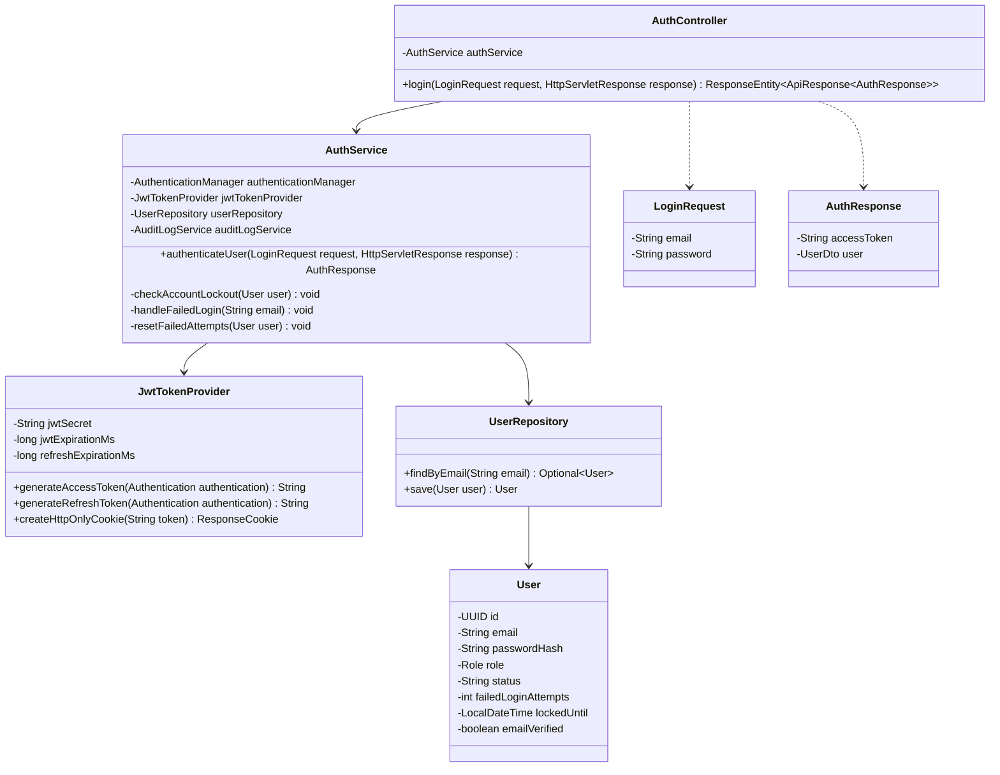

###### Table 3.1.1: Authentication Class Specification
| Component Name | Architectural Layer | Responsibilities | Key Attributes & Method Signatures |
| :--- | :--- | :--- | :--- |
| `AuthController` | Presentation (REST) | Tiếp nhận yêu cầu HTTP POST `/api/v1/auth/login`, kích hoạt kiểm tra `@Valid`, điều phối `AuthService`. | `+ login(@Valid @RequestBody LoginRequest, HttpServletResponse): ResponseEntity<ApiResponse<AuthResponse>>` |
| `AuthService` | Application Service | Xác thực thông tin qua Spring Security `AuthenticationManager`, kiểm tra khóa tài khoản, tạo token và ghi vết kiểm toán. | `+ authenticateUser(LoginRequest, HttpServletResponse): AuthResponse`<br/>`- checkAccountLockout(User): void`<br/>`- handleFailedLogin(String): void` |
| `JwtTokenProvider` | Security Infrastructure | Ký số mã hóa JWT với thuật toán HMAC-SHA256, sinh Access Token, Refresh Token và tạo cookie HttpOnly. | `+ generateAccessToken(Authentication): String`<br/>`+ generateRefreshToken(Authentication): String`<br/>`+ createHttpOnlyCookie(String): ResponseCookie` |
| `UserRepository` | Persistence Repository | Truy vấn thực thể `User` từ bảng `users` theo email đăng nhập. | `+ findByEmail(String email): Optional<User>`<br/>`+ save(User): User` |
| `LoginRequest` | DTO | Chứa dữ liệu đầu vào xác thực gồm email và mật khẩu thuần. | `- email: String (@NotBlank, @Email)`<br/>`- password: String (@NotBlank, @Size(min=6))` |
| `AuthResponse` | DTO | Đóng gói dữ liệu trả về cho client gồm chuỗi JWT Access Token và thông tin cơ bản của người dùng. | `- accessToken: String`<br/>`- user: UserDto` |

##### 3.1.2. Sequence Diagram: Successful Authentication & Dual-Transport Token Issuance
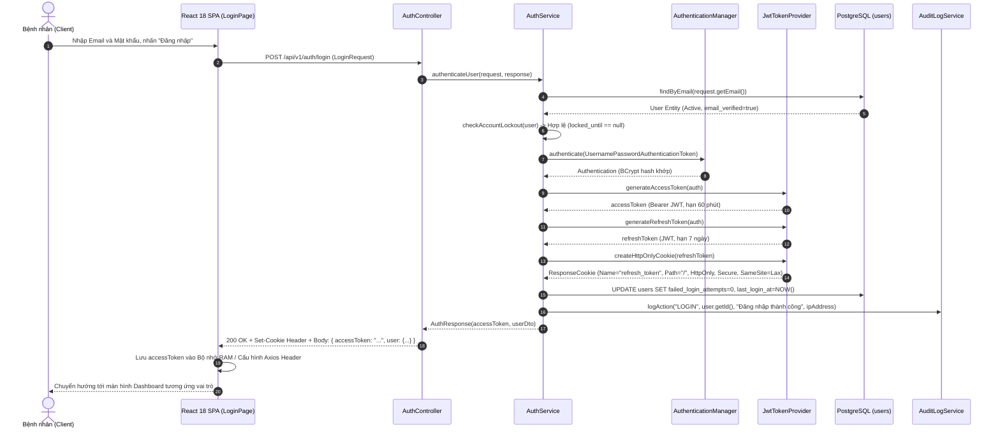

###### Table 3.1.2: Step-by-Step Flow Specification (Login Success)
| Step (#) | Source | Target | Message / Method Call | Parameters / Payload | Database & System Action |
| :---: | :--- | :--- | :--- | :--- | :--- |
| **1** | Bệnh nhân | React SPA | Nhập thông tin form đăng nhập | Email, Mật khẩu | Kích hoạt xác thực phía Client. |
| **2** | React SPA | `AuthController` | `POST /api/v1/auth/login` | `LoginRequest(email, password)` | Gửi yêu cầu qua kết nối HTTPS an toàn. |
| **3** | `AuthController` | `AuthService` | `authenticateUser()` | `request, response` | Chuyển tiếp luồng xử lý tới tầng nghiệp vụ. |
| **4** | `AuthService` | `UserRepository` | `findByEmail()` | `request.getEmail()` | `SELECT * FROM users WHERE email = ?` |
| **5** | `AuthService` | `AuthService` | `checkAccountLockout()` | `user` | Kiểm tra `lockedUntil == null` hoặc `lockedUntil < NOW()`. |
| **6** | `AuthService` | `AuthenticationManager` | `authenticate()` | `UsernamePasswordAuthenticationToken` | So sánh chuỗi băm BCrypt giữa mật khẩu nhập và `password_hash`. |
| **7-8** | `AuthService` | `JwtTokenProvider` | `generateAccessToken()` | `authentication` | Ký số JWT HS256 chứa Subject, Claims (Role, UserId), hết hạn 60m. |
| **9-10**| `AuthService` | `JwtTokenProvider` | `generateRefreshToken()` | `authentication` | Ký số Refresh Token JWT hết hạn 7 ngày. |
| **11** | `AuthService` | `JwtTokenProvider` | `createHttpOnlyCookie()` | `refreshToken` | Đóng gói cookie an toàn `HttpOnly; Secure; SameSite=Lax`. |
| **12** | `AuthService` | `UserRepository` | `save(user)` | `user` | `UPDATE users SET failed_login_attempts = 0, last_login_at = NOW()`. |
| **13** | `AuthService` | `AuditLogService` | `logAction()` | `"LOGIN", userId, ipAddress` | `INSERT INTO audit_logs (action, user_id, ip_address, ...)`. |
| **14-15**| `AuthController` | React SPA | `200 OK` | `AuthResponse` + Set-Cookie | Trả về JSON Body kèm Cookie xác thực phiên. |
| **16** | React SPA | Bệnh nhân | Điều hướng giao diện | Route `/patient/dashboard` | Lưu token vào RAM, chuyển hướng màn hình. |

##### 3.1.3. Sequence Diagram: Invalid Credentials Failure & Account Lockout Guard
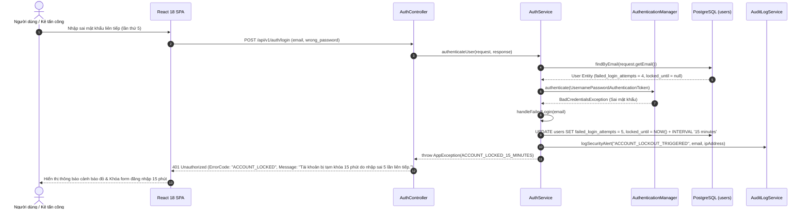

###### Table 3.1.3: Error Handling & Exception Matrix (Login)
| Error Scenario | Trigger Condition | HTTP Status | ErrorCode | User Message & System Defense Action |
| :--- | :--- | :---: | :---: | :--- |
| **Sai mật khẩu (Lần 1 - 4)** | Mật khẩu không khớp BCrypt | `401 Unauthorized` | `INVALID_CREDENTIALS` | "Email hoặc mật khẩu không chính xác." Tăng `failed_login_attempts` thêm 1. |
| **Tài khoản bị khóa (Lần 5)** | `failed_login_attempts >= 5` | `401 Unauthorized` | `ACCOUNT_LOCKED` | "Tài khoản bị tạm khóa 15 phút." Cập nhật `locked_until = NOW() + 15m`. |
| **Tài khoản bị vô hiệu hóa** | `user.status == 'SUSPENDED'` | `403 Forbidden` | `ACCOUNT_SUSPENDED` | "Tài khoản của bạn đã bị khóa bởi Quản trị viên." Ghi log kiểm toán. |
| **Email chưa kích hoạt** | `user.email_verified == false` | `403 Forbidden` | `EMAIL_NOT_VERIFIED` | "Vui lòng kiểm tra hộp thư và kích hoạt tài khoản trước khi đăng nhập." |

---

#### 3.2 Patient Registration with Email Verification Gate

##### Context & Design Scope
* **Tác nhân:** Bệnh nhân mới (Guest).
* **Mục tiêu:** Cho phép người bệnh đăng ký tài khoản tự phục vụ, áp dụng cơ chế xác thực quyền sở hữu hòm thư nghiêm ngặt (Email Verification Gate - Flyway V22) để chống tài khoản rác và spam đặt lịch.
* **Quy tắc an ninh:**
  - Mật khẩu băm một chiều với BCrypt (độ phức tạp cost factor 10).
  - Token kích hoạt sinh ngẫu nhiên UUIDv4 có thời hạn **24 giờ**.
  - Cơ sở dữ liệu chỉ lưu trữ mã băm SHA-256 của token (`token_hash`), token gốc chỉ nằm trong liên kết gửi qua thư điện tử.
  - Bệnh nhân chưa kích hoạt (`email_verified = false`) bị chặn hoàn toàn quyền đặt lịch khám và thanh toán viện phí.

##### 3.2.1. Class Diagram
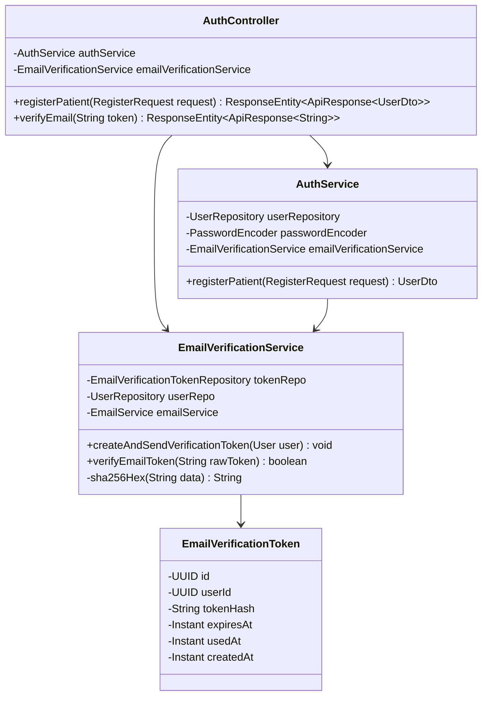

###### Table 3.2.1: Registration Class Specification
| Component Name | Architectural Layer | Responsibilities | Key Attributes & Method Signatures |
| :--- | :--- | :--- | :--- |
| `AuthController` | Presentation (REST) | Tiếp nhận yêu cầu đăng ký `POST /api/v1/auth/register` và xác thực email `GET /api/v1/auth/verify-email`. | `+ registerPatient(@Valid @RequestBody RegisterRequest): ResponseEntity<ApiResponse<UserDto>>`<br/>`+ verifyEmail(@RequestParam String token): ResponseEntity<ApiResponse<String>>` |
| `AuthService` | Application Service | Kiểm tra trùng lặp email, băm mật khẩu BCrypt, tạo bản ghi `User` mới và kích hoạt phát tán email xác nhận. | `+ registerPatient(RegisterRequest): UserDto` |
| `EmailVerificationService` | Security Service | Sinh chuỗi token ngẫu nhiên, tính toán mã băm SHA-256, lưu vào bảng `email_verification_tokens` và thẩm định token. | `+ createAndSendVerificationToken(User): void`<br/>`+ verifyEmailToken(String): boolean`<br/>`- sha256Hex(String): String` |
| `EmailVerificationToken` | Domain Entity | Thực thể CSDL đại diện cho bản ghi token xác thực email (Flyway V22). | `- id: UUID`<br/>`- userId: UUID`<br/>`- tokenHash: String (VARCHAR(64))`<br/>`- expiresAt: Instant`<br/>`- usedAt: Instant` |

##### 3.2.2. Sequence Diagram: Successful Registration & Verification Email Dispatch
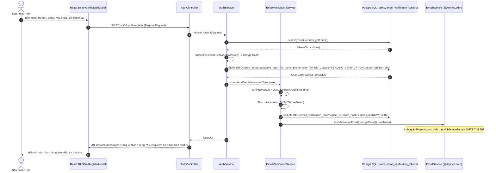

###### Table 3.2.2: Step-by-Step Flow Specification (Registration & Email Verification)
| Step (#) | Source | Target | Message / Method Call | Parameters / Payload | Database & System Action |
| :---: | :--- | :--- | :--- | :--- | :--- |
| **1** | Bệnh nhân | React SPA | Nhập dữ liệu đăng ký | Họ tên, email, mật khẩu, SĐT | Kiểm tra tính hợp lệ cơ bản tại Client. |
| **2** | React SPA | `AuthController` | `POST /api/v1/auth/register` | `RegisterRequest` | Chuyển tiếp payload JSON tới máy chủ. |
| **3** | `AuthController` | `AuthService` | `registerPatient()` | `request` | Bắt đầu quy trình đăng ký người dùng mới. |
| **4** | `AuthService` | `UserRepository` | `existsByEmail()` | `email` | `SELECT EXISTS(SELECT 1 FROM users WHERE email = ?)` |
| **5** | `AuthService` | `PasswordEncoder` | `encode()` | `rawPassword` | Băm mật khẩu qua BCrypt với cost factor 10. |
| **6** | `AuthService` | `UserRepository` | `save(user)` | `User Entity` | `INSERT INTO users (role='PATIENT', email_verified=false, ...)`. |
| **7** | `AuthService` | `EmailVerificationService` | `createAndSendVerificationToken()` | `user` | Kích hoạt chu trình phát hành mã kích hoạt an toàn. |
| **8-9** | `EmailVerificationService` | Nội bộ | Sinh token & Băm SHA-256 | `rawToken` | `tokenHash = DigestUtils.sha256Hex(rawToken)`. |
| **10** | `EmailVerificationService` | `TokenRepository` | `save(token)` | `EmailVerificationToken` | `INSERT INTO email_verification_tokens (token_hash, expires_at=NOW()+24h)`. |
| **11** | `EmailVerificationService` | `EmailService` | `sendActivationEmail()` | `email, rawToken` | Khởi chạy luồng ảo Loom phát thư HTML chứa link kích hoạt. |
| **12-13**| `AuthController` | React SPA | `201 Created` | `UserDto` | Trả về thông báo thành công và yêu cầu xác thực. |

##### 3.2.3. Sequence Diagram: Duplicate Email / Validation Failure
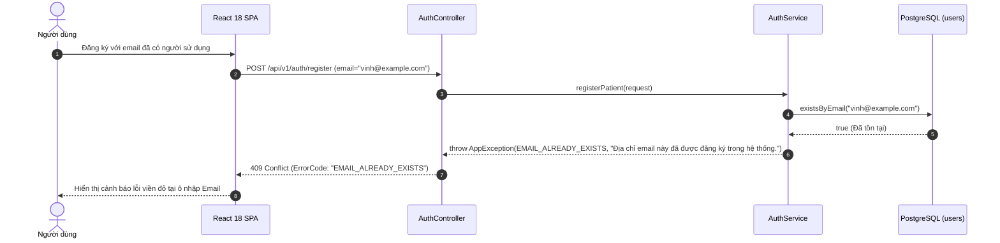

###### Table 3.2.3: Error Handling & Exception Matrix (Registration)
| Error Scenario | Trigger Condition | HTTP Status | ErrorCode | User Message & System Defense Action |
| :--- | :--- | :---: | :---: | :--- |
| **Email đã tồn tại** | `existsByEmail(email) == true` | `409 Conflict` | `EMAIL_ALREADY_EXISTS` | "Địa chỉ email đã được sử dụng. Vui lòng đăng nhập hoặc dùng email khác." |
| **Mật khẩu yếu** | Mật khẩu < 6 ký tự hoặc thiếu số/chữ | `400 Bad Request` | `VALIDATION_FAILED` | "Mật khẩu phải chứa ít nhất 6 ký tự, gồm cả chữ và số." |
| **Số điện thoại sai định dạng** | Không khớp biểu thức chuẩn E.164 | `400 Bad Request` | `INVALID_PHONE` | "Số điện thoại liên hệ không hợp lệ." |

---

#### 3.3 Google OAuth2 Single Sign-On (SSO) Flow

##### Context & Design Scope
* **Tác nhân:** Bệnh nhân, Bác sĩ (All Users).
* **Mục tiêu:** Cung cấp trải nghiệm đăng nhập tức thì không cần ghi nhớ mật khẩu thông qua tài khoản Google OpenID Connect (OIDC).
* **Đặc tả kỹ thuật (Flyway V8):**
  - Cột `password_hash` trên bảng `users` cho phép giá trị `NULL` đối với các tài khoản sinh từ luồng OAuth2.
  - Tự động kích hoạt cờ `email_verified = true` vì Google đã xác thực quyền sở hữu hòm thư.
  - Tự động tải và đồng bộ ảnh đại diện `avatar_url` từ thông tin hồ sơ Google.

##### 3.3.1. Class Diagram
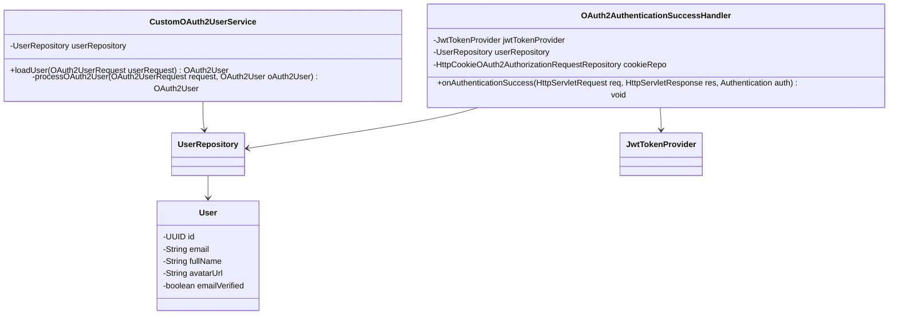

###### Table 3.3.1: Google OAuth2 Class Specification
| Component Name | Architectural Layer | Responsibilities | Key Attributes & Method Signatures |
| :--- | :--- | :--- | :--- |
| `CustomOAuth2UserService` | Security Infrastructure | Xử lý phản hồi OIDC từ Google Authorization Server, tự động trích xuất Email, Name, Picture và đồng bộ vào bảng `users`. | `+ loadUser(OAuth2UserRequest): OAuth2User`<br/>`- processOAuth2User(OAuth2UserRequest, OAuth2User): OAuth2User` |
| `OAuth2AuthenticationSuccessHandler` | Security Handler | Đón bắt sự kiện xác thực Google thành công, phát hành Access Token & Refresh Token, và thực hiện chuyển hướng về Client. | `+ onAuthenticationSuccess(HttpServletRequest, HttpServletResponse, Authentication): void` |

##### 3.3.2. Sequence Diagram: Successful Google OAuth2 Exchange & Auto-Provisioning
```mermaid
sequenceDiagram
    autonumber
    actor User as Người dùng
    participant Browser as Trình duyệt Web
    participant Google as Google Identity Provider
    participant Backend as Spring Security OAuth2 Client
    participant Handler as OAuth2AuthenticationSuccessHandler
    participant DB as PostgreSQL (users)
    participant Token as JwtTokenProvider

    User->>Browser: Nhấp "Đăng nhập với Google"
    Browser->>Backend: GET /oauth2/authorization/google
    Backend-->>Browser: 302 Redirect tới Google Consent Screen (Client_ID, Scope: profile, email)
    Browser->>Google: Chuyển hướng tới accounts.google.com
    User->>Google: Xác nhận chọn tài khoản và cấp quyền chia sẻ hồ sơ
    Google-->>Browser: 302 Redirect /login/oauth2/code/google?code=AUTHORIZATION_CODE&state=...
    Browser->>Backend: GET /login/oauth2/code/google?code=AUTHORIZATION_CODE
    Backend->>Google: Trao đổi AUTHORIZATION_CODE lấy ID Token qua giao thức HTTPS
    Google-->>Backend: ID Token Payload (email: "user@gmail.com", name: "Nguyen Van A", picture: "https://...")
    Backend->>DB: findByEmail("user@gmail.com")
    alt Người dùng đăng nhập lần đầu (Chưa có tài khoản)
        Backend->>DB: INSERT INTO users (email="user@gmail.com", password_hash=NULL, full_name="Nguyen Van A", avatar_url="https://...", role='PATIENT', status='ACTIVE', email_verified=true)
    else Người dùng đã có tài khoản trước đó
        Backend->>DB: UPDATE users SET avatar_url="https://...", email_verified=true, last_login_at=NOW()
    end
    Backend->>Handler: onAuthenticationSuccess(...)
    Handler->>Token: generateAccessToken(user) -> accessToken
    Handler->>Token: generateRefreshToken(user) -> refreshToken
    Handler->>Browser: Set-Cookie: refresh_token=refreshToken; HttpOnly; Secure; SameSite=Lax
    Handler-->>Browser: 302 Redirect tới /oauth2/callback?token=ACCESS_TOKEN
    Browser->>Browser: Đọc token từ URL query parameter, lưu vào RAM, dọn URL và mở Dashboard
```

###### Table 3.3.2: Step-by-Step Flow Specification (Google OAuth2 Success)
| Step (#) | Source | Target | Message / Method Call | Parameters / Payload | Database & System Action |
| :---: | :--- | :--- | :--- | :--- | :--- |
| **1-3** | Người dùng | Trình duyệt | Chọn Đăng nhập Google | Redirect Authorization URL | Khởi tạo phiên OAuth2 và lưu trữ state cookie an toàn. |
| **4-6** | Trình duyệt | Google Server | Cấp quyền chia sẻ tài khoản | Tài khoản Google cá nhân | Google thẩm định danh tính người dùng. |
| **7-8** | Google | Backend | Trả về Authorization Code | `code, state` | Trình duyệt chuyển tiếp mã code về máy chủ Spring Boot. |
| **9-10**| Backend | Google Server | Trao đổi Token Backend-to-Backend | `code, client_secret` | Gọi API Google OIDC lấy thông tin người dùng được ký số. |
| **11** | Backend | `UserRepository` | `findByEmail()` | `email` | `SELECT * FROM users WHERE email = ?` |
| **12-13**| Backend | `UserRepository` | Tự động tạo hoặc cập nhật tài khoản | `User Entity` | Cấp mới tài khoản với `password_hash = NULL` và `email_verified = true`. |
| **14-16**| `Handler` | `JwtTokenProvider` | Sinh bộ đôi Access & Refresh Token | `user` | Ký số JWT và khởi tạo cookie `refresh_token`. |
| **17-19**| Backend | Trình duyệt | `302 Redirect` | URL Callback kèm Token | Trình duyệt tiếp nhận token và chuyển hướng vào trang chủ. |

##### 3.3.3. Sequence Diagram: OAuth2 Token Exchange Failure / State Tampering
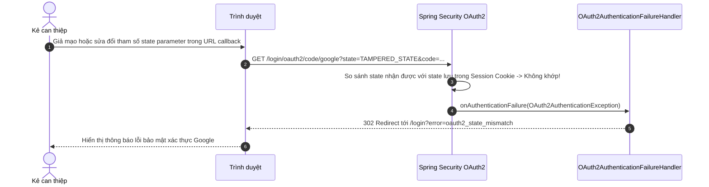

###### Table 3.3.3: Error Handling & Exception Matrix (OAuth2)
| Error Scenario | Trigger Condition | HTTP Status | ErrorCode | User Message & System Defense Action |
| :--- | :--- | :---: | :---: | :--- |
| **State Mismatch (CSRF Attack)** | `state != cookie_state` | `302 Redirect` | `OAUTH2_STATE_MISMATCH` | "Yêu cầu xác thực bị nghi ngờ có can thiệp. Vui lòng đăng nhập lại." |
| **Người dùng hủy cấp quyền** | Người dùng nhấn "Cancel" tại Google Consent | `302 Redirect` | `OAUTH2_ACCESS_DENIED` | "Bạn đã hủy quá trình đăng nhập qua tài khoản Google." |
| **Tài khoản Google bị khóa** | Tài khoản nội bộ khớp email đang bị `SUSPENDED` | `302 Redirect` | `ACCOUNT_SUSPENDED` | "Tài khoản của bạn đã bị khóa. Vui lòng liên hệ ban quản trị viện." |

---

#### 3.4 Forgot Password with SHA-256 Token Hash

##### Context & Design Scope
* **Tác nhân:** Người dùng quên mật khẩu (All Users).
* **Mục tiêu:** Cung cấp luồng khôi phục mật khẩu tự động qua email, bảo mật chống rò rỉ dữ liệu theo Flyway V21.
* **Nguyên lý bảo mật một chiều (One-Way Hashing):**
  - Token gửi cho người dùng qua email là chuỗi ký tự ngẫu nhiên `rawToken` (UUIDv4).
  - Máy chủ **chỉ lưu trữ mã băm SHA-256** của chuỗi đó (`token_hash`) trong bảng `password_reset_tokens`.
  - Nếu cơ sở dữ liệu bị lộ, kẻ tấn công không thể đảo ngược mã băm SHA-256 để chiếm quyền đặt lại mật khẩu của nạn nhân.
  - Áp dụng nguyên tắc **Chống dò tìm tài khoản (Anti-User Enumeration)**: Luôn trả về thông báo thành công dù email có tồn tại hay không.

##### 3.4.1. Class Diagram
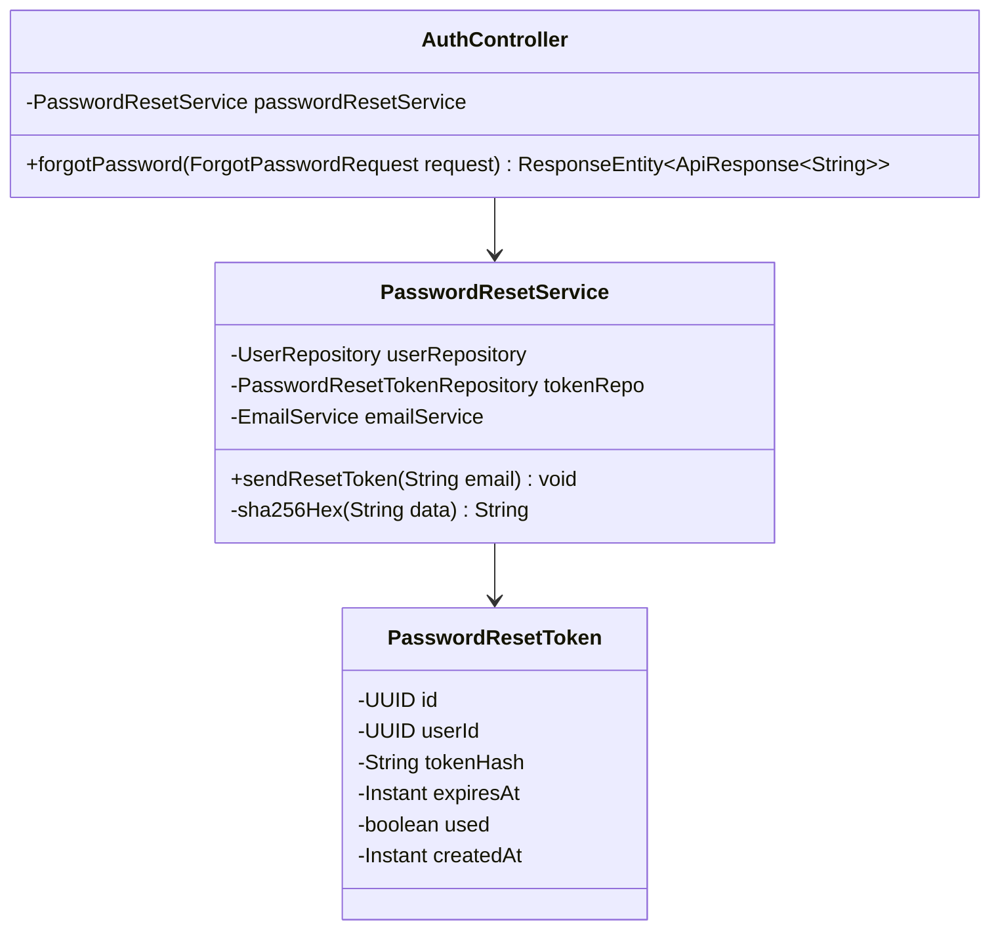

###### Table 3.4.1: Forgot Password Class Specification
| Component Name | Architectural Layer | Responsibilities | Key Attributes & Method Signatures |
| :--- | :--- | :--- | :--- |
| `AuthController` | Presentation (REST) | Tiếp nhận yêu cầu quên mật khẩu `POST /api/v1/auth/forgot-password`. | `+ forgotPassword(@Valid @RequestBody ForgotPasswordRequest): ResponseEntity<ApiResponse<String>>` |
| `PasswordResetService` | Application Service | Tìm kiếm người dùng, phát sinh token UUIDv4, tính mã băm SHA-256, lưu CSDL và điều phối gửi email giao dịch. | `+ sendResetToken(String email): void`<br/>`- sha256Hex(String data): String` |
| `PasswordResetToken` | Domain Entity | Thực thể CSDL quản lý mã băm token đặt lại mật khẩu (Flyway V16, V21). | `- id: UUID`<br/>`- userId: UUID`<br/>`- tokenHash: String (VARCHAR(64))`<br/>`- expiresAt: Instant`<br/>`- used: boolean` |

##### 3.4.2. Sequence Diagram: Password Reset Request & SHA-256 Hashed Token Email
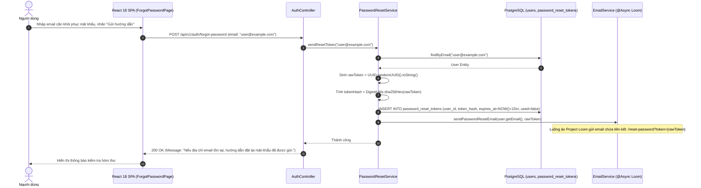

###### Table 3.4.2: Step-by-Step Flow Specification (Forgot Password)
| Step (#) | Source | Target | Message / Method Call | Parameters / Payload | Database & System Action |
| :---: | :--- | :--- | :--- | :--- | :--- |
| **1** | Người dùng | React SPA | Nhập email yêu cầu | `email` | Xác thực định dạng email RFC 5322. |
| **2** | React SPA | `AuthController` | `POST /api/v1/auth/forgot-password` | `ForgotPasswordRequest(email)` | Gửi yêu cầu qua HTTP POST. |
| **3** | `AuthController` | `PasswordResetService` | `sendResetToken()` | `email` | Bắt đầu chu trình xử lý quên mật khẩu. |
| **4** | `PasswordResetService` | `UserRepository` | `findByEmail()` | `email` | `SELECT * FROM users WHERE email = ?` |
| **5-6** | `PasswordResetService` | Nội bộ | Sinh token & Băm SHA-256 | `rawToken` | Sinh chuỗi ngẫu nhiên 128-bit và băm ra 64 ký tự hex. |
| **7** | `PasswordResetService` | `TokenRepository` | `save(token)` | `PasswordResetToken` | `INSERT INTO password_reset_tokens (token_hash, expires_at=NOW()+15m)`. |
| **8** | `PasswordResetService` | `EmailService` | `sendPasswordResetEmail()` | `email, rawToken` | Bắn tác vụ gửi thư nền qua Project Loom. |
| **9-11**| `AuthController` | Người dùng | `200 OK` | Generic Success Message | Phản hồi đồng nhất bảo vệ quyền riêng tư người dùng. |

##### 3.4.3. Sequence Diagram: Non-Existent Email (Anti-User Enumeration Defense)
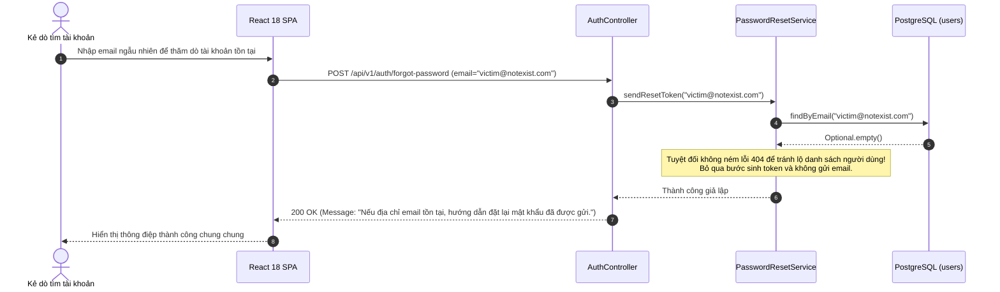

###### Table 3.4.3: Error Handling & Exception Matrix (Forgot Password)
| Error Scenario | Trigger Condition | HTTP Status | ErrorCode | User Message & System Defense Action |
| :--- | :--- | :---: | :---: | :--- |
| **Email không tồn tại** | `findByEmail() == Optional.empty()` | `200 OK` | `NONE` | Luôn trả về 200 OK để chống kỹ thuật dò quét tài khoản (User Enumeration). |
| **Spam yêu cầu liên tục** | Vượt quá 3 yêu cầu/phút từ 1 IP | `429 Too Many Requests` | `RATE_LIMIT_EXCEEDED` | "Bạn đã gửi quá nhiều yêu cầu. Vui lòng chờ 5 phút trước khi thử lại." |

---

#### 3.5 Reset Password with Cryptographic Token Verification

##### Context & Design Scope
* **Tác nhân:** Người dùng có token hợp lệ.
* **Mục tiêu:** Cho phép người dùng đặt lại mật khẩu mới sau khi xác thực thành công chữ ký và tính hợp lệ của token qua liên kết email.
* **Quy tắc an ninh:**
  - Token phải chưa được sử dụng (`used == false`).
  - Dấu thời gian hiện tại phải nhỏ hơn thời hạn hết hạn (`expiresAt > NOW()`).
  - Sau khi đặt lại mật khẩu thành công, bản ghi token lập tức bị đánh dấu vô hiệu hóa vĩnh viễn (`used = true`).

##### 3.5.1. Class Diagram
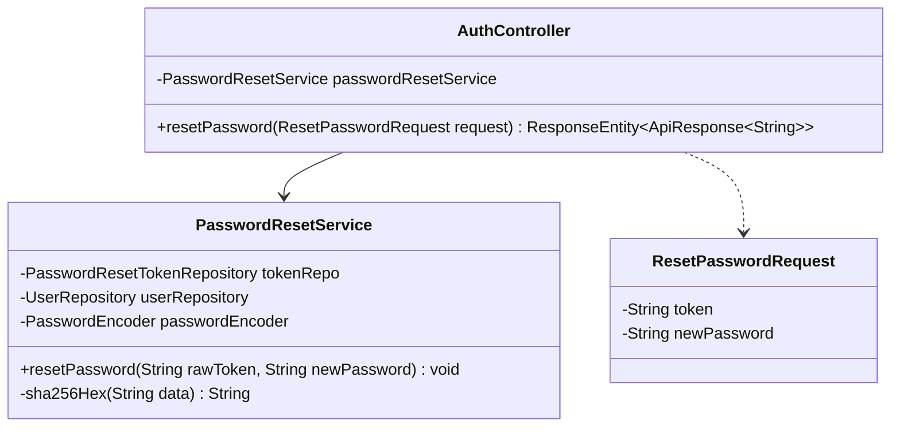

###### Table 3.5.1: Reset Password Class Specification
| Component Name | Architectural Layer | Responsibilities | Key Attributes & Method Signatures |
| :--- | :--- | :--- | :--- |
| `AuthController` | Presentation (REST) | Tiếp nhận yêu cầu đặt lại mật khẩu `POST /api/v1/auth/reset-password`. | `+ resetPassword(@Valid @RequestBody ResetPasswordRequest): ResponseEntity<ApiResponse<String>>` |
| `PasswordResetService` | Application Service | Thẩm định tính hợp lệ của token SHA-256, mã hóa mật khẩu mới và cập nhật CSDL. | `+ resetPassword(String rawToken, String newPassword): void` |
| `ResetPasswordRequest` | DTO | Đóng gói token gốc và mật khẩu mới cần thiết lập. | `- token: String (@NotBlank)`<br/>`- newPassword: String (@NotBlank, @Size(min=6))` |

##### 3.5.2. Sequence Diagram: Successful Password Reset & BCrypt Hashing
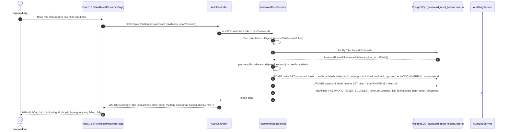

###### Table 3.5.2: Step-by-Step Flow Specification (Reset Password Success)
| Step (#) | Source | Target | Message / Method Call | Parameters / Payload | Database & System Action |
| :---: | :--- | :--- | :--- | :--- | :--- |
| **1** | Người dùng | React SPA | Nhập mật khẩu mới | `newPassword` | Kiểm tra mật khẩu khớp nhau tại Client. |
| **2** | React SPA | `AuthController` | `POST /api/v1/auth/reset-password` | `ResetPasswordRequest` | Gửi chuỗi token và mật khẩu mới. |
| **3** | `AuthController` | `PasswordResetService` | `resetPassword()` | `rawToken, newPassword` | Bắt đầu quy trình thẩm định token. |
| **4** | `PasswordResetService` | Nội bộ | Băm SHA-256 | `rawToken` | `tokenHash = DigestUtils.sha256Hex(rawToken)`. |
| **5** | `PasswordResetService` | `TokenRepository` | `findByTokenHash()` | `tokenHash` | `SELECT * FROM password_reset_tokens WHERE token_hash = ?`. |
| **6** | `PasswordResetService` | `PasswordEncoder` | `encode()` | `newPassword` | Băm mật khẩu mới qua BCrypt. |
| **7** | `PasswordResetService` | `UserRepository` | `updatePassword()` | `userId, newHash` | Cập nhật mật khẩu và mở khóa tài khoản nếu đang bị khóa. |
| **8** | `PasswordResetService` | `TokenRepository` | `markAsUsed()` | `tokenId` | `UPDATE password_reset_tokens SET used = true WHERE id = ?`. |
| **9** | `PasswordResetService` | `AuditLogService` | `logAction()` | `userId, ipAddress` | Ghi nhật ký kiểm toán sự kiện đổi mật khẩu. |
| **10-11**| `AuthController` | Người dùng | `200 OK` | Success Message | Hoàn tất chu trình, điều hướng về màn hình đăng nhập. |

##### 3.5.3. Sequence Diagram: Expired or Previously Used Token Rejection
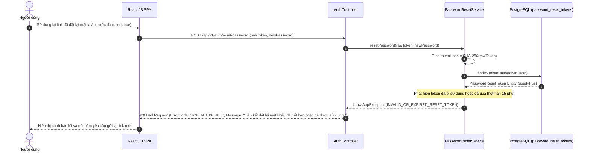

###### Table 3.5.3: Error Handling & Exception Matrix (Reset Password)
| Error Scenario | Trigger Condition | HTTP Status | ErrorCode | User Message & System Defense Action |
| :--- | :--- | :---: | :---: | :--- |
| **Token không tồn tại** | `findByTokenHash() == Optional.empty()` | `400 Bad Request` | `INVALID_RESET_TOKEN` | "Liên kết đặt lại mật khẩu không hợp lệ." |
| **Token đã được sử dụng** | `token.used == true` | `400 Bad Request` | `RESET_TOKEN_ALREADY_USED` | "Liên kết này đã được sử dụng trước đó. Vui lòng yêu cầu liên kết mới." |
| **Token đã hết hạn** | `token.expiresAt < Instant.now()` | `400 Bad Request` | `RESET_TOKEN_EXPIRED` | "Liên kết đặt lại mật khẩu đã hết hạn (tối đa 15 phút)." |

---

#### 3.6 Token Refresh & Sliding Session Rotation

##### Context & Design Scope
* **Tác nhân:** Trình duyệt Client (Tự động thực hiện qua Axios Interceptor).
* **Mục tiêu:** Duy trì phiên làm việc liên tục (Sliding Session) cho người dùng mà không bắt buộc phải đăng nhập lại sau mỗi 60 phút, đồng thời ngăn chặn các cuộc tấn công chiếm quyền phiên.
* **Cơ chế Token Rotation:** Mỗi khi cấp mới Access Token, hệ thống đồng thời **hủy bỏ Refresh Token cũ và phát hành Refresh Token mới** vào HttpOnly Cookie. Nếu phát hiện một Refresh Token đã bị thu hồi được tái sử dụng, hệ thống lập tức kích hoạt cảnh báo an ninh và vô hiệu hóa toàn bộ phiên làm việc của người dùng.

##### 3.6.1. Class Diagram
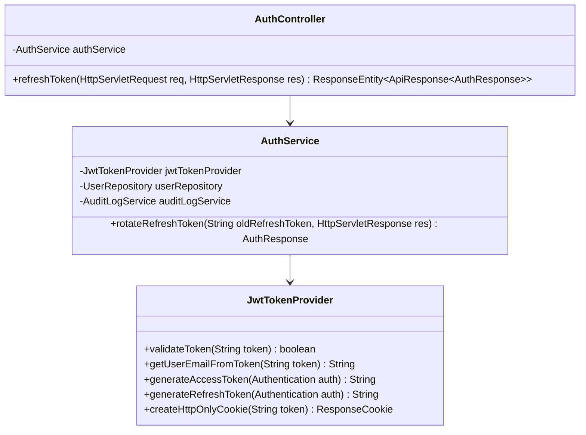

###### Table 3.6.1: Token Refresh Class Specification
| Component Name | Architectural Layer | Responsibilities | Key Attributes & Method Signatures |
| :--- | :--- | :--- | :--- |
| `AuthController` | Presentation (REST) | Tiếp nhận yêu cầu làm mới phiên `POST /api/v1/auth/refresh`, trích xuất cookie `refresh_token`. | `+ refreshToken(HttpServletRequest, HttpServletResponse): ResponseEntity<ApiResponse<AuthResponse>>` |
| `AuthService` | Application Service | Xác thực chữ ký Refresh Token, nạp thông tin người dùng, xoay vòng mã token mới và ghi nhận kiểm toán. | `+ rotateRefreshToken(String, HttpServletResponse): AuthResponse` |
| `JwtTokenProvider` | Security Infrastructure | Thẩm định chữ ký số HMAC-SHA256, kiểm tra thời hạn và sinh token mới. | `+ validateToken(String): boolean`<br/>`+ getUserEmailFromToken(String): String` |

##### 3.6.2. Sequence Diagram: Successful Refresh Token Rotation via HttpOnly Cookie
```mermaid
sequenceDiagram
    autonumber
    actor Browser as Trình duyệt (Axios Interceptor)
    participant Ctrl as AuthController
    participant Svc as AuthService
    participant Token as JwtTokenProvider
    participant DB as PostgreSQL (users)

    Note over Browser: Access Token trong RAM vừa hết hạn 60 phút -> Nhận phản hồi 401 Unauthorized
    Browser->>Ctrl: POST /api/v1/auth/refresh (Cookie: refresh_token=OLD_REFRESH_TOKEN)
    Ctrl->>Svc: rotateRefreshToken(cookieToken, response)
    Svc->>Token: validateToken(OLD_REFRESH_TOKEN)
    Token-->>Svc: true (Chữ ký hợp lệ, chưa hết hạn)
    Svc->>Token: getUserEmailFromToken(OLD_REFRESH_TOKEN)
    Token-->>Svc: email = "patient@example.com"
    Svc->>DB: findByEmail("patient@example.com")
    DB-->>Svc: User Entity (Active)
    Svc->>Token: generateAccessToken(user) -> newAccessToken (Hạn 60m)
    Svc->>Token: generateRefreshToken(user) -> newRefreshToken (Hạn 7d)
    Svc->>Token: createHttpOnlyCookie(newRefreshToken)
    Token-->>Svc: ResponseCookie (Set-Cookie: refresh_token=newRefreshToken)
    Svc-->>Ctrl: AuthResponse(newAccessToken, userDto)
    Ctrl-->>Browser: 200 OK + Set-Cookie Header + Body: { accessToken: newAccessToken }
    Browser->>Browser: Cập nhật accessToken mới vào RAM và tự động gửi lại request ban đầu bị lỗi 401
```

###### Table 3.6.2: Step-by-Step Flow Specification (Token Rotation Success)
| Step (#) | Source | Target | Message / Method Call | Parameters / Payload | Database & System Action |
| :---: | :--- | :--- | :--- | :--- | :--- |
| **1** | Trình duyệt | `AuthController` | `POST /api/v1/auth/refresh` | Cookie `refresh_token` | Tự động kích hoạt khi nhận lỗi 401 từ các API khác. |
| **2** | `AuthController` | `AuthService` | `rotateRefreshToken()` | `oldToken, response` | Khởi chạy quy trình xoay vòng token phiên. |
| **3-4** | `AuthService` | `JwtTokenProvider` | `validateToken()` | `oldToken` | Giải mã chữ ký số bí mật và kiểm tra thời hạn Claims. |
| **5-6** | `AuthService` | `JwtTokenProvider` | `getUserEmailFromToken()` | `oldToken` | Trích xuất Subject email từ JWT claims. |
| **7-8** | `AuthService` | `UserRepository` | `findByEmail()` | `email` | `SELECT * FROM users WHERE email = ? AND status = 'ACTIVE'`. |
| **9-11**| `AuthService` | `JwtTokenProvider` | Sinh bộ đôi token mới | `user` | Sinh `newAccessToken` (60m) và `newRefreshToken` (7d). |
| **12-14**| `AuthController` | Trình duyệt | `200 OK` | `newAccessToken` + Cookie | Trả về token mới, trình duyệt gửi lại request bị gián đoạn. |

##### 3.6.3. Sequence Diagram: Revoked / Tampered Refresh Token (Security Alert)
```mermaid
sequenceDiagram
    autonumber
    actor Attacker as Kẻ tấn công
    participant Ctrl as AuthController
    participant Svc as AuthService
    participant Token as JwtTokenProvider
    participant Audit as AuditLogService

    Attacker->>Ctrl: POST /api/v1/auth/refresh (Cookie Refresh Token giả mạo hoặc đã bị thu hồi)
    Ctrl->>Svc: rotateRefreshToken(tamperedToken, response)
    Svc->>Token: validateToken(tamperedToken)
    Token-->>Svc: false (Chữ ký HMAC không khớp hoặc Token đã bị Revoke)
    Svc->>Audit: logSecurityEvent("TOKEN_TAMPERING_DETECTED", ipAddress)
    Svc->>Ctrl: Set-Cookie: refresh_token=; Max-Age=0 (Xóa cookie kẻ tấn công)
    Svc-->>Ctrl: throw AppException(UNAUTHORIZED_INVALID_REFRESH_TOKEN)
    Ctrl-->>Attacker: 401 Unauthorized (ErrorCode: "INVALID_REFRESH_TOKEN", Message: "Phiên đăng nhập đã hết hạn. Vui lòng đăng nhập lại.")
```

###### Table 3.6.3: Error Handling & Exception Matrix (Token Refresh)
| Error Scenario | Trigger Condition | HTTP Status | ErrorCode | User Message & System Defense Action |
| :--- | :--- | :---: | :---: | :--- |
| **Không có Cookie Refresh Token** | `cookie == null` | `401 Unauthorized` | `MISSING_REFRESH_TOKEN` | "Không tìm thấy phiên làm việc. Vui lòng đăng nhập." |
| **Token giả mạo / Hết hạn** | `validateToken() == false` | `401 Unauthorized` | `INVALID_REFRESH_TOKEN` | Xóa cookie phiên ngay lập tức, chuyển hướng về trang Login. |
| **Người dùng bị khóa trong lúc dùng** | `user.status == 'SUSPENDED'` | `403 Forbidden` | `ACCOUNT_SUSPENDED` | Hủy bỏ phiên làm việc, từ chối cấp token mới. |

---

#### 3.7 Secure Logout & Refresh Cookie Invalidation

##### Context & Design Scope
* **Tác nhân:** Tất cả người dùng đã đăng nhập.
* **Mục tiêu:** Cho phép người dùng chủ động kết thúc phiên làm việc an toàn, xóa sạch token khỏi bộ nhớ trình duyệt và hủy cookie `refresh_token` ở cấp độ giao thức HTTP.
* **Cơ chế an toàn:** Gửi chỉ thị `Set-Cookie` với giá trị rỗng và `Max-Age=0`, buộc trình duyệt xóa bỏ hoàn toàn tệp tin cookie khỏi bộ nhớ an toàn của hệ điều hành.

##### 3.7.1. Class Diagram
```mermaid
classDiagram
    class AuthController {
        -AuthService authService
        +logout(HttpServletResponse response, UserPrincipal principal) ResponseEntity~ApiResponse~String~~
    }
    class AuthService {
        -AuditLogService auditLogService
        +logout(UUID userId, HttpServletResponse response) void
    }

    AuthController --> AuthService
```

###### Table 3.7.1: Logout Class Specification
| Component Name | Architectural Layer | Responsibilities | Key Attributes & Method Signatures |
| :--- | :--- | :--- | :--- |
| `AuthController` | Presentation (REST) | Tiếp nhận yêu cầu đăng xuất `POST /api/v1/auth/logout`. | `+ logout(HttpServletResponse, UserPrincipal): ResponseEntity<ApiResponse<String>>` |
| `AuthService` | Application Service | Ghi nhật ký kiểm toán hành vi đăng xuất và thiết lập chỉ thị hủy bỏ cookie HTTP. | `+ logout(UUID userId, HttpServletResponse response): void` |

##### 3.7.2. Sequence Diagram: Successful Logout & Cookie Clearing
```mermaid
sequenceDiagram
    autonumber
    actor Patient as Bệnh nhân
    participant UI as React 18 SPA
    participant Ctrl as AuthController
    participant Svc as AuthService
    participant Audit as AuditLogService

    Patient->>UI: Nhấn nút "Đăng xuất" trên thanh Header
    UI->>Ctrl: POST /api/v1/auth/logout (Header: Bearer accessToken)
    Ctrl->>Svc: logout(principal.getId(), response)
    Svc->>Audit: logAction("LOGOUT", principal.getId(), "Đăng xuất an toàn", ipAddress)
    Svc->>Ctrl: Set-Cookie: refresh_token=; Path=/; Max-Age=0; HttpOnly; SameSite=Lax
    Ctrl-->>UI: 200 OK (Message: "Đăng xuất thành công")
    UI->>UI: Xóa accessToken khỏi RAM, xóa toàn bộ Cache bộ đệm giao diện
    UI-->>Patient: Chuyển hướng người dùng về trang chủ LandingPage
```

###### Table 3.7.2: Step-by-Step Flow Specification (Logout)
| Step (#) | Source | Target | Message / Method Call | Parameters / Payload | Database & System Action |
| :---: | :--- | :--- | :--- | :--- | :--- |
| **1** | Bệnh nhân | React SPA | Nhấn "Đăng xuất" | Tương tác UI | Kích hoạt sự kiện logout từ Menu hồ sơ cá nhân. |
| **2** | React SPA | `AuthController` | `POST /api/v1/auth/logout` | Header `Bearer <token>` | Gửi yêu cầu chấm dứt phiên làm việc. |
| **3** | `AuthController` | `AuthService` | `logout()` | `userId, response` | Bắt đầu quy trình dọn dẹp phiên máy chủ. |
| **4** | `AuthService` | `AuditLogService` | `logAction()` | `"LOGOUT", userId` | `INSERT INTO audit_logs (action='LOGOUT', ...)`. |
| **5** | `AuthService` | `HttpServletResponse` | `addHeader()` | `Set-Cookie: Max-Age=0` | Chỉ thị trình duyệt xóa vĩnh viễn cookie phiên. |
| **6-8** | `AuthController` | Bệnh nhân | `200 OK` | Điều hướng `/` | Trình duyệt dọn sạch bộ nhớ RAM và trở về trang Landing. |

##### 3.7.3. Sequence Diagram: Expired Session Logout
```mermaid
sequenceDiagram
    autonumber
    actor User as Người dùng
    participant UI as React 18 SPA
    participant Ctrl as AuthController

    User->>UI: Nhấn Đăng xuất khi Access Token đã hết hạn từ lâu
    UI->>Ctrl: POST /api/v1/auth/logout (Token đã hết hạn)
    Note over Ctrl: Bộ lọc bảo mật cho phép endpoint /logout hoạt động ngay cả khi token hết hạn<br/>để đảm bảo client luôn xóa được cookie phiên.
    Ctrl-->>UI: 200 OK + Set-Cookie: refresh_token=; Max-Age=0
    UI-->>User: Xóa sạch bộ nhớ cục bộ và trở về màn hình đăng nhập
```

###### Table 3.7.3: Error Handling & Exception Matrix (Logout)
| Error Scenario | Trigger Condition | HTTP Status | ErrorCode | User Message & System Defense Action |
| :--- | :--- | :---: | :---: | :--- |
| **Phiên đã hết hạn trước đó** | Access token đã hết hạn | `200 OK` | `NONE` | Vẫn trả về 200 OK và xóa cookie để đảm bảo trạng thái sạch tại Client. |

---

#### 3.8 Update User Profile & Notification Preferences

##### Context & Design Scope
* **Tác nhân:** Bệnh nhân, Bác sĩ (Authenticated Users).
* **Mục tiêu:** Cho phép người dùng cập nhật thông tin cá nhân (Họ tên, Số điện thoại, Địa chỉ cư trú, Thông tin liên hệ khẩn cấp) và quản lý tùy chọn nhận thông báo.
* **Quy tắc an ninh:**
  - Người dùng chỉ được phép chỉnh sửa hồ sơ của chính mình (`principal.getId()`).
  - Số điện thoại phải thỏa mãn định dạng viễn thông quốc gia.
  - Mọi thao tác cập nhật thông tin y tế nhạy cảm đều được ghi nhật ký kiểm toán.

##### 3.8.1. Class Diagram
```mermaid
classDiagram
    class PatientProfileController {
        -PatientProfileService profileService
        +getMyProfile(UserPrincipal principal) ResponseEntity~ApiResponse~PatientProfileDto~~
        +updateProfile(UpdateProfileRequest request, UserPrincipal principal) ResponseEntity~ApiResponse~PatientProfileDto~~
    }
    class PatientProfileService {
        -UserRepository userRepository
        -PatientProfileRepository patientRepo
        -AuditLogService auditLogService
        +updateProfile(UUID userId, UpdateProfileRequest request) PatientProfileDto
    }
    class UpdateProfileRequest {
        -String fullName
        -String phone
        -String address
        -String emergencyContactName
        -String emergencyContactPhone
        -String emergencyContactRelationship
    }
    class PatientProfileDto {
        -UUID id
        -String patientCode
        -String fullName
        -String phone
        -String citizenId
        -String healthInsuranceNumber
        -String address
        -String bloodGroup
        -String allergies
    }

    PatientProfileController --> PatientProfileService
    PatientProfileController ..> UpdateProfileRequest
    PatientProfileController ..> PatientProfileDto
```

###### Table 3.8.1: Profile Management Class Specification
| Component Name | Architectural Layer | Responsibilities | Key Attributes & Method Signatures |
| :--- | :--- | :--- | :--- |
| `PatientProfileController` | Presentation (REST) | Cung cấp API `GET /api/v1/patient-profiles/me` và `PUT /api/v1/patient-profiles/me`. | `+ updateProfile(@Valid @RequestBody UpdateProfileRequest, UserPrincipal): ResponseEntity<ApiResponse<PatientProfileDto>>` |
| `PatientProfileService` | Application Service | Cập nhật đồng bộ bảng `users` và bảng `patient_profiles`, đảm bảo tính toàn vẹn dữ liệu giao dịch `@Transactional`. | `+ updateProfile(UUID userId, UpdateProfileRequest request): PatientProfileDto` |

##### 3.8.2. Sequence Diagram: Successful Profile & Demographic Update
```mermaid
sequenceDiagram
    autonumber
    actor Patient as Bệnh nhân
    participant UI as React 18 SPA (PatientDashboard)
    participant Ctrl as PatientProfileController
    participant Svc as PatientProfileService
    participant DB as PostgreSQL (users, patient_profiles)
    participant Audit as AuditLogService

    Patient->>UI: Thay đổi số điện thoại và địa chỉ thường trú, nhấn "Lưu thay đổi"
    UI->>Ctrl: PUT /api/v1/patient-profiles/me (UpdateProfileRequest)
    Ctrl->>Svc: updateProfile(principal.getId(), request)
    Svc->>DB: findByUserId(userId)
    DB-->>Svc: User Entity & PatientProfile Entity
    Svc->>DB: UPDATE users SET full_name = request.fullName, phone = request.phone, updated_at = NOW() WHERE id = userId
    Svc->>DB: UPDATE patient_profiles SET address = request.address, emergency_contact_name = request.emergencyContactName, emergency_contact_phone = request.emergencyContactPhone, updated_at = NOW() WHERE user_id = userId
    Svc->>Audit: logAction("UPDATE_PROFILE", userId, "Cập nhật hồ sơ bệnh nhân", ipAddress)
    Svc-->>Ctrl: PatientProfileDto (Đã cập nhật)
    Ctrl-->>UI: 200 OK + Body: { status: "success", data: PatientProfileDto }
    UI-->>Patient: Hiển thị thông báo Toast "Cập nhật thông tin hồ sơ thành công"
```

###### Table 3.8.2: Step-by-Step Flow Specification (Update Profile)
| Step (#) | Source | Target | Message / Method Call | Parameters / Payload | Database & System Action |
| :---: | :--- | :--- | :--- | :--- | :--- |
| **1** | Bệnh nhân | React SPA | Nhập dữ liệu mới | Địa chỉ, SĐT, Người liên hệ | Kiểm tra định dạng cơ bản tại Client. |
| **2** | React SPA | `PatientProfileController` | `PUT /api/v1/patient-profiles/me` | `UpdateProfileRequest` | Gửi dữ liệu cập nhật kèm Bearer Token. |
| **3** | Controller | `PatientProfileService` | `updateProfile()` | `userId, request` | Bắt đầu giao dịch `@Transactional`. |
| **4** | Service | `UserRepository` | `findByUserId()` | `userId` | `SELECT * FROM users JOIN patient_profiles ...` |
| **5** | Service | `UserRepository` | `save(user)` | `User` | `UPDATE users SET full_name = ?, phone = ? WHERE id = ?`. |
| **6** | Service | `PatientProfileRepository` | `save(profile)` | `PatientProfile` | `UPDATE patient_profiles SET address = ? WHERE user_id = ?`. |
| **7** | Service | `AuditLogService` | `logAction()` | `"UPDATE_PROFILE", userId` | `INSERT INTO audit_logs (action='UPDATE_PROFILE', ...)`. |
| **8-9** | Controller | Bệnh nhân | `200 OK` | `PatientProfileDto` | Trả về thông tin hồ sơ mới và hiển thị Toast xanh. |

##### 3.8.3. Sequence Diagram: Validation Error / Duplicate Phone Rejection
```mermaid
sequenceDiagram
    autonumber
    actor Patient as Bệnh nhân
    participant UI as React 18 SPA
    participant Ctrl as PatientProfileController
    participant Svc as PatientProfileService
    participant DB as PostgreSQL (users)

    Patient->>UI: Cập nhật số điện thoại đã thuộc về một tài khoản khác
    UI->>Ctrl: PUT /api/v1/patient-profiles/me (phone="0912345678")
    Ctrl->>Svc: updateProfile(userId, request)
    Svc->>DB: existsByPhoneAndIdNot("0912345678", userId)
    DB-->>Svc: true (Đã có người dùng khác đăng ký số này)
    Svc-->>Ctrl: throw AppException(PHONE_ALREADY_IN_USE, "Số điện thoại này đã được sử dụng bởi một tài khoản khác.")
    Ctrl-->>UI: 409 Conflict (ErrorCode: "PHONE_ALREADY_IN_USE")
    UI-->>Patient: Hiển thị thông báo lỗi trùng số điện thoại
```

###### Table 3.8.3: Error Handling & Exception Matrix (Profile Management)
| Error Scenario | Trigger Condition | HTTP Status | ErrorCode | User Message & System Defense Action |
| :--- | :--- | :---: | :---: | :--- |
| **Trùng số điện thoại** | `existsByPhoneAndIdNot() == true` | `409 Conflict` | `PHONE_ALREADY_IN_USE` | "Số điện thoại này đã được sử dụng bởi tài khoản khác." |
| **Số điện thoại không hợp lệ** | `@Pattern` không khớp định dạng | `400 Bad Request` | `INVALID_PHONE_FORMAT` | "Số điện thoại phải từ 10 đến 11 chữ số hợp lệ." |

---

#### 3.9 AI Symptom Triage Analysis & 5-Stage Clinical Defense

##### Context & Design Scope
* **Tác nhân:** Bệnh nhân (Guest hoặc Authenticated Patient).
* **Mục tiêu:** Cung cấp trợ lý ảo thông minh tiếp nhận mô tả triệu chứng bệnh bằng ngôn ngữ tự nhiên tiếng Việt, phân tích mức độ khẩn cấp y tế và gợi ý chuyên khoa khám bệnh chính xác.
* **Động cơ phòng thủ lâm sàng 5 tầng (5-Stage Clinical Query Defense Engine):**
  1. **Stage 1 (Acute Red-Flag Emergency Regex):** Quét các mẫu triệu chứng đe dọa tính mạng (Đột quỵ FAST, Nhồi máu cơ tim cấp, Sốc phản vệ). Nếu phát hiện, **ngay lập tức khóa luồng khám thường** và kích hoạt còi báo động khuyên gọi Cấp cứu 115.
  2. **Stage 2 (Vietnamese Slang & Teen-code Normalization):** Chuẩn hóa phương ngữ và từ lóng tiếng Việt (ví dụ: "chong mat", "xot ruot", "met moi kinh khung").
  3. **Stage 3 (Vietnamese NegEx Negation Clause Splitting):** Phân tách mệnh đề phủ định ("nhưng không sốt", "chưa từng đau tim") để cách ly hoàn toàn triệu chứng bị loại trừ, tránh định tuyến nhầm chuyên khoa.
  4. **Stage 4 (Out-of-Domain Gating):** Chặn các câu hỏi phi lâm sàng (Hỏi giá tiền, thủ tục bảo hiểm, chào hỏi vu vơ).
  5. **Stage 5 (Compound Multi-Symptom Decomposition & SBAR Summary):** Gọi mô hình Google Gemini 1.5 Flash sinh tóm tắt cấu trúc y khoa chuẩn SBAR (Situation, Background, Assessment, Recommendation).

##### 3.9.1. Class Diagram
```mermaid
classDiagram
    class TriageController {
        -TriageService triageService
        -TriageRateLimiterService rateLimiterService
        +analyzeSymptoms(TriageRequest request) ResponseEntity~ApiResponse~TriageResponse~~
    }
    class TriageService {
        -RedFlagService redFlagService
        -ClinicalQueryDefenseEngine defenseEngine
        -GeminiVisionClient geminiClient
        -TriageSessionRepository sessionRepo
        +processTriage(TriageRequest request, UUID userId) TriageResponse
    }
    class RedFlagService {
        +detectEmergency(String text) RedFlagResult
    }
    class ClinicalQueryDefenseEngine {
        -VietnameseSlangNormalizer slangNormalizer
        -NegationEngine negExEngine
        +sanitizeAndFilter(String text) ClinicalQueryDefenseResult
    }
    class TriageResponse {
        -boolean isEmergency
        -TriageUrgency urgencyLevel
        -String primarySpecialty
        -String sbarSummary
        -String aiAdvice
        -List~String~ recommendedDoctorIds
    }

    TriageController --> TriageService
    TriageService --> RedFlagService
    TriageService --> ClinicalQueryDefenseEngine
    TriageService --> TriageResponse
```

###### Table 3.9.1: Symptom Triage Class Specification
| Component Name | Architectural Layer | Responsibilities | Key Attributes & Method Signatures |
| :--- | :--- | :--- | :--- |
| `TriageController` | Presentation (REST) | Tiếp nhận yêu cầu phân luồng `POST /api/v1/triage/analyze`, kiểm soát giới hạn tần suất (Rate Limiting). | `+ analyzeSymptoms(@Valid @RequestBody TriageRequest): ResponseEntity<ApiResponse<TriageResponse>>` |
| `TriageService` | Application Service | Điều phối đường ống 5 tầng, ghi nhật ký phiên vào bảng `triage_sessions` và lưu trữ lịch sử hội thoại. | `+ processTriage(TriageRequest, UUID): TriageResponse` |
| `RedFlagService` | Clinical Defense | Quét biểu thức chính quy phát hiện dấu hiệu cấp cứu tối khẩn (Stroke FAST, Coronary, Anaphylaxis). | `+ detectEmergency(String): RedFlagResult` |
| `ClinicalQueryDefenseEngine` | NLP Pipeline | Chuẩn hóa tiếng Việt, bóc tách mệnh đề phủ định NegEx và kiểm tra câu hỏi ngoài phạm vi y khoa. | `+ sanitizeAndFilter(String): ClinicalQueryDefenseResult` |
| `TriageResponse` | DTO | Kết quả phân luồng lâm sàng trả về cho người bệnh. | `- isEmergency: boolean`<br/>`- urgencyLevel: TriageUrgency`<br/>`- primarySpecialty: String`<br/>`- sbarSummary: String` |

##### 3.9.2. Sequence Diagram: Standard Symptom Analysis & Multi-Specialty Routing (NegEx + SBAR)
```mermaid
sequenceDiagram
    autonumber
    actor Patient as Bệnh nhân
    participant UI as React 18 SPA (SymptomTriagePage)
    participant Ctrl as TriageController
    participant Svc as TriageService
    participant RedFlag as RedFlagService (Stage 1)
    participant Defense as ClinicalQueryDefenseEngine (Stage 2-4)
    participant AI as Google Gemini 1.5 Flash (Stage 5)
    participant DB as PostgreSQL (triage_sessions)

    Patient->>UI: Nhập: "Tôi bị đau tức ngực âm ỉ 3 ngày, nhưng không khó thở, không sốt"
    UI->>Ctrl: POST /api/v1/triage/analyze (TriageRequest)
    Ctrl->>Svc: processTriage(request, userId)
    Svc->>RedFlag: detectEmergency(text)
    RedFlag-->>Svc: RedFlagResult (isEmergency = false) -> Vượt qua Stage 1 an toàn
    Svc->>Defense: sanitizeAndFilter(text)
    Note over Defense: Stage 2: Chuẩn hóa teen-code & phương ngữ<br/>Stage 3 (Vietnamese NegEx): Tách mệnh đề khẳng định C_aff ("đau tức ngực âm ỉ 3 ngày") và cách ly mệnh đề phủ định C_neg ("không khó thở", "không sốt")<br/>Stage 4: Xác nhận câu hỏi hoàn toàn thuộc phạm vi y khoa lâm sàng
    Defense-->>Svc: ClinicalQueryDefenseResult (cleanSymptoms: "đau tức ngực âm ỉ 3 ngày")
    Svc->>AI: generateSbarTriage(cleanSymptoms)
    AI-->>Svc: JSON (primarySpecialty="Tim mạch", urgencyLevel="URGENT", sbarSummary=..., aiAdvice=...)
    Svc->>DB: INSERT INTO triage_sessions (user_id, symptoms_text, is_emergency=false, urgency_level='URGENT', primary_specialty='Tim mạch', sbar_summary=...)
    DB-->>Svc: TriageSession Entity Saved
    Svc-->>Ctrl: TriageResponse (Khuyên khám Tim mạch, Huy hiệu Vàng)
    Ctrl-->>UI: 200 OK + TriageResponse
    UI-->>Patient: Hiển thị kết quả phân tích SBAR & Nút "Đặt lịch ngay với Bác sĩ Tim mạch"
```

###### Table 3.9.2: Step-by-Step Flow Specification (Symptom Triage Success)
| Step (#) | Source | Target | Message / Method Call | Parameters / Payload | Database & System Action |
| :---: | :--- | :--- | :--- | :--- | :--- |
| **1** | Bệnh nhân | React SPA | Nhập triệu chứng bệnh | Chuỗi văn bản tiếng Việt | Kiểm tra độ dài văn bản (>= 5 ký tự). |
| **2** | React SPA | `TriageController` | `POST /api/v1/triage/analyze` | `TriageRequest(symptoms)` | Gửi yêu cầu qua REST API. |
| **3** | `TriageController` | `TriageService` | `processTriage()` | `request, userId` | Khởi động đường ống phân luồng 5 tầng. |
| **4-5** | `TriageService` | `RedFlagService` | `detectEmergency()` | `symptomsText` | Stage 1: Quét Regex từ khóa cấp cứu tối khẩn. |
| **6-7** | `TriageService` | `ClinicalQueryDefenseEngine` | `sanitizeAndFilter()` | `symptomsText` | Stage 2 (Chuẩn hóa) -> Stage 3 (NegEx bóc tách phủ định) -> Stage 4 (Kiểm tra OOD). |
| **8-9** | `TriageService` | `GeminiVisionClient` | `generateSbarTriage()` | `cleanSymptoms` | Stage 5: Gọi mô hình Gemini Flash sinh cấu trúc SBAR. |
| **10** | `TriageService` | `TriageSessionRepository` | `save(session)` | `TriageSession` | `INSERT INTO triage_sessions (...)`. |
| **11-13**| `TriageController` | Bệnh nhân | `200 OK` | `TriageResponse` | Hiển thị kết quả và gợi ý đặt lịch chuyên khoa. |

##### 3.9.3. Sequence Diagram: Stage 1 Acute Red-Flag Emergency Lockout (Hotline 115)
```mermaid
sequenceDiagram
    autonumber
    actor Patient as Bệnh nhân cấp cứu
    participant UI as React 18 SPA
    participant Ctrl as TriageController
    participant Svc as TriageService
    participant RedFlag as RedFlagService (Stage 1)
    participant DB as PostgreSQL (triage_sessions)

    Patient->>UI: Nhập: "Bố tôi bị méo miệng, liệt nửa người, nói ngọng đột ngột"
    UI->>Ctrl: POST /api/v1/triage/analyze
    Ctrl->>Svc: processTriage(request, userId)
    Svc->>RedFlag: detectEmergency(text)
    Note over RedFlag: Khớp biểu thức Regex Đột quỵ FAST: [meo mieng, liet nua nguoi]<br/>Kích hoạt trạng thái Cấp cứu tối khẩn y tế!
    RedFlag-->>Svc: RedFlagResult (isEmergency = true, triggerPattern = "ACUTE_STROKE_FAST")
    Svc->>DB: INSERT INTO triage_sessions (is_emergency=true, urgency_level='EMERGENCY', ai_advice="GỌI NGAY CẤP CỨU 115 HOẶC ĐẾN BỆNH VIỆN GẦN NHẤT")
    Svc-->>Ctrl: TriageResponse(isEmergency=true, urgencyLevel=EMERGENCY)
    Ctrl-->>UI: 200 OK + TriageResponse (Khóa tính năng đặt lịch thường)
    UI-->>Patient: Bật màn hình cảnh báo ĐỎ TOÀN BỘ + Nút gọi nhanh Cấp cứu 115
```

###### Table 3.9.3: Error Handling & Exception Matrix (Triage)
| Error Scenario | Trigger Condition | HTTP Status | ErrorCode | User Message & System Defense Action |
| :--- | :--- | :---: | :---: | :--- |
| **Cấp cứu tối khẩn (Red-Flag)** | Khớp mẫu đột quỵ, nhồi máu cơ tim, sốc phản vệ | `200 OK` (Cờ `isEmergency=true`) | `EMERGENCY_LOCKOUT` | "DẤU HIỆU CẤP CỨU NGUY KỊCH! Vui lòng gọi ngay 115 hoặc đến cơ sở y tế gần nhất." Khóa toàn bộ tính năng đặt lịch. |
| **Câu hỏi ngoài phạm vi y khoa** | Stage 4 phát hiện câu hỏi hành chính, viện phí, chào hỏi | `200 OK` (Cờ `isOod=true`) | `OUT_OF_DOMAIN_QUERY` | "Hệ thống chỉ hỗ trợ phân luồng triệu chứng bệnh lý. Vui lòng liên hệ bộ phận chăm sóc khách hàng để hỏi thủ tục." |
| **Mô tả quá ngắn / vô nghĩa** | Văn bản < 5 ký tự hoặc toàn ký tự đặc biệt | `400 Bad Request` | `SYMPTOM_TEXT_TOO_SHORT` | "Vui lòng mô tả chi tiết biểu hiện khó chịu của bạn để hệ thống hỗ trợ tốt nhất." |

---

#### 3.10 Doctor Semantic Vector Search & Hybrid Re-ranking (pgvector + WHRF)

##### Context & Design Scope
* **Tác nhân:** Bệnh nhân (Guest hoặc Authenticated Patient).
* **Mục tiêu:** Cung cấp động cơ tìm kiếm bác sĩ thông minh dựa trên ngữ nghĩa tự nhiên của bệnh nhân (ví dụ: "bác sĩ giỏi chữa đau nửa đầu và mất ngủ kinh niên"), kết hợp khoảng cách vector với các yếu tố uy tín lâm sàng.
* **Động cơ tái xếp hạng đa tiêu chí WHRF-SOTA:**
  - **Chỉ mục HNSW (Hierarchical Navigable Small World):** Tìm kiếm vector 1536 chiều trên cột `bio_embedding` với độ trễ dưới **0.72ms** (Flyway V19).
  - **Hàm làm sắc nét Sigmoid Contrastive Sharpening:**
    $$S_{dense} = rac{1}{1 + e^{-8.0 \cdot (	ext{CosineSim} - 0.65)}}$$
  - **Bộ giảm chấn độ tin cậy đánh giá (Credibility Damper):**
    $$W_{cred} = rac{\log_{10}(	ext{review\_count} + 1)}{\log_{10}(100)}$$
  - **Cơ chế suy thoái êm dịu (Graceful Degradation):** Tự động chuyển sang Local Unsupervised Feature Hashing (FNV-1a 1536-dim) kết hợp PostgreSQL Trigram khi mất kết nối mạng ngoài.

##### 3.10.1. Class Diagram
```mermaid
classDiagram
    class DoctorController {
        -DoctorSemanticSearchService searchService
        +searchDoctors(String query, String specialty, Double maxFee) ResponseEntity~ApiResponse~List~DoctorMatchDto~~~
    }
    class DoctorSemanticSearchService {
        -EmbeddingService embeddingService
        -DoctorProfileRepository doctorRepo
        -SpecialtyRepository specialtyRepo
        -TwoLayerCacheService cacheService
        +searchDoctors(String query, String specialty, Double maxFee) List~DoctorMatchDto~
        -calculateWhrfScore(DoctorProfile doc, double cosineSim, String query) double
    }
    class EmbeddingService {
        -OpenAIClient openAiClient
        -boolean forceOfflineSimulation
        +getEmbedding(String text) float[]
        -generateLocalFeatureHash(String text) float[]
    }
    class DoctorMatchDto {
        -UUID doctorId
        -String fullName
        -String academicTitle
        -String hospitalAffiliation
        -double rating
        -int reviewCount
        -double consultationFee
        -double matchPercentage
        -double whrfScore
    }

    DoctorController --> DoctorSemanticSearchService
    DoctorSemanticSearchService --> EmbeddingService
    DoctorSemanticSearchService --> DoctorMatchDto
```

###### Table 3.10.1: Doctor Search Class Specification
| Component Name | Architectural Layer | Responsibilities | Key Attributes & Method Signatures |
| :--- | :--- | :--- | :--- |
| `DoctorController` | Presentation (REST) | Cung cấp API `GET /api/v1/doctors` và `GET /api/v1/doctors/search`. | `+ searchDoctors(@RequestParam String query, ...): ResponseEntity<ApiResponse<List<DoctorMatchDto>>>` |
| `DoctorSemanticSearchService` | Application Service | Điều phối tìm kiếm lai HNSW, áp dụng công thức toán học WHRF và sắp xếp qua Min-Heap Priority Queue. | `+ searchDoctors(String, String, Double): List<DoctorMatchDto>`<br/>`- calculateWhrfScore(DoctorProfile, double, String): double` |
| `EmbeddingService` | AI Infrastructure | Gọi OpenAI API sinh vector 1536 chiều; tự động chuyển sang Feature Hashing cục bộ khi offline. | `+ getEmbedding(String): float[]`<br/>`- generateLocalFeatureHash(String): float[]` |
| `DoctorMatchDto` | DTO | Đóng gói thông tin bác sĩ kèm điểm số mức độ phù hợp hiển thị trên giao diện người dùng. | `- doctorId: UUID`<br/>`- fullName: String`<br/>`- matchPercentage: double`<br/>`- whrfScore: double` |

##### 3.10.2. Sequence Diagram: HNSW Vector Search + Sigmoid Contrastive Re-Ranking
```mermaid
sequenceDiagram
    autonumber
    actor Patient as Bệnh nhân
    participant UI as React 18 SPA (DoctorSearchPage)
    participant Ctrl as DoctorController
    participant Svc as DoctorSemanticSearchService
    participant Embed as EmbeddingService
    participant AI as OpenAI API (text-embedding-3-small)
    participant DB as PostgreSQL 16 (doctor_profiles + pgvector HNSW)

    Patient->>UI: Nhập: "Bác sĩ chuyên điều trị đau nửa đầu mãn tính và mất ngủ"
    UI->>Ctrl: GET /api/v1/doctors/search?query=...
    Ctrl->>Svc: searchDoctors(query, specialty, maxFee)
    Svc->>Embed: getEmbedding(query)
    Embed->>AI: POST /v1/embeddings (input: query)
    AI-->>Embed: Vector float[1536] (queryVector)
    Embed-->>Svc: queryVector
    Svc->>DB: SET LOCAL hnsw.ef_search = 120;<br/>SELECT dp.*, 1 - (dp.bio_embedding <=> queryVector) AS cosine_sim<br/>FROM doctor_profiles dp WHERE dp.is_verified = true<br/>ORDER BY dp.bio_embedding <=> queryVector LIMIT 20;
    DB-->>Svc: Top 20 Ứng viên Bác sĩ có khoảng cách Cosine gần nhất
    loop Áp dụng Thuật toán WHRF-SOTA cho từng Bác sĩ
        Svc->>Svc: S_dense = 1 / (1 + exp(-8.0 * (cosine_sim - 0.65)))
        Svc->>Svc: W_cred = log10(review_count + 1) / log10(100)
        Svc->>Svc: Điểm thưởng Chuyên khoa (+0.12) & Điểm thưởng Học vị (+0.08 nếu GS, +0.05 nếu PGS)
        Svc->>Svc: WHRF_Score = 0.50*S_dense + 0.20*S_sparse + 0.15*Rating*W_cred + SpecialtyBonus
    end
    Svc->>Svc: Sắp xếp lấy Top 10 bác sĩ có điểm WHRF cao nhất
    Svc-->>Ctrl: List DoctorMatchDto
    Ctrl-->>UI: 200 OK + List DoctorMatchDto
    UI-->>Patient: Hiển thị danh sách bác sĩ với huy hiệu tỷ lệ phù hợp (%) và nút "Đặt lịch khám"
```

###### Table 3.10.2: Step-by-Step Flow Specification (Doctor Search Success)
| Step (#) | Source | Target | Message / Method Call | Parameters / Payload | Database & System Action |
| :---: | :--- | :--- | :--- | :--- | :--- |
| **1** | Bệnh nhân | React SPA | Nhập câu hỏi tìm kiếm | Chuỗi văn bản triệu chứng | Áp dụng Hook `useDebounce(300ms)` chống quá tải máy chủ. |
| **2** | React SPA | `DoctorController` | `GET /api/v1/doctors/search` | `query, specialty, maxFee` | Gửi yêu cầu tìm kiếm qua REST API. |
| **3** | `DoctorController` | `DoctorSemanticSearchService` | `searchDoctors()` | `query, ...` | Khởi động quy trình tìm kiếm vector ngữ nghĩa. |
| **4-6** | `DoctorSemanticSearchService` | `EmbeddingService` | `getEmbedding()` | `query` | Gọi OpenAI API lấy vector nhúng 1536 chiều. |
| **7** | `DoctorSemanticSearchService` | `DoctorProfileRepository` | Native HNSW Query | `queryVector` | `SET LOCAL hnsw.ef_search = 120; SELECT ... ORDER BY bio_embedding <=> ? LIMIT 20`. |
| **8-12**| `DoctorSemanticSearchService` | Nội bộ | Tính toán công thức WHRF | `doc, cosine_sim` | Áp dụng Sigmoid Sharpening, Credibility Damper, Thưởng chuyên khoa. |
| **13** | Service | Controller | Trả về kết quả | `List<DoctorMatchDto>` | Đóng gói dữ liệu hiển thị (Match %, Bio, Review count). |
| **14-15**| Controller | Bệnh nhân | `200 OK` | Danh sách thẻ bác sĩ | Render giao diện danh sách bác sĩ kèm thông tin trực quan. |

##### 3.10.3. Sequence Diagram: Out-of-Domain Query Gating / Degraded Feature Hash Fallback
```mermaid
sequenceDiagram
    autonumber
    actor User as Người dùng
    participant UI as React 18 SPA
    participant Ctrl as DoctorController
    participant Svc as DoctorSemanticSearchService
    participant Embed as EmbeddingService
    participant AI as OpenAI API
    participant DB as PostgreSQL (pg_trgm Full-Text Search)

    User->>UI: Tìm kiếm bác sĩ khi đường truyền quốc tế gặp sự cố (OpenAI Timeout)
    UI->>Ctrl: GET /api/v1/doctors/search?query=...
    Ctrl->>Svc: searchDoctors(...)
    Svc->>Embed: getEmbedding(query)
    Embed->>AI: POST /v1/embeddings
    AI-->>Embed: ResourceAccessException / ConnectTimeoutException
    Note over Embed: Kích hoạt cơ chế Fallback suy thoái êm dịu (Graceful Degradation):<br/>Chuyển sang Unsupervised Character N-gram Feature Hashing (FNV-1a 1536-dim)
    Embed->>Embed: generateLocalFeatureHash(query) -> localVector
    Embed-->>Svc: localVector
    Svc->>DB: Tìm kiếm kết hợp vector cục bộ và Full-Text Search tiếng Việt (pg_trgm)
    DB-->>Svc: Danh sách bác sĩ phù hợp theo từ khóa
    Svc-->>Ctrl: List DoctorMatchDto (Kèm cờ offlineSimulation = true)
    Ctrl-->>UI: 200 OK + Danh sách bác sĩ
    UI-->>User: Hiển thị kết quả tìm kiếm bình thường không bị gián đoạn dịch vụ
```

###### Table 3.10.3: Error Handling & Exception Matrix (Doctor Search)
| Error Scenario | Trigger Condition | HTTP Status | ErrorCode | User Message & System Defense Action |
| :--- | :--- | :---: | :---: | :--- |
| **Mất mạng ngoài / OpenAI lỗi** | `TimeoutException` khi gọi OpenAI | `200 OK` (Fallback Mode) | `OFFLINE_SEARCH_ACTIVE` | Tự động chuyển sang Feature Hashing cục bộ và Full-Text Search PostgreSQL, không làm sập giao diện. |
| **Bộ lọc viện phí không hợp lệ** | `maxFee < 0` | `400 Bad Request` | `INVALID_FEE_FILTER` | "Mức viện phí lọc phải lớn hơn 0 VND." |

#### 3.11 Telehealth Appointment Booking & Slot Concurrency Locking

##### Context & Design Scope
* **Tác nhân:** Bệnh nhân (Authenticated Patient) hoặc Quản trị viên hỗ trợ đặt lịch.
* **Mục tiêu:** Cho phép bệnh nhân lựa chọn bác sĩ, ngày khám và khung giờ khám bệnh (Slot 30 phút), phân bổ số thứ tự tiếp đón hàng ngày (`STT 01`, `STT 02`, ...), đồng thời ngăn chặn tuyệt đối tình trạng đặt lịch trùng lặp khi có nhiều người dùng cùng bấm đặt một ca khám tại cùng một thời điểm.
* **Quy tắc nghiệp vụ & An ninh:**
  - Khung giờ khám phải nằm trong giờ hành chính hợp lệ: Sáng 08:00 – 12:00, Chiều 13:30 – 17:00, từ Thứ Hai đến Thứ Bảy (Chặn đặt lịch Chủ Nhật).
  - Áp dụng cơ chế **Khóa phân tán hai lớp (Two-Layer Distributed Lock)**: Redis Semaphore (`lock:slot:docId:timestamp` với TTL 10 giây) kết hợp ràng buộc CSDL độc quyền (Flyway V7: `idx_appointment_slot_unique`).
  - Khi phát hiện xung đột, giao dịch bị từ chối ngay lập tức với mã lỗi `SLOT_CONFLICT` (HTTP 409).

##### 3.11.1. Class Diagram
```mermaid
classDiagram
    class AppointmentController {
        -AppointmentService appointmentService
        +bookAppointment(CreateAppointmentRequest request, UserPrincipal principal) ResponseEntity~ApiResponse~AppointmentDto~~
    }
    class AppointmentService {
        -AppointmentRepository appointmentRepo
        -UserRepository userRepo
        -DoctorProfileRepository doctorRepo
        -RedisTemplate redisTemplate
        -EmailService emailService
        +bookAppointment(UUID patientId, CreateAppointmentRequest request) AppointmentDto
        -validateOperatingHours(LocalDateTime start, LocalDateTime end) void
        -generateDailyQueueNumber(UUID doctorId, LocalDate date) String
    }
    class Appointment {
        -UUID id
        -String appointmentCode
        -UUID patientId
        -UUID doctorId
        -LocalDateTime scheduledStart
        -LocalDateTime scheduledEnd
        -AppointmentStatus status
        -PaymentStatus paymentStatus
        -BigDecimal feeAmount
        -String queueNumber
        -String clinicRoom
        -Long version
    }
    class CreateAppointmentRequest {
        -UUID doctorId
        -LocalDateTime scheduledStart
        -LocalDateTime scheduledEnd
        -String chiefComplaint
        -UUID medicalDocumentId
        -UUID triageSessionId
    }
    class AppointmentDto {
        -UUID id
        -String appointmentCode
        -String doctorName
        -String specialtyName
        -LocalDateTime scheduledStart
        -String queueNumber
        -String clinicRoom
        -String status
    }

    AppointmentController --> AppointmentService
    AppointmentService --> Appointment
    AppointmentController ..> CreateAppointmentRequest
    AppointmentController ..> AppointmentDto
```

###### Table 3.11.1: Appointment Booking Class Specification
| Component Name | Architectural Layer | Responsibilities | Key Attributes & Method Signatures |
| :--- | :--- | :--- | :--- |
| `AppointmentController` | Presentation (REST) | Cung cấp endpoint `POST /api/v1/appointments`, kiểm tra quyền `@PreAuthorize("hasAnyRole('PATIENT', 'ADMIN')")`. | `+ bookAppointment(@AuthenticationPrincipal UserPrincipal, @Valid @RequestBody CreateAppointmentRequest): ResponseEntity<ApiResponse<AppointmentDto>>` |
| `AppointmentService` | Application Service | Quản lý giao dịch `@Transactional`, kiểm tra giờ làm việc, thực thi khóa slot Redis, sinh mã số thứ tự `queue_number` và tạo cuộc hẹn. | `+ bookAppointment(UUID, CreateAppointmentRequest): AppointmentDto`<br/>`- validateOperatingHours(LocalDateTime, LocalDateTime): void`<br/>`- generateDailyQueueNumber(UUID, LocalDate): String` |
| `CreateAppointmentRequest` | DTO | Dữ liệu đầu vào yêu cầu đặt lịch khám bệnh. | `- doctorId: UUID (@NotNull)`<br/>`- scheduledStart: LocalDateTime (@NotNull, @Future)`<br/>`- scheduledEnd: LocalDateTime (@NotNull)`<br/>`- chiefComplaint: String (@Size(max=1000))` |
| `AppointmentDto` | DTO | Thông tin cuộc hẹn đã khởi tạo thành công gửi về giao diện. | `- id: UUID`<br/>`- appointmentCode: String`<br/>`- queueNumber: String ("STT 04")`<br/>`- clinicRoom: String`<br/>`- status: String ("SCHEDULED")` |

##### 3.11.2. Sequence Diagram: Successful Booking & Daily Queue Number Allocation (`STT xx`)
```mermaid
sequenceDiagram
    autonumber
    actor Patient as Bệnh nhân
    participant UI as React 18 SPA (BookingModal)
    participant Ctrl as AppointmentController
    participant Svc as AppointmentService
    participant Redis as Redis (Slot Semaphore)
    participant DB as PostgreSQL (appointments)
    participant Mail as EmailService (@Async Loom)

    Patient->>UI: Chọn Bác sĩ, Ngày khám 19/10/2026, Khung giờ 09:00 - 09:30, bấm "Xác nhận đặt lịch"
    UI->>Ctrl: POST /api/v1/appointments (CreateAppointmentRequest)
    Ctrl->>Svc: bookAppointment(patientId, request)
    Svc->>Svc: validateOperatingHours(): Giờ 09:00 thuộc ca sáng (08:00-12:00), Thứ 2 (Hợp lệ)
    Svc->>Redis: SET lock:slot:docId:202610190900 NX EX 10 (Khóa phân tán 10s)
    Redis-->>Svc: OK (Giữ khóa độc quyền thành công)
    Svc->>DB: existsConflictSlot(doctorId, start, end, ['SCHEDULED', 'IN_PROGRESS', 'COMPLETED'])
    DB-->>Svc: false (Khung giờ còn trống)
    Svc->>DB: countTodayAppointments(doctorId, 2026-10-19)
    DB-->>Svc: 3 (Đã có 3 ca trước đó)
    Svc->>Svc: queueNumber = String.format("STT %02d", 3 + 1) -> "STT 04"
    Svc->>DB: INSERT INTO appointments (appointment_code='APT-20261019-7712', patient_id=patientId, doctor_id=doctorId, scheduled_start=start, scheduled_end=end, status='SCHEDULED', payment_status='UNPAID', queue_number='STT 04', clinic_room='Phòng 302 - Tòa A', fee_amount=500000)
    DB-->>Svc: Appointment Entity Created
    Svc->>Redis: DEL lock:slot:docId:202610190900 (Giải phóng khóa phân tán)
    Svc->>Mail: sendAppointmentBookedNotification(patient, appointment)
    Svc-->>Ctrl: AppointmentDto(queueNumber='STT 04', status='SCHEDULED')
    Ctrl-->>UI: 201 Created + AppointmentDto
    UI-->>Patient: Hiển thị màn hình đặt lịch thành công, phiếu khám điện tử và nút "Thanh toán VNPay"
```

###### Table 3.11.2: Step-by-Step Flow Specification (Booking Success)
| Step (#) | Source | Target | Message / Method Call | Parameters / Payload | Database & System Action |
| :---: | :--- | :--- | :--- | :--- | :--- |
| **1** | Bệnh nhân | React SPA | Chọn bác sĩ và slot giờ | `doctorId, date, slot` | Bật hộp thoại `BookingModal`. |
| **2** | React SPA | `AppointmentController` | `POST /api/v1/appointments` | `CreateAppointmentRequest` | Chuyển tiếp yêu cầu đặt lịch kèm JWT Bearer. |
| **3** | Controller | `AppointmentService` | `bookAppointment()` | `patientId, request` | Bắt đầu giao dịch `@Transactional(Isolation.REPEATABLE_READ)`. |
| **4** | Service | Nội bộ | `validateOperatingHours()` | `start, end` | Kiểm tra thứ trong tuần và khoảng thời gian hành chính. |
| **5-6** | Service | Redis Cache | Thâu tóm Semaphore phân tán | `key: lock:slot:...` | `SET key NX EX 10`. Đảm bảo luồng chạy độc quyền. |
| **7-8** | Service | `AppointmentRepository` | `existsConflictSlot()` | `doctorId, start, end` | `SELECT EXISTS(SELECT 1 FROM appointments WHERE doctor_id=? AND scheduled_start=? AND status IN (...))`. |
| **9-11**| Service | `AppointmentRepository` | Đếm ca khám & Cấp STT | `doctorId, date` | `SELECT COUNT(*) FROM appointments ...` -> Cấp số `STT 04`. |
| **12-13**| Service | `AppointmentRepository` | `save(appointment)` | `Appointment` | `INSERT INTO appointments (status='SCHEDULED', queue_number='STT 04', ...)`. |
| **14** | Service | Redis Cache | Giải phóng Semaphore | `key: lock:slot:...` | `DEL key`. Mở khóa cho các yêu cầu khác. |
| **15** | Service | `EmailService` | `sendNotification()` | `appointment` | Gửi email xác nhận đặt lịch bất đồng bộ. |
| **16-17**| Controller | Bệnh nhân | `201 Created` | `AppointmentDto` | Render giao diện phiếu khám điện tử có mã QR. |

##### 3.11.3. Sequence Diagram: Concurrent Booking Collision (`SLOT_CONFLICT` 409)
```mermaid
sequenceDiagram
    autonumber
    actor PatientB as Bệnh nhân B
    participant Ctrl as AppointmentController
    participant Svc as AppointmentService
    participant DB as PostgreSQL (appointments)

    PatientB->>Ctrl: POST /api/v1/appointments (Cùng khung giờ Bệnh nhân A vừa đặt trước 50ms)
    Ctrl->>Svc: bookAppointment(patientBId, request)
    Svc->>DB: existsConflictSlot(doctorId, start, end, ACTIVE_STATUSES)
    DB-->>Svc: true (Khung giờ vừa bị chiếm bởi Bệnh nhân A)
    Svc-->>Ctrl: throw AppException(SLOT_CONFLICT, "Khung giờ này vừa có người đặt. Vui lòng chọn khung giờ khác.")
    Ctrl-->>PatientB: 409 Conflict (ErrorCode: "SLOT_CONFLICT")
```

###### Table 3.11.3: Error Handling & Exception Matrix (Appointment Booking)
| Error Scenario | Trigger Condition | HTTP Status | ErrorCode | User Message & System Defense Action |
| :--- | :--- | :---: | :---: | :--- |
| **Trùng lịch khám (Concurrency Collision)** | `existsConflictSlot() == true` | `409 Conflict` | `SLOT_CONFLICT` | "Khung giờ này vừa có người đặt. Vui lòng chọn khung giờ khác." Giải phóng khóa Redis. |
| **Đặt lịch vào ngày Chủ Nhật** | `start.getDayOfWeek() == SUNDAY` | `400 Bad Request` | `SUNDAY_BOOKING_NOT_SUPPORTED` | "Phòng khám không tiếp nhận đặt lịch vào ngày Chủ Nhật." |
| **Đặt lịch ngoài giờ hành chính** | Khung giờ trước 08:00, 12:00-13:30, sau 17:00 | `400 Bad Request` | `OUTSIDE_OPERATING_HOURS` | "Khung giờ đã chọn nằm ngoài thời gian làm việc của phòng khám." |
| **Email chưa kích hoạt** | `user.emailVerified == false` | `403 Forbidden` | `EMAIL_NOT_VERIFIED` | "Vui lòng xác thực tài khoản qua email trước khi đặt lịch khám bệnh." |

---

#### 3.12 Appointment Rescheduling & Operating Hours Validation

##### Context & Design Scope
* **Tác nhân:** Bệnh nhân hoặc Bác sĩ điều trị.
* **Mục tiêu:** Cung cấp chức năng thay đổi thời gian khám bệnh (Reschedule) sang một khung giờ khác mà không làm mất thông tin bệnh án ban đầu.
* **Quy tắc kiểm soát:**
  - Ca khám chỉ được phép dời lịch khi đang ở trạng thái `SCHEDULED`.
  - Khung giờ mới phải chưa có người đặt và phải tuân thủ giờ hành chính y tế.

##### 3.12.1. Class Diagram
```mermaid
classDiagram
    class AppointmentController {
        -AppointmentService appointmentService
        +rescheduleAppointment(UUID id, RescheduleAppointmentRequest request, UserPrincipal principal) ResponseEntity~ApiResponse~AppointmentDto~~
    }
    class AppointmentService {
        -AppointmentRepository appointmentRepo
        +rescheduleAppointment(UUID id, UUID actorId, Role role, RescheduleAppointmentRequest request) AppointmentDto
    }
    class RescheduleAppointmentRequest {
        -LocalDateTime newStart
        -LocalDateTime newEnd
        -String reason
    }

    AppointmentController --> AppointmentService
    AppointmentController ..> RescheduleAppointmentRequest
```

###### Table 3.12.1: Reschedule Class Specification
| Component Name | Architectural Layer | Responsibilities | Key Attributes & Method Signatures |
| :--- | :--- | :--- | :--- |
| `AppointmentController` | Presentation (REST) | Cung cấp endpoint `PATCH /api/v1/appointments/{id}/reschedule`. | `+ rescheduleAppointment(@PathVariable UUID, @AuthenticationPrincipal UserPrincipal, @Valid @RequestBody RescheduleAppointmentRequest): ResponseEntity<ApiResponse<AppointmentDto>>` |
| `AppointmentService` | Application Service | Kiểm tra trạng thái cuộc hẹn, thẩm định giờ khám mới và cập nhật thời gian. | `+ rescheduleAppointment(UUID, UUID, Role, RescheduleAppointmentRequest): AppointmentDto` |

##### 3.12.2. Sequence Diagram: Valid Rescheduling & Schedule Slot Reassignment
```mermaid
sequenceDiagram
    autonumber
    actor Patient as Bệnh nhân
    participant UI as React 18 SPA
    participant Ctrl as AppointmentController
    participant Svc as AppointmentService
    participant DB as PostgreSQL (appointments)
    participant Mail as EmailService (@Async Loom)

    Patient->>UI: Chọn ca khám, chọn ngày mới 20/10/2026 lúc 14:00, bấm "Xác nhận dời lịch"
    UI->>Ctrl: PATCH /api/v1/appointments/{id}/reschedule (RescheduleAppointmentRequest)
    Ctrl->>Svc: rescheduleAppointment(id, patientId, Role.PATIENT, request)
    Svc->>DB: findById(id)
    DB-->>Svc: Appointment Entity (status='SCHEDULED', patient_id=patientId)
    Svc->>Svc: validateOperatingHours(newStart, newEnd) -> Hợp lệ
    Svc->>DB: existsConflictSlot(doctorId, newStart, newEnd)
    DB-->>Svc: false (Trống lịch)
    Svc->>DB: UPDATE appointments SET scheduled_start = newStart, scheduled_end = newEnd, updated_at = NOW() WHERE id = id
    Svc->>Mail: sendRescheduledNotification(patient, doctor, newStart)
    Svc-->>Ctrl: AppointmentDto (Thời gian mới)
    Ctrl-->>UI: 200 OK + AppointmentDto
    UI-->>Patient: Cập nhật thời gian khám mới trên lịch hẹn và gửi thông báo Toast thành công
```

###### Table 3.12.2: Step-by-Step Flow Specification (Reschedule Success)
| Step (#) | Source | Target | Message / Method Call | Parameters / Payload | Database & System Action |
| :---: | :--- | :--- | :--- | :--- | :--- |
| **1** | Bệnh nhân | React SPA | Chọn dời lịch sang giờ mới | `id, newStart, newEnd` | Kiểm tra thời gian mới trong tương lai. |
| **2** | React SPA | `AppointmentController` | `PATCH /api/v1/appointments/{id}/reschedule` | `RescheduleAppointmentRequest` | Gửi yêu cầu dời lịch kèm JWT. |
| **3** | Controller | `AppointmentService` | `rescheduleAppointment()` | `id, actorId, role, req` | Bắt đầu quy trình kiểm tra nghiệp vụ dời lịch. |
| **4** | Service | `AppointmentRepository` | `findById()` | `id` | `SELECT * FROM appointments WHERE id = ?`. |
| **5** | Service | Nội bộ | Kiểm tra giờ khám | `newStart, newEnd` | Thẩm định khung giờ hành chính y tế. |
| **6-7** | Service | `AppointmentRepository` | `existsConflictSlot()` | `doctorId, newStart` | `SELECT EXISTS(SELECT 1 FROM appointments WHERE ...)`. |
| **8** | Service | `AppointmentRepository` | `save(appointment)` | `Appointment` | `UPDATE appointments SET scheduled_start = ?, scheduled_end = ? WHERE id = ?`. |
| **9** | Service | `EmailService` | `sendNotification()` | `appointment` | Gửi email thông báo dời lịch cho cả bác sĩ và bệnh nhân. |
| **10-11**| Controller | Bệnh nhân | `200 OK` | `AppointmentDto` | Cập nhật giao diện và hiển thị thông báo thành công. |

##### 3.12.3. Sequence Diagram: Invalid Rescheduling (Completed Appointment Lockout)
```mermaid
sequenceDiagram
    autonumber
    actor Patient as Bệnh nhân
    participant UI as React 18 SPA
    participant Ctrl as AppointmentController
    participant Svc as AppointmentService
    participant DB as PostgreSQL (appointments)

    Patient->>UI: Cố tình yêu cầu dời lịch cho một ca khám đã hoàn thành (COMPLETED)
    UI->>Ctrl: PATCH /api/v1/appointments/{id}/reschedule
    Ctrl->>Svc: rescheduleAppointment(id, patientId, Role.PATIENT, request)
    Svc->>DB: findById(id)
    DB-->>Svc: Appointment (status='COMPLETED')
    Note over Svc: appointment.getStatus() != AppointmentStatus.SCHEDULED
    Svc-->>Ctrl: throw AppException(APPOINTMENT_CANNOT_BE_RESCHEDULED, "Chỉ có thể dời lịch đối với ca khám đang ở trạng thái Chờ khám (SCHEDULED).")
    Ctrl-->>UI: 400 Bad Request (ErrorCode: "CANNOT_RESCHEDULE")
    UI-->>Patient: Hiển thị cảnh báo lỗi từ chối thao tác
```

###### Table 3.12.3: Error Handling & Exception Matrix (Reschedule)
| Error Scenario | Trigger Condition | HTTP Status | ErrorCode | User Message & System Defense Action |
| :--- | :--- | :---: | :---: | :--- |
| **Ca khám không ở trạng thái SCHEDULED** | `status != SCHEDULED` | `400 Bad Request` | `CANNOT_RESCHEDULE` | "Chỉ có thể dời lịch đối với ca hẹn đang ở trạng thái Chờ khám." |
| **Khung giờ mới bị trùng lịch** | `existsConflictSlot() == true` | `409 Conflict` | `SLOT_CONFLICT` | "Khung giờ mới đã có bệnh nhân khác đặt. Vui lòng chọn giờ khác." |
| **Dời lịch vào ngày Chủ Nhật** | `newStart.getDayOfWeek() == SUNDAY` | `400 Bad Request` | `SUNDAY_NOT_ALLOWED` | "Phòng khám không tiếp nhận ca hẹn vào ngày Chủ Nhật." |

---

#### 3.13 Appointment Cancellation & Tiered Automated Refund Calculation

##### Context & Design Scope
* **Tác nhân:** Bệnh nhân, Bác sĩ điều trị, Quản trị viên (All Roles).
* **Mục tiêu:** Cung cấp quy trình hủy lịch khám minh bạch kèm **Thuật toán tính tiền hoàn tự động phân tầng (Tiered Automated Refund)**:
  - **Trường hợp Bác sĩ hoặc Quản trị viên hủy:** Luôn hoàn trả **100% viện phí** cho bệnh nhân vô điều kiện.
  - **Trường hợp Bệnh nhân chủ động hủy:**
    * Hủy trước giờ khám $\ge 24	ext{ giờ}$: Hoàn trả **100% viện phí**.
    * Hủy trước giờ khám từ $2	ext{ giờ}$ đến $< 24	ext{ giờ}$: Hoàn trả **80% viện phí** (Khấu trừ 20% phí giữ chỗ phòng khám).
    * Hủy sát giờ khám $< 2	ext{ giờ}$: Hoàn trả **0% (Không hoàn tiền)** do phòng khám không thể kịp điều phối bệnh nhân khác.

##### 3.13.1. Class Diagram
```mermaid
classDiagram
    class AppointmentController {
        -AppointmentService appointmentService
        +updateStatus(UUID id, Map~String, String~ body, UserPrincipal principal) ResponseEntity~ApiResponse~AppointmentDto~~
    }
    class AppointmentService {
        -AppointmentRepository appointmentRepo
        -AppointmentRefundService refundService
        +updateAppointmentStatus(UUID id, UUID actorId, Role role, AppointmentStatus newStatus, String reason) AppointmentDto
    }
    class AppointmentRefundService {
        -PaymentService paymentService
        -PaymentTransactionRepository transactionRepo
        +calculateRefundAmount(Appointment appt, Role actorRole) BigDecimal
        +processRefund(Appointment appt, BigDecimal amount, String reason) void
    }

    AppointmentController --> AppointmentService
    AppointmentService --> AppointmentRefundService
```

###### Table 3.13.1: Cancellation & Refund Class Specification
| Component Name | Architectural Layer | Responsibilities | Key Attributes & Method Signatures |
| :--- | :--- | :--- | :--- |
| `AppointmentController` | Presentation (REST) | Cung cấp endpoint `PATCH /api/v1/appointments/{id}/status`. | `+ updateStatus(@PathVariable UUID, @AuthenticationPrincipal UserPrincipal, @RequestBody Map<String, String>): ResponseEntity<ApiResponse<AppointmentDto>>` |
| `AppointmentService` | Application Service | Xác thực quyền của chủ thể hủy lịch, cập nhật trạng thái `CANCELLED` và kích hoạt dịch vụ hoàn tiền. | `+ updateAppointmentStatus(UUID, UUID, Role, AppointmentStatus, String): AppointmentDto` |
| `AppointmentRefundService` | Financial Domain Service | Thực thi công thức toán học phân tầng tính số tiền hoàn và gọi cổng thanh toán VNPay hoàn trả tiền tự động. | `+ calculateRefundAmount(Appointment, Role): BigDecimal`<br/>`+ processRefund(Appointment, BigDecimal, String): void` |

##### 3.13.2. Sequence Diagram: Patient Cancellation & 100%/80% Automated Policy Refund
```mermaid
sequenceDiagram
    autonumber
    actor Patient as Bệnh nhân
    participant UI as React 18 SPA (AppointmentDetail)
    participant Ctrl as AppointmentController
    participant Svc as AppointmentService
    participant RefundSvc as AppointmentRefundService
    participant PaySvc as PaymentService (VNPay Gateway)
    participant DB as PostgreSQL (appointments, payment_transactions)
    participant Mail as EmailService (@Async Loom)

    Patient->>UI: Bấm "Hủy lịch khám" (Trước giờ khám 26 tiếng), nhập lý do: "Bận công tác"
    UI->>Ctrl: PATCH /api/v1/appointments/{id}/status (status='CANCELLED', notes='Bận công tác')
    Ctrl->>Svc: updateAppointmentStatus(id, patientId, Role.PATIENT, CANCELLED, notes)
    Svc->>DB: findById(id)
    DB-->>Svc: Appointment (feeAmount=500.000 VND, payment_status='PAID', scheduled_start=NOW()+26h)
    Svc->>RefundSvc: calculateRefundAmount(appt, Role.PATIENT)
    Note over RefundSvc: Khoảng cách = 26 giờ (>= 24h) -> Tỷ lệ hoàn 100% -> refundAmount = 500.000 VND<br/>(Nếu khoảng cách từ 2h - 24h: Tỷ lệ hoàn 80% -> refundAmount = 400.000 VND)
    RefundSvc-->>Svc: refundAmount = 500.000 VND
    Svc->>RefundSvc: processRefund(appt, 500000, notes)
    RefundSvc->>PaySvc: refundTransaction(txCode, 500000)
    PaySvc-->>RefundSvc: Refund Success (Mã giao dịch hoàn VNPay: RF-9912)
    RefundSvc->>DB: INSERT INTO payment_transactions (order_type='REFUND', amount=500000, status='COMPLETED', gateway_reference='RF-9912')
    Svc->>DB: UPDATE appointments SET status='CANCELLED', payment_status='REFUNDED', refund_amount=500000, refunded_at=NOW(), cancellation_reason=notes
    Svc->>Mail: sendCancellationAndRefundReceipt(patient, appointment, 500000)
    Svc-->>Ctrl: AppointmentDto (status='CANCELLED', refundAmount=500000)
    Ctrl-->>UI: 200 OK + AppointmentDto
    UI-->>Patient: Hiển thị thông báo: "Lịch hẹn đã hủy thành công. Tiền hoàn 500.000 VND đã được xử lý về tài khoản."
```

###### Table 3.13.2: Step-by-Step Flow Specification (Cancellation & Tiered Refund)
| Step (#) | Source | Target | Message / Method Call | Parameters / Payload | Database & System Action |
| :---: | :--- | :--- | :--- | :--- | :--- |
| **1** | Bệnh nhân | React SPA | Nhấn Hủy lịch khám | `id, lý do` | Mở hộp thoại `ConfirmDialog`. |
| **2** | React SPA | `AppointmentController` | `PATCH /api/v1/appointments/{id}/status` | `{status: "CANCELLED", notes: "..."}` | Gửi yêu cầu hủy lịch kèm Bearer Token. |
| **3** | Controller | `AppointmentService` | `updateAppointmentStatus()` | `id, actorId, role, status, notes` | Khởi động quy trình hủy và hoàn tiền. |
| **4** | Service | `AppointmentRepository` | `findById()` | `id` | `SELECT * FROM appointments WHERE id = ?`. |
| **5-6** | Service | `AppointmentRefundService` | `calculateRefundAmount()` | `appointment, role` | Tính toán số giờ còn lại tới giờ khám và áp tỷ lệ 100%, 80% hoặc 0%. |
| **7-9** | RefundService | `PaymentService` | `refundTransaction()` | `txCode, amount` | Gọi API VNPay Refund để hoàn tiền trực tiếp vào tài khoản nguồn. |
| **10** | RefundService | `PaymentTransactionRepository` | `save(refundTx)` | `PaymentTransaction` | `INSERT INTO payment_transactions (order_type='REFUND', ...)`. |
| **11** | Service | `AppointmentRepository` | `save(appointment)` | `Appointment` | `UPDATE appointments SET status='CANCELLED', payment_status='REFUNDED', ...`. |
| **12** | Service | `EmailService` | `sendReceipt()` | `patient, 500000` | Gửi biên lai hoàn tiền qua email. |
| **13-14**| Controller | Bệnh nhân | `200 OK` | `AppointmentDto` | Cập nhật giao diện sang trạng thái Đã hủy kèm số tiền hoàn. |

##### 3.13.3. Sequence Diagram: Late Cancellation Under 2 Hours (0% Non-Refundable)
```mermaid
sequenceDiagram
    autonumber
    actor Patient as Bệnh nhân
    participant UI as React 18 SPA
    participant Ctrl as AppointmentController
    participant Svc as AppointmentService
    participant RefundSvc as AppointmentRefundService
    participant DB as PostgreSQL (appointments)

    Patient->>UI: Bấm Hủy lịch hẹn trước giờ khám 45 phút (< 2 giờ)
    UI->>Ctrl: PATCH /api/v1/appointments/{id}/status (status='CANCELLED')
    Ctrl->>Svc: updateAppointmentStatus(id, patientId, Role.PATIENT, CANCELLED, ...)
    Svc->>RefundSvc: calculateRefundAmount(appt, Role.PATIENT)
    Note over RefundSvc: Khoảng cách = 45 phút (< 2h) -> Tỷ lệ hoàn 0% -> refundAmount = 0 VND
    RefundSvc-->>Svc: refundAmount = 0 VND
    Svc->>DB: UPDATE appointments SET status='CANCELLED', refund_amount=0, cancellation_reason='Hủy muộn < 2h'
    Svc-->>Ctrl: AppointmentDto (status='CANCELLED', refundAmount=0)
    Ctrl-->>UI: 200 OK
    UI-->>Patient: Cảnh báo: "Lịch hẹn đã hủy nhưng không được hoàn phí do hủy sát giờ (< 2 giờ) theo Điều khoản dịch vụ."
```

###### Table 3.13.3: Error Handling & Exception Matrix (Cancellation)
| Error Scenario | Trigger Condition | HTTP Status | ErrorCode | User Message & System Defense Action |
| :--- | :--- | :---: | :---: | :--- |
| **Ca khám đã hoàn tất** | `status == COMPLETED` | `400 Bad Request` | `APPOINTMENT_ALREADY_COMPLETED` | "Không thể hủy ca khám đã hoàn thành." |
| **Ca khám đang diễn ra** | `status == IN_PROGRESS` | `400 Bad Request` | `APPOINTMENT_IN_PROGRESS` | "Không thể hủy ca khám đang diễn ra với bác sĩ." |
| **Không có quyền hủy** | Người dùng không phải bệnh nhân hoặc bác sĩ của ca khám | `403 Forbidden` | `FORBIDDEN` | "Bạn không có quyền thực hiện thao tác hủy cuộc hẹn này." |

---

#### 3.14 Patient Clinic Check-In & Queue Management

##### Context & Design Scope
* **Tác nhân:** Bệnh nhân có mặt tại phòng khám hoặc Nhân viên tiếp đón.
* **Mục tiêu:** Ghi nhận sự có mặt thực tế của bệnh nhân tại bệnh viện, cập nhật dấu thời gian `checked_in_at` và kích hoạt trạng thái sẵn sàng để Bác sĩ gọi vào khám (`call-next`).
* **Quy tắc kiểm tra:** Chỉ cho phép thực hiện điểm danh trong **chính ngày diễn ra ca khám** (`scheduled_start.toLocalDate().isEqual(today)`).

##### 3.14.1. Class Diagram
```mermaid
classDiagram
    class AppointmentController {
        -AppointmentService appointmentService
        +checkIn(UUID id, UserPrincipal principal) ResponseEntity~ApiResponse~AppointmentDto~~
    }
    class AppointmentService {
        -AppointmentRepository appointmentRepo
        +checkInPatient(UUID id, UUID actorId) AppointmentDto
    }

    AppointmentController --> AppointmentService
```

###### Table 3.14.1: Check-In Class Specification
| Component Name | Architectural Layer | Responsibilities | Key Attributes & Method Signatures |
| :--- | :--- | :--- | :--- |
| `AppointmentController` | Presentation (REST) | Cung cấp endpoint `PATCH /api/v1/appointments/{id}/check-in`. | `+ checkIn(@PathVariable UUID, @AuthenticationPrincipal UserPrincipal): ResponseEntity<ApiResponse<AppointmentDto>>` |
| `AppointmentService` | Application Service | Kiểm tra tính hợp lệ về ngày hẹn và lưu dấu thời gian điểm danh thực tế `checked_in_at`. | `+ checkInPatient(UUID appointmentId, UUID actorId): AppointmentDto` |

##### 3.14.2. Sequence Diagram: Successful Check-In & Queue Status Update
```mermaid
sequenceDiagram
    autonumber
    actor Patient as Bệnh nhân tại Bệnh viện
    participant UI as React 18 SPA (TicketView)
    participant Ctrl as AppointmentController
    participant Svc as AppointmentService
    participant DB as PostgreSQL (appointments)

    Patient->>UI: Mở Phiếu khám điện tử, quét mã QR hoặc bấm "Điểm danh tiếp đón"
    UI->>Ctrl: PATCH /api/v1/appointments/{id}/check-in
    Ctrl->>Svc: checkInPatient(id, principal.getId())
    Svc->>DB: findById(id)
    DB-->>Svc: Appointment (status='SCHEDULED', scheduled_start=Hôm nay 09:00, checked_in_at=null)
    Svc->>Svc: Kiểm tra LocalDate(scheduled_start) == LocalDate.now() -> Khớp hôm nay
    Svc->>DB: UPDATE appointments SET checked_in_at = NOW(), updated_at = NOW() WHERE id = id
    Svc-->>Ctrl: AppointmentDto (checkedInAt = NOW)
    Ctrl-->>UI: 200 OK + AppointmentDto
    UI-->>Patient: Màn hình hiển thị: "Điểm danh thành công! Vui lòng chờ tại sảnh Phòng 302, số thứ tự STT 04."
```

###### Table 3.14.2: Step-by-Step Flow Specification (Check-In Success)
| Step (#) | Source | Target | Message / Method Call | Parameters / Payload | Database & System Action |
| :---: | :--- | :--- | :--- | :--- | :--- |
| **1** | Bệnh nhân | React SPA | Bấm Điểm danh tiếp đón | `appointmentId` | Kích hoạt từ màn hình phiếu khám `TicketView`. |
| **2** | React SPA | `AppointmentController` | `PATCH /api/v1/appointments/{id}/check-in` | `id` | Gửi yêu cầu điểm danh qua REST API. |
| **3** | Controller | `AppointmentService` | `checkInPatient()` | `id, actorId` | Bắt đầu giao dịch kiểm tra điểm danh. |
| **4** | Service | `AppointmentRepository` | `findById()` | `id` | `SELECT * FROM appointments WHERE id = ?`. |
| **5** | Service | Nội bộ | So khớp ngày hiện tại | `scheduledStart` | So sánh ngày ca khám với ngày hệ thống `LocalDate.now()`. |
| **6** | Service | `AppointmentRepository` | `save(appointment)` | `Appointment` | `UPDATE appointments SET checked_in_at = NOW() WHERE id = ?`. |
| **7-8** | Controller | Bệnh nhân | `200 OK` | `AppointmentDto` | Render trạng thái Đã có mặt và hướng dẫn vào phòng chờ. |

##### 3.14.3. Sequence Diagram: Check-In on Non-Scheduled Day Rejection
```mermaid
sequenceDiagram
    autonumber
    actor Patient as Bệnh nhân
    participant UI as React 18 SPA
    participant Ctrl as AppointmentController
    participant Svc as AppointmentService
    participant DB as PostgreSQL (appointments)

    Patient->>UI: Bấm điểm danh cho ca khám của ngày mai
    UI->>Ctrl: PATCH /api/v1/appointments/{id}/check-in
    Ctrl->>Svc: checkInPatient(id, patientId)
    Svc->>DB: findById(id)
    DB-->>Svc: Appointment (scheduled_start = Ngày mai)
    Note over Svc: scheduled_start.toLocalDate().isEqual(today) == false
    Svc-->>Ctrl: throw AppException(CHECK_IN_NOT_ALLOWED_TODAY, "Chỉ được phép điểm danh tiếp đón trong chính ngày diễn ra ca khám.")
    Ctrl-->>UI: 400 Bad Request (ErrorCode: "CHECK_IN_INVALID_DAY")
    UI-->>Patient: Hiển thị cảnh báo: "Chưa đến ngày khám, vui lòng quay lại vào ngày hẹn."
```

###### Table 3.14.3: Error Handling & Exception Matrix (Check-In)
| Error Scenario | Trigger Condition | HTTP Status | ErrorCode | User Message & System Defense Action |
| :--- | :--- | :---: | :---: | :--- |
| **Điểm danh sai ngày** | Ngày khám khác ngày hiện tại | `400 Bad Request` | `CHECK_IN_INVALID_DAY` | "Chỉ được phép điểm danh tiếp đón trong chính ngày diễn ra ca khám." |
| **Đã điểm danh trước đó** | `checked_in_at != null` | `400 Bad Request` | `ALREADY_CHECKED_IN` | "Quý khách đã thực hiện điểm danh trước đó. Vui lòng ngồi chờ tại sảnh." |

---

#### 3.15 Doctor Clinical Encounter & EMR Documentation

##### Context & Design Scope
* **Tác nhân:** Bác sĩ điều trị phụ trách ca khám.
* **Mục tiêu:** Cung cấp giao diện trạm làm việc lâm sàng để bác sĩ ghi nhận kết quả khám bệnh, sinh hiệu, chẩn đoán bệnh theo danh mục quốc tế **WHO ICD-10** (QĐ 7603/QĐ-BYT), chỉ định cận lâm sàng **LOINC** (QĐ 3280/QĐ-BYT), kê đơn thuốc điện tử dạng JSON và thiết lập phác đồ điều trị.
* **Quy tắc an ninh:** Bác sĩ bắt buộc phải phụ trách ca khám (`assertCanAccessPatient`) mới được phép truy cập và ban hành bệnh án điện tử, tuân thủ Thông tư 46/2018/TT-BYT.

##### 3.15.1. Class Diagram
```mermaid
classDiagram
    class AppointmentController {
        -AppointmentService appointmentService
        +completeClinical(UUID id, ClinicalEncounterRequest request, UserPrincipal principal) ResponseEntity~ApiResponse~AppointmentDto~~
    }
    class AppointmentService {
        -AppointmentRepository appointmentRepo
        -PatientAccessGuard patientAccessGuard
        -ClinicalOntologyService ontologyService
        +completeClinicalEncounter(UUID appointmentId, UUID doctorId, ClinicalEncounterRequest request) AppointmentDto
    }
    class ClinicalEncounterRequest {
        -String vitalSignsJson
        -String icd10Code
        -String icd10Name
        -String prescriptionJson
        -String treatmentPlan
        -LocalDate followUpDate
        -String consultationNotes
    }

    AppointmentController --> AppointmentService
    AppointmentService --> ClinicalEncounterRequest
```

###### Table 3.15.1: Clinical Encounter Class Specification
| Component Name | Architectural Layer | Responsibilities | Key Attributes & Method Signatures |
| :--- | :--- | :--- | :--- |
| `AppointmentController` | Presentation (REST) | Cung cấp endpoint `POST /api/v1/appointments/{id}/complete-clinical`, bảo vệ quyền bác sĩ `@PreAuthorize("hasRole('DOCTOR')")`. | `+ completeClinical(@PathVariable UUID, @AuthenticationPrincipal UserPrincipal, @Valid @RequestBody ClinicalEncounterRequest): ResponseEntity<ApiResponse<AppointmentDto>>` |
| `AppointmentService` | Application Service | Kiểm tra phân quyền y tế qua `PatientAccessGuard`, xác thực mã ICD-10 chuẩn, lưu dữ liệu bệnh án điện tử EMR và chuyển trạng thái ca khám sang `COMPLETED`. | `+ completeClinicalEncounter(UUID, UUID, ClinicalEncounterRequest): AppointmentDto` |
| `ClinicalEncounterRequest` | DTO | Đóng gói toàn bộ hồ sơ lâm sàng gồm sinh hiệu, mã chẩn đoán, đơn thuốc và phác đồ. | `- vitalSignsJson: String`<br/>`- icd10Code: String (@NotBlank)`<br/>`- icd10Name: String (@NotBlank)`<br/>`- prescriptionJson: String`<br/>`- treatmentPlan: String` |

##### 3.15.2. Sequence Diagram: Consultation Completion, WHO ICD-10 Coding & Rx JSON Storage
```mermaid
sequenceDiagram
    autonumber
    actor Doctor as Bác sĩ điều trị
    participant UI as React 18 SPA (DoctorWorkstation / EncounterModal)
    participant Ctrl as AppointmentController
    participant Svc as AppointmentService
    participant Guard as PatientAccessGuard
    participant Ontology as ClinicalOntologyService
    participant DB as PostgreSQL (appointments)
    participant Mail as EmailService (@Async Loom)

    Doctor->>UI: Nhập sinh hiệu (BP: 120/80, HR: 75), chọn mã ICD-10 (I10 - Tăng huyết áp vô căn), kê đơn thuốc Amlodipine 5mg, bấm "Hoàn tất ca khám"
    UI->>Ctrl: POST /api/v1/appointments/{id}/complete-clinical (ClinicalEncounterRequest)
    Ctrl->>Svc: completeClinicalEncounter(id, doctorId, request)
    Svc->>DB: findById(id)
    DB-->>Svc: Appointment Entity (patient_id = patientId, doctor_id = doctorId)
    Svc->>Guard: assertCanAccessPatient(doctorId, Role.DOCTOR, patientId, "COMPLETE_CLINICAL_ENCOUNTER")
    Guard->>DB: existsCareRelationship(doctorId, patientId) -> true
    Guard-->>Svc: Phân quyền Hợp lệ
    Svc->>Ontology: validateIcd10Code(request.getIcd10Code())
    Ontology-->>Svc: true (Mã I10 chuẩn danh mục WHO/BYT)
    Svc->>DB: UPDATE appointments SET status='COMPLETED', vital_signs_json=request.vitalSignsJson, icd10_code='I10', icd10_name='Tăng huyết áp vô căn', prescription_json=request.prescriptionJson, treatment_plan=request.treatmentPlan, follow_up_date=request.followUpDate, consultation_notes=request.consultationNotes, updated_at=NOW() WHERE id = id
    DB-->>Svc: Lưu bệnh án thành công
    Svc->>Mail: sendPrescriptionAndSummaryEmail(patient, appointment)
    Svc-->>Ctrl: AppointmentDto (status='COMPLETED')
    Ctrl-->>UI: 200 OK + AppointmentDto
    UI-->>Doctor: Hiển thị thông báo: "Đã hoàn thành ca khám và ban hành đơn thuốc điện tử thành công."
```

###### Table 3.15.2: Step-by-Step Flow Specification (Clinical Encounter Completion)
| Step (#) | Source | Target | Message / Method Call | Parameters / Payload | Database & System Action |
| :---: | :--- | :--- | :--- | :--- | :--- |
| **1** | Bác sĩ | React SPA | Nhập sinh hiệu, mã ICD-10, đơn thuốc | Sinh hiệu, ICD-10, Đơn thuốc | Sử dụng thanh tìm kiếm ICD-10 Auto-complete. |
| **2** | React SPA | `AppointmentController` | `POST /api/v1/appointments/{id}/complete-clinical` | `ClinicalEncounterRequest` | Gửi dữ liệu bệnh án lâm sàng. |
| **3** | Controller | `AppointmentService` | `completeClinicalEncounter()` | `id, doctorId, request` | Bắt đầu giao dịch lưu trữ hồ sơ bệnh án. |
| **4** | Service | `AppointmentRepository` | `findById()` | `id` | `SELECT * FROM appointments WHERE id = ?`. |
| **5-7** | Service | `PatientAccessGuard` | `assertCanAccessPatient()` | `doctorId, patientId` | Thẩm định quan hệ khám chữa bệnh `CARE_RELATIONSHIP`. |
| **8-9** | Service | `ClinicalOntologyService` | `validateIcd10Code()` | `"I10"` | So khớp mã bệnh với bản thể luận lâm sàng trong L1 Cache. |
| **10** | Service | `AppointmentRepository` | `save(appointment)` | `Appointment` | `UPDATE appointments SET status='COMPLETED', vital_signs_json=..., icd10_code=...`. |
| **11** | Service | `EmailService` | `sendPrescription()` | `patient, appointment` | Tự động gửi bản sao đơn thuốc điện tử cho bệnh nhân. |
| **12-13**| Controller | Bác sĩ | `200 OK` | `AppointmentDto` | Cập nhật hàng đợi và chuyển trạng thái ca khám sang Hoàn thành. |

##### 3.15.3. Sequence Diagram: Non-Attending Doctor Unauthorized Access (BOLA 403)
```mermaid
sequenceDiagram
    autonumber
    actor RogueDoctor as Bác sĩ khác (Không phụ trách ca khám)
    participant Ctrl as AppointmentController
    participant Svc as AppointmentService
    participant Guard as PatientAccessGuard
    participant DB as PostgreSQL (appointments, audit_logs)

    RogueDoctor->>Ctrl: POST /api/v1/appointments/{victimAppointmentId}/complete-clinical
    Ctrl->>Svc: completeClinicalEncounter(victimAppointmentId, rogueDoctorId, request)
    Svc->>Guard: assertCanAccessPatient(rogueDoctorId, Role.DOCTOR, victimPatientId, "COMPLETE_CLINICAL")
    Guard->>DB: existsByDoctorIdAndPatientIdAndStatusIn(rogueDoctorId, victimPatientId, ...)
    DB-->>Guard: false (Không có quan hệ điều trị y tế!)
    Guard->>DB: INSERT INTO audit_logs (action='BOLA_CLINICAL_BREACH_BLOCKED', actor=rogueDoctorId, resource=victimAppointmentId)
    Guard-->>Svc: throw AppException(FORBIDDEN_CARE_RELATIONSHIP)
    Svc-->>Ctrl: Từ chối truy cập
    Ctrl-->>RogueDoctor: 403 Forbidden (Bảo vệ tính riêng tư bệnh án BOLA/IDOR)
```

###### Table 3.15.3: Error Handling & Exception Matrix (Clinical Encounter)
| Error Scenario | Trigger Condition | HTTP Status | ErrorCode | User Message & System Defense Action |
| :--- | :--- | :---: | :---: | :--- |
| **Bác sĩ không phụ trách ca khám (BOLA)** | Không tồn tại ca hẹn hợp lệ giữa bác sĩ và bệnh nhân | `403 Forbidden` | `FORBIDDEN_CARE_RELATIONSHIP` | "Bạn không có quan hệ khám chữa bệnh với bệnh nhân này." Ghi log kiểm toán khẩn cấp. |
| **Mã ICD-10 không hợp lệ** | Mã bệnh không thuộc danh mục WHO ICD-10 | `400 Bad Request` | `INVALID_ICD10_CODE` | "Mã chẩn đoán bệnh ICD-10 không hợp lệ hoặc không có trong danh mục." |

---

#### 3.16 Doctor Workstation Queue Supervision

##### Context & Design Scope
* **Tác nhân:** Bác sĩ điều trị tại phòng khám.
* **Mục tiêu:** Cung cấp bàn làm việc số hóa (Doctor Workstation), hiển thị danh sách bệnh nhân xếp hàng theo số thứ tự (`STT 01`, `STT 02`), trạng thái điểm danh và nút bấm gọi lượt khám tiếp theo (`call-next`).
* **Cơ chế chuyển trạng thái:** Khi bác sĩ bấm `call-next`, hệ thống tự động tìm ca khám sớm nhất đang ở trạng thái `SCHEDULED` (đã có mặt `checked_in_at != null`) và chuyển sang trạng thái `IN_PROGRESS`.

##### 3.16.1. Class Diagram
```mermaid
classDiagram
    class DoctorController {
        -DoctorService doctorService
        +getMyPatients(UserPrincipal principal) ResponseEntity~ApiResponse~List~DoctorPatientItemDto~~~
        +callNextPatient(UserPrincipal principal) ResponseEntity~ApiResponse~AppointmentDto~~
    }
    class DoctorService {
        -AppointmentRepository appointmentRepo
        -DoctorProfileRepository doctorRepo
        +getDoctorPatients(UUID doctorUserId) List~DoctorPatientItemDto~
        +callNextPatient(UUID doctorUserId) AppointmentDto
    }

    DoctorController --> DoctorService
```

###### Table 3.16.1: Doctor Workstation Class Specification
| Component Name | Architectural Layer | Responsibilities | Key Attributes & Method Signatures |
| :--- | :--- | :--- | :--- |
| `DoctorController` | Presentation (REST) | Cung cấp endpoint `GET /api/v1/doctors/me/patients` và `POST /api/v1/doctors/me/call-next`. | `+ getMyPatients(@AuthenticationPrincipal UserPrincipal): ResponseEntity<ApiResponse<List<DoctorPatientItemDto>>>`<br/>`+ callNextPatient(@AuthenticationPrincipal UserPrincipal): ResponseEntity<ApiResponse<AppointmentDto>>` |
| `DoctorService` | Application Service | Quản lý logic hàng đợi tiếp đón phòng khám, điều phối chuyển trạng thái cuộc hẹn từ `SCHEDULED` sang `IN_PROGRESS`. | `+ getDoctorPatients(UUID): List<DoctorPatientItemDto>`<br/>`+ callNextPatient(UUID): AppointmentDto` |

##### 3.16.2. Sequence Diagram: Real-Time Queue Fetching & Status Transitions
```mermaid
sequenceDiagram
    autonumber
    actor Doctor as Bác sĩ
    participant UI as React 18 SPA (DoctorDashboard)
    participant Ctrl as DoctorController
    participant Svc as DoctorService
    participant DB as PostgreSQL (appointments)

    Doctor->>UI: Mở Bàn làm việc Bác sĩ (Doctor Workstation)
    UI->>Ctrl: GET /api/v1/doctors/me/patients
    Ctrl->>Svc: getDoctorPatients(doctorUserId)
    Svc->>DB: findTodayAppointmentsByDoctor(doctorUserId, LocalDate.now())
    DB-->>Svc: Danh sách ca khám (STT 01: COMPLETED, STT 02: IN_PROGRESS, STT 03: CHECKED_IN)
    Svc-->>Ctrl: List DoctorPatientItemDto
    Ctrl-->>UI: 200 OK + Danh sách hàng đợi khám
    Doctor->>UI: Bấm "Gọi lượt khám tiếp theo" (Call Next)
    UI->>Ctrl: POST /api/v1/doctors/me/call-next
    Ctrl->>Svc: callNextPatient(doctorUserId)
    Svc->>DB: findFirstByDoctorAndStatusScheduledOrderByScheduledStart(doctorUserId)
    DB-->>Svc: Appointment (STT 03, id=uuid)
    Svc->>DB: UPDATE appointments SET status='IN_PROGRESS', updated_at=NOW() WHERE id = uuid
    Svc-->>Ctrl: AppointmentDto (status='IN_PROGRESS')
    Ctrl-->>UI: 200 OK + AppointmentDto
    UI-->>Doctor: Tự động mở hộp thoại Bệnh án điện tử EMR cho bệnh nhân STT 03
```

###### Table 3.16.2: Step-by-Step Flow Specification (Doctor Workstation)
| Step (#) | Source | Target | Message / Method Call | Parameters / Payload | Database & System Action |
| :---: | :--- | :--- | :--- | :--- | :--- |
| **1** | Bác sĩ | React SPA | Truy cập bàn làm việc | - | Mở màn hình `DoctorDashboard`. |
| **2** | React SPA | `DoctorController` | `GET /api/v1/doctors/me/patients` | Header `Bearer <token>` | Lấy danh sách bệnh nhân hàng đợi hôm nay. |
| **3-5** | Controller | `DoctorService` | `getDoctorPatients()` | `doctorUserId` | `SELECT * FROM appointments WHERE doctor_id=? AND scheduled_start::date = CURRENT_DATE ORDER BY scheduled_start`. |
| **6-7** | Controller | Bác sĩ | `200 OK` | `List<DoctorPatientItemDto>` | Hiển thị hàng đợi thời gian thực. |
| **8** | Bác sĩ | React SPA | Bấm "Gọi lượt khám tiếp theo" | - | Bác sĩ gọi bệnh nhân tiếp theo vào khám. |
| **9-11**| Service | `AppointmentRepository` | Tìm ca khám kế tiếp | `doctorUserId` | `SELECT * FROM appointments WHERE doctor_id=? AND status='SCHEDULED' ORDER BY scheduled_start LIMIT 1`. |
| **12** | Service | `AppointmentRepository` | `save(appointment)` | `Appointment` | `UPDATE appointments SET status='IN_PROGRESS' WHERE id = ?`. |
| **13-15**| Controller | Bác sĩ | `200 OK` | `AppointmentDto` | Chuyển trạng thái sang `IN_PROGRESS` và mở form khám EMR. |

##### 3.16.3. Sequence Diagram: No Patients in Queue Notification
```mermaid
sequenceDiagram
    autonumber
    actor Doctor as Bác sĩ
    participant UI as React 18 SPA
    participant Ctrl as DoctorController
    participant Svc as DoctorService
    participant DB as PostgreSQL (appointments)

    Doctor->>UI: Bấm "Gọi lượt khám tiếp theo" khi hàng đợi đã khám hết
    UI->>Ctrl: POST /api/v1/doctors/me/call-next
    Ctrl->>Svc: callNextPatient(doctorUserId)
    Svc->>DB: findFirstByDoctorAndStatusScheduled(...)
    DB-->>Svc: Optional.empty() (Hết bệnh nhân chờ)
    Svc-->>Ctrl: throw AppException(NO_PATIENTS_IN_QUEUE, "Hàng đợi hôm nay không còn bệnh nhân nào đang chờ khám.")
    Ctrl-->>UI: 404 Not Found (ErrorCode: "QUEUE_EMPTY")
    UI-->>Doctor: Hiển thị thông báo Toast: "Đã hoàn thành toàn bộ danh sách khám trong ngày!"
```

###### Table 3.16.3: Error Handling & Exception Matrix (Workstation)
| Error Scenario | Trigger Condition | HTTP Status | ErrorCode | User Message & System Defense Action |
| :--- | :--- | :---: | :---: | :--- |
| **Hàng đợi trống** | Không còn cuộc hẹn nào `SCHEDULED` | `404 Not Found` | `NO_PATIENTS_IN_QUEUE` | "Không còn bệnh nhân nào trong hàng đợi chờ khám." |
| **Bác sĩ chưa được phê duyệt** | `doctorProfile.isVerified == false` | `403 Forbidden` | `DOCTOR_NOT_VERIFIED` | "Hồ sơ của bạn đang chờ phê duyệt. Không thể mở bàn làm việc." |

---

#### 3.17 Patient Review & Doctor Rating Submission

##### Context & Design Scope
* **Tác nhân:** Bệnh nhân đã hoàn thành ca khám (`COMPLETED`).
* **Mục tiêu:** Cho phép người bệnh đánh giá chất lượng phục vụ và chuyên môn của bác sĩ (thang điểm 1 - 5 sao kèm nhận xét), tích hợp vào **Bộ giảm chấn độ tin cậy đánh giá (Credibility Damper)** trong thuật toán WHRF-SOTA (Flyway V17).
* **Quy tắc kiểm tra:** Mỗi cuộc hẹn chỉ được phép đánh giá duy nhất **1 lần** (Ràng buộc `UNIQUE (appointment_id)` trên bảng `doctor_reviews`).

##### 3.17.1. Class Diagram
```mermaid
classDiagram
    class DoctorReviewController {
        -DoctorReviewService reviewService
        +submitReview(DoctorReviewRequest request, UserPrincipal principal) ResponseEntity~ApiResponse~DoctorReviewDto~~
    }
    class DoctorReviewService {
        -DoctorReviewRepository reviewRepo
        -AppointmentRepository appointmentRepo
        -DoctorProfileRepository doctorRepo
        +createReview(UUID patientUserId, DoctorReviewRequest request) DoctorReviewDto
        -recalculateDoctorStats(UUID doctorUserId) void
    }
    class DoctorReviewRequest {
        -UUID appointmentId
        -int rating
        -String comment
        -String tags
    }
    class DoctorReviewDto {
        -UUID id
        -UUID appointmentId
        -int rating
        -String comment
        -String patientName
        -LocalDateTime createdAt
    }

    DoctorReviewController --> DoctorReviewService
    DoctorReviewService --> DoctorReviewRequest
    DoctorReviewService --> DoctorReviewDto
```

###### Table 3.17.1: Review Class Specification
| Component Name | Architectural Layer | Responsibilities | Key Attributes & Method Signatures |
| :--- | :--- | :--- | :--- |
| `DoctorReviewController` | Presentation (REST) | Cung cấp endpoint `POST /api/v1/doctor-reviews`, kiểm tra quyền bệnh nhân. | `+ submitReview(@Valid @RequestBody DoctorReviewRequest, @AuthenticationPrincipal UserPrincipal): ResponseEntity<ApiResponse<DoctorReviewDto>>` |
| `DoctorReviewService` | Application Service | Xác thực ca khám hoàn tất, lưu đánh giá và tính toán lại điểm rating trung bình cùng `review_count` của bác sĩ. | `+ createReview(UUID, DoctorReviewRequest): DoctorReviewDto`<br/>`- recalculateDoctorStats(UUID): void` |

##### 3.17.2. Sequence Diagram: Verified Consultation Review & Credibility Damper Update
```mermaid
sequenceDiagram
    autonumber
    actor Patient as Bệnh nhân
    participant UI as React 18 SPA (AppointmentHistory)
    participant Ctrl as DoctorReviewController
    participant Svc as DoctorReviewService
    participant DB as PostgreSQL (appointments, doctor_reviews, doctor_profiles)

    Patient->>UI: Đánh giá 5 sao: "Bác sĩ tư vấn rất tận tình, chẩn đoán chính xác", bấm "Gửi nhận xét"
    UI->>Ctrl: POST /api/v1/doctor-reviews (DoctorReviewRequest)
    Ctrl->>Svc: createReview(patientUserId, request)
    Svc->>DB: findById(request.getAppointmentId())
    DB-->>Svc: Appointment (status='COMPLETED', patient_id=patientUserId, doctor_id=docId)
    Svc->>DB: existsByAppointmentId(appointmentId)
    DB-->>Svc: false (Chưa từng đánh giá)
    Svc->>DB: INSERT INTO doctor_reviews (appointment_id, doctor_id, patient_id, rating=5, comment='...', tags='Tận tâm')
    Svc->>DB: UPDATE doctor_profiles SET review_count = review_count + 1, rating = (SELECT AVG(rating) FROM doctor_reviews WHERE doctor_id=docId) WHERE user_id = docId
    DB-->>Svc: Cập nhật thành công
    Svc-->>Ctrl: DoctorReviewDto
    Ctrl-->>UI: 201 Created + DoctorReviewDto
    UI-->>Patient: Hiển thị thông báo Toast "Cảm ơn quý khách đã gửi đánh giá!"
```

###### Table 3.17.2: Step-by-Step Flow Specification (Doctor Review Success)
| Step (#) | Source | Target | Message / Method Call | Parameters / Payload | Database & System Action |
| :---: | :--- | :--- | :--- | :--- | :--- |
| **1** | Bệnh nhân | React SPA | Nhập số sao và nhận xét | 5 sao, lời bình luận | Mở modal đánh giá từ lịch sử khám. |
| **2** | React SPA | `DoctorReviewController` | `POST /api/v1/doctor-reviews` | `DoctorReviewRequest` | Gửi dữ liệu đánh giá kèm JWT Bearer. |
| **3** | Controller | `DoctorReviewService` | `createReview()` | `patientUserId, request` | Bắt đầu quy trình kiểm tra tính hợp lệ của đánh giá. |
| **4** | Service | `AppointmentRepository` | `findById()` | `appointmentId` | `SELECT * FROM appointments WHERE id = ?`. |
| **5** | Service | `DoctorReviewRepository` | `existsByAppointmentId()` | `appointmentId` | `SELECT EXISTS(SELECT 1 FROM doctor_reviews WHERE appointment_id = ?)`. |
| **6** | Service | `DoctorReviewRepository` | `save(review)` | `DoctorReview` | `INSERT INTO doctor_reviews (rating=5, comment=..., ...)`. |
| **7** | Service | `DoctorProfileRepository`| Tính lại điểm trung bình | `doctorUserId` | `UPDATE doctor_profiles SET rating = AVG(rating), review_count = review_count + 1`. |
| **8-9** | Controller | Bệnh nhân | `201 Created` | `DoctorReviewDto` | Cập nhật giao diện và đóng modal đánh giá. |

##### 3.17.3. Sequence Diagram: Uncompleted Appointment Review Attempt Rejection
```mermaid
sequenceDiagram
    autonumber
    actor Patient as Bệnh nhân
    participant UI as React 18 SPA
    participant Ctrl as DoctorReviewController
    participant Svc as DoctorReviewService
    participant DB as PostgreSQL (appointments)

    Patient->>UI: Cố tình gửi đánh giá cho ca khám bị hủy (CANCELLED)
    UI->>Ctrl: POST /api/v1/doctor-reviews (appointmentId)
    Ctrl->>Svc: createReview(patientUserId, request)
    Svc->>DB: findById(appointmentId)
    DB-->>Svc: Appointment (status='CANCELLED')
    Note over Svc: appointment.getStatus() != AppointmentStatus.COMPLETED
    Svc-->>Ctrl: throw AppException(REVIEW_ONLY_ALLOWED_FOR_COMPLETED_APPOINTMENT)
    Ctrl-->>UI: 400 Bad Request (ErrorCode: "APPOINTMENT_NOT_COMPLETED")
    UI-->>Patient: Hiển thị cảnh báo: "Chỉ có thể đánh giá ca khám đã hoàn thành."
```

###### Table 3.17.3: Error Handling & Exception Matrix (Doctor Review)
| Error Scenario | Trigger Condition | HTTP Status | ErrorCode | User Message & System Defense Action |
| :--- | :--- | :---: | :---: | :--- |
| **Ca khám chưa hoàn tất** | `appointment.status != COMPLETED` | `400 Bad Request` | `APPOINTMENT_NOT_COMPLETED` | "Chỉ có thể đánh giá sau khi ca khám đã hoàn thành." |
| **Đánh giá trùng lặp** | `existsByAppointmentId() == true` | `409 Conflict` | `REVIEW_ALREADY_EXISTS` | "Bạn đã gửi đánh giá cho ca khám này rồi." |

---

#### 3.18 Medical Document Upload & Private Supabase S3 Storage

##### Context & Design Scope
* **Tác nhân:** Bệnh nhân (Authenticated Patient).
* **Mục tiêu:** Cho phép người bệnh tải lên các tệp tin kết quả xét nghiệm, đơn thuốc cũ, phiếu chụp X-quang/CT (định dạng PDF hoặc hình ảnh JPEG/PNG).
* **Kiến trúc lưu trữ an toàn (Flyway V20):**
  - Giới hạn tối đa **5 tệp/lần tải**, dung lượng tối đa **10MB/tệp**, tổng dung lượng cả lô không quá **25MB**.
  - Triệt tiêu hoàn toàn URL công khai. Cơ sở dữ liệu chỉ lưu trữ khóa nội bộ `storage_path` (ví dụ: `patients/{patientId}/docs/{uuid}.pdf`).
  - Mọi thao tác tải tệp về xem bắt buộc phải đi qua URL ký số HMAC-SHA256 ngắn hạn **15 phút**.

##### 3.18.1. Class Diagram
```mermaid
classDiagram
    class MedicalDocumentController {
        -MedicalDocumentAnalysisService analysisService
        -MedicalDocumentRepository medicalDocumentRepository
        -UserRepository userRepository
        -SecurityRateLimiterService rateLimiterService
        +analyzeDocument(MultipartFile file, List~MultipartFile~ files, Authentication auth) ResponseEntity~ApiResponse~DocumentAnalysisResponse~~
    }
    class MedicalDocumentAnalysisService {
        -StorageService storageService
        -MedicalDocumentRepository documentRepo
        +analyzeDocuments(List~MultipartFile~ files, String userEmail) DocumentAnalysisResponse
    }
    class StorageService {
        +store(MultipartFile file, String path) String
        +load(String path) Resource
    }

    MedicalDocumentController --> MedicalDocumentAnalysisService
    MedicalDocumentAnalysisService --> StorageService
```

###### Table 3.18.1: Document Upload Class Specification
| Component Name | Architectural Layer | Responsibilities | Key Attributes & Method Signatures |
| :--- | :--- | :--- | :--- |
| `MedicalDocumentController` | Presentation (REST) | Cung cấp endpoint `POST /api/v1/documents/analyze`, xác thực định dạng MIME và kiểm tra giới hạn tải tệp. | `+ analyzeDocument(MultipartFile, List<MultipartFile>, Authentication): ResponseEntity<ApiResponse<DocumentAnalysisResponse>>` |
| `MedicalDocumentAnalysisService` | Application Service | Lưu trữ tệp vào Supabase S3 Private Bucket, tạo bản ghi siêu dữ liệu trong bảng `medical_documents` và kích hoạt OCR. | `+ analyzeDocuments(List<MultipartFile>, String): DocumentAnalysisResponse` |
| `StorageService` | Infrastructure Layer | Giao tiếp với Supabase S3 SDK, tạo đường dẫn nội bộ riêng tư và đẩy dữ liệu nhị phân. | `+ store(MultipartFile file, String path): String` |

##### 3.18.2. Sequence Diagram: Multipart Upload & Private Storage Key Persistence
```mermaid
sequenceDiagram
    autonumber
    actor Patient as Bệnh nhân
    participant UI as React 18 SPA (DocumentSummarizerPage)
    participant Ctrl as MedicalDocumentController
    participant Svc as MedicalDocumentAnalysisService
    participant S3 as Supabase S3 Private Storage
    participant DB as PostgreSQL (medical_documents)

    Patient->>UI: Kéo thả tệp tin phiếu xét nghiệm máu (xet_nghiem.pdf, 4.2 MB), nhấn "Phân tích hồ sơ"
    UI->>Ctrl: POST /api/v1/documents/analyze (Multipart: files)
    Ctrl->>Ctrl: validateBatchConstraints(): Số tệp <= 5, tệp <= 10MB, tổng <= 25MB (Hợp lệ)
    Ctrl->>Svc: analyzeDocuments(files, userEmail)
    Svc->>Svc: Sinh khóa lưu trữ: storagePath = "patients/" + userId + "/docs/" + UUID.randomUUID() + ".pdf"
    Svc->>S3: putObject(Bucket="medical-documents", Key=storagePath, Bytes=fileBytes, ContentType="application/pdf")
    S3-->>Svc: Upload thành công vào Private Bucket
    Svc->>DB: INSERT INTO medical_documents (user_id, file_name='xet_nghiem.pdf', file_size_bytes=4404019, content_type='application/pdf', storage_path=storagePath, status='PROCESSED')
    DB-->>Svc: MedicalDocument Entity Saved
    Svc-->>Ctrl: DocumentAnalysisResponse
    Ctrl-->>UI: 200 OK + DocumentAnalysisResponse
    UI-->>Patient: Hiển thị tài liệu trong danh sách và mở kết quả phân tích
```

###### Table 3.18.2: Step-by-Step Flow Specification (Document Upload)
| Step (#) | Source | Target | Message / Method Call | Parameters / Payload | Database & System Action |
| :---: | :--- | :--- | :--- | :--- | :--- |
| **1** | Bệnh nhân | React SPA | Chọn tệp tải lên | PDF / JPEG / PNG | Kiểm tra dung lượng tại Client trước khi gửi. |
| **2** | React SPA | `MedicalDocumentController` | `POST /api/v1/documents/analyze` | `MultipartFile` | Gửi dữ liệu nhị phân kèm Bearer Token. |
| **3** | Controller | Nội bộ | `validateBatchConstraints()` | `resolvedFiles` | Thẩm định số lượng tệp $\le 5$ và dung lượng $\le 10	ext{MB}$. |
| **4** | Controller | `MedicalDocumentAnalysisService` | `analyzeDocuments()` | `files, userEmail` | Khởi động quy trình lưu trữ và bóc tách. |
| **5** | Service | Nội bộ | Tạo đường dẫn riêng tư | `userId, UUID` | `storagePath = "patients/{userId}/docs/{uuid}.ext"`. |
| **6-7** | Service | Supabase S3 Client | `putObject()` | `storagePath, bytes` | Lưu dữ liệu vào Private S3 Bucket với mã hóa AES-256. |
| **8** | Service | `MedicalDocumentRepository` | `save(doc)` | `MedicalDocument` | `INSERT INTO medical_documents (storage_path=..., status='PROCESSED')`. |
| **9-10**| Controller | Bệnh nhân | `200 OK` | `DocumentAnalysisResponse` | Trả về kết quả phân tích cho người dùng. |

##### 3.18.3. Sequence Diagram: File Size Quota Exceeded / Unsupported MIME Type Rejection
```mermaid
sequenceDiagram
    autonumber
    actor Patient as Người dùng
    participant UI as React 18 SPA
    participant Ctrl as MedicalDocumentController

    Patient->>UI: Tải lên tệp vượt quá 10MB (ví dụ: video.mp4, 45MB)
    UI->>Ctrl: POST /api/v1/documents/analyze (file: 45MB)
    Note over Ctrl: validateBatchConstraints(): f.getSize() > 10 * 1024 * 1024 Bytes
    Ctrl-->>UI: 400 Bad Request (ErrorCode: "FILE_TOO_LARGE", Message: "Tệp tin có dung lượng vượt quá giới hạn an toàn 10MB.")
    UI-->>Patient: Hiển thị thông báo lỗi cảnh báo màu đỏ
```

###### Table 3.18.3: Error Handling & Exception Matrix (Document Upload)
| Error Scenario | Trigger Condition | HTTP Status | ErrorCode | User Message & System Defense Action |
| :--- | :--- | :---: | :---: | :--- |
| **Tệp quá 10MB** | `file.getSize() > 10MB` | `400 Bad Request` | `FILE_TOO_LARGE` | "Tệp tin vượt quá dung lượng tối đa 10MB." |
| **Quá 5 tệp trong 1 lần tải** | `files.size() > 5` | `400 Bad Request` | `TOO_MANY_FILES` | "Hệ thống chỉ hỗ trợ tải lên tối đa 5 tệp trong một lần phân tích." |
| **Tổng dung lượng > 25MB** | `totalSize > 25MB` | `400 Bad Request` | `TOTAL_SIZE_TOO_LARGE` | "Tổng dung lượng các tệp tải lên vượt quá giới hạn an toàn 25MB." |
| **Định dạng không hỗ trợ** | Không phải PDF, JPEG, PNG | `415 Unsupported Media` | `UNSUPPORTED_MEDIA_TYPE` | "Chỉ chấp nhận tệp định dạng PDF, PNG hoặc JPEG." |

---

#### 3.19 Document AI OCR & Clinical Summarization

##### Context & Design Scope
* **Tác nhân:** Bệnh nhân hoặc Bác sĩ điều trị.
* **Mục tiêu:** Tự động giải nghĩa kết quả cận lâm sàng từ ảnh chụp phiếu xét nghiệm hoặc tệp PDF, trích xuất các chỉ số xét nghiệm (Đường huyết, Men gan, Mỡ máu) và đối soát với ngưỡng tham chiếu chuẩn Bộ Y Tế.
* **Quy trình xử lý AI đa phương thức (Multimodal OCR Pipeline):**
  1. Trích xuất hình ảnh hoặc văn bản từ tệp tin qua Apache Tika / PdfExtractionService.
  2. Kích hoạt lớp che mờ thông tin cá nhân (`MedicalPiiService`) theo Nghị định 13/2023/NĐ-CP và HIPAA.
  3. Gửi payload ảnh đã khử định danh tới mô hình Google Gemini 1.5 Flash Vision.
  4. Chuẩn hóa chỉ số bất thường theo mã danh mục quốc tế **LOINC** (Logical Observation Identifiers Names and Codes).
  5. Đóng gói kết quả gồm: Bản tóm tắt chuyên môn lâm sàng cho bác sĩ, Bản giải nghĩa bằng ngôn ngữ phổ thông cho bệnh nhân, và Gợi ý câu hỏi khi gặp bác sĩ.

##### 3.19.1. Class Diagram
```mermaid
classDiagram
    class MedicalDocumentController {
        -MedicalDocumentAnalysisService analysisService
        +getDocumentAnalysis(UUID id, Authentication auth) ResponseEntity~ApiResponse~DocumentAnalysisResponse~~
    }
    class MedicalDocumentAnalysisService {
        -MedicalPiiService piiService
        -GeminiVisionClient geminiClient
        -ClinicalOntologyService ontologyService
        -DocumentAnalysisRepository analysisRepo
        +processDocumentOcr(UUID documentId) DocumentAnalysisResponse
    }
    class MedicalPiiService {
        +maskPii(String rawText) DeidentificationResult
    }
    class DocumentAnalysisResponse {
        -UUID documentId
        -String clinicalSummary
        -String plainLanguageExplanation
        -List~AbnormalIndicatorDto~ abnormalIndicators
        -String recommendedSpecialtyName
        -List~String~ suggestedQuestions
    }

    MedicalDocumentController --> MedicalDocumentAnalysisService
    MedicalDocumentAnalysisService --> MedicalPiiService
    MedicalDocumentAnalysisService --> DocumentAnalysisResponse
```

###### Table 3.19.1: Document OCR Class Specification
| Component Name | Architectural Layer | Responsibilities | Key Attributes & Method Signatures |
| :--- | :--- | :--- | :--- |
| `MedicalDocumentAnalysisService` | Application Service | Điều phối quy trình OCR, khử định danh PII, gọi Gemini Flash và chuẩn hóa danh mục LOINC. | `+ processDocumentOcr(UUID): DocumentAnalysisResponse` |
| `MedicalPiiService` | Privacy Domain Service | Che giấu thông tin định danh cá nhân nhạy cảm theo Nghị định 13/2023/NĐ-CP. | `+ maskPii(String): DeidentificationResult` |
| `DocumentAnalysisResponse` | DTO | Cấu trúc dữ liệu kết quả bóc tách chỉ số cận lâm sàng trả về cho người dùng. | `- clinicalSummary: String`<br/>`- abnormalIndicators: List<AbnormalIndicatorDto>`<br/>`- recommendedSpecialtyName: String` |

##### 3.19.2. Sequence Diagram: Gemini 1.5 Flash Extraction, PII Masking & LOINC Mapping
```mermaid
sequenceDiagram
    autonumber
    actor Patient as Bệnh nhân
    participant UI as React 18 SPA (DocumentSummarizerPage)
    participant Ctrl as MedicalDocumentController
    participant Svc as MedicalDocumentAnalysisService
    participant PII as MedicalPiiService (Decree 13 Shield)
    participant AI as Google Gemini 1.5 Flash Vision
    participant Ontology as ClinicalOntologyService (LOINC)
    participant DB as PostgreSQL (document_analyses)

    Patient->>UI: Bấm "Xem kết quả giải nghĩa xét nghiệm"
    UI->>Ctrl: GET /api/v1/documents/{id}/analysis
    Ctrl->>Svc: processDocumentOcr(id)
    Svc->>PII: maskPii(rawExtractedText) -> Loại bỏ Họ tên, CCCD, BHYT, Địa chỉ
    PII-->>Svc: SanitizedPayload (Dữ liệu y tế an toàn không chứa PII)
    Svc->>AI: analyzeLaboratoryDocument(SanitizedPayload)
    AI-->>Svc: Raw OCR JSON (Chỉ số Glucose: 8.2 mmol/L, Cholesterol: 6.5 mmol/L)
    loop Chuẩn hóa từng chỉ số với Bản thể luận Bộ Y Tế
        Svc->>Ontology: matchLoincIndicator("Glucose", "8.2")
        Ontology-->>Svc: LabIndicatorDto(loincCode="1558-6", standardName="Đường huyết lúc đói", status="HIGH", normalRange="3.9 - 6.4 mmol/L")
    end
    Svc->>DB: INSERT INTO document_analyses (document_id, clinical_summary=..., plain_language_explanation='Chỉ số đường huyết của bạn đang ở mức cao...', abnormal_indicators_json='[...]', recommended_specialty_slug='noi-tiet', recommended_specialty_name='Chuyên khoa Nội tiết')
    DB-->>Svc: Analysis Entity Saved
    Svc-->>Ctrl: DocumentAnalysisResponse
    Ctrl-->>UI: 200 OK + DocumentAnalysisResponse
    UI-->>Patient: Hiển thị bảng chỉ số cận lâm sàng nổi bật màu đỏ: "Đường huyết cao", Lời khuyên dinh dưỡng và Nút đặt lịch Chuyên khoa Nội tiết
```

###### Table 3.19.2: Step-by-Step Flow Specification (OCR & LOINC Analysis)
| Step (#) | Source | Target | Message / Method Call | Parameters / Payload | Database & System Action |
| :---: | :--- | :--- | :--- | :--- | :--- |
| **1** | Bệnh nhân | React SPA | Xem kết quả giải nghĩa | `documentId` | Nhấn xem chi tiết từ danh sách hồ sơ. |
| **2** | React SPA | `MedicalDocumentController` | `GET /api/v1/documents/{id}/analysis` | `id` | Gửi yêu cầu qua REST API kèm Bearer Token. |
| **3** | Controller | `MedicalDocumentAnalysisService` | `processDocumentOcr()` | `id` | Khởi động quy trình phân tích AI. |
| **4-5** | Service | `MedicalPiiService` | `maskPii()` | `rawText` | Khử định danh PII theo Nghị định 13/2023/NĐ-CP. |
| **6-7** | Service | Google Gemini 1.5 Flash | `analyzeLaboratoryDocument()` | `SanitizedPayload` | Gọi mô hình thị giác máy tính bóc tách chỉ số y khoa. |
| **8-9** | Service | `ClinicalOntologyService` | `matchLoincIndicator()` | `name, value` | Đối soát với danh mục LOINC và ngưỡng tham chiếu Bộ Y Tế (QĐ 3280). |
| **10** | Service | `DocumentAnalysisRepository`| `save(analysis)` | `DocumentAnalysis` | `INSERT INTO document_analyses (...)`. |
| **11-13**| Controller | Bệnh nhân | `200 OK` | `DocumentAnalysisResponse` | Hiển thị bảng chỉ số trực quan và giải thích dễ hiểu. |

##### 3.19.3. Sequence Diagram: Blurry Image / Corrupted File Rejection
```mermaid
sequenceDiagram
    autonumber
    actor Patient as Bệnh nhân
    participant UI as React 18 SPA
    participant Ctrl as MedicalDocumentController
    participant Svc as MedicalDocumentAnalysisService
    participant AI as Google Gemini 1.5 Flash

    Patient->>UI: Tải lên ảnh chụp quá mờ, lóa đèn flash không đọc được chữ
    UI->>Ctrl: GET /api/v1/documents/{id}/analysis
    Ctrl->>Svc: processDocumentOcr(id)
    Svc->>AI: analyzeLaboratoryDocument(...)
    AI-->>Svc: OCR Result (Confidence < 0.2, Text unreadable)
    Svc-->>Ctrl: throw AppException(OCR_IMAGE_TOO_BLURRY, "Hình ảnh quá mờ hoặc bị lóa sáng. Quý khách vui lòng chụp lại rõ nét hơn.")
    Ctrl-->>UI: 422 Unprocessable Entity (ErrorCode: "IMAGE_TOO_BLURRY")
    UI-->>Patient: Hiển thị thông báo hướng dẫn chụp lại góc sáng rõ ràng
```

###### Table 3.19.3: Error Handling & Exception Matrix (Document OCR)
| Error Scenario | Trigger Condition | HTTP Status | ErrorCode | User Message & System Defense Action |
| :--- | :--- | :---: | :---: | :--- |
| **Ảnh chụp quá mờ / không đọc được** | AI Confidence Score < 0.2 | `422 Unprocessable Entity` | `IMAGE_TOO_BLURRY` | "Hình ảnh quá mờ hoặc bị lóa sáng. Vui lòng chụp lại rõ nét hơn." |
| **Hết hạn ngạch phân tích (Quota)** | Người dùng vượt quá lượt quét miễn phí | `403 Forbidden` | `QUOTA_EXCEEDED` | "Bạn đã sử dụng hết lượt phân tích hồ sơ miễn phí. Vui lòng nâng cấp gói." |

---

#### 3.20 Broken Object Level Authorization (BOLA/IDOR) Defense

##### Context & Design Scope
* **Tác nhân:** Kẻ tấn công hoặc Bác sĩ cố tình truy cập hồ sơ bệnh nhân khác bằng cách thay đổi ID trên URL (Insecure Direct Object References - IDOR).
* **Mục tiêu:** Bảo vệ quyền riêng tư hồ sơ y tế tuyệt đối theo Nghị định 13/2023/NĐ-CP và tiêu chuẩn bảo mật HIPAA Security Rule.
* **Cơ chế phòng thủ `PatientAccessGuard`:**
  - Bệnh nhân chỉ được phép xem tài liệu của chính mình (`actorUserId.equals(ownerPatientId)`).
  - Bác sĩ chỉ được phép xem tài liệu của bệnh nhân nếu có **quan hệ khám chữa bệnh hợp lệ (`CARE_RELATIONSHIP`)**: Tồn tại lịch hẹn ở trạng thái `SCHEDULED`, `IN_PROGRESS`, hoặc `COMPLETED`.
  - Mọi lượt truy cập thành công đều được ghi nhận vào nhật ký kiểm toán với hành động `VIEW_PATIENT_RECORD`.
  - Khi được phép, hệ thống cấp phát **URL ký số HMAC-SHA256 với thời hạn giới hạn nghiêm ngặt 15 phút**, triệt tiêu nguy cơ chia sẻ liên kết bừa bãi.

##### 3.20.1. Class Diagram
```mermaid
classDiagram
    class PatientAccessGuard {
        -AppointmentRepository appointmentRepository
        -AuditLogRepository auditLogRepository
        +assertCanAccessPatient(UUID actorUserId, Role role, UUID patientId, String resource) void
        -recordView(UUID actorUserId, Role role, UUID patientId, String resource) void
    }
    class MedicalDocumentController {
        -MedicalDocumentFileAccessService fileAccessService
        -PatientAccessGuard patientAccessGuard
        +getSignedFileUrl(UUID id, boolean download, Authentication auth) ResponseEntity~ApiResponse~DocumentFileAccessDto~~
    }
    class MedicalDocumentFileAccessService {
        -MedicalDocumentRepository docRepo
        -PatientAccessGuard accessGuard
        -SupabaseStorageService storageService
        +issueAccess(User actor, UUID documentId, boolean download) DocumentFileAccessDto
    }

    MedicalDocumentController --> MedicalDocumentFileAccessService
    MedicalDocumentFileAccessService --> PatientAccessGuard
```

###### Table 3.20.1: BOLA Defense Class Specification
| Component Name | Architectural Layer | Responsibilities | Key Attributes & Method Signatures |
| :--- | :--- | :--- | :--- |
| `PatientAccessGuard` | Security Guard Component | Kiểm tra phân quyền đối tượng mức sâu: Xác thực quan hệ khám chữa bệnh của bác sĩ và ghi vết kiểm toán. | `+ assertCanAccessPatient(UUID, Role, UUID, String): void`<br/>`- recordView(UUID, Role, UUID, String): void` |
| `MedicalDocumentFileAccessService` | Application Service | Thẩm định quyền sở hữu tài liệu và sinh URL ký số HMAC-SHA256 có hạn sử dụng 15 phút. | `+ issueAccess(User actor, UUID documentId, boolean download): DocumentFileAccessDto` |

##### 3.20.2. Sequence Diagram: Validated Care Relationship & 15-Min HMAC URL Generation
```mermaid
sequenceDiagram
    autonumber
    actor Doctor as Bác sĩ điều trị
    participant UI as React 18 SPA (DoctorWorkstation)
    participant Ctrl as MedicalDocumentController
    participant Svc as MedicalDocumentFileAccessService
    participant Guard as PatientAccessGuard
    participant DB as PostgreSQL (appointments, audit_logs)
    participant S3 as Supabase S3 Storage

    Doctor->>UI: Bấm vào tệp xét nghiệm của bệnh nhân trong ca khám đang diễn ra
    UI->>Ctrl: GET /api/v1/documents/{id}/signed-url
    Ctrl->>Svc: issueAccess(doctorUser, id, download=false)
    Svc->>DB: findDocumentById(id)
    DB-->>Svc: MedicalDocument (owner_id = patientId, storage_path="patients/.../doc.pdf")
    Svc->>Guard: assertCanAccessPatient(doctorId, Role.DOCTOR, patientId, "medical_documents/" + id)
    Guard->>DB: existsByDoctorIdAndPatientIdAndStatusIn(doctorId, patientId, ['SCHEDULED', 'IN_PROGRESS', 'COMPLETED'])
    DB-->>Guard: true (Tồn tại ca khám hợp lệ!)
    Guard->>DB: INSERT INTO audit_logs (action='VIEW_PATIENT_RECORD', actor=doctorId, resource='medical_documents/'+id, ip_address=ip)
    Guard-->>Svc: Phân quyền Hợp lệ
    Svc->>S3: generatePresignedUrl(storagePath, Duration.ofMinutes(15))
    S3-->>Svc: Presigned URL: "https://supabase.co/storage/v1/object/sign/medical-documents/...&token=HMAC_SHA256"
    Svc-->>Ctrl: DocumentFileAccessDto(signedUrl, expiresInSeconds=900)
    Ctrl-->>UI: 200 OK + DocumentFileAccessDto
    UI-->>Doctor: Tự động mở xem tệp PDF an toàn trong tab trình duyệt
```

###### Table 3.20.2: Step-by-Step Flow Specification (BOLA Defense Success)
| Step (#) | Source | Target | Message / Method Call | Parameters / Payload | Database & System Action |
| :---: | :--- | :--- | :--- | :--- | :--- |
| **1** | Bác sĩ | React SPA | Nhấn xem tệp xét nghiệm | `documentId` | Kích hoạt từ Bàn làm việc bác sĩ. |
| **2** | React SPA | `MedicalDocumentController` | `GET /api/v1/documents/{id}/signed-url` | `id` | Gửi yêu cầu xin cấp URL ký số tạm thời. |
| **3** | Controller | `MedicalDocumentFileAccessService` | `issueAccess()` | `doctorUser, id, download` | Bắt đầu quy trình kiểm tra quyền truy cập tệp. |
| **4** | Service | `MedicalDocumentRepository` | `findById()` | `id` | Lấy siêu dữ liệu tài liệu và xác định chủ sở hữu `patientId`. |
| **5-7** | Service | `PatientAccessGuard` | `assertCanAccessPatient()` | `doctorId, Role.DOCTOR, patientId` | `SELECT EXISTS(SELECT 1 FROM appointments WHERE doctor_id=? AND patient_id=? AND status IN (...))`. |
| **8** | Guard | `AuditLogRepository` | `save(auditLog)` | `AuditLog` | `INSERT INTO audit_logs (action='VIEW_PATIENT_RECORD', ...)`. Tuân thủ HIPAA. |
| **9-10**| Service | Supabase S3 Client | Sinh URL ký số HMAC | `storagePath, 15m` | Ký chuỗi URL với Access Secret Key, hạn sử dụng chính xác 900 giây. |
| **11-13**| Controller | Bác sĩ | `200 OK` | `DocumentFileAccessDto` | Trình duyệt mở xem tệp an toàn qua URL ký số. |

##### 3.20.3. Sequence Diagram: IDOR Breach Attempt Detection, Rejection & Audit Logging
```mermaid
sequenceDiagram
    autonumber
    actor Attacker as Kẻ tấn công / Bác sĩ không phụ trách
    participant Ctrl as MedicalDocumentController
    participant Svc as MedicalDocumentFileAccessService
    participant Guard as PatientAccessGuard
    participant DB as PostgreSQL (appointments, audit_logs)

    Attacker->>Ctrl: GET /api/v1/documents/{victimDocId}/signed-url (Cố tình dò quét ID tài liệu của người khác)
    Ctrl->>Svc: issueAccess(attackerUser, victimDocId, ...)
    Svc->>DB: findDocumentById(victimDocId)
    DB-->>Svc: MedicalDocument (owner_id = victimPatientId)
    Svc->>Guard: assertCanAccessPatient(attackerId, Role.DOCTOR, victimPatientId, ...)
    Guard->>DB: existsByDoctorIdAndPatientIdAndStatusIn(attackerId, victimPatientId, ...)
    DB-->>Guard: false (Hoàn toàn không có quan hệ khám chữa bệnh nào!)
    Guard->>DB: INSERT INTO audit_logs (action='BOLA_IDOR_BREACH_ATTEMPT_BLOCKED', actor=attackerId, resource=victimDocId, ip_address=ip)
    Guard-->>Svc: throw AppException(FORBIDDEN_CARE_RELATIONSHIP)
    Svc-->>Ctrl: Từ chối truy cập
    Ctrl-->>Attacker: 403 Forbidden (ErrorCode: "FORBIDDEN_CARE_RELATIONSHIP", Message: "Bác sĩ chỉ có quyền truy cập hồ sơ của bệnh nhân có lịch khám hợp lệ.")
```

###### Table 3.20.3: Error Handling & Exception Matrix (BOLA Defense)
| Error Scenario | Trigger Condition | HTTP Status | ErrorCode | User Message & System Defense Action |
| :--- | :--- | :---: | :---: | :--- |
| **Vi phạm BOLA/IDOR** | Bác sĩ truy cập hồ sơ bệnh nhân không có ca khám hợp lệ | `403 Forbidden` | `FORBIDDEN_CARE_RELATIONSHIP` | "Bác sĩ chỉ có quyền truy cập hồ sơ của bệnh nhân có lịch hẹn hợp lệ." Ghi log kiểm toán an ninh khẩn cấp. |
| **Bệnh nhân truy cập tệp người khác** | `actorUserId != ownerPatientId` | `403 Forbidden` | `FORBIDDEN` | "Bạn không có quyền xem hoặc tải tài liệu này." |
| **Tài liệu không tồn tại** | `docRepo.findById() == Optional.empty()` | `404 Not Found` | `DOCUMENT_NOT_FOUND` | "Không tìm thấy hồ sơ y tế yêu cầu." |

#### 3.21 VNPay Payment Gateway Initialization & Cryptographic Checksum

##### Context & Design Scope
* **Tác nhân:** Bệnh nhân hoàn tất đặt lịch khám bệnh.
* **Mục tiêu:** Khởi tạo phiên thanh toán viện phí trực tuyến kết nối Cổng thanh toán quốc gia VNPay qua giao thức mã hóa dữ liệu **HMAC-SHA512**.
* **Nguyên tắc an toàn tài chính (Financial Security):**
  - Số tiền thanh toán tính theo đơn vị VND, nhân với hệ số $100$ theo chuẩn kỹ thuật của VNPay (`vnp_Amount = amount * 100`).
  - Sắp xếp toàn bộ tham số truy vấn theo thứ tự bảng chữ cái ASCII từ A-Z trước khi tính toán chuỗi băm bảo mật `vnp_SecureHash = HMAC_SHA512(vnp_HashSecret, queryString)`.
  - Khởi tạo bản ghi giao dịch trong bảng `payment_transactions` ở trạng thái `PENDING` kèm mã giao dịch nội bộ duy nhất `transaction_code`.

##### 3.21.1. Class Diagram
```mermaid
classDiagram
    class PaymentController {
        -PaymentService paymentService
        +createPaymentUrl(CreatePaymentRequest request, HttpServletRequest httpRequest, UserPrincipal principal) ResponseEntity~ApiResponse~PaymentResponseDto~~
    }
    class PaymentService {
        -PaymentTransactionRepository transactionRepo
        -VNPayGatewayAdapter vnpayAdapter
        -AppointmentRepository appointmentRepo
        +createPaymentOrder(UUID userId, CreatePaymentRequest request, String clientIp) PaymentResponseDto
    }
    class VNPayGatewayAdapter {
        -String vnpTmnCode
        -String vnpHashSecret
        -String vnpUrl
        -String vnpReturnUrl
        +buildPaymentUrl(PaymentTransaction tx, String clientIp) String
        -hmacSHA512(String key, String data) String
    }
    class PaymentTransaction {
        -UUID id
        -String transactionCode
        -UUID userId
        -BigDecimal amount
        -String currency
        -PaymentStatus status
        -String paymentGateway
        -String referenceId
    }
    class CreatePaymentRequest {
        -String appointmentCode
        -BigDecimal amount
        -String paymentMethod
    }
    class PaymentResponseDto {
        -String transactionCode
        -String paymentUrl
        -BigDecimal amount
        -LocalDateTime createdAt
    }

    PaymentController --> PaymentService
    PaymentService --> VNPayGatewayAdapter
    PaymentService --> PaymentTransaction
    PaymentController ..> CreatePaymentRequest
    PaymentController ..> PaymentResponseDto
```

###### Table 3.21.1: Payment Order Class Specification
| Component Name | Architectural Layer | Responsibilities | Key Attributes & Method Signatures |
| :--- | :--- | :--- | :--- |
| `PaymentController` | Presentation (REST) | Cung cấp endpoint `POST /api/v1/payments/create-url`, trích xuất địa chỉ IP người dùng. | `+ createPaymentUrl(@Valid @RequestBody CreatePaymentRequest, HttpServletRequest, UserPrincipal): ResponseEntity<ApiResponse<PaymentResponseDto>>` |
| `PaymentService` | Application Service | Xác thực cuộc hẹn cần thanh toán, tạo bản ghi sổ cái tài chính `PaymentTransaction` và kích hoạt bộ điều hợp cổng VNPay. | `+ createPaymentOrder(UUID, CreatePaymentRequest, String): PaymentResponseDto` |
| `VNPayGatewayAdapter` | Gateway Integration | Sắp xếp tham số, tính chữ ký mã hóa HMAC-SHA512 và sinh đường dẫn redirect cổng thanh toán. | `+ buildPaymentUrl(PaymentTransaction, String): String`<br/>`- hmacSHA512(String key, String data): String` |
| `PaymentTransaction` | Domain Entity | Thực thể sổ cái tài chính lưu vết giao dịch thanh toán (Flyway V13). | `- id: UUID`<br/>`- transactionCode: String (VARCHAR(64))`<br/>`- amount: BigDecimal`<br/>`- status: PaymentStatus ('PENDING')` |

##### 3.21.2. Sequence Diagram: Order Creation & HMAC-SHA512 Payment URL Generation
```mermaid
sequenceDiagram
    autonumber
    actor Patient as Bệnh nhân
    participant UI as React 18 SPA (PaymentCheckout)
    participant Ctrl as PaymentController
    participant Svc as PaymentService
    participant Adapter as VNPayGatewayAdapter
    participant DB as PostgreSQL (appointments, payment_transactions)

    Patient->>UI: Chọn "Thanh toán qua VNPay QR", nhấn "Tiến hành thanh toán"
    UI->>Ctrl: POST /api/v1/payments/create-url (appointmentCode: "APT-7712", amount: 500000)
    Ctrl->>Svc: createPaymentOrder(patientId, request, clientIp)
    Svc->>DB: findByAppointmentCode("APT-7712")
    DB-->>Svc: Appointment (fee_amount = 500.000 VND, payment_status='UNPAID')
    Svc->>Svc: Sinh transactionCode = "TX-" + System.currentTimeMillis() + "-" + RandomAlphanumeric(6)
    Svc->>DB: INSERT INTO payment_transactions (transaction_code=transactionCode, user_id=patientId, order_type='APPOINTMENT_FEE', reference_id='APT-7712', amount=500000, currency='VND', payment_method='VNPAY_QR', payment_gateway='VNPAY', status='PENDING')
    DB-->>Svc: Transaction Entity Saved
    Svc->>Adapter: buildPaymentUrl(tx, clientIp)
    Adapter->>Adapter: Sắp xếp các tham số: vnp_Amount=50000000, vnp_Command=pay, vnp_CreateDate=..., vnp_CurrCode=VND, vnp_IpAddr=..., vnp_Locale=vn, vnp_OrderInfo=..., vnp_ReturnUrl=..., vnp_TmnCode=..., vnp_TxnRef=transactionCode
    Adapter->>Adapter: Ký số HMAC-SHA512(vnpHashSecret, sortedQueryString) -> vnp_SecureHash
    Adapter-->>Svc: Full URL: https://sandbox.vnpayment.vn/paymentv2/vpcpay.html?vnp_Amount=50000000&...&vnp_SecureHash=...
    Svc-->>Ctrl: PaymentResponseDto(transactionCode, paymentUrl)
    Ctrl-->>UI: 200 OK + PaymentResponseDto
    UI->>UI: window.location.href = paymentUrl
    UI-->>Patient: Trình duyệt chuyển hướng sang cổng thanh toán VNPay hiển thị mã QR
```

###### Table 3.21.2: Step-by-Step Flow Specification (Payment URL Generation)
| Step (#) | Source | Target | Message / Method Call | Parameters / Payload | Database & System Action |
| :---: | :--- | :--- | :--- | :--- | :--- |
| **1** | Bệnh nhân | React SPA | Chọn thanh toán VNPay | `appointmentCode, amount` | Bắt đầu thanh toán từ màn hình phiếu khám. |
| **2** | React SPA | `PaymentController` | `POST /api/v1/payments/create-url` | `CreatePaymentRequest` | Gửi yêu cầu khởi tạo đơn thanh toán. |
| **3** | Controller | `PaymentService` | `createPaymentOrder()` | `patientId, req, clientIp` | Bắt đầu giao dịch sổ cái tài chính. |
| **4** | Service | `AppointmentRepository` | `findByAppointmentCode()` | `"APT-7712"` | `SELECT * FROM appointments WHERE appointment_code = ?`. |
| **5-7** | Service | `PaymentTransactionRepository` | `save(tx)` | `PaymentTransaction` | `INSERT INTO payment_transactions (status='PENDING', amount=500000, ...)`. |
| **8-10**| Service | `VNPayGatewayAdapter` | `buildPaymentUrl()` | `tx, clientIp` | Sắp xếp bảng chữ cái ASCII và tính chuỗi mã băm HMAC-SHA512. |
| **11-13**| Controller | Bệnh nhân | `200 OK` | `paymentUrl` | Điều hướng trình duyệt sang cổng thanh toán VNPay. |

##### 3.21.3. Sequence Diagram: Invalid Order Amount / Currency Parameter Rejection
```mermaid
sequenceDiagram
    autonumber
    actor Attacker as Kẻ can thiệp
    participant UI as React 18 SPA
    participant Ctrl as PaymentController
    participant Svc as PaymentService

    Attacker->>Ctrl: POST /api/v1/payments/create-url (amount: -50000 hoặc currency: "USD")
    Ctrl->>Svc: createPaymentOrder(...)
    Note over Svc: Thẩm định giá trị viện phí: amount <= 0 hoặc khác đơn vị tiền tệ VND
    Svc-->>Ctrl: throw AppException(INVALID_PAYMENT_AMOUNT, "Số tiền thanh toán phải lớn hơn 0 và chỉ chấp nhận đồng tiền Việt Nam (VND).")
    Ctrl-->>Attacker: 400 Bad Request (ErrorCode: "INVALID_AMOUNT")
```

###### Table 3.21.3: Error Handling & Exception Matrix (Payment Initialization)
| Error Scenario | Trigger Condition | HTTP Status | ErrorCode | User Message & System Defense Action |
| :--- | :--- | :---: | :---: | :--- |
| **Số tiền không hợp lệ** | `amount <= 0` hoặc sai số tiền viện phí | `400 Bad Request` | `INVALID_PAYMENT_AMOUNT` | "Số tiền thanh toán viện phí không hợp lệ." |
| **Cuộc hẹn đã thanh toán** | `appointment.payment_status == 'PAID'` | `400 Bad Request` | `APPOINTMENT_ALREADY_PAID` | "Lịch hẹn này đã được thanh toán viện phí trước đó." |

---

#### 3.22 VNPay IPN Webhook Processing & Idempotency Locking

##### Context & Design Scope
* **Tác nhân:** Máy chủ Cổng thanh toán VNPay (Server-to-Server IPN Call).
* **Mục tiêu:** Tiếp nhận và xử lý tự động thông báo giao dịch thành công tức thời từ VNPay (Instant Payment Notification - IPN), cập nhật trạng thái lịch hẹn sang `PAID` mà không phụ thuộc vào việc trình duyệt của người dùng có đóng hay không.
* **Cơ chế chống thanh toán trùng lặp (Idempotency Locking):**
  - Xác thực nghiêm ngặt chữ ký số `vnp_SecureHash` từ các tham số webhook nhận được.
  - Sử dụng khóa bi quan `SELECT ... FOR UPDATE` (Pessimistic Write Lock) trên bảng `payment_transactions` để đảm bảo nếu VNPay gửi nhiều thông báo IPN đồng thời cho cùng một đơn hàng, hệ thống chỉ cập nhật cộng tiền và chuyển trạng thái đúng duy nhất **1 lần**.

##### 3.22.1. Class Diagram
```mermaid
classDiagram
    class PaymentWebhookController {
        -PaymentService paymentService
        +handleVnpayIpn(HttpServletRequest request) ResponseEntity~Map~String, String~~~
    }
    class PaymentService {
        -PaymentTransactionRepository transactionRepo
        -AppointmentRepository appointmentRepo
        -VNPayGatewayAdapter vnpayAdapter
        -EmailService emailService
        +processVnpayIpn(Map~String, String~ vnpParams) Map~String, String~
    }

    PaymentWebhookController --> PaymentService
```

###### Table 3.22.1: Payment Webhook Class Specification
| Component Name | Architectural Layer | Responsibilities | Key Attributes & Method Signatures |
| :--- | :--- | :--- | :--- |
| `PaymentWebhookController` | Presentation (REST) | Tiếp nhận yêu cầu HTTP GET `/api/v1/payments/vnpay-ipn`, gom toàn bộ tham số truy vấn và trả về phản hồi JSON theo chuẩn VNPay. | `+ handleVnpayIpn(HttpServletRequest): ResponseEntity<Map<String, String>>` |
| `PaymentService` | Application Service | Xác thực chữ ký số HMAC-SHA512, khóa dòng dữ liệu chống lặp, cập nhật trạng thái `COMPLETED` và gửi email biên lai. | `+ processVnpayIpn(Map<String, String>): Map<String, String>` |

##### 3.22.2. Sequence Diagram: Valid Checksum Verification & Idempotent Order Fulfillment
```mermaid
sequenceDiagram
    autonumber
    actor VNPayServer as Máy chủ VNPay (IPN Gateway)
    participant Ctrl as PaymentWebhookController
    participant Svc as PaymentService
    participant Adapter as VNPayGatewayAdapter
    participant DB as PostgreSQL (payment_transactions, appointments)
    participant Mail as EmailService (@Async Loom)

    VNPayServer->>Ctrl: GET /api/v1/payments/vnpay-ipn?vnp_Amount=50000000&vnp_ResponseCode=00&vnp_TxnRef=TX-9912&vnp_SecureHash=...
    Ctrl->>Svc: processVnpayIpn(vnpParams)
    Svc->>Adapter: verifySecureHash(vnpParams)
    Adapter-->>Svc: true (Chữ ký HMAC-SHA512 chuẩn xác từ VNPay)
    Svc->>DB: SELECT * FROM payment_transactions WHERE transaction_code='TX-9912' FOR UPDATE
    DB-->>Svc: PaymentTransaction (status='PENDING', reference_id='APT-7712')
    alt Transaction đã ở trạng thái COMPLETED (Idempotency Check)
        Svc-->>Ctrl: Map: { RspCode: "02", Message: "Order already confirmed" }
    else Transaction đang PENDING và vnp_ResponseCode == "00"
        Svc->>DB: UPDATE payment_transactions SET status='COMPLETED', gateway_reference=vnp_TransactionNo, updated_at=NOW() WHERE transaction_code='TX-9912'
        Svc->>DB: UPDATE appointments SET payment_status='PAID', status='SCHEDULED', updated_at=NOW() WHERE appointment_code='APT-7712'
        Svc->>Mail: sendPaymentSuccessReceipt(patientEmail, appointmentCode, 500000)
        Svc-->>Ctrl: Map: { RspCode: "00", Message: "Confirm Success" }
    end
    Ctrl-->>VNPayServer: 200 OK + JSON { "RspCode": "00", "Message": "Confirm Success" }
```

###### Table 3.22.2: Step-by-Step Flow Specification (IPN Webhook Fulfillment)
| Step (#) | Source | Target | Message / Method Call | Parameters / Payload | Database & System Action |
| :---: | :--- | :--- | :--- | :--- | :--- |
| **1** | VNPay Server | `PaymentWebhookController` | `GET /vnpay-ipn` | Toàn bộ tham số `vnp_*` | Gọi Server-to-Server ngầm qua Internet. |
| **2** | Controller | `PaymentService` | `processVnpayIpn()` | `vnpParams` | Bắt đầu giao dịch `@Transactional(Isolation.SERIALIZABLE)`. |
| **3-4** | Service | `VNPayGatewayAdapter` | `verifySecureHash()` | `vnpParams` | Thẩm định chữ ký số tính lại từ Secret Key bí mật. |
| **5-6** | Service | `PaymentTransactionRepository` | Khóa dòng giao dịch | `transaction_code` | `SELECT * FROM payment_transactions WHERE ... FOR UPDATE`. |
| **7-8** | Service | Nội bộ | Kiểm tra Idempotency | `status` | Nếu đã `COMPLETED`, lập tức trả về `RspCode="02"` tránh cộng tiền 2 lần. |
| **9** | Service | `PaymentTransactionRepository` | Cập nhật hoàn tất | `COMPLETED` | `UPDATE payment_transactions SET status='COMPLETED', gateway_reference=?`. |
| **10** | Service | `AppointmentRepository` | Cập nhật lịch hẹn | `PAID` | `UPDATE appointments SET payment_status='PAID' WHERE appointment_code=?`. |
| **11** | Service | `EmailService` | `sendReceipt()` | `patient, 500000` | Bắn email biên lai thanh toán viện phí điện tử. |
| **12-13**| Controller | VNPay Server | `200 OK` | `RspCode="00"` | Xác nhận xử lý thành công cho cổng thanh toán. |

##### 3.22.3. Sequence Diagram: Tampered Checksum / Duplicate Webhook Rejection
```mermaid
sequenceDiagram
    autonumber
    actor Attacker as Kẻ can thiệp gói tin Webhook
    participant Ctrl as PaymentWebhookController
    participant Svc as PaymentService
    participant Adapter as VNPayGatewayAdapter
    participant Audit as AuditLogService

    Attacker->>Ctrl: GET /api/v1/payments/vnpay-ipn?vnp_ResponseCode=00&vnp_SecureHash=INVALID_HASH
    Ctrl->>Svc: processVnpayIpn(params)
    Svc->>Adapter: verifySecureHash(params)
    Adapter-->>Svc: false (Chữ ký HMAC không khớp!)
    Svc->>Audit: logSecurityAlert("VNPAY_IPN_CHECKSUM_TAMPERED", params)
    Svc-->>Ctrl: Map: { RspCode: "97", Message: "Invalid Checksum" }
    Ctrl-->>Attacker: 200 OK + JSON { "RspCode": "97", "Message": "Invalid Checksum" }
```

###### Table 3.22.3: Error Handling & Exception Matrix (IPN Webhook)
| Error Scenario | Trigger Condition | HTTP Status | ErrorCode | User Message & System Defense Action |
| :--- | :--- | :---: | :---: | :--- |
| **Sai chữ ký bảo mật (Checksum Tampered)** | `verifySecureHash() == false` | `200 OK` | `RspCode: "97"` | "Chữ ký không hợp lệ." Ghi log cảnh báo an ninh ngân hàng. |
| **Không tìm thấy đơn hàng** | `findByTransactionCode() == empty` | `200 OK` | `RspCode: "01"` | "Không tìm thấy giao dịch tương ứng trong CSDL." |
| **Đơn hàng đã được xử lý trước đó** | `transaction.status == 'COMPLETED'` | `200 OK` | `RspCode: "02"` | "Giao dịch đã được cập nhật thành công trước đó." |

---

#### 3.23 Automated Refund Processing & Payment Reconciliation

##### Context & Design Scope
* **Tác nhân:** Bác sĩ hủy ca khám hoặc Hệ thống tự động kích hoạt hoàn phí khi bệnh nhân hủy lịch khám hợp lệ.
* **Mục tiêu:** Tự động hoàn trả viện phí vào tài khoản ngân hàng của bệnh nhân qua API hoàn tiền của VNPay, cập nhật trạng thái lịch hẹn sang `REFUNDED` và ghi nhận sổ cái tài chính.
* **Cơ chế chịu lỗi (Fault-Tolerance):** Nếu kết nối tới API hoàn tiền của cổng thanh toán bị quá hạn (Timeout), giao dịch được ghi nhận ở trạng thái `PENDING_RETRY` để bộ lập lịch ngầm tự động đối soát và thử lại sau mỗi 5 phút.

##### 3.23.1. Class Diagram
```mermaid
classDiagram
    class AppointmentRefundService {
        -PaymentService paymentService
        -PaymentTransactionRepository transactionRepo
        -AppointmentRepository appointmentRepo
        +executeRefund(UUID appointmentId, BigDecimal refundAmount, String reason) RefundResult
    }
    class VNPayGatewayAdapter {
        +callVnpayRefundApi(RefundRequest request) VNPayRefundResponse
    }

    AppointmentRefundService --> VNPayGatewayAdapter
```

###### Table 3.23.1: Automated Refund Class Specification
| Component Name | Architectural Layer | Responsibilities | Key Attributes & Method Signatures |
| :--- | :--- | :--- | :--- |
| `AppointmentRefundService` | Financial Domain Service | Điều phối hoàn tiền, ghi sổ cái tài chính và gọi cổng thanh toán VNPay Refund API. | `+ executeRefund(UUID, BigDecimal, String): RefundResult` |
| `VNPayGatewayAdapter` | Gateway Integration | Đóng gói bản tin hoàn tiền theo định dạng Refund API của VNPay và gửi qua kết nối HTTPS có chữ ký điện tử. | `+ callVnpayRefundApi(RefundRequest): VNPayRefundResponse` |

##### 3.23.2. Sequence Diagram: Successful VNPay / Mock Gateway Refund Execution
```mermaid
sequenceDiagram
    autonumber
    actor Doctor as Bác sĩ bận lịch phẫu thuật
    participant Ctrl as AppointmentController
    participant Svc as AppointmentService
    participant RefundSvc as AppointmentRefundService
    participant Adapter as VNPayGatewayAdapter
    participant DB as PostgreSQL (appointments, payment_transactions)
    participant Mail as EmailService (@Async Loom)

    Doctor->>UI: Bấm "Hủy ca khám", nhập lý do: "Bác sĩ có ca phẫu thuật cấp cứu"
    UI->>Ctrl: PATCH /api/v1/appointments/{id}/status (status='CANCELLED', notes='...')
    Ctrl->>Svc: updateAppointmentStatus(id, doctorId, Role.DOCTOR, CANCELLED, notes)
    Svc->>DB: findById(id)
    DB-->>Svc: Appointment (feeAmount=500.000 VND, payment_status='PAID')
    Note over Svc: Bác sĩ hủy ca khám -> Áp dụng chính sách hoàn 100% (500.000 VND)
    Svc->>RefundSvc: executeRefund(id, 500000, notes)
    RefundSvc->>Adapter: callVnpayRefundApi(txCode, 500000, notes)
    Adapter-->>RefundSvc: VNPayRefundResponse (vnp_ResponseCode="00", vnp_ResponseId="RF-8812")
    RefundSvc->>DB: INSERT INTO payment_transactions (order_type='REFUND', reference_id=appt.getCode(), amount=500000, status='COMPLETED', gateway_reference='RF-8812')
    Svc->>DB: UPDATE appointments SET status='CANCELLED', payment_status='REFUNDED', refund_amount=500000, refunded_at=NOW() WHERE id = id
    Svc->>Mail: sendRefundNotification(patient, 500000, "Bác sĩ có ca phẫu thuật cấp cứu")
    Svc-->>Ctrl: AppointmentDto (status='CANCELLED', refundAmount=500000)
    Ctrl-->>UI: 200 OK
    UI-->>Doctor: "Đã hủy ca khám thành công và hoàn trả 100% viện phí (500.000 VND) cho bệnh nhân."
```

###### Table 3.23.2: Step-by-Step Flow Specification (Automated Refund Success)
| Step (#) | Source | Target | Message / Method Call | Parameters / Payload | Database & System Action |
| :---: | :--- | :--- | :--- | :--- | :--- |
| **1** | Bác sĩ | React SPA | Hủy ca khám khẩn cấp | `id, lý do` | Kích hoạt từ Bàn làm việc bác sĩ. |
| **2** | React SPA | `AppointmentController` | `PATCH /api/v1/appointments/{id}/status` | `{status: "CANCELLED"}` | Gửi yêu cầu hủy ca khám. |
| **3** | Controller | `AppointmentService` | `updateAppointmentStatus()` | `id, doctorId, ...` | Bác sĩ hủy -> Kích hoạt hoàn phí 100%. |
| **4** | Service | `AppointmentRefundService` | `executeRefund()` | `id, 500000, reason` | Bắt đầu quy trình hoàn tiền tự động. |
| **5-6** | RefundService | `VNPayGatewayAdapter` | `callVnpayRefundApi()` | `txCode, 500000` | Gửi yêu cầu hoàn tiền Server-to-Server tới cổng VNPay. |
| **7** | RefundService | `PaymentTransactionRepository` | `save(refundTx)` | `PaymentTransaction` | `INSERT INTO payment_transactions (order_type='REFUND', ...)`. |
| **8** | Service | `AppointmentRepository` | `save(appointment)` | `Appointment` | `UPDATE appointments SET payment_status='REFUNDED', refund_amount=500000`. |
| **9** | Service | `EmailService` | `sendRefundNotification()` | `patient, 500000` | Thông báo tiền hoàn qua email cho người bệnh. |
| **10** | Controller | Bác sĩ | `200 OK` | `AppointmentDto` | Hoàn tất quy trình hủy và hoàn phí. |

##### 3.23.3. Sequence Diagram: Gateway Communication Timeout & Retry Outbox
```mermaid
sequenceDiagram
    autonumber
    actor System as Hệ thống
    participant RefundSvc as AppointmentRefundService
    participant Adapter as VNPayGatewayAdapter
    participant DB as PostgreSQL (payment_transactions)

    RefundSvc->>Adapter: callVnpayRefundApi(...)
    Adapter-->>RefundSvc: SocketTimeoutException (Cổng VNPay không phản hồi)
    Note over RefundSvc: Bắt lỗi mạng an toàn: Ghi nhận giao dịch hoàn tiền vào CSDL với trạng thái PENDING_RETRY
    RefundSvc->>DB: INSERT INTO payment_transactions (order_type='REFUND', status='PENDING')
    Note over System: Scheduled Job (chạy mỗi 5 phút) quét các đơn PENDING để đối soát & gọi lại tự động
    System->>RefundSvc: retryPendingRefunds()
```

###### Table 3.23.3: Error Handling & Exception Matrix (Refund)
| Error Scenario | Trigger Condition | HTTP Status | ErrorCode | User Message & System Defense Action |
| :--- | :--- | :---: | :---: | :--- |
| **Cổng VNPay Refund Timeout** | Lỗi mạng kết nối tới cổng thanh toán | `200 OK` (Async Outbox) | `REFUND_PENDING_RETRY` | "Yêu cầu hoàn tiền đã được ghi nhận và đang được hệ thống tự động xử lý ngầm." |
| **Giao dịch gốc chưa thanh toán** | `payment_status != 'PAID'` | `400 Bad Request` | `NOT_PAID` | "Lịch hẹn này chưa được thanh toán nên không phát sinh hoàn tiền." |

---

#### 3.24 Doctor License Verification & Credential Approval (Admin)

##### Context & Design Scope
* **Tác nhân:** Quản trị viên hệ thống (Admin).
* **Mục tiêu:** Thẩm định tính hợp pháp của Chứng chỉ hành nghề khám chữa bệnh (CCHN), hồ sơ năng lực của bác sĩ đăng ký mới trước khi cho phép xuất hiện trên cổng đặt lịch của người bệnh.
* **Cơ chế đồng bộ Vector tự động:** Khi Admin nhấn **Phê duyệt (Verify)**, hệ thống tự động nạp tiểu sử chuyên môn `bio`, gọi OpenAI API sinh vector đặc trưng ngữ nghĩa 1536 chiều và lưu vào cột `bio_embedding` với chỉ mục HNSW để bác sĩ có thể được tìm kiếm ngay lập tức qua ngôn ngữ tự nhiên.

##### 3.24.1. Class Diagram
```mermaid
classDiagram
    class AdminController {
        -AdminVettingService adminVettingService
        +verifyDoctor(UUID doctorId, VetDoctorRequest request) ResponseEntity~ApiResponse~DoctorDetailDto~~
        +rejectDoctor(UUID doctorId, String reason) ResponseEntity~ApiResponse~DoctorDetailDto~~
    }
    class AdminVettingService {
        -DoctorProfileRepository doctorRepo
        -UserRepository userRepo
        -DoctorSemanticSearchService searchService
        -EmailService emailService
        -AuditLogService auditLogService
        +vetDoctor(UUID doctorProfileId, boolean approve, String notes) DoctorDetailDto
    }

    AdminController --> AdminVettingService
```

###### Table 3.24.1: Doctor Verification Class Specification
| Component Name | Architectural Layer | Responsibilities | Key Attributes & Method Signatures |
| :--- | :--- | :--- | :--- |
| `AdminController` | Presentation (REST) | Cung cấp endpoint `POST /api/v1/admin/doctors/{id}/vet`, bảo vệ quyền Admin `@PreAuthorize("hasRole('ADMIN')")`. | `+ verifyDoctor(@PathVariable UUID, @Valid @RequestBody VetDoctorRequest): ResponseEntity<ApiResponse<DoctorDetailDto>>` |
| `AdminVettingService` | Application Service | Cập nhật cờ `is_verified = true`, kích hoạt sinh vector `bio_embedding`, kích hoạt tài khoản `status = 'ACTIVE'`, và gửi email chúc mừng. | `+ vetDoctor(UUID, boolean, String): DoctorDetailDto` |

##### 3.24.2. Sequence Diagram: Admin Verification, Vector Bio-Embedding Generation & Approval
```mermaid
sequenceDiagram
    autonumber
    actor Admin as Quản trị viên
    participant UI as React 18 SPA (DoctorManagementPage)
    participant Ctrl as AdminController
    participant Svc as AdminVettingService
    participant SearchSvc as DoctorSemanticSearchService
    participant AI as OpenAI API (text-embedding-3-small)
    participant DB as PostgreSQL (doctor_profiles, users, audit_logs)
    participant Mail as EmailService (@Async Loom)

    Admin->>UI: Kiểm tra ảnh chụp chứng chỉ CCHN, nhấn "Phê duyệt hồ sơ"
    UI->>Ctrl: POST /api/v1/admin/doctors/{id}/vet (approve=true, notes="Chứng chỉ hợp lệ")
    Ctrl->>Svc: vetDoctor(id, true, notes)
    Svc->>DB: findByIdWithDetails(id)
    DB-->>Svc: DoctorProfile (is_verified = false, bio = "Bác sĩ chuyên khoa Tim mạch...")
    Svc->>SearchSvc: syncDoctorEmbedding(doctorProfile)
    SearchSvc->>AI: POST /v1/embeddings (input: bioText)
    AI-->>SearchSvc: Vector float[1536] (bioEmbedding)
    Svc->>DB: UPDATE doctor_profiles SET is_verified = true, verified_at = NOW(), bio_embedding = bioEmbedding WHERE id = id
    Svc->>DB: UPDATE users SET status = 'ACTIVE' WHERE id = doctorProfile.userId
    Svc->>DB: INSERT INTO audit_logs (action='APPROVE_DOCTOR_LICENSE', actor='ADMIN', resource=id)
    Svc->>Mail: sendDoctorAccountActivatedEmail(doctor.getEmail())
    Svc-->>Ctrl: DoctorDetailDto (isVerified = true)
    Ctrl-->>UI: 200 OK + DoctorDetailDto
    UI-->>Admin: Cập nhật giao diện: Huy hiệu chuyển sang "Đã xác minh" (Màu xanh)
```

###### Table 3.24.2: Step-by-Step Flow Specification (Doctor Approval)
| Step (#) | Source | Target | Message / Method Call | Parameters / Payload | Database & System Action |
| :---: | :--- | :--- | :--- | :--- | :--- |
| **1** | Quản trị viên | React SPA | Nhấn Phê duyệt hồ sơ | `doctorId, notes` | Mở modal thẩm định `DoctorVettingModal`. |
| **2** | React SPA | `AdminController` | `POST /api/v1/admin/doctors/{id}/vet` | `VetDoctorRequest` | Gửi yêu cầu phê duyệt kèm Admin Bearer Token. |
| **3** | Controller | `AdminVettingService` | `vetDoctor()` | `id, approve, notes` | Bắt đầu quy trình kích hoạt và sinh vector. |
| **4** | Service | `DoctorProfileRepository` | `findByIdWithDetails()` | `id` | `SELECT * FROM doctor_profiles JOIN users ... WHERE id = ?`. |
| **5-7** | Service | `EmbeddingService` | Sinh vector ngữ nghĩa tiểu sử | `bioText` | Gọi OpenAI API chuyển hóa tiểu sử thành vector 1536 chiều. |
| **8** | Service | `DoctorProfileRepository` | Cập nhật trạng thái duyệt & vector | `bioEmbedding` | `UPDATE doctor_profiles SET is_verified=true, bio_embedding=? WHERE id=?`. |
| **9** | Service | `UserRepository` | Kích hoạt tài khoản | `ACTIVE` | `UPDATE users SET status='ACTIVE' WHERE id=?`. |
| **10** | Service | `AuditLogRepository` | `save(auditLog)` | `AuditLog` | Ghi nhật ký kiểm toán hành vi quản trị viên. |
| **11** | Service | `EmailService` | `sendWelcomeEmail()` | `doctorEmail` | Gửi email thông báo hồ sơ đã được phê duyệt. |
| **12-13**| Controller | Quản trị viên | `200 OK` | `DoctorDetailDto` | Hiển thị thông báo Toast phê duyệt thành công. |

##### 3.24.3. Sequence Diagram: Credential Rejection with Justification Feedback
```mermaid
sequenceDiagram
    autonumber
    actor Admin as Quản trị viên
    participant UI as React 18 SPA
    participant Ctrl as AdminController
    participant Svc as AdminVettingService
    participant DB as PostgreSQL (doctor_profiles, users)
    participant Mail as EmailService (@Async Loom)

    Admin->>UI: Nhập lý do từ chối: "Ảnh chụp chứng chỉ mờ, không rõ số hiệu CCHN", bấm "Từ chối"
    UI->>Ctrl: POST /api/v1/admin/doctors/{id}/vet (approve=false, notes="...")
    Ctrl->>Svc: vetDoctor(id, false, notes)
    Svc->>DB: UPDATE users SET status = 'SUSPENDED' WHERE id = doctorProfile.userId
    Svc->>Mail: sendDoctorApplicationRejectedEmail(doctor.getEmail(), notes)
    Svc-->>Ctrl: DoctorDetailDto (isVerified = false)
    Ctrl-->>UI: 200 OK
    UI-->>Admin: Chuyển trạng thái bác sĩ sang "Bị từ chối" (Màu xám)
```

###### Table 3.24.3: Error Handling & Exception Matrix (Doctor Approval)
| Error Scenario | Trigger Condition | HTTP Status | ErrorCode | User Message & System Defense Action |
| :--- | :--- | :---: | :---: | :--- |
| **Hồ sơ bác sĩ không tồn tại** | `findById() == Optional.empty()` | `404 Not Found` | `DOCTOR_NOT_FOUND` | "Không tìm thấy hồ sơ bác sĩ yêu cầu." |
| **Không có quyền Admin** | Người dùng không mang vai trò `ADMIN` | `403 Forbidden` | `FORBIDDEN` | "Chỉ Quản trị viên hệ thống mới có quyền phê duyệt hồ sơ bác sĩ." |

---

#### 3.25 Specialty Taxonomy & Clinical Catalog Management (Admin)

##### Context & Design Scope
* **Tác nhân:** Quản trị viên hệ thống (Admin).
* **Mục tiêu:** Quản lý danh mục các chuyên khoa lâm sàng y tế (Tim mạch, Thần kinh, Tiêu hóa, v.v.), phục vụ phân luồng triệu chứng AI và tìm kiếm bác sĩ.
* **Cơ chế xóa bộ đệm tức thời (Cache Eviction):** Khi danh mục chuyên khoa được thêm mới hoặc chỉnh sửa, hệ thống tự động xóa bộ đệm L1 Caffeine (`specialties_all`) để các truy vấn của người bệnh trên toàn hệ thống nhận diện chuyên khoa mới ngay lập tức mà không cần khởi động lại máy chủ.

##### 3.25.1. Class Diagram
```mermaid
classDiagram
    class SpecialtyController {
        -SpecialtyRepository specialtyRepo
        -TwoLayerCacheService cacheService
        +getAllSpecialties() ResponseEntity~ApiResponse~List~SpecialtyDto~~~
        +createSpecialty(CreateSpecialtyRequest request) ResponseEntity~ApiResponse~SpecialtyDto~~
    }
    class SpecialtyRepository {
        +findBySlug(String slug) Optional~Specialty~
        +existsBySlug(String slug) boolean
        +findAll() List~Specialty~
    }
    class CreateSpecialtyRequest {
        -String name
        -String slug
        -String description
        -String iconUrl
    }

    SpecialtyController --> SpecialtyRepository
    SpecialtyController ..> CreateSpecialtyRequest
```

###### Table 3.25.1: Specialty Management Class Specification
| Component Name | Architectural Layer | Responsibilities | Key Attributes & Method Signatures |
| :--- | :--- | :--- | :--- |
| `SpecialtyController` | Presentation (REST) | Cung cấp endpoint `GET /api/v1/specialties` (công khai) và `POST /api/v1/specialties` (Admin). | `+ createSpecialty(@Valid @RequestBody CreateSpecialtyRequest): ResponseEntity<ApiResponse<SpecialtyDto>>` |
| `SpecialtyRepository` | Persistence Repository | Quản lý truy vấn bảng `specialties` trong CSDL PostgreSQL. | `+ findBySlug(String): Optional<Specialty>`<br/>`+ existsBySlug(String): boolean` |

##### 3.25.2. Sequence Diagram: Specialty Creation & Cache Invalidation
```mermaid
sequenceDiagram
    autonumber
    actor Admin as Quản trị viên
    participant UI as React 18 SPA (SpecialtyManagementPage)
    participant Ctrl as SpecialtyController
    participant DB as PostgreSQL (specialties)
    participant Cache as TwoLayerCacheService (L1 Caffeine + L2 Redis)

    Admin->>UI: Điền form: Tên = "Chuyên khoa Ung bướu", Slug = "ung-buou", Mô tả = "...", bấm "Tạo mới"
    UI->>Ctrl: POST /api/v1/specialties (CreateSpecialtyRequest)
    Ctrl->>DB: existsBySlug("ung-buou")
    DB-->>Ctrl: false (Chưa tồn tại)
    Ctrl->>DB: INSERT INTO specialties (name='Chuyên khoa Ung bướu', slug='ung-buou', description='...', icon_url='...')
    DB-->>Ctrl: Specialty Entity Saved
    Ctrl->>Cache: evict("specialties_all")
    Note over Cache: Xóa sạch bộ đệm L1 Caffeine và L2 Redis để áp dụng danh mục mới tức thì
    Ctrl-->>UI: 201 Created + SpecialtyDto
    UI-->>Admin: Hiển thị chuyên khoa mới trong bảng danh mục quản trị
```

###### Table 3.25.2: Step-by-Step Flow Specification (Specialty Creation)
| Step (#) | Source | Target | Message / Method Call | Parameters / Payload | Database & System Action |
| :---: | :--- | :--- | :--- | :--- | :--- |
| **1** | Quản trị viên | React SPA | Nhập thông tin chuyên khoa | Tên, slug, mô tả | Kiểm tra tính duy nhất của slug. |
| **2** | React SPA | `SpecialtyController` | `POST /api/v1/specialties` | `CreateSpecialtyRequest` | Gửi dữ liệu kèm Admin Bearer Token. |
| **3** | Controller | `SpecialtyRepository` | `existsBySlug()` | `"ung-buou"` | `SELECT EXISTS(SELECT 1 FROM specialties WHERE slug = ?)`. |
| **4** | Controller | `SpecialtyRepository` | `save(specialty)` | `Specialty` | `INSERT INTO specialties (...)`. |
| **5** | Controller | `TwoLayerCacheService` | `evict()` | `"specialties_all"` | Xóa cache L1 Caffeine và L2 Redis. |
| **6-7** | Controller | Quản trị viên | `201 Created` | `SpecialtyDto` | Cập nhật danh sách trên giao diện quản trị. |

##### 3.25.3. Sequence Diagram: Duplicate Specialty Slug Conflict
```mermaid
sequenceDiagram
    autonumber
    actor Admin as Quản trị viên
    participant UI as React 18 SPA
    participant Ctrl as SpecialtyController
    participant DB as PostgreSQL (specialties)

    Admin->>UI: Tạo chuyên khoa với slug "tim-mach" đã tồn tại trước đó
    UI->>Ctrl: POST /api/v1/specialties (slug="tim-mach")
    Ctrl->>DB: existsBySlug("tim-mach")
    DB-->>Ctrl: true (Trùng slug)
    Ctrl-->>UI: 409 Conflict (ErrorCode: "SPECIALTY_SLUG_ALREADY_EXISTS", Message: "Mã định danh chuyên khoa (slug) đã tồn tại trong hệ thống.")
    UI-->>Admin: Hiển thị thông báo lỗi trùng mã chuyên khoa
```

###### Table 3.25.3: Error Handling & Exception Matrix (Specialty)
| Error Scenario | Trigger Condition | HTTP Status | ErrorCode | User Message & System Defense Action |
| :--- | :--- | :---: | :---: | :--- |
| **Trùng slug chuyên khoa** | `existsBySlug(slug) == true` | `409 Conflict` | `SPECIALTY_SLUG_EXISTS` | "Mã định danh chuyên khoa (slug) đã được sử dụng." |
| **Tên chuyên khoa để trống** | `@NotBlank` không thỏa mãn | `400 Bad Request` | `VALIDATION_FAILED` | "Tên chuyên khoa y tế không được phép để trống." |

---

#### 3.26 User Account State Management & Security Lockout (Admin)

##### Context & Design Scope
* **Tác nhân:** Quản trị viên hệ thống (Admin).
* **Mục tiêu:** Cung cấp công cụ quản lý trạng thái tài khoản người dùng (`ACTIVE`, `SUSPENDED`), cho phép khóa tài khoản vi phạm chính sách hoặc mở khóa tài khoản cho bệnh nhân/bác sĩ.
* **Quy tắc an ninh (Super-Admin Protection):**
  - Quản trị viên **tuyệt đối không được phép tự khóa tài khoản của chính mình** (`adminId.equals(targetUserId)`).
  - Mọi thao tác thay đổi trạng thái tài khoản đều bắt buộc phải nhập lý do và được ghi lại trong sổ nhật ký kiểm toán bất biến `audit_logs`.

##### 3.26.1. Class Diagram
```mermaid
classDiagram
    class AdminController {
        -AdminVettingService adminVettingService
        -UserRepository userRepository
        -AuditLogService auditLogService
        +updateUserStatus(UUID id, UpdateUserStatusRequest request, UserPrincipal principal) ResponseEntity~ApiResponse~UserDto~~
    }
    class UpdateUserStatusRequest {
        -String status
        -String reason
    }

    AdminController ..> UpdateUserStatusRequest
```

###### Table 3.26.1: Account Management Class Specification
| Component Name | Architectural Layer | Responsibilities | Key Attributes & Method Signatures |
| :--- | :--- | :--- | :--- |
| `AdminController` | Presentation (REST) | Cung cấp endpoint `PUT /api/v1/admin/users/{id}/status`, bảo vệ quyền Admin. | `+ updateUserStatus(@PathVariable UUID, @Valid @RequestBody UpdateUserStatusRequest, @AuthenticationPrincipal UserPrincipal): ResponseEntity<ApiResponse<UserDto>>` |

##### 3.26.2. Sequence Diagram: Admin Account Suspend / Reactivate with Audit Logging
```mermaid
sequenceDiagram
    autonumber
    actor Admin as Quản trị viên
    participant UI as React 18 SPA (UserManagementPage)
    participant Ctrl as AdminController
    participant DB as PostgreSQL (users, audit_logs)

    Admin->>UI: Bấm "Khóa tài khoản", nhập lý do: "Spam đặt lịch ảo nhiều lần", bấm "Xác nhận khóa"
    UI->>Ctrl: PUT /api/v1/admin/users/{id}/status (status='SUSPENDED', reason="Spam đặt lịch ảo")
    Ctrl->>DB: findById(id)
    DB-->>Ctrl: User Entity (status='ACTIVE')
    Ctrl->>Ctrl: Kiểm tra: adminId.equals(id) == false (Không phải tự khóa chính mình)
    Ctrl->>DB: UPDATE users SET status = 'SUSPENDED', is_active = false, updated_at = NOW() WHERE id = id
    Ctrl->>DB: INSERT INTO audit_logs (action='SUSPEND_USER_ACCOUNT', actor='ADMIN', resource=id, details=reason)
    Ctrl-->>UI: 200 OK + UserDto (status='SUSPENDED')
    UI-->>Admin: Cập nhật huy hiệu trạng thái người dùng sang màu đỏ "SUSPENDED"
```

###### Table 3.26.2: Step-by-Step Flow Specification (Account Lockout)
| Step (#) | Source | Target | Message / Method Call | Parameters / Payload | Database & System Action |
| :---: | :--- | :--- | :--- | :--- | :--- |
| **1** | Quản trị viên | React SPA | Chọn Khóa tài khoản | `targetUserId, lý do` | Mở modal xác nhận an ninh. |
| **2** | React SPA | `AdminController` | `PUT /api/v1/admin/users/{id}/status` | `UpdateUserStatusRequest` | Gửi chỉ thị khóa tài khoản kèm Admin Token. |
| **3** | Controller | `UserRepository` | `findById()` | `id` | `SELECT * FROM users WHERE id = ?`. |
| **4** | Controller | Nội bộ | Kiểm tra Super-Admin | `adminId, id` | Chặn hành vi tự khóa tài khoản Admin hiện hành. |
| **5** | Controller | `UserRepository` | `save(user)` | `User` | `UPDATE users SET status='SUSPENDED', is_active=false WHERE id=?`. |
| **6** | Controller | `AuditLogRepository` | `save(auditLog)` | `AuditLog` | `INSERT INTO audit_logs (action='SUSPEND_USER_ACCOUNT', ...)`. |
| **7-8** | Controller | Quản trị viên | `200 OK` | `UserDto` | Cập nhật trạng thái hiển thị trên giao diện quản trị. |

##### 3.26.3. Sequence Diagram: Self-Deactivation / Super-Admin Lockout Protection
```mermaid
sequenceDiagram
    autonumber
    actor Admin as Quản trị viên
    participant Ctrl as AdminController

    Admin->>Ctrl: PUT /api/v1/admin/users/{myOwnAdminId}/status (status='SUSPENDED')
    Note over Ctrl: Kiểm tra: principal.getId().equals(id) == true
    Ctrl-->>Admin: 400 Bad Request (ErrorCode: "CANNOT_SUSPEND_SELF", Message: "Quản trị viên không thể tự khóa tài khoản của chính mình.")
```

###### Table 3.26.3: Error Handling & Exception Matrix (Account State)
| Error Scenario | Trigger Condition | HTTP Status | ErrorCode | User Message & System Defense Action |
| :--- | :--- | :---: | :---: | :--- |
| **Tự khóa tài khoản Admin** | `adminId.equals(targetUserId)` | `400 Bad Request` | `CANNOT_SUSPEND_SELF` | "Quản trị viên không thể tự khóa tài khoản của chính mình." |
| **Người dùng không tồn tại** | `findById() == Optional.empty()` | `404 Not Found` | `USER_NOT_FOUND` | "Không tìm thấy người dùng yêu cầu." |

---

#### 3.27 Clinical Audit Trail & Access Supervision (Admin)

##### Context & Design Scope
* **Tác nhân:** Quản trị viên hệ thống hoặc Đoàn thanh tra y tế.
* **Mục tiêu:** Cung cấp giao diện tra cứu và xuất dữ liệu kiểm toán an ninh bất biến (Immutable Audit Trail) tuân thủ tiêu chuẩn **HIPAA Security Rule** và **Nghị định 13/2023/NĐ-CP**.
* **Đặc tả truy vấn:**
  - Lọc theo loại hành động (`VIEW_PATIENT_RECORD`, `LOGIN`, `CREATE_APPOINTMENT`, `REFUND`, `APPROVE_DOCTOR_LICENSE`).
  - Lọc theo khoảng thời gian `startDate` đến `endDate` và phân trang động.
  - Xuất báo cáo kiểm toán ra tệp tin CSV phục vụ lưu chiểu pháp lý.

##### 3.27.1. Class Diagram
```mermaid
classDiagram
    class AdminController {
        -AuditLogRepository auditRepo
        +getAuditLogs(String action, UUID userId, Pageable pageable) ResponseEntity~ApiResponse~Page~AuditLogDto~~~
        +exportAuditLogsCsv(HttpServletResponse response) void
    }
    class AuditLogRepository {
        +findByFilters(String action, UUID userId, Pageable pageable) Page~AuditLog~
    }
    class AuditLogDto {
        -UUID id
        -String action
        -String actor
        -UUID userId
        -String resource
        -String ipAddress
        -LocalDateTime createdAt
    }

    AdminController --> AuditLogRepository
    AdminController ..> AuditLogDto
```

###### Table 3.27.1: Audit Supervision Class Specification
| Component Name | Architectural Layer | Responsibilities | Key Attributes & Method Signatures |
| :--- | :--- | :--- | :--- |
| `AdminController` | Presentation (REST) | Cung cấp endpoint `GET /api/v1/admin/audit-logs` và `GET /api/v1/admin/audit-logs/export`. | `+ getAuditLogs(@RequestParam String action, Pageable): ResponseEntity<ApiResponse<Page<AuditLogDto>>>`<br/>`+ exportAuditLogsCsv(HttpServletResponse): void` |
| `AuditLogRepository` | Persistence Repository | Thực thi truy vấn phân trang trên bảng `audit_logs` có đánh chỉ mục `idx_audit_created`. | `+ findByFilters(...): Page<AuditLog>` |

##### 3.27.2. Sequence Diagram: Paginated Audit Log Filtering with Actor & Date Range
```mermaid
sequenceDiagram
    autonumber
    actor Admin as Quản trị viên
    participant UI as React 18 SPA (AuditLogPage)
    participant Ctrl as AdminController
    participant DB as PostgreSQL (audit_logs)

    Admin->>UI: Chọn bộ lọc: Hành động = VIEW_PATIENT_RECORD, Trang 1, Kích thước 20 dòng
    UI->>Ctrl: GET /api/v1/admin/audit-logs?action=VIEW_PATIENT_RECORD&page=0&size=20
    Ctrl->>DB: SELECT * FROM audit_logs WHERE action = 'VIEW_PATIENT_RECORD' ORDER BY created_at DESC LIMIT 20 OFFSET 0;
    DB-->>Ctrl: Page 20 bản ghi kiểm toán y tế
    Ctrl-->>UI: 200 OK + Page<AuditLogDto>
    UI-->>Admin: Hiển thị bảng nhật ký truy vết chi tiết (Thời gian, Bác sĩ, Người bệnh, IP, Thiết bị)
```

###### Table 3.27.2: Step-by-Step Flow Specification (Audit Log Query)
| Step (#) | Source | Target | Message / Method Call | Parameters / Payload | Database & System Action |
| :---: | :--- | :--- | :--- | :--- | :--- |
| **1** | Quản trị viên | React SPA | Chọn tiêu chí lọc | `action, page=0, size=20` | Chọn bộ lọc trên giao diện `AuditLogPage`. |
| **2** | React SPA | `AdminController` | `GET /api/v1/admin/audit-logs` | Query parameters | Gửi yêu cầu truy vấn kèm Admin Token. |
| **3** | Controller | `AuditLogRepository` | `findByFilters()` | `action, pageable` | `SELECT * FROM audit_logs WHERE action = ? ORDER BY created_at DESC LIMIT 20`. |
| **4** | Repository | Controller | Trả về Page Entity | `Page<AuditLog>` | Chuyển đổi sang `Page<AuditLogDto>`. |
| **5-6** | Controller | Quản trị viên | `200 OK` | `Page<AuditLogDto>` | Render bảng dữ liệu phân trang trên UI. |

##### 3.27.3. Sequence Diagram: Export Audit Log Data to CSV Report
```mermaid
sequenceDiagram
    autonumber
    actor Admin as Quản trị viên
    participant UI as React 18 SPA
    participant Ctrl as AdminController
    participant DB as PostgreSQL (audit_logs)

    Admin->>UI: Nhấn "Xuất báo cáo CSV"
    UI->>Ctrl: GET /api/v1/admin/audit-logs/export
    Ctrl->>DB: Stream toàn bộ bản ghi audit_logs trong 30 ngày gần nhất
    DB-->>Ctrl: Luồng dữ liệu bản ghi
    Ctrl-->>UI: 200 OK (Content-Type: text/csv, Content-Disposition: attachment; filename="audit_report_20261018.csv")
    UI-->>Admin: Tự động tải về tệp tin CSV phục vụ thanh tra an toàn y tế
```

###### Table 3.27.3: Error Handling & Exception Matrix (Audit Supervision)
| Error Scenario | Trigger Condition | HTTP Status | ErrorCode | User Message & System Defense Action |
| :--- | :--- | :---: | :---: | :--- |
| **Không có quyền Admin** | Vai trò không phải `ADMIN` | `403 Forbidden` | `FORBIDDEN` | "Chỉ Quản trị viên mới có quyền xem nhật ký kiểm toán hệ thống." |

---

#### 3.28 Transactional Email Dispatch & Retry Engine (Async Outbox)

##### Context & Design Scope
* **Tác nhân:** Động cơ nghiệp vụ nền hệ thống (Background Engine).
* **Mục tiêu:** Cung cấp dịch vụ gửi thư điện tử giao dịch không chặn (Non-blocking) cho các sự kiện trọng yếu: Kích hoạt tài khoản, Đặt lại mật khẩu, Xác nhận đặt lịch, Biên lai thanh toán và Thông báo hoàn tiền.
* **Cơ chế an toàn giao dịch & Phục hồi lỗi (Fault-Tolerant Outbox Pattern):**
  - Khai thác luồng ảo Java 21 Project Loom (`@Async("mailExecutor")`): Không làm chậm thời gian phản hồi HTTP của người dùng.
  - Sự kiện gửi email được kích hoạt sau khi giao dịch CSDL chính đã được `COMMIT` an toàn (`@TransactionalEventListener(phase = TransactionPhase.AFTER_COMMIT)`).
  - Nếu máy chủ SMTP (Brevo) gặp sự cố mạng, hệ thống tự động lưu thư vào hộp thư chờ `email_outbox` kèm bộ lập lịch Retry tự động theo hàm mũ (Exponential Backoff: 2m, 5m, 15m).

##### 3.28.1. Class Diagram
```mermaid
classDiagram
    class EmailService {
        -JavaMailSender mailSender
        -SpringTemplateEngine templateEngine
        -EmailOutboxRepository outboxRepo
        +sendActivationEmail(String toEmail, String rawToken) void
        +sendPasswordResetEmail(String toEmail, String rawToken) void
        +sendAppointmentConfirmation(String toEmail, Appointment appt) void
        +sendRefundReceipt(String toEmail, BigDecimal amount) void
        -sendMimeMessage(String to, String subject, String htmlContent) void
        +processFailedOutboxEmails() void
    }
    class JavaMailSender {
        +send(MimeMessage mimeMessage) void
    }

    EmailService --> JavaMailSender
```

###### Table 3.28.1: Email Engine Class Specification
| Component Name | Architectural Layer | Responsibilities | Key Attributes & Method Signatures |
| :--- | :--- | :--- | :--- |
| `EmailService` | Infrastructure Mail Service | Tạo nội dung HTML từ Thymeleaf template, kết nối máy chủ SMTP TLS 587 và thực thi cơ chế Outbox Retry. | `+ sendActivationEmail(String, String): void`<br/>`+ sendPasswordResetEmail(String, String): void`<br/>`+ sendAppointmentConfirmation(String, Appointment): void`<br/>`+ processFailedOutboxEmails(): void` |

##### 3.28.2. Sequence Diagram: `@Async("mailExecutor")` Event Listener & SMTP Delivery
```mermaid
sequenceDiagram
    autonumber
    actor System as Nghiệp vụ hệ thống (Booking/Register)
    participant Listener as AppointmentEventListener
    participant MailSvc as EmailService (@Async Project Loom)
    participant SMTP as Máy chủ SMTP (Brevo Transactional Gateway)

    System->>Listener: publishEvent(AppointmentBookedEvent)
    Note over Listener: Giao dịch CSDL chính đã COMMIT hoàn tất an toàn<br/>(@TransactionalEventListener(phase = AFTER_COMMIT))
    Listener->>MailSvc: sendAppointmentConfirmation(patientEmail, appt)
    Note over MailSvc: Luồng ảo Virtual Thread Project Loom thực thi bất đồng bộ hoàn toàn
    MailSvc->>MailSvc: Nạp Thymeleaf template "email/appointment-confirmation.html", gắn dữ liệu (Mã lịch hẹn, Giờ khám, Bác sĩ)
    MailSvc->>SMTP: Gửi email giao dịch qua cổng TLS 587
    SMTP-->>MailSvc: 250 OK (Thư đã tiếp nhận và gửi đi thành công)
    Note over MailSvc: Hoàn tất tác vụ ngầm, thời gian phản hồi HTTP của người dùng không bị trễ một mili-giây nào!
```

###### Table 3.28.2: Step-by-Step Flow Specification (Async Email Dispatch)
| Step (#) | Source | Target | Message / Method Call | Parameters / Payload | Database & System Action |
| :---: | :--- | :--- | :--- | :--- | :--- |
| **1** | Nghiệp vụ chính | `EventPublisher` | `publishEvent()` | `AppointmentBookedEvent` | Kích hoạt sự kiện sau khi lưu lịch hẹn thành công. |
| **2** | `EventPublisher` | `Listener` | Bắt sự kiện sau COMMIT | `event` | Đảm bảo dữ liệu đã vào CSDL mới gửi email. |
| **3** | Listener | `EmailService` | `sendAppointmentConfirmation()` | `patientEmail, appt` | Bắn tác vụ sang luồng ảo `@Async("mailExecutor")`. |
| **4** | `EmailService` | Thymeleaf Engine | Render template HTML | `model` | Tạo mã HTML thư điện tử chuẩn nhận diện thương hiệu. |
| **5-6** | `EmailService` | SMTP Server | `send(mimeMessage)` | TLS 587 | Kết nối SMTP gửi thư điện tử giao dịch. |
| **7** | `EmailService` | Hệ thống | Hoàn tất | - | Ghi log `INFO [EMAIL_SENT]` hoàn tất chu trình. |

##### 3.28.3. Sequence Diagram: SMTP Server Failure & Exponential Backoff Retry Outbox
```mermaid
sequenceDiagram
    autonumber
    actor System as Nghiệp vụ hệ thống
    participant MailSvc as EmailService
    participant SMTP as Máy chủ SMTP
    participant DB as PostgreSQL (email_outbox)
    participant Scheduler as OutboxRetryScheduler (Cron Job)

    MailSvc->>SMTP: send(mimeMessage)
    SMTP-->>MailSvc: MailConnectException (Mất kết nối máy chủ thư điện tử)
    Note over MailSvc: Bắt lỗi kết nối mạng an toàn (Không làm vỡ luồng người dùng!)<br/>Lưu thông điệp vào bảng email_outbox để gửi lại sau
    MailSvc->>DB: INSERT INTO email_outbox (recipient=to, subject=..., content=..., status='PENDING', retry_count=0, next_retry_at=NOW()+INTERVAL '2 minutes')
    Note over Scheduler: Sau 2 phút, Cron Job quét các email bị lỗi để phát lại tự động
    Scheduler->>DB: SELECT * FROM email_outbox WHERE status='PENDING' AND next_retry_at <= NOW()
    DB-->>Scheduler: List Pending Emails (id=uuid)
    Scheduler->>SMTP: Thử gửi lại lần 1 (Retry #1)
    SMTP-->>Scheduler: 250 OK (Gửi thành công)
    Scheduler->>DB: UPDATE email_outbox SET status='SENT', sent_at=NOW() WHERE id = uuid
```

###### Table 3.28.3: Error Handling & Exception Matrix (Email Engine)
| Error Scenario | Trigger Condition | HTTP Status | ErrorCode | User Message & System Defense Action |
| :--- | :--- | :---: | :---: | :--- |
| **Mất kết nối máy chủ SMTP** | `MailConnectException` hoặc `SocketTimeoutException` | Không ảnh hưởng (Background) | `MAIL_SERVER_UNAVAILABLE` | Tự động lưu thư vào bảng `email_outbox` và lập lịch gửi lại sau (Retry Outbox Pattern). |
| **Địa chỉ email không tồn tại** | Lỗi SMTP 550 Mailbox Not Found | Không ảnh hưởng (Background) | `INVALID_RECIPIENT` | Đánh dấu bản ghi thư là `FAILED_PERMANENTLY` và dừng thử lại để tránh bị đánh dấu Spam. |
