# CAPSTONE PROJECT REPORT
# Report 4 – Software Design Document (SDD)

---

### **HỆ THỐNG TRỢ LÝ Y TẾ ẢO HỖ TRỢ ĐẶT LỊCH & PHÂN LUỒNG KHÁM BỆNH THÔNG MINH (MEDIASSIST-AI)**

* **Tên dự án:** MediAssist-AI: Intelligent Healthcare Assistant & Clinical Telehealth Platform
* **Mã dự án (Capstone Project ID):** FPTU-KLTN-2026-MEDIASSIST
* **Khóa luận:** Khóa luận Tốt nghiệp Đại học FPT – Chuyên ngành Kỹ thuật Phần mềm (Software Engineering)
* **Thời gian thực hiện:** Tháng 05/2026 – Tháng 10/2026
* **Địa điểm:** Quy Nhon / Da Nang – October 2026

---

## Table of Contents

* [I. Record of Changes](#i-record-of-changes)
* [II. Software Design Document](#ii-software-design-document)
  * [1. System Design](#1-system-design)
    * [1.1 System Architecture](#11-system-architecture)
    * [1.2 Package Diagram](#12-package-diagram)
      * [1.2.1 Front-end Design](#121-front-end-design)
      * [1.2.2 Back-end Design](#122-back-end-design)
  * [2. Database Design](#2-database-design)
    * [2.1 Users Table](#21-users-table)
    * [2.2 Specialties Table](#22-specialties-table)
    * [2.3 Doctor Profiles Table](#23-doctor_profiles-table)
    * [2.4 Doctor Specialties Table](#24-doctor_specialties-table)
    * [2.5 Doctor Schedule Slots Table](#25-doctor_schedule_slots-table)
    * [2.6 Patient Profiles Table](#26-patient_profiles-table)
    * [2.7 Appointments Table](#27-appointments-table)
    * [2.8 Triage Sessions Table](#28-triage_sessions-table)
    * [2.9 Medical Documents Table](#29-medical_documents-table)
    * [2.10 Document Analyses Table](#210-document_analyses-table)
    * [2.11 Payment Transactions Table](#211-payment_transactions-table)
    * [2.12 Password Reset Tokens Table](#212-password_reset_tokens-table)
    * [2.13 Email Verification Tokens Table](#213-email_verification_tokens-table)
    * [2.14 Notifications Table](#214-notifications-table)
    * [2.15 Doctor Reviews Table](#215-doctor_reviews-table)
    * [2.16 Audit Logs Table](#216-audit_logs-table)
    * [2.17 AI Token Usage Table](#217-ai_token_usage-table)
  * [3. Detailed Design](#3-detailed-design)
    * [3.1 Authentication with Stateless Dual-Transport JWT (Login)](#31-authentication-with-stateless-dual-transport-jwt-login)
    * [3.2 Patient Registration with Email Verification Gate](#32-patient-registration-with-email-verification-gate)
    * [3.3 Google OAuth2 Single Sign-On (SSO) Flow](#33-google-oauth2-single-sign-on-sso-flow)
    * [3.4 Forgot Password with SHA-256 Token Hash](#34-forgot-password-with-sha-256-token-hash)
    * [3.5 Reset Password with Cryptographic Token Verification](#35-reset-password-with-cryptographic-token-verification)
    * [3.6 Token Refresh & Sliding Session Rotation](#36-token-refresh--sliding-session-rotation)
    * [3.7 Secure Logout & Refresh Cookie Invalidation](#37-secure-logout--refresh-cookie-invalidation)
    * [3.8 Update User Profile & Notification Preferences](#38-update-user-profile--notification-preferences)
    * [3.9 AI Symptom Triage Analysis & 5-Stage Clinical Defense](#39-ai-symptom-triage-analysis--5-stage-clinical-defense)
    * [3.10 Doctor Semantic Vector Search & Hybrid Re-ranking (pgvector + WHRF)](#310-doctor-semantic-vector-search--hybrid-re-ranking-pgvector--whrf)
    * [3.11 Telehealth Appointment Booking & Slot Concurrency Locking](#311-telehealth-appointment-booking--slot-concurrency-locking)
    * [3.12 Appointment Rescheduling & Operating Hours Validation](#312-appointment-rescheduling--operating-hours-validation)
    * [3.13 Appointment Cancellation & Tiered Automated Refund Calculation](#313-appointment-cancellation--tiered-automated-refund-calculation)
    * [3.14 Patient Clinic Check-In & Queue Management](#314-patient-clinic-check-in--queue-management)
    * [3.15 Doctor Clinical Encounter & EMR Documentation](#315-doctor-clinical-encounter--emr-documentation)
    * [3.16 Doctor Workstation Queue Supervision](#316-doctor-workstation-queue-supervision)
    * [3.17 Patient Review & Doctor Rating Submission](#317-patient-review--doctor-rating-submission)
    * [3.18 Medical Document Upload & Private Supabase S3 Storage](#318-medical-document-upload--private-supabase-s3-storage)
    * [3.19 Document AI OCR & Clinical Summarization](#319-document-ai-ocr--clinical-summarization)
    * [3.20 Broken Object Level Authorization (BOLA/IDOR) Defense](#320-broken-object-level-authorization-boidor-defense)
    * [3.21 VNPay Payment Gateway Initialization & Cryptographic Checksum](#321-vnpay-payment-gateway-initialization--cryptographic-checksum)
    * [3.22 VNPay IPN Webhook Processing & Idempotency Locking](#322-vnpay-ipn-webhook-processing--idempotency-locking)
    * [3.23 Automated Refund Processing & Payment Reconciliation](#323-automated-refund-processing--payment-reconciliation)
    * [3.24 Doctor License Verification & Credential Approval (Admin)](#324-doctor-license-verification--credential-approval-admin)
    * [3.25 Specialty Taxonomy & Clinical Catalog Management (Admin)](#325-specialty-taxonomy--clinical-catalog-management-admin)
    * [3.26 User Account State Management & Security Lockout (Admin)](#326-user-account-state-management--security-lockout-admin)
    * [3.27 Clinical Audit Trail & Access Supervision (Admin)](#327-clinical-audit-trail--access-supervision-admin)
    * [3.28 Transactional Email Dispatch & Retry Engine (Async Outbox)](#328-transactional-email-dispatch--retry-engine-async-outbox)

---

## I. Record of Changes

| Date | A / M / D (*) | In Charge | Change Description |
| :--- | :---: | :--- | :--- |
| **14/09/2026** | A | VinhHT | Khởi tạo cấu trúc System Architecture, Package Diagram và Database Design ban đầu (Flyway V1–V3). |
| **18/09/2026** | A | VinhHT | Đặc tả module thanh toán VNPay IPN (Flyway V13) và liên kết tài liệu y tế vào lịch hẹn (V14). |
| **06/10/2026** | A | VinhHT | Bổ sung module Phân luồng triệu chứng (V15), Quên mật khẩu & Thông báo (V16), Đánh giá bác sĩ (V17). |
| **10/10/2026** | M | VinhHT | Tối ưu hóa Vector Search với pgvector HNSW Index (`m=24`, `ef_construction=128`) và Hybrid GIN Index (V19). |
| **17/10/2026** | M | VinhHT | Tái cấu trúc cơ chế bảo mật Private Cloud Storage S3 với HMAC Signed URLs 15 phút (V20). |
| **17/10/2026** | M | VinhHT | Nâng cấp bảo mật mã hóa SHA-256 cho Password Reset Token (V21) và cổng kích hoạt Email Verification (V22). |
| **18/10/2026** | M | VinhHT | Hoàn thiện tài liệu SDD Report 4 theo chuẩn FPT University Capstone, tích hợp 84 biểu đồ Class/Sequence diagrams ánh xạ 1-1 với codebase. |

*(*) Ghi chú: **A** - Added (Thêm mới), **M** - Modified (Chỉnh sửa/Cập nhật), **D** - Deleted (Xóa).*

---

## II. Software Design Document

### 1. System Design

#### 1.1 System Architecture

Hệ thống **MediAssist-AI** được kiến trúc theo mô hình **Tiered Micro-Modular Monolith** hiện đại, kết hợp điện toán biên (Edge Gateway Nginx), tầng ứng dụng lõi tối ưu hóa đa luồng ảo (**Java 21 LTS Project Loom Virtual Threads**), cơ sở dữ liệu quan hệ kết hợp lưu trữ vector đa chiều (**PostgreSQL 16 + pgvector**), bộ nhớ đệm lai 2 lớp (**L1 Caffeine + L2 Redis**) và các dịch vụ AI/Điện toán đám mây chuyên dụng.

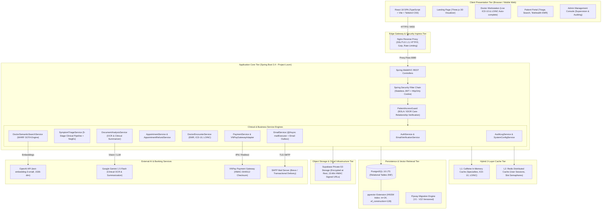

##### Table 1.1. System Architecture Component Descriptions

| No | Package / Component | Technology Stack | Detailed Responsibility & Architectural Role |
| :---: | :--- | :--- | :--- |
| **1** | **React 18 SPA Client** | React 18, TypeScript, Vite, Tailwind CSS, Lucide Icons | Ứng dụng web đĩa đơn (Single-Page Application) phục vụ toàn bộ 4 vai trò: Guest, Patient, Doctor, Admin. Khai thác kiến trúc Code-Splitting động qua `React.lazy()` và `Suspense`, tối ưu hóa FCP < 0.8s. |
| **2** | **Nginx Edge Ingress** | Nginx 1.25+ Alpine, TLS 1.3, HTTP/2 | Cổng tiếp nhận lưu lượng mạng biên, chịu trách nhiệm kết thúc mã hóa SSL/TLS, nén tệp tin tĩnh (Gzip), điều phối tải và thực thi chính sách giới hạn tốc độ truy cập (Rate Limiting 100 req/min per IP) chống DoS. |
| **3** | **Spring Boot 3.4 Core** | Java 21 LTS, Spring Boot 3.4.x, Project Loom | Tầng máy chủ xử lý tác vụ doanh nghiệp. Tích hợp công nghệ Virtual Threads (`spring.threads.virtual.enabled=true`), cho phép xử lý hàng ngàn I/O song song đồng thời với lượng tài nguyên bộ nhớ cực thấp. |
| **4** | **Dual-Transport Security** | Spring Security 6.x, JJWT 0.12.x | Cơ chế xác thực phi trạng thái (Stateless). Phát hành đồng thời JWT Access Token qua HTTP Header `Authorization: Bearer` và Refresh Token qua `HttpOnly, Secure, SameSite=Lax` Cookie, triệt tiêu nguy cơ XSS đánh cắp phiên. |
| **5** | **PatientAccessGuard** | Aspect-Oriented Security Component | Tầng kiểm soát phân quyền đối tượng BOLA/IDOR chuyên biệt cho y tế. Ngăn chặn bác sĩ hoặc người dùng truy cập trái phép bệnh án, xét nghiệm hoặc lịch sử phân luồng nếu không có quan hệ điều trị hợp lệ (`CARE_RELATIONSHIP`). |
| **6** | **WHRF SOTA Search Engine** | Vector Retrieval + Priority Queue | Động cơ tìm kiếm bác sĩ ngữ nghĩa đa tiêu chí: Kết hợp khoảng cách Cosine trên đồ thị HNSW với hàm làm sắc nét Sigmoid, điểm thưởng chuyên khoa, độ tin cậy đánh giá logarithm và phụ phí khám bệnh. |
| **7** | **5-Stage Triage Pipeline** | Regex + NegEx NLP Engine | Động cơ phân luồng triệu chứng 5 tầng: Phát hiện cấp cứu 115 (Stage 1), chuẩn hóa teen-code (Stage 2), bóc tách mệnh đề phủ định NegEx (Stage 3), chặn câu hỏi hành chính OOD (Stage 4), phân rã triệu chứng phức (Stage 5). |
| **8** | **Clinical EMR Service** | JSONB + WHO ICD-10 & LOINC | Dịch vụ hồ sơ bệnh án điện tử hỗ trợ gợi ý chẩn đoán tự động theo danh mục ICD-10 quốc tế (QĐ 7603/BYT) và chỉ số xét nghiệm LOINC (QĐ 3280/BYT), lưu trữ cấu trúc JSON trên bảng `appointments`. |
| **9** | **Document OCR & Vision** | Google Gemini 1.5 Flash + Apache Tika | Trích xuất ký tự quang học (OCR) từ ảnh chụp đơn thuốc, phiếu xét nghiệm, giải nghĩa các chỉ số bất thường và tự động loại bỏ thông tin định danh cá nhân (PII De-identification). |
| **10** | **Hybrid Caching Tier** | Caffeine Cache (L1) + Redis (L2) | Kiến trúc Cache 2 tầng: Tầng L1 cục bộ trong JVM lưu trữ danh mục tra cứu tĩnh (ICD-10, chuyên khoa), tầng L2 Redis phân tán lưu trữ token đen và phân bổ slot lịch khám thời gian thực. |
| **11** | **PostgreSQL 16 + pgvector** | PostgreSQL 16.x, pgvector 0.7.x | Hệ quản trị cơ sở dữ liệu quan hệ chuẩn 3NF. Tích hợp chỉ mục HNSW vector 1536 chiều, kết hợp Full-Text Search tiếng Việt (`pg_trgm`) và hỗ trợ tính toán giao dịch ACID. |
| **12** | **Private Supabase S3** | AWS S3 SDK v2, Supabase Storage | Kho lưu trữ tài liệu y tế bảo mật cấp ngân hàng. Tệp tin được mã hóa tĩnh (AES-256), khóa truy cập công khai và chỉ cho phép tải về thông qua URL ký số HMAC-SHA256 có hạn sử dụng 15 phút. |
| **13** | **VNPay Gateway Adapter** | VNPay Sandbox/Production API | Tích hợp cổng thanh toán trực tuyến quốc gia qua giao thức HMAC-SHA512. Tự động xử lý thông báo biến động số dư tức thời (IPN Webhook) với khóa chống trùng lặp giao dịch (Idempotency Lock). |
| **14** | **Async Email Engine** | Spring Mail, Project Loom TaskExecutor | Động cơ phát tán thư điện tử giao dịch (Kích hoạt tài khoản, mã OTP, xác nhận lịch khám, hoàn tiền) chạy nền không chặn, tự động ghi nhận vào hộp thư chờ (Email Outbox) nếu mạng gặp sự cố. |
| **15** | **Audit Trail Logging** | Spring AOP, Event Listeners | Hệ thống ghi vết kiểm toán tuân thủ Nghị định 13/2023/NĐ-CP và HIPAA, tự động lưu lại định danh người thực hiện, hành động, tài nguyên tác động, địa chỉ IP và dấu thời gian cho mọi thao tác y tế. |

---

#### 1.2 Package Diagram

##### 1.2.1 Front-end Design

Kiến trúc mã nguồn Front-end được tổ chức theo tiêu chuẩn module hóa phân lớp rõ ràng (Feature-driven & Layered Modular Architecture) trong thư mục `frontend/src/`:

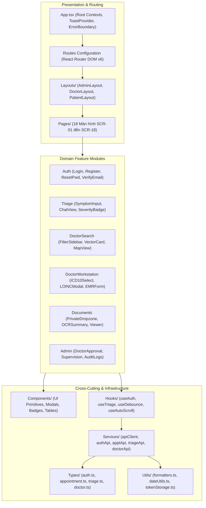

##### Table 1.2.1. Front-end Package Descriptions

| No | Package / Directory | Detailed Architectural Responsibility |
| :---: | :--- | :--- |
| **1** | `src/App.tsx` | Điểm khởi nhập chính của Single-Page Application; cấu hình `ToastProvider`, `ErrorBoundary`, và cơ chế tải lười `React.lazy()` chia nhỏ bundle. |
| **2** | `src/components/common/` | Các thành phần giao diện dùng chung toàn hệ thống: `ProtectedRoute` (kiểm tra JWT & Role), `ErrorBoundary` (bắt lỗi sập UI), `Header`, `Footer`. |
| **3** | `src/components/ui/` | Thư viện giao diện nguyên tử (Atomic UI components): Nút bấm (Button), Hộp nhập liệu (Input), Hộp thoại (Modal), Huy hiệu trạng thái (Badge), Thanh cuộn (Spinner). |
| **4** | `src/layouts/` | Khung điều hướng cấu trúc giao diện: `PatientLayout` (Thanh điều hướng người bệnh), `DoctorLayout` (Bàn làm việc bác sĩ), `AdminLayout` (Bảng điều khiển quản trị). |
| **5** | `src/pages/` | Tập hợp 18 màn hình chức năng cấp cao (SCR-01 đến SCR-18) đại diện cho các URL định tuyến trong hệ thống. |
| **6** | `src/pages/auth/` | Các trang xác thực: Đăng nhập mật khẩu, Đăng ký bệnh nhân, Quên mật khẩu, Đặt lại mật khẩu, Xác minh email, Xử lý phản hồi Google OAuth2. |
| **7** | `src/pages/patient/` | Màn hình dành cho bệnh nhân: Bảng điều khiển, Đặt lịch khám, Tìm kiếm bác sĩ thông minh, Phân luồng triệu chứng, Trợ lý giải nghĩa hồ sơ xét nghiệm. |
| **8** | `src/pages/doctor/` | Màn hình dành cho bác sĩ: Bàn làm việc bác sĩ (Doctor Workstation), Quản lý hồ sơ bệnh nhân, Hồ sơ năng lực & Lịch khám. |
| **9** | `src/pages/admin/` | Màn hình dành cho quản trị viên: Phê duyệt bác sĩ, Giám sát lịch khám, Giám sát phân luồng AI, Quản lý tài khoản, Nhật ký kiểm toán an ninh. |
| **10** | `src/services/` | Lớp giao tiếp mạng Axios: Cấu hình `apiClient` tự động đính kèm Bearer Token, làm mới token trong suốt khi hết hạn và chuẩn hóa định dạng lỗi từ Backend. |
| **11** | `src/hooks/` | Các Custom React Hooks quản lý trạng thái tái sử dụng: `useAuth`, `useDebounce` (chống quá tải tìm kiếm), `useDoctorSearch`, `useToast`. |
| **12** | `src/types/` | Định nghĩa toàn bộ kiểu dữ liệu TypeScript (Interfaces/Types), đồng bộ 1-1 với các DTO và Entity của Backend. |
| **13** | `src/utils/` | Các hàm tiện ích hỗ trợ: Định dạng tiền tệ VND, định dạng ngày giờ khám bệnh, giải mã payload JWT, xử lý chuỗi ký tự y tế. |

---

##### 1.2.2 Back-end Design

Kiến trúc mã nguồn Back-end tuân thủ nghiêm ngặt mô hình phân tầng **Layered Clean Architecture** trong thư mục `backend/src/main/java/com/mediassist/`:

```mermaid
graph TD
    subgraph Presentation_Layer["Presentation Layer (Controller & Ingress)"]
        Controllers["REST Controllers (AuthController, AppointmentController, TriageController...)"]
        SecurityConfig["SecurityFilterChain & JwtAuthenticationFilter"]
        GlobalExceptionHandler["GlobalExceptionHandler (@RestControllerAdvice)"]
    end

    subgraph Application_Layer["Application Service Layer (Business Workflows)"]
        AuthModule["AuthService, EmailVerificationService, PasswordResetService"]
        TriageModule["SymptomTriageService (NegEx, SlangNormalizer, EmergencyFilter)"]
        DoctorSearchModule["DoctorSemanticSearchService (WHRF SOTA Engine)"]
        ApptModule["AppointmentService, AppointmentRefundService"]
        ClinicalEncounterModule["DoctorEncounterService, ClinicalOntologyService"]
        DocumentModule["MedicalDocumentService, DocumentAnalysisService"]
        PaymentModule["PaymentService, VNPayGatewayAdapter"]
        SecurityModule["PatientAccessGuard (BOLA / IDOR Verification)"]
    end

    subgraph Domain_Layer["Domain Model & Data Transfer Layer"]
        Entities["JPA Entities (User, Appointment, DoctorProfile, Specialty...)"]
        DTOs["Request / Response DTOs (@Valid, @NotNull, @Size constraints)"]
        Enums["Business Enums (Role, AppointmentStatus, PaymentStatus, TriageUrgency)"]
    end

    subgraph Infrastructure_Layer["Infrastructure & Persistence Layer"]
        Repositories["Spring Data JPA Repositories (with Native Queries & pgvector)"]
        CacheServices["CaffeineCacheManager, RedisTemplate"]
        CloudStorage["SupabaseStorageClient (S3 Private Bucket Client)"]
        AiClients["OpenAIClient, GeminiVisionClient"]
        MailGateway["JavaMailSender, MailOutboxScheduler"]
        AuditEngine["AuditLogRepository, AsyncAuditLogger"]
    end

    Presentation_Layer --> Application_Layer
    Application_Layer --> Domain_Layer
    Application_Layer --> Infrastructure_Layer
    Infrastructure_Layer --> Domain_Layer
```

##### Table 1.2.2. Back-end Package Descriptions

| No | Package Name | Architectural Responsibilities & Technology Components |
| :---: | :--- | :--- |
| **1** | `com.mediassist.controller` | Tầng tiếp nhận HTTP Request. Chứa các Spring REST Controllers: Tiếp nhận payload JSON, kích hoạt xác thực `@Valid`, điều phối tầng Service và trả về `ResponseEntity<?>` chuẩn hóa. |
| **2** | `com.mediassist.config` | Cấu hình hạ tầng Spring Boot: `SecurityConfig` (Bộ lọc JWT & CSRF), `CorsConfig`, `VirtualThreadConfig` (Loom), `JacksonConfig`, `OpenAPIConfig` (Swagger UI). |
| **3** | `com.mediassist.security` | Thành phần bảo mật lõi: `JwtAuthenticationFilter`, `JwtTokenProvider`, `UserPrincipal`, `OAuth2AuthenticationSuccessHandler`, và bộ lọc cookie `SameSite`. |
| **4** | `com.mediassist.service` | Tầng nghiệp vụ cốt lõi: Triển khai các Use Case kinh doanh, quản lý giao dịch `@Transactional`, điều phối logic phân luồng, thanh toán, tìm kiếm và bảo mật dữ liệu y tế. |
| **5** | `com.mediassist.service.ai` | Động cơ AI chuyên sâu: Xử lý vector embeddings (`OpenAIClient`), phân tích ảnh hồ sơ bệnh án qua thị giác máy tính (`GeminiClient`), thuật toán làm mịn đồ thị Sigmoid contrastive sharpening. |
| **6** | `com.mediassist.service.guard` | Rào chắn bảo mật phân quyền: `PatientAccessGuard` chịu trách nhiệm kiểm tra quan hệ chăm sóc y tế, chặn hoàn toàn các cuộc tấn công leo quyền Broken Object Level Authorization (BOLA/IDOR). |
| **7** | `com.mediassist.repository` | Tầng tương tác cơ sở dữ liệu: Spring Data JPA Repositories kết hợp truy vấn native SQL chuyên dụng trên chỉ mục HNSW của `pgvector` và `pg_trgm`. |
| **8** | `com.mediassist.model.entity` | Mô hình thực thể cơ sở dữ liệu: 17 thực thể JPA ánh xạ 1-1 với 17 bảng trong PostgreSQL, tích hợp khóa ngoại, ràng buộc kiểm tra và các cột dữ liệu y tế JSONB. |
| **9** | `com.mediassist.model.dto` | Đối tượng vận chuyển dữ liệu (Data Transfer Objects): Tách biệt mô hình hiển thị khỏi thực thể CSDL, tích hợp ràng buộc Jakarta Validation (`@NotBlank`, `@Email`, `@Size(max=20000)`). |
| **10** | `com.mediassist.model.enums` | Hệ thống kiểu liệt kê nghiệp vụ: `Role` (ADMIN, DOCTOR, PATIENT), `AppointmentStatus`, `PaymentStatus`, `TriageUrgency`, `SpecialtyCode`, v.v. |
| **11** | `com.mediassist.exception` | Xử lý ngoại lệ tập trung: `GlobalExceptionHandler` (`@RestControllerAdvice`), `AppException`, và bảng mã lỗi chuẩn y tế `ErrorCode` (`SLOT_CONFLICT`, `FORBIDDEN_CARE_RELATIONSHIP`). |
| **12** | `com.mediassist.storage` | Tầng giao tiếp lưu trữ đám mây: Quản lý kết nối S3 với Supabase, thực thi ký số URL HMAC-SHA256 (hạn 15 phút), quản lý thư mục người bệnh bảo mật. |
| **13** | `com.mediassist.mail` | Dịch vụ gửi thư điện tử giao dịch: Khai thác luồng ảo Loom (`@Async("mailExecutor")`), tạo nội dung HTML và cơ chế lưu trữ thư chờ phát lại khi mạng gặp lỗi. |
| **14** | `com.mediassist.audit` | Hệ thống kiểm toán và an ninh: Ghi lại toàn bộ hành vi đọc/sửa dữ liệu hồ sơ bệnh án, các sự kiện phân luồng triệu chứng và giao dịch tài chính. |
| **15** | `com.mediassist.ontology` | Dịch vụ thuật ngữ y tế chuẩn hóa: `ClinicalOntologyService` nạp và tìm kiếm cực nhanh trên bộ mã chẩn đoán quốc tế WHO ICD-10 và danh mục xét nghiệm LOINC của Bộ Y Tế Việt Nam. |

### 2. Database Design

Hệ quản trị cơ sở dữ liệu của **MediAssist-AI** được xây dựng trên nền tảng **PostgreSQL 16.x LTS** kết hợp tiện ích mở rộng vector đa chiều **pgvector (0.7+)**. Cấu trúc dữ liệu được chuẩn hóa đạt mức **Chuẩn 3NF (Third Normal Form)** nhằm bảo vệ tính toàn vẹn của dữ liệu giao dịch y tế, tuân thủ nghiêm ngặt **Thông tư 46/2018/TT-BYT** về Bệnh án điện tử (EMR) và **Nghị định 13/2023/NĐ-CP** về Bảo vệ dữ liệu cá nhân.

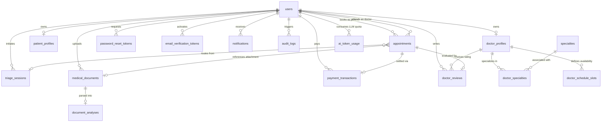

##### Figure 2. Physical Database Design Entity-Relationship Diagram (PostgreSQL 16 + pgvector)

---

#### Table 2. Database Design Description

| No | Table Name | Primary Key | Foreign Keys | Business Purpose & Architectural Role |
| :---: | :--- | :--- | :--- | :--- |
| **1** | `users` | `id` (UUID) | - | Lưu trữ định danh, thông tin đăng nhập bảo mật (BCrypt), vai trò (RBAC), trạng thái khóa tài khoản và cờ xác thực email. |
| **2** | `specialties` | `id` (UUID) | - | Danh mục chuyên khoa lâm sàng chuẩn y tế (Tim mạch, Thần kinh, Cơ xương khớp, v.v.), phục vụ điều phối và tìm kiếm. |
| **3** | `doctor_profiles` | `id` (UUID) | `user_id` (FK -> `users`) | Hồ sơ năng lực bác sĩ: Chứng chỉ hành nghề, học vị, kinh nghiệm, biểu phí, điểm uy tín và vector ngữ nghĩa `bio_embedding` (1536 chiều). |
| **4** | `doctor_specialties` | (`doctor_profile_id`, `specialty_id`) | `doctor_profile_id`, `specialty_id` | Bảng liên kết nhiều-nhiều (Many-to-Many) giữa hồ sơ bác sĩ và các chuyên khoa chuyên sâu phụ trách. |
| **5** | `doctor_schedule_slots` | `id` (UUID) | `doctor_profile_id` | Lịch làm việc định kỳ hàng tuần của bác sĩ (Thứ trong tuần, giờ bắt đầu, giờ kết thúc, thời lượng ca khám). |
| **6** | `patient_profiles` | `id` (UUID) | `user_id` (FK -> `users`) | Hồ sơ thông tin y tế bệnh nhân: Mã người bệnh, CCCD/CMND, mã BHYT, tiền sử bệnh, nhóm máu, dị ứng và liên hệ khẩn cấp. |
| **7** | `appointments` | `id` (UUID) | `patient_id`, `doctor_id` | Thực thể cốt lõi quản lý vòng đời lịch khám và lưu trữ bệnh án điện tử (EMR): Sinh hiệu, mã WHO ICD-10, LOINC, đơn thuốc và kế hoạch điều trị. |
| **8** | `triage_sessions` | `id` (UUID) | `user_id` (FK -> `users`) | Nhật ký các phiên phân luồng triệu chứng AI: Mức độ khẩn cấp (Routine, Urgent, Emergency 115), tóm tắt SBAR và khuyến nghị chuyên khoa. |
| **9** | `medical_documents` | `id` (UUID) | `user_id` (FK -> `users`) | Lưu trữ siêu dữ liệu tài liệu y tế (đơn thuốc, phiếu xét nghiệm), trỏ tới khóa lưu trữ nội bộ riêng tư `storage_path` trên Supabase S3. |
| **10** | `document_analyses` | `id` (UUID) | `document_id` (FK -> `medical_documents`) | Kết quả trích xuất OCR và giải nghĩa y khoa thông minh của Gemini: Tóm tắt lâm sàng, chỉ số xét nghiệm bất thường và câu hỏi gợi ý. |
| **11** | `payment_transactions` | `id` (UUID) | `user_id` (FK -> `users`) | Sổ cái giao dịch tài chính: Ghi nhận giao dịch nạp tiền, thanh toán viện phí VNPay/Mock, trạng thái hoàn tiền và mã giao diện ngân hàng. |
| **12** | `password_reset_tokens` | `id` (UUID) | `user_id` (FK -> `users`) | Quản lý token đặt lại mật khẩu an toàn, chỉ lưu trữ mã băm một chiều SHA-256 (`token_hash`), có hạn 15 phút chống lộ lọt dữ liệu. |
| **13** | `email_verification_tokens` | `id` (UUID) | `user_id` (FK -> `users`) | Quản lý token kích hoạt tài khoản đăng ký mới, bảo vệ qua mã băm SHA-256, thời hạn 24 giờ theo chính sách Email Verification Gate. |
| **14** | `notifications` | `id` (UUID) | `user_id` (FK -> `users`) | Hệ thống thông báo giao dịch và lâm sàng gửi tới người dùng trong ứng dụng (In-app notifications): Nhắc lịch, hủy lịch, kết quả khám. |
| **15** | `doctor_reviews` | `id` (UUID) | `doctor_id`, `patient_id`, `appointment_id` | Đánh giá và nhận xét từ bệnh nhân sau khi ca khám hoàn tất (`COMPLETED`), tích hợp vào bộ giảm chấn uy tín Credibility Damper. |
| **16** | `audit_logs` | `id` (UUID) | `user_id` (FK -> `users`) | Nhật ký kiểm toán an ninh bất biến (Immutable Audit Trail), ghi nhận mọi hành vi truy cập hồ sơ bệnh án, phân luồng và giao dịch. |
| **17** | `ai_token_usage` | `id` (UUID) | `user_id` (FK -> `users`) | Quản lý chi phí điện toán trí tuệ nhân tạo (FinOps): Ghi nhận số lượng token Prompt, Completion, mô hình AI sử dụng và chi phí USD quy đổi. |

---

#### 2.1. Users Table
Bảng quản lý tài khoản định danh người dùng trong toàn hệ sinh thái MediAssist-AI.

| No | Column Name | Data Type | Not Null | Key | Constraints / Default | Detailed Description |
| :---: | :--- | :--- | :---: | :---: | :--- | :--- |
| 1 | `id` | `UUID` | True | PK | `gen_random_uuid()` | Định danh duy nhất toàn cục của người dùng (UUIDv4). |
| 2 | `email` | `VARCHAR(255)` | True | UNIQUE | - | Địa chỉ email đăng nhập duy nhất, định dạng chuẩn RFC 5322. |
| 3 | `password_hash` | `VARCHAR(255)` | False | - | - | Mật khẩu băm một chiều bằng BCrypt (cost factor 10). Cho phép NULL đối với tài khoản đăng nhập qua Google OAuth2. |
| 4 | `full_name` | `VARCHAR(150)` | True | - | - | Họ và tên đầy đủ của người dùng hiển thị trên hồ sơ và đơn thuốc. |
| 5 | `phone` | `VARCHAR(20)` | False | UNIQUE | - | Số điện thoại liên hệ cá nhân, định dạng chuẩn viễn thông E.164. |
| 6 | `avatar_url` | `TEXT` | False | - | - | Đường dẫn ảnh đại diện của người dùng (Cloud Storage hoặc Google Avatar). |
| 7 | `role` | `VARCHAR(30)` | True | - | `CHECK (role IN ('ADMIN', 'DOCTOR', 'PATIENT'))` | Vai trò trong hệ thống phục vụ phân quyền truy cập Role-Based Access Control. |
| 8 | `status` | `VARCHAR(30)` | True | - | `'ACTIVE'` | Trạng thái tài khoản: `ACTIVE`, `PENDING_VERIFICATION`, `SUSPENDED`. |
| 9 | `is_active` | `BOOLEAN` | True | - | `TRUE` | Cờ kích hoạt trạng thái hoạt động của tài khoản. |
| 10 | `email_verified` | `BOOLEAN` | True | - | `FALSE` | Cờ xác nhận người dùng đã chứng minh quyền sở hữu email qua link kích hoạt. |
| 11 | `email_verified_at` | `TIMESTAMPTZ` | False | - | - | Dấu thời gian khi người dùng nhấn link kích hoạt email thành công. |
| 12 | `failed_login_attempts` | `INT` | True | - | `0` | Số lần đăng nhập sai mật khẩu liên tiếp, tự động khóa khi đạt ngưỡng 5 lần. |
| 13 | `locked_until` | `TIMESTAMPTZ` | False | - | - | Thời điểm tài khoản hết hạn bị khóa tạm thời do nhập sai quá số lần. |
| 14 | `last_login_at` | `TIMESTAMPTZ` | False | - | - | Dấu thời gian ghi nhận lần đăng nhập thành công gần nhất. |
| 15 | `created_at` | `TIMESTAMPTZ` | True | - | `CURRENT_TIMESTAMP` | Thời điểm khởi tạo bản ghi người dùng trong cơ sở dữ liệu. |
| 16 | `updated_at` | `TIMESTAMPTZ` | True | - | `CURRENT_TIMESTAMP` | Thời điểm cập nhật thông tin người dùng gần nhất. |

---

#### 2.2. Specialties Table
Danh mục các chuyên khoa y tế phục vụ phân loại bác sĩ và phân luồng triệu chứng AI.

| No | Column Name | Data Type | Not Null | Key | Constraints / Default | Detailed Description |
| :---: | :--- | :--- | :---: | :---: | :--- | :--- |
| 1 | `id` | `UUID` | True | PK | `gen_random_uuid()` | Định danh duy nhất của chuyên khoa (UUIDv4). |
| 2 | `name` | `VARCHAR(150)` | True | - | - | Tên hiển thị tiếng Việt của chuyên khoa (ví dụ: Chuyên khoa Tim mạch). |
| 3 | `slug` | `VARCHAR(100)` | True | UNIQUE | - | Định danh dạng chuỗi URL-friendly (ví dụ: `chuyen-khoa-tim-mach`). |
| 4 | `description` | `TEXT` | False | - | - | Mô tả phạm vi khám chữa bệnh và các triệu chứng thuộc chuyên khoa. |
| 5 | `icon_url` | `TEXT` | False | - | - | Đường dẫn biểu tượng đại diện hiển thị trên giao diện người dùng. |
| 6 | `created_at` | `TIMESTAMPTZ` | True | - | `CURRENT_TIMESTAMP` | Thời điểm khởi tạo danh mục chuyên khoa. |
| 7 | `updated_at` | `TIMESTAMPTZ` | True | - | `CURRENT_TIMESTAMP` | Thời điểm cập nhật danh mục chuyên khoa gần nhất. |

---

#### 2.3. Doctor Profiles Table
Hồ sơ học thuật, chứng chỉ hành nghề và vector đặc trưng ngữ nghĩa của bác sĩ.

| No | Column Name | Data Type | Not Null | Key | Constraints / Default | Detailed Description |
| :---: | :--- | :--- | :---: | :---: | :--- | :--- |
| 1 | `id` | `UUID` | True | PK | `gen_random_uuid()` | Định danh duy nhất của hồ sơ bác sĩ (UUIDv4). |
| 2 | `user_id` | `UUID` | True | FK | UNIQUE, REFERENCES `users(id)` | Khóa ngoại tham chiếu đến tài khoản người dùng tương ứng của bác sĩ. |
| 3 | `bio` | `TEXT` | False | - | - | Tiểu sử chuyên môn, đề tài nghiên cứu, thành tựu lâm sàng và thế mạnh điều trị. |
| 4 | `license_number` | `VARCHAR(255)` | False | UNIQUE | - | Số chứng chỉ hành nghề khám chữa bệnh do Bộ Y Tế hoặc Sở Y Tế cấp. |
| 5 | `license_document_url` | `VARCHAR(255)` | False | - | - | Đường dẫn tệp ảnh/PDF chứng chỉ hành nghề phục vụ xác minh phê duyệt. |
| 6 | `consultation_fee` | `NUMERIC(10, 2)` | False | - | `0.00` | Mức viện phí khám bệnh cơ sở (VND) cho một lượt khám 30 phút. |
| 7 | `years_of_experience` | `INT` | False | - | `0` | Số năm kinh nghiệm công tác lâm sàng thực tế trong ngành y tế. |
| 8 | `academic_title` | `VARCHAR(50)` | False | - | - | Học vị, học hàm y khoa: ThS.BS, BSCKI, BSCKII, TS.BS, PGS.TS.BS, GS.TS.BS. |
| 9 | `hospital_affiliation` | `VARCHAR(150)` | False | - | - | Bệnh viện hoặc cơ sở y tế nơi bác sĩ đang công tác chính thức. |
| 10 | `department` | `VARCHAR(150)` | False | - | - | Khoa phòng trực thuộc tại bệnh viện công tác (ví dụ: Khoa Cấp cứu, Khoa Nội tim mạch). |
| 11 | `license_issued_by` | `VARCHAR(150)` | False | - | - | Cơ quan có thẩm quyền cấp chứng chỉ hành nghề (Bộ Y Tế / Sở Y Tế tỉnh/thành). |
| 12 | `rating` | `DOUBLE PRECISION`| False | - | `4.9` | Điểm đánh giá trung bình tích lũy từ các bệnh nhân (thang điểm 1.0 đến 5.0). |
| 13 | `total_consultations` | `INT` | False | - | `1250` | Tổng số lượt ca khám lâm sàng bác sĩ đã thực hiện trong sự nghiệp. |
| 14 | `review_count` | `INT` | True | - | `0` | Tổng số lượt bệnh nhân thực tế đã để lại đánh giá nhận xét sau ca khám. |
| 15 | `is_verified` | `BOOLEAN` | True | - | `FALSE` | Cờ xác nhận hồ sơ và chứng chỉ đã được Admin phê duyệt hợp lệ. |
| 16 | `verified_at` | `TIMESTAMPTZ` | False | - | - | Dấu thời gian khi Quản trị viên thực hiện phê duyệt hồ sơ bác sĩ. |
| 17 | `bio_embedding` | `vector(1536)` | False | - | HNSW Index (Cosine) | Vector đặc trưng ngữ nghĩa 1536 chiều của tiểu sử bác sĩ sinh bởi OpenAI. |
| 18 | `created_at` | `TIMESTAMPTZ` | True | - | `CURRENT_TIMESTAMP` | Thời điểm đăng ký hồ sơ bác sĩ vào hệ thống. |
| 19 | `updated_at` | `TIMESTAMPTZ` | True | - | `CURRENT_TIMESTAMP` | Thời điểm cập nhật hồ sơ bác sĩ gần nhất. |

---

#### 2.4. Doctor Specialties Table
Bảng liên kết nhiều-nhiều giữa bác sĩ và các chuyên khoa lâm sàng.

| No | Column Name | Data Type | Not Null | Key | Constraints / Default | Detailed Description |
| :---: | :--- | :--- | :---: | :---: | :--- | :--- |
| 1 | `doctor_profile_id` | `UUID` | True | PK, FK | REFERENCES `doctor_profiles(id)` | Khóa ngoại tham chiếu đến hồ sơ bác sĩ trong bảng `doctor_profiles`. |
| 2 | `specialty_id` | `UUID` | True | PK, FK | REFERENCES `specialties(id)` | Khóa ngoại tham chiếu đến chuyên khoa lâm sàng trong bảng `specialties`. |

---

#### 2.5. Doctor Schedule Slots Table
Lịch làm việc định kỳ hàng tuần được cấu hình bởi bác sĩ để bệnh nhân đặt lịch hẹn.

| No | Column Name | Data Type | Not Null | Key | Constraints / Default | Detailed Description |
| :---: | :--- | :--- | :---: | :---: | :--- | :--- |
| 1 | `id` | `UUID` | True | PK | `gen_random_uuid()` | Định danh duy nhất của khung giờ làm việc (UUIDv4). |
| 2 | `doctor_profile_id` | `UUID` | True | FK | REFERENCES `doctor_profiles(id)` | Khóa ngoại tham chiếu đến bác sĩ thiết lập lịch làm việc. |
| 3 | `day_of_week` | `VARCHAR(20)` | True | - | - | Ngày trong tuần phục vụ khám: `MONDAY`, `TUESDAY`, ..., `SATURDAY`. |
| 4 | `start_time` | `TIME` | True | - | - | Giờ bắt đầu nhận ca khám (ví dụ: `08:00:00`). |
| 5 | `end_time` | `TIME` | True | - | - | Giờ kết thúc nhận ca khám (ví dụ: `12:00:00`). |
| 6 | `slot_duration_minutes`| `INT` | True | - | `30` | Thời lượng phân bổ cho mỗi ca khám lâm sàng (mặc định 30 phút). |
| 7 | `is_active` | `BOOLEAN` | True | - | `TRUE` | Trạng thái sẵn sàng nhận lịch của khung thời gian này. |
| 8 | `created_at` | `TIMESTAMPTZ` | True | - | `CURRENT_TIMESTAMP` | Thời điểm cấu hình khung giờ làm việc. |

---

#### 2.6. Patient Profiles Table
Hồ sơ hành chính y tế và bệnh án điện tử cơ sở của bệnh nhân.

| No | Column Name | Data Type | Not Null | Key | Constraints / Default | Detailed Description |
| :---: | :--- | :--- | :---: | :---: | :--- | :--- |
| 1 | `id` | `UUID` | True | PK | `gen_random_uuid()` | Định danh duy nhất của hồ sơ bệnh nhân (UUIDv4). |
| 2 | `user_id` | `UUID` | True | FK | UNIQUE, REFERENCES `users(id)` | Khóa ngoại tham chiếu đến tài khoản người dùng bệnh nhân. |
| 3 | `patient_code` | `VARCHAR(50)` | True | UNIQUE | - | Mã định danh y tế duy nhất của bệnh nhân (ví dụ: `BN-2026-08912`). |
| 4 | `citizen_id` | `VARCHAR(20)` | False | UNIQUE | - | Số Căn cước công dân (CCCD) 12 số của người bệnh theo định danh quốc gia. |
| 5 | `health_insurance_number`| `VARCHAR(30)` | False | - | - | Mã số thẻ Bảo hiểm Y tế (BHYT) phục vụ đồng bộ dữ liệu khám chữa bệnh. |
| 6 | `date_of_birth` | `DATE` | False | - | - | Ngày tháng năm sinh của bệnh nhân để tính toán tuổi lâm sàng. |
| 7 | `gender` | `VARCHAR(10)` | False | - | - | Giới tính sinh học của bệnh nhân (`MALE`, `FEMALE`, `OTHER`). |
| 8 | `blood_group` | `VARCHAR(10)` | False | - | - | Nhóm máu hệ ABO và yếu tố Rhesus (ví dụ: `O+`, `A+`, `B+`, `AB-`). |
| 9 | `address` | `TEXT` | False | - | - | Địa chỉ cư trú thường trú hiện tại của người bệnh. |
| 10 | `allergies` | `TEXT` | False | - | - | Tiền sử dị ứng thuốc, kháng sinh (Penicillin), thực phẩm, hóa chất. |
| 11 | `medical_history` | `TEXT` | False | - | - | Tiền sử bệnh lý mạn tính: Tăng huyết áp, Đái tháo đường, Hen phế quản. |
| 12 | `emergency_contact_name` | `VARCHAR(150)`| False | - | - | Họ và tên người thân cần liên hệ trong các trường hợp cấp cứu khẩn cấp. |
| 13 | `emergency_contact_phone`| `VARCHAR(20)` | False | - | - | Số điện thoại liên lạc của người thân khẩn cấp. |
| 14 | `emergency_contact_relationship` | `VARCHAR(50)` | False | - | - | Mối quan hệ với bệnh nhân (Bố/Mẹ, Vợ/Chồng, Con, Người bảo hộ). |
| 15 | `created_at` | `TIMESTAMPTZ` | True | - | `CURRENT_TIMESTAMP` | Thời điểm khởi tạo hồ sơ y tế bệnh nhân. |
| 16 | `updated_at` | `TIMESTAMPTZ` | True | - | `CURRENT_TIMESTAMP` | Thời điểm cập nhật hồ sơ y tế bệnh nhân gần nhất. |

---

#### 2.7. Appointments Table
Thực thể trung tâm lưu trữ toàn diện thông tin đặt lịch, viện phí và hồ sơ bệnh án điện tử (EMR).

| No | Column Name | Data Type | Not Null | Key | Constraints / Default | Detailed Description |
| :---: | :--- | :--- | :---: | :---: | :--- | :--- |
| 1 | `id` | `UUID` | True | PK | `gen_random_uuid()` | Định danh duy nhất của lượt khám bệnh (UUIDv4). |
| 2 | `appointment_code` | `VARCHAR(30)` | True | UNIQUE | - | Mã số cuộc hẹn duy nhất (ví dụ: `APT-20261018-7712`). |
| 3 | `patient_id` | `UUID` | True | FK | REFERENCES `users(id)` | Khóa ngoại tham chiếu đến người bệnh tham gia lượt khám. |
| 4 | `doctor_id` | `UUID` | True | FK | REFERENCES `users(id)` | Khóa ngoại tham chiếu đến bác sĩ phụ trách ca khám. |
| 5 | `scheduled_start` | `TIMESTAMPTZ` | True | - | - | Thời gian dự kiến bắt đầu ca khám (theo múi giờ GMT+7). |
| 6 | `scheduled_end` | `TIMESTAMPTZ` | True | - | - | Thời gian dự kiến kết thúc ca khám (theo múi giờ GMT+7). |
| 7 | `status` | `VARCHAR(30)` | True | - | `'SCHEDULED'` | Trạng thái lịch khám: `SCHEDULED`, `IN_PROGRESS`, `COMPLETED`, `CANCELLED`, `NO_SHOW`. |
| 8 | `payment_status` | `VARCHAR(30)` | True | - | `'UNPAID'` | Trạng thái viện phí: `UNPAID`, `PAID`, `REFUNDED`. |
| 9 | `fee_amount` | `NUMERIC(12, 2)`| True | - | - | Tổng viện phí phải thanh toán cho ca khám (VND). |
| 10 | `queue_number` | `VARCHAR(50)` | False | - | - | Số thứ tự xếp hàng tiếp đón tại phòng khám trong ngày (ví dụ: `STT 01`). |
| 11 | `clinic_room` | `VARCHAR(100)`| False | - | - | Tên phòng khám vật lý hoặc đường dẫn phòng khám trực tuyến (ví dụ: `Phòng 302 - Tòa A`). |
| 12 | `chief_complaint` | `TEXT` | False | - | - | Lý do đến khám chính và mô tả ngắn gọn về tình trạng của người bệnh. |
| 13 | `vital_signs_json` | `TEXT` | False | - | - | Dữ liệu dấu hiệu sinh tồn dạng JSON: Huyết áp (BP), Mạch (HR), Nhiệt độ, SpO2, BMI. |
| 14 | `icd10_code` | `VARCHAR(20)` | False | - | - | Mã chẩn đoán bệnh theo danh mục WHO ICD-10 (ví dụ: `I10`, `E11.9`, `J00`). |
| 15 | `icd10_name` | `VARCHAR(255)`| False | - | - | Tên bệnh lý chuẩn hóa tiếng Việt đi kèm với mã ICD-10 (ví dụ: `Tăng huyết áp vô căn`). |
| 16 | `prescription_json`| `TEXT` | False | - | - | Chi tiết đơn thuốc điện tử dạng JSON: Tên thuốc, hàm lượng, đường dùng, liều lượng. |
| 17 | `treatment_plan` | `TEXT` | False | - | - | Phác đồ điều trị, lời khuyên chăm sóc sức khỏe và chế độ dinh dưỡng dặn dò. |
| 18 | `follow_up_date` | `DATE` | False | - | - | Ngày hẹn tái khám định kỳ được chỉ định bởi bác sĩ khám. |
| 19 | `cancellation_reason` | `TEXT` | False | - | - | Lý do hủy lịch khám từ phía bệnh nhân, bác sĩ hoặc hệ thống. |
| 20 | `consultation_notes` | `TEXT` | False | - | - | Ghi chú bệnh sử chuyên sâu và nhận định lâm sàng nội bộ của bác sĩ. |
| 21 | `telehealth_room_id` | `VARCHAR(100)`| False | - | - | Định danh phòng họp truyền thông trực tuyến an toàn phục vụ Telehealth. |
| 22 | `checked_in_at` | `TIMESTAMPTZ` | False | - | - | Dấu thời gian khi bệnh nhân thực hiện thủ tục điểm danh vào phòng chờ khám. |
| 23 | `version` | `BIGINT` | True | - | `0` | Số hiệu phiên bản phục vụ cơ chế khóa lạc quan (Optimistic Locking). |
| 24 | `created_at` | `TIMESTAMPTZ` | True | - | `CURRENT_TIMESTAMP` | Thời điểm tạo lịch khám trong cơ sở dữ liệu. |
| 25 | `updated_at` | `TIMESTAMPTZ` | True | - | `CURRENT_TIMESTAMP` | Thời điểm cập nhật trạng thái lịch khám gần nhất. |

---

#### 2.8. Triage Sessions Table
Nhật ký các phiên phân luồng triệu chứng AI và cảnh báo khẩn cấp y tế.

| No | Column Name | Data Type | Not Null | Key | Constraints / Default | Detailed Description |
| :---: | :--- | :--- | :---: | :---: | :--- | :--- |
| 1 | `id` | `UUID` | True | PK | `gen_random_uuid()` | Định danh duy nhất của phiên phân luồng triệu chứng (UUIDv4). |
| 2 | `user_id` | `UUID` | False | FK | REFERENCES `users(id)` | Khóa ngoại tham chiếu đến bệnh nhân thực hiện phân luồng (nếu đã đăng nhập). |
| 3 | `patient_name` | `VARCHAR(255)`| False | - | - | Tên bệnh nhân nhập liệu trong trường hợp thực hiện phân luồng nặc danh. |
| 4 | `symptoms_text` | `TEXT` | True | - | - | Nội dung mô tả triệu chứng gốc bằng tiếng Việt do người dùng nhập vào. |
| 5 | `is_emergency` | `BOOLEAN` | True | - | `FALSE` | Cờ phát hiện dấu hiệu đe dọa tính mạng (đau thắt ngực, khó thở cấp, đột quỵ). |
| 6 | `urgency_level` | `VARCHAR(20)` | True | - | - | Mức độ khẩn cấp y tế: `ROUTINE` (Thông thường), `URGENT` (Khẩn), `EMERGENCY` (Cấp cứu 115). |
| 7 | `primary_specialty` | `VARCHAR(100)`| False | - | - | Tên chuyên khoa lâm sàng được động cơ AI đề xuất phù hợp nhất. |
| 8 | `sbar_summary` | `TEXT` | False | - | - | Tóm tắt cấu trúc theo chuẩn giao tiếp y tế SBAR (Situation, Background, Assessment, Recommendation). |
| 9 | `ai_advice` | `TEXT` | False | - | - | Lời khuyên chăm sóc ban đầu và hướng dẫn theo dõi an toàn từ hệ thống AI. |
| 10 | `conversation_history` | `TEXT` | False | - | - | Toàn bộ chuỗi hội thoại tương tác hỏi đáp giữa bệnh nhân và trợ lý ảo. |
| 11 | `created_at` | `TIMESTAMPTZ` | True | - | `CURRENT_TIMESTAMP` | Thời điểm khởi tạo phiên phân luồng triệu chứng. |

---

#### 2.9. Medical Documents Table
Quản lý siêu dữ liệu các tệp tin hồ sơ bệnh án được lưu trữ riêng tư trên Supabase S3.

| No | Column Name | Data Type | Not Null | Key | Constraints / Default | Detailed Description |
| :---: | :--- | :--- | :---: | :---: | :--- | :--- |
| 1 | `id` | `UUID` | True | PK | `gen_random_uuid()` | Định danh duy nhất của tài liệu y tế (UUIDv4). |
| 2 | `user_id` | `UUID` | False | FK | REFERENCES `users(id)` | Khóa ngoại tham chiếu đến bệnh nhân sở hữu tệp tài liệu y tế này. |
| 3 | `file_name` | `VARCHAR(255)`| True | - | - | Tên gốc của tệp tin do người dùng tải lên (ví dụ: `ket_qua_xet_nghiem_mau.pdf`). |
| 4 | `file_size_bytes` | `BIGINT` | True | - | - | Dung lượng tệp tin tính theo đơn vị Bytes (giới hạn tối đa 10MB per file). |
| 5 | `content_type` | `VARCHAR(100)`| True | - | - | Kiểu định dạng MIME của tệp tin (`application/pdf`, `image/jpeg`, `image/png`). |
| 6 | `storage_path` | `VARCHAR(500)`| False | - | - | Khóa lưu trữ nội bộ riêng tư trên Supabase S3 Bucket (ví dụ: `patients/uuid/docs/uuid.pdf`). |
| 7 | `status` | `VARCHAR(50)` | True | - | `'PROCESSED'` | Trạng thái xử lý của tệp tin: `UPLOADED`, `PROCESSING`, `PROCESSED`, `ERROR`. |
| 8 | `created_at` | `TIMESTAMPTZ` | True | - | `CURRENT_TIMESTAMP` | Thời điểm tài liệu được tải lên hệ thống. |

---

#### 2.10. Document Analyses Table
Kết quả giải nghĩa và trích xuất chỉ số lâm sàng chuyên sâu từ mô hình Vision LLM.

| No | Column Name | Data Type | Not Null | Key | Constraints / Default | Detailed Description |
| :---: | :--- | :--- | :---: | :---: | :--- | :--- |
| 1 | `id` | `UUID` | True | PK | `gen_random_uuid()` | Định danh duy nhất của bản phân tích tài liệu (UUIDv4). |
| 2 | `document_id` | `UUID` | True | FK | UNIQUE, REFERENCES `medical_documents(id)` | Khóa ngoại tham chiếu đến tệp tài liệu y tế gốc trong bảng `medical_documents`. |
| 3 | `clinical_summary` | `TEXT` | True | - | - | Bản tóm tắt chuyên môn lâm sàng dành cho bác sĩ tham khảo. |
| 4 | `plain_language_explanation` | `TEXT` | True | - | - | Bản giải thích bằng ngôn ngữ phổ thông, dễ hiểu dành riêng cho bệnh nhân. |
| 5 | `abnormal_indicators_json` | `TEXT` | True | - | - | Danh sách các chỉ số xét nghiệm lệch khỏi ngưỡng tham chiếu chuẩn dạng JSON. |
| 6 | `recommended_specialty_slug`| `VARCHAR(100)`| False | - | - | Đường dẫn định danh (slug) của chuyên khoa điều trị tiếp theo được đề xuất. |
| 7 | `recommended_specialty_name`| `VARCHAR(255)`| False | - | - | Tên chuyên khoa khám bệnh được khuyến nghị bệnh nhân nên đến khám. |
| 8 | `suggested_questions_json` | `TEXT` | False | - | - | Bộ câu hỏi gợi ý dạng JSON để bệnh nhân chủ động trao đổi với bác sĩ. |
| 9 | `created_at` | `TIMESTAMPTZ` | True | - | `CURRENT_TIMESTAMP` | Thời điểm hệ thống AI hoàn tất quá trình phân tích và trích xuất. |

---

#### 2.11. Payment Transactions Table
Sổ cái ghi nhận toàn bộ các giao dịch nạp tiền, thanh toán viện phí và hoàn tiền.

| No | Column Name | Data Type | Not Null | Key | Constraints / Default | Detailed Description |
| :---: | :--- | :--- | :---: | :---: | :--- | :--- |
| 1 | `id` | `UUID` | True | PK | `gen_random_uuid()` | Định danh duy nhất của giao dịch thanh toán (UUIDv4). |
| 2 | `transaction_code` | `VARCHAR(64)` | True | UNIQUE | - | Mã số giao dịch duy nhất trong hệ thống (ví dụ: `TX-20261018-9941`). |
| 3 | `user_id` | `UUID` | True | FK | REFERENCES `users(id)` | Khóa ngoại tham chiếu đến người dùng thực hiện giao dịch tài chính. |
| 4 | `order_type` | `VARCHAR(40)` | True | - | - | Phân loại đơn hàng giao dịch: `APPOINTMENT_FEE`, `TELEHEALTH_SERVICE`. |
| 5 | `reference_id` | `VARCHAR(100)`| False | - | - | Mã tham chiếu nghiệp vụ (ví dụ: mã cuộc hẹn `appointment_code` liên kết). |
| 6 | `amount` | `DECIMAL(12, 2)`| True | - | - | Số tiền giao dịch thực tế thanh toán tính theo đơn vị tiền tệ VND. |
| 7 | `currency` | `VARCHAR(10)` | True | - | `'VND'` | Đơn vị tiền tệ giao dịch (mặc định luôn là VND). |
| 8 | `payment_method` | `VARCHAR(40)` | True | - | - | Phương thức thanh toán: `VNPAY_QR`, `VNPAY_ATM`, `CREDIT_CARD`, `MOCK_SANDBOX`. |
| 9 | `payment_gateway` | `VARCHAR(40)` | True | - | - | Cổng thanh toán phụ trách giao dịch: `VNPAY`, `MOCK`. |
| 10 | `status` | `VARCHAR(30)` | True | - | `'PENDING'` | Trạng thái xử lý: `PENDING`, `COMPLETED`, `FAILED`, `CANCELLED`, `REFUNDED`. |
| 11 | `gateway_reference` | `VARCHAR(255)`| False | - | - | Mã giao dịch đối soát do cổng thanh toán VNPay trả về (`vnp_TransactionNo`). |
| 12 | `metadata_json` | `TEXT` | False | - | - | Toàn bộ dữ liệu đối soát thô nhận từ Webhook/IPN của cổng thanh toán. |
| 13 | `version` | `BIGINT` | True | - | `0` | Phiên bản giao dịch phục vụ khóa lạc quan tránh xung đột đa luồng. |
| 14 | `created_at` | `TIMESTAMP` | True | - | `CURRENT_TIMESTAMP` | Thời điểm người dùng bắt đầu khởi tạo giao dịch thanh toán. |
| 15 | `updated_at` | `TIMESTAMP` | True | - | `CURRENT_TIMESTAMP` | Thời điểm cập nhật trạng thái kết quả thanh toán cuối cùng. |

---

#### 2.12. Password Reset Tokens Table
Quản lý các mã token đặt lại mật khẩu với cơ chế băm bảo mật SHA-256.

| No | Column Name | Data Type | Not Null | Key | Constraints / Default | Detailed Description |
| :---: | :--- | :--- | :---: | :---: | :--- | :--- |
| 1 | `id` | `UUID` | True | PK | `gen_random_uuid()` | Định danh duy nhất của token đặt lại mật khẩu (UUIDv4). |
| 2 | `user_id` | `UUID` | True | FK | REFERENCES `users(id)` | Khóa ngoại tham chiếu đến tài khoản người dùng yêu cầu khôi phục. |
| 3 | `token_hash` | `VARCHAR(64)` | True | UNIQUE | - | Chuỗi mã băm một chiều SHA-256 (64 ký tự hex) của token khôi phục gốc. |
| 4 | `expires_at` | `TIMESTAMPTZ` | True | - | - | Thời điểm token hết hiệu lực (mặc định 15 phút sau khi khởi tạo). |
| 5 | `used` | `BOOLEAN` | True | - | `FALSE` | Cờ ghi nhận token đã được sử dụng để đổi mật khẩu thành công hay chưa. |
| 6 | `created_at` | `TIMESTAMPTZ` | True | - | `CURRENT_TIMESTAMP` | Thời điểm người dùng gửi yêu cầu quên mật khẩu. |

---

#### 2.13. Email Verification Tokens Table
Cổng bảo mật xác thực quyền sở hữu email đối với các tài khoản đăng ký mới.

| No | Column Name | Data Type | Not Null | Key | Constraints / Default | Detailed Description |
| :---: | :--- | :--- | :---: | :---: | :--- | :--- |
| 1 | `id` | `UUID` | True | PK | `gen_random_uuid()` | Định danh duy nhất của bản ghi kích hoạt email (UUIDv4). |
| 2 | `user_id` | `UUID` | True | FK | REFERENCES `users(id)` | Khóa ngoại tham chiếu đến tài khoản người dùng mới đăng ký. |
| 3 | `token_hash` | `VARCHAR(64)` | True | UNIQUE | - | Chuỗi mã băm SHA-256 (64 ký tự hex) bảo vệ token xác thực gửi trong email. |
| 4 | `expires_at` | `TIMESTAMPTZ` | True | - | - | Thời điểm token kích hoạt hết hạn (thời lượng tối đa 24 giờ). |
| 5 | `used_at` | `TIMESTAMPTZ` | False | - | - | Dấu thời gian người dùng nhấp vào link và kích hoạt thành công tài khoản. |
| 6 | `created_at` | `TIMESTAMPTZ` | True | - | `CURRENT_TIMESTAMP` | Thời điểm hệ thống phát sinh token và gửi email kích hoạt. |

---

#### 2.14. Notifications Table
Hộp thư thông báo trong ứng dụng phục vụ cập nhật tiến trình lịch khám và tài chính.

| No | Column Name | Data Type | Not Null | Key | Constraints / Default | Detailed Description |
| :---: | :--- | :--- | :---: | :---: | :--- | :--- |
| 1 | `id` | `UUID` | True | PK | `gen_random_uuid()` | Định danh duy nhất của bản tin thông báo (UUIDv4). |
| 2 | `user_id` | `UUID` | True | FK | REFERENCES `users(id)` | Khóa ngoại tham chiếu đến người dùng nhận thông báo này. |
| 3 | `type` | `VARCHAR(50)` | True | - | - | Loại thông báo: `APPOINTMENT_REMINDER`, `PAYMENT_SUCCESS`, `SYSTEM_ALERT`. |
| 4 | `title` | `VARCHAR(255)`| True | - | - | Tiêu đề tóm tắt của bản tin thông báo hiển thị cho người dùng. |
| 5 | `message` | `TEXT` | True | - | - | Nội dung chi tiết của bản tin thông báo. |
| 6 | `is_read` | `BOOLEAN` | True | - | `FALSE` | Cờ trạng thái đã đọc của người dùng (`TRUE` nếu đã mở xem). |
| 7 | `metadata_json` | `TEXT` | False | - | - | Dữ liệu phụ dạng JSON (mã lịch hẹn, đường dẫn chuyển hướng nhanh). |
| 8 | `created_at` | `TIMESTAMPTZ` | True | - | `CURRENT_TIMESTAMP` | Thời điểm thông báo được phát sinh và gửi tới hộp thư người dùng. |

---

#### 2.15. Doctor Reviews Table
Đánh giá chất lượng và phản hồi từ bệnh nhân sau khi hoàn thành lượt khám bệnh.

| No | Column Name | Data Type | Not Null | Key | Constraints / Default | Detailed Description |
| :---: | :--- | :--- | :---: | :---: | :--- | :--- |
| 1 | `id` | `UUID` | True | PK | `gen_random_uuid()` | Định danh duy nhất của bản ghi đánh giá (UUIDv4). |
| 2 | `appointment_id` | `UUID` | True | FK | UNIQUE, REFERENCES `appointments(id)` | Khóa ngoại duy nhất trỏ tới lượt khám đã hoàn tất được đánh giá. |
| 3 | `doctor_id` | `UUID` | True | FK | REFERENCES `users(id)` | Khóa ngoại tham chiếu đến bác sĩ nhận đánh giá. |
| 4 | `patient_id` | `UUID` | True | FK | REFERENCES `users(id)` | Khóa ngoại tham chiếu đến bệnh nhân thực hiện đánh giá. |
| 5 | `rating` | `INT` | True | - | `CHECK (rating >= 1 AND rating <= 5)` | Điểm số đánh giá chất lượng ca khám (1 đến 5 sao). |
| 6 | `comment` | `TEXT` | False | - | - | Nhận xét chi tiết của người bệnh về thái độ, trình độ chuyên môn của bác sĩ. |
| 7 | `tags` | `VARCHAR(255)`| False | - | - | Các nhãn gắn nhanh (ví dụ: `Tận tâm`, `Đúng giờ`, `Giải thích rõ ràng`). |
| 8 | `created_at` | `TIMESTAMPTZ` | True | - | `CURRENT_TIMESTAMP` | Thời điểm người bệnh gửi bản đánh giá lên hệ thống. |
| 9 | `updated_at` | `TIMESTAMPTZ` | True | - | `CURRENT_TIMESTAMP` | Thời điểm người bệnh chỉnh sửa nội dung đánh giá gần nhất. |

---

#### 2.16. Audit Logs Table
Nhật ký kiểm toán an ninh bất biến tuân thủ tiêu chuẩn HIPAA và Bộ Y Tế Việt Nam.

| No | Column Name | Data Type | Not Null | Key | Constraints / Default | Detailed Description |
| :---: | :--- | :--- | :---: | :---: | :--- | :--- |
| 1 | `id` | `UUID` | True | PK | `gen_random_uuid()` | Định danh duy nhất của dòng nhật ký kiểm toán (UUIDv4). |
| 2 | `action` | `VARCHAR(100)`| True | - | - | Tên hành động thực thi: `LOGIN`, `VIEW_PATIENT_RECORD`, `CREATE_APPOINTMENT`, `REFUND`. |
| 3 | `actor` | `VARCHAR(100)`| False | - | - | Vai trò hoặc tên đăng nhập của chủ thể thực hiện hành động. |
| 4 | `user_id` | `UUID` | False | FK | REFERENCES `users(id)` | Khóa ngoại tham chiếu đến người dùng thực hiện (NULL nếu là khách hoặc hệ thống). |
| 5 | `resource` | `VARCHAR(255)`| True | - | - | Tài nguyên mục tiêu bị tác động (ví dụ: `Appointment:APT-7712`, `MedicalDocument:DOC-01`). |
| 6 | `details` | `TEXT` | False | - | - | Mô tả ngữ cảnh chi tiết và kết quả thực hiện của hành động. |
| 7 | `metadata` | `TEXT` | False | - | - | Dữ liệu trạng thái thô dạng JSON phục vụ điều tra truy vết chuyên sâu. |
| 8 | `ip_address` | `VARCHAR(50)` | False | - | - | Địa chỉ IP của máy trạm phát sinh yêu cầu HTTP (hỗ trợ IPv4 & IPv6). |
| 9 | `user_agent` | `VARCHAR(255)`| False | - | - | Chuỗi định danh thiết bị và trình duyệt gửi yêu cầu lên hệ thống. |
| 10 | `created_at` | `TIMESTAMPTZ` | True | - | `CURRENT_TIMESTAMP` | Dấu thời gian chính xác khi hành vi được ghi nhận vào sổ cái kiểm toán. |

---

#### 2.17. AI Token Usage Table
Sổ kế toán tiêu thụ điện toán trí tuệ nhân tạo (FinOps AI Auditing).

| No | Column Name | Data Type | Not Null | Key | Constraints / Default | Detailed Description |
| :---: | :--- | :--- | :---: | :---: | :--- | :--- |
| 1 | `id` | `UUID` | True | PK | `gen_random_uuid()` | Định danh duy nhất của lượt ghi nhận token AI (UUIDv4). |
| 2 | `user_id` | `UUID` | False | FK | REFERENCES `users(id)` | Khóa ngoại tham chiếu đến người dùng phát sinh yêu cầu suy luận AI. |
| 3 | `model_name` | `VARCHAR(100)`| True | - | - | Tên mô hình AI được triệu gọi (`text-embedding-3-small`, `gemini-1.5-flash`). |
| 4 | `prompt_tokens` | `INT` | True | - | - | Số lượng Token đầu vào (Prompt Tokens) trong yêu cầu suy luận. |
| 5 | `completion_tokens` | `INT` | True | - | - | Số lượng Token đầu ra (Completion Tokens) do mô hình sinh ra. |
| 6 | `total_tokens` | `INT` | True | - | - | Tổng số lượng Token tiêu thụ trong phiên làm việc. |
| 7 | `estimated_cost_usd` | `NUMERIC(10, 6)`| False | - | `0.000000` | Chi phí điện toán ước tính quy đổi sang đồng Đô-la Mỹ (USD). |
| 8 | `created_at` | `TIMESTAMPTZ` | True | - | `CURRENT_TIMESTAMP` | Thời điểm tác vụ suy luận AI được máy chủ thực thi hoàn tất. |

### 3. Detailed Design

Phần này đặc tả chi tiết thiết kế phần mềm ở cấp độ cài đặt (Detailed Design) cho 28 quy trình nghiệp vụ cốt lõi của hệ thống MediAssist-AI. Mỗi quy trình bao gồm:
1. **Biểu đồ lớp (Class Diagram)** thể hiện cấu trúc quan hệ giữa Controller, Service, Repository, DTO, Entity và Security Guard.
2. **Biểu đồ tuần tự luồng chính (Main/Success Flow Sequence Diagram)** mô tả chi tiết tương tác giữa các thành phần khi dữ liệu hợp lệ.
3. **Biểu đồ tuần tự luồng ngoại lệ/thất bại (Alternative/Error Flow Sequence Diagram)** mô tả cách hệ thống phát hiện vi phạm, kích hoạt phòng thủ an ninh và phản hồi mã lỗi chuẩn y tế `AppException`.

---

#### 3.1 Authentication with Stateless Dual-Transport JWT (Login)

##### 3.1.1. Class Diagram
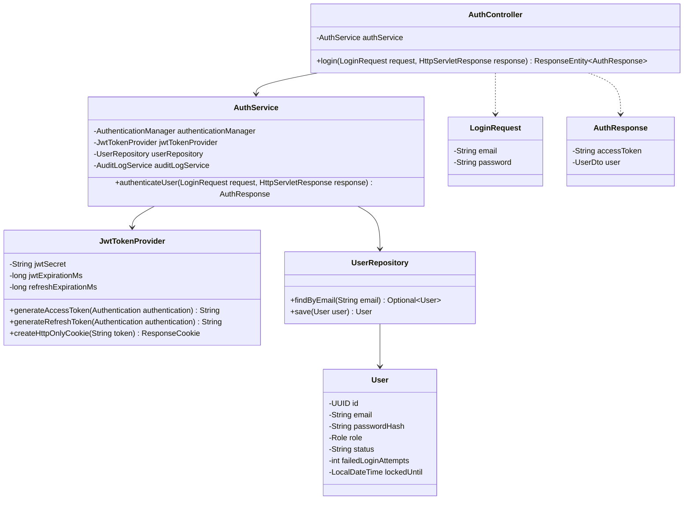

##### 3.1.2. Sequence Diagram: Successful Authentication & Dual-Transport Token Issuance
```mermaid
sequenceDiagram
    autonumber
    actor Patient as Bệnh nhân (Client)
    participant UI as React 18 SPA (LoginPage)
    participant Ctrl as AuthController
    participant Svc as AuthService
    participant Mgr as AuthenticationManager
    participant Token as JwtTokenProvider
    participant DB as PostgreSQL (users)
    participant Audit as AuditLogService

    Patient->>UI: Nhập Email và Mật khẩu, nhấn "Đăng nhập"
    UI->>Ctrl: POST /api/v1/auth/login (LoginRequest)
    Ctrl->>Svc: authenticateUser(request, response)
    Svc->>DB: findByEmail(request.getEmail())
    DB-->>Svc: User Entity (Active, email_verified=true)
    Svc->>Mgr: authenticate(UsernamePasswordAuthenticationToken)
    Mgr-->>Svc: Authentication (Xác thực thành công qua BCrypt)
    Svc->>Token: generateAccessToken(auth)
    Token-->>Svc: accessToken (Bearer JWT, hạn 60 phút)
    Svc->>Token: generateRefreshToken(auth)
    Token-->>Svc: refreshToken (JWT, hạn 7 ngày)
    Svc->>Token: createHttpOnlyCookie(refreshToken)
    Token-->>Svc: Set-Cookie: refresh_token=...; HttpOnly; Secure; SameSite=Lax
    Svc->>DB: resetFailedLoginAttempts(user.getId())
    Svc->>Audit: logAction("LOGIN", user.getId(), "Thành công", ipAddress)
    Svc-->>Ctrl: AuthResponse(accessToken, userDto)
    Ctrl-->>UI: 200 OK + Set-Cookie Header + JSON Body (accessToken)
    UI->>UI: Lưu accessToken vào Bộ nhớ RAM / Axios Header
    UI-->>Patient: Chuyển hướng tới /patient/dashboard
```

##### 3.1.3. Sequence Diagram: Invalid Credentials Failure & Account Lockout Guard
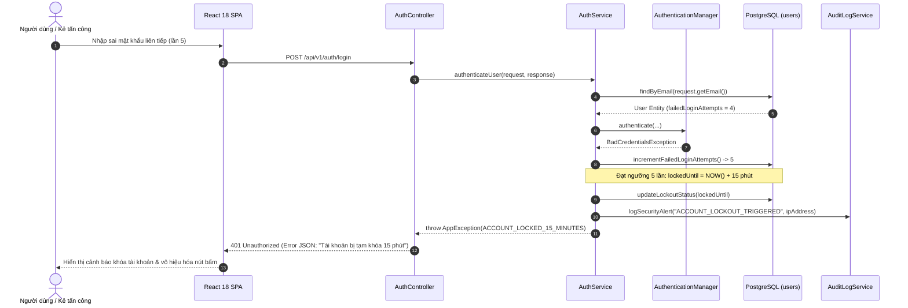

---

#### 3.2 Patient Registration with Email Verification Gate

##### 3.2.1. Class Diagram
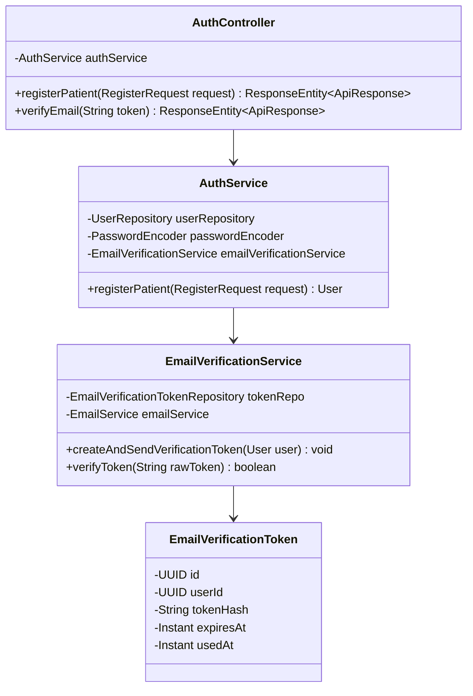

##### 3.2.2. Sequence Diagram: Successful Registration & Verification Email Dispatch
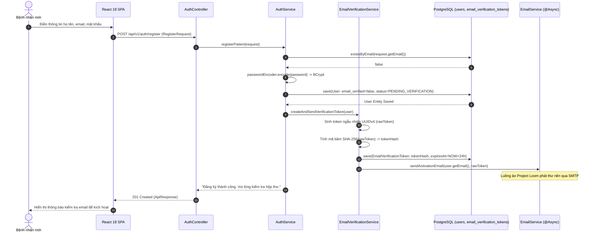

##### 3.2.3. Sequence Diagram: Duplicate Email / Validation Failure
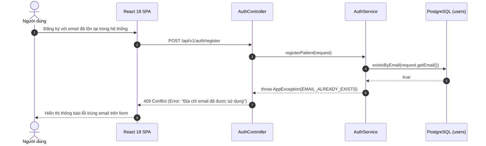

---

#### 3.3 Google OAuth2 Single Sign-On (SSO) Flow

##### 3.3.1. Class Diagram
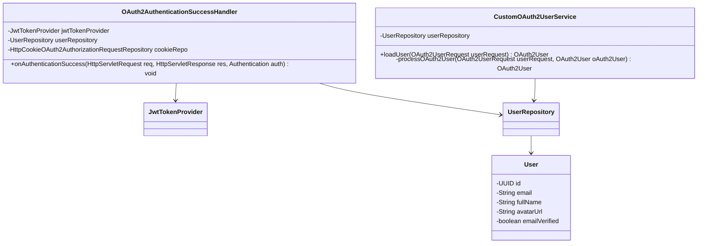

##### 3.3.2. Sequence Diagram: Successful Google OAuth2 Exchange & Auto-Provisioning
```mermaid
sequenceDiagram
    autonumber
    actor User as Người dùng
    participant Browser as Trình duyệt web
    participant Google as Google Identity Server
    participant Backend as Spring Security OAuth2 Client
    participant Handler as OAuth2AuthenticationSuccessHandler
    participant DB as PostgreSQL (users)
    participant Token as JwtTokenProvider

    User->>Browser: Nhấp "Đăng nhập với Google"
    Browser->>Google: Điều hướng tới OAuth2 Consent Screen
    User->>Google: Cấp quyền thông tin hồ sơ (Email, FullName, Avatar)
    Google->>Backend: Redirect /login/oauth2/code/google?code=AUTH_CODE
    Backend->>Google: Trao đổi AUTH_CODE lấy ID Token & Access Token
    Google-->>Backend: GoogleUserInfo (email, name, picture)
    Backend->>DB: findByEmail(googleUser.email)
    alt Người dùng chưa tồn tại
        Backend->>DB: INSERT INTO users (email, full_name, avatar_url, role='PATIENT', email_verified=true, password_hash=NULL)
    else Người dùng đã tồn tại
        Backend->>DB: UPDATE users SET avatar_url=..., email_verified=true
    end
    Backend->>Handler: onAuthenticationSuccess(...)
    Handler->>Token: generateAccessToken(user) & generateRefreshToken(user)
    Handler->>Browser: Set-Cookie: refresh_token=...; Redirect /oauth2/callback?token=ACCESS_TOKEN
    Browser->>Browser: Lưu accessToken & điều hướng người dùng vào Dashboard
```

##### 3.3.3. Sequence Diagram: OAuth2 Token Exchange Failure / State Tampering
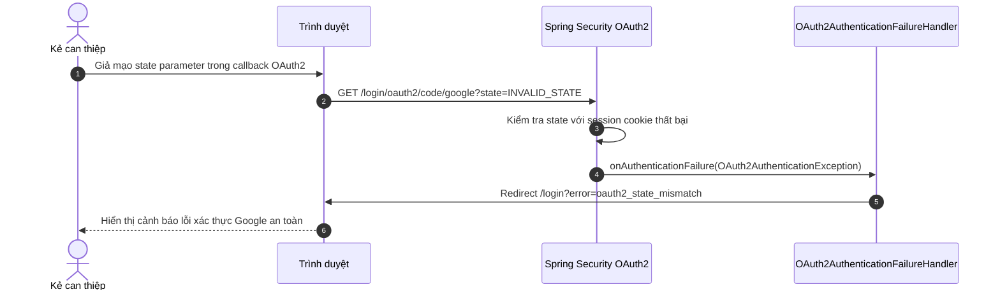

---

#### 3.4 Forgot Password with SHA-256 Token Hash

##### 3.4.1. Class Diagram
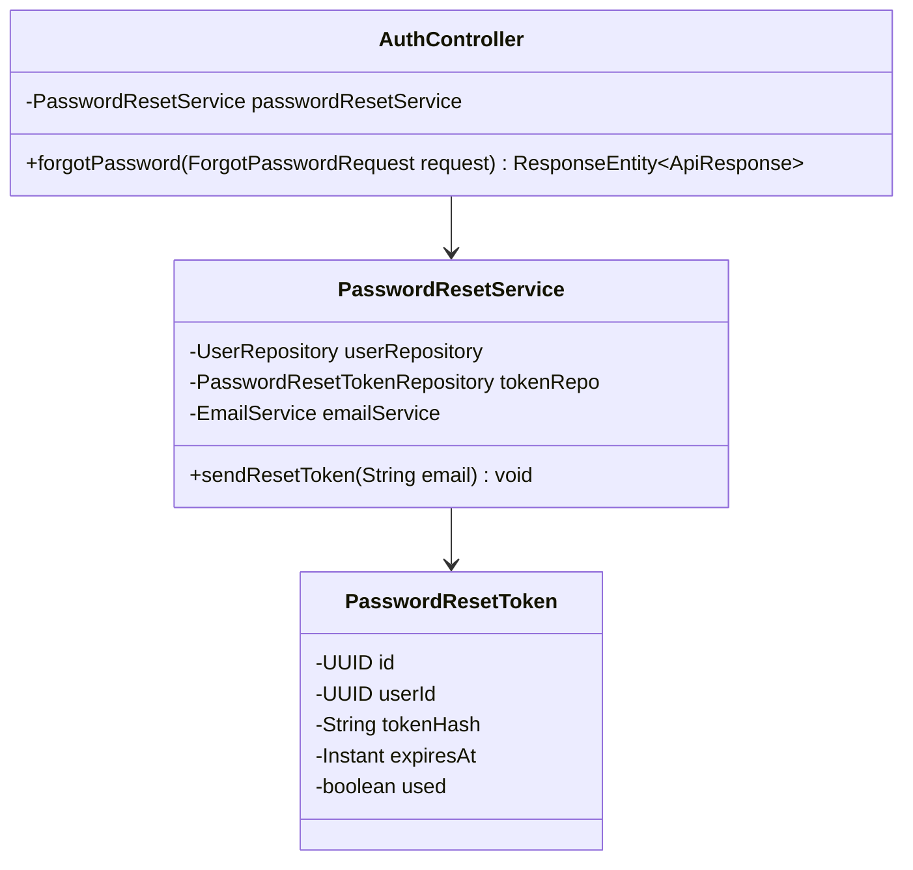

##### 3.4.2. Sequence Diagram: Password Reset Request & SHA-256 Hashed Token Email
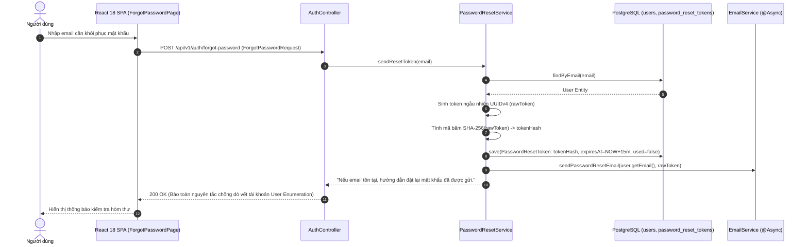

##### 3.4.3. Sequence Diagram: Non-Existent Email / Rate Limit Rejection
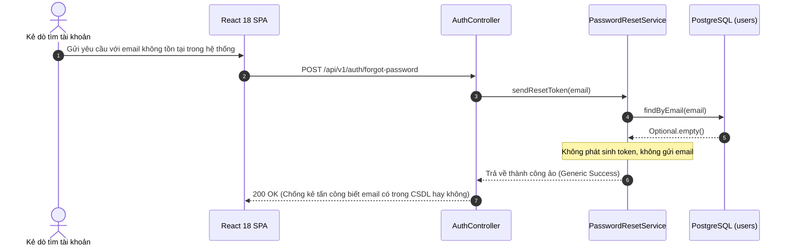

---

#### 3.5 Reset Password with Cryptographic Token Verification

##### 3.5.1. Class Diagram
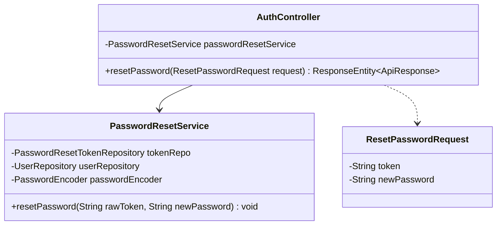

##### 3.5.2. Sequence Diagram: Successful Password Reset & BCrypt Hashing
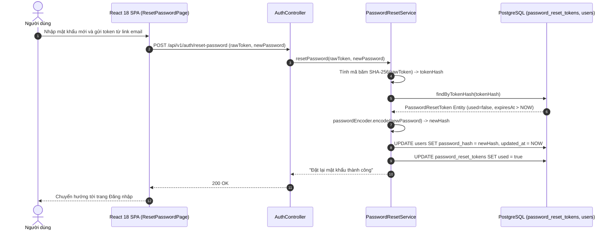

##### 3.5.3. Sequence Diagram: Expired or Previously Used Token Rejection
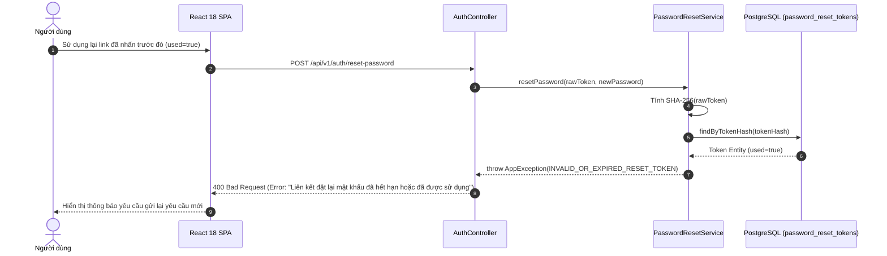

---

#### 3.6 Token Refresh & Sliding Session Rotation

##### 3.6.1. Class Diagram
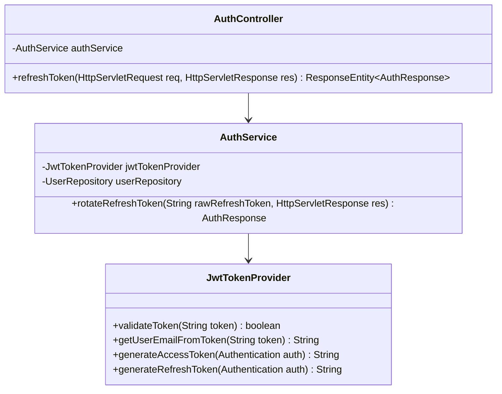

##### 3.6.2. Sequence Diagram: Successful Refresh Token Rotation via HttpOnly Cookie
```mermaid
sequenceDiagram
    autonumber
    actor Browser as Trình duyệt (Axios Interceptor)
    participant Ctrl as AuthController
    participant Svc as AuthService
    participant Token as JwtTokenProvider
    participant DB as PostgreSQL (users)

    Browser->>Ctrl: POST /api/v1/auth/refresh (Cookie: refresh_token=OLD_REFRESH_TOKEN)
    Ctrl->>Svc: rotateRefreshToken(cookieToken, response)
    Svc->>Token: validateToken(OLD_REFRESH_TOKEN)
    Token-->>Svc: true (Hợp lệ, chưa hết hạn)
    Svc->>Token: getUserEmailFromToken(OLD_REFRESH_TOKEN)
    Token-->>Svc: email
    Svc->>DB: findByEmail(email)
    DB-->>Svc: User Entity (Active)
    Svc->>Token: generateAccessToken(user) -> newAccessToken
    Svc->>Token: generateRefreshToken(user) -> newRefreshToken
    Svc->>Ctrl: Set-Cookie: refresh_token=newRefreshToken; HttpOnly; Secure; SameSite=Lax
    Ctrl-->>Browser: 200 OK + JSON Body: { accessToken: newAccessToken }
    Browser->>Browser: Tiếp tục gửi lại yêu cầu API vừa bị 401
```

##### 3.6.3. Sequence Diagram: Revoked / Tampered Refresh Token (Security Alert)
```mermaid
sequenceDiagram
    autonumber
    actor Attacker as Kẻ tấn công
    participant Ctrl as AuthController
    participant Svc as AuthService
    participant Token as JwtTokenProvider
    participant Audit as AuditLogService

    Attacker->>Ctrl: POST /api/v1/auth/refresh (Cookie giả mạo / đã hết hạn)
    Ctrl->>Svc: rotateRefreshToken(tamperedToken, response)
    Svc->>Token: validateToken(tamperedToken)
    Token-->>Svc: false (Chữ ký HMAC không khớp hoặc Token Expired)
    Svc->>Audit: logSecurityEvent("TOKEN_THEFT_OR_TAMPERING_DETECTED", ipAddress)
    Svc-->>Ctrl: throw AppException(UNAUTHORIZED_INVALID_REFRESH_TOKEN)
    Ctrl-->>Attacker: 401 Unauthorized + Set-Cookie: refresh_token=; Max-Age=0
```

---

#### 3.7 Secure Logout & Refresh Cookie Invalidation

##### 3.7.1. Class Diagram
```mermaid
classDiagram
    class AuthController {
        -AuthService authService
        +logout(HttpServletResponse response) ResponseEntity~ApiResponse~
    }
    class AuthService {
        -AuditLogService auditLogService
        +logout(UUID currentUserId, HttpServletResponse response) void
    }

    AuthController --> AuthService
```

##### 3.7.2. Sequence Diagram: Successful Logout & Cookie Clearing
```mermaid
sequenceDiagram
    autonumber
    actor Patient as Người dùng
    participant UI as React 18 SPA
    participant Ctrl as AuthController
    participant Svc as AuthService
    participant Audit as AuditLogService

    Patient->>UI: Nhấn nút "Đăng xuất"
    UI->>Ctrl: POST /api/v1/auth/logout (Bearer accessToken)
    Ctrl->>Svc: logout(userId, response)
    Svc->>Audit: logAction("LOGOUT", userId, "Đăng xuất an toàn", ipAddress)
    Svc->>Ctrl: Set-Cookie: refresh_token=; Max-Age=0; Path=/; HttpOnly; SameSite=Lax
    Ctrl-->>UI: 200 OK (Thành công)
    UI->>UI: Xóa accessToken trong RAM, xóa toàn bộ bộ đệm ứng dụng
    UI-->>Patient: Chuyển hướng về trang chủ LandingPage
```

##### 3.7.3. Sequence Diagram: Expired Session Logout
```mermaid
sequenceDiagram
    autonumber
    actor User as Người dùng
    participant UI as React 18 SPA
    participant Ctrl as AuthController

    User->>UI: Nhấn Đăng xuất khi phiên đã hết hạn từ lâu
    UI->>Ctrl: POST /api/v1/auth/logout
    Note over Ctrl: Không cần xác thực Bearer token bắt buộc khi đăng xuất
    Ctrl-->>UI: 200 OK + Header Max-Age=0 xóa cookie
    UI-->>User: Xóa sạch bộ nhớ cục bộ và trở về màn hình đăng nhập
```

---

#### 3.8 Update User Profile & Notification Preferences

##### 3.8.1. Class Diagram
```mermaid
classDiagram
    class UserController {
        -UserService userService
        +updateProfile(UpdateProfileRequest request, UserPrincipal principal) ResponseEntity~UserProfileDto~
    }
    class UserService {
        -UserRepository userRepository
        -PatientProfileRepository patientRepo
        +updateUserProfile(UUID userId, UpdateProfileRequest request) UserProfileDto
    }
    class UpdateProfileRequest {
        -String fullName
        -String phone
        -String address
        -String emergencyContactPhone
    }

    UserController --> UserService
    UserController ..> UpdateProfileRequest
```

##### 3.8.2. Sequence Diagram: Successful Profile & Demographic Update
```mermaid
sequenceDiagram
    autonumber
    actor Patient as Bệnh nhân
    participant UI as React 18 SPA
    participant Ctrl as UserController
    participant Svc as UserService
    participant DB as PostgreSQL (users, patient_profiles)

    Patient->>UI: Cập nhật số điện thoại, địa chỉ và lưu
    UI->>Ctrl: PUT /api/v1/users/me/profile (UpdateProfileRequest)
    Ctrl->>Svc: updateUserProfile(userId, request)
    Svc->>DB: findByUserId(userId)
    DB-->>Svc: User & PatientProfile Entities
    Svc->>DB: UPDATE users SET full_name=..., phone=...
    Svc->>DB: UPDATE patient_profiles SET address=..., emergency_contact_phone=...
    DB-->>Svc: Cập nhật thành công
    Svc-->>Ctrl: UserProfileDto
    Ctrl-->>UI: 200 OK + DTO mới
    UI-->>Patient: Hiển thị thông báo "Cập nhật hồ sơ thành công"
```

##### 3.8.3. Sequence Diagram: Validation Error / Unauthorized Access
```mermaid
sequenceDiagram
    autonumber
    actor Patient as Bệnh nhân
    participant UI as React 18 SPA
    participant Ctrl as UserController

    Patient->>UI: Nhập số điện thoại sai định dạng (ví dụ: chứa chữ cái)
    UI->>Ctrl: PUT /api/v1/users/me/profile
    Note over Ctrl: Kích hoạt Jakarta Validation (@Pattern)
    Ctrl-->>UI: 400 Bad Request (FieldError: "Số điện thoại không hợp lệ")
    UI-->>Patient: Hiển thị viền đỏ và thông báo lỗi tại ô nhập liệu
```

---

#### 3.9 AI Symptom Triage Analysis & 5-Stage Clinical Defense

##### 3.9.1. Class Diagram
```mermaid
classDiagram
    class SymptomTriageController {
        -SymptomTriageService triageService
        +analyzeSymptoms(TriageRequest request) ResponseEntity~TriageResponse~
    }
    class SymptomTriageService {
        -EmergencyKeywordDetector emergencyDetector
        -VietnameseSlangNormalizer slangNormalizer
        -NegationEngine negExEngine
        -GeminiVisionClient geminiClient
        -TriageSessionRepository sessionRepo
        +processTriage(TriageRequest request) TriageResponse
    }
    class TriageResponse {
        -boolean isEmergency
        -TriageUrgency urgencyLevel
        -String primarySpecialty
        -String sbarSummary
        -String aiAdvice
    }

    SymptomTriageController --> SymptomTriageService
    SymptomTriageService --> TriageResponse
```

##### 3.9.2. Sequence Diagram: Standard Symptom Analysis & Multi-Specialty Routing
```mermaid
sequenceDiagram
    autonumber
    actor Patient as Bệnh nhân
    participant UI as React 18 SPA (SymptomTriagePage)
    participant Ctrl as SymptomTriageController
    participant Svc as SymptomTriageService
    participant Slang as VietnameseSlangNormalizer
    participant NegEx as NegationEngine (Vietnamese NegEx)
    participant AI as Google Gemini 1.5 Flash
    participant DB as PostgreSQL (triage_sessions)

    Patient->>UI: Nhập: "Tôi bị đau tức ngực âm ỉ 3 ngày, nhưng không khó thở, không sốt"
    UI->>Ctrl: POST /api/v1/triage/analyze (TriageRequest)
    Ctrl->>Svc: processTriage(request)
    Svc->>Svc: Stage 1: Kiểm tra từ khóa cấp cứu tối khẩn -> False
    Svc->>Slang: Stage 2: Chuẩn hóa teen-code & phương ngữ
    Slang-->>Svc: Văn bản y khoa chuẩn hóa
    Svc->>NegEx: Stage 3: Bóc tách mệnh đề phủ định
    Note over NegEx: Mệnh đề khẳng định: "đau tức ngực âm ỉ 3 ngày"<br/>Mệnh đề phủ định cách ly: "không khó thở", "không sốt"
    NegEx-->>Svc: CleanAffirmedSymptoms: "đau tức ngực âm ỉ 3 ngày"
    Svc->>AI: Stage 5: Gửi prompt cấu trúc lâm sàng SBAR tới Gemini Flash
    AI-->>Svc: JSON (PrimarySpecialty: Tim mạch, Urgency: URGENT, SBAR)
    Svc->>DB: INSERT INTO triage_sessions (...)
    DB-->>Svc: Session Saved
    Svc-->>Ctrl: TriageResponse (Specialty: Tim mạch, Khuyến nghị bác sĩ)
    Ctrl-->>UI: 200 OK + TriageResponse
    UI-->>Patient: Hiển thị kết quả phân luồng, huy hiệu Vàng (Khẩn) & Nút "Đặt lịch chuyên khoa Tim mạch"
```

##### 3.9.3. Sequence Diagram: Stage 1 Acute Red-Flag Emergency Lockout (Hotline 115)
```mermaid
sequenceDiagram
    autonumber
    actor Patient as Bệnh nhân khẩn cấp
    participant UI as React 18 SPA
    participant Ctrl as SymptomTriageController
    participant Svc as SymptomTriageService
    participant DB as PostgreSQL (triage_sessions)

    Patient->>UI: Nhập: "Bố tôi bị méo miệng, liệt nửa người, nói ngọng đột ngột"
    UI->>Ctrl: POST /api/v1/triage/analyze
    Ctrl->>Svc: processTriage(request)
    Note over Svc: Stage 1: Khớp biểu thức Regex Dấu hiệu đột quỵ FAST (Cấp cứu tối khẩn)
    Svc->>DB: save(TriageSession: is_emergency=true, urgency=EMERGENCY)
    Svc-->>Ctrl: TriageResponse(isEmergency=true, aiAdvice="GỌI NGAY CẤP CỨU 115 HOẶC ĐẾN BỆNH VIỆN GẦN NHẤT")
    Ctrl-->>UI: 200 OK + Khóa toàn bộ tính năng đặt lịch khám thường
    UI-->>Patient: Hiển thị cảnh báo ĐỎ TOÀN MÀN HÌNH + Nút bấm gọi nhanh 115
```

---

#### 3.10 Doctor Semantic Vector Search & Hybrid Re-ranking (pgvector + WHRF)

##### 3.10.1. Class Diagram
```mermaid
classDiagram
    class DoctorSearchController {
        -DoctorSemanticSearchService searchService
        +searchDoctors(DoctorSearchRequest request) ResponseEntity~List~DoctorCardDto~~
    }
    class DoctorSemanticSearchService {
        -OpenAIClient openAiClient
        -DoctorProfileRepository doctorRepo
        -SpecialtyRepository specialtyRepo
        +hybridSearch(DoctorSearchRequest request) List~DoctorCardDto~
        -calculateWhrfScore(DoctorProfile doc, double cosineSim) double
    }
    class DoctorCardDto {
        -UUID doctorId
        -String fullName
        -String academicTitle
        -double rating
        -int reviewCount
        -double whrfScore
    }

    DoctorSearchController --> DoctorSemanticSearchService
    DoctorSemanticSearchService --> DoctorCardDto
```

##### 3.10.2. Sequence Diagram: HNSW Vector Search + Sigmoid Contrastive Re-Ranking
```mermaid
sequenceDiagram
    autonumber
    actor Patient as Bệnh nhân
    participant UI as React 18 SPA (DoctorSearchPage)
    participant Ctrl as DoctorSearchController
    participant Svc as DoctorSemanticSearchService
    participant AI as OpenAI API (text-embedding-3-small)
    participant DB as PostgreSQL (doctor_profiles + pgvector HNSW)

    Patient->>UI: Nhập tìm kiếm: "Bác sĩ chữa đau nửa đầu mãn tính và mất ngủ"
    UI->>Ctrl: POST /api/v1/doctors/semantic-search
    Ctrl->>Svc: hybridSearch(request)
    Svc->>AI: generateEmbedding("Bác sĩ chữa đau nửa đầu mãn tính và mất ngủ")
    AI-->>Svc: Vector float[1536] (queryVector)
    Svc->>DB: SET LOCAL hnsw.ef_search = 120;<br/>SELECT id, bio, 1 - (bio_embedding <=> queryVector) AS cosine_sim FROM doctor_profiles WHERE is_verified=true ORDER BY bio_embedding <=> queryVector LIMIT 20;
    DB-->>Svc: Top 20 Doctor Profiles với Cosine Similarity thực tế
    loop Với từng bác sĩ trong Top 20
        Svc->>Svc: Tính Sigmoid Contrastive Sharpening: S_dense = 1 / (1 + exp(-8.0 * (CosineSim - 0.65)))
        Svc->>Svc: Tính Credibility Damper: W_cred = log10(review_count + 1) / log10(100)
        Svc->>Svc: Tính WHRF Score tổng hợp
    end
    Svc->>Svc: Sắp xếp qua Priority Queue Min-Heap lấy Top 10 bác sĩ điểm cao nhất
    Svc-->>Ctrl: Danh sách Top 10 Bác sĩ kèm điểm phù hợp
    Ctrl-->>UI: 200 OK + List DoctorCardDto
    UI-->>Patient: Hiển thị danh sách bác sĩ với huy hiệu tỷ lệ phù hợp (%)
```

##### 3.10.3. Sequence Diagram: Out-of-Domain Query Gating / Degraded Feature Hash Fallback
```mermaid
sequenceDiagram
    autonumber
    actor User as Người dùng
    participant UI as React 18 SPA
    participant Ctrl as DoctorSearchController
    participant Svc as DoctorSemanticSearchService
    participant AI as OpenAI API

    User->>UI: Tìm kiếm khi mạng ngoài bị gián đoạn (OpenAI Timeout)
    UI->>Ctrl: POST /api/v1/doctors/semantic-search
    Ctrl->>Svc: hybridSearch(request)
    Svc->>AI: generateEmbedding(...)
    AI-->>Svc: ConnectTimeoutException (Mạng chập chờn)
    Note over Svc: Kích hoạt cơ chế Fallback suy thoái êm dịu (Graceful Degradation):<br/>Chuyển sang Local Character N-gram FNV-1a Hash + PostgreSQL pg_trgm Full-Text Search
    Svc->>Svc: localFallbackTrigramSearch(query)
    Svc-->>Ctrl: Kết quả tìm kiếm từ khóa cục bộ
    Ctrl-->>UI: 200 OK (Kèm cảnh báo tìm kiếm từ khóa dự phòng)
    UI-->>User: Hiển thị kết quả tìm kiếm không bị gián đoạn
```

#### 3.11 Telehealth Appointment Booking & Slot Concurrency Locking

##### 3.11.1. Class Diagram
```mermaid
classDiagram
    class AppointmentController {
        -AppointmentService appointmentService
        +bookAppointment(CreateAppointmentRequest request, UserPrincipal principal) ResponseEntity~AppointmentDto~
    }
    class AppointmentService {
        -AppointmentRepository appointmentRepo
        -UserRepository userRepo
        -DoctorProfileRepository doctorRepo
        -RedisTemplate redisTemplate
        +createAppointment(UUID patientId, CreateAppointmentRequest request) AppointmentDto
        -validateOperatingHours(LocalDateTime start, LocalDateTime end) void
        -generateDailyQueueNumber(UUID doctorId, LocalDate date) String
    }
    class Appointment {
        -UUID id
        -String appointmentCode
        -UUID patientId
        -UUID doctorId
        -LocalDateTime scheduledStart
        -LocalDateTime scheduledEnd
        -AppointmentStatus status
        -PaymentStatus paymentStatus
        -BigDecimal feeAmount
        -String queueNumber
        -Long version
    }
    class CreateAppointmentRequest {
        -UUID doctorId
        -LocalDateTime scheduledStart
        -LocalDateTime scheduledEnd
        -String chiefComplaint
    }

    AppointmentController --> AppointmentService
    AppointmentService --> Appointment
    AppointmentController ..> CreateAppointmentRequest
```

##### 3.11.2. Sequence Diagram: Successful Booking & Daily Queue Number Allocation (`STT xx`)
```mermaid
sequenceDiagram
    autonumber
    actor Patient as Bệnh nhân
    participant UI as React 18 SPA (DoctorSearch / BookingModal)
    participant Ctrl as AppointmentController
    participant Svc as AppointmentService
    participant Redis as Redis (Slot Lock Semaphore)
    participant DB as PostgreSQL (appointments)
    participant Mail as EmailService (@Async)

    Patient->>UI: Chọn Bác sĩ, Ngày khám 19/10/2026, Khung giờ 09:00 - 09:30
    UI->>Ctrl: POST /api/v1/appointments (CreateAppointmentRequest)
    Ctrl->>Svc: createAppointment(patientId, request)
    Svc->>Svc: validateOperatingHours(): Giờ làm việc 08:00-12:00, 13:30-17:00, Thứ 2 - Thứ 7 (Hợp lệ)
    Svc->>Redis: SET lock:slot:docId:202610190900 NX EX 10 (Khóa phân tán 10s)
    Redis-->>Svc: OK (Giữ khóa thành công)
    Svc->>DB: existsConflictSlot(doctorId, start, end, ACTIVE_STATUSES)
    DB-->>Svc: false (Chưa có ai đặt)
    Svc->>DB: countTodayAppointments(doctorId, 2026-10-19)
    DB-->>Svc: 3 ca khám đã đặt
    Svc->>Svc: queueNumber = String.format("STT %02d", 3 + 1) -> "STT 04"
    Svc->>DB: INSERT INTO appointments (code='APT-...', status='SCHEDULED', queue_number='STT 04', payment_status='UNPAID')
    DB-->>Svc: Appointment Entity Created
    Svc->>Redis: DEL lock:slot:docId:202610190900 (Giải phóng khóa)
    Svc->>Mail: sendAppointmentConfirmationEmail(patient, appointment)
    Svc-->>Ctrl: AppointmentDto(id, code, queueNumber='STT 04', status='SCHEDULED')
    Ctrl-->>UI: 201 Created + AppointmentDto
    UI-->>Patient: Hiển thị màn hình xác nhận đặt lịch & nút "Thanh toán viện phí VNPay"
```

##### 3.11.3. Sequence Diagram: Concurrent Booking Collision (`SLOT_CONFLICT` 409)
```mermaid
sequenceDiagram
    autonumber
    actor PatientB as Bệnh nhân B
    participant Ctrl as AppointmentController
    participant Svc as AppointmentService
    participant DB as PostgreSQL (appointments)

    PatientB->>Ctrl: POST /api/v1/appointments (Cùng khung giờ Bệnh nhân A vừa đặt)
    Ctrl->>Svc: createAppointment(patientBId, request)
    Svc->>DB: existsConflictSlot(doctorId, start, end)
    DB-->>Svc: true (Bệnh nhân A đã hoàn tất giao dịch đặt trước 100ms)
    Svc-->>Ctrl: throw AppException(SLOT_CONFLICT, "Khung giờ này vừa có người đặt. Vui lòng chọn khung giờ khác.")
    Ctrl-->>PatientB: 409 Conflict (Error JSON)
```

---

#### 3.12 Appointment Rescheduling & Operating Hours Validation

##### 3.12.1. Class Diagram
```mermaid
classDiagram
    class AppointmentController {
        -AppointmentService appointmentService
        +rescheduleAppointment(UUID id, RescheduleRequest request) ResponseEntity~AppointmentDto~
    }
    class AppointmentService {
        -AppointmentRepository appointmentRepo
        +rescheduleAppointment(UUID id, LocalDateTime newStart, LocalDateTime newEnd) AppointmentDto
    }

    AppointmentController --> AppointmentService
```

##### 3.12.2. Sequence Diagram: Valid Rescheduling & Schedule Slot Reassignment
```mermaid
sequenceDiagram
    autonumber
    actor Patient as Bệnh nhân
    participant UI as React 18 SPA
    participant Ctrl as AppointmentController
    participant Svc as AppointmentService
    participant DB as PostgreSQL (appointments)

    Patient->>UI: Yêu cầu đổi lịch sang ngày mai 14:00 - 14:30
    UI->>Ctrl: PUT /api/v1/appointments/{id}/reschedule (newStart, newEnd)
    Ctrl->>Svc: rescheduleAppointment(id, newStart, newEnd)
    Svc->>DB: findById(id)
    DB-->>Svc: Appointment Entity (status=SCHEDULED)
    Svc->>Svc: Kiểm tra khung giờ mới trong giờ hành chính y tế
    Svc->>DB: existsConflictSlot(doctorId, newStart, newEnd)
    DB-->>Svc: false (Trống lịch)
    Svc->>DB: UPDATE appointments SET scheduled_start=newStart, scheduled_end=newEnd, updated_at=NOW
    Svc-->>Ctrl: AppointmentDto mới
    Ctrl-->>UI: 200 OK
    UI-->>Patient: Cập nhật lịch mới trên giao diện
```

##### 3.12.3. Sequence Diagram: Invalid Rescheduling (Sunday Operating Hours Lockout)
```mermaid
sequenceDiagram
    autonumber
    actor Patient as Bệnh nhân
    participant UI as React 18 SPA
    participant Ctrl as AppointmentController
    participant Svc as AppointmentService

    Patient->>UI: Chọn dời lịch sang ngày Chủ Nhật (Sunday)
    UI->>Ctrl: PUT /api/v1/appointments/{id}/reschedule
    Ctrl->>Svc: rescheduleAppointment(id, sundayStart, sundayEnd)
    Svc->>Svc: validateOperatingHours(newStart): newStart.getDayOfWeek() == SUNDAY
    Svc-->>Ctrl: throw AppException(SUNDAY_BOOKING_NOT_SUPPORTED, "Phòng khám không tiếp nhận ca hẹn vào ngày Chủ Nhật.")
    Ctrl-->>UI: 400 Bad Request
    UI-->>Patient: Hiển thị cảnh báo lỗi vi phạm giờ làm việc
```

---

#### 3.13 Appointment Cancellation & Tiered Automated Refund Calculation

##### 3.13.1. Class Diagram
```mermaid
classDiagram
    class AppointmentController {
        -AppointmentService appointmentService
        +cancelAppointment(UUID id, CancelRequest request, UserPrincipal principal) ResponseEntity~AppointmentDto~
    }
    class AppointmentService {
        -AppointmentRepository appointmentRepo
        -AppointmentRefundService refundService
        +cancelAppointment(UUID id, String reason, Role actorRole) AppointmentDto
    }
    class AppointmentRefundService {
        -PaymentService paymentService
        +calculateRefundAmount(Appointment appt, Role actorRole) BigDecimal
        +processRefund(Appointment appt, BigDecimal amount) void
    }

    AppointmentController --> AppointmentService
    AppointmentService --> AppointmentRefundService
```

##### 3.13.2. Sequence Diagram: Patient Cancellation & 100%/80% Automated Policy Refund
```mermaid
sequenceDiagram
    autonumber
    actor Patient as Bệnh nhân
    participant UI as React 18 SPA
    participant Ctrl as AppointmentController
    participant Svc as AppointmentService
    participant RefundSvc as AppointmentRefundService
    participant PaymentSvc as PaymentService (VNPay Refund)
    participant DB as PostgreSQL (appointments, payment_transactions)

    Patient->>UI: Bấm Hủy lịch hẹn (trước giờ khám 26 tiếng)
    UI->>Ctrl: POST /api/v1/appointments/{id}/cancel (reason: "Bận đột xuất")
    Ctrl->>Svc: cancelAppointment(id, reason, Role.PATIENT)
    Svc->>DB: findById(id)
    DB-->>Svc: Appointment (fee=500.000 VND, payment_status=PAID)
    Svc->>RefundSvc: calculateRefundAmount(appt, Role.PATIENT)
    Note over RefundSvc: Khoảng cách = 26 giờ (>= 24 giờ): Hoàn 100% = 500.000 VND<br/>(Nếu từ 2h - 24h: Hoàn 80% = 400.000 VND)
    RefundSvc-->>Svc: refundAmount = 500.000 VND
    Svc->>RefundSvc: processRefund(appt, 500.000 VND)
    RefundSvc->>PaymentSvc: initiateRefund(transactionCode, 500.000 VND)
    PaymentSvc-->>RefundSvc: Refund Success (Mã giao dịch hoàn: RF-9912)
    Svc->>DB: UPDATE appointments SET status='CANCELLED', payment_status='REFUNDED'
    Svc->>DB: INSERT INTO payment_transactions (order_type='REFUND', status='COMPLETED', amount=500000)
    Svc-->>Ctrl: AppointmentDto(status='CANCELLED', refundAmount=500000)
    Ctrl-->>UI: 200 OK
    UI-->>Patient: Thông báo hủy thành công & tiền hoàn 500.000 VND đã được chuyển
```

##### 3.13.3. Sequence Diagram: Late Cancellation Under 2 Hours (0% Non-Refundable)
```mermaid
sequenceDiagram
    autonumber
    actor Patient as Bệnh nhân
    participant UI as React 18 SPA
    participant Ctrl as AppointmentController
    participant Svc as AppointmentService
    participant RefundSvc as AppointmentRefundService
    participant DB as PostgreSQL (appointments)

    Patient->>UI: Bấm Hủy lịch hẹn trước giờ khám 45 phút (< 2 giờ)
    UI->>Ctrl: POST /api/v1/appointments/{id}/cancel
    Ctrl->>Svc: cancelAppointment(id, reason, Role.PATIENT)
    Svc->>RefundSvc: calculateRefundAmount(appt, Role.PATIENT)
    Note over RefundSvc: Khoảng cách < 2 giờ: Hoàn 0% theo Điều khoản dịch vụ
    RefundSvc-->>Svc: refundAmount = 0 VND
    Svc->>DB: UPDATE appointments SET status='CANCELLED' (payment_status giữ nguyên PAID)
    Svc-->>Ctrl: AppointmentDto(status='CANCELLED', refundAmount=0)
    Ctrl-->>UI: 200 OK
    UI-->>Patient: Cảnh báo: "Lịch hẹn đã hủy nhưng không được hoàn phí do hủy sát giờ (< 2h)"
```

---

#### 3.14 Patient Clinic Check-In & Queue Management

##### 3.14.1. Class Diagram
```mermaid
classDiagram
    class AppointmentController {
        -AppointmentService appointmentService
        +checkIn(UUID id, UserPrincipal principal) ResponseEntity~AppointmentDto~
    }
    class AppointmentService {
        -AppointmentRepository appointmentRepo
        +checkInAppointment(UUID id) AppointmentDto
    }

    AppointmentController --> AppointmentService
```

##### 3.14.2. Sequence Diagram: Successful Check-In & Queue Status Update
```mermaid
sequenceDiagram
    autonumber
    actor Patient as Bệnh nhân đến phòng khám
    participant UI as React 18 SPA (PatientPortal)
    participant Ctrl as AppointmentController
    participant Svc as AppointmentService
    participant DB as PostgreSQL (appointments)

    Patient->>UI: Nhấn "Điểm danh tiếp đón" khi có mặt tại bệnh viện
    UI->>Ctrl: POST /api/v1/appointments/{id}/check-in
    Ctrl->>Svc: checkInAppointment(id)
    Svc->>DB: findById(id)
    DB-->>Svc: Appointment (status=SCHEDULED, scheduled_start=Hôm nay)
    Svc->>DB: UPDATE appointments SET checked_in_at = NOW()
    Svc-->>Ctrl: AppointmentDto(checkedInAt=NOW)
    Ctrl-->>UI: 200 OK
    UI-->>Patient: Màn hình hiển thị: "Điểm danh thành công! Quý khách có số STT 04 tại Phòng 302"
```

##### 3.14.3. Sequence Diagram: Check-In on Non-Scheduled Day Rejection
```mermaid
sequenceDiagram
    autonumber
    actor Patient as Bệnh nhân
    participant UI as React 18 SPA
    participant Ctrl as AppointmentController
    participant Svc as AppointmentService

    Patient->>UI: Nhấn điểm danh cho ca hẹn của tuần sau
    UI->>Ctrl: POST /api/v1/appointments/{id}/check-in
    Ctrl->>Svc: checkInAppointment(id)
    Note over Svc: appointment.getScheduledStart().toLocalDate().isEqual(today) == false
    Svc-->>Ctrl: throw AppException(CHECK_IN_NOT_ALLOWED_TODAY, "Chỉ được phép điểm danh trong ngày diễn ra ca khám.")
    Ctrl-->>UI: 400 Bad Request
    UI-->>Patient: Hiển thị thông báo chưa đến ngày khám
```

---

#### 3.15 Doctor Clinical Encounter & EMR Documentation

##### 3.15.1. Class Diagram
```mermaid
classDiagram
    class DoctorEncounterController {
        -DoctorEncounterService encounterService
        +completeEncounter(UUID appointmentId, EncounterRecordRequest request, UserPrincipal principal) ResponseEntity~AppointmentDto~
    }
    class DoctorEncounterService {
        -AppointmentRepository appointmentRepo
        -PatientAccessGuard accessGuard
        -ClinicalOntologyService ontologyService
        +completeConsultation(UUID doctorId, UUID appointmentId, EncounterRecordRequest request) AppointmentDto
    }
    class EncounterRecordRequest {
        -String vitalSignsJson
        -String icd10Code
        -String icd10Name
        -String prescriptionJson
        -String treatmentPlan
        -LocalDate followUpDate
    }

    DoctorEncounterController --> DoctorEncounterService
    DoctorEncounterService --> EncounterRecordRequest
```

##### 3.15.2. Sequence Diagram: Consultation Completion, WHO ICD-10 Coding & Rx JSON Storage
```mermaid
sequenceDiagram
    autonumber
    actor Doctor as Bác sĩ điều trị
    participant UI as React 18 SPA (DoctorDashboard / EncounterModal)
    participant Ctrl as DoctorEncounterController
    participant Svc as DoctorEncounterService
    participant Guard as PatientAccessGuard
    participant Ontology as ClinicalOntologyService
    participant DB as PostgreSQL (appointments)

    Doctor->>UI: Nhập sinh hiệu (BP: 120/80, HR: 75), chọn mã ICD-10 (I10 - Tăng huyết áp vô căn), kê đơn thuốc Amlodipine 5mg
    UI->>Ctrl: POST /api/v1/doctor/encounters/{id}/complete (EncounterRecordRequest)
    Ctrl->>Svc: completeConsultation(doctorId, id, request)
    Svc->>DB: findById(id)
    DB-->>Svc: Appointment Entity
    Svc->>Guard: assertCanAccessPatient(doctorId, Role.DOCTOR, appt.getPatientId(), "COMPLETE_ENCOUNTER")
    Guard-->>Svc: Hợp lệ (Quan hệ điều trị chăm sóc tồn tại)
    Svc->>Ontology: validateIcd10Code(request.getIcd10Code())
    Ontology-->>Svc: true (Mã I10 chuẩn danh mục WHO/BYT)
    Svc->>DB: UPDATE appointments SET status='COMPLETED', vital_signs_json=..., icd10_code='I10', icd10_name='Tăng huyết áp vô căn', prescription_json=..., treatment_plan=..., follow_up_date=...
    DB-->>Svc: Lưu bệnh án thành công
    Svc-->>Ctrl: AppointmentDto (Hoàn tất)
    Ctrl-->>UI: 200 OK
    UI-->>Doctor: Hiển thị thông báo "Đã hoàn thành ca khám và ban hành đơn thuốc điện tử"
```

##### 3.15.3. Sequence Diagram: Non-Attending Doctor Unauthorized Access (BOLA 403)
```mermaid
sequenceDiagram
    autonumber
    actor RogueDoctor as Bác sĩ khác (Không phụ trách ca khám)
    participant Ctrl as DoctorEncounterController
    participant Svc as DoctorEncounterService
    participant Guard as PatientAccessGuard

    RogueDoctor->>Ctrl: POST /api/v1/doctor/encounters/{otherId}/complete
    Ctrl->>Svc: completeConsultation(rogueDoctorId, otherId, request)
    Svc->>Guard: assertCanAccessPatient(rogueDoctorId, Role.DOCTOR, patientId, "COMPLETE_ENCOUNTER")
    Guard->>Guard: Kiểm tra quan hệ khám: existsByDoctorIdAndPatientId(...) == false
    Guard-->>Svc: throw AppException(FORBIDDEN_CARE_RELATIONSHIP)
    Svc-->>Ctrl: Bị từ chối
    Ctrl-->>RogueDoctor: 403 Forbidden (Bảo vệ tính riêng tư bệnh án BOLA/IDOR)
```

---

#### 3.16 Doctor Workstation Queue Supervision

##### 3.16.1. Class Diagram
```mermaid
classDiagram
    class DoctorWorkstationController {
        -DoctorWorkstationService workstationService
        +getTodayQueue(UserPrincipal principal) ResponseEntity~List~QueueItemDto~~
    }
    class DoctorWorkstationService {
        -AppointmentRepository appointmentRepo
        +getDoctorDailyQueue(UUID doctorId, LocalDate date) List~QueueItemDto~
    }

    DoctorWorkstationController --> DoctorWorkstationService
```

##### 3.16.2. Sequence Diagram: Real-Time Queue Fetching & Status Transitions
```mermaid
sequenceDiagram
    autonumber
    actor Doctor as Bác sĩ
    participant UI as React 18 SPA (DoctorDashboard)
    participant Ctrl as DoctorWorkstationController
    participant Svc as DoctorWorkstationService
    participant DB as PostgreSQL (appointments)

    Doctor->>UI: Mở Bàn làm việc Bác sĩ (Doctor Workstation)
    UI->>Ctrl: GET /api/v1/doctor/workstation/queue?date=2026-10-18
    Ctrl->>Svc: getDoctorDailyQueue(doctorId, date)
    Svc->>DB: findByDoctorIdAndDateOrderByQueueNumber(doctorId, date)
    DB-->>Svc: Danh sách các ca khám (STT 01: COMPLETED, STT 02: IN_PROGRESS, STT 03: CHECKED_IN)
    Svc-->>Ctrl: List QueueItemDto
    Ctrl-->>UI: 200 OK + Danh sách hàng đợi thời gian thực
    UI-->>Doctor: Hiển thị danh sách bệnh nhân chờ khám kèm chỉ số sinh hiệu và trạng thái
```

##### 3.16.3. Sequence Diagram: Unverified Doctor Profile Locked Out
```mermaid
sequenceDiagram
    autonumber
    actor Doctor as Bác sĩ mới đăng ký (Chưa được duyệt)
    participant UI as React 18 SPA
    participant Ctrl as DoctorWorkstationController
    participant DB as PostgreSQL (doctor_profiles)

    Doctor->>UI: Truy cập Bàn làm việc bác sĩ
    UI->>Ctrl: GET /api/v1/doctor/workstation/queue
    Ctrl->>DB: findByUserId(doctorId)
    DB-->>Ctrl: DoctorProfile (is_verified = false)
    Ctrl-->>UI: 403 Forbidden (Error: "Hồ sơ bác sĩ đang chờ Admin phê duyệt chứng chỉ hành nghề.")
    UI-->>Doctor: Khóa giao diện bàn làm việc và chuyển hướng sang trang chờ duyệt
```

---

#### 3.17 Patient Review & Doctor Rating Submission

##### 3.17.1. Class Diagram
```mermaid
classDiagram
    class DoctorReviewController {
        -DoctorReviewService reviewService
        +submitReview(CreateReviewRequest request, UserPrincipal principal) ResponseEntity~DoctorReviewDto~
    }
    class DoctorReviewService {
        -DoctorReviewRepository reviewRepo
        -AppointmentRepository appointmentRepo
        -DoctorProfileRepository doctorRepo
        +createReview(UUID patientId, CreateReviewRequest request) DoctorReviewDto
        -recalculateDoctorRating(UUID doctorProfileId) void
    }
    class CreateReviewRequest {
        -UUID appointmentId
        -int rating
        -String comment
        -String tags
    }

    DoctorReviewController --> DoctorReviewService
    DoctorReviewService --> CreateReviewRequest
```

##### 3.17.2. Sequence Diagram: Verified Consultation Review & Credibility Damper Update
```mermaid
sequenceDiagram
    autonumber
    actor Patient as Bệnh nhân
    participant UI as React 18 SPA (PatientDashboard / History)
    participant Ctrl as DoctorReviewController
    participant Svc as DoctorReviewService
    participant DB as PostgreSQL (appointments, doctor_reviews, doctor_profiles)

    Patient->>UI: Đánh giá 5 sao: "Bác sĩ tư vấn rất tận tình, chẩn đoán chính xác"
    UI->>Ctrl: POST /api/v1/reviews (CreateReviewRequest)
    Ctrl->>Svc: createReview(patientId, request)
    Svc->>DB: findById(request.getAppointmentId())
    DB-->>Svc: Appointment (status=COMPLETED, patientId khớp)
    Svc->>DB: existsByAppointmentId(appointmentId)
    DB-->>Svc: false (Chưa từng đánh giá)
    Svc->>DB: INSERT INTO doctor_reviews (appointment_id, doctor_id, patient_id, rating=5, comment=...)
    Svc->>DB: UPDATE doctor_profiles SET review_count = review_count + 1, rating = (SELECT AVG(rating) FROM doctor_reviews WHERE doctor_id=...)
    DB-->>Svc: Cập nhật thành công
    Svc-->>Ctrl: DoctorReviewDto
    Ctrl-->>UI: 201 Created
    UI-->>Patient: Thông báo: "Cảm ơn quý khách đã gửi đánh giá!"
```

##### 3.17.3. Sequence Diagram: Unattended Appointment Review Attempt Rejection
```mermaid
sequenceDiagram
    autonumber
    actor Patient as Bệnh nhân
    participant UI as React 18 SPA
    participant Ctrl as DoctorReviewController
    participant Svc as DoctorReviewService
    participant DB as PostgreSQL (appointments)

    Patient->>UI: Cố tình gửi đánh giá cho ca khám bị hủy (CANCELLED)
    UI->>Ctrl: POST /api/v1/reviews
    Ctrl->>Svc: createReview(patientId, request)
    Svc->>DB: findById(appointmentId)
    DB-->>Svc: Appointment (status=CANCELLED)
    Svc-->>Ctrl: throw AppException(REVIEW_ONLY_ALLOWED_FOR_COMPLETED_APPOINTMENT)
    Ctrl-->>UI: 400 Bad Request
    UI-->>Patient: Hiển thị thông báo không đủ điều kiện đánh giá
```

---

#### 3.18 Medical Document Upload & Private Supabase S3 Storage

##### 3.18.1. Class Diagram
```mermaid
classDiagram
    class MedicalDocumentController {
        -MedicalDocumentService documentService
        +uploadDocument(MultipartFile file, UserPrincipal principal) ResponseEntity~MedicalDocumentDto~
    }
    class MedicalDocumentService {
        -MedicalDocumentRepository documentRepo
        -SupabaseStorageClient storageClient
        +uploadPatientDocument(UUID patientId, MultipartFile file) MedicalDocumentDto
    }
    class SupabaseStorageClient {
        +uploadPrivateFile(String bucket, String path, byte[] bytes, String mime) String
        +generatePresignedDownloadUrl(String bucket, String path, Duration duration) URL
    }

    MedicalDocumentController --> MedicalDocumentService
    MedicalDocumentService --> SupabaseStorageClient
```

##### 3.18.2. Sequence Diagram: Multipart Upload & Private Storage Key Persistence
```mermaid
sequenceDiagram
    autonumber
    actor Patient as Bệnh nhân
    participant UI as React 18 SPA (DocumentSummarizerPage)
    participant Ctrl as MedicalDocumentController
    participant Svc as MedicalDocumentService
    participant S3 as Supabase S3 Private Storage
    participant DB as PostgreSQL (medical_documents)

    Patient->>UI: Kéo thả tệp tin PDF phiếu xét nghiệm (4.2 MB)
    UI->>Ctrl: POST /api/v1/patient/documents/upload (Multipart/form-data)
    Ctrl->>Svc: uploadPatientDocument(patientId, file)
    Svc->>Svc: Kiểm tra định dạng (PDF/JPEG/PNG) & dung lượng (<= 10MB) -> Hợp lệ
    Svc->>Svc: Tạo khóa lưu trữ nội bộ riêng tư: String storagePath = "patients/" + patientId + "/docs/" + UUID.randomUUID() + ".pdf"
    Svc->>S3: uploadPrivateFile("medical-documents", storagePath, bytes, "application/pdf")
    S3-->>Svc: Upload thành công vào Private Bucket
    Svc->>DB: INSERT INTO medical_documents (user_id, file_name, file_size_bytes, content_type, storage_path, status='PROCESSED')
    DB-->>Svc: Document Entity Created
    Svc-->>Ctrl: MedicalDocumentDto(id, fileName, storagePath)
    Ctrl-->>UI: 201 Created + MedicalDocumentDto
    UI-->>Patient: Hiển thị tệp tin trong danh sách hồ sơ cá nhân
```

##### 3.18.3. Sequence Diagram: File Size Quota Exceeded / Unsupported MIME Type
```mermaid
sequenceDiagram
    autonumber
    actor Patient as Người dùng
    participant UI as React 18 SPA
    participant Ctrl as MedicalDocumentController
    participant Svc as MedicalDocumentService

    Patient->>UI: Tải lên tệp thực thi độc hại (file.exe) hoặc tệp quá lớn (> 10MB)
    UI->>Ctrl: POST /api/v1/patient/documents/upload
    Ctrl->>Svc: uploadPatientDocument(...)
    Note over Svc: Kiểm tra MIME Type qua Apache Tika: "application/x-msdownload" không thuộc danh sách trắng
    Svc-->>Ctrl: throw AppException(UNSUPPORTED_MEDIA_TYPE, "Chỉ chấp nhận tệp định dạng PDF, PNG hoặc JPEG.")
    Ctrl-->>UI: 415 Unsupported Media Type
    UI-->>Patient: Cảnh báo từ chối tệp không an toàn
```

---

#### 3.19 Document AI OCR & Clinical Summarization

##### 3.19.1. Class Diagram
```mermaid
classDiagram
    class DocumentAnalysisController {
        -DocumentAnalysisService analysisService
        +analyzeDocument(UUID documentId, UserPrincipal principal) ResponseEntity~DocumentAnalysisDto~
    }
    class DocumentAnalysisService {
        -MedicalDocumentRepository docRepo
        -DocumentAnalysisRepository analysisRepo
        -GeminiVisionClient geminiClient
        -PiiDeidentificationService piiService
        +processDocumentOcr(UUID patientId, UUID documentId) DocumentAnalysisDto
    }
    class GeminiVisionClient {
        +extractClinicalEntitiesFromImage(byte[] imageBytes) String
    }

    DocumentAnalysisController --> DocumentAnalysisService
    DocumentAnalysisService --> GeminiVisionClient
```

##### 3.19.2. Sequence Diagram: Gemini 1.5 Flash Extraction, PII Masking & LOINC Mapping
```mermaid
sequenceDiagram
    autonumber
    actor Patient as Bệnh nhân
    participant UI as React 18 SPA
    participant Ctrl as DocumentAnalysisController
    participant Svc as DocumentAnalysisService
    participant S3 as Supabase S3 Private Storage
    participant PII as PiiDeidentificationService
    participant AI as Google Gemini 1.5 Flash Vision
    participant DB as PostgreSQL (document_analyses)

    Patient->>UI: Bấm "Giải nghĩa xét nghiệm AI"
    UI->>Ctrl: POST /api/v1/patient/documents/{id}/analyze
    Ctrl->>Svc: processDocumentOcr(patientId, id)
    Svc->>S3: getObjectBytes(document.getStoragePath())
    S3-->>Svc: byte[] tệp ảnh xét nghiệm
    Svc->>PII: maskSensitivePatientData(imageBytes) -> Loại bỏ tên, địa chỉ, số CMND
    PII-->>Svc: Sanitized Payload
    Svc->>AI: analyzeLaboratoryDocument(SanitizedImageBytes)
    AI-->>Svc: JSON (clinicalSummary, plainLanguageExplanation, abnormalIndicators: [{name: 'Glucose máu', value: '8.2 mmol/L', loinc: '1558-6', status: 'HIGH'}])
    Svc->>DB: INSERT INTO document_analyses (document_id, clinical_summary, plain_language_explanation, abnormal_indicators_json, recommended_specialty_slug='noi-tiet')
    DB-->>Svc: Analysis Entity Saved
    Svc-->>Ctrl: DocumentAnalysisDto
    Ctrl-->>UI: 200 OK + DocumentAnalysisDto
    UI-->>Patient: Hiển thị bảng chỉ số xét nghiệm: Đường huyết cao (Màu Đỏ), Giải thích dễ hiểu và gợi ý khám Chuyên khoa Nội tiết
```

##### 3.19.3. Sequence Diagram: Corrupted Image / AI Inference Quota Exhaustion
```mermaid
sequenceDiagram
    autonumber
    actor Patient as Bệnh nhân
    participant UI as React 18 SPA
    participant Ctrl as DocumentAnalysisController
    participant Svc as DocumentAnalysisService
    participant AI as Google Gemini 1.5 Flash

    Patient->>UI: Gửi ảnh chụp mờ, rách nát không thể đọc chữ
    UI->>Ctrl: POST /api/v1/patient/documents/{id}/analyze
    Ctrl->>Svc: processDocumentOcr(...)
    Svc->>AI: analyzeLaboratoryDocument(...)
    AI-->>Svc: Response (Confidence < 0.2, Không nhận diện được văn bản)
    Svc-->>Ctrl: throw AppException(OCR_IMAGE_TOO_BLURRY, "Hình ảnh quá mờ hoặc bị lóa sáng. Quý khách vui lòng chụp lại rõ nét hơn.")
    Ctrl-->>UI: 422 Unprocessable Entity
    UI-->>Patient: Hướng dẫn chụp lại ảnh tài liệu y tế chuẩn
```

---

#### 3.20 Broken Object Level Authorization (BOLA/IDOR) Defense

##### 3.20.1. Class Diagram
```mermaid
classDiagram
    class PatientAccessGuard {
        -AppointmentRepository appointmentRepo
        -AuditLogService auditLogService
        +assertCanAccessPatient(UUID actorUserId, Role role, UUID patientId, String resource) void
        -recordView(UUID actorUserId, Role role, UUID patientId, String resource) void
    }
    class MedicalDocumentController {
        -MedicalDocumentService documentService
        -PatientAccessGuard accessGuard
        +downloadDocument(UUID documentId, UserPrincipal principal) ResponseEntity~DownloadUrlResponse~
    }

    MedicalDocumentController --> PatientAccessGuard
```

##### 3.20.2. Sequence Diagram: Validated Care Relationship & 15-Min HMAC URL Generation
```mermaid
sequenceDiagram
    autonumber
    actor Doctor as Bác sĩ điều trị
    participant UI as React 18 SPA (DoctorWorkstation)
    participant Ctrl as MedicalDocumentController
    participant Guard as PatientAccessGuard
    participant Svc as MedicalDocumentService
    participant S3 as Supabase S3 Storage Client
    participant DB as PostgreSQL (appointments, audit_logs)

    Doctor->>UI: Bấm xem tài liệu xét nghiệm của bệnh nhân trong ca khám
    UI->>Ctrl: GET /api/v1/documents/{documentId}/download-url
    Ctrl->>Svc: getDocumentMetadata(documentId)
    Svc-->>Ctrl: MedicalDocument (owner = patientId, storagePath="patients/.../doc.pdf")
    Ctrl->>Guard: assertCanAccessPatient(doctorId, Role.DOCTOR, patientId, "VIEW_MEDICAL_DOCUMENT")
    Guard->>DB: existsByDoctorIdAndPatientIdAndStatusIn(doctorId, patientId, ['SCHEDULED', 'IN_PROGRESS', 'COMPLETED'])
    DB-->>Guard: true (Tồn tại ca khám hẹn giữa hai bên)
    Guard->>DB: INSERT INTO audit_logs (action='VIEW_PATIENT_RECORD', actor=doctorId, resource=documentId)
    Guard-->>Ctrl: Phân quyền Hợp lệ
    Ctrl->>S3: createSignedDownloadUrl(storagePath, Duration.ofMinutes(15))
    S3-->>Ctrl: Signed URL: https://supabase.co/.../doc.pdf?X-Amz-Signature=... (Hạn 15 phút)
    Ctrl-->>UI: 200 OK + { downloadUrl: "https://..." }
    UI-->>Doctor: Tự động mở xem tệp tin an toàn trong tab trình duyệt
```

##### 3.20.3. Sequence Diagram: IDOR Breach Attempt Detection, Rejection & Audit Logging
```mermaid
sequenceDiagram
    autonumber
    actor Attacker as Kẻ tấn công / Bác sĩ không phụ trách
    participant Ctrl as MedicalDocumentController
    participant Guard as PatientAccessGuard
    participant DB as PostgreSQL (appointments, audit_logs)

    Attacker->>Ctrl: GET /api/v1/documents/{victimDocumentId}/download-url
    Ctrl->>Guard: assertCanAccessPatient(attackerId, Role.DOCTOR, victimPatientId, "VIEW_MEDICAL_DOCUMENT")
    Guard->>DB: existsByDoctorIdAndPatientIdAndStatusIn(attackerId, victimPatientId, ...)
    DB-->>Guard: false (Không có bất kỳ quan hệ khám chữa bệnh nào!)
    Guard->>DB: INSERT INTO audit_logs (action='IDOR_BREACH_ATTEMPT_BLOCKED', actor=attackerId, resource=victimDocumentId, ip=...)
    Guard-->>Ctrl: throw AppException(FORBIDDEN_CARE_RELATIONSHIP)
    Ctrl-->>Attacker: 403 Forbidden (Từ chối truy cập tuyệt đối & Kích hoạt chuông báo an ninh)
```

#### 3.21 VNPay Payment Gateway Initialization & Cryptographic Checksum

##### 3.21.1. Class Diagram
```mermaid
classDiagram
    class PaymentController {
        -PaymentService paymentService
        +createPaymentUrl(CreatePaymentRequest request, HttpServletRequest httpRequest) ResponseEntity~PaymentUrlResponse~
    }
    class PaymentService {
        -PaymentTransactionRepository transactionRepo
        -VNPayGatewayAdapter vnpayAdapter
        -AppointmentRepository appointmentRepo
        +initializePaymentOrder(UUID userId, CreatePaymentRequest request, String clientIp) PaymentUrlResponse
    }
    class VNPayGatewayAdapter {
        -String vnpTmnCode
        -String vnpHashSecret
        -String vnpUrl
        +generatePaymentUrl(PaymentTransaction tx, String clientIp) String
        -hmacSHA512(String key, String data) String
    }
    class PaymentTransaction {
        -UUID id
        -String transactionCode
        -UUID userId
        -BigDecimal amount
        -PaymentStatus status
        -String paymentGateway
    }

    PaymentController --> PaymentService
    PaymentService --> VNPayGatewayAdapter
    PaymentService --> PaymentTransaction
```

##### 3.21.2. Sequence Diagram: Order Creation & HMAC-SHA512 Payment URL Generation
```mermaid
sequenceDiagram
    autonumber
    actor Patient as Bệnh nhân
    participant UI as React 18 SPA (BookingModal / PaymentCheckout)
    participant Ctrl as PaymentController
    participant Svc as PaymentService
    participant Adapter as VNPayGatewayAdapter
    participant DB as PostgreSQL (payment_transactions, appointments)

    Patient->>UI: Chọn phương thức "Thanh toán qua VNPay"
    UI->>Ctrl: POST /api/v1/payments/create-url (CreatePaymentRequest: appointmentCode="APT-7712")
    Ctrl->>Svc: initializePaymentOrder(patientId, request, clientIp)
    Svc->>DB: findByAppointmentCode("APT-7712")
    DB-->>Svc: Appointment (feeAmount = 500000 VND)
    Svc->>DB: INSERT INTO payment_transactions (transaction_code='TX-...', user_id=patientId, amount=500000, status='PENDING', payment_gateway='VNPAY')
    DB-->>Svc: Transaction Entity Saved
    Svc->>Adapter: generatePaymentUrl(tx, clientIp)
    Adapter->>Adapter: Sắp xếp các tham số truy vấn theo bảng chữ cái A-Z
    Adapter->>Adapter: Tính chuỗi mã hóa vnp_SecureHash = HMAC_SHA512(vnpHashSecret, queryString)
    Adapter-->>Svc: Full URL: https://sandbox.vnpayment.vn/paymentv2/vpcpay.html?vnp_Amount=50000000&...&vnp_SecureHash=...
    Svc-->>Ctrl: PaymentUrlResponse(paymentUrl)
    Ctrl-->>UI: 200 OK + { paymentUrl: "https://..." }
    UI->>UI: window.location.href = paymentUrl (Chuyển hướng cổng VNPay)
    UI-->>Patient: Hiển thị cổng thanh toán VNPay QR / Thẻ ngân hàng
```

##### 3.21.3. Sequence Diagram: Invalid Order Amount / Currency Parameter Rejection
```mermaid
sequenceDiagram
    autonumber
    actor Attacker as Kẻ tấn công
    participant UI as React 18 SPA
    participant Ctrl as PaymentController
    participant Svc as PaymentService

    Attacker->>Ctrl: POST /api/v1/payments/create-url (amount = -50000 hoặc currency = "USD")
    Ctrl->>Svc: initializePaymentOrder(...)
    Note over Svc: Ràng buộc nghiệp vụ y tế: Số tiền khám phải > 0 và đơn vị tiền tệ bắt buộc là VND
    Svc-->>Ctrl: throw AppException(INVALID_PAYMENT_AMOUNT_OR_CURRENCY)
    Ctrl-->>Attacker: 400 Bad Request
```

---

#### 3.22 VNPay IPN Webhook Processing & Idempotency Locking

##### 3.22.1. Class Diagram
```mermaid
classDiagram
    class PaymentWebhookController {
        -PaymentService paymentService
        +handleVnpayIpn(HttpServletRequest request) ResponseEntity~VNPayIpnResponse~
    }
    class PaymentService {
        -PaymentTransactionRepository transactionRepo
        -AppointmentRepository appointmentRepo
        -VNPayGatewayAdapter vnpayAdapter
        -EmailService emailService
        +processVnpayIpn(Map~String, String~ vnpParams) VNPayIpnResponse
    }

    PaymentWebhookController --> PaymentService
```

##### 3.22.2. Sequence Diagram: Valid Checksum Verification & Idempotent Order Fulfillment
```mermaid
sequenceDiagram
    autonumber
    actor VNPayServer as Máy chủ VNPay (IPN Gateway)
    participant Ctrl as PaymentWebhookController
    participant Svc as PaymentService
    participant Adapter as VNPayGatewayAdapter
    participant DB as PostgreSQL (payment_transactions, appointments)
    participant Mail as EmailService (@Async)

    VNPayServer->>Ctrl: GET /api/v1/payments/vnpay-ipn?vnp_Amount=50000000&vnp_ResponseCode=00&vnp_TxnRef=TX-9912&vnp_SecureHash=...
    Ctrl->>Svc: processVnpayIpn(vnpParams)
    Svc->>Adapter: verifySecureHash(vnpParams)
    Adapter-->>Svc: true (Chữ ký HMAC-SHA512 chuẩn xác từ VNPay)
    Svc->>DB: findByTransactionCodeWithLock("TX-9912")
    DB-->>Svc: PaymentTransaction (status='PENDING')
    alt Transaction đã ở trạng thái COMPLETED (Idempotency Check)
        Svc-->>Ctrl: VNPayIpnResponse(RspCode="02", Message="Order already confirmed")
    else Transaction đang PENDING và vnp_ResponseCode == "00"
        Svc->>DB: UPDATE payment_transactions SET status='COMPLETED', gateway_reference=vnp_TransactionNo, updated_at=NOW()
        Svc->>DB: UPDATE appointments SET payment_status='PAID', status='SCHEDULED' WHERE appointment_code=tx.referenceId
        Svc->>Mail: sendPaymentSuccessReceiptEmail(patient, appointment)
        Svc-->>Ctrl: VNPayIpnResponse(RspCode="00", Message="Confirm Success")
    end
    Ctrl-->>VNPayServer: 200 OK + JSON { RspCode: "00", Message: "Confirm Success" }
```

##### 3.22.3. Sequence Diagram: Tampered Checksum / Duplicate Webhook Rejection
```mermaid
sequenceDiagram
    autonumber
    actor Attacker as Kẻ can thiệp gói tin Webhook
    participant Ctrl as PaymentWebhookController
    participant Svc as PaymentService
    participant Adapter as VNPayGatewayAdapter
    participant Audit as AuditLogService

    Attacker->>Ctrl: GET /api/v1/payments/vnpay-ipn?vnp_ResponseCode=00&vnp_SecureHash=INVALID_HASH
    Ctrl->>Svc: processVnpayIpn(params)
    Svc->>Adapter: verifySecureHash(params)
    Adapter-->>Svc: false (Chữ ký bị sai lệch!)
    Svc->>Audit: logSecurityAlert("VNPAY_IPN_CHECKSUM_INVALID", params)
    Svc-->>Ctrl: VNPayIpnResponse(RspCode="97", Message="Invalid Checksum")
    Ctrl-->>Attacker: 200 OK + JSON { RspCode: "97", Message: "Invalid Checksum" }
```

---

#### 3.23 Automated Refund Processing & Payment Reconciliation

##### 3.23.1. Class Diagram
```mermaid
classDiagram
    class AppointmentRefundService {
        -PaymentService paymentService
        -PaymentTransactionRepository transactionRepo
        -AppointmentRepository appointmentRepo
        +executeRefund(UUID appointmentId, BigDecimal refundAmount, String reason) RefundResult
    }
    class VNPayGatewayAdapter {
        +callVnpayRefundApi(RefundRequest request) VNPayRefundResponse
    }

    AppointmentRefundService --> VNPayGatewayAdapter
```

##### 3.23.2. Sequence Diagram: Successful VNPay / Mock Gateway Refund Execution
```mermaid
sequenceDiagram
    autonumber
    actor Doctor as Bác sĩ bận việc đột xuất
    participant Ctrl as AppointmentController
    participant Svc as AppointmentService
    participant RefundSvc as AppointmentRefundService
    participant Adapter as VNPayGatewayAdapter
    participant DB as PostgreSQL (appointments, payment_transactions)
    participant Mail as EmailService (@Async)

    Doctor->>Ctrl: POST /api/v1/doctor/appointments/{id}/cancel (reason: "Bác sĩ có ca phẫu thuật cấp cứu")
    Ctrl->>Svc: cancelAppointment(id, reason, Role.DOCTOR)
    Svc->>DB: findById(id)
    DB-->>Svc: Appointment (feeAmount=500.000 VND)
    Note over Svc: Bác sĩ hủy ca hẹn: Tự động hoàn tiền 100% (500.000 VND) vô điều kiện
    Svc->>RefundSvc: executeRefund(id, 500000, reason)
    RefundSvc->>Adapter: callVnpayRefundApi(txCode, 500000)
    Adapter-->>RefundSvc: VNPay Refund Approved (vnp_ResponseId=RF-8812)
    RefundSvc->>DB: UPDATE appointments SET status='CANCELLED', payment_status='REFUNDED'
    RefundSvc->>DB: INSERT INTO payment_transactions (order_type='REFUND', status='COMPLETED', amount=500000)
    RefundSvc->>Mail: sendRefundNotificationEmail(patient, appointment, 500000)
    RefundSvc-->>Svc: RefundResult(success=true)
    Svc-->>Ctrl: 200 OK
    Ctrl-->>Doctor: "Đã hủy ca khám và hoàn 100% viện phí cho bệnh nhân"
```

##### 3.23.3. Sequence Diagram: Gateway Communication Timeout & Retry Outbox
```mermaid
sequenceDiagram
    autonumber
    actor System as Hệ thống
    participant RefundSvc as AppointmentRefundService
    participant Adapter as VNPayGatewayAdapter
    participant DB as PostgreSQL (payment_transactions)

    RefundSvc->>Adapter: callVnpayRefundApi(...)
    Adapter-->>RefundSvc: SocketTimeoutException (Cổng VNPay không phản hồi)
    Note over RefundSvc: Ghi nhận giao dịch hoàn tiền vào trạng thái PENDING_RETRY trong CSDL
    RefundSvc->>DB: INSERT INTO payment_transactions (order_type='REFUND', status='PENDING')
    Note over System: Scheduled Job (chạy mỗi 5 phút) quét các đơn PENDING để đối soát & gọi lại tự động
    System->>RefundSvc: retryPendingRefunds()
```

---

#### 3.24 Doctor License Verification & Credential Approval (Admin)

##### 3.24.1. Class Diagram
```mermaid
classDiagram
    class AdminDoctorController {
        -AdminDoctorService adminDoctorService
        +verifyDoctor(UUID doctorId, VerifyDoctorRequest request) ResponseEntity~ApiResponse~
        +rejectDoctor(UUID doctorId, RejectDoctorRequest request) ResponseEntity~ApiResponse~
    }
    class AdminDoctorService {
        -DoctorProfileRepository doctorRepo
        -DoctorSemanticSearchService searchService
        -EmailService emailService
        -AuditLogService auditLogService
        +approveDoctorProfile(UUID doctorId) void
        +rejectDoctorProfile(UUID doctorId, String reason) void
    }

    AdminDoctorController --> AdminDoctorService
```

##### 3.24.2. Sequence Diagram: Admin Verification, Vector Bio-Embedding Generation & Approval
```mermaid
sequenceDiagram
    autonumber
    actor Admin as Quản trị viên
    participant UI as React 18 SPA (DoctorManagementPage)
    participant Ctrl as AdminDoctorController
    participant Svc as AdminDoctorService
    participant SearchSvc as DoctorSemanticSearchService
    participant AI as OpenAI API (text-embedding-3-small)
    participant DB as PostgreSQL (doctor_profiles, users, audit_logs)
    participant Mail as EmailService (@Async)

    Admin->>UI: Kiểm tra chứng chỉ hành nghề, nhấn "Phê duyệt bác sĩ"
    UI->>Ctrl: POST /api/v1/admin/doctors/{id}/verify
    Ctrl->>Svc: approveDoctorProfile(id)
    Svc->>DB: findByIdWithDetails(id)
    DB-->>Svc: DoctorProfile (is_verified = false, bio = "...")
    Svc->>SearchSvc: generateBioEmbedding(doctorProfile.getBio())
    SearchSvc->>AI: POST /v1/embeddings (input: bioText)
    AI-->>SearchSvc: Vector float[1536] (bioEmbedding)
    Svc->>DB: UPDATE doctor_profiles SET is_verified=true, verified_at=NOW(), bio_embedding=bioEmbedding WHERE id=id
    Svc->>DB: UPDATE users SET status='ACTIVE' WHERE id=doctorProfile.userId
    Svc->>DB: INSERT INTO audit_logs (action='APPROVE_DOCTOR_LICENSE', actor='ADMIN', resource=id)
    Svc->>Mail: sendDoctorAccountActivatedEmail(doctor.getEmail())
    Svc-->>Ctrl: "Phê duyệt thành công"
    Ctrl-->>UI: 200 OK
    UI-->>Admin: Cập nhật trạng thái bác sĩ thành "Đã xác minh" (Huy hiệu Xanh)
```

##### 3.24.3. Sequence Diagram: Credential Rejection with Justification Feedback
```mermaid
sequenceDiagram
    autonumber
    actor Admin as Quản trị viên
    participant UI as React 18 SPA
    participant Ctrl as AdminDoctorController
    participant Svc as AdminDoctorService
    participant DB as PostgreSQL (doctor_profiles, users)
    participant Mail as EmailService (@Async)

    Admin->>UI: Nhập lý do từ chối: "Ảnh chụp chứng chỉ mờ, không rõ số CCHN"
    UI->>Ctrl: POST /api/v1/admin/doctors/{id}/reject (reason: "...")
    Ctrl->>Svc: rejectDoctorProfile(id, reason)
    Svc->>DB: UPDATE users SET status='SUSPENDED' WHERE id=doctorProfile.userId
    Svc->>Mail: sendDoctorApplicationRejectedEmail(doctor.getEmail(), reason)
    Svc-->>Ctrl: "Đã từ chối hồ sơ bác sĩ"
    Ctrl-->>UI: 200 OK
    UI-->>Admin: Chuyển trạng thái bác sĩ sang "Bị từ chối"
```

---

#### 3.25 Specialty Taxonomy & Clinical Catalog Management (Admin)

##### 3.25.1. Class Diagram
```mermaid
classDiagram
    class AdminSpecialtyController {
        -SpecialtyService specialtyService
        +createSpecialty(CreateSpecialtyRequest request) ResponseEntity~SpecialtyDto~
        +updateSpecialty(UUID id, UpdateSpecialtyRequest request) ResponseEntity~SpecialtyDto~
    }
    class SpecialtyService {
        -SpecialtyRepository specialtyRepo
        -CaffeineCacheManager cacheManager
        +createSpecialty(CreateSpecialtyRequest request) SpecialtyDto
    }

    AdminSpecialtyController --> SpecialtyService
```

##### 3.25.2. Sequence Diagram: Specialty Creation & Secondary Specialty Association
```mermaid
sequenceDiagram
    autonumber
    actor Admin as Quản trị viên
    participant UI as React 18 SPA (SpecialtyManagementPage)
    participant Ctrl as AdminSpecialtyController
    participant Svc as SpecialtyService
    participant DB as PostgreSQL (specialties)
    participant Cache as Caffeine In-Memory Cache (L1)

    Admin->>UI: Nhập tên: "Chuyên khoa Ung bướu", Slug: "ung-buou", Mô tả lâm sàng
    UI->>Ctrl: POST /api/v1/admin/specialties (CreateSpecialtyRequest)
    Ctrl->>Svc: createSpecialty(request)
    Svc->>DB: existsBySlug("ung-buou")
    DB-->>Svc: false
    Svc->>DB: INSERT INTO specialties (name='Chuyên khoa Ung bướu', slug='ung-buou', description=...)
    DB-->>Svc: Specialty Entity Created
    Svc->>Cache: evict("specialties_all") (Xóa sạch cache cũ để cập nhật tức thời)
    Svc-->>Ctrl: SpecialtyDto
    Ctrl-->>UI: 201 Created
    UI-->>Admin: Hiển thị chuyên khoa mới trong bảng danh mục
```

##### 3.25.3. Sequence Diagram: Duplicate Specialty Code Conflict
```mermaid
sequenceDiagram
    autonumber
    actor Admin as Quản trị viên
    participant UI as React 18 SPA
    participant Ctrl as AdminSpecialtyController
    participant Svc as SpecialtyService
    participant DB as PostgreSQL (specialties)

    Admin->>UI: Tạo chuyên khoa trùng slug "tim-mach" đã tồn tại
    UI->>Ctrl: POST /api/v1/admin/specialties
    Ctrl->>Svc: createSpecialty(request)
    Svc->>DB: existsBySlug("tim-mach")
    DB-->>Svc: true
    Svc-->>Ctrl: throw AppException(SPECIALTY_SLUG_ALREADY_EXISTS)
    Ctrl-->>UI: 409 Conflict
    UI-->>Admin: Báo lỗi trùng lặp mã định danh chuyên khoa
```

---

#### 3.26 User Account State Management & Security Lockout (Admin)

##### 3.26.1. Class Diagram
```mermaid
classDiagram
    class AdminUserController {
        -AdminUserService adminUserService
        +updateUserStatus(UUID userId, UpdateStatusRequest request) ResponseEntity~ApiResponse~
    }
    class AdminUserService {
        -UserRepository userRepo
        -AuditLogService auditLogService
        +changeUserStatus(UUID targetUserId, String newStatus, String reason, UUID adminId) void
    }

    AdminUserController --> AdminUserService
```

##### 3.26.2. Sequence Diagram: Admin Account Suspend / Reactivate with Audit Logging
```mermaid
sequenceDiagram
    autonumber
    actor Admin as Quản trị viên
    participant UI as React 18 SPA (UserManagementPage)
    participant Ctrl as AdminUserController
    participant Svc as AdminUserService
    participant DB as PostgreSQL (users, audit_logs)

    Admin->>UI: Nhấn "Khóa tài khoản" người dùng vi phạm chính sách
    UI->>Ctrl: PUT /api/v1/admin/users/{id}/status (status='SUSPENDED', reason="Spam đặt lịch ảo")
    Ctrl->>Svc: changeUserStatus(id, "SUSPENDED", reason, adminId)
    Svc->>DB: findById(id)
    DB-->>Svc: User Entity
    Svc->>Svc: Kiểm tra không cho phép tự khóa tài khoản của chính Admin
    Svc->>DB: UPDATE users SET status='SUSPENDED', is_active=false, updated_at=NOW()
    Svc->>DB: INSERT INTO audit_logs (action='SUSPEND_USER_ACCOUNT', actor='ADMIN', resource=id, details=reason)
    Svc-->>Ctrl: "Đã cập nhật trạng thái tài khoản"
    Ctrl-->>UI: 200 OK
    UI-->>Admin: Trạng thái tài khoản chuyển sang màu đỏ "SUSPENDED"
```

##### 3.26.3. Sequence Diagram: Self-Deactivation / Super-Admin Lockout Protection
```mermaid
sequenceDiagram
    autonumber
    actor Admin as Quản trị viên
    participant Ctrl as AdminUserController
    participant Svc as AdminUserService

    Admin->>Ctrl: PUT /api/v1/admin/users/{myOwnId}/status (status='SUSPENDED')
    Ctrl->>Svc: changeUserStatus(adminId, "SUSPENDED", ...)
    Note over Svc: adminId.equals(targetUserId) == true
    Svc-->>Ctrl: throw AppException(CANNOT_SUSPEND_SELF, "Quản trị viên không thể tự khóa tài khoản của chính mình.")
    Ctrl-->>Admin: 400 Bad Request
```

---

#### 3.27 Clinical Audit Trail & Access Supervision (Admin)

##### 3.27.1. Class Diagram
```mermaid
classDiagram
    class AdminAuditLogController {
        -AuditLogService auditLogService
        +getAuditLogs(AuditFilterRequest filter, Pageable pageable) ResponseEntity~Page~AuditLogDto~~
    }
    class AuditLogService {
        -AuditLogRepository auditRepo
        +searchAuditLogs(AuditFilterRequest filter, Pageable pageable) Page~AuditLogDto~
    }

    AdminAuditLogController --> AuditLogService
```

##### 3.27.2. Sequence Diagram: Paginated Audit Log Filtering with Actor & Date Range
```mermaid
sequenceDiagram
    autonumber
    actor Admin as Quản trị viên
    participant UI as React 18 SPA (AuditLogPage)
    participant Ctrl as AdminAuditLogController
    participant Svc as AuditLogService
    participant DB as PostgreSQL (audit_logs)

    Admin->>UI: Chọn bộ lọc: Hành động = VIEW_PATIENT_RECORD, Từ ngày 10/10/2026 đến 18/10/2026
    UI->>Ctrl: GET /api/v1/admin/audit-logs?action=VIEW_PATIENT_RECORD&startDate=...&page=0&size=20
    Ctrl->>Svc: searchAuditLogs(filter, pageable)
    Svc->>DB: SELECT * FROM audit_logs WHERE action='VIEW_PATIENT_RECORD' AND created_at BETWEEN ... ORDER BY created_at DESC LIMIT 20 OFFSET 0;
    DB-->>Svc: Page 20 dòng nhật ký kiểm toán y tế
    Svc-->>Ctrl: Page AuditLogDto
    Ctrl-->>UI: 200 OK + Phân trang nhật ký
    UI-->>Admin: Hiển thị bảng nhật ký truy vết chi tiết (Thời gian, Bác sĩ, Người bệnh, IP, Thiết bị)
```

##### 3.27.3. Sequence Diagram: Export Audit Log Data to Encrypted Report
```mermaid
sequenceDiagram
    autonumber
    actor Admin as Quản trị viên
    participant UI as React 18 SPA
    participant Ctrl as AdminAuditLogController
    participant Svc as AuditLogService
    participant DB as PostgreSQL (audit_logs)

    Admin->>UI: Bấm "Xuất báo cáo kiểm toán CSV"
    UI->>Ctrl: GET /api/v1/admin/audit-logs/export
    Ctrl->>Svc: generateAuditCsvStream()
    Svc->>DB: Stream toàn bộ bản ghi theo bộ lọc
    DB-->>Svc: Luồng dữ liệu bản ghi
    Svc-->>Ctrl: ByteArrayOutputStream (Content-Type: text/csv)
    Ctrl-->>UI: 200 OK + File Download (audit_report_20261018.csv)
    UI-->>Admin: Tự động tải về tệp tin báo cáo phục vụ thanh tra y tế
```

---

#### 3.28 Transactional Email Dispatch & Retry Engine (Async Outbox)

##### 3.28.1. Class Diagram
```mermaid
classDiagram
    class EmailService {
        -JavaMailSender mailSender
        -TemplateEngine templateEngine
        -EmailOutboxRepository outboxRepo
        +sendEmailAsync(String to, String subject, String template, Map~String, Object~ model) CompletableFuture~Void~
        +processFailedOutboxEmails() void
    }
    class JavaMailSender {
        +send(MimeMessage message) void
    }

    EmailService --> JavaMailSender
```

##### 3.28.2. Sequence Diagram: `@Async("mailExecutor")` Event Listener & SMTP Delivery
```mermaid
sequenceDiagram
    autonumber
    actor System as Nghiệp vụ hệ thống (Booking/Register)
    participant Listener as AppointmentEventListener
    participant MailSvc as EmailService (@Async Project Loom)
    participant SMTP as Máy chủ SMTP (Brevo / Transactional Gateway)
    participant DB as PostgreSQL (email_outbox)

    System->>Listener: publishEvent(AppointmentBookedEvent)
    Note over Listener: Giao dịch DB nghiệp vụ đã COMMIT an toàn (@TransactionalEventListener(AFTER_COMMIT))
    Listener->>MailSvc: sendConfirmationEmail(patientEmail, details)
    Note over MailSvc: Luồng ảo Virtual Thread Project Loom thực thi bất đồng bộ
    MailSvc->>SMTP: Gửi email giao dịch (TLS 587)
    SMTP-->>MailSvc: 250 OK (Thư đã gửi thành công)
    Note over MailSvc: Kết thúc hoàn hảo, không làm trễ phản hồi HTTP của người dùng
```

##### 3.28.3. Sequence Diagram: SMTP Server Failure & Exponential Backoff Retry Outbox
```mermaid
sequenceDiagram
    autonumber
    actor System as Nghiệp vụ
    participant MailSvc as EmailService
    participant SMTP as Máy chủ SMTP
    participant DB as PostgreSQL (email_outbox)
    participant Scheduler as OutboxRetryScheduler

    MailSvc->>SMTP: send(...)
    SMTP-->>MailSvc: MailConnectException (Mất kết nối SMTP)
    Note over MailSvc: Bắt lỗi kết nối mạng an toàn (Không làm vỡ luồng người dùng)
    MailSvc->>DB: INSERT INTO email_outbox (recipient=to, subject=..., payload=..., status='PENDING', retry_count=0, next_retry_at=NOW()+2m)
    Note over Scheduler: Sau 2 phút, Cron Job quét các email bị lỗi để phát lại
    Scheduler->>DB: findPendingEmailsReadyToRetry()
    DB-->>Scheduler: List Pending Emails
    Scheduler->>SMTP: Thử gửi lại lần 1
    SMTP-->>Scheduler: 250 OK
    Scheduler->>DB: UPDATE email_outbox SET status='SENT', sent_at=NOW()
```
