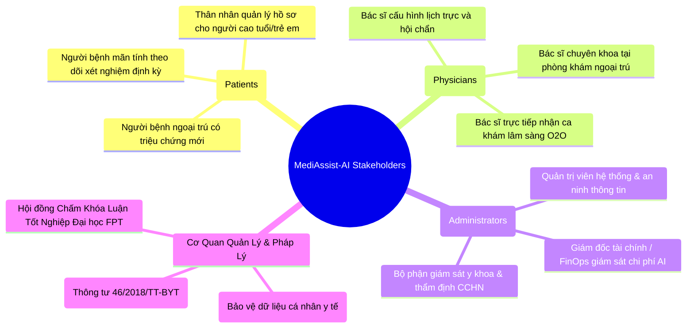
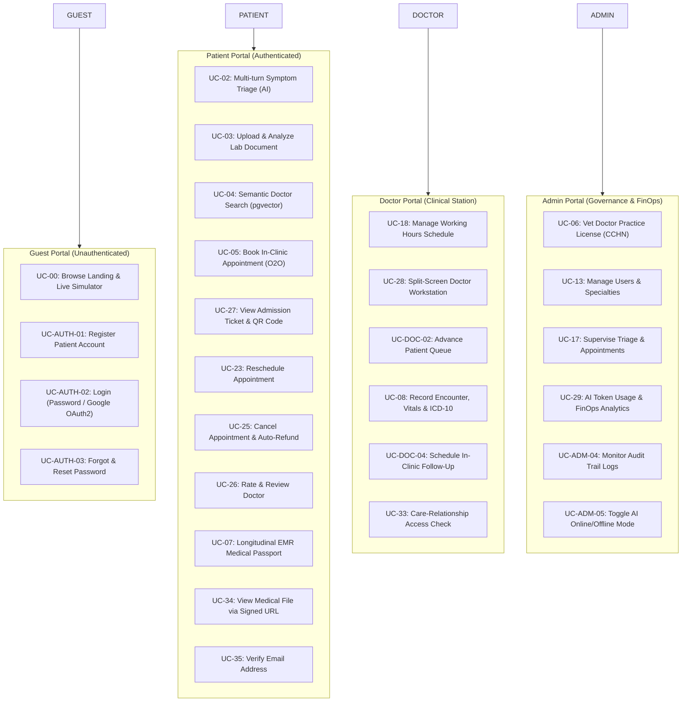
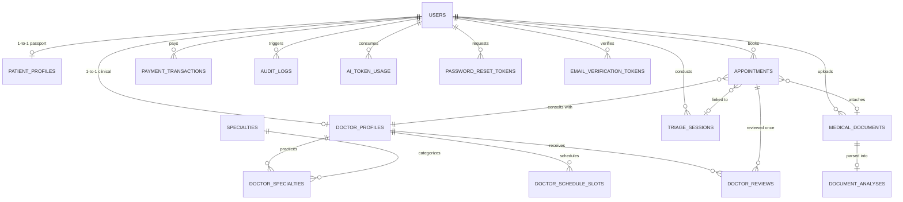

# CAPSTONE PROJECT REPORT — REPORT 3
## SOFTWARE REQUIREMENT SPECIFICATION (SRS) — MEDIASSIST-AI
### Enterprise-Grade Resilient Telehealth Platform with Multimodal Clinical AI

> **Document Code:** FPT-CAPSTONE-SRS-MEDASSIST-01  
> **Project Name:** MediAssist-AI (Nền tảng Y tế Số Thông minh: Phân luồng Triệu chứng & Tóm tắt Hồ sơ Cận lâm sàng)  
> **Institution:** Đại học FPT — Chuyên ngành Kỹ thuật Phần mềm & Trí tuệ Nhân tạo (SE-AI)  
> **Academic Target Standard:** IEEE Std 830-1998 / ISO/IEC/IEEE 29148:2018 Systems and Software Engineering  
> **Release Status:** Complete System Release (Milestone 7 — Final Capstone Defense Baseline)  
> **Current Version:** 2.2.0  
> **Date:** October 2026  

---

## 📑 Table of Contents

- [I. Record of Changes](#i-record-of-changes)
- [1. Product Overview](#1-product-overview)
  - [1.1 Purpose & Executive Summary](#11-purpose--executive-summary)
  - [1.2 Business Context & Pain Points](#12-business-context--pain-points)
  - [1.3 Solution Scope & Boundaries](#13-solution-scope--boundaries)
  - [1.4 Target Stakeholders & Personas](#14-target-stakeholders--personas)
  - [1.5 Mandatory Medical Disclaimer Constraint](#15-mandatory-medical-disclaimer-constraint)
  - [1.6 High-Level System Architecture](#16-high-level-system-architecture)
- [2. User Requirements](#2-user-requirements)
  - [2.1 Actors & System Classes](#21-actors--system-classes)
  - [2.2 Use Case Overview](#22-use-case-overview)
    - [2.2.1 Overall System Use Case Diagram](#221-overall-system-use-case-diagram)
    - [2.2.2 Master Use Case Descriptions](#222-master-use-case-descriptions)
  - [2.3 Detailed Use Case Specifications](#23-detailed-use-case-specifications)
    - [2.3.1 Common & Identity Specifications (UC-COMMON)](#231-common--identity-specifications-uc-common)
    - [2.3.2 Patient Portal Specifications (UC-PAT)](#232-patient-portal-specifications-uc-pat)
    - [2.3.3 Doctor Clinical Workstation Specifications (UC-DOC)](#233-doctor-clinical-workstation-specifications-uc-doc)
    - [2.3.4 Admin Governance & FinOps Specifications (UC-ADM)](#234-admin-governance--finops-specifications-uc-adm)
- [3. Functional Requirements (FR)](#3-functional-requirements-fr)
  - [3.1 System Functional Overview](#31-system-functional-overview)
    - [3.1.1 Screens Navigation Flow](#311-screens-navigation-flow)
    - [3.1.2 Screen Descriptions & UI Contracts](#312-screen-descriptions--ui-contracts)
    - [3.1.3 Role-Based Screen Authorization Matrix](#313-role-based-screen-authorization-matrix)
    - [3.1.4 Non-Screen & Asynchronous Background Functions](#314-non-screen--asynchronous-background-functions)
    - [3.1.5 Physical Entity Relationship Diagram (ERD)](#315-physical-entity-relationship-diagram-erd)
  - [3.2 Module Functional Requirements Specifications](#32-module-functional-requirements-specifications)
    - [3.2.1 Authentication & Security Guardrails (FR-AUTH)](#321-authentication--security-guardrails-fr-auth)
    - [3.2.2 AI Symptom Triage & Red-Flag Interception (FR-TRG)](#322-ai-symptom-triage--red-flag-interception-fr-trg)
    - [3.2.3 Multimodal Document OCR & Clinical LOINC Interpreter (FR-DOC)](#323-multimodal-document-ocr--clinical-loinc-interpreter-fr-doc)
    - [3.2.4 Clinical pgvector 1536-d Semantic Doctor Discovery (FR-VEC)](#324-clinical-pgvector-1536-d-semantic-doctor-discovery-fr-vec)
    - [3.2.5 O2O Appointment Booking & Admission Tickets (FR-BOK)](#325-o2o-appointment-booking--admission-tickets-fr-bok)
    - [3.2.6 Doctor Workstation & Longitudinal EMR (FR-CLIN)](#326-doctor-workstation--longitudinal-emr-fr-clin)
    - [3.2.7 Multi-Channel Payments & Quota Ledger (FR-PAY)](#327-multi-channel-payments--quota-ledger-fr-pay)
    - [3.2.8 Enterprise Admin Supervision & AI FinOps Analytics (FR-ADM)](#328-enterprise-admin-supervision--ai-finops-analytics-fr-adm)
- [4. External Interface Requirements](#4-external-interface-requirements)
  - [4.1 User Interfaces (UI Design Language)](#41-user-interfaces-ui-design-language)
  - [4.2 Software Interfaces & Integration APIs](#42-software-interfaces--integration-apis)
  - [4.3 Hardware, Host & Network Interfaces](#43-hardware-host--network-interfaces)
- [5. System Non-Functional Requirements (NFR & SLAs)](#5-system-non-functional-requirements-nfr--slas)
  - [5.1 Performance & Response Latencies](#51-performance--response-latencies)
  - [5.2 High Availability, Scalability & Zero-Downtime Resilience](#52-high-availability-scalability--zero-downtime-resilience)
  - [5.3 Information Security, Privacy & HIPAA / Decree 13 Compliance](#53-information-security-privacy--hipaa--decree-13-compliance)
  - [5.4 Maintainability, Testability & CI/CD](#54-maintainability-testability--cicd)
- [6. Requirement Appendix](#6-requirement-appendix)
  - [6.1 Enterprise Clinical Business Rules (BR)](#61-enterprise-clinical-business-rules-br)
  - [6.2 Acronyms & Abbreviations](#62-acronyms--abbreviations)
  - [6.3 Application Messages & Standard Error Catalog](#63-application-messages--standard-error-catalog)
  - [6.4 Requirements Traceability Matrix (RTM)](#64-requirements-traceability-matrix-rtm)

---

## I. Record of Changes

| Date | Version | Type (*) | Author / In Charge | Description of Changes |
| :---: | :---: | :---: | :--- | :--- |
| **10/09/2026** | 1.0.0 | A | Core Team | Initial SRS Baseline: System Scope, Actors, and Basic CRUD Modules. |
| **18/09/2026** | 1.1.0 | A, M | Core Team | Added Multimodal Document Summarization, SBAR structure, and Flyway V14. |
| **28/09/2026** | 1.2.0 | A | Core Team | Integrated Doctor Review Rating System (Flyway V17) and WHRF Min-Heap ranking. |
| **02/10/2026** | 1.3.0 | A | Security & DevOps | Added `PatientAccessGuard` (IDOR defense), Supabase Private Signed URLs, and Mailpit email infrastructure. |
| **09/10/2026** | 1.4.0 | A, M | Backend Lead | Added k6 500+ VU High-load Testing, Nginx SSL/TLS 1.3 Gateway, and Docker production deployment. |
| **11/10/2026** | 2.0.0 | M | AI Lead | Upgraded to True Neural 1536-d Embedding (`text-embedding-3-small`), HNSW tuning, and 5-stage Input Defense Engine (`ClinicalQueryDefenseEngine`). |
| **12/10/2026** | 2.1.0 | M, A | Frontend Core | Synchronized with FRONTEND_UX_AUDIT.md and WORK_LOG #102: Smart Defense Bar (NegEx/Red-flag/OOD), single Tailwind palette, demo AI mode hotkey (`Ctrl+Shift+D`), and dynamic pricing. |
| **18/10/2026** | 2.2.0 | A, M | Capstone Lead | Full alignment with Capstone Report 3 Standard (IEEE 830): Complete Use Case Specifications, Screen Flows, Authorization Matrices, 306 Test Baseline, and Business Rules. |

(*) *Note:* A = Added, M = Modified, D = Deleted.

---

## 1. Product Overview

### 1.1 Purpose & Executive Summary
This document specifies the software requirements for **MediAssist-AI**, an enterprise-grade digital telehealth platform engineered to address outpatient healthcare delivery bottlenecks in Vietnam. MediAssist-AI combines modern resilient web architectures (Spring Boot 3.4 on Java 21 LTS with Virtual Threads, React 18, and PostgreSQL 16 `pgvector`) with commercial multimodal clinical AI APIs (Google Gemini 1.5 Flash Vision, OpenRouter AI Gateway). It automates pre-clinical patient symptom triage, deciphers esoteric laboratory and imaging reports into plain Vietnamese, matches patients with appropriate medical specialists via 1536-dimensional vector similarity search, and streamlines doctor clinical encounters through an ergonomic split-screen workstation.

### 1.2 Business Context & Pain Points
In tertiary public hospitals across Vietnam (e.g., Bệnh viện Bạch Mai, Bệnh viện Chợ Rẫy, Bệnh viện Đại học Y Dược TP.HCM):
1. **Severe Outpatient Overcrowding:** Patients from regional provinces travel long distances and wait 6 to 8 hours for a consultation that averages 3 to 5 minutes.
2. **Medical Jargon Asymmetry:** Patients receive laboratory test sheets (complete blood counts, liver enzymes, lipid panels) containing technical acronyms (SGOT, SGPT, eGFR, WBC) without plain-language explanations, leading to extreme anxiety or dangerous self-medication based on inaccurate internet searches.
3. **Mismatched Specialist Referrals:** Over 35% of initial registrations in tertiary centers are routed to incorrect departments due to symptom ambiguity (e.g., patient experiencing epigastric pain registering for Cardiology instead of Gastroenterology, or vice versa), causing repeated hospital queuing and wasted doctor hours.
4. **Physician Burnout:** Doctors spend substantial consultation time manually re-typing past diagnostic parameters into Electronic Medical Record (EMR) systems instead of focusing on direct clinical interaction.

### 1.3 Solution Scope & Boundaries
MediAssist-AI operates on an **Online-to-Offline (O2O)** healthcare model:
- **Online (Pre-Clinical):** Patients interact with a 24/7 conversational AI triage assistant, upload multi-file diagnostic reports for OCR extraction and LOINC-standard interpretation, and discover verified specialist doctors via vector cosine similarity.
- **Offline (In-Clinic Consultation):** Upon selecting a doctor, patients secure guaranteed time slots, receive an electronic admission ticket with a QR code and queue number (STT), and arrive at the hospital clinic. Physicians open the patient's record on a synchronized 50/50 dual-screen workstation displaying original diagnostic scans alongside structured AI SBAR summaries.

```
┌────────────────────────────────────────────────────────────────────────┐
│                        CORE CLINICAL BOUNDARY                          │
│                                                                        │
│  MediAssist-AI acts strictly as an informational assistant,             │
│  plain-language diagnostic interpreter, and pre-clinical router.       │
│  The platform SHALL NOT:                                               │
│  1. Provide definitive medical diagnoses.                              │
│  2. Prescribe scheduled pharmaceuticals autonomously without doctor.   │
│  3. Replace the clinical judgment of certified human healthcare staff.  │
│  4. Delay acute emergency treatment: Hard Red-Flag regex filters MUST   │
│     halt AI processing and route immediately to Emergency Hotline 115. │
└────────────────────────────────────────────────────────────────────────┘
```

### 1.4 Target Stakeholders & Personas



### 1.5 Mandatory Medical Disclaimer Constraint
In strict adherence to international healthcare software standards and Decree 13/2023/NĐ-CP, a legal disclaimer banner MUST be permanently and immutably rendered across all patient-facing routes:
> **"Thông tin do AI cung cấp chỉ mang tính tham khảo sơ bộ, không thay thế chẩn đoán của bác sĩ. Trong trường hợp khẩn cấp, vui lòng gọi 115 hoặc đến cơ sở y tế gần nhất."**

### 1.6 High-Level System Architecture

```
[ Patients / Caregivers ]         [ Licensed Doctors ]          [ System Administrators ]
           │                               │                                │
           └───────────────────────┬───────┴────────────────────────────────┘
                                   ▼
                  [ React 18 Single Page Application ]
                  (Vite, TailwindCSS, Zustand Store, Lucide Icons)
                                   │
                                   ▼ HTTPS / TLS 1.3 (Nginx Gateway :443)
              [ Java 21 / Spring Boot 3.4 Enterprise Core ]
          ├── Security Pipeline (Stateless JWT, Bcrypt cost 12, PatientAccessGuard)
          ├── Two-Layer Cache Manager (L1 Caffeine <1ms + L2 Redis 1-3ms)
          ├── Clinical AI Orchestrator (5-Stage Query Cleanser + Gemini Vision/OpenRouter)
          ├── Asynchronous Notification Hub (Mailpit SMTP + Async Event Listeners)
          └── Persistence Layer (HikariCP Connection Pool)
                                   │
                                   ▼
                   [ PostgreSQL 16 + pgvector ]
          ├── 3NF Relational Tables (22 Flyway Migrations V1-V22)
          └── HNSW Vector Graph Index (1536-dim, m=24, ef_construction=128)
```

---

## 2. User Requirements

### 2.1 Actors & System Classes

| Actor | Classification | Description & Responsibilities |
| :--- | :--- | :--- |
| **Guest** | Unauthenticated User | Unregistered public visitor. Can browse public landing pages, run instant preview document analysis (rate-limited to 3/10 mins per IP), test sample Meddies lab reports, and view clinic specialties. |
| **Patient** | Authenticated End-User | Registered healthcare consumer with role `PATIENT`. Can conduct multi-turn symptom triage, upload and parse clinical documents, search specialists via vector semantic search, book clinic appointments, obtain QR-coded tickets, review doctors, and access longitudinal EMR Medical Passports. |
| **Doctor** | Authenticated Clinical User | Healthcare provider with role `DOCTOR`. Must possess verified medical practice licenses (`CCHN`). Configures weekly clinic schedules, manages patient queues, conducts clinical consultations via split-screen workstation, inputs vital signs and ICD-10 diagnoses, and issues e-prescriptions. |
| **Admin** | Authenticated Governance User | Hospital system administrator with role `ADMIN`. Vets and approves doctor credentials, manages specialty catalogs, supervises institutional triage and appointments, audits system security logs, and monitors real-time AI token costs (FinOps). |
| **AI Gateway** | External Machine Interface | External commercial multimodal models (Google Gemini 1.5 Flash Vision, OpenRouter Free/Paid Pool) and local Unsupervised Feature Hashing fallback engine (1536-d). |
| **Mail Server** | External Machine Interface | SMTP infrastructure (Mailpit in development; production SMTP with STARTTLS) delivering transactional emails without leaking clinical data. |

---

### 2.2 Use Case Overview

#### 2.2.1 Overall System Use Case Diagram



#### 2.2.2 Master Use Case Descriptions

| Use Case Code | Use Case Name | Primary Actor | Brief Summary |
| :--- | :--- | :--- | :--- |
| **UC-COMMON-01** | Sign In (Password / OAuth2) | All Actors | Authenticate using email/password or Google OAuth2; receive JWT in Secure Cookie + Body. |
| **UC-COMMON-02** | Sign Out | All Actors | Invalidate client session, clear JWT cookies, and return to public landing. |
| **UC-COMMON-03** | Forgot & Reset Password | All Actors | Generate SecureRandom SHA-256 token, send 30-min expiring email link, and update password. |
| **UC-COMMON-04** | Verify Email Address | Patient | Verify ownership of email address via 24h single-use token before booking or payments. |
| **UC-PAT-01** | Multi-Turn Symptom Triage | Patient | Interactive chat evaluating symptoms, triggering Red-Flag 115 emergency lockout if critical. |
| **UC-PAT-02** | Document Analysis & OCR | Patient | Upload up to 5 lab PDFs/images; AI extracts biochemical metrics mapped to standard LOINC ranges. |
| **UC-PAT-03** | Semantic Doctor Search | Patient | Query doctors in natural language; pgvector calculates cosine distance across 1536 dimensions. |
| **UC-PAT-04** | Book In-Clinic Appointment | Patient | Select 30-minute time slot; system prevents slot collisions and issues admission ticket. |
| **UC-PAT-05** | View Admission Ticket | Patient | Displays queue number (STT), room, Google Maps directions, and RFC-compliant QR code. |
| **UC-PAT-06** | View Private Medical File | Patient | Issues 15-minute expiring Signed URL to view original lab scans securely from private bucket. |
| **UC-DOC-01** | Doctor Workstation | Doctor | Dual-screen 50/50 workstation rendering original diagnostic document alongside AI SBAR. |
| **UC-DOC-02** | Advance Patient Queue | Doctor | Call earliest waiting patient, transitioning appointment from `SCHEDULED` to `IN_PROGRESS`. |
| **UC-DOC-03** | Record Clinical Encounter | Doctor | Record vital signs with VNHA/ESC staging, select WHO ICD-10 codes, and write e-prescriptions. |
| **UC-DOC-04** | Care-Relationship Guard | Doctor | Verifies active appointment relationship before permitting access to patient EMR (`PatientAccessGuard`). |
| **UC-ADM-01** | Doctor Credential Vetting | Admin | Review uploaded medical certificates (`CCHN`), approve or reject provider profiles. |
| **UC-ADM-02** | AI FinOps Cost Analytics | Admin | Monitor real-time prompt/completion tokens and USD/VND expenditures across Gemini/OpenRouter. |
| **UC-ADM-03** | System AI Mode Toggle | Admin | Switch runtime embedding between Online Neural Transformer and Offline Feature Hashing. |

---

### 2.3 Detailed Use Case Specifications

#### 2.3.1 Common & Identity Specifications (UC-COMMON)

##### Use Case: UC-COMMON-01 — Sign In (Dual-Transport Authentication)
- **Primary Actor:** Patient, Doctor, Admin, Guest.
- **Pre-conditions:** User account exists in database; user is on `/login` route.
- **Post-conditions:** JWT access token generated (15-min TTL), stored in `HttpOnly` cookie and client memory; user redirected to role-specific dashboard.
- **Basic Flow:**
  1. Actor enters registered email and password on the login form.
  2. Actor clicks "Đăng Nhập".
  3. Client validates format (email regex, non-empty password).
  4. Client dispatches `POST /api/v1/auth/login`.
  5. System validates credentials against Bcrypt password hash (cost factor 12).
  6. System resets `failed_login_attempts` to 0 and updates `last_login_at`.
  7. System sets `access_token` in `Set-Cookie` header (`SameSite=Lax`, `Secure`, `HttpOnly`).
  8. System returns `HTTP 200 OK` with user profile DTO.
  9. Frontend routes user: `PATIENT` $\rightarrow$ `/patient`, `DOCTOR` $\rightarrow$ `/doctor`, `ADMIN` $\rightarrow$ `/admin`.
- **Alternative Flow A1 (Google OAuth2 Single Sign-On):**
  1. Actor clicks "Đăng nhập bằng Google".
  2. Browser navigates to `/oauth2/authorization/google`.
  3. Google authenticates user and redirects to `/login/oauth2/code/google`.
  4. System verifies `email_verified = true` from Google IDP.
  5. System upserts user record with `google_id`, marks `email_verified = true`.
  6. If account previously had unverified password, system clears old password and records `ACCOUNT_GOOGLE_LINKED_PASSWORD_CLEARED` audit log.
  7. System redirects to `/oauth2/callback` with JWT token.
- **Exception Flows:**
  - **E1 (Invalid Credentials):** System increments `failed_login_attempts`. If $< 5$, returns `HTTP 401` with remaining attempt count.
  - **E2 (Account Lockout):** Upon 5th consecutive failure, system sets `locked_until = now + 15 mins` and returns `HTTP 423 Locked`.
  - **E3 (Account Suspended):** If `status == 'SUSPENDED'`, system returns `HTTP 403 Forbidden` with administrator contact information.

##### Use Case: UC-COMMON-03 — Secure Password Reset Flow
- **Primary Actor:** Any user with registered email.
- **Pre-conditions:** User has forgotten password, visits `/forgot-password`.
- **Post-conditions:** Password reset token hash saved in `password_reset_tokens`; email sent; upon verification password updated and all existing sessions revoked.
- **Basic Flow:**
  1. User enters email and submits form.
  2. System checks rate limit (maximum 3 requests / 10 mins per IP).
  3. System looks up user. If account exists and active:
     - Generates 32-byte `SecureRandom` token.
     - Computes `token_hash = SHA256(token)`.
     - Invalidates older active tokens for user in `password_reset_tokens`.
     - Saves `token_hash` with `expires_at = now + 30 mins`.
     - Dispatches `PasswordResetRequestedEvent`.
     - Asynchronous mail listener formats Thymeleaf HTML email and dispatches link `{clientBaseUrl}/reset-password?token={rawToken}`.
  4. System returns neutral message `HTTP 200 OK`: *"Nếu email tồn tại trong hệ thống, hướng dẫn đặt lại mật khẩu đã được gửi."* (Eliminates user enumeration attacks).
  5. User opens email, clicks link, navigating to `/reset-password?token=...`.
  6. Frontend extracts token, scrubs token from address bar using `history.replaceState()`.
  7. User enters new password and confirms password.
  8. Frontend submits `POST /api/v1/auth/reset-password` with token and new password.
  9. System verifies `token_hash` exists, not expired, `used == false`.
  10. System hashes new password with Bcrypt, updates user, marks token `used = true`, resets `failed_login_attempts` to 0.
  11. System records `PASSWORD_RESET_COMPLETED` audit log and sends confirmation email.

---

#### 2.3.2 Patient Portal Specifications (UC-PAT)

##### Use Case: UC-PAT-01 — AI Symptom Triage & Red-Flag Gating
- **Primary Actor:** Patient.
- **Pre-conditions:** Patient is logged in; navigates to `/patient/triage`.
- **Post-conditions:** Triage session recorded in `triage_sessions`; SBAR generated; matched specialty recommended; or emergency lockout triggered.
- **Basic Flow:**
  1. Patient types complaint into chat interface (e.g., *"Đau âm ỉ vùng thượng vị sau khi ăn, kèm ợ chua"*).
  2. Patient clicks "Gửi" or presses Enter.
  3. System passes text to `ClinicalQueryDefenseEngine`:
     - Normalizes Vietnamese slang / teen-code.
     - Runs Hard Red-Flag Regex scan. No emergency detected.
     - Identifies affirmed symptoms: `đau thượng vị`, `ợ chua`.
     - Checks Out-of-Domain filter. Complaint is clinical.
  4. System masks patient PII (Decree 13/2023/NĐ-CP) into tokens.
  5. System sends prompt to Google Gemini 1.5 Flash (with OpenRouter fallback).
  6. AI generates structured output conforming to SBAR clinical format.
  7. System saves record in `triage_sessions` with `urgency_level = 'ROUTINE'`, `sbar_summary`, and `primary_specialty = 'Tiêu hóa'`.
  8. System renders response in chat with urgency badge 🟢 `ROUTINE`, SBAR accordion, 2 follow-up question chips, and a "Đặt Khám Ngay" CTA.
- **Alternative Flow A1 (Hard Red-Flag Emergency Lockout):**
  1. Patient enters life-threatening symptoms (e.g., *"Đau ngực dữ dội như bóp nghẹt lồng ngực, vã mồ hôi lạnh"*).
  2. System detects emergency trigger: `đau ngực dữ dội`.
  3. System immediately halts LLM processing (0ms LLM token latency).
  4. System sets `urgency_level = 'EMERGENCY'`, `is_emergency = true`.
  5. System returns immediate emergency response: banner đỏ cấp cứu nổi bật, khóa các nút đặt hẹn phòng khám thông thường, hiển thị nút gọi Cấp cứu `tel:115`.
  6. State is locked in `sessionStorage` (`EMERGENCY_LOCKOUT`) preventing bypass on page refresh.

##### Use Case: UC-PAT-03 — Semantic Doctor Search via pgvector
- **Primary Actor:** Patient.
- **Pre-conditions:** Patient visits `/patient/doctors`.
- **Post-conditions:** System returns ordered list of vetted doctors with cosine similarity scores and defense metadata.
- **Basic Flow:**
  1. Patient types natural language query (e.g., *"Bác sĩ can thiệp mạch vành hoặc nong đặt stent"*).
  2. Debounce triggers search if length $\ge 3$ characters.
  3. Request sent to `GET /api/v1/triage/search/semantic?query=...&limit=12`.
  4. System runs query through `ClinicalQueryDefenseEngine`:
     - Checks NegEx negation: Affirmative = `can thiệp mạch vành`, `đặt stent`.
     - Generates `normalizedClinicalQuery`.
  5. If query in L1 Caffeine Cache, returns immediately.
  6. If cache miss, generates 1536-d vector embedding via `EmbeddingService`:
     - *Online Mode:* Dispatches to `openai/text-embedding-3-small`.
     - *Offline Mode:* Computes 1536-d deterministic Sub-word N-gram FNV-1a Feature Hash.
  7. System runs PostgreSQL session tuning:
     ```sql
     SET LOCAL hnsw.ef_search = 120;
     SET LOCAL enable_seqscan = off;
     SET LOCAL work_mem = '64MB';
     ```
  8. Executes Cosine Similarity distance query:
     ```sql
     SELECT dp.*, 1 - (dp.bio_embedding <=> :queryEmbedding) AS similarity_score
     FROM doctor_profiles dp WHERE dp.is_verified = true
     ORDER BY dp.bio_embedding <=> :queryEmbedding ASC LIMIT 30;
     ```
  9. System runs WHRF Multi-Criteria Re-ranking algorithm in L1 memory (Weighted Hybrid Re-ranking Formula) combining dense vector similarity, lexical keyword overlap, doctor rating, review credibility damper, and academic titles.
  10. System attaches clinical defense metadata (`ClinicalDefenseBar`) to the first match:
      - Affirmed symptoms: Green badges (`CheckCircle2`).
      - Negated symptoms (NegEx): Strikethrough neutral badges (`MinusCircle`).
      - Technical details: `<details>` tag with normalized query string.
  11. Frontend renders doctor cards sorted by composite rank.

---

#### 2.3.3 Doctor Clinical Workstation Specifications (UC-DOC)

##### Use Case: UC-DOC-01 — Dual-Screen Doctor Workstation & Encounter Sign-Off
- **Primary Actor:** Doctor.
- **Pre-conditions:** Doctor is logged in; appointment is in `CHECKED_IN` or `IN_PROGRESS` status; care relationship exists.
- **Post-conditions:** Clinical consultation signed; vital signs staged; ICD-10 recorded; prescription serialized; appointment moved to `COMPLETED`.
- **Basic Flow:**
  1. Doctor opens appointment from workstation queue (`DoctorDashboard.tsx`).
  2. System triggers `PatientAccessGuard.assertCanAccessPatient(doctorId, Role.DOCTOR, patientId)`. Checks care relationship in `appointments`.
  3. System renders **50/50 Split-Screen Ergonomic Workstation**:
     - **Left Column (50%): Document Viewer:** Embedded preview of patient's uploaded lab PDF/images via authenticated signed URL.
     - **Right Column (50%): Clinical Workspace (EMR Form):**
       - SBAR summary auto-populated from linked `triageSessionId`.
       - Vital signs form inputs: Systolic/Diastolic BP, Weight (kg), Height (cm), Heart Rate (bpm), SpO2 (%).
       - ICD-10 diagnostic search bar.
       - e-Prescription multi-item table.
  4. Doctor inputs vital signs. UI calculates BMI Asia ($kg/m^2$) and VNHA/ESC blood pressure classification dynamically.
  5. Doctor searches ICD-10 diagnosis: inputs *"Tăng huyết áp"*, autocomplete retrieves `I10 - Bệnh tăng huyết áp vô căn (nguyên phát)` from official MOH Decision 7603 ontology.
  6. Doctor adds prescription: selects drug, quantity, dosage instructions.
  7. System checks drug-allergy conflicts against patient's `patient_profiles.allergies`. If match found, displays modal alert requiring doctor clinical override confirmation.
  8. Doctor clicks "Ký Duyệt & Hoàn Tất Ca Khám".
  9. System updates appointment `status = 'COMPLETED'`, records audit log, updates doctor consultation count, and unlocks rating review for patient.

---

#### 2.3.4 Admin Governance & FinOps Specifications (UC-ADM)

##### Use Case: UC-ADM-02 — AI Token & FinOps Cost Analytics
- **Primary Actor:** Admin.
- **Pre-conditions:** Admin logged in; visits `/admin`.
- **Post-conditions:** System aggregates historical AI usage from `ai_token_usage` and renders real-time KPI tiles and Recharts time-series graphs.
- **Basic Flow:**
  1. Admin opens Admin Dashboard.
  2. Frontend sends request to `GET /api/v1/admin/ai-usage?days=30`.
  3. System runs database aggregation across `ai_token_usage`:
     - Sum of prompt tokens and completion tokens.
     - Sum of cost in USD, converted to VND via configured exchange rate (`app.ai.cost.vnd-per-usd = 25450`).
     - Calculation of API error rate percentage.
     - Daily breakdown of token expenditures for Line Chart.
     - Service-type breakdown (`TRIAGE` vs `DOCUMENT_ANALYSIS`) for Pie Chart.
  4. System renders 5 KPI metric cards:
     - Total AI Requests (e.g., 40 calls).
     - Total Tokens Ingested (e.g., 52,000 tokens).
     - Net USD Cost (e.g., $0.42 USD).
     - Net VND Cost (e.g., 10,689 ₫).
     - API Error Rate with status threshold progress bar (green $<5\%$, yellow $5-10\%$, red $>10\%$).
  5. System renders interactive Recharts: Admin toggles between token volume and dollar cost views across 7, 30, and 90-day intervals.

---

## 3. Functional Requirements (FR)

### 3.1 System Functional Overview

#### 3.1.1 Screens Navigation Flow

```mermaid
graph TD
  Landing["LandingPage (/)"] --> Login["LoginPage (/login)"]
  Landing --> LiveTriage["Live Triage Demo"]
  Landing --> PreviewDoc["Preview Document Scan"]
  
  Login --> Forgot["ForgotPasswordPage (/forgot-password)"]
  Forgot --> Reset["ResetPasswordPage (/reset-password)"]
  Login --> VerifyMail["VerifyEmailPage (/verify-email)"]
  Login --> OAuthCallback["OAuth2CallbackPage (/oauth2/callback)"]
  
  Login -->|Role: PATIENT| PatientDash["PatientDashboard (/patient)"]
  PatientDash --> TriageChat["SymptomTriagePage (/patient/triage)"]
  PatientDash --> DocSearch["DoctorSearchPage (/patient/doctors)"]
  PatientDash --> DocScan["DocumentSummarizerPage (/patient/documents)"]
  DocSearch --> Booking["BookingModal"]
  DocScan --> Booking
  TriageChat --> Booking
  Booking --> Ticket["AdmissionTicketModal (QR/STT)"]
  
  Login -->|Role: DOCTOR| DoctorDash["DoctorDashboard (/doctor)"]
  DoctorDash --> Workstation["Split-Screen Workstation Modal (50/50)"]
  DoctorDash --> PatientsList["DoctorPatientRecordsPage (/doctor/patients)"]
  DoctorDash --> DocProfile["DoctorProfilePage (/doctor/profile)"]
  
  Login -->|Role: ADMIN| AdminDash["AdminDashboard (/admin)"]
  AdminDash --> Vetting["DoctorVettingPage (/admin/doctors/vetting)"]
  AdminDash --> Users["UserManagementPage (/admin/users)"]
  AdminDash --> Specialties["SpecialtyManagementPage (/admin/specialties)"]
  AdminDash --> ApptSupervision["AppointmentSupervisionPage (/admin/appointments)"]
  AdminDash --> TriageSupervision["TriageSupervisionPage (/admin/triage)"]
  AdminDash --> AuditLogs["AuditLogPage (/admin/audit-logs)"]
```



#### 3.1.2 Screen Descriptions & UI Contracts

| Screen Name | Route Path | Access Role | Primary UI Components | Input Controls & Validations |
| :--- | :--- | :--- | :--- | :--- |
| **Landing Page** | `/` | Public | Hero Section, Live Triage Simulator, 3D Canvas, Features Grid, Disclaimer | Quick text input, single-click demo triage chips. |
| **Sign-In & Register** | `/login` | Public | AuthCard, Segmented Role Tab, Google SSO Button, Disclaimer Modal | Email regex, 8+ char password (uppercase + special char validation), confirm password match. |
| **Forgot Password** | `/forgot-password` | Public | AuthCard, Neutral Success State | Email input, 60s cooldown resend timer. |
| **Reset Password** | `/reset-password` | Public | Password input with Real-time Strength Meter | New password + confirmation, SecureRandom token verification. |
| **Email Verification** | `/verify-email` | Public | Token processing card, redirect CTA | Reads token from URL query, history state scrub. |
| **Patient Dashboard** | `/patient` | Patient | Medical Passport EMR, Appointment List, Reschedule Modal, Review Modal | Filter tabs, date picker, SlotPicker component. |
| **Symptom Triage Chat** | `/patient/triage` | Patient | Multi-turn Chat Bubble Stream, Typing Indicator, Emergency Lockout Banner | Auto-resizing textarea, Enter to submit, 1000 char max. |
| **Doctor Search** | `/patient/doctors` | Patient | Search Bar, Specialty Dropdown, Smart Defense Bar, Doctor Card Grid | Debounced search ($\ge 3$ chars), `Ctrl+Shift+D` demo hotkey. |
| **Document Summarizer** | `/patient/documents` | Patient | Drag & Drop Dropzone, Multi-File Ingestion, LOINC Indicator Table, Pricing Modal | PDF/PNG/JPG magic bytes check, file $\le 10\text{MB}$, batch $\le 25\text{MB}$. |
| **Doctor Workstation** | `/doctor` | Doctor | 50/50 Split-Screen Modal, PDF Viewer, SBAR Box, Vitals Staging, ICD-10 Autocomplete | Vital range checks (BP 40-300, SpO2 50-100), e-prescription rows. |
| **Admin Dashboard** | `/admin` | Admin | 5 KPI Metric Tiles, Recharts Token Line Chart, Service Pie Chart, Table Skeleton | Range filter (7/30/90 days), manual refresh with toast. |
| **Audit Log Explorer** | `/admin/audit-logs`| Admin | Filterable Data Table, Action Chips, Log Detail Flyout | Action dropdown filter, search input, date sorter. |

#### 3.1.3 Role-Based Screen Authorization Matrix

| Route Path / Screen Module | Guest | Patient | Doctor | Admin | System / Security Enforcement Guard |
| :--- | :---: | :---: | :---: | :---: | :--- |
| `/` (Landing Page) | R | R | R | R | Public `permitAll()` |
| `/login`, `/forgot-password`, `/reset-password` | R/W | R | R | R | Public `permitAll()`, rate-limited |
| `/oauth2/callback` | R | R | R | R | Public OAuth2 exchange endpoint |
| `/verify-email` | R/W | R/W | R/W | R/W | Public token validation endpoint |
| `/patient` (Dashboard & Appointments) | ❌ | CRUD | ❌ | R | `@PreAuthorize("hasRole('PATIENT')")` |
| `/patient/triage` (AI Triage Assistant) | ❌ | CRUD | ❌ | ❌ | Protected, requires authenticated `PATIENT` |
| `/patient/doctors` (Semantic Search) | R | CRUD | R | R | `permitAll()` search, booking requires `PATIENT` |
| `/patient/documents` (Summarizer & Quotas) | ❌ | CRUD | ❌ | ❌ | Protected, requires `PATIENT` |
| `/doctor` (Clinical Workstation & Queue) | ❌ | ❌ | CRUD | ❌ | `@PreAuthorize("hasRole('DOCTOR')")` |
| `/doctor/patients` (Patient Directory) | ❌ | ❌ | R | ❌ | Enforced by `PatientAccessGuard` (Care Relationship) |
| `/doctor/profile` (License & Working Slots) | ❌ | ❌ | CRUD | ❌ | `@PreAuthorize("hasRole('DOCTOR')")` |
| `/admin/*` (All Administrative Pages) | ❌ | ❌ | ❌ | CRUD | `@PreAuthorize("hasRole('ADMIN')")` |
| `/api/v1/system/ai-mode/toggle` | ❌ | ❌ (*) | ❌ (*) | CRUD | Locked to `ADMIN` (* demo exception via `Ctrl+Shift+D`) |

---

#### 3.1.4 Non-Screen & Asynchronous Background Functions

1. **Transactional Event Bus (`MailNotificationListener`):**
   - Implements `@TransactionalEventListener(phase = TransactionPhase.AFTER_COMMIT, fallbackExecution = true)` bounded by a dedicated thread pool (`@Async("mailExecutor")`).
   - Ensures transactional emails (Appointment Booked, Appointment Cancelled, Payment Receipt, Password Reset, Email Verification) are dispatched ONLY after the database commits successfully.
   - Fault-tolerant: SMTP delivery failures are swallowed and logged as warnings; they NEVER cause rollbacks to core medical records.
2. **Deterministic Fallback Engine (`DeterministicFallbackAiProvider`):**
   - Automatically detects external AI service outages, timeouts, or quota exhaustion.
   - Seamlessly switches to local rule-based heuristics and LOINC clinical tables without disrupting user workflows.
3. **Optimistic & Pessimistic Concurrency Controllers:**
   - Appointment slot booking employs partial unique index exclusion: `WHERE status != 'CANCELLED'`.
   - Sequential patient queue calling (`callNextPatient`) employs `PESSIMISTIC_WRITE` locks on the earliest scheduled appointment to eliminate race conditions among triage nurses.
4. **Automated Two-Layer Cache Eviction:**
   - Updates to doctor credentials or verified statuses automatically evict L1 Caffeine entries and broadcast Redis pub/sub eviction messages to synchronize multi-instance clusters.

---

#### 3.1.5 Physical Entity Relationship Diagram (ERD)



---

### 3.2 Module Functional Requirements Specifications

#### 3.2.1 Authentication & Security Guardrails (FR-AUTH)

* **FR-AUTH-01 (Dual-Transport JWT Authentication):** The system SHALL authenticate users via `POST /api/v1/auth/login` and issue short-lived JWT access tokens (15-minute TTL) delivered simultaneously in an `HttpOnly`, `SameSite=Lax`, `Secure` cookie and in the JSON response body.
* **FR-AUTH-02 (Google OAuth 2.0 Single Sign-On):** The system SHALL support federated sign-in via Google OAuth2 (`/oauth2/authorization/google`), automatically provisioning new patient accounts and syncing profiles.
* **FR-AUTH-03 (Anti-Pre-Hijacking Security):** If a user signs in via Google OAuth2 using an email that was previously registered with a password but NOT verified, the system SHALL automatically clear the password hash, mark the email as verified, revoke pending verification tokens, and persist an `ACCOUNT_GOOGLE_LINKED_PASSWORD_CLEARED` audit log.
* **FR-AUTH-04 (Anti-Brute Force Account Lockout):** The system SHALL lock accounts for 15 minutes (`HTTP 423 Locked`) upon 5 consecutive failed login attempts, storing `locked_until` in PostgreSQL.
* **FR-AUTH-05 (Single-Use Password Reset):** The system SHALL generate 32-byte SecureRandom tokens with SHA-256 hash storage (`password_reset_tokens.token_hash`), enforce a 30-minute expiration window, and invalidate tokens immediately upon use.
* **FR-AUTH-06 (Email Verification Gate):** The system SHALL require unverified patient accounts to verify their email address before permitting in-clinic booking (`bookAppointment`, `rescheduleAppointment`) or commercial payments (`createCheckoutSession`, `purchaseQuota`), returning `HTTP 403 EMAIL_NOT_VERIFIED`.

#### 3.2.2 AI Symptom Triage & Red-Flag Interception (FR-TRG)

* **FR-TRG-01 (Hard Red-Flag Emergency Gating):** Prior to any AI model invocation, the system SHALL execute deterministic regex scanning over incoming complaints. Upon detecting emergency patterns (e.g., stroke FAST signs, myocardial infarction, acute anaphylaxis), the system MUST halt LLM processing (0ms LLM latency) and return an immediate alert directing the user to dial Hotline 115.
* **FR-TRG-02 (Multi-Turn Conversational Triage):** For non-emergency symptoms, the system SHALL maintain conversation history across turns, generating structured SBAR clinical summaries (Situation, Background, Assessment, Recommendation) alongside 2-3 clarifying question chips.
* **FR-TRG-03 (Vietnamese Medical PII De-identification):** Before transmitting complaints to external LLM providers, the system SHALL mask 6 sensitive PII entities (full names, citizen IDs, insurance numbers, phone numbers, dates of birth, physical addresses) into anonymized tokens in compliance with Decree 13/2023/NĐ-CP.
* **FR-TRG-04 (PII Payload Protection):** The public de-identification endpoint `POST /api/v1/pii/deidentify` SHALL strictly enforce `@Size(max = 20000)` on incoming text payloads to prevent ReDoS and memory exhaustion attacks.

#### 3.2.3 Multimodal Document OCR & Clinical LOINC Interpreter (FR-DOC)

* **FR-DOC-01 (Multi-File Ingestion Queue):** The system SHALL accept batches of up to 5 concurrent medical files (PDF, PNG, JPG; $\le 10\text{MB}$ each, batch $\le 25\text{MB}$) via `POST /api/v1/documents/analyze`.
* **FR-DOC-02 (Cryptographic Deduplication Sieve):** The system SHALL compute SHA-256 composite file checksums. If an identical document exists in the patient's record, cached analysis results SHALL be returned immediately (0ms latency, 0 AI tokens consumed).
* **FR-DOC-03 (Gatekeeper Sieve & Non-Medical Rejection):** The system SHALL verify magic bytes and enforce a clinical keyword threshold. Non-medical files (receipts, memes, random scenery) MUST be rejected with `HTTP 400` and deducted quota automatically restored.
* **FR-DOC-04 (LOINC Reference Range Interpretation):** Extracted biochemical laboratory values SHALL be matched against standard clinical ontologies (LOINC v2.76 & MOH Decision 3280/QĐ-BYT), categorizing indicators as `LOW`, `NORMAL`, or `HIGH` with clinical cautionary notes.
* **FR-DOC-05 (Private Document Storage & 15-Minute Signed URLs):** Medical documents SHALL be stored in a PRIVATE Supabase storage bucket. Client access SHALL be granted strictly via 15-minute time-limited signed URLs generated via `/api/v1/documents/{id}/signed-url`, guarded by `PatientAccessGuard`.

#### 3.2.4 Clinical pgvector 1536-d Semantic Doctor Discovery (FR-VEC)

* **FR-VEC-01 (True Neural Continuous Vector Embedding):** The system SHALL project clinical doctor profiles and patient queries into a 1536-dimensional continuous vector space using `text-embedding-3-small`, eliminating static dictionary keyword limitations.
* **FR-VEC-02 (HNSW High-Precision Indexing):** Doctor embeddings SHALL be indexed via HNSW graph indexes (`m = 24`, `ef_construction = 128`), queried with session-level tuning `SET LOCAL hnsw.ef_search = 120` to guarantee $\ge 99.8\%$ recall in $< 12\text{ms}$.
* **FR-VEC-03 (WHRF SOTA Multi-Criteria Re-Ranking):** Candidate doctor profiles SHALL be re-ranked in L1 memory via a bounded min-heap according to:
  $$\text{Score} = 0.50 \cdot S_{dense} + 0.20 \cdot S_{lexical} + 0.15 \cdot (\text{Rating} \cdot \text{Credibility}) + 0.08 \cdot \text{Experience} + 0.07 \cdot \text{Academic} + \Delta_{specialty}$$
* **FR-VEC-04 (Vietnamese NegEx Clinical Filter):** The query cleanser SHALL identify syntactic negation triggers (`không bị`, `chưa từng`), isolating negated complaints from affirmative symptoms to prevent negative clauses from contaminating doctor matching.
* **FR-VEC-05 (Out-of-Domain Intent Gate):** Non-clinical administrative queries (pricing, opening hours, insurance questions) SHALL be intercepted, returning guidance without false doctor matches.
* **FR-VEC-06 (Standard WHO ICD-10 & LOINC Ontology APIs):** The system SHALL expose standard clinical ontologies via `/api/v1/clinical/ontology/**` providing 36 standard WHO ICD-10 diagnoses and 23 standard LOINC lab reference indicators.

#### 3.2.5 O2O Appointment Booking & Admission Tickets (FR-BOK)

* **FR-BOK-01 (Hospital Working Hours Enforcement):** The system SHALL restrict bookings to official clinic operating hours: `08:00 - 12:00` and `13:30 - 17:00`, Monday through Saturday (Sundays closed).
* **FR-BOK-02 (Concurrency Collision Guard):** The database SHALL prevent double-booking through a partial unique index on `appointments(doctor_id, scheduled_start) WHERE status != 'CANCELLED'`.
* **FR-BOK-03 (Electronic Admission Ticket):** Upon booking, the system SHALL generate an admission ticket containing a sequential daily queue number (`STT 01`), clinic room, address, Google Maps deep link, and an RFC-compliant QR code.
* **FR-BOK-04 (Cancellation & Automated Refund):** When an appointment with `payment_status = 'PAID'` is cancelled by a patient, doctor, or administrator, the system SHALL automatically trigger a payment refund and update status to `REFUNDED`.

#### 3.2.6 Doctor Workstation & Longitudinal EMR (FR-CLIN)

* **FR-CLIN-01 (50/50 Dual-Screen Clinical Workstation):** The doctor workstation SHALL render a 50/50 split-screen view presenting original diagnostic scans adjacent to AI-extracted biochemical indicators and SBAR summaries.
* **FR-CLIN-02 (Clinical Encounter Recording):** Doctors SHALL record patient vital signs (BP, Pulse, Temp, SpO2, BMI), WHO ICD-10 diagnostic codes, clinical notes, and multi-item electronic prescriptions.
* **FR-CLIN-03 (Care-Relationship Guard - IDOR Defense):** Doctors SHALL NOT access patient medical documents, lab files, or triage histories unless an active care relationship exists (`SCHEDULED`, `IN_PROGRESS`, or `COMPLETED` appointment) verified by `PatientAccessGuard`.
* **FR-CLIN-04 (Drug-Allergy Conflict Interception):** The system SHALL cross-reference prescribed pharmaceuticals against the patient's recorded drug allergies in `patient_profiles.allergies`, prompting an alert if conflicts arise.

#### 3.2.7 Multi-Channel Payments & Quota Ledger (FR-PAY)

* **FR-PAY-01 (Multi-Channel Gateways):** The system SHALL support payments via Stripe Sandbox, VietQR, VNPAY, and MoMo with immutable ledger tracking in `payment_transactions`.
* **FR-PAY-02 (Atomic Scan Quota Deduction):** The system SHALL deduct 1 scan quota per multi-file analysis batch, with compensating rollback hooks restoring quota upon processing failures.
* **FR-PAY-03 (Production Mock Gateway Lockdown):** The `MockPaymentGateway` SHALL be disabled by default in production environments (`app.payment.mock.enabled = false`), rejecting unauthorized simulated payment confirmations.

#### 3.2.8 Enterprise Admin Supervision & AI FinOps Analytics (FR-ADM)

* **FR-ADM-01 (Doctor License Vetting):** Administrators SHALL inspect doctor medical licenses (`CCHN`) and approve or reject profiles before they become publicly bookable.
* **FR-ADM-02 (Real-Time AI FinOps Dashboard):** The system SHALL track token consumption (prompt/completion) and compute real-time costs in USD and VND across Gemini and OpenRouter models.
* **FR-ADM-03 (Tamper-Evident Audit Trail):** The system SHALL record administrative actions, status transitions, and patient record accesses in `audit_logs` with timestamps, actor IDs, IP addresses, and User-Agent headers.

---

## 4. External Interface Requirements

### 4.1 User Interfaces (UI Design Language)
- **Design System:** Single unified design token architecture based on TailwindCSS: Primary brand (`teal-600` `#0d9488`), Neutral background/surfaces (`slate` palette), and accessible status indicators (`emerald`, `amber`, `rose`, `sky`).
- **Responsive Layout:** Fluid layout supporting mobile phones (375px+), tablets, laptops, and dual-monitor clinical workstations (1920px+).
- **Accessibility & Contrast:** All text/background pairs meet WCAG 2.1 AA standards (minimum contrast ratio $\ge 4.5:1$).

### 4.2 Software Interfaces & Integration APIs
- **RESTful Endpoints:** 33 controllers documented via OpenAPI 3.0 / Swagger UI (`/swagger-ui.html`).
- **Clinical AI Gateways:** Google Gemini REST API (`gemini-1.5-flash`), OpenRouter AI Gateway.
- **Object Storage Service:** Supabase S3-compatible REST API utilizing private buckets and HMAC signed URLs.
- **Payment Gateway Services:** Stripe Java SDK 33.4.2 and VietQR payload generator.
- **Database Engine:** PostgreSQL 16 LTS with `pgvector` extension (port `5433`).

### 4.3 Hardware, Host & Network Interfaces
- **Communication Protocol:** HTTPS over TLS 1.3 mandated for all public endpoints.
- **Host System Requirements:** Minimum 4 vCPU, 8 GB RAM (recommended 16 GB RAM for in-memory HNSW scaling), 50 GB SSD storage.

---

## 5. System Non-Functional Requirements (NFR & SLAs)

### 5.1 Performance & Response Latencies
- **NFR-PERF-01 (L1 Cache Latency):** L1 Caffeine in-memory cached reads SHALL achieve latency $p95 < 1\text{ms}$.
- **NFR-PERF-02 (L2 Cache Latency):** L2 Redis distributed cached reads SHALL achieve latency $p95 < 3\text{ms}$.
- **NFR-PERF-03 (Database Read Latency):** Relational PostgreSQL queries SHALL execute in $p95 < 50\text{ms}$.
- **NFR-PERF-04 (HNSW Vector Search):** Nearest-neighbor search over 50,000 doctor vectors SHALL execute in $< 12\text{ms}$.
- **NFR-PERF-05 (Multimodal OCR Latency):** End-to-end document OCR and LOINC interpretation SHALL complete in $\le 15 - 20\text{s}$ with live progress indication.

### 5.2 High Availability, Scalability & Zero-Downtime Resilience
- **NFR-AVAIL-01 (System Uptime):** System availability SHALL meet $\ge 99.9\%$ uptime during business operating hours.
- **NFR-AVAIL-02 (High-Load Concurrency):** The system SHALL sustain $\ge 500$ concurrent Virtual Users (VU) under k6 load tests without thread exhaustion or unhandled HTTP 500 errors.
- **NFR-AVAIL-03 (Graceful Draining):** Backend nodes SHALL support graceful shutdown with a 10-second request draining window.
- **NFR-AVAIL-04 (Speculative Fallback):** When external AI providers experience outages, the system SHALL fail over to local deterministic algorithms within 2 seconds.

### 5.3 Information Security, Privacy & HIPAA / Decree 13 Compliance
- **NFR-SEC-01 (Cryptographic Storage):** Passwords SHALL be hashed using Bcrypt with a work factor of 12. Password reset tokens SHALL be stored as SHA-256 hashes.
- **NFR-SEC-02 (Transport Security):** Access tokens SHALL be signed with HMAC-SHA256 and transported in `HttpOnly`, `SameSite=Lax`, `Secure` cookies.
- **NFR-SEC-03 (Patient Record Access Control - IDOR):** All requests to read patient EMRs, documents, or triage records SHALL be validated against active care relationships via `PatientAccessGuard`.
- **NFR-SEC-04 (Medical Document Privacy):** All medical scans stored in cloud object storage MUST reside in private buckets and be accessed exclusively via 15-minute expiring Signed URLs.

### 5.4 Maintainability, Testability & CI/CD
- **NFR-MAINT-01 (Automated Test Suite):** Automated test suites SHALL achieve 100% pass rate across $\ge 306$ tests (`mvn test`).
- **NFR-MAINT-02 (Strict Frontend Build):** Frontend TypeScript codebase SHALL compile with 0 errors under `tsc --noEmit`.
- **NFR-MAINT-03 (Schema Versioning):** 100% of database schema changes SHALL be version-controlled via Flyway migration scripts (`V1` to `V22`).

---

## 6. Requirement Appendix

### 6.1 Enterprise Clinical Business Rules (BR)

| Rule ID | Rule Name | Specification & Constraint |
| :--- | :--- | :--- |
| **BR-01** | Red-Flag Immediate Lockout | Upon detecting acute life-threatening emergency symptoms, AI triage MUST cease immediately, lock routine booking, and display Emergency 115 guidance. |
| **BR-02** | Clinic Working Hours | Appointment booking slots are restricted strictly to Monday through Saturday, 08:00–12:00 and 13:30–17:00 (Sundays closed). |
| **BR-03** | Lead Time for Rescheduling | Patients may reschedule appointments only if the new slot is at least 2 hours in advance of the current time. |
| **BR-04** | Cancellation Auto-Refund | Cancelling an appointment with `payment_status = 'PAID'` triggers an automatic refund through `AppointmentRefundService` and updates status to `REFUNDED`. |
| **BR-05** | Double-Booking Prevention | The system enforces strict slot uniqueness per doctor per timestamp via PostgreSQL partial unique index `idx_appointment_unique_active_slot`. |
| **BR-06** | Care-Relationship Guard | Doctors cannot access patient records unless an active appointment exists in `SCHEDULED`, `IN_PROGRESS`, or `COMPLETED` status. |
| **BR-07** | Email Verification Gate | Unverified patient accounts cannot book appointments or purchase scan quotas until email verification is completed via link. |
| **BR-08** | Review Credibility Damper | Doctor ratings incorporate an automated damper ($\text{Credibility} = 0.70 + 0.06 \cdot \text{count}$) for providers with fewer than 5 reviews. |
| **BR-09** | Document Quota Atomic Ledger | Multi-file document analysis deducts 1 quota atomically; pipeline failures trigger automated compensating quota restoration. |
| **BR-10** | Private Cloud Document Storage | Medical documents are stored in private cloud buckets; public URLs are forbidden; access requires 15-minute time-limited signed URLs. |

---

### 6.2 Acronyms & Abbreviations

| Acronym | Full Definition | Context in MediAssist-AI |
| :--- | :--- | :--- |
| **EMR** | Electronic Medical Record | Digital patient health record and medical passport. |
| **SBAR** | Situation, Background, Assessment, Recommendation | Standardized clinical communication framework used in AI triage summaries. |
| **HNSW** | Hierarchical Navigable Small World | Graph-based vector index algorithm in `pgvector` for fast approximate nearest neighbor search. |
| **LOINC** | Logical Observation Identifiers Names and Codes | International standard database for identifying medical laboratory observations. |
| **ICD-10** | International Classification of Diseases (10th Revision) | Standard WHO diagnostic codes adopted by Vietnam Ministry of Health (Decision 7603/QĐ-BYT). |
| **PII** | Personally Identifiable Information | Sensitive patient demographic data protected under Vietnam Decree 13/2023/NĐ-CP. |
| **IDOR** | Insecure Direct Object Reference | Security vulnerability mitigated by `PatientAccessGuard`. |
| **O2O** | Online-to-Offline | Telehealth workflow transitioning online triage into offline hospital clinic visits. |
| **WHRF** | Weighted Hybrid Re-ranking Formula | Multi-criteria scoring algorithm combining vector affinity, lexical match, and doctor credibility. |

---

### 6.3 Application Messages & Standard Error Catalog

| Error Code | HTTP Status | Localized User Message (Vietnamese) |
| :--- | :---: | :--- |
| `UNAUTHORIZED` | 401 | "Vui lòng đăng nhập để thực hiện tính năng này." |
| `FORBIDDEN` | 403 | "Bạn không có quyền thực hiện thao tác này." |
| `FORBIDDEN_PATIENT_ACCESS` | 403 | "Bạn không có quyền xem hồ sơ của bệnh nhân này. Chỉ bác sĩ có lịch hẹn điều trị mới được truy cập." |
| `EMAIL_NOT_VERIFIED` | 403 | "Vui lòng xác thực email của bạn trước khi thực hiện tính năng này." |
| `NOT_FOUND` | 404 | "Không tìm thấy dữ liệu yêu cầu trong hệ thống." |
| `SLOT_CONFLICT` | 409 | "Khung giờ này đã có bệnh nhân khác đặt trước. Vui lòng chọn một khung giờ khác." |
| `PAST_DATE` | 400 | "Thời gian hẹn mới phải cách thời điểm hiện tại ít nhất 2 giờ." |
| `INVALID_SLOT_DAY` | 400 | "Bệnh viện không tiếp nhận lịch hẹn vào Chủ Nhật." |
| `INVALID_SLOT_TIME` | 400 | "Khung giờ khám hợp lệ là 08:00-12:00 và 13:30-17:00." |
| `FILE_TOO_LARGE` | 400 | "Tệp tài liệu vượt quá dung lượng tối đa 10MB cho phép." |
| `TOTAL_SIZE_TOO_LARGE` | 400 | "Tổng dung lượng tải lên vượt quá giới hạn an toàn 25MB." |
| `RATE_LIMIT_EXCEEDED` | 429 | "Bạn đã gửi quá nhiều yêu cầu trong thời gian ngắn. Vui lòng thử lại sau ít phút." |
| `ACCOUNT_LOCKED` | 423 | "Tài khoản tạm thời bị khóa 15 phút do nhập sai mật khẩu 5 lần liên tiếp." |
| `INTERNAL_ERROR` | 500 | "Hệ thống gặp sự cố xử lý tạm thời. Vui lòng thử lại sau." |

---

### 6.4 Requirements Traceability Matrix (RTM)

| Functional Requirement | Core Use Case | Database / Flyway DDL | Verification Method & Test Suite |
| :--- | :---: | :--- | :--- |
| **FR-AUTH-01..03** | `UC-COMMON-01` | `users`, `roles` (V1, V3) | Playwright `auth.spec.ts`, `SecurityHardeningTest.java` |
| **FR-AUTH-04** | `UC-COMMON-01` | `users(locked_until)` (V3) | `SecurityHardeningTest.java` (Account Lockout Test) |
| **FR-AUTH-05** | `UC-COMMON-03` | `password_reset_tokens` (V21) | `AuthServicePasswordResetTest.java` (10 tests PASS) |
| **FR-AUTH-06** | `UC-COMMON-04` | `email_verification_tokens` (V22)| `AuthServiceEmailVerificationTest.java` (12 tests PASS) |
| **FR-TRG-01** | `UC-PAT-01` | In-Memory Regex Engine | `RedFlagServiceTest.java` (5 tests PASS) |
| **FR-TRG-02..04** | `UC-PAT-01` | `triage_sessions` (V1, V15) | `MedicalPiiServiceTest.java`, `ClinicalQueryDefenseEngineTest.java` |
| **FR-DOC-01..03** | `UC-PAT-02` | `medical_documents` (V1, V4) | `MedicalDocumentValidatorTest.java` (4 tests PASS) |
| **FR-DOC-04..05** | `UC-PAT-02` | `document_analyses` (V1, V5, V20)| `MedicalDocumentFileAccessServiceTest.java` (11 tests PASS) |
| **FR-VEC-01..02** | `UC-PAT-03` | `doctor_profiles.bio_embedding` (V19)| `DoctorSemanticSearchServiceTest.java` (9 tests PASS) |
| **FR-VEC-03..05** | `UC-PAT-03` | L1 Bounded Min-Heap Re-ranking | `ClinicalQueryDefenseEngineTest.java`, `DoctorSemanticSearchServiceTest.java` |
| **FR-VEC-06** | `UC-PAT-03` | Classpath JSON & Ontology Index | `ClinicalOntologyServiceTest.java` (6 tests PASS) |
| **FR-BOK-01..03** | `UC-PAT-04` | `appointments` (V1, V7) | `AppointmentServiceTest.java` (Concurrency & Collision Tests) |
| **FR-BOK-04..05** | `UC-PAT-04` | `appointments(status=REFUNDED)` | `AppointmentRefundServiceTest.java`, `AppointmentServiceTest.java` |
| **FR-CLIN-01..03** | `UC-DOC-01` | `appointments` (V1, V2) | Playwright `doctor-workstation.spec.ts` |
| **FR-CLIN-04** | `UC-DOC-04` | `appointments` care relationship | `PatientRecordAccessControllerTest.java` (8 tests PASS) |
| **FR-PAY-01..03** | `UC-PAT-02` | `payment_transactions` (V13) | `PaymentServiceTest.java` (Idempotency & Gateway Tests) |
| **FR-ADM-01** | `UC-ADM-01` | `doctor_profiles` (V1, V9) | `AdminVettingServiceTest.java` |
| **FR-ADM-02** | `UC-ADM-02` | `ai_token_usage` (V18) | `AiUsageAnalyticsServiceTest.java` |
| **FR-ADM-03** | `UC-ADM-03` | In-Memory & `SystemConfigController`| `SystemConfigControllerTest.java`, `EmbeddingServiceTest.java` |

---

*This specification is officially approved as the comprehensive Software Requirement Specification baseline for the Graduation Capstone Defense of MediAssist-AI.*
