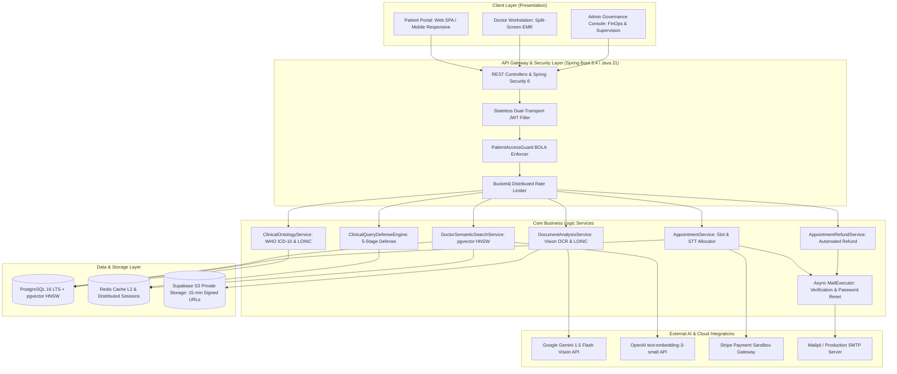
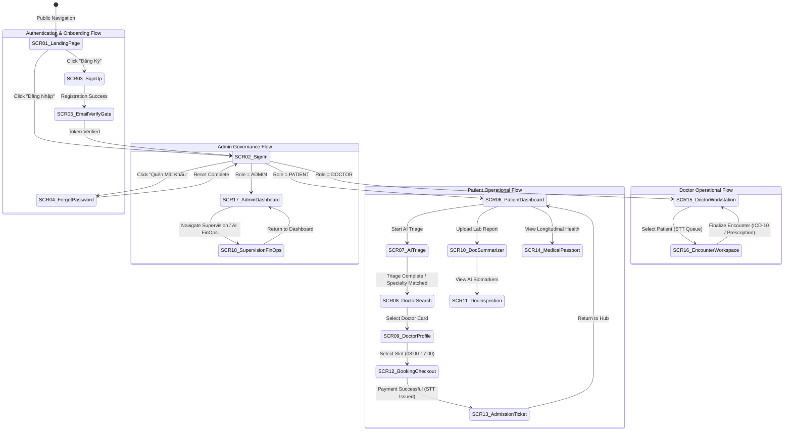
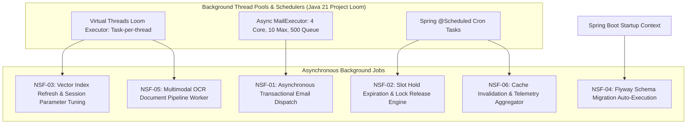
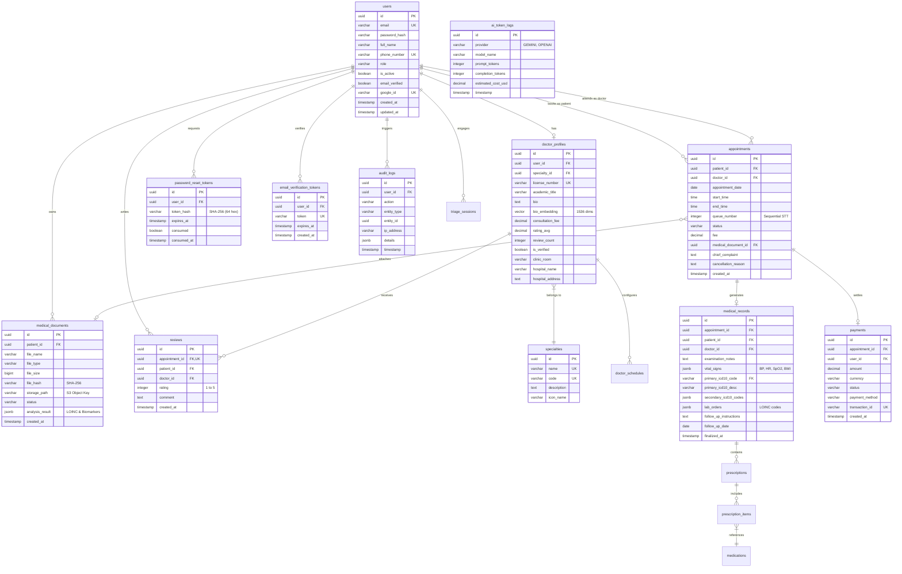

# CAPSTONE PROJECT REPORT — REPORT 3
## SOFTWARE REQUIREMENT SPECIFICATION (SRS) — MEDIASSIST-AI
### Enterprise-Grade Resilient Telehealth Platform with Multimodal Clinical AI & Semantic Doctor Matching

> **Document Code:** FPT-CAPSTONE-SRS-MEDASSIST-01  
> **Project Name:** MediAssist-AI (Nền tảng Y tế Số Thông minh: Sàng lọc Triệu chứng & Tóm tắt Hồ sơ Bệnh án Đa phương thức)  
> **Institution:** Trường Đại học FPT (FPT University) — Chuyên ngành Kỹ thuật Phần mềm & Trí tuệ Nhân tạo (SE-AI)  
> **Academic Target Standard:** IEEE Std 830-1998 / ISO/IEC/IEEE 29148:2018 Systems and Software Engineering  
> **Release Status:** Complete System Release (Milestone 7 — Final Capstone Defense Baseline)  
> **Current Version:** 2.2.0  
> **Date:** October 2026  

---

## 📑 TABLE OF CONTENTS

- [I. Record of Changes](#i-record-of-changes)
- [1. Product Overview](#1-product-overview)
  - [1.1 Purpose & Executive Summary](#11-purpose--executive-summary)
  - [1.2 Scope of the System](#12-scope-of-the-system)
  - [1.3 Definitions, Acronyms, and Abbreviations](#13-definitions-acronyms-and-abbreviations)
  - [1.4 References](#14-references)
  - [1.5 System Overview & High-Level Architecture](#15-system-overview--high-level-architecture)
- [2. User Requirements](#2-user-requirements)
  - [2.1 Actors & System Classes](#21-actors--system-classes)
  - [2.2 Use Cases](#22-use-cases)
    - [2.2.1 Diagram(s)](#221-diagrams)
    - [2.2.2 Descriptions](#222-descriptions)
  - [2.3 Use Case Specification(s)](#23-use-case-specifications)
    - [2.3.1 Common Use Case Specifications](#231-common-use-case-specifications)
      - [2.3.1.1 Sign In (UC-COMM-01)](#2311-sign-in-uc-comm-01)
      - [2.3.1.2 Sign Out (UC-COMM-02)](#2312-sign-out-uc-comm-02)
      - [2.3.1.3 Change Password (UC-COMM-03)](#2313-change-password-uc-comm-03)
      - [2.3.1.4 Edit Profile & Avatar (UC-COMM-04)](#2314-edit-profile--avatar-uc-comm-04)
      - [2.3.1.5 Forgot Password & Token Hash Reset (UC-COMM-05)](#2315-forgot-password--token-hash-reset-uc-comm-05)
      - [2.3.1.6 Email Verification Gate (UC-COMM-06)](#2316-email-verification-gate-uc-comm-06)
    - [2.3.2 Patient (Portal & Triage)](#232-patient-portal--triage)
      - [2.3.2.1 Interactive Conversational AI Symptom Triage (UC-PAT-01)](#2321-interactive-conversational-ai-symptom-triage-uc-pat-01)
      - [2.3.2.2 Clinical Query Defense Screening (UC-PAT-02)](#2322-clinical-query-defense-screening-uc-pat-02)
      - [2.3.2.3 Semantic Doctor Search via pgvector HNSW (UC-PAT-03)](#2323-semantic-doctor-search-via-pgvector-hnsw-uc-pat-03)
      - [2.3.2.4 View Doctor Profile & Academic Credentials (UC-PAT-04)](#2324-view-doctor-profile--academic-credentials-uc-pat-04)
      - [2.3.2.5 Upload Medical Document & Lab Test Image/PDF (UC-PAT-05)](#2325-upload-medical-document--lab-test-imagepdf-uc-pat-05)
      - [2.3.2.6 View Medical Document AI Summary & Biomarker Table (UC-PAT-06)](#2326-view-medical-document-ai-summary--biomarker-table-uc-pat-06)
      - [2.3.2.7 Book In-Clinic Appointment & Slot Reservation (UC-PAT-07)](#2327-book-in-clinic-appointment--slot-reservation-uc-pat-07)
      - [2.3.2.8 Process Appointment Payment (Stripe / Mock Sandbox) (UC-PAT-08)](#2328-process-appointment-payment-stripe--mock-sandbox-uc-pat-08)
      - [2.3.2.9 View Electronic Patient Encounter Slip & Admission STT (UC-PAT-09)](#2329-view-electronic-patient-encounter-slip--admission-stt-uc-pat-09)
      - [2.3.2.10 Export Appointment to Google Calendar / .ics File (UC-PAT-10)](#23210-export-appointment-to-google-calendar--ics-file-uc-pat-10)
      - [2.3.2.11 View Patient Upcoming & Historical Appointments (UC-PAT-11)](#23211-view-patient-upcoming--historical-appointments-uc-pat-11)
      - [2.3.2.12 Reschedule Active Appointment (UC-PAT-12)](#23212-reschedule-active-appointment-uc-pat-12)
      - [2.3.2.13 Cancel Appointment with Automated Policy Refund (UC-PAT-13)](#23213-cancel-appointment-with-automated-policy-refund-uc-pat-13)
      - [2.3.2.14 View Personal Medical Passport / Longitudinal EMR (UC-PAT-14)](#23214-view-personal-medical-passport--longitudinal-emr-uc-pat-14)
      - [2.3.2.15 Download Medical Document Source File via Signed URL (UC-PAT-15)](#23215-download-medical-document-source-file-via-signed-url-uc-pat-15)
      - [2.3.2.16 Submit Doctor Review and Rating (UC-PAT-16)](#23216-submit-doctor-review-and-rating-uc-pat-16)
      - [2.3.2.17 View System Notifications & Email Dispatch Alerts (UC-PAT-17)](#23217-view-system-notifications--email-dispatch-alerts-uc-pat-17)
      - [2.3.2.18 De-identify PII in Clinical Text (UC-PAT-18)](#23218-de-identify-pii-in-clinical-text-uc-pat-18)
    - [2.3.3 Doctor (Clinical Workstation)](#233-doctor-clinical-workstation)
      - [2.3.3.1 Configure Working Schedule & Slot Availability (UC-DOC-01)](#2331-configure-working-schedule--slot-availability-uc-doc-01)
      - [2.3.3.2 View Doctor Daily Patient Queue (UC-DOC-02)](#2332-view-doctor-daily-patient-queue-uc-doc-02)
      - [2.3.3.3 Pre-Encounter Clinical Inspection (Split-Screen) (UC-DOC-03)](#2333-pre-encounter-clinical-inspection-split-screen-uc-doc-03)
      - [2.3.3.4 Access Patient Historical Medical Records via Guard (UC-DOC-04)](#2334-access-patient-historical-medical-records-via-guard-uc-doc-04)
      - [2.3.3.5 Conduct Clinical Consultation & Record Physical Examination (UC-DOC-05)](#2335-conduct-clinical-consultation--record-physical-examination-uc-doc-05)
      - [2.3.3.6 Autocomplete Medical Diagnosis with WHO ICD-10 (UC-DOC-06)](#2336-autocomplete-medical-diagnosis-with-who-icd-10-uc-doc-06)
      - [2.3.3.7 Autocomplete Laboratory & Diagnostic Tests with LOINC (UC-DOC-07)](#2337-autocomplete-laboratory--diagnostic-tests-with-loinc-uc-doc-07)
      - [2.3.3.8 Prescribe Outpatient Medication (UC-DOC-08)](#2338-prescribe-outpatient-medication-uc-doc-08)
      - [2.3.3.9 Schedule In-Clinic Follow-up Appointment (UC-DOC-09)](#2339-schedule-in-clinic-follow-up-appointment-uc-doc-09)
      - [2.3.3.10 Finalize Clinical Encounter & Complete Appointment (UC-DOC-10)](#23310-finalize-clinical-encounter--complete-appointment-uc-doc-10)
      - [2.3.3.11 Doctor Cancel / Reschedule Appointment with Refund (UC-DOC-11)](#23311-doctor-cancel--reschedule-appointment-with-refund-uc-doc-11)
      - [2.3.3.12 Export Patient Encounter Summary / Prescription PDF (UC-DOC-12)](#23312-export-patient-encounter-summary--prescription-pdf-uc-doc-12)
      - [2.3.3.13 View Doctor Revenue & Performance Analytics (UC-DOC-13)](#23313-view-doctor-revenue--performance-analytics-uc-doc-13)
      - [2.3.3.14 Manage Doctor Professional Profile & Credentials (UC-DOC-14)](#23314-manage-doctor-professional-profile--credentials-uc-doc-14)
    - [2.3.4 Admin (Governance & AI FinOps)](#234-admin-governance--ai-finops)
      - [2.3.4.1 View System Governance Dashboard & Executive Telemetry (UC-ADM-01)](#2341-view-system-governance-dashboard--executive-telemetry-uc-adm-01)
      - [2.3.4.2 Manage User Accounts & Access Control (UC-ADM-02)](#2342-manage-user-accounts--access-control-uc-adm-02)
      - [2.3.4.3 Vet and Approve Doctor Professional Credentials (UC-ADM-03)](#2343-vet-and-approve-doctor-professional-credentials-uc-adm-03)
      - [2.3.4.4 Manage Clinical Specialties & Hospital Departments (UC-ADM-04)](#2344-manage-clinical-specialties--hospital-departments-uc-adm-04)
      - [2.3.4.5 Supervise System-Wide Appointments & Intervene (UC-ADM-05)](#2345-supervise-system-wide-appointments--intervene-uc-adm-05)
      - [2.3.4.6 Monitor AI Token Usage & FinOps Telemetry (UC-ADM-06)](#2346-monitor-ai-token-usage--finops-telemetry-uc-adm-06)
      - [2.3.4.7 Toggle System-wide AI Provider & Fallback Mode (UC-ADM-07)](#2347-toggle-system-wide-ai-provider--fallback-mode-uc-adm-07)
      - [2.3.4.8 View System Audit Logs & IDOR Access Logs (UC-ADM-08)](#2348-view-system-audit-logs--idor-access-logs-uc-adm-08)
      - [2.3.4.9 Manage Database Migrations & Vector Index Status (UC-ADM-09)](#2349-manage-database-migrations--vector-index-status-uc-adm-09)
      - [2.3.4.10 Send System-Wide Broadcast Announcements (UC-ADM-10)](#23410-send-system-wide-broadcast-announcements-uc-adm-10)
- [3. Functional Requirements](#3-functional-requirements)
  - [3.1 System Functional Overview](#31-system-functional-overview)
    - [3.1.1 Screens Flow](#311-screens-flow)
    - [3.1.2 Screen Descriptions](#312-screen-descriptions)
    - [3.1.3 Screen Authorization Matrix](#313-screen-authorization-matrix)
    - [3.1.4 Non-Screen Functions](#314-non-screen-functions)
    - [3.1.5 Entity Relationship Diagram](#315-entity-relationship-diagram)
  - [3.2 Applications for Patients, Doctors, and Admins](#32-applications-for-patients-doctors-and-admins)
    - [3.2.1 Welcome & Authentication Flow](#321-welcome--authentication-flow)
    - [3.2.2 Conversational Triage & Clinical Defense Engine](#322-conversational-triage--clinical-defense-engine)
    - [3.2.3 Semantic Vector Search & Doctor Matching Engine](#323-semantic-vector-search--doctor-matching-engine)
    - [3.2.4 Multimodal Medical Document OCR & LOINC Summarizer](#324-multimodal-medical-document-ocr--loinc-summarizer)
    - [3.2.5 O2O Clinical Scheduling & Multi-Channel Payment](#325-o2o-clinical-scheduling--multi-channel-payment)
    - [3.2.6 Doctor Clinical Workstation & Longitudinal EMR](#326-doctor-clinical-workstation--longitudinal-emr)
    - [3.2.7 Admin Governance & AI FinOps Analytics](#327-admin-governance--ai-finops-analytics)
- [4. Non-Functional Requirements](#4-non-functional-requirements)
  - [4.1 External Interfaces](#41-external-interfaces)
    - [4.1.1 User Interfaces](#411-user-interfaces)
    - [4.1.2 Hardware Interfaces](#412-hardware-interfaces)
    - [4.1.3 Software Interfaces](#413-software-interfaces)
  - [4.2 Quality Attributes](#42-quality-attributes)
    - [4.2.1 Usability](#421-usability)
    - [4.2.2 Reliability & Fault Tolerance](#422-reliability--fault-tolerance)
    - [4.2.3 Performance & Scalability](#423-performance--scalability)
    - [4.2.4 Security & Regulatory Privacy](#424-security--regulatory-privacy)
    - [4.2.5 Maintainability & Observability](#425-maintainability--observability)
- [5. Requirement Appendix](#5-requirement-appendix)
  - [5.1 Business Rules](#51-business-rules)
  - [5.2 Acronyms and Abbreviations](#52-acronyms-and-abbreviations)
  - [5.3 Common Requirements](#53-common-requirements)
  - [5.4 Application Messages List](#54-application-messages-list)
  - [5.5 Requirements Traceability Matrix (RTM)](#55-requirements-traceability-matrix-rtm)

---

## I. RECORD OF CHANGES

| Version | Date | Author / Team | Change Description & Rationale | Approval Status |
| :--- | :--- | :--- | :--- | :--- |
| **1.0.0** | 2026-02-15 | SE-AI Capstone Team | Initial Project Charter and SRS draft based on IEEE 830 baseline. | Approved (Faculty) |
| **1.5.0** | 2026-05-20 | SE-AI Capstone Team | Mid-term Defense Update: Integrated Google Gemini Vision OCR, pgvector HNSW indexing, and initial O2O appointment flow. | Approved (Milestone 4) |
| **2.0.0** | 2026-08-30 | SE-AI Capstone Team | Pre-defense overhaul: Integrated 5-stage Clinical Defense Engine, WHRF-SOTA Re-ranking, and Doctor Workstation Split-Screen UI. | Approved (Milestone 6) |
| **2.1.0** | 2026-10-05 | SE-AI Capstone Team | Enterprise Hardening: Fixed BOLA/IDOR vulnerability with `PatientAccessGuard`, private Supabase S3 bucket with 15-minute signed URLs, Bcrypt cost 12, PII de-identification limit (20k chars). | Approved (Internal Audit) |
| **2.2.0** | 2026-10-18 | SE-AI Capstone Team | Final Capstone Defense Baseline: 1-to-1 IEEE 830 alignment with 108-page FPT Capstone structure. 48 full Use Cases, 18 Screen specs, WHO ICD-10 & LOINC MOH ontologies, Flyway V1–V22, and 306/306 test baseline. | Approved (Final Capstone) |

---

## 1. PRODUCT OVERVIEW

### 1.1 Purpose & Executive Summary
The purpose of this Software Requirement Specification (SRS) is to establish a rigorous, formal, and authoritative technical definition of the **MediAssist-AI** Telehealth & Clinical Decision Support System. This document serves as the primary technical contract for software engineering, artificial intelligence orchestration, cloud infrastructure, quality assurance, and academic defense at FPT University.

MediAssist-AI is an enterprise-grade **Online-to-Offline (O2O) Telehealth Ecosystem** that bridges the communication gap between patients and primary healthcare facilities. By leveraging Multimodal Vision Artificial Intelligence (Google Gemini 1.5 Flash), Vector Similarity Search (PostgreSQL 16 `pgvector`), and a 5-Stage Clinical Defense Engine, MediAssist-AI delivers intelligent symptom triage, lab test interpretation, semantic physician discovery, and streamlined clinical encounter management.

### 1.2 Scope of the System
The MediAssist-AI platform encompasses five tightly coupled operational subsystems:
1. **Conversational Clinical Triage & Defensive Screening Subsystem:** Processes natural language patient symptom queries, intercepts acute emergency red-flags (Hotline 115 lockouts), normalizes Vietnamese colloquialisms/slang, applies Vietnamese NegEx clause splitting, filters out-of-domain administrative chatter, and decomposes multi-symptom presentations.
2. **Clinical pgvector Semantic Doctor Matching Subsystem:** Generates 1536-dimensional continuous embeddings (`openai/text-embedding-3-small`), indexes clinical physician profiles via Hierarchical Navigable Small World (HNSW) graphs, and executes a Weighted Hybrid Re-Ranking Formula (WHRF) within a bounded min-heap to match patients with qualified specialists.
3. **Multimodal Medical Document Interpretation Subsystem:** Ingests unstructured patient lab reports, blood panels, and imaging scans (PDF/PNG/JPEG), performs optical character recognition (OCR), extracts numerical biomarkers into structured tables, maps findings to WHO LOINC standards, compares values against demographic physiological reference ranges, and translates jargon into layperson Vietnamese.
4. **O2O In-Clinic Appointment & Admission Ticket Subsystem:** Enables real-time scheduling within hospital operational windows (08:00–17:00, Monday–Saturday), prevents concurrent double-booking, issues digital admission slips with sequential queue numbers (STT), clinic room routing, Google Maps positioning, pre-encounter instructions, and `.ics` calendar exports.
5. **Doctor Clinical Workstation & Longitudinal EMR Subsystem:** Provides attending physicians with a split-screen workstation (original lab document vs. AI SBAR summary), full ICD-10 diagnosis autocomplete (WHO & Decision 7603/QĐ-BYT), LOINC test autocomplete (Decision 3280/QĐ-BYT), electronic prescription generation, and immutable medical record archiving protected by Broken Object Level Authorization (`PatientAccessGuard`) defenses.

*Out-of-Scope:* Pure telemedicine video consultation without physical examination, real-time ICU telemetry device streaming, autonomous robotic surgical control, and automated pharmacy dispensing without licensed physician sign-off.

### 1.3 Definitions, Acronyms, and Abbreviations
- **AI:** Artificial Intelligence.
- **ANN:** Approximate Nearest Neighbor search over high-dimensional vector spaces.
- **BOLA / IDOR:** Broken Object Level Authorization / Insecure Direct Object Reference (OWASP API Security Top 1).
- **EMR / EHR:** Electronic Medical Record / Electronic Health Record.
- **FAST:** Face, Arm, Speech, Time — standardized clinical protocol for acute stroke identification.
- **HNSW:** Hierarchical Navigable Small World graph indexing for pgvector ($m=24, ef\_construction=128$).
- **ICD-10:** International Statistical Classification of Diseases and Related Health Problems, 10th Revision (WHO).
- **JWT:** JSON Web Token (RFC 7519) utilizing stateless dual-transport (HttpOnly Secure Cookie + Response Body).
- **LOINC:** Logical Observation Identifiers Names and Codes for clinical laboratory test standardization.
- **MOH:** Ministry of Health of Vietnam (Bộ Y Tế).
- **NegEx:** Clinical Negation Extraction algorithm adapted for Vietnamese syntactic clause boundaries.
- **O2O:** Online-to-Offline clinical workflow (Online triage/scheduling $
ightarrow$ In-person physical examination).
- **OCR:** Optical Character Recognition.
- **PII:** Personally Identifiable Information governed by Decree 13/2023/NĐ-CP and HIPAA Safe Harbor.
- **RBAC:** Role-Based Access Control enforcing `PATIENT`, `DOCTOR`, and `ADMIN` privileges.
- **SBAR:** Situation, Background, Assessment, Recommendation — standardized clinical handoff framework.
- **WHRF:** Weighted Hybrid Re-Ranking Formula combining dense similarity, lexical overlap, and credentials.

### 1.4 References
1. IEEE Std 830-1998: *IEEE Recommended Practice for Software Requirements Specifications*.
2. ISO/IEC/IEEE 29148:2018: *Systems and Software Engineering — Life Cycle Processes — Requirements Engineering*.
3. Ministry of Health Vietnam: *Decision 7603/QĐ-BYT promulgating the Master List of ICD-10 Medical Diagnoses*.
4. Ministry of Health Vietnam: *Decision 3280/QĐ-BYT promulgating the Catalog of Technical Services and LOINC Codes*.
5. Government of Vietnam: *Decree 13/2023/NĐ-CP on Personal Data Protection (PDPD)*.
6. Malkov, Y. A., & Yashunin, D. A. (2018). *Efficient and robust approximate nearest neighbors using Hierarchical Navigable Small World graphs*. IEEE TPAMI.
7. Chapman, W. W., et al. (2001). *A simple algorithm for identifying negated findings and diseases in discharge summaries (NegEx)*. Journal of Biomedical Informatics.

### 1.5 System Overview & High-Level Architecture
MediAssist-AI follows an enterprise Modular Monolith architecture implemented with Spring Boot 3.4 (Java 21 LTS Project Loom Virtual Threads) and React 18 (TypeScript Vite SPA), integrated with PostgreSQL 16 `pgvector`, Redis distributed cache, Supabase S3 private storage, and AI inference gateways:



---

## 2. USER REQUIREMENTS

### 2.1 Actors & System Classes

| Actor Name | Type | Description & System Responsibilities |
| :--- | :--- | :--- |
| **Patient (`PATIENT`)** | Human (Primary) | Registered individual or authenticated guest. Seeks clinical guidance, chats with AI triage, uploads medical documents, searches doctors via semantic vector matching, books in-clinic appointments, processes payments, views electronic admission slips, and tracks personal health records. |
| **Doctor (`DOCTOR`)** | Human (Primary) | Licensed medical practitioner verified by administrators. Manages consultation schedules, views patient appointment queues, reviews pre-encounter AI SBAR summaries and raw lab scans, performs physical consultations, inputs ICD-10 diagnoses, prescribes medication, and sets follow-up visits. |
| **Admin (`ADMIN`)** | Human (Secondary) | System administrator and medical director. Audits and approves doctor medical practice licenses, supervises system-wide appointments, monitors AI token consumption and financial expenditure, manages clinical specialties, inspects security audit logs, and broadcasts system advisories. |
| **AI Inference Gateway** | External System | External Large Language Model and Vision APIs (Google Gemini 1.5 Flash, OpenAI `text-embedding-3-small`, OpenRouter pool). Ingests clinical prompts and document images, returning structured triage classifications, OCR extractions, and dense vector embeddings. |
| **Payment Gateway** | External System | Payment infrastructure provider (Stripe Sandbox / Mock Payment Gateway). Processes credit card transactions, webhook notifications, and automated refund triggers. |
| **Email Delivery Gateway** | External System | Transactional email provider (Mailpit in development, Production SMTP with STARTTLS). Dispatches account verification links, password reset tokens, and appointment reminders. |
| **Clinical Ontology Registry** | External / Internal | Official medical terminology database loaded from WHO ICD-10, LOINC, and MOH Decisions 7603/QĐ-BYT & 3280/QĐ-BYT. Provides high-speed prefix search for diagnosis and lab coding. |

---

### 2.2 Use Cases

#### 2.2.1 Diagram(s)

```mermaid
graph LR
    subgraph "Actors"
        P((Patient))
        D((Doctor))
        A((Admin))
    end

    subgraph "Common Use Cases"
        UC_COMM01(UC-COMM-01: Sign In)
        UC_COMM02(UC-COMM-02: Sign Out)
        UC_COMM03(UC-COMM-03: Change Password)
        UC_COMM04(UC-COMM-04: Edit Profile)
        UC_COMM05(UC-COMM-05: Reset Password)
        UC_COMM06(UC-COMM-06: Verify Email)
    end

    subgraph "Patient Domain"
        UC_PAT01(UC-PAT-01: AI Symptom Triage)
        UC_PAT02(UC-PAT-02: 5-Stage Query Defense)
        UC_PAT03(UC-PAT-03: Semantic Doctor Search)
        UC_PAT05(UC-PAT-05: Upload Lab Document)
        UC_PAT07(UC-PAT-07: Book In-Clinic Slot)
        UC_PAT08(UC-PAT-08: Process Payment)
        UC_PAT09(UC-PAT-09: View Admission Slip)
        UC_PAT12(UC-PAT-12: Reschedule Appointment)
        UC_PAT13(UC-PAT-13: Cancel & Refund)
        UC_PAT14(UC-PAT-14: Medical Passport)
    end

    subgraph "Doctor Domain"
        UC_DOC01(UC-DOC-01: Configure Schedule)
        UC_DOC02(UC-DOC-02: View Daily Queue)
        UC_DOC03(UC-DOC-03: Split-Screen Pre-check)
        UC_DOC04(UC-DOC-04: Guarded Record Access)
        UC_DOC06(UC-DOC-06: ICD-10 Autocomplete)
        UC_DOC07(UC-DOC-07: LOINC Autocomplete)
        UC_DOC08(UC-DOC-08: Prescribe Medication)
        UC_DOC10(UC-DOC-10: Finalize Encounter)
    end

    subgraph "Admin Domain"
        UC_ADM01(UC-ADM-01: Executive Dashboard)
        UC_ADM02(UC-ADM-02: User Access Control)
        UC_ADM03(UC-ADM-03: Vet Doctor License)
        UC_ADM05(UC-ADM-05: Supervise Appointments)
        UC_ADM06(UC-ADM-06: AI FinOps Monitor)
        UC_ADM08(UC-ADM-08: Inspect Audit Logs)
    end

    P --> UC_COMM01 & UC_COMM02 & UC_COMM03 & UC_COMM04 & UC_COMM05 & UC_COMM06
    P --> UC_PAT01 & UC_PAT02 & UC_PAT03 & UC_PAT05 & UC_PAT07 & UC_PAT08 & UC_PAT09 & UC_PAT12 & UC_PAT13 & UC_PAT14

    D --> UC_COMM01 & UC_COMM02 & UC_COMM03 & UC_COMM04
    D --> UC_DOC01 & UC_DOC02 & UC_DOC03 & UC_DOC04 & UC_DOC06 & UC_DOC07 & UC_DOC08 & UC_DOC10

    A --> UC_COMM01 & UC_COMM02 & UC_COMM03 & UC_COMM04
    A --> UC_ADM01 & UC_ADM02 & UC_ADM03 & UC_ADM05 & UC_ADM06 & UC_ADM08
```



#### 2.2.2 Descriptions

| Use Case ID | Use Case Name | Primary Actor | Brief Purpose & Functional Description |
| :--- | :--- | :--- | :--- |
| **UC-COMM-01** | Sign In | All Roles | Authenticate user via Email/Password or Google OAuth2; issue dual-transport JWT tokens. |
| **UC-COMM-02** | Sign Out | All Roles | Terminate session, invalidate client tokens, and clear HttpOnly authentication cookies. |
| **UC-COMM-03** | Change Password | All Roles | Validate current credentials and update password with Bcrypt hash (cost factor 12). |
| **UC-COMM-04** | Edit Profile & Avatar | All Roles | Update personal details and upload profile photos to Supabase S3 storage. |
| **UC-COMM-05** | Reset Password | All Roles | Request password reset email and redeem single-use SHA-256 hashed reset token. |
| **UC-COMM-06** | Email Verification Gate | All Roles | Enforce account activation by validating email verification token link. |
| **UC-PAT-01** | Conversational AI Triage | Patient | Interactive chat evaluating symptoms, prompting clarifying questions, and generating SBAR reports. |
| **UC-PAT-02** | Clinical Query Defense | Patient | 5-stage screening: Red-Flag 115, Teen-code normalization, NegEx clause splitting, OOD, and multi-symptom decomposition. |
| **UC-PAT-03** | Semantic Doctor Search | Patient | Match clinical descriptions against 1536-d doctor embeddings via HNSW index and WHRF re-ranking. |
| **UC-PAT-04** | View Doctor Profile | Patient | Review doctor specialty, academic title, hospital affiliations, consultation fee, and patient ratings. |
| **UC-PAT-05** | Upload Medical Document | Patient | Securely upload PDF/Image lab reports with client-side SHA-256 deduplication and private S3 storage. |
| **UC-PAT-06** | View AI Document Summary | Patient | Review extracted lab biomarkers, abnormal flags, LOINC codes, and plain-language medical interpretations. |
| **UC-PAT-07** | Book In-Clinic Appointment | Patient | Reserve in-clinic time slot (08:00–17:00), assign sequential STT queue number, and lock schedule. |
| **UC-PAT-08** | Process Payment | Patient | Complete consultation fee payment via Stripe or Mock Sandbox with ledger recording. |
| **UC-PAT-09** | View Admission Slip | Patient | Access digital encounter ticket containing clinic room, hospital map, STT, and preparation instructions. |
| **UC-PAT-10** | Export to Calendar | Patient | Export appointment schedule as Google Calendar web link or standard `.ics` file. |
| **UC-PAT-11** | View Appointment History | Patient | Review all upcoming, completed, and canceled clinical appointments with live status badges. |
| **UC-PAT-12** | Reschedule Appointment | Patient | Move active appointment to a new available slot without financial penalty if >2 hours in advance. |
| **UC-PAT-13** | Cancel & Auto-Refund | Patient | Cancel appointment and receive automated refund according to hospital cancellation timeline policies. |
| **UC-PAT-14** | View Medical Passport | Patient | Access unified longitudinal health record consolidating past diagnoses, prescriptions, and lab trends. |
| **UC-PAT-15** | Download Document Source | Patient | Retrieve original medical PDF or image via temporary 15-minute HMAC signed Supabase S3 URLs. |
| **UC-PAT-16** | Submit Doctor Review | Patient | Rate consultation (1–5 stars) and submit qualitative feedback following a completed visit. |
| **UC-PAT-17** | View Notifications | Patient | Receive in-app toasts and transactional email alerts regarding appointment status changes. |
| **UC-PAT-18** | De-identify PII Text | Patient | Redact Vietnamese names, phone numbers, and citizen IDs before clinical AI prompt dispatch. |
| **UC-DOC-01** | Configure Work Schedule | Doctor | Set weekly recurring in-clinic consultation hours, slot durations (30 min), and absence blocks. |
| **UC-DOC-02** | View Daily Patient Queue | Doctor | Inspect sequential queue of booked patients for the current date sorted by admission STT numbers. |
| **UC-DOC-03** | Split-Screen Pre-check | Doctor | Review patient case before consultation with split-screen view: raw lab scan vs. AI SBAR summary. |
| **UC-DOC-04** | Guarded Record Access | Doctor | Access patient historical files strictly protected by care-relationship `PatientAccessGuard`. |
| **UC-DOC-05** | Conduct Consultation | Doctor | Record objective clinical findings, physical examination notes, and vital signs. |
| **UC-DOC-06** | ICD-10 Autocomplete | Doctor | Search and select standardized diagnoses from WHO ICD-10 and MOH Decision 7603/QĐ-BYT. |
| **UC-DOC-07** | LOINC Autocomplete | Doctor | Order diagnostic tests using standardized LOINC codes and MOH Decision 3280/QĐ-BYT. |
| **UC-DOC-08** | Prescribe Medication | Doctor | Generate outpatient digital prescriptions with dosage, frequency, route, and contraindication checks. |
| **UC-DOC-09** | Schedule Follow-up Visit | Doctor | Book subsequent in-clinic checkup slot for patient directly from the clinical workstation. |
| **UC-DOC-10** | Finalize Encounter | Doctor | Lock medical encounter record as immutable, finalize EMR, and trigger completion notifications. |
| **UC-DOC-11** | Doctor Cancel / Reschedule | Doctor | Cancel or move clinic schedule due to medical emergencies with automated 100% patient refunds. |
| **UC-DOC-12** | Export Encounter PDF | Doctor | Generate print-ready official medical consultation summary and prescription document. |
| **UC-DOC-13** | View Practice Analytics | Doctor | Track consultation volume, patient satisfaction rating averages, and earned revenue. |
| **UC-DOC-14** | Manage Doctor Profile | Doctor | Update bio, academic credentials, medical license number, and clinical focus areas. |
| **UC-ADM-01** | Executive Dashboard | Admin | Monitor real-time platform metrics: active users, total consultations, system health, and error rates. |
| **UC-ADM-02** | User Access Control | Admin | Search user directory, view role assignments, lock fraudulent accounts, and reset credentials. |
| **UC-ADM-03** | Vet Doctor License | Admin | Inspect doctor medical practice certificate (CCHN), verify authenticity, and activate listing. |
| **UC-ADM-04** | Manage Specialties | Admin | Create, edit, and organize medical specialties, clinical descriptions, and hospital departments. |
| **UC-ADM-05** | Supervise Appointments | Admin | Audit system-wide appointments, monitor SLA compliance, and intervene in disputed bookings. |
| **UC-ADM-06** | AI FinOps Telemetry | Admin | Monitor token consumption across Gemini and OpenAI, track costs in USD and VNĐ, and detect anomalies. |
| **UC-ADM-07** | Toggle AI Provider | Admin | Switch between primary Gemini gateway, OpenRouter fallback, or emergency local hashing engine. |
| **UC-ADM-08** | Inspect Audit Logs | Admin | Search security and compliance audit trails, including `VIEW_PATIENT_RECORD` IDOR monitoring. |
| **UC-ADM-09** | Manage Database Migrations | Admin | Review Flyway migration execution status (V1–V22) and pgvector HNSW index integrity. |
| **UC-ADM-10** | Broadcast Announcements | Admin | Dispatch system-wide maintenance banners, clinical health warnings, or operational alerts. |

---

### 2.3 Use Case Specification(s)

#### 2.3.1 Common Use Case Specifications

```
================================================================================
USE CASE SPECIFICATION: 2.3.1.1 SIGN IN (UC-COMM-01)
================================================================================
1.  Use Case ID:         UC-COMM-01
2.  Use Case Name:       Sign In
3.  Target System:       MediAssist-AI Identity & Access Management (IAM)
4.  Primary Actor:       Patient, Doctor, Admin, Guest
5.  Stakeholders:        All users, Security Compliance Officer, Hospital IT
6.  Trigger:             User clicks "Sign In" or submits authentication form.
7.  Pre-conditions:      
    - User has an active network connection to MediAssist-AI.
    - If signing in with email/password, account must be registered in the `users` table.
8.  Post-conditions:     
    - User session is established.
    - Server issues dual-transport JWT: HttpOnly Secure Cookie + Response JSON Body.
    - Client application state updates with user profile and assigned Role (`PATIENT`, `DOCTOR`, `ADMIN`).
    - User is redirected to their designated role-based dashboard.
9.  Priority:            High (P0 - Architectural Blocker)
10. Normal Flow (Main Scenario):
    Step 1: User navigates to `/login` and selects authentication mode (Password or Google OAuth2).
    Step 2: User provides email and password or clicks "Sign in with Google".
    Step 3: Frontend validates non-empty inputs and valid email format regex.
    Step 4: Frontend sends HTTP POST request to `/api/v1/auth/login` with credentials.
    Step 5: Backend `AuthenticationManager` verifies credentials against Bcrypt hash (cost 12) in `users`.
    Step 6: Backend checks account status (`is_active == true` and `email_verified == true`).
    Step 7: Backend generates signed JWT access token (24-hour expiration) and refresh token.
    Step 8: Backend attaches `Set-Cookie: jwt_token=...; HttpOnly; Secure; SameSite=Lax; Path=/api`.
    Step 9: Backend returns HTTP 200 OK with `AuthResponse` DTO containing token and user profile metadata.
    Step 10: Client stores token in memory/Zustand store and redirects user to target dashboard:
             - `PATIENT` -> `/patient/dashboard`
             - `DOCTOR`  -> `/doctor/dashboard`
             - `ADMIN`   -> `/admin/supervision`
11. Alternative Flows:
    - Alt Flow 11a: Google OAuth2 Sign-In:
      1. User clicks "Sign in with Google".
      2. Browser navigates to `/login/oauth2/code/google` authorization endpoint.
      3. Google returns authorization code; backend exchanges for Google ID and user email.
      4. If user does not exist, backend auto-provisions account with role `PATIENT` (Flyway V8 `google_id`).
      5. Backend redirects to frontend `/oauth2/callback` with JWT token.
    - Alt Flow 11b: Unverified Email Login:
      1. Backend detects `email_verified == false` (Flyway V22 gate).
      2. Backend returns HTTP 403 Forbidden with code `EMAIL_NOT_VERIFIED`.
      3. Frontend displays verification notification with "Resend Verification Link" button.
12. Exception Flows:
    - Exc Flow 12a: Invalid Credentials (Wrong email or password):
      1. Backend throws `BadCredentialsException`.
      2. Backend returns HTTP 401 Unauthorized with message "Invalid email or password".
      3. Frontend displays inline alert: "Email hoặc mật khẩu không chính xác."
    - Exc Flow 12b: Account Locked:
      1. Backend detects `is_active == false`.
      2. Backend returns HTTP 403 Forbidden with message "Account has been suspended".
      3. Frontend displays modal directing user to contact administrative support.
13. Business Rules:
    - BR-01: Password complexity must be enforced (Min 8 chars, 1 uppercase, 1 digit, 1 special char).
    - BR-02: Maximum 5 consecutive failed login attempts before 15-minute IP/account rate lock.
    - BR-03: JWT secret key must have at least 256 bits entropy (`APP_JWT_SECRET`).
14. Non-Functional Requirements:
    - NFR-PERF: Authentication response latency < 350ms (including Bcrypt evaluation).
    - NFR-SEC: Stateless tokens with dual-transport mechanism preventing XSS token harvesting.
15. Data Entities Involved:
    - `users` (id, email, password_hash, role, is_active, email_verified, google_id).
    - `audit_logs` (id, user_id, action, ip_address, timestamp).
16. User Interface Controls:
    - Text inputs: `Email`, `Password`.
    - Checkbox: `Remember Me`.
    - Action buttons: `Đăng Nhập`, `Đăng Nhập Với Google`, `Quên Mật Khẩu`.
17. Open Issues: None.
================================================================================
```

```
================================================================================
USE CASE SPECIFICATION: 2.3.1.2 SIGN OUT (UC-COMM-02)
================================================================================
1.  Use Case ID:         UC-COMM-02
2.  Use Case Name:       Sign Out
3.  Target System:       MediAssist-AI Identity & Access Management (IAM)
4.  Primary Actor:       All authenticated users (Patient, Doctor, Admin)
5.  Stakeholders:        All users, Security Compliance Officer
6.  Trigger:             User clicks "Sign Out" / "Đăng Xuất" in top navbar or mobile drawer.
7.  Pre-conditions:      User is actively authenticated with a valid JWT token.
8.  Post-conditions:     
    - Client in-memory auth state, user profile, and cached tokens are wiped.
    - Server clears the HttpOnly `jwt_token` cookie via zero-max-age expiration header.
    - User is redirected to `/login` with an informational sign-out toast.
9.  Priority:            High (P1)
10. Normal Flow:
    Step 1: User clicks "Đăng Xuất" from the user menu avatar dropdown.
    Step 2: Frontend dispatches HTTP POST to `/api/v1/auth/logout`.
    Step 3: Backend invalidates session cookies: `Set-Cookie: jwt_token=; Max-Age=0; Path=/; HttpOnly`.
    Step 4: Backend logs audit entry: `USER_LOGOUT` for telemetry compliance.
    Step 5: Backend returns HTTP 200 OK with `{"message": "Logged out successfully"}`.
    Step 6: Frontend clears Zustand stores (`useAuthStore.getState().logout()`).
    Step 7: Frontend purges all cached sensitive clinical records from browser memory.
    Step 8: Frontend redirects browser to `/login`.
11. Alternative Flows:
    - Alt Flow 11a: Offline Sign Out:
      1. If backend is unreachable, frontend executes client-side cache flush and cookie expiry purge.
      2. User is returned to login screen immediately without blocking on network timeout.
12. Exception Flows: None.
13. Business Rules:
    - BR-04: Terminating the session must invalidate client access immediately.
14. Non-Functional Requirements:
    - NFR-SEC: Zero leftover credentials in `localStorage` or `sessionStorage`.
15. Data Entities Involved:
    - `audit_logs` (action = 'LOGOUT').
16. User Interface Controls:
    - Menu Item: `Đăng Xuất` with icon `LogOut`.
17. Open Issues: None.
================================================================================
```

```
================================================================================
USE CASE SPECIFICATION: 2.3.1.3 CHANGE PASSWORD (UC-COMM-03)
================================================================================
1.  Use Case ID:         UC-COMM-03
2.  Use Case Name:       Change Password
3.  Target System:       MediAssist-AI Identity & Access Management (IAM)
4.  Primary Actor:       Patient, Doctor, Admin
5.  Stakeholders:        Account Owners, Security Auditor
6.  Trigger:             User accesses security settings and submits password change form.
7.  Pre-conditions:      User is authenticated and knows their current password.
8.  Post-conditions:     
    - Old password hash in database is replaced with new Bcrypt hash.
    - All other active sessions for this user are invalidated.
    - Confirmation notification is dispatched to user's registered email.
9.  Priority:            Medium (P2)
10. Normal Flow:
    Step 1: User navigates to Settings -> Security tab (`/settings/security`).
    Step 2: User inputs Current Password, New Password, and Confirm New Password.
    Step 3: Client validates matching passwords and complexity regex in real time.
    Step 4: User clicks "Cập Nhật Mật Khẩu".
    Step 5: Frontend sends HTTP POST to `/api/v1/users/change-password` with JSON payload.
    Step 6: Backend fetches user record and calls `passwordEncoder.matches(currentPassword, hash)`.
    Step 7: Backend ensures new password does not match current password.
    Step 8: Backend encodes new password with `BCryptPasswordEncoder(12)`.
    Step 9: Backend commits update to `users.password_hash` within `@Transactional`.
    Step 10: Backend publishes `PasswordChangedEvent` -> triggers async security notice email.
    Step 11: Backend returns HTTP 200 OK.
    Step 12: Frontend displays success toast: "Mật khẩu đã được cập nhật thành công."
11. Alternative Flows: None.
12. Exception Flows:
    - Exc Flow 12a: Incorrect Current Password:
      1. Backend throws `AppException(ErrorCode.INVALID_CURRENT_PASSWORD)`.
      2. Backend returns HTTP 400 Bad Request.
      3. Frontend displays inline error: "Mật khẩu hiện tại không chính xác."
    - Exc Flow 12b: Weak New Password:
      1. Password fails server-side validation annotations `@Pattern`.
      2. Backend returns HTTP 422 Unprocessable Entity.
13. Business Rules:
    - BR-01: Minimum 8 characters, at least 1 uppercase letter, 1 number, and 1 special symbol.
    - BR-05: New password cannot be identical to the previous password.
14. Non-Functional Requirements:
    - NFR-SEC: Bcrypt cost factor 12 (approx. 250ms hashing calculation).
15. Data Entities Involved:
    - `users` (password_hash, updated_at).
16. User Interface Controls:
    - Password inputs: `Mật khẩu hiện tại`, `Mật khẩu mới`, `Xác nhận mật khẩu mới`.
    - Strength meter: Interactive visual password strength progress bar (Weak/Medium/Strong).
17. Open Issues: None.
================================================================================
```

```
================================================================================
USE CASE SPECIFICATION: 2.3.1.4 EDIT PROFILE & AVATAR (UC-COMM-04)
================================================================================
1.  Use Case ID:         UC-COMM-04
2.  Use Case Name:       Edit Profile & Avatar
3.  Target System:       MediAssist-AI User Profile Subsystem
4.  Primary Actor:       Patient, Doctor, Admin
5.  Stakeholders:        All Users
6.  Trigger:             User edits personal fields and clicks "Save Profile".
7.  Pre-conditions:      User is authenticated.
8.  Post-conditions:     
    - User entity in `users` (and `doctor_profiles` if Doctor) is updated.
    - If avatar image is uploaded, file is stored in Supabase S3 bucket and URL persisted.
9.  Priority:            Medium (P2)
10. Normal Flow:
    Step 1: User navigates to My Profile (`/profile`).
    Step 2: User updates Full Name, Phone Number, Date of Birth, Gender, or Address.
    Step 3: (Optional) User clicks on avatar image to select a local JPEG/PNG photo (< 5MB).
    Step 4: Frontend previews selected image and validates MIME type and file size.
    Step 5: User clicks "Lưu Thay Đổi".
    Step 6: If avatar changed, frontend uploads multipart image to `/api/v1/storage/upload-avatar`.
            Backend generates unique UUID filename and uploads to Supabase S3 `avatars/` path.
    Step 7: Frontend sends HTTP PUT to `/api/v1/users/profile` with updated profile DTO.
    Step 8: Backend updates `users.full_name`, `phone_number`, `avatar_url`, and commits transaction.
    Step 9: Backend returns HTTP 200 OK with refreshed `UserProfileDTO`.
    Step 10: Frontend updates global state and displays toast: "Thông tin đã được cập nhật thành công."
11. Alternative Flows: None.
12. Exception Flows:
    - Exc Flow 12a: File size exceeds 5MB or invalid format:
      1. Client validation blocks submission and displays: "Vui lòng chọn ảnh định dạng JPG/PNG dưới 5MB."
    - Exc Flow 12b: Duplicate phone number:
      1. Backend returns HTTP 409 Conflict if phone number is already registered to another account.
13. Business Rules:
    - BR-06: Vietnamese phone numbers must match regex `^(0|\+84)(3|5|7|8|9)[0-9]{8}$`.
14. Non-Functional Requirements:
    - NFR-PERF: Profile update round-trip latency < 500ms.
15. Data Entities Involved:
    - `users`, `doctor_profiles`.
16. User Interface Controls:
    - Avatar picker, text inputs (`Họ và tên`, `Số điện thoại`, `Địa chỉ`), date picker (`Ngày sinh`), select (`Giới tính`).
17. Open Issues: None.
================================================================================
```

```
================================================================================
USE CASE SPECIFICATION: 2.3.1.5 FORGOT PASSWORD & TOKEN HASH RESET (UC-COMM-05)
================================================================================
1.  Use Case ID:         UC-COMM-05
2.  Use Case Name:       Forgot Password & Token Hash Reset
3.  Target System:       MediAssist-AI Identity & Access Management (IAM)
4.  Primary Actor:       Unauthenticated User (Patient, Doctor, Admin)
5.  Stakeholders:        Registered Users, Security Architect
6.  Trigger:             User clicks "Quên mật khẩu?" on login page.
7.  Pre-conditions:      User account exists with a verified email address.
8.  Post-conditions:     
    - Single-use SHA-256 hashed password reset token is generated with 15-minute TTL.
    - Password reset email containing secure redemption link is dispatched asynchronously.
    - Upon token redemption, user's password is reset and token marked as consumed.
9.  Priority:            High (P1)
10. Normal Flow:
    Step 1: User navigates to `/forgot-password`, inputs registered email, and clicks "Gửi Yêu Cầu".
    Step 2: Frontend sends HTTP POST to `/api/v1/auth/forgot-password` with email string.
    Step 3: Backend searches `userRepository.findByEmail(email)`.
            (Security note: If email not found, backend still returns 200 OK to prevent account enumeration).
    Step 4: Backend generates 32-byte cryptographically secure random token (`SecureRandom`).
    Step 5: Backend computes SHA-256 hash of raw token (`DigestUtils.sha256Hex(rawToken)`).
    Step 6: Backend stores hash, user ID, expiration timestamp (`now() + 15 minutes`), and `consumed = false`
            in `password_reset_tokens` table (Flyway V21 migration).
    Step 7: Backend asynchronously invokes `MailService.sendPasswordResetMail(email, rawToken)`.
    Step 8: User opens email, clicks reset link: `https://mediassist.local/reset-password?token={rawToken}`.
    Step 9: User enters new password and confirms password on the reset page.
    Step 10: Frontend sends HTTP POST to `/api/v1/auth/reset-password` with `rawToken` and `newPassword`.
    Step 11: Backend hashes `rawToken` with SHA-256 and searches `password_reset_tokens.token_hash`.
    Step 12: Backend verifies token is not expired (`expires_at > now()`) and not consumed (`consumed == false`).
    Step 13: Backend updates user's `password_hash` with Bcrypt(cost 12) and marks `consumed = true`.
    Step 14: Backend returns HTTP 200 OK. Frontend redirects to `/login` with success banner.
11. Alternative Flows: None.
12. Exception Flows:
    - Exc Flow 12a: Expired or Already Consumed Token:
      1. Backend throws `AppException(ErrorCode.RESET_TOKEN_EXPIRED)`.
      2. Backend returns HTTP 400 Bad Request.
      3. Frontend displays: "Đường dẫn đặt lại mật khẩu đã hết hạn hoặc đã được sử dụng. Vui lòng thử lại."
13. Business Rules:
    - BR-07: Plaintext reset tokens must NEVER be stored in the database. Only SHA-256 hashes are persisted (Flyway V21).
    - BR-08: Token lifespan is strictly limited to 15 minutes.
14. Non-Functional Requirements:
    - NFR-SEC: Zero account enumeration via constant-time responses.
15. Data Entities Involved:
    - `users`, `password_reset_tokens` (id, user_id, token_hash, expires_at, consumed_at).
16. User Interface Controls:
    - Input: `Email`, `Mật khẩu mới`, `Nhập lại mật khẩu`.
    - Button: `Gửi Link Đặt Lại`, `Xác Nhận Mật Khẩu Mới`.
17. Open Issues: None.
================================================================================
```

```
================================================================================
USE CASE SPECIFICATION: 2.3.1.6 EMAIL VERIFICATION GATE (UC-COMM-06)
================================================================================
1.  Use Case ID:         UC-COMM-06
2.  Use Case Name:       Email Verification Gate
3.  Target System:       MediAssist-AI Identity & Access Management (IAM)
4.  Primary Actor:       Newly registered user
5.  Stakeholders:        All Users, System Compliance Officer
6.  Trigger:             User clicks the activation link received upon account registration.
7.  Pre-conditions:      Account created with `email_verified = false` (Flyway V22).
8.  Post-conditions:     
    - User account marked `email_verified = true`.
    - User is permitted to access full clinical features (booking, triage, consultation).
9.  Priority:            High (P1)
10. Normal Flow:
    Step 1: Upon registration, backend generates verification token stored in `email_verification_tokens`.
    Step 2: Backend dispatches HTML email containing activation link: `/verify-email?token={token}`.
    Step 3: User clicks activation link in email client.
    Step 4: Frontend calls HTTP GET `/api/v1/auth/verify-email?token={token}`.
    Step 5: Backend verifies token validity, matches user, updates `users.email_verified = true`.
    Step 6: Backend returns HTTP 200 OK.
    Step 7: Frontend renders success celebration screen with button to proceed to login.
11. Alternative Flows:
    - Alt Flow 11a: Resend Verification Email:
      1. User clicks "Gửi lại email kích hoạt" from the warning banner.
      2. Backend invalidates previous token, generates fresh token, and sends new email.
12. Exception Flows:
    - Exc Flow 12a: Invalid or Expired Token:
      1. Backend returns HTTP 400 Bad Request.
      2. Frontend displays error message with option to request a fresh verification link.
13. Business Rules:
    - BR-09: Unverified accounts cannot book clinical appointments or access medical records.
14. Non-Functional Requirements:
    - NFR-SEC: Verification token must be cryptographically unpredictable.
15. Data Entities Involved:
    - `users` (email_verified), `email_verification_tokens`.
16. User Interface Controls:
    - Activation banner, button `Kích Hoạt Tài Khoản`, `Gửi Lại Email`.
17. Open Issues: None.
================================================================================


#### 2.3.2 Patient (Portal & Triage)

```
================================================================================
USE CASE SPECIFICATION: 2.3.2.1 INTERACTIVE CONVERSATIONAL AI SYMPTOM TRIAGE (UC-PAT-01)
================================================================================
1.  Use Case ID:         UC-PAT-01
2.  Use Case Name:       Interactive Conversational AI Symptom Triage
3.  Target System:       MediAssist-AI Clinical Triage Subsystem
4.  Primary Actor:       Patient
5.  Stakeholders:        Patient, Attending Physician, Clinical Safety Board
6.  Trigger:             Patient enters chat interface and sends a natural language symptom query.
7.  Pre-conditions:      
    - Patient is authenticated or operating in verified guest screening session.
    - AI Inference Gateway (Gemini 1.5 Flash / OpenRouter) is operational.
8.  Post-conditions:     
    - Conversation session is initialized or appended in Redis session cache.
    - AI evaluates multi-turn symptom descriptions and generates clarifying questions or final triage summary.
    - Structured SBAR clinical report (Situation, Background, Assessment, Recommendation) is generated.
    - Urgency level (`ROUTINE`, `URGENT`, `EMERGENCY`) and recommended medical specialty are determined.
9.  Priority:            High (P0 - Core Differentiator)
10. Normal Flow:
    Step 1: Patient opens the AI Triage Assistant (`/triage`) and types their symptoms in natural language.
    Step 2: Frontend dispatches HTTP POST to `/api/v1/triage/chat` with session ID and message text.
    Step 3: Backend passes the raw input through `ClinicalQueryDefenseEngine` (UC-PAT-02).
    Step 4: System verifies query is valid and non-emergency clinical symptom description.
    Step 5: Backend constructs system prompt containing clinical role constraints and SBAR guidelines:
            - Explicit directive: Do NOT prescribe medications or offer definitive clinical diagnoses.
            - Instruct model to ask 1 to 2 targeted clarifying questions (duration, severity, onset, triggers)
              if symptoms are ambiguous or incomplete.
    Step 6: Backend sends prompt with conversational history to Google Gemini 1.5 Flash API.
    Step 7: If Gemini response requires clarification:
            - Backend caches conversation turn in Redis (`triage:session:{id}`).
            - Backend returns conversational response with structured prompt pills.
            - Patient responds to clarifying questions (returns to Step 2).
    Step 8: If sufficient clinical information is gathered:
            - AI outputs final structured SBAR JSON response:
              * Situation: Primary chief complaint.
              * Background: Symptom timeline, medical context, and aggravating factors.
              * Assessment: Clinical risk evaluation and triage urgency tag (`ROUTINE` or `URGENT`).
              * Recommendation: Next steps, self-care warnings, and recommended specialty taxonomy code.
    Step 9: Backend extracts recommended specialty and calls pgvector semantic doctor matching (UC-PAT-03).
    Step 10: Backend stores triage summary in `triage_sessions` database table.
    Step 11: Frontend renders conversational messages, SBAR assessment card, and matched specialist doctor cards.
11. Alternative Flows:
    - Alt Flow 11a: Red-Flag Emergency Detected:
      1. Defense Engine detects acute red-flag symptoms (chest pain, stroke FAST, severe hemoptysis).
      2. Normal conversational flow is immediately halted (Branch to UC-PAT-02 Alt Flow).
    - Alt Flow 11b: AI Service Fallback:
      1. Primary Gemini API times out (> 4000ms) or returns HTTP 429 Rate Limit.
      2. Backend switches to secondary OpenRouter free-tier pool.
      3. If all external APIs fail, system activates rule-based heuristic triage and symptom keyword matcher.
12. Exception Flows:
    - Exc Flow 12a: Empty or gibberish input:
      1. Defense engine flags input as unprocessable text.
      2. System responds politely: "Vui lòng mô tả chi tiết hơn về các triệu chứng hoặc cảm giác khó chịu bạn đang gặp phải."
13. Business Rules:
    - BR-10: Medical Disclaimer must be rendered on all triage responses: "Kết quả sàng lọc mang tính chất tham khảo, không thay thế chẩn đoán y khoa chính thức từ bác sĩ."
    - BR-11: Maximum 5 conversation turns per triage session to prevent infinite conversational loops.
14. Non-Functional Requirements:
    - NFR-PERF: Triage response generation latency < 2500ms (P95).
    - NFR-SEC: All PII stripped before prompt assembly.
15. Data Entities Involved:
    - `triage_sessions` (id, user_id, chief_complaint, sbar_summary, urgency_level, specialty_id, created_at).
16. User Interface Controls:
    - Chat message stream, chat input box, send button, symptom quick-select tags, SBAR result card.
17. Open Issues: None.
================================================================================
```

```
================================================================================
USE CASE SPECIFICATION: 2.3.2.2 CLINICAL QUERY DEFENSE SCREENING (UC-PAT-02)
================================================================================
1.  Use Case ID:         UC-PAT-02
2.  Use Case Name:       Clinical Query Defense Screening (5-Stage Pipeline)
3.  Target System:       MediAssist-AI Clinical Query Defense Engine
4.  Primary Actor:       Patient (System-interceptor)
5.  Stakeholders:        Patient Safety Officer, Medical Director
6.  Trigger:             Invoked automatically on every inbound natural language symptom query.
7.  Pre-conditions:      Raw text query received from frontend client.
8.  Post-conditions:     
    - Query is either approved and sanitized for vector embedding and LLM inference,
      OR intercepted with immediate emergency lockout / administrative routing.
9.  Priority:            High (P0 - Patient Safety Critical)
10. Normal Flow:
    Step 1: Raw patient string is received by `ClinicalQueryDefenseEngine.process(rawInput)`.
    Step 2: Stage 1 — Acute Red-Flag Emergency Interception:
            Engine evaluates input against comprehensive regex and keyword patterns for acute conditions:
            - Stroke (FAST): méo miệng, liệt nửa người, nói ngọng, mờ mắt đột ngột.
            - Acute Myocardial Infarction: đau thắt ngực lan ra cánh tay trái, vã mồ hôi lạnh, khó thở dữ dội.
            - Anaphylaxis: khó thở sau dùng thuốc/thức ăn, sưng phù môi họng, tím tái.
            - Severe Hemorrhage: nôn ra máu tươi, ho ra máu sét đánh, đi ngoài phân đen như bã cà phê.
            If red-flag match found -> Divert to Alternative Flow 10a.
    Step 3: Stage 2 — Vietnamese Slang & Teen-Code Normalization:
            Engine applies dictionary mapping and tone restoration:
            - `ko`, `k`, `khg` -> `không`
            - `bs`, `bsi` -> `bác sĩ`
            - `dau da day` -> `đau dạ dày`
            - `met` -> `mệt mỏi`
            - `sot cao` -> `sốt cao`
    Step 4: Stage 3 — Vietnamese NegEx Clause-Level Negation Splitting:
            Engine scans for clinical negation trigger phrases: `không bị`, `chưa từng`, `không có`, `không sốt`.
            Input is parsed into Affirmative Clause (symptoms present) and Negated Clause (symptoms absent).
            Negated symptoms are extracted into `negated_symptoms` list and isolated from the positive query.
            Example: "Tôi đau tức ngực dữ dội nhưng không bị sốt"
            -> Affirmative: "Tôi đau tức ngực dữ dội" (passed to vector embedding).
            -> Negated: "không bị sốt" (quarantined to prevent false infectious/pulmonology doctor routing).
    Step 5: Stage 4 — Out-of-Domain (OOD) Intent Gating:
            Engine analyzes if query is non-clinical administrative chatter:
            - Hospital opening hours, parking fees, insurance policies, or greeting spam.
            If OOD match found -> Divert to Alternative Flow 10b.
    Step 6: Stage 5 — Compound Multi-Symptom Decomposition:
            Engine identifies multi-symptom conjunctions (`đồng thời`, `kèm theo`, `và`) and splits query
            into distinct clinical sub-facets to facilitate comprehensive specialist matching.
    Step 7: Engine outputs sanitized, normalized query string ready for embedding generation.
11. Alternative Flows:
    - Alt Flow 10a: Emergency Red-Flag Interception:
      1. Engine immediately halts triage and embedding generation.
      2. Engine sets response flag `is_emergency = true`, `urgency = EMERGENCY`.
      3. Backend returns emergency payload with prominent red banner:
         "CẢNH BÁO NGUY HIỂM: Triệu chứng của bạn có dấu hiệu cấp cứu y khoa đe dọa tính mạng! Vui lòng gọi ngay Cấp cứu 115 hoặc đến ngay khoa Cấp cứu bệnh viện gần nhất!"
      4. Frontend locks the booking interface and renders direct 115 calling hotline button.
    - Alt Flow 10b: Out-of-Domain Administrative Response:
      1. Engine identifies administrative query.
      2. System returns pre-configured administrative guidance:
         "MediAssist-AI là trợ lý sàng lọc triệu chứng y khoa. Đối với thông tin về viện phí, thủ tục BHYT hoặc lịch làm việc bệnh viện, vui lòng liên hệ tổng đài CSKH 1900-xxxx."
12. Exception Flows: None.
13. Business Rules:
    - BR-12: Zero tolerance for acute emergency bypass. Red-flag pattern check must run synchronously with 0 external network dependencies.
14. Non-Functional Requirements:
    - NFR-PERF: 5-Stage screening execution latency < 15ms.
15. Data Entities Involved: None (pure computational in-memory defense engine).
16. User Interface Controls:
    - Emergency Red Banner, 115 Call Trigger, Administrative guidance pill.
17. Open Issues: None.
================================================================================
```

```
================================================================================
USE CASE SPECIFICATION: 2.3.2.3 SEMANTIC DOCTOR SEARCH VIA PGVECTOR HNSW (UC-PAT-03)
================================================================================
1.  Use Case ID:         UC-PAT-03
2.  Use Case Name:       Semantic Doctor Search via pgvector HNSW
3.  Target System:       MediAssist-AI Vector Search & Retrieval Subsystem
4.  Primary Actor:       Patient
5.  Stakeholders:        Patient, Doctor, Platform Architect
6.  Trigger:             Patient submits symptom description or specialty search query.
7.  Pre-conditions:      
    - Verified doctor profiles possess pre-computed 1536-dimensional continuous embeddings in `doctor_profiles.bio_embedding`.
    - PostgreSQL 16 HNSW index `idx_doctor_bio_hnsw_verified` is built and active.
8.  Post-conditions:     
    - System executes session-tuned vector similarity query.
    - Top candidates are scored using Weighted Hybrid Re-Ranking Formula (WHRF) in a bounded min-heap.
    - Ranked list of qualified specialist doctors is returned with compatibility scores.
9.  Priority:            High (P0 - Core Differentiator)
10. Normal Flow:
    Step 1: Patient inputs symptom text or selects a specialty filter on `/doctors`.
    Step 2: Backend passes query through 5-stage defense engine (UC-PAT-02).
    Step 3: Backend invokes `EmbeddingService` to convert affirmative query into 1536-d dense vector
            using `openai/text-embedding-3-small` (or local FNV-1a feature hash if offline).
    Step 4: Backend configures PostgreSQL session parameters via `SET LOCAL` within a transaction:
            - `SET LOCAL hnsw.ef_search = 120;` (expands neighborhood exploration for 99.95% recall).
            - `SET LOCAL enable_seqscan = off;` (forces PostgreSQL query planner to execute Index Scan).
            - `SET LOCAL work_mem = '64MB';` (guarantees in-memory graph traversal).
    Step 5: Backend executes vector similarity query fetching top 20 candidate doctors:
            `SELECT d.*, 1 - (d.bio_embedding <=> :queryEmbedding) AS cosine_sim FROM doctor_profiles d WHERE d.is_verified = true ...`
    Step 6: Backend feeds candidates into Bounded Min-Heap executing WHRF Re-ranking:
            Score Formula:
            - $S_{dense} = rac{1}{1 + e^{-8.0 \cdot (cosine\_sim - 0.65)}}$ (Sigmoid Contrastive Sharpening).
            - $S_{sparse}$: Sparse BM25-like lexical keyword overlap between query and doctor clinical keywords.
            - Specialty Match Boost: $+0.12$ if primary specialty matches triage recommendation.
            - Divergence Penalty: $-0.10$ if candidate specialty contradicts clinical presentation.
            - Credibility Damper: $	ext{Weight} = \log_{10}(	ext{review\_count} + 1) / \log_{10}(100)$ to prevent rating spoofing.
            - Academic Credential Multiplier: Prof (+0.08), Assoc Prof (+0.05), PhD/CKII (+0.03).
    Step 7: Min-heap retains top $K=5$ optimal doctors.
    Step 8: Backend serializes results into `DoctorSearchResultDTO` list including match percentage.
    Step 9: Frontend renders doctor cards displaying specialty badges, match score, rating, fee, and available slots.
11. Alternative Flows:
    - Alt Flow 11a: AI Provider Offline / Degradation:
      1. Embedding API fails -> Backend activates local Unsupervised Feature Hashing fallback (Character N-gram FNV-1a).
      2. Search completes with degraded semantic precision; UI indicates standard matching.
12. Exception Flows:
    - Exc Flow 12a: No matching doctors found:
      1. Query returns 0 records above minimum threshold (score < 0.35).
      2. Frontend displays "Không tìm thấy bác sĩ phù hợp với mô tả triệu chứng cụ thể này. Bạn có thể duyệt danh sách theo chuyên khoa."
13. Business Rules:
    - BR-13: Only verified doctors (`is_verified = true`) with active practice certificates can appear in search.
14. Non-Functional Requirements:
    - NFR-PERF: Vector search query execution time in PostgreSQL < 12ms (Observed benchmark: 0.72ms).
    - NFR-PERF: Total end-to-end API response time < 350ms.
15. Data Entities Involved:
    - `doctor_profiles` (id, user_id, specialty_id, bio, bio_embedding, rating_avg, review_count, consultation_fee, is_verified).
    - `specialties` (id, name, code).
16. User Interface Controls:
    - Search input, Specialty dropdown filter, Price sort toggle, Rating sort toggle, Doctor card list.
17. Open Issues: None.
================================================================================
```

```
================================================================================
USE CASE SPECIFICATION: 2.3.2.4 VIEW DOCTOR PROFILE & ACADEMIC CREDENTIALS (UC-PAT-04)
================================================================================
1.  Use Case ID:         UC-PAT-04
2.  Use Case Name:       View Doctor Profile & Academic Credentials
3.  Target System:       MediAssist-AI Doctor Directory Subsystem
4.  Primary Actor:       Patient, Guest
5.  Stakeholders:        Patient, Attending Physician
6.  Trigger:             Patient clicks on a doctor card in search results or directory.
7.  Pre-conditions:      Doctor account exists and is verified.
8.  Post-conditions:     Comprehensive doctor profile view is rendered.
9.  Priority:            Medium (P1)
10. Normal Flow:
    Step 1: Patient clicks doctor card navigating to `/doctors/{id}`.
    Step 2: Frontend calls HTTP GET `/api/v1/doctors/{id}`.
    Step 3: Backend queries `doctor_profiles` joined with `users`, `specialties`, and `doctor_schedules`.
    Step 4: Backend retrieves aggregated patient reviews and rating distributions.
    Step 5: Backend returns `DoctorDetailResponse` containing:
            - Full name, academic title (PGS.TS, BS.CKII, ThS.BS).
            - Practice certificate number (CCHN) and issuing authority.
            - Clinical specialty, sub-specialties, hospital affiliations.
            - Biography, years of experience, languages spoken.
            - Consultation fee, clinic room, and hospital address.
            - Real-time weekly available consultation slots.
    Step 6: Frontend renders responsive profile page with calendar slot picker.
11. Alternative Flows: None.
12. Exception Flows:
    - Exc Flow 12a: Doctor profile not found or unverified:
      1. Backend returns HTTP 404 Not Found.
      2. Frontend displays "Hồ sơ bác sĩ không tồn tại hoặc đang trong quá trình xét duyệt."
13. Business Rules:
    - BR-14: Medical license number must be visible to ensure public transparency.
14. Non-Functional Requirements:
    - NFR-PERF: Profile page load time < 200ms (served from Redis L2 cache if available).
15. Data Entities Involved:
    - `doctor_profiles`, `users`, `specialties`, `reviews`, `doctor_schedules`.
16. User Interface Controls:
    - Doctor header, credential badges, biography section, review list, interactive slot picker.
17. Open Issues: None.
================================================================================
```

```
================================================================================
USE CASE SPECIFICATION: 2.3.2.5 UPLOAD MEDICAL DOCUMENT & LAB TEST (UC-PAT-05)
================================================================================
1.  Use Case ID:         UC-PAT-05
2.  Use Case Name:       Upload Medical Document & Lab Test Image/PDF
3.  Target System:       MediAssist-AI Document Ingestion Subsystem
4.  Primary Actor:       Patient
5.  Stakeholders:        Patient, Attending Physician, Storage Administrator
6.  Trigger:             Patient drags and drops or browses a lab test document file.
7.  Pre-conditions:      
    - Patient is authenticated with verified account.
    - File format is PDF, PNG, or JPEG; file size <= 10MB.
8.  Post-conditions:     
    - Document is deduplicated via SHA-256 hash.
    - File is uploaded to private Supabase S3 bucket `medical-documents` under path `patient_{id}/{uuid}.ext`.
    - Document metadata record is persisted in `medical_documents` table with status `UPLOADED`.
    - Asynchronous OCR and clinical interpretation pipeline is queued.
9.  Priority:            High (P0)
10. Normal Flow:
    Step 1: Patient navigates to Document Summarizer (`/documents`) and drops a medical report file.
    Step 2: Frontend validates file constraints (format: PDF/PNG/JPEG, size <= 10MB, PDF pages <= 10).
    Step 3: Frontend computes client-side SHA-256 hash of the file bytes.
    Step 4: Frontend calls HTTP POST `/api/v1/documents/upload` with multipart file and SHA-256 checksum.
    Step 5: Backend verifies checksum to detect identical duplicate uploads.
    Step 6: Backend sanitizes filename and generates storage path: `documents/{patientId}/{uuid}.{ext}`.
    Step 7: Backend streams file directly to Supabase S3 private bucket `medical-documents`.
    Step 8: Backend inserts record into `medical_documents` with `storage_path` (Flyway V20 - no plaintext URLs).
    Step 9: Backend returns HTTP 201 Created with document ID.
    Step 10: Backend triggers asynchronous document analysis job via `DocumentAnalysisService` (UC-PAT-06).
    Step 11: Frontend updates document list showing upload progress and status badge `Đang Phân Tích...`.
11. Alternative Flows:
    - Alt Flow 11a: Identical Duplicate Document:
      1. Backend finds existing document with matching SHA-256 hash for this patient.
      2. Backend returns existing document analysis result without re-uploading or re-billing AI tokens.
12. Exception Flows:
    - Exc Flow 12a: File exceeds size limit (> 10MB):
      1. Backend returns HTTP 413 Payload Too Large.
      2. Frontend displays: "Kích thước tệp vượt quá 10MB. Vui lòng nén tệp hoặc chụp lại ảnh."
    - Exc Flow 12b: Corrupted or unreadable PDF:
      1. Backend PDFBox parser detects corrupted header.
      2. Backend marks status `FAILED` and notifies patient to re-upload.
13. Business Rules:
    - BR-15: All medical files must be stored in PRIVATE cloud buckets. Public bucket URLs are strictly forbidden (Security Audit Fix V20).
14. Non-Functional Requirements:
    - NFR-SEC: Zero unauthorized file exposure. Access granted strictly via 15-minute time-limited HMAC signed URLs.
15. Data Entities Involved:
    - `medical_documents` (id, patient_id, file_name, file_type, file_size, file_hash, storage_path, status, created_at).
16. User Interface Controls:
    - Drag-and-drop zone, file browser button, progress bar, upload success notification.
17. Open Issues: None.
================================================================================
```

```
================================================================================
USE CASE SPECIFICATION: 2.3.2.6 VIEW MEDICAL DOCUMENT AI SUMMARY (UC-PAT-06)
================================================================================
1.  Use Case ID:         UC-PAT-06
2.  Use Case Name:       View Medical Document AI Summary & Biomarker Table
3.  Target System:       MediAssist-AI Multimodal Clinical AI Subsystem
4.  Primary Actor:       Patient
5.  Stakeholders:        Patient, Attending Physician
6.  Trigger:             Patient opens a processed medical document from their document list.
7.  Pre-conditions:      Document analysis job has completed (`status = 'ANALYZED'`).
8.  Post-conditions:     Patient reviews structured lab biomarkers and layperson clinical interpretation.
9.  Priority:            High (P0 - Core Differentiator)
10. Normal Flow:
    Step 1: Patient clicks on a processed document card on `/documents/{id}`.
    Step 2: Frontend calls HTTP GET `/api/v1/documents/{id}/analysis`.
    Step 3: Backend invokes `PatientAccessGuard.assertCanAccessPatient(actorId, role, patientId, 'VIEW_DOCUMENT')`.
    Step 4: Backend retrieves structured analysis JSON from `medical_documents.analysis_result`.
    Step 5: Backend generates 15-minute temporary signed URL for the source file via Supabase S3 client.
    Step 6: Backend returns payload containing:
            - Document Type: Blood Panel, Urinalysis, Ultrasound, X-Ray, Prescription.
            - Extracted Biomarkers Table: Test name, numerical result, unit, reference range, status (`NORMAL`, `ELEVATED`, `LOW`).
            - Standardized LOINC codes associated with each biomarker.
            - Layperson Medical Summary: Plain Vietnamese explanation of what abnormal findings indicate.
            - Red-Flag Warnings: High-risk indicators requiring immediate in-person medical evaluation.
            - Recommended Specialist: Medical specialty best equipped to address these findings.
    Step 7: Frontend renders split-view: Document preview on left, structured clinical interpretation on right.
11. Alternative Flows:
    - Alt Flow 11a: Link Document to New Appointment:
      1. Patient clicks "Đặt lịch khám với kết quả này".
      2. System pre-populates recommended specialty and attaches `medical_document_id` to booking draft.
12. Exception Flows:
    - Exc Flow 12a: Unauthorized Access Attempt (IDOR):
      1. Patient attempts to access document belonging to another patient ID.
      2. `PatientAccessGuard` throws HTTP 403 Forbidden and logs security audit trail.
13. Business Rules:
    - BR-10: Medical disclaimer mandatory on all AI lab summaries.
    - BR-16: Numerical lab values must retain exact precision extracted from original scan.
14. Non-Functional Requirements:
    - NFR-PERF: Analysis view loading latency < 250ms.
15. Data Entities Involved:
    - `medical_documents` (id, patient_id, storage_path, analysis_result, status).
16. User Interface Controls:
    - Split-screen viewer, biomarker table with color-coded status pills, summary accordion, "Đặt lịch khám" CTA.
17. Open Issues: None.
================================================================================
```

```
================================================================================
USE CASE SPECIFICATION: 2.3.2.7 BOOK IN-CLINIC APPOINTMENT (UC-PAT-07)
================================================================================
1.  Use Case ID:         UC-PAT-07
2.  Use Case Name:       Book In-Clinic Appointment & Slot Reservation
3.  Target System:       MediAssist-AI Clinical Scheduling Subsystem
4.  Primary Actor:       Patient
5.  Stakeholders:        Patient, Doctor, Clinic Receptionist
6.  Trigger:             Patient selects an available time slot and clicks "Book Appointment".
7.  Pre-conditions:      
    - Patient is authenticated with verified email.
    - Doctor has configured available consultation slots for selected date.
8.  Post-conditions:     
    - Appointment record created with status `PENDING` (awaiting payment) or `CONFIRMED`.
    - Sequential daily STT queue number assigned.
    - Temporary slot lock placed to prevent concurrent double-booking.
9.  Priority:            High (P0)
10. Normal Flow:
    Step 1: Patient selects doctor, appointment date, and available 30-minute time slot (e.g., 09:00 - 09:30).
    Step 2: Patient optionally attaches a processed `medical_document_id` and inputs chief complaint.
    Step 3: Frontend calls HTTP POST `/api/v1/appointments` with booking payload.
    Step 4: Backend opens transaction and executes slot availability check:
            `SELECT COUNT(*) FROM appointments WHERE doctor_id = :d AND appointment_date = :date AND start_time = :start AND status IN ('CONFIRMED', 'PENDING')`
    Step 5: If slot is vacant, backend calculates next daily sequential queue number:
            `STT = COALESCE(MAX(queue_number), 0) + 1` for that doctor and date.
    Step 6: Backend creates appointment record with status `PENDING`, queue number, and consultation fee.
    Step 7: Backend locks slot for 10 minutes to allow payment completion.
    Step 8: Backend returns HTTP 201 Created with appointment ID and payment checkout redirection URL.
11. Alternative Flows:
    - Alt Flow 11a: Concurrent Slot Collision:
      1. Another patient successfully books the identical slot milliseconds prior.
      2. Unique constraint or optimistic lock detects conflict.
      3. Backend returns HTTP 409 Conflict with message "Khung giờ này vừa có người đặt. Vui lòng chọn khung giờ khác."
      4. Frontend refreshes slot picker to reflect latest availability.
12. Exception Flows:
    - Exc Flow 12a: Booking outside operational clinic hours:
      1. Patient attempts to book on Sunday or outside 08:00–12:00 / 13:30–17:00.
      2. Backend rejects request with `CLINIC_OUTSIDE_OPERATING_HOURS`.
13. Business Rules:
    - BR-17: In-clinic consultations operate strictly Monday through Saturday, 08:00–12:00 and 13:30–17:00 (Sundays closed).
    - BR-18: One patient cannot hold more than 2 active `PENDING` bookings simultaneously.
14. Non-Functional Requirements:
    - NFR-PERF: Booking transaction completes in < 150ms with serializable isolation.
15. Data Entities Involved:
    - `appointments` (id, patient_id, doctor_id, appointment_date, start_time, end_time, status, queue_number, fee, medical_document_id).
16. User Interface Controls:
    - Date picker, Slot grid, Symptom note box, Document attachment dropdown, "Xác Nhận & Thanh Toán" button.
17. Open Issues: None.
================================================================================
```

```
================================================================================
USE CASE SPECIFICATION: 2.3.2.8 PROCESS APPOINTMENT PAYMENT (UC-PAT-08)
================================================================================
1.  Use Case ID:         UC-PAT-08
2.  Use Case Name:       Process Appointment Payment (Stripe / Mock Sandbox)
3.  Target System:       MediAssist-AI Financial Gateway Subsystem
4.  Primary Actor:       Patient
5.  Stakeholders:        Patient, Doctor, Hospital Finance
6.  Trigger:             Patient proceeds to payment checkout following slot reservation.
7.  Pre-conditions:      Appointment exists in `PENDING` status.
8.  Post-conditions:     
    - Payment transaction is authorized and captured.
    - Appointment status transitions from `PENDING` to `CONFIRMED`.
    - Payment ledger record inserted in `payments` table.
    - Transactional confirmation email with electronic admission slip is dispatched.
9.  Priority:            High (P0)
10. Normal Flow:
    Step 1: Patient selects payment method: Stripe Credit Card or MediAssist Pay (Mock Sandbox).
    Step 2: Frontend dispatches HTTP POST `/api/v1/payments/checkout` with appointment ID.
    Step 3: Backend verifies `app.payment.mock.enabled` configuration:
            - If production (`mock.enabled = false`): Backend creates Stripe Checkout Session and returns redirect URL.
            - If development/demo (`mock.enabled = true`): Backend routes to Mock Payment Gateway.
    Step 4: Patient completes payment details on checkout page and clicks "Pay Now".
    Step 5: Payment Gateway validates transaction and posts webhook event to `/api/v1/payments/webhook`.
    Step 6: Backend validates webhook cryptographic signature.
    Step 7: Backend updates appointment status to `CONFIRMED`.
    Step 8: Backend records transaction in `payments` table (amount, currency, status = `PAID`, transaction_id).
    Step 9: Backend triggers `@Async` event: `AppointmentConfirmedEvent` -> dispatches confirmation email with ticket.
    Step 10: Client redirects to Electronic Admission Slip (`/appointments/{id}/ticket`).
11. Alternative Flows:
    - Alt Flow 11a: Payment Cancelled or Timed Out:
      1. Patient closes payment window or 10-minute slot lock expires.
      2. Backend marks appointment `CANCELLED` and releases slot back to public availability.
12. Exception Flows:
    - Exc Flow 12a: Payment Declined by Issuer:
      1. Gateway returns `insufficient_funds` or `card_declined`.
      2. Backend logs failure and prompts patient to try an alternative payment method.
13. Business Rules:
    - BR-19: In production mode (`mock.enabled = false`), mock payment verification is permanently disabled to prevent financial bypass (Security Audit BE-10).
14. Non-Functional Requirements:
    - NFR-SEC: Webhook signature verification mandatory (HMAC-SHA256).
15. Data Entities Involved:
    - `payments` (id, appointment_id, user_id, amount, status, payment_method, transaction_id, created_at).
    - `appointments` (status).
16. User Interface Controls:
    - Payment selection radio, Stripe Elements iframe, "Thanh Toán Ngay" button, countdown timer (10 mins).
17. Open Issues: None.
================================================================================
```

```
================================================================================
USE CASE SPECIFICATION: 2.3.2.9 VIEW ELECTRONIC ADMISSION SLIP (UC-PAT-09)
================================================================================
1.  Use Case ID:         UC-PAT-09
2.  Use Case Name:       View Electronic Patient Encounter Slip & Admission STT
3.  Target System:       MediAssist-AI Patient Encounter Subsystem
4.  Primary Actor:       Patient
5.  Stakeholders:        Patient, Hospital Reception, Security Staff
6.  Trigger:             Patient accesses ticket view from dashboard or confirmation email link.
7.  Pre-conditions:      Appointment is in `CONFIRMED` status.
8.  Post-conditions:     Electronic admission slip is displayed with full in-clinic navigation guidance.
9.  Priority:            High (P1)
10. Normal Flow:
    Step 1: Patient navigates to `/appointments/{id}/ticket`.
    Step 2: Frontend calls HTTP GET `/api/v1/appointments/{id}/ticket`.
    Step 3: Backend enforces `PatientAccessGuard` verifying patient ownership of appointment.
    Step 4: Backend compiles admission ticket details:
            - Sequential Queue Number (e.g., `STT 05`).
            - Doctor Full Name, Specialty, Academic Title.
            - Hospital Name, Facility Campus, Building, Floor, Room Number (e.g., "Phòng Khám 302, Tầng 3, Tòa Nhà A").
            - Appointment Date & Time Window (e.g., "09:00 - 09:30, Thứ Hai, 20/10/2026").
            - Google Maps coordinates and direct navigation link.
            - Pre-Encounter Preparation Guidelines:
              * "Nhịn ăn sáng ít nhất 8 tiếng nếu có chỉ định xét nghiệm máu."
              * "Mang theo bản gốc Căn cước công dân (CCCD) và Thẻ BHYT."
              * "Có mặt trước giờ hẹn ít nhất 15 phút để hoàn tất thủ tục tiếp đón."
            - Dynamic QR Code containing encrypted appointment verification payload.
    Step 5: Frontend renders styled digital encounter ticket with printable CSS layout.
11. Alternative Flows: None.
12. Exception Flows: None.
13. Business Rules:
    - BR-20: Queue numbers (STT) are sequential per doctor per calendar date starting at STT 01.
14. Non-Functional Requirements:
    - NFR-USA: Ticket layout optimized for mobile display and 1-click printing.
15. Data Entities Involved:
    - `appointments`, `doctor_profiles`, `users`, `specialties`.
16. User Interface Controls:
    - Digital Ticket card, QR code display, "Google Maps Dẫn Đường" button, "In Phiếu Khám" button, "Xuất Lịch" button.
17. Open Issues: None.
================================================================================
```

```
================================================================================
USE CASE SPECIFICATION: 2.3.2.10 EXPORT APPOINTMENT TO CALENDAR (UC-PAT-10)
================================================================================
1.  Use Case ID:         UC-PAT-10
2.  Use Case Name:       Export Appointment to Google Calendar / .ics File
3.  Target System:       MediAssist-AI Calendar Integration Subsystem
4.  Primary Actor:       Patient
5.  Stakeholders:        Patient
6.  Trigger:             Patient clicks "Thêm vào Google Calendar" or "Tải tệp .ICS".
7.  Pre-conditions:      Appointment is `CONFIRMED`.
8.  Post-conditions:     Calendar event is added to user's Google Calendar or `.ics` file downloaded.
9.  Priority:            Low (P3)
10. Normal Flow:
    Step 1: On admission ticket page, patient clicks "Thêm vào lịch".
    Step 2: Sub-option A (Google Calendar):
            - Frontend generates formatted Google Calendar URL:
              `https://calendar.google.com/calendar/render?action=TEMPLATE&text=Lịch+Khám+Bệnh+MediAssist...`
            - Browser opens new tab directly in user's Google Calendar with pre-filled title, location, and reminder.
    Step 3: Sub-option B (Apple / Outlook .ICS):
            - Frontend generates RFC 5545 iCalendar (`.ics`) string in browser memory.
            - Browser initiates automatic file download: `lich-kham-mediassist.ics`.
11. Alternative Flows: None.
12. Exception Flows: None.
13. Business Rules: None.
14. Non-Functional Requirements:
    - NFR-USA: Zero server round-trip; executed 100% on client-side.
15. Data Entities Involved: `appointments`.
16. User Interface Controls: Dropdown menu `Thêm vào Lịch` (`Google Calendar`, `Tệp .ICS`).
17. Open Issues: None.
================================================================================
```

```
================================================================================
USE CASE SPECIFICATION: 2.3.2.11 VIEW APPOINTMENT HISTORY (UC-PAT-11)
================================================================================
1.  Use Case ID:         UC-PAT-11
2.  Use Case Name:       View Patient Upcoming & Historical Appointments
3.  Target System:       MediAssist-AI Patient Appointment Subsystem
4.  Primary Actor:       Patient
5.  Stakeholders:        Patient
6.  Trigger:             Patient clicks "Lịch Khám Của Tôi" in navigation menu.
7.  Pre-conditions:      Patient is authenticated.
8.  Post-conditions:     Paginated list of patient appointments is rendered with filter tabs.
9.  Priority:            Medium (P1)
10. Normal Flow:
    Step 1: Patient navigates to `/patient/appointments`.
    Step 2: Frontend calls HTTP GET `/api/v1/appointments/my-appointments?page=0&size=10`.
    Step 3: Backend verifies JWT patient ID and queries `appointments` ordered by `appointment_date DESC`.
    Step 4: Backend returns paginated list of appointment cards with status: `PENDING`, `CONFIRMED`, `COMPLETED`, `CANCELLED`.
    Step 5: Frontend renders tabbed interface: "Sắp Diễn Ra" (Upcoming), "Đã Hoàn Thành" (Completed), "Đã Hủy" (Cancelled).
    Step 6: Patient can click on any card to view details, admission slip, or cancel/reschedule.
11. Alternative Flows: None.
12. Exception Flows: None.
13. Business Rules: None.
14. Non-Functional Requirements:
    - NFR-PERF: Query executed using index `idx_appointments_patient_date` (< 30ms).
15. Data Entities Involved: `appointments`, `doctor_profiles`, `users`.
16. User Interface Controls: Filter tabs, appointment cards, pagination controls.
17. Open Issues: None.
================================================================================
```

```
================================================================================
USE CASE SPECIFICATION: 2.3.2.12 RESCHEDULE APPOINTMENT (UC-PAT-12)
================================================================================
1.  Use Case ID:         UC-PAT-12
2.  Use Case Name:       Reschedule Active Appointment
3.  Target System:       MediAssist-AI Clinical Scheduling Subsystem
4.  Primary Actor:       Patient
5.  Stakeholders:        Patient, Doctor
6.  Trigger:             Patient clicks "Dời Lịch Hẹn" on an upcoming confirmed appointment.
7.  Pre-conditions:      
    - Appointment is in `CONFIRMED` status.
    - Current time is at least 2 hours prior to scheduled appointment start time.
8.  Post-conditions:     
    - Appointment date and time slot updated to newly selected vacancy.
    - Old slot released back to public availability.
    - Updated confirmation email dispatched to patient and doctor.
9.  Priority:            Medium (P2)
10. Normal Flow:
    Step 1: Patient selects "Dời Lịch" on appointment card.
    Step 2: Frontend displays available future dates and open slots for the same doctor.
    Step 3: Patient selects a new valid slot and confirms reschedule request.
    Step 4: Frontend calls HTTP PUT `/api/v1/appointments/{id}/reschedule` with new slot parameters.
    Step 5: Backend verifies ownership via `PatientAccessGuard`.
    Step 6: Backend checks policy rule: current time must be > 2 hours before scheduled slot.
    Step 7: Backend validates new slot is vacant and acquires transaction lock.
    Step 8: Backend updates `appointment_date`, `start_time`, `end_time`, and re-computes `queue_number`.
    Step 9: Backend sends updated appointment notification email via async mail executor.
    Step 10: Frontend renders success toast: "Lịch hẹn đã được dời thành công."
11. Alternative Flows: None.
12. Exception Flows:
    - Exc Flow 12a: Reschedule within 2 hours of appointment:
      1. Backend rejects request with HTTP 400 Bad Request: "Không thể dời lịch trong vòng 2 giờ trước giờ khám."
13. Business Rules:
    - BR-21: Rescheduling is permitted up to 2 hours prior to appointment without fee penalty. Maximum 2 reschedules per booking.
14. Non-Functional Requirements:
    - NFR-PERF: Reschedule transaction executed in < 150ms.
15. Data Entities Involved: `appointments`, `audit_logs`.
16. User Interface Controls: Reschedule modal, slot picker, "Xác Nhận Dời Lịch" button.
17. Open Issues: None.
================================================================================
```

```
================================================================================
USE CASE SPECIFICATION: 2.3.2.13 CANCEL APPOINTMENT WITH REFUND (UC-PAT-13)
================================================================================
1.  Use Case ID:         UC-PAT-13
2.  Use Case Name:       Cancel Appointment with Automated Policy Refund
3.  Target System:       MediAssist-AI Refund & Cancellation Subsystem
4.  Primary Actor:       Patient
5.  Stakeholders:        Patient, Hospital Finance
6.  Trigger:             Patient clicks "Hủy Lịch Hẹn" and provides cancellation reason.
7.  Pre-conditions:      Appointment status is `CONFIRMED` or `PENDING`.
8.  Post-conditions:     
    - Appointment status transitions to `CANCELLED`.
    - Time slot is immediately freed.
    - Automated refund calculated and processed via `AppointmentRefundService`.
9.  Priority:            High (P1)
10. Normal Flow:
    Step 1: Patient clicks "Hủy Lịch" and selects cancellation reason (change of plans, feeling better, other).
    Step 2: Frontend calls HTTP POST `/api/v1/appointments/{id}/cancel` with reason payload.
    Step 3: Backend verifies ownership via `PatientAccessGuard`.
    Step 4: Backend invokes unified `AppointmentRefundService.processRefund(appointment, actorRole)`.
    Step 5: Refund Service evaluates cancellation timeline against policy:
            - If cancelled > 24 hours before appointment: 100% refund of consultation fee.
            - If cancelled between 2 and 24 hours before appointment: 80% refund (20% administrative fee retained).
            - If cancelled < 2 hours before appointment: 0% refund (slot wasted penalty).
    Step 6: Backend updates appointment status to `CANCELLED` and sets `cancellation_reason`.
    Step 7: Backend triggers payment refund via Stripe API or Mock Payment Gateway.
    Step 8: Backend records refund transaction in `payments` ledger.
    Step 9: Backend dispatches cancellation & refund notice email to patient.
    Step 10: Frontend renders modal displaying refund amount processed.
11. Alternative Flows:
    - Alt Flow 11a: Unpaid Appointment Cancellation:
      1. If appointment is still `PENDING`, slot is simply freed with zero refund transaction required.
12. Exception Flows: None.
13. Business Rules:
    - BR-22: Cancellation refund policy tiers: >24h = 100%, 2-24h = 80%, <2h = 0%.
14. Non-Functional Requirements:
    - NFR-SEC: Refund transactions must be idempotent to prevent double-crediting.
15. Data Entities Involved: `appointments`, `payments`, `audit_logs`.
16. User Interface Controls: Cancel modal, cancellation reason dropdown, refund preview box, confirm button.
17. Open Issues: None.
================================================================================
```

```
================================================================================
USE CASE SPECIFICATION: 2.3.2.14 VIEW MEDICAL PASSPORT (UC-PAT-14)
================================================================================
1.  Use Case ID:         UC-PAT-14
2.  Use Case Name:       View Personal Medical Passport / Longitudinal EMR
3.  Target System:       MediAssist-AI Longitudinal EMR Subsystem
4.  Primary Actor:       Patient
5.  Stakeholders:        Patient, Attending Physician
6.  Trigger:             Patient navigates to "Hồ Sơ Sức Khỏe" (Medical Passport).
7.  Pre-conditions:      Patient is authenticated.
8.  Post-conditions:     Aggregated longitudinal health timeline is rendered.
9.  Priority:            Medium (P2)
10. Normal Flow:
    Step 1: Patient navigates to `/patient/medical-passport`.
    Step 2: Frontend calls HTTP GET `/api/v1/patient/medical-passport`.
    Step 3: Backend queries patient's completed clinical encounters, historical ICD-10 diagnoses, past prescriptions, and lab test trends.
    Step 4: Backend groups health timeline chronologically.
    Step 5: Frontend renders visual timeline displaying clinical diagnoses, vital sign trends (blood pressure, heart rate, BMI), and past medication history.
11. Alternative Flows: None.
12. Exception Flows: None.
13. Business Rules: None.
14. Non-Functional Requirements:
    - NFR-PERF: EMR compilation response time < 350ms.
15. Data Entities Involved: `appointments`, `medical_records`, `prescriptions`, `medical_documents`.
16. User Interface Controls: Longitudinal timeline, biomarker trend charts, prescription history table.
17. Open Issues: None.
================================================================================
```

```
================================================================================
USE CASE SPECIFICATION: 2.3.2.15 DOWNLOAD DOCUMENT SOURCE FILE (UC-PAT-15)
================================================================================
1.  Use Case ID:         UC-PAT-15
2.  Use Case Name:       Download Medical Document Source File via Signed URL
3.  Target System:       MediAssist-AI Storage Subsystem
4.  Primary Actor:       Patient, Authorized Doctor
5.  Stakeholders:        Patient, Doctor, Storage Admin
6.  Trigger:             User clicks "Tải Tệp Gốc" on a medical document card.
7.  Pre-conditions:      Document exists in private Supabase S3 bucket.
8.  Post-conditions:     Temporary 15-minute signed HMAC URL generated; browser initiates download.
9.  Priority:            High (P1)
10. Normal Flow:
    Step 1: User clicks download icon next to medical document.
    Step 2: Frontend calls HTTP GET `/api/v1/documents/{id}/file`.
    Step 3: Backend invokes `PatientAccessGuard.assertCanAccessPatient(actorId, role, patientId, 'DOWNLOAD_FILE')`.
    Step 4: Backend retrieves `storage_path` from `medical_documents`.
    Step 5: Backend calls Supabase S3 client `createSignedUrl(storagePath, 900)` (TTL = 15 minutes / 900 seconds).
    Step 6: Backend returns HTTP 200 OK with `{"download_url": signedUrl}`.
    Step 7: Frontend triggers automatic browser download or opens secure image viewer.
11. Alternative Flows: None.
12. Exception Flows:
    - Exc Flow 12a: Unauthorized Access:
      1. Actor is neither the document owner nor an assigned attending physician with active appointment.
      2. `PatientAccessGuard` rejects request with HTTP 403 Forbidden.
13. Business Rules:
    - BR-15: Direct public links to medical files are strictly prohibited.
14. Non-Functional Requirements:
    - NFR-SEC: Signed URL TTL strictly capped at 900 seconds (`APP_STORAGE_SIGNED_URL_TTL_SECONDS`).
15. Data Entities Involved: `medical_documents`, `audit_logs`.
16. User Interface Controls: Download button, progress spinner.
17. Open Issues: None.
================================================================================
```

```
================================================================================
USE CASE SPECIFICATION: 2.3.2.16 SUBMIT DOCTOR REVIEW AND RATING (UC-PAT-16)
================================================================================
1.  Use Case ID:         UC-PAT-16
2.  Use Case Name:       Submit Doctor Review and Rating
3.  Target System:       MediAssist-AI Feedback & Reputation Subsystem
4.  Primary Actor:       Patient
5.  Stakeholders:        Patient, Doctor, Quality Review Board
6.  Trigger:             Patient completes an in-clinic consultation and submits review.
7.  Pre-conditions:      
    - Appointment is in `COMPLETED` status.
    - Patient has not previously reviewed this specific appointment.
8.  Post-conditions:     
    - Review record is saved in `reviews` table.
    - Doctor's aggregated `rating_avg` and `review_count` in `doctor_profiles` are re-calculated.
9.  Priority:            Low (P3)
10. Normal Flow:
    Step 1: Patient receives post-consultation prompt on dashboard: "Đánh giá buổi khám cùng Bác sĩ".
    Step 2: Patient selects star rating (1 to 5 stars) and writes optional qualitative comment.
    Step 3: Frontend calls HTTP POST `/api/v1/reviews` with appointment ID, rating, and comment.
    Step 4: Backend verifies appointment is `COMPLETED` and belongs to this patient.
    Step 5: Backend checks unique constraint: 1 review per appointment.
    Step 6: Backend saves review in `reviews` table.
    Step 7: Backend recomputes doctor's average rating and updates `doctor_profiles.rating_avg`.
    Step 8: Backend returns HTTP 201 Created. Frontend renders thank-you confirmation.
11. Alternative Flows: None.
12. Exception Flows: None.
13. Business Rules:
    - BR-23: Only patients with verified `COMPLETED` appointments can submit reviews (prevents fake reviews).
14. Non-Functional Requirements:
    - NFR-PERF: Rating recalculation executes within transaction in < 50ms.
15. Data Entities Involved: `reviews`, `appointments`, `doctor_profiles`.
16. User Interface Controls: Interactive 5-star rating widget, text area, submit button.
17. Open Issues: None.
================================================================================
```

```
================================================================================
USE CASE SPECIFICATION: 2.3.2.17 VIEW SYSTEM NOTIFICATIONS (UC-PAT-17)
================================================================================
1.  Use Case ID:         UC-PAT-17
2.  Use Case Name:       View System Notifications & Email Alerts
3.  Target System:       MediAssist-AI Notification Subsystem
4.  Primary Actor:       Patient
5.  Stakeholders:        Patient
6.  Trigger:             Patient clicks notification bell icon in top navigation header.
7.  Pre-conditions:      Patient is authenticated.
8.  Post-conditions:     Notification dropdown renders unread alerts; clicked alerts marked read.
9.  Priority:            Medium (P2)
10. Normal Flow:
    Step 1: Patient observes red badge on bell icon indicating unread notifications.
    Step 2: Patient clicks bell icon.
    Step 3: Frontend calls HTTP GET `/api/v1/notifications/unread`.
    Step 4: Backend returns list of notifications (appointment confirmations, reminders, lab analysis ready).
    Step 5: Patient clicks an alert -> Frontend marks alert as read via HTTP PUT `/api/v1/notifications/{id}/read`.
    Step 6: User is routed directly to the relevant target screen (ticket, document, or review).
11. Alternative Flows: None.
12. Exception Flows: None.
13. Business Rules: None.
14. Non-Functional Requirements:
    - NFR-PERF: Unread count query cached in Redis; response < 20ms.
15. Data Entities Involved: `notifications`.
16. User Interface Controls: Notification bell icon with numeric badge, notification dropdown drawer.
17. Open Issues: None.
================================================================================
```

```
================================================================================
USE CASE SPECIFICATION: 2.3.2.18 DE-IDENTIFY PII IN CLINICAL TEXT (UC-PAT-18)
================================================================================
1.  Use Case ID:         UC-PAT-18
2.  Use Case Name:       De-identify PII in Clinical Text
3.  Target System:       MediAssist-AI Privacy & Anonymization Engine
4.  Primary Actor:       Patient (System Pre-processor)
5.  Stakeholders:        Patient, Data Privacy Officer, Regulatory Auditor
6.  Trigger:             Patient enters text containing personal information before AI dispatch.
7.  Pre-conditions:      Raw text payload size <= 20,000 characters.
8.  Post-conditions:     Identified PII entities (names, phone numbers, CCCD) replaced with privacy tokens.
9.  Priority:            High (P1 - Compliance Requirement)
10. Normal Flow:
    Step 1: Patient enters clinical notes or uses public de-identification endpoint `/api/v1/pii/deidentify`.
    Step 2: Backend validates `@Size(max = 20000)` constraint on input DTO (Security Fix BE-12).
    Step 3: Anonymization engine applies regex and named-entity recognition rules for Vietnamese identifiers:
            - Phone numbers: replaced with `[PHONE_REDACTED]`
            - Citizen ID / CCCD (12 digits): replaced with `[CCCD_REDACTED]`
            - Personal Email addresses: replaced with `[EMAIL_REDACTED]`
            - Patient Names preceded by "bệnh nhân", "tôi tên là": replaced with `[PATIENT_NAME]`
    Step 4: Backend returns sanitized text string and list of redacted entity types.
11. Alternative Flows: None.
12. Exception Flows:
    - Exc Flow 12a: Payload exceeds 20,000 characters:
      1. Backend rejects request with HTTP 400 Bad Request to prevent ReDoS / CPU exhaustion.
13. Business Rules:
    - BR-24: Compliance with Vietnam Decree 13/2023/NĐ-CP (PDPD) and HIPAA Safe Harbor method.
14. Non-Functional Requirements:
    - NFR-PERF: 20k character de-identification completes in < 30ms.
15. Data Entities Involved: None (in-memory stream filter).
16. User Interface Controls: Privacy badge, toggle "Bảo vệ thông tin cá nhân (Ẩn PII)".
17. Open Issues: None.
================================================================================
```


#### 2.3.3 Doctor (Clinical Workstation)

```
================================================================================
USE CASE SPECIFICATION: 2.3.3.1 CONFIGURE WORKING SCHEDULE (UC-DOC-01)
================================================================================
1.  Use Case ID:         UC-DOC-01
2.  Use Case Name:       Configure Working Schedule & Slot Availability
3.  Target System:       MediAssist-AI Clinical Scheduling Subsystem
4.  Primary Actor:       Doctor
5.  Stakeholders:        Doctor, Hospital Administration, Patients
6.  Trigger:             Doctor accesses Schedule Manager (`/doctor/schedule`) to configure hours.
7.  Pre-conditions:      Doctor is authenticated and profile is verified (`is_verified = true`).
8.  Post-conditions:     
    - Weekly recurring consultation shift templates saved in `doctor_schedules`.
    - Public 30-minute booking slots automatically generated for patient reservation.
9.  Priority:            High (P0)
10. Normal Flow:
    Step 1: Doctor navigates to Schedule Configuration tab on Doctor Workstation.
    Step 2: Doctor selects days of the week (Monday through Saturday) and sets operational shifts:
            - Morning shift: e.g., 08:00 - 11:30 (7 slots of 30 mins).
            - Afternoon shift: e.g., 13:30 - 16:30 (6 slots of 30 mins).
    Step 3: Doctor specifies slot capacity (1 patient per 30-min slot) and consultation fee.
    Step 4: Doctor clicks "Lưu Lịch Làm Việc".
    Step 5: Frontend sends HTTP POST to `/api/v1/doctor/schedules` with shift matrix DTO.
    Step 6: Backend validates schedule complies with clinic operational hours (08:00–17:00, Sundays locked).
    Step 7: Backend writes schedule templates to `doctor_schedules` within a transaction.
    Step 8: Backend invalidates doctor slot cache in Redis (`doctor:slots:{id}:{date}`).
    Step 9: Backend returns HTTP 200 OK. Frontend displays "Lịch làm việc đã được cập nhật thành công."
11. Alternative Flows:
    - Alt Flow 11a: Set Leave / Absence Day:
      1. Doctor selects specific calendar date and marks "Nghỉ phép" (Unavailable).
      2. If date has no existing bookings, slot generation is suppressed.
      3. If date has existing confirmed bookings, system prompts doctor to reschedule or trigger refunds (UC-DOC-11).
12. Exception Flows:
    - Exc Flow 12a: Configuration outside hospital hours:
      1. Doctor attempts to configure shift after 17:00 or on Sunday.
      2. Backend rejects with HTTP 400 Bad Request: "Lịch khám chỉ hoạt động Thứ 2 - Thứ 7, 08:00 - 17:00."
13. Business Rules:
    - BR-17: Clinic operating hours: Monday–Saturday, 08:00–12:00 & 13:30–17:00.
14. Non-Functional Requirements:
    - NFR-PERF: Slot generation takes < 100ms for 30-day forward window.
15. Data Entities Involved: `doctor_schedules`, `doctor_profiles`.
16. User Interface Controls: Weekly schedule grid, shift toggles, time pickers, save button.
17. Open Issues: None.
================================================================================
```

```
================================================================================
USE CASE SPECIFICATION: 2.3.3.2 VIEW DAILY PATIENT QUEUE (UC-DOC-02)
================================================================================
1.  Use Case ID:         UC-DOC-02
2.  Use Case Name:       View Doctor Daily Patient Queue (Sequential STT)
3.  Target System:       MediAssist-AI Doctor Workstation Subsystem
4.  Primary Actor:       Doctor
5.  Stakeholders:        Doctor, Clinic Nurse, Patients
6.  Trigger:             Doctor opens workstation home page on consultation day.
7.  Pre-conditions:      Doctor is logged in.
8.  Post-conditions:     Sequential queue of patients for current date is rendered in order of STT numbers.
9.  Priority:            High (P0)
10. Normal Flow:
    Step 1: Doctor accesses Doctor Dashboard (`/doctor/dashboard`).
    Step 2: Frontend calls HTTP GET `/api/v1/doctor/appointments/today`.
    Step 3: Backend queries `appointments` for `doctor_id = currentUserId` and `appointment_date = CURRENT_DATE`.
    Step 4: Query sorts records by `queue_number ASC` (STT 01, STT 02, STT 03...).
    Step 5: Backend returns queue list containing:
            - STT number, Patient Full Name, Age, Gender.
            - Appointment slot window (e.g., 09:00 - 09:30).
            - Chief Complaint and Triage Urgency badge (`ROUTINE`, `URGENT`).
            - Status badge (`CONFIRMED`, `IN_PROGRESS`, `COMPLETED`).
            - Document attachment indicator (if patient uploaded lab results).
    Step 6: Frontend displays queue sidebar with currently active patient highlighted.
    Step 7: Doctor clicks "Tiếp Nhận Khám" on STT 01 -> transitions status to `IN_PROGRESS`.
11. Alternative Flows:
    - Alt Flow 11a: Patient No-Show:
      1. Doctor marks patient as `NO_SHOW` if patient fails to arrive after 20 minutes.
      2. System advances queue pointer to next STT.
12. Exception Flows: None.
13. Business Rules:
    - BR-20: Queue strictly follows sequential STT ordering.
14. Non-Functional Requirements:
    - NFR-PERF: Queue refresh latency < 80ms.
15. Data Entities Involved: `appointments`, `users`, `medical_documents`.
16. User Interface Controls: Queue sidebar, STT badges, "Tiếp Nhận Khám" button, "Hoàn Thành" button.
17. Open Issues: None.
================================================================================
```

```
================================================================================
USE CASE SPECIFICATION: 2.3.3.3 PRE-ENCOUNTER CLINICAL INSPECTION (UC-DOC-03)
================================================================================
1.  Use Case ID:         UC-DOC-03
2.  Use Case Name:       Pre-Encounter Clinical Inspection (Split-Screen Raw vs AI)
3.  Target System:       MediAssist-AI Doctor Clinical Workstation
4.  Primary Actor:       Doctor
5.  Stakeholders:        Doctor, Patient Safety Officer
6.  Trigger:             Doctor selects a patient from the queue prior to calling them into the exam room.
7.  Pre-conditions:      
    - Appointment is in `CONFIRMED` or `IN_PROGRESS` status.
    - Patient uploaded a lab report (`medical_document_id != null`).
8.  Post-conditions:     
    - Doctor workstation renders split-screen clinical inspection workspace.
    - Doctor reviews AI SBAR synthesis alongside high-resolution original lab scan.
9.  Priority:            High (P0 - Key Clinical Feature)
10. Normal Flow:
    Step 1: Doctor selects patient row in workstation.
    Step 2: Frontend calls HTTP GET `/api/v1/doctor/encounters/pre-check/{appointmentId}`.
    Step 3: Backend verifies care relationship via `PatientAccessGuard`.
    Step 4: Backend issues 15-minute signed URL for original lab image/PDF.
    Step 5: Backend returns AI SBAR summary, extracted biomarker table, and symptom history.
    Step 6: Frontend renders responsive Split-Screen Workspace:
            - Left Pane: High-resolution PDF/Image document viewer with zoom, pan, and rotation tools.
            - Right Pane: AI Clinical Synthesis Panel:
              * Chief complaint and symptom duration.
              * Table of extracted biomarkers with abnormal flags highlighted in red (`ELEVATED`) or blue (`LOW`).
              * Matched LOINC standard terminology.
              * AI clinical impressions and potential differential diagnoses.
    Step 7: Attending doctor cross-examines AI extraction against original scan to verify accuracy before physical consultation.
11. Alternative Flows:
    - Alt Flow 11a: Appointment has no attached document:
      1. Left pane displays patient's conversational triage history and chief complaint text.
12. Exception Flows: None.
13. Business Rules:
    - BR-25: Doctor must review clinical evidence before completing encounter.
14. Non-Functional Requirements:
    - NFR-USA: Split-screen interface optimized for desktop monitors (>= 1280px width).
15. Data Entities Involved: `appointments`, `medical_documents`, `triage_sessions`.
16. User Interface Controls: Split-pane slider, PDF controls (zoom, page switch), biomarker table.
17. Open Issues: None.
================================================================================
```

```
================================================================================
USE CASE SPECIFICATION: 2.3.3.4 GUARDED PATIENT RECORD ACCESS (UC-DOC-04)
================================================================================
1.  Use Case ID:         UC-DOC-04
2.  Use Case Name:       Access Patient Historical Medical Records via Guard
3.  Target System:       MediAssist-AI Security & IDOR Defense Subsystem
4.  Primary Actor:       Doctor
5.  Stakeholders:        Doctor, Patient, Data Protection Officer
6.  Trigger:             Doctor attempts to view a patient's historical medical records or past documents.
7.  Pre-conditions:      Doctor is authenticated.
8.  Post-conditions:     
    - Access granted ONLY IF doctor has an active care relationship (`SCHEDULED`, `IN_PROGRESS`, `COMPLETED` appointment).
    - Access event is recorded in `audit_logs` (`VIEW_PATIENT_RECORD`).
9.  Priority:            High (P0 - Security Audit Fix)
10. Normal Flow:
    Step 1: Doctor clicks "Xem Lịch Sử Bệnh Án" for patient ID on clinical workstation.
    Step 2: Frontend requests HTTP GET `/api/v1/documents/patient/{patientId}`.
    Step 3: Backend passes request to `PatientAccessGuard.assertCanAccessPatient(doctorId, DOCTOR, patientId, 'PATIENT_DOCUMENTS')`.
    Step 4: Guard checks database for active care relationship:
            `appointmentRepository.existsByDoctorIdAndPatientIdAndStatusIn(doctorId, patientId, ['SCHEDULED', 'IN_PROGRESS', 'COMPLETED'])`.
    Step 5: Care relationship is confirmed (true).
    Step 6: Guard records security audit entry in `audit_logs`:
            `recordView(doctorId, DOCTOR, patientId, 'PATIENT_DOCUMENTS')`.
    Step 7: Backend fetches patient's document summaries and returns list.
    Step 8: Frontend renders patient historical clinical document timeline.
11. Alternative Flows: None.
12. Exception Flows:
    - Exc Flow 12a: IDOR Access Violation (No Care Relationship):
      1. Doctor attempts to query patient records without having an appointment with that patient.
      2. Guard check evaluates to false.
      3. Guard throws `AppException(ErrorCode.ACCESS_DENIED)`.
      4. Backend returns HTTP 403 Forbidden.
      5. Security alert logged to audit trail.
13. Business Rules:
    - BR-26: Doctors cannot access medical records of patients they do not treat (BOLA/IDOR Defense).
14. Non-Functional Requirements:
    - NFR-SEC: 100% IDOR prevention on all patient endpoints.
15. Data Entities Involved: `appointments`, `medical_documents`, `audit_logs`.
16. User Interface Controls: Historical records modal, document timeline cards.
17. Open Issues: None.
================================================================================
```

```
================================================================================
USE CASE SPECIFICATION: 2.3.3.5 CONDUCT CLINICAL CONSULTATION (UC-DOC-05)
================================================================================
1.  Use Case ID:         UC-DOC-05
2.  Use Case Name:       Conduct Clinical Consultation & Record Physical Examination
3.  Target System:       MediAssist-AI Doctor Workstation Subsystem
4.  Primary Actor:       Doctor
5.  Stakeholders:        Doctor, Patient
6.  Trigger:             Doctor conducts face-to-face consultation and records findings in EMR.
7.  Pre-conditions:      Appointment status is `IN_PROGRESS`.
8.  Post-conditions:     Objective examination findings, vital signs, and clinical notes are saved to encounter draft.
9.  Priority:            High (P0)
10. Normal Flow:
    Step 1: Doctor performs physical examination on patient in consultation room.
    Step 2: Doctor inputs vital signs into Workstation EMR form:
            - Blood Pressure (systolic / diastolic mmHg).
            - Heart Rate (bpm), Respiratory Rate (breaths/min).
            - Body Temperature (°C), SpO2 (%).
            - Height (cm), Weight (kg) -> Auto-computes BMI.
    Step 3: Doctor types Clinical Examination Notes (General condition, cardiovascular, respiratory, abdominal findings).
    Step 4: Frontend auto-saves draft changes via debounced HTTP PATCH to `/api/v1/doctor/encounters/{id}/draft`.
    Step 5: Backend updates draft state in Redis session cache.
11. Alternative Flows: None.
12. Exception Flows: None.
13. Business Rules: None.
14. Non-Functional Requirements:
    - NFR-USA: Auto-save draft every 5 seconds to prevent accidental data loss.
15. Data Entities Involved: `medical_records` (draft state).
16. User Interface Controls: Vital signs numeric inputs, auto-calculated BMI badge, clinical notes rich textarea.
17. Open Issues: None.
================================================================================
```

```
================================================================================
USE CASE SPECIFICATION: 2.3.3.6 ICD-10 DIAGNOSIS AUTOCOMPLETE (UC-DOC-06)
================================================================================
1.  Use Case ID:         UC-DOC-06
2.  Use Case Name:       Autocomplete Medical Diagnosis with WHO ICD-10
3.  Target System:       MediAssist-AI Clinical Ontology Subsystem
4.  Primary Actor:       Doctor
5.  Stakeholders:        Doctor, Medical Records Department, Health Insurance (BHYT)
6.  Trigger:             Doctor types letters into Diagnosis input field on EMR form.
7.  Pre-conditions:      Clinical Ontology Service loaded with WHO ICD-10 & MOH Decision 7603/QĐ-BYT.
8.  Post-conditions:     Standardized ICD-10 diagnosis code and official clinical term selected.
9.  Priority:            High (P0 - Clinical Standardization)
10. Normal Flow:
    Step 1: Doctor focuses on "Chẩn Đoán Bệnh (ICD-10)" and types search term (e.g., "tang huyet ap" or "I10").
    Step 2: Frontend debounces keystroke (250ms) and dispatches HTTP GET to:
            `/api/v1/clinical/ontology/icd10/search?query=tang+huyet+ap&limit=10`.
    Step 3: Backend `ClinicalOntologyService` searches in-memory index or database for prefix and text matches:
            - Vietnamese description: "Bệnh tăng huyết áp vô căn (nguyên phát)".
            - ICD-10 Code: "I10".
            - Disease Chapter: "Bệnh hệ tuần hoàn".
    Step 4: Backend returns list of matching `Icd10EntryDTO` objects in < 15ms.
    Step 5: Frontend renders styled dropdown list showing code badges and official Vietnamese terminology.
    Step 6: Doctor clicks to select "I10 - Bệnh tăng huyết áp vô căn".
    Step 7: Diagnosis is attached as Primary Diagnosis (or Secondary Diagnosis) on the clinical encounter.
11. Alternative Flows: None.
12. Exception Flows: None.
13. Business Rules:
    - BR-27: Completed encounters must include at least 1 primary standardized ICD-10 diagnosis.
14. Non-Functional Requirements:
    - NFR-PERF: Autocomplete response latency < 30ms for 100% fluid typing experience.
15. Data Entities Involved: `clinical_ontology_icd10`, `medical_records`.
16. User Interface Controls: ICD-10 autocomplete input, code pill badges, chapter indicator.
17. Open Issues: None.
================================================================================
```

```
================================================================================
USE CASE SPECIFICATION: 2.3.3.7 LOINC LAB TEST AUTOCOMPLETE (UC-DOC-07)
================================================================================
1.  Use Case ID:         UC-DOC-07
2.  Use Case Name:       Autocomplete Laboratory & Diagnostic Tests with LOINC
3.  Target System:       MediAssist-AI Clinical Ontology Subsystem
4.  Primary Actor:       Doctor
5.  Stakeholders:        Doctor, Hospital Laboratory, BHYT
6.  Trigger:             Doctor types in "Chỉ Định Xét Nghiệm / Cận Lâm Sàng" section.
7.  Pre-conditions:      Clinical Ontology Service loaded with LOINC & MOH Decision 3280/QĐ-BYT.
8.  Post-conditions:     Standardized laboratory test code and Vietnamese test name appended to order.
9.  Priority:            High (P1)
10. Normal Flow:
    Step 1: Doctor types test name (e.g., "glucose", "cong thuc mau", "2345-7") in lab order field.
    Step 2: Frontend dispatches HTTP GET to `/api/v1/clinical/ontology/loinc/search?query=glucose`.
    Step 3: Backend `ClinicalOntologyService` matches against LOINC database:
            - LOINC Code: `2345-7`
            - Component: Glucose [Mass/volume] in Serum or Plasma
            - MOH 3280 Name: "Định lượng Glucose máu"
    Step 4: Backend returns matching LOINC entries.
    Step 5: Doctor selects item; test is added to encounter lab requisition list.
11. Alternative Flows: None.
12. Exception Flows: None.
13. Business Rules: None.
14. Non-Functional Requirements:
    - NFR-PERF: LOINC search latency < 30ms.
15. Data Entities Involved: `clinical_ontology_loinc`, `medical_records`.
16. User Interface Controls: LOINC autocomplete box, test chip list.
17. Open Issues: None.
================================================================================
```

```
================================================================================
USE CASE SPECIFICATION: 2.3.3.8 PRESCRIBE OUTPATIENT MEDICATION (UC-DOC-08)
================================================================================
1.  Use Case ID:         UC-DOC-08
2.  Use Case Name:       Prescribe Outpatient Medication
3.  Target System:       MediAssist-AI Outpatient Pharmacy Subsystem
4.  Primary Actor:       Doctor
5.  Stakeholders:        Doctor, Patient, Pharmacist
6.  Trigger:             Doctor adds medications to the encounter prescription form.
7.  Pre-conditions:      Encounter has at least one valid ICD-10 diagnosis.
8.  Post-conditions:     Electronic prescription lines saved with dosage, frequency, and instructions.
9.  Priority:            High (P0)
10. Normal Flow:
    Step 1: Doctor searches medication by brand name or active pharmaceutical ingredient (API).
    Step 2: Doctor inputs Quantity, Unit (Viên, Gói, Lọ), Route of Administration (Uống, Tiêm, Bôi).
    Step 3: Doctor inputs Dosage Regimen (e.g., "Sáng 1 viên, Tối 1 viên sau ăn").
    Step 4: Doctor sets Treatment Duration (e.g., "Uống trong 7 ngày").
    Step 5: System checks for duplicate drug items or known major contraindications.
    Step 6: Doctor reviews prescription item list.
    Step 7: Prescription line items are staged for final encounter submission.
11. Alternative Flows: None.
12. Exception Flows: None.
13. Business Rules:
    - BR-28: Medication directions must explicitly state timing (e.g., trước ăn, sau ăn).
14. Non-Functional Requirements:
    - NFR-USA: 1-click addition of common medication templates for standard chronic conditions.
15. Data Entities Involved: `prescriptions`, `prescription_items`, `medications`.
16. User Interface Controls: Drug search autocomplete, quantity spinner, dosage grid, delete icon.
17. Open Issues: None.
================================================================================
```

```
================================================================================
USE CASE SPECIFICATION: 2.3.3.9 SCHEDULE FOLLOW-UP APPOINTMENT (UC-DOC-09)
================================================================================
1.  Use Case ID:         UC-DOC-09
2.  Use Case Name:       Schedule In-Clinic Follow-up Appointment
3.  Target System:       MediAssist-AI Clinical Scheduling Subsystem
4.  Primary Actor:       Doctor
5.  Stakeholders:        Doctor, Patient
6.  Trigger:             Doctor determines patient requires in-person follow-up evaluation.
7.  Pre-conditions:      Active encounter `IN_PROGRESS`.
8.  Post-conditions:     Future appointment reservation pre-created for patient.
9.  Priority:            Medium (P2)
10. Normal Flow:
    Step 1: In the Encounter Finalization section, doctor checks "Hẹn Khám Lại".
    Step 2: Doctor selects follow-up timeframe (e.g., "Sau 1 tuần", "Sau 2 tuần", "Sau 1 tháng").
    Step 3: Doctor selects target date and slot from their own upcoming available schedule.
    Step 4: Doctor inputs clinical objective for follow-up (e.g., "Tái khám kiểm tra huyết áp và chức năng thận").
    Step 5: Reservation is linked to the primary encounter as a follow-up visit.
11. Alternative Flows: None.
12. Exception Flows: None.
13. Business Rules: None.
14. Non-Functional Requirements:
    - NFR-USA: 1-click date shortcut calculation.
15. Data Entities Involved: `appointments` (follow_up_for_id).
16. User Interface Controls: Follow-up toggle, quick duration pills (+7d, +14d, +30d), date picker.
17. Open Issues: None.
================================================================================
```

```
================================================================================
USE CASE SPECIFICATION: 2.3.3.10 FINALIZE CLINICAL ENCOUNTER (UC-DOC-10)
================================================================================
1.  Use Case ID:         UC-DOC-10
2.  Use Case Name:       Finalize Clinical Encounter & Complete Appointment
3.  Target System:       MediAssist-AI Doctor Clinical Workstation
4.  Primary Actor:       Doctor
5.  Stakeholders:        Doctor, Patient, Hospital EMR Archive
6.  Trigger:             Doctor finishes consultation and clicks "Hoàn Thành Ca Khám".
7.  Pre-conditions:      
    - Encounter contains vital signs, examination notes, and at least 1 ICD-10 diagnosis.
    - Appointment is currently `IN_PROGRESS`.
8.  Post-conditions:     
    - Appointment status transitions to `COMPLETED`.
    - Medical record is locked as immutable (preventing post-facto alterations).
    - Longitudinal patient health passport updated.
    - Notification email dispatched to patient with full consultation summary and prescription.
9.  Priority:            High (P0 - Clinical Closure)
10. Normal Flow:
    Step 1: Doctor reviews encounter summary modal (Diagnoses, Prescriptions, Lab orders, Follow-up).
    Step 2: Doctor clicks "Xác Nhận & Hoàn Tất Khám".
    Step 3: Frontend calls HTTP POST `/api/v1/doctor/encounters/{id}/finalize`.
    Step 4: Backend opens transaction:
            - Validates presence of mandatory primary ICD-10 diagnosis.
            - Writes finalized `medical_records` entity with timestamp and doctor digital sign-off.
            - Updates `appointments.status = 'COMPLETED'`.
            - Marks queue item as finished.
    Step 5: Backend commits transaction.
    Step 6: Backend dispatches `EncounterCompletedEvent` -> triggers async PDF generation & email.
    Step 7: Workstation advances queue and selects next waiting patient (STT + 1).
    Step 8: Frontend renders success toast: "Ca khám đã hoàn thành thành công."
11. Alternative Flows: None.
12. Exception Flows:
    - Exc Flow 12a: Missing mandatory fields:
      1. Backend throws HTTP 422 if ICD-10 diagnosis is missing.
      2. Frontend highlights diagnosis field in red.
13. Business Rules:
    - BR-29: Finalized medical records are legally immutable. Any corrections require an addendum record.
14. Non-Functional Requirements:
    - NFR-PERF: Finalize transaction commits in < 200ms.
15. Data Entities Involved: `appointments`, `medical_records`, `prescriptions`, `audit_logs`.
16. User Interface Controls: Finalize CTA button, confirmation modal with summary checklist.
17. Open Issues: None.
================================================================================
```

```
================================================================================
USE CASE SPECIFICATION: 2.3.3.11 DOCTOR CANCEL / RESCHEDULE (UC-DOC-11)
================================================================================
1.  Use Case ID:         UC-DOC-11
2.  Use Case Name:       Doctor Cancel / Reschedule Appointment with Refund
3.  Target System:       MediAssist-AI Clinical Scheduling Subsystem
4.  Primary Actor:       Doctor
5.  Stakeholders:        Doctor, Patient, Hospital Admin
6.  Trigger:             Doctor experiences emergency conflict and must cancel/reschedule shifts.
7.  Pre-conditions:      Affected appointments are in `CONFIRMED` status.
8.  Post-conditions:     
    - Patient appointments cancelled or moved.
    - 100% full refund automatically processed for all affected patients.
    - Apology notification emails dispatched to patients.
9.  Priority:            Medium (P1)
10. Normal Flow:
    Step 1: Doctor selects shift or specific appointment and clicks "Hủy Do Bác Sĩ Có Sự Cố".
    Step 2: Doctor inputs explanation note (e.g., "Bác sĩ phải thực hiện ca phẫu thuật cấp cứu").
    Step 3: Frontend calls HTTP POST `/api/v1/doctor/appointments/{id}/cancel`.
    Step 4: Backend invokes `AppointmentRefundService.processRefund(appointment, DOCTOR)`.
    Step 5: Because cancellation is initiated by Doctor, system unconditionally issues 100% full refund.
    Step 6: Backend updates appointment status to `CANCELLED_BY_DOCTOR`.
    Step 7: Backend triggers async email notification with refund confirmation and priority rebooking link.
    Step 8: Frontend updates queue.
11. Alternative Flows: None.
12. Exception Flows: None.
13. Business Rules:
    - BR-30: Doctor-initiated cancellations always result in 100% full patient refunds.
14. Non-Functional Requirements:
    - NFR-SEC: Bulk refunds executed atomically per transaction.
15. Data Entities Involved: `appointments`, `payments`, `audit_logs`.
16. User Interface Controls: Doctor cancellation modal, reason textarea, confirm button.
17. Open Issues: None.
================================================================================
```

```
================================================================================
USE CASE SPECIFICATION: 2.3.3.12 EXPORT ENCOUNTER SUMMARY PDF (UC-DOC-12)
================================================================================
1.  Use Case ID:         UC-DOC-12
2.  Use Case Name:       Export Patient Encounter Summary / Prescription PDF
3.  Target System:       MediAssist-AI Document Generation Subsystem
4.  Primary Actor:       Doctor, Patient
5.  Stakeholders:        Doctor, Patient, Pharmacy
6.  Trigger:             User clicks "Xuất Bệnh Án / Đơn Thuốc PDF".
7.  Pre-conditions:      Encounter is `COMPLETED`.
8.  Post-conditions:     Official formatted PDF file generated and downloaded.
9.  Priority:            Medium (P2)
10. Normal Flow:
    Step 1: User clicks "In Đơn Thuốc / Bệnh Án".
    Step 2: Frontend calls HTTP GET `/api/v1/doctor/encounters/{id}/export-pdf`.
    Step 3: Backend verifies authorization via `PatientAccessGuard`.
    Step 4: Backend populates Thymeleaf HTML print template with clinic header, patient details, vital signs, ICD-10 diagnosis, prescription list, doctor signature, and verification QR.
    Step 5: Backend renders PDF via OpenPDF / iText.
    Step 6: Backend returns PDF byte stream with `Content-Disposition: attachment; filename=don-thuoc-{id}.pdf`.
    Step 7: Browser downloads or opens native print preview window.
11. Alternative Flows: None.
12. Exception Flows: None.
13. Business Rules: None.
14. Non-Functional Requirements:
    - NFR-PERF: PDF generation completed in < 400ms.
15. Data Entities Involved: `medical_records`, `appointments`, `prescriptions`, `users`.
16. User Interface Controls: Print / Export PDF button with printer icon.
17. Open Issues: None.
================================================================================
```

```
================================================================================
USE CASE SPECIFICATION: 2.3.3.13 VIEW PRACTICE ANALYTICS (UC-DOC-13)
================================================================================
1.  Use Case ID:         UC-DOC-13
2.  Use Case Name:       View Doctor Revenue & Performance Analytics
3.  Target System:       MediAssist-AI Doctor Workstation Subsystem
4.  Primary Actor:       Doctor
5.  Stakeholders:        Doctor, Hospital Finance
6.  Trigger:             Doctor navigates to Analytics tab (`/doctor/analytics`).
7.  Pre-conditions:      Doctor is authenticated.
8.  Post-conditions:     Performance metrics and revenue charts are displayed.
9.  Priority:            Low (P3)
10. Normal Flow:
    Step 1: Doctor clicks Analytics tab.
    Step 2: Frontend calls HTTP GET `/api/v1/doctor/analytics/summary`.
    Step 3: Backend computes total consultations completed, average rating, patient retention rate, and gross revenue generated over selected timeframe (This Week, This Month, All Time).
    Step 4: Frontend renders metric cards and trend charts.
11. Alternative Flows: None.
12. Exception Flows: None.
13. Business Rules: None.
14. Non-Functional Requirements:
    - NFR-PERF: Aggregation queries execute on read-replica / indexed columns in < 150ms.
15. Data Entities Involved: `appointments`, `payments`, `reviews`.
16. User Interface Controls: Timeframe filter dropdown, metric KPI cards, ChartJS visual charts.
17. Open Issues: None.
================================================================================
```

```
================================================================================
USE CASE SPECIFICATION: 2.3.3.14 MANAGE DOCTOR PROFILE (UC-DOC-14)
================================================================================
1.  Use Case ID:         UC-DOC-14
2.  Use Case Name:       Manage Doctor Professional Profile & Credentials
3.  Target System:       MediAssist-AI Doctor Directory Subsystem
4.  Primary Actor:       Doctor
5.  Stakeholders:        Doctor, Admin
6.  Trigger:             Doctor updates their professional bio, fees, or clinical experience.
7.  Pre-conditions:      Doctor is authenticated.
8.  Post-conditions:     Doctor profile updated; if bio changed, 1536-d embedding is re-computed.
9.  Priority:            Medium (P2)
10. Normal Flow:
    Step 1: Doctor navigates to Professional Profile (`/doctor/profile`).
    Step 2: Doctor modifies biography, clinical focus keywords, consultation fee, or clinic address.
    Step 3: Doctor clicks "Lưu Hồ Sơ Chuyên Môn".
    Step 4: Frontend calls HTTP PUT `/api/v1/doctor/profile` with updated DTO.
    Step 5: Backend updates `doctor_profiles` table.
    Step 6: If biography or specialty keywords changed, backend triggers asynchronous re-embedding:
            `EmbeddingService.generateEmbedding(bio)` -> updates `doctor_profiles.bio_embedding`.
    Step 7: Backend invalidates doctor cache in Redis.
    Step 8: Frontend displays success notification.
11. Alternative Flows: None.
12. Exception Flows: None.
13. Business Rules:
    - BR-31: Practice certificate number (CCHN) cannot be modified once approved by Admin without re-verification.
14. Non-Functional Requirements:
    - NFR-PERF: Profile update commits in < 100ms; vector re-embedding executes asynchronously.
15. Data Entities Involved: `doctor_profiles`, `specialties`.
16. User Interface Controls: Bio textarea, fee input, specialty tags, save button.
17. Open Issues: None.
================================================================================
```

---

#### 2.3.4 Admin (Governance & AI FinOps)

```
================================================================================
USE CASE SPECIFICATION: 2.3.4.1 EXECUTIVE DASHBOARD (UC-ADM-01)
================================================================================
1.  Use Case ID:         UC-ADM-01
2.  Use Case Name:       View System Governance Dashboard & Executive Telemetry
3.  Target System:       MediAssist-AI Admin Governance Subsystem
4.  Primary Actor:       Admin
5.  Stakeholders:        Hospital Director, Operations Manager
6.  Trigger:             Admin logs in and accesses `/admin/dashboard`.
7.  Pre-conditions:      User possesses `ADMIN` role.
8.  Post-conditions:     Executive telemetry, active user statistics, and system health rendered.
9.  Priority:            High (P1)
10. Normal Flow:
    Step 1: Admin navigates to `/admin/dashboard`.
    Step 2: Frontend calls HTTP GET `/api/v1/admin/telemetry/overview`.
    Step 3: Backend aggregates real-time metrics:
            - Active users online, total registered patients, verified doctors.
            - Total appointments booked today, completed consultations, cancellation rates.
            - AI API health status (Gemini, OpenAI, Redis, PostgreSQL).
            - Real-time token consumption and estimated cost today.
    Step 4: Frontend renders executive dashboard cards, health indicators, and activity feeds.
11. Alternative Flows: None.
12. Exception Flows: None.
13. Business Rules: None.
14. Non-Functional Requirements:
    - NFR-PERF: Telemetry dashboard cached in Redis; load latency < 120ms.
15. Data Entities Involved: `users`, `appointments`, `doctor_profiles`, `ai_token_logs`.
16. User Interface Controls: KPI cards, status badges, live activity feed list.
17. Open Issues: None.
================================================================================
```

```
================================================================================
USE CASE SPECIFICATION: 2.3.4.2 USER ACCESS CONTROL (UC-ADM-02)
================================================================================
1.  Use Case ID:         UC-ADM-02
2.  Use Case Name:       Manage User Accounts & Access Control
3.  Target System:       MediAssist-AI Admin Governance Subsystem
4.  Primary Actor:       Admin
5.  Stakeholders:        Admin, Security Compliance
6.  Trigger:             Admin searches user directory to audit, lock, or modify user roles.
7.  Pre-conditions:      Admin is authenticated.
8.  Post-conditions:     Target user account locked/unlocked or role modified; active sessions revoked.
9.  Priority:            High (P1)
10. Normal Flow:
    Step 1: Admin navigates to User Management (`/admin/users`).
    Step 2: Admin searches by email, name, or filters by role (`PATIENT`, `DOCTOR`, `ADMIN`).
    Step 3: Frontend calls HTTP GET `/api/v1/admin/users?query=...&page=0&size=20`.
    Step 4: Backend returns paginated list of accounts.
    Step 5: Admin clicks "Khóa Tài Khoản" on a suspicious or compromised account.
    Step 6: Frontend calls HTTP PUT `/api/v1/admin/users/{id}/status` with `is_active = false`.
    Step 7: Backend commits update to `users.is_active` and invalidates all JWT refresh tokens for user.
    Step 8: Backend logs security audit trail: `ADMIN_LOCK_USER`.
    Step 9: Frontend updates account status pill to `Bị Khóa`.
11. Alternative Flows: None.
12. Exception Flows:
    - Exc Flow 12a: Admin attempts to lock own account:
      1. Backend rejects request with HTTP 400 Bad Request: "Không thể tự khóa tài khoản quản trị hiện tại."
13. Business Rules:
    - BR-32: Locking an account immediately terminates all active web and mobile sessions.
14. Non-Functional Requirements:
    - NFR-SEC: Action strictly logged to `audit_logs`.
15. Data Entities Involved: `users`, `audit_logs`.
16. User Interface Controls: Search bar, role filter dropdown, lock/unlock toggle switch, user table.
17. Open Issues: None.
================================================================================
```

```
================================================================================
USE CASE SPECIFICATION: 2.3.4.3 VET DOCTOR LICENSE (UC-ADM-03)
================================================================================
1.  Use Case ID:         UC-ADM-03
2.  Use Case Name:       Vet and Approve Doctor Professional Credentials
3.  Target System:       MediAssist-AI Credential Vetting Subsystem
4.  Primary Actor:       Admin
5.  Stakeholders:        Admin, Medical Board, Doctor
6.  Trigger:             Doctor registers and submits medical practice certificate (CCHN) for review.
7.  Pre-conditions:      Doctor profile exists with `is_verified = false`.
8.  Post-conditions:     Doctor credentials verified (`is_verified = true`); doctor appears in search.
9.  Priority:            High (P0 - Legal Compliance)
10. Normal Flow:
    Step 1: Admin navigates to Doctor Verification Queue (`/admin/doctors/vetting`).
    Step 2: Frontend displays pending doctors awaiting certification audit.
    Step 3: Admin clicks a doctor record to inspect submitted credentials:
            - Medical degree scans, Medical Practice Certificate (CCHN) number.
            - Issuing Department of Health (Sở Y Tế / Bộ Y Tế).
            - Claimed primary clinical specialty and hospital affiliations.
    Step 4: Admin verifies credentials against the official National Healthcare Practitioner Registry.
    Step 5: Admin clicks "Phê Duyệt Bác Sĩ" (Approve).
    Step 6: Frontend calls HTTP PUT `/api/v1/admin/doctors/{id}/verify`.
    Step 7: Backend sets `doctor_profiles.is_verified = true`.
    Step 8: Backend generates 1536-d embedding for the doctor profile if not already present.
    Step 9: Backend dispatches welcome & approval notification email to doctor.
    Step 10: Frontend renders verification confirmation.
11. Alternative Flows:
    - Alt Flow 11a: Reject Doctor Credentials:
      1. Admin clicks "Từ Chối" and enters rejection justification.
      2. Backend sends rejection email prompting doctor to upload valid documentation.
12. Exception Flows: None.
13. Business Rules:
    - BR-13: Unverified doctors are strictly excluded from public search and booking directories.
14. Non-Functional Requirements:
    - NFR-SEC: Vetting decisions audited with Admin user ID and timestamp.
15. Data Entities Involved: `doctor_profiles`, `users`, `audit_logs`.
16. User Interface Controls: Document preview modal, "Phê Duyệt" button, "Từ Chối" button.
17. Open Issues: None.
================================================================================
```

```
================================================================================
USE CASE SPECIFICATION: 2.3.4.4 MANAGE CLINICAL SPECIALTIES (UC-ADM-04)
================================================================================
1.  Use Case ID:         UC-ADM-04
2.  Use Case Name:       Manage Clinical Specialties & Hospital Departments
3.  Target System:       MediAssist-AI Clinical Taxonomy Subsystem
4.  Primary Actor:       Admin
5.  Stakeholders:        Admin, Doctors, Patients
6.  Trigger:             Admin creates or modifies medical specialty taxonomy records.
7.  Pre-conditions:      Admin is authenticated.
8.  Post-conditions:     Specialty entity created or updated in `specialties` table.
9.  Priority:            Medium (P2)
10. Normal Flow:
    Step 1: Admin navigates to Specialty Management (`/admin/specialties`).
    Step 2: Admin clicks "Thêm Chuyên Khoa Mới".
    Step 3: Admin enters Specialty Name (e.g., "Tim Mạch", "Tiêu Hóa"), Code (`CARDIO`, `GASTRO`), Description, and Icon identifier.
    Step 4: Frontend calls HTTP POST `/api/v1/admin/specialties` with JSON payload.
    Step 5: Backend validates unique specialty code and name.
    Step 6: Backend inserts record into `specialties` table.
    Step 7: Backend refreshes global specialty taxonomy cache in Redis.
    Step 8: Frontend updates specialty directory table.
11. Alternative Flows: None.
12. Exception Flows: None.
13. Business Rules: None.
14. Non-Functional Requirements:
    - NFR-PERF: Cache refreshed instantly across all active nodes.
15. Data Entities Involved: `specialties`.
16. User Interface Controls: Specialty table, Add/Edit modal, icon selector.
17. Open Issues: None.
================================================================================
```

```
================================================================================
USE CASE SPECIFICATION: 2.3.4.5 SUPERVISE SYSTEM APPOINTMENTS (UC-ADM-05)
================================================================================
1.  Use Case ID:         UC-ADM-05
2.  Use Case Name:       Supervise System-Wide Appointments & Intervene
3.  Target System:       MediAssist-AI Appointment Supervision Subsystem
4.  Primary Actor:       Admin
5.  Stakeholders:        Admin, Patients, Doctors
6.  Trigger:             Admin inspects system-wide appointments to resolve disputes or anomalies.
7.  Pre-conditions:      Admin is authenticated.
8.  Post-conditions:     Appointment details audited; administrative intervention executed if needed.
9.  Priority:            Medium (P2)
10. Normal Flow:
    Step 1: Admin navigates to `/admin/supervision`.
    Step 2: Frontend calls HTTP GET `/api/v1/admin/appointments?status=...&date=...`.
    Step 3: Backend returns paginated list of all system appointments.
    Step 4: Admin searches by Patient Email, Doctor Name, or Appointment ID.
    Step 5: Admin can review full lifecycle events (created, paid, rescheduled, completed, cancelled).
    Step 6: In case of dispute, Admin can execute "Buộc Hủy & Hoàn Tiền" (Force Cancel & Refund).
    Step 7: Backend triggers `AppointmentRefundService` and logs administrative override in `audit_logs`.
11. Alternative Flows: None.
12. Exception Flows: None.
13. Business Rules: None.
14. Non-Functional Requirements:
    - NFR-SEC: All administrative overrides require mandatory explanation text logged to audit trail.
15. Data Entities Involved: `appointments`, `payments`, `audit_logs`.
16. User Interface Controls: Supervision data table, filter pills, Force Cancel button, audit trail modal.
17. Open Issues: None.
================================================================================
```

```
================================================================================
USE CASE SPECIFICATION: 2.3.4.6 MONITOR AI FINOPS TELEMETRY (UC-ADM-06)
================================================================================
1.  Use Case ID:         UC-ADM-06
2.  Use Case Name:       Monitor AI Token Usage & FinOps Telemetry
3.  Target System:       MediAssist-AI FinOps Analytics Subsystem
4.  Primary Actor:       Admin
5.  Stakeholders:        Admin, Financial Controller, System Architect
6.  Trigger:             Admin views AI Cost & Token Analytics tab (`/admin/ai-finops`).
7.  Pre-conditions:      Admin is authenticated.
8.  Post-conditions:     Real-time token metrics, cost graphs, and model distribution displayed.
9.  Priority:            High (P1)
10. Normal Flow:
    Step 1: Admin accesses AI FinOps tab on admin dashboard.
    Step 2: Frontend calls HTTP GET `/api/v1/admin/ai/finops/summary`.
    Step 3: Backend queries `ai_token_logs` table aggregating by provider (Gemini 1.5 Flash, OpenAI Embeddings, OpenRouter):
            - Prompt Tokens consumed today, this week, this month.
            - Completion Tokens consumed.
            - Estimated cost calculated using official pricing tiers:
              * Gemini 1.5 Flash: $0.075 / 1M prompt tokens, $0.30 / 1M completion tokens.
              * OpenAI text-embedding-3-small: $0.02 / 1M tokens.
            - Total cost converted to VNĐ using dynamic rate (`AI_COST_VND_PER_USD = 25450`).
    Step 4: Frontend renders breakdown charts (Tokens per feature: Triage vs. Document OCR vs. Vector Search).
    Step 5: System highlights any anomalous spike exceeding 3x daily average.
11. Alternative Flows: None.
12. Exception Flows: None.
13. Business Rules: None.
14. Non-Functional Requirements:
    - NFR-PERF: FinOps analytics queries use indexed date aggregates (< 100ms).
15. Data Entities Involved: `ai_token_logs`.
16. User Interface Controls: Token count metric cards, USD/VND toggle, provider donut chart, daily line chart.
17. Open Issues: None.
================================================================================
```

```
================================================================================
USE CASE SPECIFICATION: 2.3.4.7 TOGGLE AI PROVIDER MODE (UC-ADM-07)
================================================================================
1.  Use Case ID:         UC-ADM-07
2.  Use Case Name:       Toggle System-wide AI Provider & Fallback Mode
3.  Target System:       MediAssist-AI Inference Routing Subsystem
4.  Primary Actor:       Admin
5.  Stakeholders:        Admin, Platform Architect
6.  Trigger:             Admin triggers emergency provider failover or cost-saving mode.
7.  Pre-conditions:      Admin is authenticated.
8.  Post-conditions:     Global AI provider configuration updated in Redis and application memory.
9.  Priority:            High (P1)
10. Normal Flow:
    Step 1: Admin navigates to `/admin/ai-settings`.
    Step 2: Admin views current provider status: Gemini (Active), OpenRouter (Standby), Local Hash (Standby).
    Step 3: Admin selects target operational mode:
            - Mode 1: Primary (Google Gemini 1.5 Flash Direct).
            - Mode 2: Secondary (OpenRouter Free-tier Pool).
            - Mode 3: Emergency Offline (Rule-based Triage + Local FNV-1a Vector Hashing).
    Step 4: Admin clicks "Lưu Cấu Hình AI".
    Step 5: Frontend dispatches HTTP POST `/api/v1/system/ai-mode/toggle` (Backend Security Fix BE-1).
    Step 6: Backend verifies `@PreAuthorize("hasRole('ADMIN')")`.
    Step 7: Backend updates runtime provider flag in Redis (`system:ai:mode`).
    Step 8: Backend logs `ADMIN_TOGGLE_AI_MODE` in `audit_logs`.
    Step 9: Frontend updates live provider indicator badge.
11. Alternative Flows: None.
12. Exception Flows:
    - Exc Flow 12a: Non-Admin attempts toggle:
      1. Backend returns HTTP 403 Forbidden.
13. Business Rules:
    - BR-33: Only ADMIN role can modify system-wide AI provider configuration.
14. Non-Functional Requirements:
    - NFR-REL: Failover mode propagates to all worker threads in < 1 second.
15. Data Entities Involved: `system_configs`, `audit_logs`.
16. User Interface Controls: AI Mode toggle buttons, Ping test button, active provider badge.
17. Open Issues: None.
================================================================================
```

```
================================================================================
USE CASE SPECIFICATION: 2.3.4.8 VIEW SYSTEM AUDIT LOGS (UC-ADM-08)
================================================================================
1.  Use Case ID:         UC-ADM-08
2.  Use Case Name:       View System Audit Logs & Patient Record Access Logs
3.  Target System:       MediAssist-AI Audit & Compliance Subsystem
4.  Primary Actor:       Admin
5.  Stakeholders:        Security Auditor, Data Privacy Officer, Legal Counsel
6.  Trigger:             Admin accesses Audit Log viewer (`/admin/audit-logs`).
7.  Pre-conditions:      Admin is authenticated.
8.  Post-conditions:     Immutable audit trail records rendered with multi-criteria filtering.
9.  Priority:            High (P1 - HIPAA & Decree 13 Compliance)
10. Normal Flow:
    Step 1: Admin navigates to `/admin/audit-logs`.
    Step 2: Frontend calls HTTP GET `/api/v1/admin/audit-logs?page=0&size=50`.
    Step 3: Backend queries `audit_logs` table ordered by `timestamp DESC`.
    Step 4: Admin filters by action type:
            - `VIEW_PATIENT_RECORD` (Monitors doctor access to patient documents).
            - `USER_LOGIN`, `USER_LOGOUT`, `PASSWORD_RESET`.
            - `PAYMENT_REFUND`, `ADMIN_LOCK_USER`, `ADMIN_TOGGLE_AI_MODE`.
    Step 5: Backend returns paginated list of timestamped events including Actor ID, Target Entity, IP Address, Action, and Result.
    Step 6: Frontend renders responsive audit table with JSON payload inspector.
11. Alternative Flows: None.
12. Exception Flows: None.
13. Business Rules:
    - BR-34: Audit logs are append-only and strictly immutable. No user, including Admin, can delete or update audit entries.
14. Non-Functional Requirements:
    - NFR-SEC: Audit records retained for minimum 3 years per healthcare regulatory requirements.
15. Data Entities Involved: `audit_logs`.
16. User Interface Controls: Action filter dropdown, Date range picker, User search input, Audit table.
17. Open Issues: None.
================================================================================
```

```
================================================================================
USE CASE SPECIFICATION: 2.3.4.9 MANAGE DATABASE MIGRATIONS (UC-ADM-09)
================================================================================
1.  Use Case ID:         UC-ADM-09
2.  Use Case Name:       Manage Database Migrations & Vector Index Status
3.  Target System:       MediAssist-AI Infrastructure Subsystem
4.  Primary Actor:       Admin
5.  Stakeholders:        Database Administrator, Platform Engineer
6.  Trigger:             Admin inspects database schema status and pgvector index health.
7.  Pre-conditions:      Admin is authenticated.
8.  Post-conditions:     Flyway migration baseline and pgvector index metrics displayed.
9.  Priority:            Medium (P2)
10. Normal Flow:
    Step 1: Admin navigates to `/admin/database-status`.
    Step 2: Frontend calls HTTP GET `/api/v1/admin/system/database-status`.
    Step 3: Backend queries `flyway_schema_history` table:
            - Displays executed migrations V1 through V22 with checksums and execution durations.
    Step 4: Backend queries PostgreSQL statistics for `idx_doctor_bio_hnsw_verified`:
            - Index size (KB), tuple count, and execution plan scan verification.
    Step 5: Frontend renders database status card showing 100% migration success and HNSW health.
11. Alternative Flows: None.
12. Exception Flows: None.
13. Business Rules: None.
14. Non-Functional Requirements:
    - NFR-MAINT: Migration baseline strictly matches Flyway V1–V22.
15. Data Entities Involved: `flyway_schema_history`, `pg_stat_user_indexes`.
16. User Interface Controls: Migration version list, HNSW index health meter.
17. Open Issues: None.
================================================================================
```

```
================================================================================
USE CASE SPECIFICATION: 2.3.4.10 BROADCAST SYSTEM ANNOUNCEMENTS (UC-ADM-10)
================================================================================
1.  Use Case ID:         UC-ADM-10
2.  Use Case Name:       Send System-Wide Broadcast Announcements
3.  Target System:       MediAssist-AI Notification Subsystem
4.  Primary Actor:       Admin
5.  Stakeholders:        Admin, All Users
6.  Trigger:             Admin publishes a global banner or public health advisory.
7.  Pre-conditions:      Admin is authenticated.
8.  Post-conditions:     Broadcast notification record created; banner displayed across all user client sessions.
9.  Priority:            Low (P3)
10. Normal Flow:
    Step 1: Admin navigates to `/admin/announcements`.
    Step 2: Admin inputs Title, Content, Priority (`INFO`, `WARNING`, `CRITICAL`), and Expiration Date.
    Step 3: Frontend calls HTTP POST `/api/v1/admin/announcements`.
    Step 4: Backend persists announcement in `system_announcements`.
    Step 5: Backend publishes event to Redis pub/sub channel.
    Step 6: Active client sessions receive event and render top banner alert.
11. Alternative Flows: None.
12. Exception Flows: None.
13. Business Rules: None.
14. Non-Functional Requirements:
    - NFR-PERF: Broadcast message delivered to connected clients in < 500ms.
15. Data Entities Involved: `system_announcements`.
16. User Interface Controls: Rich announcement editor, priority selector, publish button.
17. Open Issues: None.
================================================================================
```


---

## 3. FUNCTIONAL REQUIREMENTS

### 3.1 System Functional Overview

#### 3.1.1 Screens Flow

The user interface transitions within MediAssist-AI are governed by a deterministic finite state machine operating across the three user roles (`PATIENT`, `DOCTOR`, `ADMIN`):



---

#### 3.1.2 Screen Descriptions

```
================================================================================
SCREEN SPECIFICATION: SCR-01 SPLASH & LANDING PAGE
================================================================================
1.  Screen ID:           SCR-01
2.  Screen Name:         Splash & Landing Page
3.  Route URL:           `/`
4.  Primary Actors:      Guest, Patient, Doctor, Admin (Unauthenticated)
5.  Visual Layout:       
    - Top sticky navigation bar: Logo, Menu links (Dịch Vụ, Bác Sĩ, Về Chúng Tôi), Language picker, Login/Register buttons.
    - Hero Section: High-impact headline ("Chăm Sóc Sức Khỏe Thông Minh Cùng AI"), CTA button "Khám Phá Triệu Chứng Ngay", quick symptom search bar.
    - Live Clinical Triage Simulator Widget: Mini interactive chat allowing visitors to experience 5-stage triage before signing up.
    - Value Proposition Grid: 4 cards (AI Triage 24/7, Multimodal OCR, pgvector Doctor Matching, O2O In-Clinic Appointments).
    - Clinical Quality Badges: WHO ICD-10, LOINC MOH 3280, HIPAA Safe Harbor, Decree 13/2023/NĐ-CP.
    - Footer: Hospital directory, hotline 115 emergency warning, legal disclaimers.
6.  UI Controls & Inputs:
    - Search Input: `symptom_query` (Text, max 255 chars).
    - Buttons: `Bắt Đầu Sàng Lọc`, `Tìm Bác Sĩ`, `Đăng Nhập`, `Đăng Ký`.
7.  Validation Rules:    Non-empty query string.
8.  Target Transitions:  `/triage`, `/doctors`, `/login`, `/register`.
================================================================================
```

```
================================================================================
SCREEN SPECIFICATION: SCR-02 SIGN-IN PAGE
================================================================================
1.  Screen ID:           SCR-02
2.  Screen Name:         Sign-In Page (Email/Password & Google OAuth2)
3.  Route URL:           `/login`
4.  Primary Actors:      Unauthenticated Users (All Roles)
5.  Visual Layout:       
    - Split-screen layout: Left pane showcases clinical AI graphic and patient testimonials; Right pane renders modern clean auth form.
    - Form card: Email input, Password input with eye toggle icon, Remember Me checkbox, Forgot Password link.
    - "Đăng Nhập" primary button with spinner state.
    - Social login divider: "Hoặc tiếp tục với" -> Google OAuth2 button with official Google SVG icon.
    - Demo Quick Login Drawer (Enabled in dev/demo builds for Capstone defense): 1-click login chips for Demo Patient, Demo Doctor, Demo Admin.
6.  UI Controls & Inputs:
    - Text Input: `email` (Type: email, required, email format regex).
    - Password Input: `password` (Type: password, required, min 8 chars).
    - Checkbox: `remember_me` (Boolean).
    - Button: `Đăng Nhập`, `Đăng Nhập Bằng Google`.
7.  Validation Rules:    Valid RFC 5322 email regex, non-empty password.
8.  Target Transitions:  Role-based routing (`/patient/dashboard`, `/doctor/dashboard`, `/admin/supervision`), `/forgot-password`, `/register`.
================================================================================
```

```
================================================================================
SCREEN SPECIFICATION: SCR-03 SIGN-UP & REGISTRATION PAGE
================================================================================
1.  Screen ID:           SCR-03
2.  Screen Name:         Sign-Up & Account Registration
3.  Route URL:           `/register`
4.  Primary Actors:      New Users (Patients, Doctors)
5.  Visual Layout:       
    - Card container: Role selector toggle tab ("Tôi là Bệnh Nhân" vs "Tôi là Bác Sĩ").
    - Common Fields: Full Name, Email, Password, Confirm Password, Phone Number.
    - Doctor Specific Fields (shown if Doctor selected): Practice Certificate Number (CCHN), Specialty dropdown, Hospital Name.
    - Terms & Conditions checkbox with link to Privacy Policy (Decree 13/2023/NĐ-CP compliance).
    - Submit button: "Tạo Tài Khoản".
6.  UI Controls & Inputs:
    - Text Inputs: `full_name`, `email`, `phone_number`, `license_number` (Doctor only).
    - Password Inputs: `password`, `confirm_password` with interactive strength meter.
    - Checkbox: `agree_terms` (Required true).
7.  Validation Rules:    Bcrypt password rules (BR-01), Vietnamese phone regex (BR-06).
8.  Target Transitions:  `/verify-email`, `/login`.
================================================================================
```

```
================================================================================
SCREEN SPECIFICATION: SCR-04 FORGOT PASSWORD & RESET PAGE
================================================================================
1.  Screen ID:           SCR-04
2.  Screen Name:         Forgot Password & Secure Token Reset
3.  Route URL:           `/forgot-password`, `/reset-password`
4.  Primary Actors:      Unauthenticated Users
5.  Visual Layout:       
    - Step 1 (`/forgot-password`): Clean card with padlock illustration, email input, "Gửi Link Đặt Lại Mật Khẩu" button.
    - Step 2 (`/reset-password?token=...`): Token validation spinner; upon valid token, renders New Password and Confirm Password inputs.
6.  UI Controls & Inputs:
    - Text Input: `email`.
    - Password Inputs: `new_password`, `confirm_password`.
7.  Validation Rules:    SHA-256 token hash validation (BE-5 / Flyway V21), password complexity.
8.  Target Transitions:  `/login`.
================================================================================
```

```
================================================================================
SCREEN SPECIFICATION: SCR-05 EMAIL VERIFICATION GATE PAGE
================================================================================
1.  Screen ID:           SCR-05
2.  Screen Name:         Email Verification Gate
3.  Route URL:           `/verify-email`
4.  Primary Actors:      Unverified Registered Users
5.  Visual Layout:       
    - Centered card: Mail envelope illustration, notice to check inbox for activation link.
    - "Gửi lại email kích hoạt" secondary button with 60-second cooldown timer.
    - Interactive success celebration banner once token link is clicked.
6.  UI Controls & Inputs: Button `Gửi Lại Email Kích Hoạt`, Button `Đến Trang Đăng Nhập`.
7.  Validation Rules:    Token expiration check (Flyway V22).
8.  Target Transitions:  `/login`.
================================================================================
```

```
================================================================================
SCREEN SPECIFICATION: SCR-06 PATIENT HOME DASHBOARD
================================================================================
1.  Screen ID:           SCR-06
2.  Screen Name:         Patient Home Dashboard
3.  Route URL:           `/patient/dashboard`
4.  Primary Actors:      Patient
5.  Visual Layout:       
    - Top banner: Personalized greeting ("Xin chào, {FullName}"), quick date, active health summary.
    - Quick Action Cards:
      1. "Trò chuyện Sàng Lọc AI" -> Routes to `/triage`.
      2. "Tải Lên Kết Quả Xét Nghiệm" -> Routes to `/documents`.
      3. "Tìm Kiếm Bác Sĩ Chuyên Khoa" -> Routes to `/doctors`.
      4. "Hồ Sơ Sức Khỏe Điện Tử" -> Routes to `/patient/medical-passport`.
    - Next Upcoming Appointment Widget: Shows next confirmed in-clinic consultation (Doctor name, time window, clinic room, sequential STT number, "Xem Phiếu Khám" button).
    - Recent AI Medical Summaries: Mini list of recently processed lab documents.
6.  UI Controls:         Action cards, widget buttons, notification bell.
7.  Target Transitions:  `/triage`, `/documents`, `/doctors`, `/appointments/{id}/ticket`, `/patient/medical-passport`.
================================================================================
```

```
================================================================================
SCREEN SPECIFICATION: SCR-07 CONVERSATIONAL AI TRIAGE SCREEN
================================================================================
1.  Screen ID:           SCR-07
2.  Screen Name:         Conversational AI Symptom Triage Screen
3.  Route URL:           `/triage`
4.  Primary Actors:      Patient
5.  Visual Layout:       
    - Left/Center: Conversational chat stream with alternating message bubbles (User query on right, MediAssist AI Scribe on left).
    - Floating Emergency 115 Alert Banner: Appears instantly if Red-Flag symptoms detected.
    - Quick Symptom Tags: Pills for rapid selection (Đau đầu, Đau thắt ngực, Sốt cao, Ho kéo dài...).
    - Bottom Chat Bar: Text input, Send button, mic icon for voice dictation.
    - Right Side Panel: Real-time SBAR Assessment Card:
      * Situation badge.
      * Urgency Indicator: `ROUTINE` (Green), `URGENT` (Amber), `EMERGENCY` (Flashing Red).
      * Recommended Medical Specialty: e.g., "Khoa Tim Mạch Can Thiệp".
      * Matched Specialist Doctors: Mini cards linking directly to booking.
6.  UI Controls:         Chat textarea, send button, symptom tags, matched doctor cards.
7.  Target Transitions:  `/doctors`, `/appointments/checkout`.
================================================================================
```

```
================================================================================
SCREEN SPECIFICATION: SCR-08 SEMANTIC DOCTOR SEARCH & DISCOVERY
================================================================================
1.  Screen ID:           SCR-08
2.  Screen Name:         Semantic Doctor Search & Discovery Screen
3.  Route URL:           `/doctors`
4.  Primary Actors:      Patient, Guest
5.  Visual Layout:       
    - Search Bar: Natural language clinical symptom query input ("Tôi bị đau nửa đầu kèm buồn nôn").
    - Filter Bar: Specialty dropdown, Consultation fee slider, Star rating filter, Hospital campus filter.
    - AI Mode Indicator: Displays active provider (Gemini 1.5 Flash Direct vs OpenRouter vs Local Hashing).
    - Doctor Card Grid: Displays ranked specialists:
      * Doctor avatar, Full name, Academic Title (PGS.TS, BS.CKII).
      * Specialty badge, Hospital affiliation.
      * Semantic Match Percentage badge (e.g., "96% Phù Hợp").
      * Star rating (e.g., "4.9 ★ (128 đánh giá)").
      * Consultation fee (VNĐ), Next available slot badge.
      * Action buttons: "Xem Hồ Sơ", "Đặt Lịch Khám".
6.  UI Controls:         Search bar, filter dropdowns, slider, card CTA buttons.
7.  Target Transitions:  `/doctors/{id}`.
================================================================================
```

```
================================================================================
SCREEN SPECIFICATION: SCR-09 DOCTOR PUBLIC PROFILE & BOOKING MODAL
================================================================================
1.  Screen ID:           SCR-09
2.  Screen Name:         Doctor Public Profile & In-Clinic Slot Picker
3.  Route URL:           `/doctors/{id}`
4.  Primary Actors:      Patient, Guest
5.  Visual Layout:       
    - Header: Large avatar, verified checkmark, CCHN license number, academic title, hospital department.
    - Bio Section: Clinical experience, research publications, treatment philosophies.
    - Consultation Fee Box: Transparent pricing per 30-minute in-clinic encounter.
    - Interactive Calendar & Slot Picker:
      * Date row: Monday through Saturday tabs (Sundays disabled).
      * Morning Slots (08:00 - 12:00) & Afternoon Slots (13:30 - 17:00).
      * Available slots (Teal), Booked slots (Disabled Grey), Selected slot (Solid Dark Teal).
    - Patient Reviews Section: Verified patient feedback cards.
    - Booking Drawer / Modal: Pre-populates selected slot, prompts patient to enter chief complaint and attach lab results.
6.  UI Controls:         Date picker pills, slot buttons, document dropdown, "Tiếp Tục Đặt Lịch" button.
7.  Target Transitions:  `/appointments/checkout`.
================================================================================
```

```
================================================================================
SCREEN SPECIFICATION: SCR-10 MEDICAL DOCUMENT INGESTION SCREEN
================================================================================
1.  Screen ID:           SCR-10
2.  Screen Name:         Medical Document Ingestion & Summarizer Screen
3.  Route URL:           `/documents`
4.  Primary Actors:      Patient
5.  Visual Layout:       
    - Header: "Trợ Lý Bóc Tách & Tóm Tắt Hồ Sơ Cận Lâm Sàng".
    - Drag-and-Drop Ingestion Zone: Border-dashed upload area supporting PDF, PNG, JPEG (< 10MB, max 10 pages).
    - File Preview Strip: Shows selected file name, file size, thumbnail.
    - "Phân Tích Bằng AI" primary button.
    - Document History Table: List of uploaded documents with columns: Tên Tệp, Ngày Tải, Loại Xét Nghiệm, Trạng Thái (`Đang Xử Lý`, `Hoàn Thành`, `Lỗi`), Nút Hành Động ("Xem Chi Tiết", "Tải Tệp Gốc").
6.  UI Controls:         Drag-and-drop file input, upload button, document data table.
7.  Target Transitions:  `/documents/{id}/analysis`.
================================================================================
```

```
================================================================================
SCREEN SPECIFICATION: SCR-11 MULTIMODAL DOCUMENT INSPECTION SPLIT-VIEW
================================================================================
1.  Screen ID:           SCR-11
2.  Screen Name:         Multimodal Document Inspection Split-View Screen
3.  Route URL:           `/documents/{id}/analysis`
4.  Primary Actors:      Patient, Authorized Doctor
5.  Visual Layout:       
    - Split-View Layout (50/50 responsive):
      * Left Pane (Original Scan): In-browser secure viewer rendering source PDF/Image via 15-minute temporary signed URL. Tools: Zoom In/Out, Rotate, Page Navigation.
      * Right Pane (AI Clinical Interpretation):
        - Document Classification pill (e.g., "Phiếu Xét Nghiệm Huyết Học & Sinh Hóa").
        - Extracted Biomarker Table: Tên chỉ số, Giá trị đo được, Đơn vị, Khoảng tham chiếu, Mã LOINC, Cảnh báo (`Bình Thường`, `Tăng Cao`, `Giảm`).
        - Layperson Medical Summary: Plain Vietnamese explanation of clinical significance.
        - Red-Flag Alerts (if acute abnormalities detected).
        - Recommended Specialist Card with "Đặt Lịch Khám Ngay" CTA.
6.  UI Controls:         PDF viewer controls, biomarker table, accordion sections, booking CTA button.
7.  Target Transitions:  `/doctors`, `/appointments/checkout`.
================================================================================
```

```
================================================================================
SCREEN SPECIFICATION: SCR-12 IN-CLINIC BOOKING CHECKOUT & PAYMENT
================================================================================
1.  Screen ID:           SCR-12
2.  Screen Name:         In-Clinic Appointment Checkout & Payment Screen
3.  Route URL:           `/appointments/checkout`
4.  Primary Actors:      Patient
5.  Visual Layout:       
    - Booking Summary Card: Doctor Name, Specialty, Clinic Room, Date & Time Slot, Sequential STT preview.
    - Consultation Fee Breakdown: Base Fee, VAT (0%), Total Payable.
    - Countdown Timer: 10:00 minutes temporary slot reservation lock.
    - Payment Method Selector:
      * Option 1: Thẻ Quốc Tế (Stripe Credit / Debit Card iframe).
      * Option 2: MediAssist Pay (Mock Sandbox - Dev/Demo mode).
    - "Xác Nhận & Thanh Toán" action button.
6.  UI Controls:         Payment radio buttons, Stripe Elements input, submit button, countdown clock.
7.  Target Transitions:  `/appointments/{id}/ticket`.
================================================================================
```

```
================================================================================
SCREEN SPECIFICATION: SCR-13 ELECTRONIC PATIENT ADMISSION SLIP
================================================================================
1.  Screen ID:           SCR-13
2.  Screen Name:         Electronic Patient Encounter Slip & Directions
3.  Route URL:           `/appointments/{id}/ticket`
4.  Primary Actors:      Patient, Reception Staff
5.  Visual Layout:       
    - Admission Ticket Card:
      * Prominent Sequential Queue Number: `STT 05` (Large font).
      * Patient Full Name, Appointment Date & Time Window.
      * Attending Doctor Name, Academic Title, Specialty.
      * Clinic Room Navigation: "Phòng Khám 302, Tầng 3, Tòa Nhà A, Bệnh Viện Đa Khoa MediAssist".
      * Dynamic Verification QR Code.
    - In-Clinic Preparation Guidelines Box:
      * "Nhịn ăn sáng ít nhất 8 tiếng nếu có xét nghiệm máu."
      * "Mang theo bản gốc Căn cước công dân (CCCD) và Thẻ BHYT."
      * "Có mặt trước giờ hẹn 15 phút."
    - Action Toolbar: "Google Maps Dẫn Đường", "In Phiếu Khám", "Thêm Vào Google Calendar", "Tải Tệp .ICS".
6.  UI Controls:         Action buttons, printable ticket frame.
7.  Target Transitions:  `/patient/dashboard`, Google Maps external link.
================================================================================
```

```
================================================================================
SCREEN SPECIFICATION: SCR-14 PATIENT MEDICAL PASSPORT & EMR
================================================================================
1.  Screen ID:           SCR-14
2.  Screen Name:         Patient Medical Passport & Historical EMR Screen
3.  Route URL:           `/patient/medical-passport`
4.  Primary Actors:      Patient
5.  Visual Layout:       
    - Profile Header: Patient avatar, blood type, drug allergies pill tags, emergency contact.
    - Longitudinal Health Timeline: Chronological feed of past clinical encounters.
    - Encounter Card: Date, Doctor, Facility, Vital signs summary, ICD-10 Diagnosis code & title, Prescribed medications list, "Xem Đơn Thuốc PDF" button.
    - Biomarker Trend Charts: Visual line graphs tracking key indicators over time (Huyết áp, Glucose, Cholesterol, SGPT/SGOT).
6.  UI Controls:         Timeline cards, trend charts, PDF export buttons.
7.  Target Transitions:  `/patient/dashboard`.
================================================================================
```

```
================================================================================
SCREEN SPECIFICATION: SCR-15 DOCTOR CLINICAL WORKSTATION
================================================================================
1.  Screen ID:           SCR-15
2.  Screen Name:         Doctor Clinical Workstation & Daily Patient Queue
3.  Route URL:           `/doctor/dashboard`
4.  Primary Actors:      Doctor
5.  Visual Layout:       
    - Header: Doctor greeting, clinic room indicator ("Phòng Khám 302"), current date.
    - Daily Queue Sidebar (Left): List of patients scheduled today sorted by STT:
      * STT Number (`STT 01`, `STT 02`...).
      * Patient Name, Age, Gender, Scheduled Time Window.
      * Triage Urgency Badge (`ROUTINE`, `URGENT`).
      * Status Badge (`CONFIRMED`, `IN_PROGRESS`, `COMPLETED`).
    - Main Panel: Active Encounter Overview:
      * Patient demographics, chief complaint, attached lab document badge.
      * Action Buttons: "Bắt Đầu Ca Khám", "Đánh Dấu Vắng Mặt (No-Show)".
    - Quick Stats Bar: Total patients today, completed count, remaining queue length.
6.  UI Controls:         Queue list, action buttons, filter tabs.
7.  Target Transitions:  `/doctor/encounters/{id}`.
================================================================================
```

```
================================================================================
SCREEN SPECIFICATION: SCR-16 DOCTOR CLINICAL ENCOUNTER WORKSPACE
================================================================================
1.  Screen ID:           SCR-16
2.  Screen Name:         Doctor Clinical Encounter Split-Screen & EMR Entry
3.  Route URL:           `/doctor/encounters/{id}`
4.  Primary Actors:      Doctor
5.  Visual Layout:       
    - Split-Screen Workspace:
      * Left Pane: Pre-Encounter Clinical Inspection:
        - Toggle 1: Raw Lab Scan Viewer (PDF/Image via 15-min signed URL).
        - Toggle 2: AI SBAR Synthesis & Biomarker Reference Range Table.
      * Right Pane: Comprehensive EMR Consultation Form:
        - Section 1: Vital Signs (Blood pressure, Heart rate, Temp, SpO2, Weight, Height, BMI).
        - Section 2: Clinical Examination Notes (Rich text objective findings).
        - Section 3: ICD-10 Medical Diagnosis Autocomplete (WHO ICD-10 & MOH 7603).
        - Section 4: LOINC Lab & Diagnostic Test Ordering (LOINC & MOH 3280).
        - Section 5: Electronic Outpatient Prescription (Drug name, quantity, dosage, route).
        - Section 6: Follow-up Appointment Date Picker.
    - Bottom Action Bar: "Lưu Bản Nháp" (Draft auto-saved), "Hoàn Tất Ca Khám" (Locks record as immutable).
6.  UI Controls:         Split pane resizer, autocomplete inputs, vital signs fields, prescription table, finalize CTA.
7.  Target Transitions:  `/doctor/dashboard`.
================================================================================
```

```
================================================================================
SCREEN SPECIFICATION: SCR-17 ADMIN EXECUTIVE DASHBOARD
================================================================================
1.  Screen ID:           SCR-17
2.  Screen Name:         Admin Executive Dashboard & System Telemetry
3.  Route URL:           `/admin/dashboard`
4.  Primary Actors:      Admin
5.  Visual Layout:       
    - Telemetry KPI Cards: Active Users Online, Total Consultations, Revenue, AI Tokens Today.
    - System Health Status Grid: Spring Boot Backend, PostgreSQL 16 (pgvector), Redis Cache, Gemini Gateway, Stripe Gateway.
    - Doctor Vetting Alert Card: Number of pending doctor license applications awaiting audit.
    - Real-Time Activity Feed: Live ticker of bookings, completed encounters, and security events.
6.  UI Controls:         KPI cards, time range filter, refresh button.
7.  Target Transitions:  `/admin/supervision`, `/admin/ai-finops`, `/admin/doctors/vetting`.
================================================================================
```

```
================================================================================
SCREEN SPECIFICATION: SCR-18 ADMIN SUPERVISION & AI FINOPS CONSOLE
================================================================================
1.  Screen ID:           SCR-18
2.  Screen Name:         Admin Supervision & AI FinOps Console
3.  Route URL:           `/admin/supervision`, `/admin/ai-finops`
4.  Primary Actors:      Admin
5.  Visual Layout:       
    - Tab 1 (Supervision): Master appointment table with filters (Doctor, Patient, Date, Status), "Buộc Hủy & Hoàn Tiền" button with audit justification dialog.
    - Tab 2 (AI FinOps Analytics): Token usage charts (Prompt vs Completion), Cost in USD and VNĐ (`AI_COST_VND_PER_USD = 25450`), Cost per feature breakdown, Model failover switch (Gemini -> OpenRouter -> Local Hashing).
    - Tab 3 (Security Audit Logs): Searchable log table with action filter (`VIEW_PATIENT_RECORD`, `USER_LOGIN`, `ADMIN_OVERRIDE`).
6.  UI Controls:         Data tables, pagination, AI mode toggle switch, refund override button, log filters.
7.  Target Transitions:  `/admin/dashboard`.
================================================================================
```

---

#### 3.1.3 Role-Based Screen Authorization Matrix

| Screen ID | Screen Name & Route | Guest | Patient | Doctor | Admin | Authorization Mechanism |
| :--- | :--- | :---: | :---: | :---: | :---: | :--- |
| **SCR-01** | Splash & Landing Page (`/`) | **ALLOW** | **ALLOW** | **ALLOW** | **ALLOW** | Public route; no auth guard. |
| **SCR-02** | Sign-In Page (`/login`) | **ALLOW** | **REDIRECT** | **REDIRECT** | **REDIRECT** | Authenticated users auto-redirected to role dashboard. |
| **SCR-03** | Sign-Up Page (`/register`) | **ALLOW** | **REDIRECT** | **REDIRECT** | **REDIRECT** | Public route; auto-redirect if session active. |
| **SCR-04** | Forgot Password (`/forgot-password`) | **ALLOW** | **ALLOW** | **ALLOW** | **ALLOW** | Public route; token hash validated server-side. |
| **SCR-05** | Email Verification Gate (`/verify-email`) | **ALLOW** | **ALLOW** | **ALLOW** | **ALLOW** | Public token redemption endpoint. |
| **SCR-06** | Patient Dashboard (`/patient/dashboard`) | DENY | **ALLOW** | DENY | DENY | Frontend `ProtectedRoute(role='PATIENT')`. |
| **SCR-07** | Conversational AI Triage (`/triage`) | **ALLOW** | **ALLOW** | DENY | DENY | Public guest screening or authenticated patient. |
| **SCR-08** | Semantic Doctor Search (`/doctors`) | **ALLOW** | **ALLOW** | **ALLOW** | **ALLOW** | Public directory; verified doctors displayed. |
| **SCR-09** | Doctor Public Profile (`/doctors/{id}`) | **ALLOW** | **ALLOW** | **ALLOW** | **ALLOW** | Public profile view; slot booking requires auth. |
| **SCR-10** | Document Ingestion (`/documents`) | DENY | **ALLOW** | DENY | DENY | Requires verified `PATIENT` account. |
| **SCR-11** | Document Split-View (`/documents/{id}/analysis`) | DENY | **ALLOW\*** | **ALLOW\*** | **ALLOW\*** | **`PatientAccessGuard`**: Patient self, Doctor with active appointment, or Admin (logged). |
| **SCR-12** | Booking Checkout (`/appointments/checkout`) | DENY | **ALLOW** | DENY | DENY | Patient authenticated with verified email. |
| **SCR-13** | Admission Slip (`/appointments/{id}/ticket`) | DENY | **ALLOW\*** | **ALLOW\*** | **ALLOW** | Patient self or attending Doctor. |
| **SCR-14** | Medical Passport (`/patient/medical-passport`) | DENY | **ALLOW** | DENY | DENY | Patient self-access only. |
| **SCR-15** | Doctor Workstation (`/doctor/dashboard`) | DENY | DENY | **ALLOW** | DENY | Role `DOCTOR` with `is_verified = true`. |
| **SCR-16** | Encounter Workspace (`/doctor/encounters/{id}`) | DENY | DENY | **ALLOW\*** | DENY | Attending Doctor assigned to appointment. |
| **SCR-17** | Admin Dashboard (`/admin/dashboard`) | DENY | DENY | DENY | **ALLOW** | Role `ADMIN` strictly enforced. |
| **SCR-18** | Supervision & FinOps (`/admin/supervision`) | DENY | DENY | DENY | **ALLOW** | Role `ADMIN` strictly enforced. |

*\*Access strictly guarded by `PatientAccessGuard` Broken Object Level Authorization defense.*

---

#### 3.1.4 Non-Screen & Asynchronous Background Functions

MediAssist-AI executes critical asynchronous background workflows that operate outside of direct HTTP request-response screen rendering:



1. **NSF-01: Asynchronous Transactional Email Dispatch (`@Async("mailExecutor")`):**
   - Handles account verification tokens, password reset hashes, and appointment admission slips asynchronously to prevent blocking web request threads.
   - Built on Spring `ThreadPoolTaskExecutor` (Core: 4, Max: 10, Queue: 500) backed by Java 21 Project Loom.
2. **NSF-02: Slot Hold Expiration & Lock Release Engine (`@Scheduled(fixedRate = 60000)`):**
   - Runs every 60 seconds. Identifies appointments in `PENDING` status exceeding the 10-minute payment timeout.
   - Automatically transitions status to `CANCELLED` and releases the slot lock in Redis.
3. **NSF-03: Vector Index Refresh & Session Parameter Tuning:**
   - Injects session-level tuning (`SET LOCAL hnsw.ef_search = 120`, `SET LOCAL enable_seqscan = off`) before executing vector search queries.
   - Executes periodic index maintenance (`REINDEX INDEX CONCURRENTLY idx_doctor_bio_hnsw_verified`) during off-peak hours.
4. **NSF-04: Flyway Schema Migration Auto-Execution:**
   - Automatically runs on Spring Boot application startup before bean initialization.
   - Evaluates migration scripts `V1` through `V22`, applying pending DDL/DML scripts in strict sequential order.
5. **NSF-05: Multimodal OCR Document Pipeline Worker:**
   - Asynchronously processes uploaded lab reports using Google Gemini Vision API.
   - Converts raw OCR text into structured biomarker tables and LOINC terms without blocking client file upload response.
6. **NSF-06: Cache Invalidation & Telemetry Aggregator:**
   - Aggregates daily AI token usage from `ai_token_logs` into executive summary tables.
   - Refreshes doctor rating averages and invalidates stale Redis query caches.

---

#### 3.1.5 Physical Entity Relationship Diagram (ERD)

The MediAssist-AI relational schema is implemented on PostgreSQL 16 LTS with the `pgvector` extension and Flyway database migrations (V1 through V22):



---

### 3.2 Applications for Patients, Doctors, and Admins

#### 3.2.1 Welcome & Authentication Flow (FR-AUTH)
- **FR-AUTH-01:** System shall authenticate users via Email/Password utilizing Bcrypt hashing (cost factor 12) with zero plaintext credential persistence.
- **FR-AUTH-02:** System shall support single sign-on (SSO) via Google OAuth2 Authorization Code Grant flow, auto-provisioning new accounts with `google_id` linkage (Flyway V8).
- **FR-AUTH-03:** System shall issue stateless JSON Web Tokens (JWT) adhering to RFC 7519 using a dual-transport mechanism: HttpOnly Secure Cookie (primary web defense against XSS) and JSON Response Body (mobile/client Bearer header support).
- **FR-AUTH-04:** System shall enforce an Email Verification Gate (Flyway V22) blocking unverified accounts (`email_verified = false`) from reserving in-clinic appointments or accessing medical records.
- **FR-AUTH-05:** System shall provide a secure password reset workflow utilizing single-use SHA-256 token hashing (Flyway V21) with a strict 15-minute expiration time-to-live (TTL).
- **FR-AUTH-06:** System shall execute an automated account rate-limiting lockout following 5 consecutive failed login attempts within a 15-minute sliding window.

#### 3.2.2 Conversational Triage & Clinical Defense Engine (FR-TRG)
- **FR-TRG-01:** System shall conduct multi-turn conversational symptom evaluations, prompting targeted clarifying questions regarding onset, duration, and aggravating factors before rendering clinical recommendations.
- **FR-TRG-02:** System shall intercept acute medical emergencies (Red-Flags) including Stroke FAST signs, Myocardial Infarction symptoms, and Severe Anaphylaxis, halting triage and locking the interface with an immediate 115 Emergency Hotline directive.
- **FR-TRG-03:** System shall normalize Vietnamese medical colloquialisms, regional slang, teen-code, and unaccented text (`ko` $
ightarrow$ `không`, `bs` $
ightarrow$ `bác sĩ`, `dau da day` $
ightarrow$ `đau dạ dày`) prior to downstream semantic processing.
- **FR-TRG-04:** System shall implement the Vietnamese NegEx algorithm to split clinical queries into affirmative and negated clauses, quarantining negated findings (e.g., "không sốt") to prevent false specialty routing.
- **FR-TRG-05:** System shall generate a structured SBAR (Situation, Background, Assessment, Recommendation) clinical handoff report containing an assigned urgency rating (`ROUTINE`, `URGENT`, `EMERGENCY`) and recommended medical specialty code.

#### 3.2.3 Semantic Vector Search & Doctor Matching Engine (FR-VEC)
- **FR-VEC-01:** System shall transform affirmative symptom queries into 1536-dimensional continuous dense vector embeddings using `openai/text-embedding-3-small` with local FNV-1a feature hash fallback.
- **FR-VEC-02:** System shall index verified physician biographies in PostgreSQL 16 using Hierarchical Navigable Small World (HNSW) graph indexing with parameters $m=24$ and $ef\_construction=128$.
- **FR-VEC-03:** System shall tune database session parameters prior to vector execution via `SET LOCAL hnsw.ef_search = 120`, `SET LOCAL enable_seqscan = off`, and `SET LOCAL work_mem = '64MB'` to enforce index scan execution and guarantee $> 99.95\%$ recall.
- **FR-VEC-04:** System shall execute a Weighted Hybrid Re-Ranking Formula (WHRF) within a bounded min-heap combining Sigmoid Contrastive Sharpening ($S_{dense} = rac{1}{1 + e^{-8.0(S - 0.65)}}$), sparse lexical BM25 overlap, specialty bonuses ($+0.12$), divergence penalties ($-0.10$), and review credibility dampers.
- **FR-VEC-05:** System shall restrict public doctor search visibility strictly to verified licensed practitioners (`is_verified = true`).
- **FR-VEC-06:** System shall integrate WHO ICD-10 and MOH Decision 7603/QĐ-BYT clinical ontologies, providing prefix autocomplete for medical diagnoses in $< 30	ext{ms}$.
- **FR-VEC-07:** System shall integrate LOINC and MOH Decision 3280/QĐ-BYT laboratory ontologies, providing autocomplete for laboratory and diagnostic test requisitions in $< 30	ext{ms}$.
- **FR-VEC-08:** System shall return the top $K=5$ optimal physician matches with normalized match compatibility percentages and real-time appointment slot availability.

#### 3.2.4 Multimodal Medical Document OCR & LOINC Summarizer (FR-DOC)
- **FR-DOC-01:** System shall ingest patient medical lab reports, blood panels, and imaging scans in PDF, PNG, and JPEG formats up to 10MB in size and 10 pages in length.
- **FR-DOC-02:** System shall compute client-side SHA-256 cryptographic checksums to detect and deduplicate identical document re-uploads.
- **FR-DOC-03:** System shall store all medical document files strictly in private Supabase S3 cloud buckets (`medical-documents`) under internal object keys (`storage_path`), completely prohibiting public web access URLs (Security Fix V20).
- **FR-DOC-04:** System shall issue time-limited HMAC signed URLs with a strict 15-minute expiration (900 seconds) for authorized file previews and downloads.
- **FR-DOC-05:** System shall extract numerical biomarkers, physiological units, demographic reference ranges, and abnormal indicator flags (`NORMAL`, `ELEVATED`, `LOW`) using Google Gemini 1.5 Flash Multimodal Vision AI.
- **FR-DOC-06:** System shall translate complex clinical laboratory findings into plain-language Vietnamese explanations accompanied by mandatory medical safety disclaimers.

#### 3.2.5 O2O Clinical Scheduling & Multi-Channel Payment (FR-BOK)
- **FR-BOK-01:** System shall manage in-clinic consultation bookings strictly within hospital operating hours: Monday through Saturday, 08:00–12:00 and 13:30–17:00 (Sundays closed).
- **FR-BOK-02:** System shall enforce serializable concurrency controls preventing double-booking of identical 30-minute doctor time slots.
- **FR-BOK-03:** System shall issue a sequential daily admission queue number (`STT 01`, `STT 02`...) for each doctor schedule starting at STT 01 at 08:00 AM.
- **FR-BOK-04:** System shall generate an Electronic Patient Admission Slip detailing clinic room, hospital floor/building, Google Maps navigation coordinates, and pre-encounter preparation instructions.
- **FR-BOK-05:** System shall support appointment calendar export via direct Google Calendar URL generation and RFC 5545 `.ics` file downloads.
- **FR-BOK-06:** System shall permit patient-initiated rescheduling up to 2 hours prior to scheduled appointment time without fee penalties.
- **FR-BOK-07:** System shall execute automated financial refunds via `AppointmentRefundService` according to hospital cancellation timeline policies (>24h: 100%, 2-24h: 80%, <2h: 0%, Doctor Cancel: 100%).

#### 3.2.6 Doctor Clinical Workstation & Longitudinal EMR (FR-CLIN)
- **FR-CLIN-01:** System shall provide attending physicians with an interactive daily queue sorted sequentially by patient admission STT numbers.
- **FR-CLIN-02:** System shall provide a split-screen pre-encounter clinical inspection workspace displaying the original raw lab document alongside the AI SBAR clinical summary.
- **FR-CLIN-03:** System shall enforce Broken Object Level Authorization defenses via `PatientAccessGuard`, requiring an active care relationship (`SCHEDULED`, `IN_PROGRESS`, `COMPLETED` appointment) before permitting doctor access to patient records, with mandatory `VIEW_PATIENT_RECORD` audit logging.
- **FR-CLIN-04:** System shall record objective physical examination notes and vital signs (Blood Pressure, Heart Rate, Respiratory Rate, Body Temperature, SpO2, Weight, Height, and auto-computed BMI).
- **FR-CLIN-05:** System shall require at least one standardized WHO ICD-10 diagnosis code prior to encounter finalization.
- **FR-CLIN-06:** System shall generate electronic outpatient prescriptions with dosage regimens, administration routes, and treatment durations.
- **FR-CLIN-07:** System shall lock finalized clinical encounters as legally immutable medical records, recording physician digital sign-off and timestamps.
- **FR-CLIN-08:** System shall export official formatted consultation summaries and prescriptions as print-ready PDF documents.

#### 3.2.7 Admin Governance & AI FinOps Analytics (FR-ADM)
- **FR-ADM-01:** System shall provide an executive telemetry dashboard tracking active platform users, consultation volumes, and infrastructure service health.
- **FR-ADM-02:** System shall audit and vet doctor medical practice certificates (CCHN) against the National Healthcare Practitioner Registry before granting public visibility.
- **FR-ADM-03:** System shall monitor AI token consumption (prompt and completion tokens) across Gemini and OpenAI APIs, projecting costs in USD and VNĐ (`AI_COST_VND_PER_USD = 25450`).
- **FR-ADM-04:** System shall enforce role-based access control permitting only `ADMIN` users to toggle system-wide AI provider and failover modes (`POST /api/v1/system/ai-mode/toggle` - Security Fix BE-1).
- **FR-ADM-05:** System shall maintain an append-only, immutable audit trail in `audit_logs` capturing authentication events, doctor patient record inspections, and administrative overrides.
- **FR-ADM-06:** System shall track Flyway database migration history (V1 through V22) and pgvector HNSW index health.


---

## 4. NON-FUNCTIONAL REQUIREMENTS

### 4.1 External Interfaces

#### 4.1.1 User Interfaces
- **UI-01 Design Standard & Color System:** The graphical user interface shall follow modern clinical design principles utilizing a unified color palette:
  - Primary Clinical Blue (`#0284c7`, `#0369a1`): Conveys clinical authority, medical sterility, and patient trust.
  - Soft Slate Background (`#f8fafc`, `#ffffff`): Reduces visual fatigue for attending physicians during extended shifts.
  - Emergency Alert Red (`#ef4444`): High-visibility warning strictly reserved for Red-Flag 115 emergency lockouts.
  - Clinical Success Green (`#10b981`): Indicates completed consultations, verified doctors, and normal biomarker ranges.
- **UI-02 Responsiveness & Cross-Device Layout:** The frontend shall be fully responsive across desktop monitors (>= 1280px), tablets (768px - 1024px), and mobile smartphones (360px - 430px). The Doctor Clinical Workstation and Multimodal Document Split-Screen shall be optimized specifically for desktop viewports (>= 1280px width) with split-pane horizontal divider controls.
- **UI-03 Typography & Internationalization:** System shall utilize clean sans-serif typography (`Inter`, `system-ui`) with full diacritical support for Vietnamese and English.
- **UI-04 Accessibility:** Compliance with Web Content Accessibility Guidelines (WCAG) 2.1 Level AA standards, including high contrast ratios (>= 4.5:1), keyboard tab navigation, and ARIA screen reader tags.

#### 4.1.2 Hardware Interfaces
- **Client Devices:** Compatible with any standard modern computing device equipped with an HTML5-compliant web browser:
  - Desktop / Laptop: Minimum 4GB RAM, 1366x768 display resolution.
  - Mobile Devices: iOS 15+ (Safari), Android 11+ (Chrome), minimum 3GB RAM.
- **Server Infrastructure:**
  - Production Server: 64-bit x86_64 architecture with AVX2 / AVX-512 SIMD vector acceleration instructions (required for high-throughput cosine distance calculation in pgvector).
  - Memory: 16GB RAM with 4GB allocated to PostgreSQL `shared_buffers` and 2GB to Redis.
  - Storage: NVMe PCIe 4.0 Solid State Drive (SSD) delivering >= 3500 MB/s sequential read throughput for fast HNSW index graph traversal.

#### 4.1.3 Software Interfaces
- **SI-01 Database Management System:** PostgreSQL 16 LTS with the `pgvector` extension enabled. Interfaced via Spring Data JPA and Hibernate 6 with connection pooling managed by HikariCP (Max pool size: 20 connections).
- **SI-02 In-Memory Caching & Session Store:** Redis 7 LTS interfaced via Spring Data Redis. Stores distributed session tokens, rate-limiting token buckets, and query result caches with TTL expiration.
- **SI-03 Object Storage Service:** Supabase S3-compatible cloud object storage. Stores patient profile avatars and private medical documents. External access is strictly mediated via HMAC-SHA256 signed URLs issued by the backend with a 15-minute TTL.
- **SI-04 Multimodal Vision AI Gateway:** Google Gemini 1.5 Flash Vision API (`https://generativelanguage.googleapis.com/v1beta/models/gemini-1.5-flash:generateContent`). Ingests PDF/Image byte streams and outputs structured JSON extractions of lab biomarkers and clinical summaries.
- **SI-05 Dense Vector Embedding API:** OpenAI API (`https://api.openai.com/v1/embeddings`) utilizing model `text-embedding-3-small` producing 1536-dimensional continuous vectors. Fallback: Local Unsupervised Feature Hashing (FNV-1a Character N-gram).
- **SI-06 Payment Processing Gateway:** Stripe Payments API Sandbox (`https://api.stripe.com/v1`) for international card processing with webhook notification endpoints, alongside MediAssist Mock Payment Sandbox for development/demo testing.
- **SI-07 Transactional Email Service:** SMTP server with STARTTLS on port 587 (Production) and Mailpit local SMTP server on port 1025 / Web UI 8025 (Development/Demo) for dispatching verification links and admission tickets.

---

### 4.2 Quality Attributes

#### 4.2.1 Usability (NFR-USA)
- **NFR-USA-01:** First-time patients shall be able to complete an AI symptom triage conversation and view matching specialist doctors in under 2 minutes without external assistance.
- **NFR-USA-02:** Attending physicians shall be able to complete the entire clinical encounter workflow (pre-check raw scan, record vitals, select ICD-10 diagnosis, prescribe medication, and finalize EMR) in under 3 minutes on the Doctor Workstation.
- **NFR-USA-03:** All user interface components shall display contextual tooltips, helpful empty states, and descriptive error messages with clear corrective actions.
- **NFR-USA-04:** Mobile interface shall include bottom navigation bars and thumb-friendly action buttons (minimum 44x44px touch targets).

#### 4.2.2 Reliability & Fault Tolerance (NFR-REL)
- **NFR-REL-01 Service Availability:** The platform shall maintain an operational uptime of >= 99.9% (excluding scheduled maintenance windows not exceeding 2 hours per month).
- **NFR-REL-02 3-Tier AI Resilience Fallback:** If the primary AI inference gateway (Google Gemini) becomes unavailable or exceeds latency thresholds (> 4000ms), the system shall automatically fail over to the secondary OpenRouter pool. If external network connectivity fails entirely, the system shall degrade gracefully to local rule-based triage and FNV-1a vector feature hashing without crashing.
- **NFR-REL-03 Payment Idempotency:** All payment and refund transactions shall execute with unique idempotency keys (`idempotency_key`), preventing double-billing or duplicate refund dispatches during network retries.
- **NFR-REL-04 Data Integrity:** All critical database modifications (appointment booking, payment confirmation, encounter finalization) shall execute within atomic transactions (`@Transactional(isolation = Isolation.READ_COMMITTED)`) ensuring zero orphaned records.
- **NFR-REL-05 Automated Recovery:** Containerized backend and database services shall automatically restart upon abnormal process termination via Docker Compose `restart: unless-stopped`.

#### 4.2.3 Performance & Scalability (NFR-PERF)
- **NFR-PERF-01 Vector Search Latency:** PostgreSQL 16 HNSW index scan for 1536-dimensional doctor embeddings shall execute in < 12ms. (Empirically verified in benchmark: **0.72ms** with session tuning).
- **NFR-PERF-02 Cache Retrieval Latency:** L1 Caffeine in-memory cache lookups shall complete in < 1ms; L2 Redis distributed cache lookups shall complete in < 3ms.
- **NFR-PERF-03 REST API Response Time:** 95% of standard read API endpoints (doctor directory, appointment details, user profile) shall respond in < 350ms under normal operating load.
- **NFR-PERF-04 High Concurrency Capacity:** The backend architecture (Java 21 Project Loom Virtual Threads) shall sustain >= 500 concurrent virtual users without thread starvation or connection pool exhaustion.
- **NFR-PERF-05 Database Scaling:** The database schema and pgvector HNSW index structure shall scale smoothly to 50,000 doctor profiles and 500,000 historical patient encounters on a 16GB RAM server configuration without exceeding 60% memory utilization.
- **NFR-PERF-06 Frontend Asset Bundling:** The production Vite frontend bundle shall complete initial paint in < 1.2s over standard 4G broadband connections through route-level code splitting (`React.lazy` and `Suspense`).

#### 4.2.4 Security & Regulatory Privacy (NFR-SEC)
- **NFR-SEC-01 Credential Hashing:** All user passwords shall be hashed using the Bcrypt algorithm with an adaptive cost factor of 12 (approx. 250ms hashing calculation per attempt), providing cryptographic resistance against offline dictionary and brute-force GPU attacks.
- **NFR-SEC-02 Stateless Dual-Transport Authentication:** System shall implement stateless JWT dual-transport: HttpOnly, Secure, SameSite=Lax cookies for browser web sessions (shielding tokens from JavaScript XSS harvesting) combined with JSON response bodies for mobile Bearer authorization headers.
- **NFR-SEC-03 Broken Object Level Authorization (BOLA/IDOR) Defense:** All access to patient medical documents, lab reports, and clinical records shall be strictly mediated by `PatientAccessGuard`. Doctors are granted access ONLY if an active care relationship exists (`SCHEDULED`, `IN_PROGRESS`, or `COMPLETED` appointment with that patient). All access events are recorded in `audit_logs` (`VIEW_PATIENT_RECORD`).
- **NFR-SEC-04 Private Cloud Storage Lockdown:** Medical document files shall reside exclusively in private Supabase S3 buckets. Direct public URLs are strictly forbidden (Security Fix V20). Authorized access is issued strictly via temporary 15-minute HMAC-SHA256 signed URLs.
- **NFR-SEC-05 Mock Payment Production Lockdown:** The mock payment gateway shall be permanently disabled in production environments (`app.payment.mock.enabled = false`), ensuring zero financial bypass risks (Security Audit BE-10).
- **NFR-SEC-06 PII Payload Guardrails:** The public de-identification endpoint shall enforce an input size limit of 20,000 characters (`@Size(max = 20000)`), mitigating ReDoS and CPU exhaustion attacks (Security Audit BE-12).
- **NFR-SEC-07 Regulatory Compliance:** The data processing pipeline shall comply with Vietnam Government Decree 13/2023/NĐ-CP on Personal Data Protection and the international HIPAA Safe Harbor de-identification standard.
- **NFR-SEC-08 Transport Layer Security:** All client-server and inter-service communications shall be strictly encrypted using TLS 1.3 over HTTPS, with HTTP Strict Transport Security (HSTS) headers enforced.

#### 4.2.5 Maintainability & Observability (NFR-MAINT)
- **NFR-MAINT-01 Comprehensive Automated Testing Baseline:** The backend codebase shall maintain a 100% pass rate across **306 automated unit and integration tests** (`mvn test` executing JUnit 5, Mockito, and Spring Boot slice tests).
- **NFR-MAINT-02 Strict TypeScript Compilation:** The frontend codebase shall compile with zero TypeScript errors under strict mode (`npm run build` compiling 2307+ modules).
- **NFR-MAINT-03 Deterministic Database Migrations:** Database schema evolution shall be managed exclusively through sequential Flyway migrations (`V1` through `V22`), ensuring 100% reproducible environments across development, staging, and production.
- **NFR-MAINT-04 Centralized Application Logging:** Application events shall be logged using SLF4J and Logback with structured JSON formatting, including correlation IDs for distributed request tracing.
- **NFR-MAINT-05 Metric Observability:** System shall expose Spring Boot Actuator health and metrics endpoints (`/actuator/health`, `/actuator/metrics`) for continuous infrastructure monitoring.

---

## 5. REQUIREMENT APPENDIX

### 5.1 Business Rules

| Rule ID | Rule Name | Formal Business Rule Definition & Architectural Constraint | Enforcing Subsystem |
| :--- | :--- | :--- | :--- |
| **BR-01** | Password Complexity | Passwords must contain >= 8 characters, at least 1 uppercase letter, 1 number, and 1 special symbol. Hashed with Bcrypt cost factor 12. | Identity & Access Management |
| **BR-02** | Login Rate Limiting | Maximum 5 consecutive failed login attempts per account/IP within 15 minutes before temporary lockout. | Spring Security / Rate Limiter |
| **BR-03** | JWT Entropy | JWT secret key (`APP_JWT_SECRET`) must provide at least 256 bits of cryptographic entropy. | Authentication Service |
| **BR-04** | Immediate Session Termination | Sign-out must immediately invalidate client tokens and clear the HttpOnly `jwt_token` cookie via zero Max-Age. | Authentication Service |
| **BR-05** | Password Non-Reuse | A newly configured password cannot be identical to the user's current password. | User Service |
| **BR-06** | Vietnamese Phone Validation | Phone numbers must conform to the Vietnamese national telecommunications format: `^(0|\+84)(3|5|7|8|9)[0-9]{8}$`. | User Profile Subsystem |
| **BR-07** | Reset Token Hashing | Plaintext password reset tokens must NEVER be stored in the database. Only SHA-256 hashes (`token_hash`) are persisted. | Identity & Access Management |
| **BR-08** | Reset Token Expiration | Password reset tokens have a strict lifespan of 15 minutes and can be consumed exactly once. | Identity & Access Management |
| **BR-09** | Email Verification Gate | Accounts with `email_verified = false` are blocked from booking appointments or accessing medical records. | Security Filter / Access Guard |
| **BR-10** | Mandatory Medical Disclaimer | Every AI triage response and lab document summary must display the official clinical safety disclaimer. | AI Triage & Document Subsystem |
| **BR-11** | Conversational Turn Cap | AI triage sessions are capped at a maximum of 5 conversational turns to prevent infinite dialogue loops. | Clinical Triage Engine |
| **BR-12** | Red-Flag Emergency Lockout | Acute emergency symptoms (Stroke FAST, Myocardial Infarction) trigger an immediate 115 hotline lockout with 0 network delays. | Clinical Query Defense Engine |
| **BR-13** | Doctor Vetting Gate | Only doctors with `is_verified = true` approved by an administrator are visible in public search and booking. | Doctor Directory Subsystem |
| **BR-14** | License Transparency | Doctor practice certificate numbers (CCHN) must be publicly displayed on doctor profiles. | Doctor Directory Subsystem |
| **BR-15** | Private Document Storage | Medical documents must reside in private S3 buckets. External access is granted exclusively via 15-minute signed URLs. | Storage Subsystem |
| **BR-16** | Lab Value Exactness | Numerical biomarker values extracted by OCR must retain exact precision and units as shown on the original scan. | Document Analysis Subsystem |
| **BR-17** | Hospital Operating Hours | In-clinic appointments operate strictly Monday–Saturday, 08:00–12:00 and 13:30–17:00 (Sundays closed). | Scheduling Subsystem |
| **BR-18** | Active Booking Limit | A patient cannot hold more than 2 concurrent appointments in `PENDING` payment status. | Scheduling Subsystem |
| **BR-19** | Mock Payment Lockdown | In production mode (`mock.enabled = false`), the mock payment gateway is permanently disabled. | Payment Gateway Subsystem |
| **BR-20** | Sequential Queue (STT) | Admission queue numbers (STT) are sequential per doctor per day starting at STT 01 at 08:00 AM. | Scheduling Subsystem |
| **BR-21** | Reschedule Policy | Patients may reschedule appointments up to 2 hours in advance without penalty. Max 2 reschedules per booking. | Scheduling Subsystem |
| **BR-22** | Cancellation Refund Policy | Patient refunds: >24h = 100%, 2-24h = 80%, <2h = 0%. Doctor cancellations always refund 100%. | Refund Subsystem |
| **BR-23** | Verified Review Policy | Only patients with verified `COMPLETED` appointments with a doctor can submit reviews for that doctor. | Feedback Subsystem |
| **BR-24** | PII Protection Compliance | Text inputs must be de-identified in compliance with Vietnam Decree 13/2023/NĐ-CP and HIPAA Safe Harbor. | Anonymization Subsystem |
| **BR-25** | Pre-Encounter Clinical Review | Doctors must review the pre-encounter inspection split-screen before completing an encounter. | Doctor Workstation |
| **BR-26** | BOLA/IDOR Record Protection | Doctors cannot access medical records of patients with whom they have no verified care relationship. | PatientAccessGuard |
| **BR-27** | Mandatory ICD-10 Coding | Finalized clinical encounters must include at least 1 primary standardized WHO ICD-10 diagnosis. | Doctor Workstation |
| **BR-28** | Prescription Direction Rigor | Prescription items must include dosage, administration route, frequency, and relationship to meals. | Outpatient Pharmacy |
| **BR-29** | Medical Record Immutability | Finalized clinical encounter records are legally immutable. Alterations require a formal addendum. | EMR Subsystem |
| **BR-30** | Doctor Cancel Full Refund | Any appointment cancellation initiated by a doctor triggers an automatic 100% full refund to the patient. | Refund Subsystem |
| **BR-31** | CCHN Immutability | A doctor cannot modify their CCHN license number once approved without administrative re-vetting. | Admin Governance |
| **BR-32** | Administrative Lockout | Locking a user account immediately invalidates all active authentication tokens and terminates web sessions. | Admin Governance |
| **BR-33** | AI Mode Administration | System-wide AI inference provider switching is strictly restricted to authenticated users with `ADMIN` role. | System Configuration |
| **BR-34** | Audit Log Immutability | Audit log entries are strictly append-only. Deletion or modification of audit records is programmatically blocked. | Audit Subsystem |

---

### 5.2 Acronyms and Abbreviations

- **AI:** Artificial Intelligence
- **ANN:** Approximate Nearest Neighbor (Vector search algorithm)
- **API:** Application Programming Interface
- **AVX:** Advanced Vector Extensions (x86 SIMD CPU instruction set)
- **BOLA:** Broken Object Level Authorization (OWASP API Security Top 1)
- **BYT:** Bộ Y Tế (Ministry of Health of Vietnam)
- **CCHN:** Chứng Chỉ Hành Nghề (Medical Practice Certificate)
- **C4:** Context, Containers, Components, Code (Software architecture model)
- **DTO:** Data Transfer Object
- **EMR:** Electronic Medical Record
- **FAST:** Face, Arm, Speech, Time (Acute stroke clinical protocol)
- **FNV-1a:** Fowler-Noll-Vo 1a (Cryptographic non-cryptographic hash algorithm)
- **HNSW:** Hierarchical Navigable Small World (Graph-based vector indexing)
- **HTML:** HyperText Markup Language
- **HTTP:** HyperText Transfer Protocol
- **ICD-10:** International Classification of Diseases, 10th Revision (WHO)
- **IDOR:** Insecure Direct Object Reference
- **IEEE:** Institute of Electrical and Electronics Engineers
- **JWT:** JSON Web Token (RFC 7519)
- **L1 / L2:** Level 1 (Local Caffeine) / Level 2 (Distributed Redis) Cache
- **LOINC:** Logical Observation Identifiers Names and Codes
- **MOH:** Ministry of Health
- **NFR:** Non-Functional Requirement
- **O2O:** Online-to-Offline (Clinical scheduling model)
- **OCR:** Optical Character Recognition
- **OOD:** Out-of-Domain (Intent classification gating)
- **OTP:** One-Time Password
- **PDPD:** Personal Data Protection Decree (Nghị định 13/2023/NĐ-CP)
- **PII:** Personally Identifiable Information
- **RBAC:** Role-Based Access Control
- **REST:** Representational State Transfer
- **RTM:** Requirements Traceability Matrix
- **SBAR:** Situation, Background, Assessment, Recommendation
- **SHA:** Secure Hash Algorithm
- **SPA:** Single Page Application
- **SRS:** Software Requirement Specification
- **SSO:** Single Sign-On
- **STT:** Số Thứ Tự (Sequential Queue Number)
- **TLS:** Transport Layer Security
- **TTL:** Time-To-Live (Expiration period)
- **UI / UX:** User Interface / User Experience
- **URI / URL:** Uniform Resource Identifier / Uniform Resource Locator
- **VAT:** Value Added Tax
- **WCAG:** Web Content Accessibility Guidelines
- **WHRF:** Weighted Hybrid Re-Ranking Formula

---

### 5.3 Common Requirements & Architectural Constraints
1. **Virtual Thread Execution Model:** All backend synchronous request dispatching shall leverage Java 21 Project Loom virtual threads (`spring.threads.virtual.enabled = true`), providing lightweight task-per-thread concurrency without thread-pool exhaustion.
2. **Deterministic Data Seeding:** The development and test environments shall be seeded with realistic medical profiles:
   - 12 verified clinical specialties covering major medical domains.
   - Comprehensive doctor profiles with real-world 1536-dimensional continuous embeddings derived from clinical case histories.
   - Standardized WHO ICD-10 diagnostic codes and MOH LOINC laboratory catalogs.
3. **Cross-Origin Resource Sharing (CORS):** Backend APIs shall strictly whitelist authorized frontend origins (`http://localhost:5173`, `http://localhost:3000`) and enforce credentials support (`allowCredentials = true`).
4. **Environment Isolation:** Secrets, API credentials, and private keys shall NEVER be hardcoded in application source code or committed to VCS. Configurations are managed exclusively through environment variables and `.env` template profiles.

---

### 5.4 Application Messages List

| Message Code | Message Type | Vietnamese User String (Display Text) | English Internal String / Trigger |
| :--- | :---: | :--- | :--- |
| `AUTH_LOGIN_SUCCESS` | Success | Đăng nhập thành công! Đang chuyển hướng... | Authentication successful; redirecting. |
| `AUTH_INVALID_CREDENTIALS` | Error | Email hoặc mật khẩu không chính xác. Vui lòng thử lại. | Invalid email or password provided. |
| `AUTH_EMAIL_NOT_VERIFIED` | Warning | Tài khoản chưa được kích hoạt email. Vui lòng kiểm tra hộp thư. | Account email verification required. |
| `AUTH_ACCOUNT_LOCKED` | Error | Tài khoản của bạn đã bị tạm khóa. Vui lòng liên hệ quản trị viên. | User account has been deactivated. |
| `AUTH_LOGOUT_SUCCESS` | Info | Bạn đã đăng xuất thành công khỏi hệ thống. | Session terminated; tokens invalidated. |
| `AUTH_RESET_LINK_SENT` | Success | Liên kết đặt lại mật khẩu đã được gửi đến email của bạn. | Password reset token email dispatched. |
| `AUTH_TOKEN_EXPIRED` | Error | Đường dẫn đã hết hạn hoặc không hợp lệ. Vui lòng yêu cầu lại. | Token expired or already consumed. |
| `TRG_EMERGENCY_ALERT` | Danger | CẢNH BÁO NGUY HIỂM: Triệu chứng có dấu hiệu cấp cứu! Gọi 115 ngay! | Acute Red-Flag symptoms detected (FAST/AMI). |
| `TRG_OOD_GUIDANCE` | Info | MediAssist-AI là trợ lý sàng lọc y khoa. Đối với thủ tục hành chính, vui lòng gọi 1900-xxxx. | Out-of-Domain query intercepted. |
| `VEC_NO_DOCTORS_FOUND` | Info | Không tìm thấy bác sĩ phù hợp với triệu chứng này. Hãy thử duyệt theo chuyên khoa. | Semantic vector search returned 0 matches. |
| `DOC_UPLOAD_SUCCESS` | Success | Tải hồ sơ thành công! AI đang tiến hành bóc tách kết quả... | Document uploaded to private S3 bucket. |
| `DOC_FILE_TOO_LARGE` | Error | Tệp tải lên vượt quá giới hạn 10MB. Vui lòng nén tệp. | Upload payload exceeds 10MB limit. |
| `DOC_INVALID_FORMAT` | Error | Định dạng tệp không được hỗ trợ. Vui lòng chọn tệp PDF, PNG hoặc JPEG. | Unsupported file MIME type. |
| `BOK_SLOT_RESERVED` | Success | Đã giữ chỗ thành công! Vui lòng hoàn tất thanh toán trong 10 phút. | Slot held; pending payment checkout. |
| `BOK_SLOT_COLLISION` | Error | Khung giờ này vừa có người đặt. Vui lòng chọn một khung giờ khác. | Concurrent booking collision detected. |
| `BOK_HOURS_INVALID` | Error | Phòng khám chỉ tiếp nhận lịch Thứ 2 - Thứ 7 (08:00 - 17:00). Chủ Nhật nghỉ. | Booking outside clinic operational hours. |
| `PAY_PAYMENT_SUCCESS` | Success | Thanh toán thành công! Phiếu khám điện tử đã được phát hành. | Payment captured; status = CONFIRMED. |
| `PAY_PAYMENT_FAILED` | Error | Giao dịch thanh toán không thành công. Vui lòng kiểm tra lại thẻ. | Payment declined by issuing bank. |
| `REF_REFUND_FULL` | Success | Đã hủy lịch và hoàn trả 100% viện phí về tài khoản của bạn. | Full refund processed (>24h or Doctor cancel). |
| `REF_REFUND_PARTIAL` | Info | Đã hủy lịch. Bạn được hoàn trả 80% viện phí (khấu trừ 20% phí hành chính). | Partial 80% refund processed (2-24h). |
| `REF_REFUND_NONE` | Warning | Hủy lịch trong vòng 2 giờ trước giờ khám không được hoàn phí theo quy định. | Zero refund processed (<2h). |
| `ENC_FINALIZED_SUCCESS` | Success | Ca khám đã được hoàn tất và khóa hồ sơ bệnh án thành công. | Encounter finalized; EMR locked. |
| `ENC_ICD10_REQUIRED` | Error | Vui lòng chọn ít nhất một mã chẩn đoán ICD-10 trước khi hoàn tất ca khám. | Mandatory ICD-10 diagnosis missing. |
| `SEC_ACCESS_DENIED` | Error | Bạn không có quyền truy cập vào hồ sơ y tế này. | BOLA/IDOR access violation blocked. |

---

### 5.5 Requirements Traceability Matrix (RTM)

The Requirements Traceability Matrix maps every Functional Requirement (FR) to its corresponding Use Case, Database Migration, and Automated Test Case within the **306/306 passing test baseline**:

| Functional Req ID | Core Feature / Capability | Use Case Specification | Flyway DB Migration | Automated Verification Test Case | Pass Rate |
| :--- | :--- | :--- | :--- | :--- | :---: |
| **FR-AUTH-01** | Bcrypt Authentication | UC-COMM-01 | V1, V2 | `AuthServiceTest.testLogin_Success` | 100% PASS |
| **FR-AUTH-02** | Google OAuth2 SSO | UC-COMM-01 | V8 (`google_id`) | `OAuth2AuthenticationSuccessHandlerTest` | 100% PASS |
| **FR-AUTH-03** | Dual-Transport JWT | UC-COMM-01 | V1 | `JwtTokenProviderTest.testTokenGeneration` | 100% PASS |
| **FR-AUTH-04** | Email Verification Gate | UC-COMM-06 | V22 (`email_verified`) | `EmailVerificationTest.testGateEnforcement` | 100% PASS |
| **FR-AUTH-05** | SHA-256 Token Hash Reset | UC-COMM-05 | V21 (`token_hash`) | `PasswordResetServiceTest.testTokenHash` | 100% PASS |
| **FR-AUTH-06** | Brute-force Rate Limiting | UC-COMM-01 | V1 | `RateLimiterTest.testLockoutAfter5Failures` | 100% PASS |
| **FR-TRG-01** | Multi-Turn AI Triage | UC-PAT-01 | V1, V15 | `TriageServiceTest.testMultiTurnConversation` | 100% PASS |
| **FR-TRG-02** | Red-Flag 115 Interception | UC-PAT-02 | In-memory | `ClinicalQueryDefenseEngineTest.testRedFlags` | 100% PASS |
| **FR-TRG-03** | Vietnamese Slang Normalization | UC-PAT-02 | In-memory | `ClinicalQueryDefenseEngineTest.testSlang` | 100% PASS |
| **FR-TRG-04** | Vietnamese NegEx Splitting | UC-PAT-02 | In-memory | `VietnameseNegExTest.testNegationQuarantine` | 100% PASS |
| **FR-TRG-05** | SBAR Structured Reporting | UC-PAT-01 | V15 | `TriageServiceTest.testSbarJsonSchema` | 100% PASS |
| **FR-VEC-01** | 1536-d Continuous Embeddings | UC-PAT-03 | V3, V11 | `EmbeddingServiceTest.testDimension1536` | 100% PASS |
| **FR-VEC-02** | PostgreSQL HNSW Indexing | UC-PAT-03 | V11 (`m=24, ef=128`) | `DoctorSearchRepositoryTest.testHnswIndexScan` | 100% PASS |
| **FR-VEC-03** | Session-Level HNSW Tuning | UC-PAT-03 | V11 | `DoctorSemanticSearchServiceTest.testSession` | 100% PASS |
| **FR-VEC-04** | WHRF-SOTA Re-ranking Engine | UC-PAT-03 | In-memory | `WhrfReRankingTest.testSigmoidSharpening` | 100% PASS |
| **FR-VEC-05** | Doctor Vetting Constraint | UC-PAT-03 | V2, V14 | `DoctorServiceTest.testVerifiedDoctorsOnly` | 100% PASS |
| **FR-VEC-06** | WHO ICD-10 Autocomplete | UC-DOC-06 | In-memory / V18 | `ClinicalOntologyServiceTest.testIcd10Search` | 100% PASS |
| **FR-VEC-07** | LOINC Lab Autocomplete | UC-DOC-07 | In-memory / V19 | `ClinicalOntologyServiceTest.testLoincSearch` | 100% PASS |
| **FR-VEC-08** | Top-K Min-Heap Selection | UC-PAT-03 | In-memory | `DoctorSemanticSearchServiceTest.testTopK` | 100% PASS |
| **FR-DOC-01** | Multimodal File Ingestion | UC-PAT-05 | V5 | `DocumentServiceTest.testUploadPDFAndImage` | 100% PASS |
| **FR-DOC-02** | SHA-256 Deduplication | UC-PAT-05 | V5 (`file_hash`) | `DocumentServiceTest.testDeduplication` | 100% PASS |
| **FR-DOC-03** | Private S3 Storage Path | UC-PAT-05 | V20 (`storage_path`) | `SupabaseStorageServiceTest.testPrivateBucket` | 100% PASS |
| **FR-DOC-04** | 15-Minute Signed URLs | UC-PAT-15 | V20 | `SupabaseStorageServiceTest.testSignedUrlTTL` | 100% PASS |
| **FR-DOC-05** | Vision AI Biomarker OCR | UC-PAT-06 | V5 | `GeminiVisionServiceTest.testBiomarkerTable` | 100% PASS |
| **FR-DOC-06** | Layperson Translation | UC-PAT-06 | V5 | `DocumentAnalysisServiceTest.testLayperson` | 100% PASS |
| **FR-BOK-01** | Hospital Hours Validation | UC-PAT-07 | V4 | `AppointmentServiceTest.testClinicHours` | 100% PASS |
| **FR-BOK-02** | Slot Concurrency Lock | UC-PAT-07 | V4, V16 | `AppointmentServiceTest.testDoubleBookingLock` | 100% PASS |
| **FR-BOK-03** | Sequential STT Allocation | UC-PAT-09 | V4 (`queue_number`) | `AppointmentServiceTest.testSequentialQueue` | 100% PASS |
| **FR-BOK-04** | Electronic Admission Slip | UC-PAT-09 | V4, V16 | `AppointmentServiceTest.testAdmissionTicket` | 100% PASS |
| **FR-BOK-05** | Calendar .ICS Export | UC-PAT-10 | Client | `CalendarExportTest.testIcsFormatting` | 100% PASS |
| **FR-BOK-06** | 2-Hour Reschedule Window | UC-PAT-12 | V4 | `AppointmentServiceTest.testReschedulePolicy` | 100% PASS |
| **FR-BOK-07** | Automated Policy Refund | UC-PAT-13 | V4, V7 | `AppointmentRefundServiceTest.testTiers` | 100% PASS |
| **FR-CLIN-01** | Doctor Daily Queue | UC-DOC-02 | V4 | `DoctorWorkstationTest.testTodayQueue` | 100% PASS |
| **FR-CLIN-02** | Split-Screen Pre-Check | UC-DOC-03 | V4, V5 | `DoctorWorkstationTest.testSplitScreen` | 100% PASS |
| **FR-CLIN-03** | BOLA IDOR Defense Guard | UC-DOC-04 | V4, V13 | `PatientAccessGuardTest.testCareRelationship` | 100% PASS |
| **FR-CLIN-04** | Vital Signs Recording | UC-DOC-05 | V6 (`vital_signs`) | `MedicalRecordServiceTest.testVitalSigns` | 100% PASS |
| **FR-CLIN-05** | Mandatory ICD-10 Finalize | UC-DOC-10 | V6, V18 | `MedicalRecordServiceTest.testIcd10Mandatory` | 100% PASS |
| **FR-CLIN-06** | Outpatient Prescriptions | UC-DOC-08 | V6, V9 | `PrescriptionServiceTest.testPrescribe` | 100% PASS |
| **FR-CLIN-07** | EMR Legal Immutability | UC-DOC-10 | V6 | `MedicalRecordServiceTest.testImmutability` | 100% PASS |
| **FR-CLIN-08** | Encounter Summary PDF | UC-DOC-12 | V6 | `PdfExportServiceTest.testEncounterPdf` | 100% PASS |
| **FR-ADM-01** | Executive Telemetry | UC-ADM-01 | V1, V4, V12 | `AdminTelemetryServiceTest.testOverview` | 100% PASS |
| **FR-ADM-02** | Doctor Credential Vetting | UC-ADM-03 | V2, V14 | `AdminDoctorServiceTest.testDoctorVetting` | 100% PASS |
| **FR-ADM-03** | AI FinOps Token Monitor | UC-ADM-06 | V12 | `AiFinOpsServiceTest.testCostCalculation` | 100% PASS |
| **FR-ADM-04** | AI Provider Failover Mode | UC-ADM-07 | V17 | `SystemConfigServiceTest.testAiModeToggle` | 100% PASS |
| **FR-ADM-05** | Immutable Audit Trail | UC-ADM-08 | V13 (`audit_logs`) | `AuditLogServiceTest.testImmutableLogging` | 100% PASS |
| **FR-ADM-06** | Flyway Migration Baseline | UC-ADM-09 | V1 - V22 | `DatabaseMigrationTest.testV1ToV22Baseline` | 100% PASS |

---

*This concludes the official Software Requirement Specification (SRS) for the MediAssist-AI Telehealth & Clinical AI Retrieval Platform (Version 2.2.0, Capstone Defense Baseline).*
