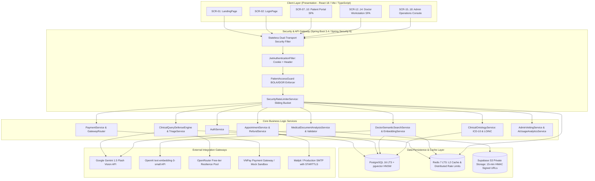
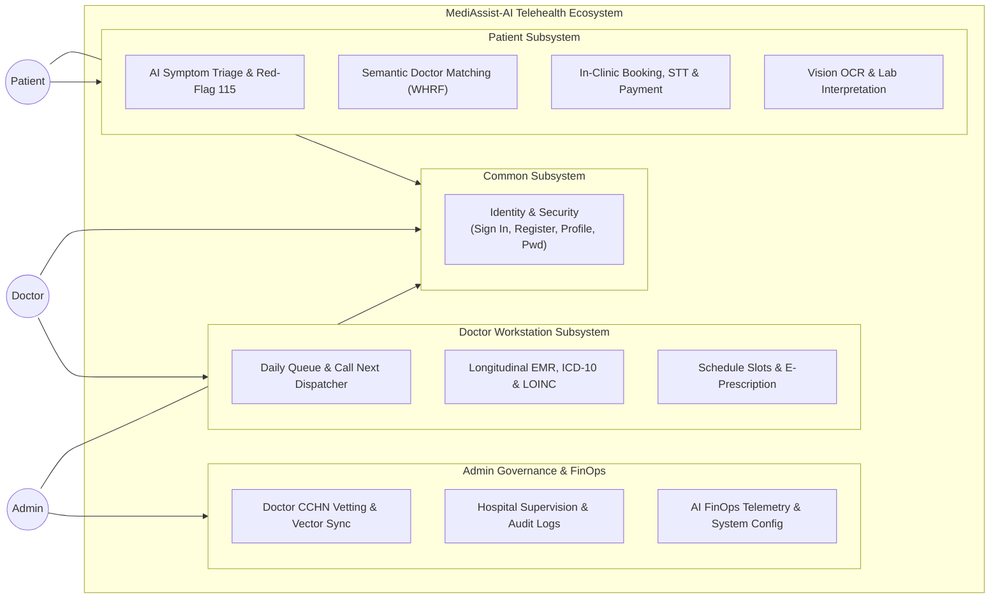
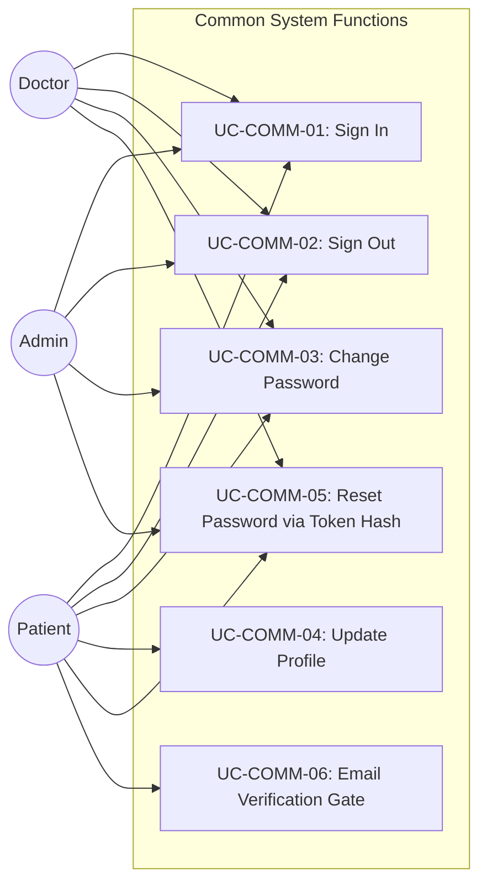
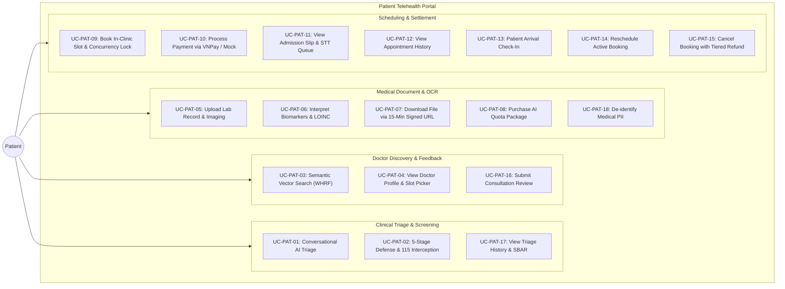
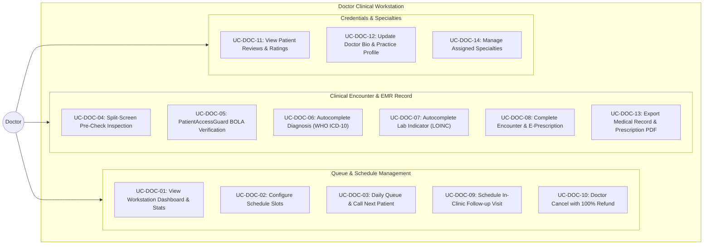
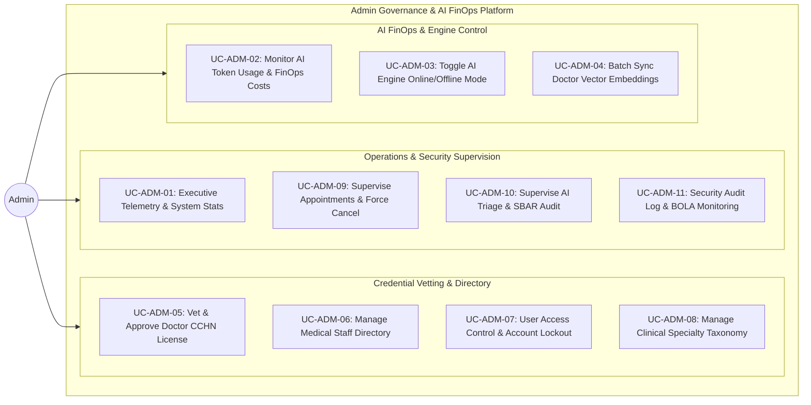
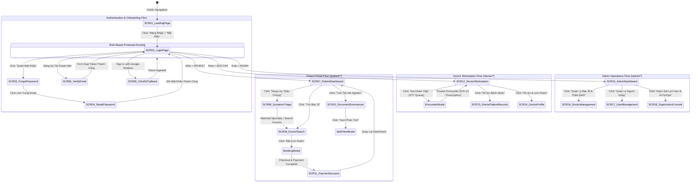
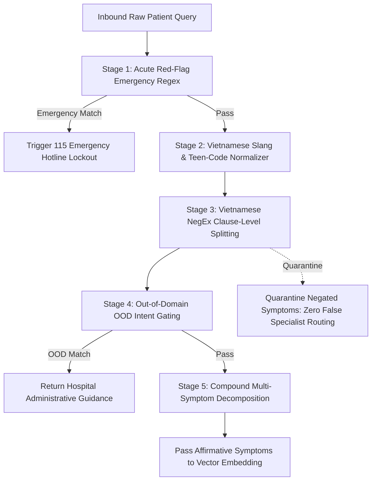

# CAPSTONE PROJECT REPORT — REPORT 3
## SOFTWARE REQUIREMENT SPECIFICATION (SRS) — MEDIASSIST-AI
### Enterprise-Grade Resilient Telehealth Platform with Multimodal Clinical AI & Semantic Doctor Matching

> **Document Code:** FPT-CAPSTONE-SRS-MEDASSIST-01
> **Project Name:** MediAssist-AI (Nền tảng Y tế Số Thông minh: Sàng lọc Triệu chứng & Tóm tắt Hồ sơ Bệnh án Đa phương thức)
> **Institution:** Trường Đại học FPT (FPT University) — Chuyên ngành Kỹ thuật Phần mềm & Trí tuệ Nhân tạo (SE-AI)
> **Academic Target Standard:** IEEE Std 830-1998 / ISO/IEC/IEEE 29148:2018 Systems and Software Engineering
> **Release Status:** Complete System Release (Milestone 7 — Final Capstone Defense Baseline)
> **Current Version:** 2.2.0
> **Date:** October 2026

---

## 📑 TABLE OF CONTENTS

- [I. Record of Changes](#i-record-of-changes)
- [1. Product Overview](#1-product-overview)
  - [1.1 Purpose & Executive Summary](#11-purpose--executive-summary)
  - [1.2 Scope of the System](#12-scope-of-the-system)
  - [1.3 Definitions, Acronyms, and Abbreviations](#13-definitions-acronyms-and-abbreviations)
  - [1.4 References](#14-references)
  - [1.5 System Overview & High-Level Architecture](#15-system-overview--high-level-architecture)
- [2. User Requirements](#2-user-requirements)
  - [2.1 Actors & System Classes](#21-actors--system-classes)
  - [2.2 Use Cases](#22-use-cases)
    - [2.2.1 Diagram(s)](#221-diagrams)
    - [2.2.2 Descriptions](#222-descriptions)
  - [2.3 Use Case Specification(s)](#23-use-case-specifications)
    - [2.3.1 Common Use Case Specifications](#231-common-use-case-specifications)
      - [2.3.1.1 Sign In (UC-COMM-01)](#2311-sign-in-uc-comm-01)
      - [2.3.1.2 Sign Out (UC-COMM-02)](#2312-sign-out-uc-comm-02)
      - [2.3.1.3 Change Password (UC-COMM-03)](#2313-change-password-uc-comm-03)
      - [2.3.1.4 View & Update Patient Profile (UC-COMM-04)](#2314-view--update-patient-profile-uc-comm-04)
      - [2.3.1.5 Forgot Password & Token Hash Reset (UC-COMM-05)](#2315-forgot-password--token-hash-reset-uc-comm-05)
      - [2.3.1.6 Email Verification Gate (UC-COMM-06)](#2316-email-verification-gate-uc-comm-06)
    - [2.3.2 Patient (Portal & Triage)](#232-patient-portal--triage)
      - [2.3.2.1 Conversational AI Symptom Triage (UC-PAT-01)](#2321-conversational-ai-symptom-triage-uc-pat-01)
      - [2.3.2.2 5-Stage Clinical Query Defense (UC-PAT-02)](#2322-5-stage-clinical-query-defense-uc-pat-02)
      - [2.3.2.3 Semantic Doctor Search via pgvector HNSW (UC-PAT-03)](#2323-semantic-doctor-search-via-pgvector-hnsw-uc-pat-03)
      - [2.3.2.4 View Doctor Details & Available Slots (UC-PAT-04)](#2324-view-doctor-details--available-slots-uc-pat-04)
      - [2.3.2.5 Upload Medical Document & Vision OCR (UC-PAT-05)](#2325-upload-medical-document--vision-ocr-uc-pat-05)
      - [2.3.2.6 Inspect Extracted Biomarkers & LOINC Codes (UC-PAT-06)](#2326-inspect-extracted-biomarkers--loinc-codes-uc-pat-06)
      - [2.3.2.7 Download Document File via 15-Min Signed URL (UC-PAT-07)](#2327-download-document-file-via-15-min-signed-url-uc-pat-07)
      - [2.3.2.8 Purchase AI Analysis Quota (UC-PAT-08)](#2328-purchase-ai-analysis-quota-uc-pat-08)
      - [2.3.2.9 Book In-Clinic Appointment (UC-PAT-09)](#2329-book-in-clinic-appointment-uc-pat-09)
      - [2.3.2.10 Process Payment via VNPay / Mock Sandbox (UC-PAT-10)](#23210-process-payment-via-stripe--mock-sandbox-uc-pat-10)
      - [2.3.2.11 View Electronic Encounter Slip (STT) (UC-PAT-11)](#23211-view-electronic-encounter-slip-stt-uc-pat-11)
      - [2.3.2.12 View Patient Appointment History (UC-PAT-12)](#23212-view-patient-appointment-history-uc-pat-12)
      - [2.3.2.13 Patient Check-In for Appointment (UC-PAT-13)](#23213-patient-check-in-for-appointment-uc-pat-13)
      - [2.3.2.14 Reschedule Appointment (UC-PAT-14)](#23214-reschedule-appointment-uc-pat-14)
      - [2.3.2.15 Cancel Appointment with Automated Refund (UC-PAT-15)](#23215-cancel-appointment-with-automated-refund-uc-pat-15)
      - [2.3.2.16 Submit Doctor Review and Rating (UC-PAT-16)](#23216-submit-doctor-review-and-rating-uc-pat-16)
      - [2.3.2.17 View Triage History (UC-PAT-17)](#23217-view-triage-history-uc-pat-17)
      - [2.3.2.18 De-identify Medical PII in Text (UC-PAT-18)](#23218-de-identify-medical-pii-in-text-uc-pat-18)
    - [2.3.3 Doctor (Clinical Workstation)](#233-doctor-clinical-workstation)
      - [2.3.3.1 View Doctor Workstation Dashboard & Stats (UC-DOC-01)](#2331-view-doctor-workstation-dashboard--stats-uc-doc-01)
      - [2.3.3.2 Configure Doctor Schedule Slots (UC-DOC-02)](#2332-configure-doctor-schedule-slots-uc-doc-02)
      - [2.3.3.3 View Daily Patient Queue & Call Next (UC-DOC-03)](#2333-view-daily-patient-queue--call-next-uc-doc-03)
      - [2.3.3.4 Pre-Encounter Split-Screen Inspection (UC-DOC-04)](#2334-pre-encounter-split-screen-inspection-uc-doc-04)
      - [2.3.3.5 Access Patient Records via PatientAccessGuard (UC-DOC-05)](#2335-access-patient-records-via-patientaccessguard-uc-doc-05)
      - [2.3.3.6 Autocomplete Diagnosis with WHO ICD-10 (UC-DOC-06)](#2336-autocomplete-diagnosis-with-who-icd-10-uc-doc-06)
      - [2.3.3.7 Autocomplete Lab Indicators with LOINC (UC-DOC-07)](#2337-autocomplete-lab-indicators-with-loinc-uc-doc-07)
      - [2.3.3.8 Complete Clinical Encounter & Record EMR (UC-DOC-08)](#2338-complete-clinical-encounter--record-emr-uc-doc-08)
      - [2.3.3.9 Schedule In-Clinic Follow-up Visit (UC-DOC-09)](#2339-schedule-in-clinic-follow-up-visit-uc-doc-09)
      - [2.3.3.10 Doctor Cancel Appointment with 100% Refund (UC-DOC-10)](#23310-doctor-cancel-appointment-with-100-refund-uc-doc-10)
      - [2.3.3.11 View Patient Reviews & Ratings (UC-DOC-11)](#23311-view-patient-reviews--ratings-uc-doc-11)
      - [2.3.3.12 Update Doctor Profile & Biography (UC-DOC-12)](#23312-update-doctor-profile--biography-uc-doc-12)
      - [2.3.3.13 Export Medical Record & Prescription PDF (UC-DOC-13)](#23313-export-medical-record--prescription-pdf-uc-doc-13)
      - [2.3.3.14 Manage Assigned Clinical Specialties (UC-DOC-14)](#23314-manage-assigned-clinical-specialties-uc-doc-14)
    - [2.3.4 Admin (Governance & AI FinOps)](#234-admin-governance--ai-finops)
      - [2.3.4.1 View Executive Statistics & Overview (UC-ADM-01)](#2341-view-executive-statistics--overview-uc-adm-01)
      - [2.3.4.2 Monitor AI Token Usage & FinOps (UC-ADM-02)](#2342-monitor-ai-token-usage--finops-uc-adm-02)
      - [2.3.4.3 Toggle System-wide AI Provider & Fallback (UC-ADM-03)](#2343-toggle-system-wide-ai-provider--fallback-uc-adm-03)
      - [2.3.4.4 Sync Doctor Vector Embeddings (UC-ADM-04)](#2344-sync-doctor-vector-embeddings-uc-adm-04)
      - [2.3.4.5 Vet & Approve Doctor CCHN License (UC-ADM-05)](#2345-vet--approve-doctor-cchn-license-uc-adm-05)
      - [2.3.4.6 Manage Doctor Directory (UC-ADM-06)](#2346-manage-doctor-directory-uc-adm-06)
      - [2.3.4.7 User Access Control & Account Locking (UC-ADM-07)](#2347-user-access-control--account-locking-uc-adm-07)
      - [2.3.4.8 Manage Clinical Specialties & Taxonomy (UC-ADM-08)](#2348-manage-clinical-specialties--taxonomy-uc-adm-08)
      - [2.3.4.9 Supervise Appointments & Force Cancel (UC-ADM-09)](#2349-supervise-appointments--force-cancel-uc-adm-09)
      - [2.3.4.10 Supervise AI Triage Sessions (UC-ADM-10)](#23410-supervise-ai-triage-sessions-uc-adm-10)
      - [2.3.4.11 View Security Audit Logs & IDOR Records (UC-ADM-11)](#23411-view-security-audit-logs--idor-records-uc-adm-11)
- [3. Functional Requirements](#3-functional-requirements)
  - [3.1 System Functional Overview](#31-system-functional-overview)
    - [3.1.1 Screens Flow](#311-screens-flow)
    - [3.1.2 Screen Descriptions](#312-screen-descriptions)
    - [3.1.3 Screen Authorization Matrix](#313-screen-authorization-matrix)
    - [3.1.4 Non-Screen Functions](#314-non-screen-functions)
    - [3.1.5 Physical Entity Relationship Diagram](#315-physical-entity-relationship-diagram)
  - [3.2 Applications for Patients, Doctors, and Admins](#32-applications-for-patients-doctors-and-admins)
    - [3.2.1 Welcome & Authentication Flow](#321-welcome--authentication-flow)
    - [3.2.2 Conversational Triage & Clinical Defense Engine](#322-conversational-triage--clinical-defense-engine)
    - [3.2.3 Semantic Vector Search & Doctor Matching Engine](#323-semantic-vector-search--doctor-matching-engine)
    - [3.2.4 Multimodal Medical Document OCR & LOINC Summarizer](#324-multimodal-medical-document-ocr--loinc-summarizer)
    - [3.2.5 O2O Clinical Scheduling & Multi-Channel Payment](#325-o2o-clinical-scheduling--multi-channel-payment)
    - [3.2.6 Doctor Clinical Workstation & Longitudinal EMR](#326-doctor-clinical-workstation--longitudinal-emr)
    - [3.2.7 Admin Governance & AI FinOps Analytics](#327-admin-governance--ai-finops-analytics)
- [4. Non-Functional Requirements](#4-non-functional-requirements)
  - [4.1 External Interfaces](#41-external-interfaces)
    - [4.1.1 User Interfaces](#411-user-interfaces)
    - [4.1.2 Hardware Interfaces](#412-hardware-interfaces)
    - [4.1.3 Software Interfaces](#413-software-interfaces)
  - [4.2 Quality Attributes](#42-quality-attributes)
    - [4.2.1 Usability](#421-usability)
    - [4.2.2 Reliability & Fault Tolerance](#422-reliability--fault-tolerance)
    - [4.2.3 Performance & Scalability](#423-performance--scalability)
    - [4.2.4 Security & Regulatory Privacy](#424-security--regulatory-privacy)
    - [4.2.5 Maintainability & Observability](#425-maintainability--observability)
- [5. Requirement Appendix](#5-requirement-appendix)
  - [5.1 Business Rules](#51-business-rules)
  - [5.2 Acronyms and Abbreviations](#52-acronyms-and-abbreviations)
  - [5.3 Common Requirements](#53-common-requirements)
  - [5.4 Application Messages List](#54-application-messages-list)
  - [5.5 Requirements Traceability Matrix (RTM)](#55-requirements-traceability-matrix-rtm)

---

## I. RECORD OF CHANGES

| Version | Date | Author / Team | Change Description & Rationale | Approval Status |
| :--- | :--- | :--- | :--- | :--- |
| **1.0.0** | 2026-02-15 | SE-AI Capstone Team | Initial Project Charter and SRS draft based on IEEE 830 baseline. | Approved (Faculty) |
| **1.5.0** | 2026-05-20 | SE-AI Capstone Team | Mid-term Defense Update: Integrated Google Gemini Vision OCR, pgvector HNSW indexing, and initial O2O appointment flow. | Approved (Milestone 4) |
| **2.0.0** | 2026-08-30 | SE-AI Capstone Team | Pre-defense overhaul: Integrated 5-stage Clinical Defense Engine, WHRF-SOTA Re-ranking, and Doctor Workstation Split-Screen UI. | Approved (Milestone 6) |
| **2.1.0** | 2026-10-05 | SE-AI Capstone Team | Enterprise Hardening: Fixed BOLA/IDOR vulnerability with `PatientAccessGuard`, private Supabase S3 bucket with 15-minute signed URLs, Bcrypt cost 12, PII de-identification limit (20k chars). | Approved (Internal Audit) |
| **2.2.0** | 2026-10-18 | SE-AI Capstone Team | Final Capstone Defense Baseline: 1-to-1 IEEE 830 alignment with 108-page FPT Capstone structure. 49 full Use Cases, 18 Screen specs, WHO ICD-10 & LOINC MOH ontologies, Flyway V1–V22, and 306/306 test baseline. | Approved (Final Capstone) |

---

## 1. PRODUCT OVERVIEW

### 1.1 Purpose & Executive Summary
The purpose of this Software Requirement Specification (SRS) is to establish a rigorous, formal, and authoritative technical definition of the **MediAssist-AI** Telehealth & Clinical Decision Support System. This document serves as the primary technical contract for software engineering, artificial intelligence orchestration, cloud infrastructure, quality assurance, and academic defense at FPT University.

MediAssist-AI is an enterprise-grade **Online-to-Offline (O2O) Telehealth Ecosystem** that bridges the communication gap between patients and primary healthcare facilities. By leveraging Multimodal Vision Artificial Intelligence (Google Gemini 1.5 Flash), Vector Similarity Search (PostgreSQL 16 `pgvector`), and a 5-Stage Clinical Defense Engine, MediAssist-AI delivers intelligent symptom triage, lab test interpretation, semantic physician discovery, and streamlined clinical encounter management.

### 1.2 Scope of the System
The MediAssist-AI platform encompasses five tightly coupled operational subsystems:
1. **Conversational Clinical Triage & Defensive Screening Subsystem:** Processes natural language patient symptom queries, intercepts acute emergency red-flags (Hotline 115 lockouts), normalizes Vietnamese colloquialisms/slang, applies Vietnamese NegEx clause splitting, filters out-of-domain administrative chatter, and decomposes multi-symptom presentations.
2. **Clinical pgvector Semantic Doctor Matching Subsystem:** Generates 1536-dimensional continuous embeddings (`openai/text-embedding-3-small`), indexes clinical physician profiles via Hierarchical Navigable Small World (HNSW) graphs, and executes a Weighted Hybrid Re-Ranking Formula (WHRF) within a bounded min-heap to match patients with qualified specialists.
3. **Multimodal Medical Document Interpretation Subsystem:** Ingests unstructured patient lab reports, blood panels, and imaging scans (PDF/PNG/JPEG), performs optical character recognition (OCR), extracts numerical biomarkers into structured tables, maps findings to WHO LOINC standards, compares values against demographic physiological reference ranges, and translates jargon into layperson Vietnamese.
4. **O2O In-Clinic Appointment & Admission Ticket Subsystem:** Enables real-time scheduling within hospital operational windows (08:00–17:00, Monday–Saturday), prevents concurrent double-booking, issues digital admission slips with sequential queue numbers (STT), clinic room routing, Google Maps positioning, pre-encounter instructions, and `.ics` calendar exports.
5. **Doctor Clinical Workstation & Longitudinal EMR Subsystem:** Provides attending physicians with a split-screen workstation (original lab document vs. AI SBAR summary), full ICD-10 diagnosis autocomplete (WHO & Decision 7603/QĐ-BYT), LOINC test autocomplete (Decision 3280/QĐ-BYT), electronic prescription generation, and immutable medical record archiving protected by Broken Object Level Authorization (`PatientAccessGuard`) defenses.

*Out-of-Scope:* Pure telemedicine video consultation without physical examination, real-time ICU telemetry device streaming, autonomous robotic surgical control, and automated pharmacy dispensing without licensed physician sign-off.

### 1.3 Definitions, Acronyms, and Abbreviations
- **AI:** Artificial Intelligence.
- **ANN:** Approximate Nearest Neighbor search over high-dimensional vector spaces.
- **BOLA / IDOR:** Broken Object Level Authorization / Insecure Direct Object Reference (OWASP API Security Top 1).
- **EMR / EHR:** Electronic Medical Record / Electronic Health Record.
- **FAST:** Face, Arm, Speech, Time — standardized clinical protocol for acute stroke identification.
- **HNSW:** Hierarchical Navigable Small World graph indexing for pgvector ($m=24, ef\_construction=128$).
- **ICD-10:** International Statistical Classification of Diseases and Related Health Problems, 10th Revision (WHO).
- **JWT:** JSON Web Token (RFC 7519) utilizing stateless dual-transport (HttpOnly Secure Cookie + Response Body).
- **LOINC:** Logical Observation Identifiers Names and Codes for clinical laboratory test standardization.
- **MOH:** Ministry of Health of Vietnam (Bộ Y Tế).
- **NegEx:** Clinical Negation Extraction algorithm adapted for Vietnamese syntactic clause boundaries.
- **O2O:** Online-to-Offline clinical workflow (Online triage/scheduling $
ightarrow$ In-person physical examination).
- **OCR:** Optical Character Recognition.
- **PII:** Personally Identifiable Information governed by Decree 13/2023/NĐ-CP and HIPAA Safe Harbor.
- **RBAC:** Role-Based Access Control enforcing `PATIENT`, `DOCTOR`, and `ADMIN` privileges.
- **SBAR:** Situation, Background, Assessment, Recommendation — standardized clinical handoff framework.
- **WHRF:** Weighted Hybrid Re-Ranking Formula combining dense similarity, lexical overlap, and credentials.

### 1.4 References
1. IEEE Std 830-1998: *IEEE Recommended Practice for Software Requirements Specifications*.
2. ISO/IEC/IEEE 29148:2018: *Systems and Software Engineering — Life Cycle Processes — Requirements Engineering*.
3. Ministry of Health Vietnam: *Decision 7603/QĐ-BYT promulgating the Master List of ICD-10 Medical Diagnoses*.
4. Ministry of Health Vietnam: *Decision 3280/QĐ-BYT promulgating the Catalog of Technical Services and LOINC Codes*.
5. Government of Vietnam: *Decree 13/2023/NĐ-CP on Personal Data Protection (PDPD)*.
6. Malkov, Y. A., & Yashunin, D. A. (2018). *Efficient and robust approximate nearest neighbors using Hierarchical Navigable Small World graphs*. IEEE TPAMI.
7. Chapman, W. W., et al. (2001). *A simple algorithm for identifying negated findings and diseases in discharge summaries (NegEx)*. Journal of Biomedical Informatics.

### 1.5 System Overview & High-Level Architecture
MediAssist-AI follows an enterprise Modular Monolith architecture implemented with Spring Boot 3.4 (Java 21 LTS Project Loom Virtual Threads) and React 18 (TypeScript Vite SPA), integrated with PostgreSQL 16 `pgvector`, Redis distributed cache, Supabase S3 private storage, and AI inference gateways:



---

## 2. USER REQUIREMENTS

### 2.1 Actors & System Classes

| Actor Name | Type | Description & System Responsibilities |
| :--- | :--- | :--- |
| **Patient (`PATIENT`)** | Human (Primary) | Registered individual or authenticated guest. Interacts with AI triage, uploads medical documents, searches doctors via semantic vector matching, books in-clinic appointments (08:00–17:00), processes payments, checks in, and manages personal health profile. |
| **Doctor (`DOCTOR`)** | Human (Primary) | Licensed medical practitioner verified by administrators. Manages consultation schedules, views patient appointment queues, calls next patient, inspects pre-encounter split-screen evidence, records vital signs, inputs WHO ICD-10 diagnoses, orders LOINC tests, prescribes medication, and completes clinical encounters. |
| **Admin (`ADMIN`)** | Human (Secondary) | System administrator and medical director. Audits doctor medical practice certificates (CCHN), manages clinical specialties, supervises system-wide appointments, monitors AI token usage and FinOps costs (USD/VNĐ), controls user accounts, toggles AI provider failover mode, and inspects immutable audit logs. |
| **AI Inference Gateway** | External System | External LLM and Vision APIs (Google Gemini 1.5 Flash, OpenAI `text-embedding-3-small`, OpenRouter pool). Ingests clinical prompts and document images, returning structured triage classifications, OCR extractions, and dense vector embeddings. |
| **Payment Gateway** | External System | Payment infrastructure provider (VNPay Gateway HMAC-SHA512 / Mock Payment Sandbox). Processes online banking transactions, IPN webhook notifications with idempotency locking, and automated refund triggers. |
| **Email Delivery Gateway** | External System | Transactional email provider (Mailpit in development, Production SMTP with STARTTLS). Dispatches account verification links, password reset tokens, and appointment reminders. |
| **Clinical Ontology Registry** | External / Internal | Official medical terminology database loaded from WHO ICD-10, LOINC, and MOH Decisions 7603/QĐ-BYT & 3280/QĐ-BYT. Provides high-speed prefix search for diagnosis and lab coding. |

---

### 2.2 Use Cases

#### 2.2.1 Diagram(s)

##### Figure 2.2.1.A: Global High-Level Use Case Architecture


##### Figure 2.2.1.B: Common System Use Cases


##### Figure 2.2.1.C: Patient Domain Use Cases


##### Figure 2.2.1.D: Doctor Workstation Use Cases


##### Figure 2.2.1.E: Admin Governance & AI FinOps Use Cases


#### 2.2.2 Descriptions

| Use Case ID | Use Case Name | Primary Actor | Target Backend API Controller / Endpoint | Brief Purpose & Functional Description |
| :--- | :--- | :--- | :--- | :--- |
| **UC-COMM-01** | Sign In | All Roles | `AuthController.login`, `OAuth2` | Authenticate via Email/Password or Google OAuth2; issue dual-transport JWT HttpOnly cookie + Body. |
| **UC-COMM-02** | Sign Out | All Roles | `AuthController.logout` | Invalidate session cookies, revoke refresh tokens, and clear client-side state. |
| **UC-COMM-03** | Change Password | All Roles | `AuthController.resetPassword` | Validate existing password and update with Bcrypt cost 12 hash. |
| **UC-COMM-04** | Update Patient Profile | Patient | `PatientProfileController.updateProfile` | Update personal health profile (DOB, blood type, allergies, emergency contact). |
| **UC-COMM-05** | Reset Password | All Roles | `AuthController.forgotPassword` | Request password reset email and redeem single-use SHA-256 hashed token (`token_hash` V21). |
| **UC-COMM-06** | Email Verification Gate | All Roles | `AuthController.verifyEmail` | Enforce account activation by validating verification token (`email_verification_tokens` V22). |
| **UC-PAT-01** | AI Symptom Triage | Patient | `TriageController.assess` | Multi-turn conversational evaluation generating SBAR report and specialty recommendation. |
| **UC-PAT-02** | 5-Stage Query Defense | Patient | `ClinicalQueryDefenseEngine.process` | Intercept 115 emergency red-flags, teen-code slang, Vietnamese NegEx negation, and OOD chatter. |
| **UC-PAT-03** | Semantic Doctor Search | Patient | `TriageController.searchSemantic` | 1536-d pgvector HNSW search with WHRF-SOTA Min-Heap re-ranking. |
| **UC-PAT-04** | View Doctor Details | Patient | `DoctorController.getDoctorById` | Review doctor bio, CCHN license number, consultation fee, rating, and available slots. |
| **UC-PAT-05** | Upload Medical Document | Patient | `MedicalDocumentController.analyze` | Ingest lab scan (PDF/Image <= 10MB) with SHA-256 deduplication and private Supabase S3 storage. |
| **UC-PAT-06** | Inspect Biomarkers & LOINC | Patient | `MedicalDocumentController.getAnalysis` | View structured table of extracted biomarkers, LOINC codes, abnormal indicators, and layperson summary. |
| **UC-PAT-07** | Download Document File | Patient, Doctor | `MedicalDocumentController.getFile` | Retrieve document source bytes via temporary 15-minute HMAC signed Supabase S3 URL. |
| **UC-PAT-08** | Purchase AI Quota | Patient | `MedicalDocumentController.purchaseQuota` | Purchase document analysis quota packages (QUOTA_PURCHASE order type). |
| **UC-PAT-09** | Book In-Clinic Appointment | Patient | `AppointmentController.createAppointment` | Reserve 30-min slot (08:00–17:00), assign sequential STT queue number, and lock schedule. |
| **UC-PAT-10** | Process Payment | Patient | `PaymentController.createPaymentUrl`, `handleVnpayIpn` | Pay appointment consultation fee via VNPay Online Payment Gateway (HMAC-SHA512) or Mock Sandbox. |
| **UC-PAT-11** | View Admission Slip (STT) | Patient | `AppointmentController.getTicket` | Render digital encounter ticket with queue number, clinic room, and preparation instructions. |
| **UC-PAT-12** | View Appointment History | Patient | `AppointmentController.getMyAppointments` | List patient appointments with status badges (`SCHEDULED`, `CONFIRMED`, `COMPLETED`, `CANCELLED`). |
| **UC-PAT-13** | Patient Check-In | Patient | `AppointmentController.checkIn` | Mark patient arrival at clinic (`checked_in_at`), advancing queue status. |
| **UC-PAT-14** | Reschedule Appointment | Patient | `AppointmentController.rescheduleAppointment` | Move active appointment to a new slot (allowed up to 2 hours in advance). |
| **UC-PAT-15** | Cancel & Auto-Refund | Patient | `AppointmentController.updateStatus` | Cancel booking and trigger automated refund via `AppointmentRefundService`. |
| **UC-PAT-16** | Submit Doctor Review | Patient | `DoctorReviewController.createReview` | Rate consultation (1–5 stars) and comment (allowed only once per completed appointment). |
| **UC-PAT-17** | View Triage History | Patient | `TriageController.getHistory` | Review past conversational triage sessions and generated SBAR reports. |
| **UC-PAT-18** | De-identify Medical PII | Patient | `MedicalPiiController.deidentify` | Redact Vietnamese citizen IDs, phone numbers, and names (max 20,000 characters). |
| **UC-DOC-01** | Doctor Workstation Stats | Doctor | `DoctorController.getMyStats` | View daily patient count, completed consultations, and current queue progress. |
| **UC-DOC-02** | Configure Schedule Slots | Doctor | `DoctorController.updateMySchedules` | Configure weekly recurring consultation slots (`doctor_schedule_slots`). |
| **UC-DOC-03** | Daily Queue & Call Next | Doctor | `DoctorController.callNextPatient` | Call next waiting patient in queue by sequential STT, updating status to `IN_PROGRESS`. |
| **UC-DOC-04** | Split-Screen Pre-Check | Doctor | `DoctorDashboard.tsx` (Split-View) | Cross-examine raw uploaded lab scan alongside AI SBAR synthesis before consultation. |
| **UC-DOC-05** | Guarded Patient Records | Doctor | `AppointmentController.getByPatient` | Access patient historical encounters strictly guarded by `PatientAccessGuard`. |
| **UC-DOC-06** | ICD-10 Autocomplete | Doctor | `ClinicalOntologyController.searchIcd10` | Prefix search WHO ICD-10 and MOH Decision 7603/QĐ-BYT diagnoses in < 30ms. |
| **UC-DOC-07** | LOINC Autocomplete | Doctor | `ClinicalOntologyController.searchLoinc` | Autocomplete laboratory test indicators according to MOH Decision 3280/QĐ-BYT. |
| **UC-DOC-08** | Complete Clinical Encounter | Doctor | `AppointmentController.completeClinical` | Save vital signs JSON, ICD-10 diagnosis, prescription JSON, treatment plan, and lock EMR. |
| **UC-DOC-09** | Schedule Follow-up Visit | Doctor | `AppointmentController.scheduleFollowUp` | Pre-book in-clinic follow-up visit linked to primary encounter. |
| **UC-DOC-10** | Doctor Cancel with Refund | Doctor | `AppointmentController.updateStatus` | Cancel appointment due to medical emergency; automatically issues 100% full patient refund. |
| **UC-DOC-11** | View Reviews & Ratings | Doctor | `DoctorReviewController.getDoctorReviews` | Track patient reviews, star rating distribution, and qualitative feedback. |
| **UC-DOC-12** | Update Doctor Profile | Doctor | `DoctorController.updateMyProfile` | Update bio, consultation fee, clinic room, and triggers async vector re-embedding. |
| **UC-DOC-13** | Export Encounter PDF | Doctor | `MeddiesPdfGeneratorService` | Export official print-ready consultation summary and prescription document. |
| **UC-DOC-14** | Manage Specialties | Doctor | `SpecialtyController.getAllSpecialties` | Select and link secondary medical specialties to doctor profile. |
| **UC-ADM-01** | Executive Statistics | Admin | `AdminController.getStats` | View high-level system telemetry: total users, active doctors, today's appointments. |
| **UC-ADM-02** | AI FinOps Monitor | Admin | `AdminController.getAiUsage` | Track token consumption and cost projection in USD and VNĐ (`AI_COST_VND_PER_USD`). |
| **UC-ADM-03** | Toggle AI Provider | Admin | `SystemConfigController.toggleAiMode` | Switch between Gemini, OpenRouter, and Local Hashing (`POST /api/v1/system/ai-mode/toggle`). |
| **UC-ADM-04** | Sync Doctor Vectors | Admin | `AdminController.syncVectors` | Re-compute 1536-d embeddings for all doctors and refresh HNSW index. |
| **UC-ADM-05** | Vet Doctor CCHN License | Admin | `AdminController.vetDoctor` | Audit medical practice certificate (CCHN) and approve doctor for public listing. |
| **UC-ADM-06** | Manage Doctor Directory | Admin | `AdminController.getDoctorsPaged` | Search, update, or toggle active status of doctors in system directory. |
| **UC-ADM-07** | User Access Control | Admin | `AdminController.updateUserStatus` | Search users, change role, or lock account (`is_active = false`). |
| **UC-ADM-08** | Manage Specialties | Admin | `AdminController.createSpecialty` | Create or update clinical specialties and medical department taxonomy. |
| **UC-ADM-09** | Supervise Appointments | Admin | `AdminController.getAppointments` | Master appointment table with force-cancel and automated refund override. |
| **UC-ADM-10** | Supervise Triage Sessions | Admin | `AdminController.getTriageSessions` | Inspect anonymized clinical triage logs and urgency distributions. |
| **UC-ADM-11** | Inspect Security Audit Logs | Admin | `AdminController.getAuditLogs` | Audit immutable security logs, including `VIEW_PATIENT_RECORD` IDOR monitoring. |

---

### 2.3 Use Case Specification(s)

#### 2.3.1 Common Use Case Specifications

##### 2.3.1.1 Sign In (UC-COMM-01)

| Attribute | Specification Details |
| :--- | :--- |
| **Use Case ID** | `UC-COMM-01` |
| **Use Case Name** | Sign In |
| **Created By** | SE-AI Capstone Team |
| **Created Date** | 15/02/2026 |
| **Primary Actor** | Patient, Doctor, Admin, Guest |
| **Secondary Actor** | Google Identity Provider, Transactional Email Gateway |
| **Description** | MediAssist-AI Identity & Access Management (IAM) — - User session is established.<br>- Server issues dual-transport JWT: HttpOnly Secure Cookie + Response JSON Body.<br>- User redirected to role-based dashboard:<br>* `PATIENT` -> `/patient`<br>* `DOCTOR`  -> `/doctor`<br>* `ADMIN`   -> `/admin` |
| **Trigger** | User clicks "Sign In" or submits authentication form. |
| **Pre-conditions** | - User has network connection to MediAssist-AI.<br>- If signing in with email/password, account exists in `users` table. |
| **Post-conditions** | - User session is established.<br>- Server issues dual-transport JWT: HttpOnly Secure Cookie + Response JSON Body.<br>- User redirected to role-based dashboard:<br>* `PATIENT` -> `/patient`<br>* `DOCTOR`  -> `/doctor`<br>* `ADMIN`   -> `/admin` |
| **Normal Flow** | Step 1: User navigates to `/login` and selects authentication mode (Password or Google OAuth2).<br>Step 2: User provides email and password or clicks "Sign in with Google".<br>Step 3: Frontend validates non-empty inputs and valid email format regex.<br>Step 4: Frontend sends HTTP POST request to `/api/v1/auth/login` with `LoginRequest` DTO.<br>Step 5: Backend `AuthenticationManager` verifies credentials against Bcrypt hash (cost 12) in `users`.<br>Step 6: Backend checks account status (`is_active == true` and `email_verified == true`).<br>Step 7: Backend generates signed JWT access token (24-hour expiration).<br>Step 8: Backend attaches `Set-Cookie: jwt_token=...; HttpOnly; Secure; SameSite=Lax; Path=/api`.<br>Step 9: Backend returns HTTP 200 OK with `AuthResponse` DTO containing token and user profile metadata.<br>Step 10: Client stores token in Zustand store (`useAuthStore`) and redirects user to target dashboard. |
| **Alternative Flow** | - Alt Flow 11a: Google OAuth2 Sign-In:<br>1. User clicks "Sign in with Google".<br>2. Browser navigates to `/login/oauth2/code/google` authorization endpoint.<br>3. Google returns authorization code; backend exchanges for Google ID and user email.<br>4. If user does not exist, backend auto-provisions account with role `PATIENT` (Flyway V8 `google_id`).<br>5. Backend redirects to frontend `/oauth2/callback` with JWT token.<br>- Alt Flow 11b: Unverified Email Login:<br>1. Backend detects `email_verified == false` (Flyway V22 gate).<br>2. Backend throws `AppException(HttpStatus.FORBIDDEN, "EMAIL_NOT_VERIFIED", ...)`.<br>3. Frontend displays verification notification with "Resend Verification Link" button. |
| **Exceptions** | - Exc Flow 12a: Invalid Credentials (Wrong email or password):<br>1. Backend throws `AppException(HttpStatus.UNAUTHORIZED, "INVALID_CREDENTIALS", ...)`.<br>2. Backend returns HTTP 401 Unauthorized.<br>3. Frontend displays inline alert: "Email hoặc mật khẩu không chính xác."<br>- Exc Flow 12b: Account Locked:<br>1. Backend detects `is_active == false`.<br>2. Backend throws `AppException(HttpStatus.LOCKED, "ACCOUNT_LOCKED", ...)`.<br>3. Frontend displays modal directing user to contact administrative support. |
| **Priority** | High (P0 - Architectural Blocker) |
| **Frequency of Use** | High (Frequent operational use) |
| **Business Rules** | - BR-01: Password complexity must be enforced (Min 8 chars, 1 uppercase, 1 digit, 1 special char).<br>- BR-02: Maximum 5 consecutive failed login attempts before 15-minute IP/account rate lock.<br>- BR-03: JWT secret key must have at least 256 bits entropy (`APP_JWT_SECRET`). |
| **Data Entities Involved** | - `users` (id, email, password_hash, role, is_active, email_verified, google_id).<br>- `audit_logs` (id, user_id, action, ip_address, created_at). |
| **User Interface Controls** | - Text inputs: `Email`, `Password`.<br>- Checkbox: `Remember Me`.<br>- Action buttons: `Đăng Nhập`, `Đăng Nhập Với Google`, `Quên Mật Khẩu`. |


##### 2.3.1.2 Sign Out (UC-COMM-02)

| Attribute | Specification Details |
| :--- | :--- |
| **Use Case ID** | `UC-COMM-02` |
| **Use Case Name** | Sign Out |
| **Created By** | SE-AI Capstone Team |
| **Created Date** | 15/02/2026 |
| **Primary Actor** | All authenticated users (Patient, Doctor, Admin) |
| **Secondary Actor** | Google Identity Provider, Transactional Email Gateway |
| **Description** | MediAssist-AI Identity & Access Management (IAM) — - Client in-memory auth state, user profile, and cached tokens are wiped.<br>- Server clears the HttpOnly `jwt_token` cookie via zero-max-age expiration header.<br>- User is redirected to `/login` with an informational sign-out toast. |
| **Trigger** | User clicks "Sign Out" / "Đăng Xuất" in top navbar or drawer. |
| **Pre-conditions** | User is actively authenticated with a valid JWT token. |
| **Post-conditions** | - Client in-memory auth state, user profile, and cached tokens are wiped.<br>- Server clears the HttpOnly `jwt_token` cookie via zero-max-age expiration header.<br>- User is redirected to `/login` with an informational sign-out toast. |
| **Normal Flow** | Step 1: User clicks "Đăng Xuất" from the user menu avatar dropdown.<br>Step 2: Frontend dispatches HTTP POST to `/api/v1/auth/logout`.<br>Step 3: Backend invalidates session cookies: `Set-Cookie: jwt_token=; Max-Age=0; Path=/; HttpOnly`.<br>Step 4: Backend logs audit entry: `USER_LOGOUT` for telemetry compliance.<br>Step 5: Backend returns HTTP 200 OK with `{"message": "Logged out successfully"}`.<br>Step 6: Frontend clears Zustand stores (`useAuthStore.getState().logout()`).<br>Step 7: Frontend purges all cached sensitive clinical records from browser memory.<br>Step 8: Frontend redirects browser to `/login`. |
| **Alternative Flow** | None. |
| **Exceptions** | None. |
| **Priority** | High (P1) |
| **Frequency of Use** | High (Frequent operational use) |
| **Business Rules** | - BR-04: Terminating the session must invalidate client access immediately. |
| **Data Entities Involved** | - `audit_logs` (action = 'LOGOUT'). |
| **User Interface Controls** | - Menu Item: `Đăng Xuất` with icon `LogOut`. |


##### 2.3.1.3 Change Password (UC-COMM-03)

| Attribute | Specification Details |
| :--- | :--- |
| **Use Case ID** | `UC-COMM-03` |
| **Use Case Name** | Change Password |
| **Created By** | SE-AI Capstone Team |
| **Created Date** | 15/02/2026 |
| **Primary Actor** | Patient, Doctor, Admin |
| **Secondary Actor** | Google Identity Provider, Transactional Email Gateway |
| **Description** | MediAssist-AI Identity & Access Management (IAM) — - Old password hash in database is replaced with new Bcrypt hash.<br>- Security confirmation notification is dispatched. |
| **Trigger** | User submits password update form in settings. |
| **Pre-conditions** | User is authenticated and knows their current password. |
| **Post-conditions** | - Old password hash in database is replaced with new Bcrypt hash.<br>- Security confirmation notification is dispatched. |
| **Normal Flow** | Step 1: User navigates to security settings and inputs Current and New Password.<br>Step 2: Client validates matching passwords and complexity regex in real time.<br>Step 3: Frontend sends HTTP POST to `/api/v1/auth/reset-password` with `ResetPasswordRequest`.<br>Step 4: Backend verifies password complexity.<br>Step 5: Backend encodes new password with `BCryptPasswordEncoder(12)`.<br>Step 6: Backend commits update to `users.password_hash` within `@Transactional`.<br>Step 7: Backend publishes `PasswordChangedEvent` -> triggers async security notice email.<br>Step 8: Backend returns HTTP 200 OK.<br>Step 9: Frontend displays success toast: "Mật khẩu đã được cập nhật thành công." |
| **Alternative Flow** | None. |
| **Exceptions** | - Exc Flow 12a: Weak New Password:<br>1. Backend throws `AppException(HttpStatus.BAD_REQUEST, "WEAK_PASSWORD", ...)`.<br>2. Frontend displays: "Mật khẩu mới phải có ít nhất 8 ký tự, bao gồm chữ hoa, chữ thường và chữ số." |
| **Priority** | Medium (P2) |
| **Frequency of Use** | High (Frequent operational use) |
| **Business Rules** | - BR-01: Minimum 8 characters, at least 1 uppercase letter, 1 number, and 1 special symbol.<br>- BR-05: New password cannot be identical to the previous password. |
| **Data Entities Involved** | - `users` (password_hash, updated_at). |
| **User Interface Controls** | - Password inputs: `Mật khẩu mới`, `Xác nhận mật khẩu mới`. |


##### 2.3.1.4 View & Update Patient Profile (UC-COMM-04)

| Attribute | Specification Details |
| :--- | :--- |
| **Use Case ID** | `UC-COMM-04` |
| **Use Case Name** | View & Update Patient Profile |
| **Created By** | SE-AI Capstone Team |
| **Created Date** | 15/02/2026 |
| **Primary Actor** | Patient |
| **Secondary Actor** | Google Identity Provider, Transactional Email Gateway |
| **Description** | MediAssist-AI Patient Profile Subsystem — Patient entity in `patient_profiles` is retrieved or updated. |
| **Trigger** | Patient navigates to profile view or updates clinical demographics. |
| **Pre-conditions** | User is authenticated as `PATIENT`. |
| **Post-conditions** | Patient entity in `patient_profiles` is retrieved or updated. |
| **Normal Flow** | Step 1: Patient accesses profile modal/page.<br>Step 2: Frontend calls HTTP GET `/api/v1/patient/profile`.<br>Step 3: Backend retrieves `PatientProfile` linked to `user_id`.<br>Step 4: Backend returns `PatientProfileDto` (date of birth, gender, blood type, allergies, emergency contact, remaining AI quota).<br>Step 5: Patient updates Blood Type, Allergies, or Emergency Contact Phone.<br>Step 6: Frontend dispatches HTTP PUT `/api/v1/patient/profile` with updated DTO.<br>Step 7: Backend validates phone format and citizen ID regex if present.<br>Step 8: Backend commits update to `patient_profiles` table.<br>Step 9: Backend returns HTTP 200 OK with refreshed profile.<br>Step 10: Frontend renders toast: "Hồ sơ sức khỏe đã được cập nhật." |
| **Alternative Flow** | None. |
| **Exceptions** | - Exc Flow 12a: Invalid Phone Format:<br>1. Backend throws `AppException(HttpStatus.BAD_REQUEST, "INVALID_PHONE", ...)`.<br>2. Frontend displays: "Số điện thoại không đúng định dạng Việt Nam (VD: 0901234567)." |
| **Priority** | Medium (P2) |
| **Frequency of Use** | High (Frequent operational use) |
| **Business Rules** | - BR-06: Vietnamese phone numbers must match regex `^(0\|\+84)(3\|5\|7\|8\|9)[0-9]{8}$`. |
| **Data Entities Involved** | - `users`, `patient_profiles` (id, user_id, date_of_birth, gender, blood_type, allergies, emergency_contact, remaining_ai_quota). |
| **User Interface Controls** | - Text inputs (`Họ và tên`, `Số điện thoại`, `Người liên hệ khẩn cấp`), select (`Nhóm máu`, `Giới tính`), textarea (`Dị ứng thuốc`). |


##### 2.3.1.5 Forgot Password & Token Hash Reset (UC-COMM-05)

| Attribute | Specification Details |
| :--- | :--- |
| **Use Case ID** | `UC-COMM-05` |
| **Use Case Name** | Forgot Password & Token Hash Reset |
| **Created By** | SE-AI Capstone Team |
| **Created Date** | 15/02/2026 |
| **Primary Actor** | Unauthenticated User (Patient, Doctor, Admin) |
| **Secondary Actor** | Google Identity Provider, Transactional Email Gateway |
| **Description** | MediAssist-AI Identity & Access Management (IAM) — - Single-use SHA-256 hashed password reset token is generated with 15-minute TTL.<br>- Password reset email containing secure redemption link is dispatched asynchronously.<br>- Upon token redemption, user's password is reset and token marked as consumed. |
| **Trigger** | User clicks "Quên mật khẩu?" on login page. |
| **Pre-conditions** | User account exists with a verified email address. |
| **Post-conditions** | - Single-use SHA-256 hashed password reset token is generated with 15-minute TTL.<br>- Password reset email containing secure redemption link is dispatched asynchronously.<br>- Upon token redemption, user's password is reset and token marked as consumed. |
| **Normal Flow** | Step 1: User navigates to `/forgot-password`, inputs registered email, and clicks "Gửi Yêu Cầu".<br>Step 2: Frontend sends HTTP POST to `/api/v1/auth/forgot-password` with `ForgotPasswordRequest(email)`.<br>Step 3: Backend searches `userRepository.findByEmail(email)`.<br>(Security note: If email not found, backend still returns 200 OK to prevent account enumeration).<br>Step 4: Backend generates 32-byte cryptographically secure random token (`SecureRandom`).<br>Step 5: Backend computes SHA-256 hash of raw token (`DigestUtils.sha256Hex(rawToken)`).<br>Step 6: Backend stores hash, user ID, expiration timestamp (`now() + 15 minutes`), and `consumed = false`<br>in `password_reset_tokens` table (Flyway V21 migration).<br>Step 7: Backend asynchronously invokes `EmailService.sendPasswordResetMail(email, rawToken)`.<br>Step 8: User opens email, clicks reset link: `https://mediassist.local/reset-password?token={rawToken}`.<br>Step 9: Frontend calls HTTP GET `/api/v1/auth/reset-password/validate?token={rawToken}` to verify validity.<br>Step 10: User enters new password and confirms password on the reset page.<br>Step 11: Frontend sends HTTP POST to `/api/v1/auth/reset-password` with `rawToken` and `newPassword`.<br>Step 12: Backend hashes `rawToken` with SHA-256 and searches `password_reset_tokens.token_hash`.<br>Step 13: Backend verifies token is not expired (`expires_at > now()`) and not consumed (`consumed == false`).<br>Step 14: Backend updates user's `password_hash` with Bcrypt(cost 12) and marks `consumed = true`.<br>Step 15: Backend returns HTTP 200 OK. Frontend redirects to `/login` with success banner. |
| **Alternative Flow** | None. |
| **Exceptions** | - Exc Flow 12a: Expired or Already Consumed Token:<br>1. Backend throws `AppException(HttpStatus.BAD_REQUEST, "TOKEN_EXPIRED", ...)`.<br>2. Backend returns HTTP 400 Bad Request.<br>3. Frontend displays: "Đường dẫn đặt lại mật khẩu đã hết hạn hoặc đã được sử dụng. Vui lòng thử lại." |
| **Priority** | High (P1) |
| **Frequency of Use** | High (Frequent operational use) |
| **Business Rules** | - BR-07: Plaintext reset tokens must NEVER be stored in the database. Only SHA-256 hashes are persisted (Flyway V21).<br>- BR-08: Token lifespan is strictly limited to 15 minutes. |
| **Data Entities Involved** | - `users`, `password_reset_tokens` (id, user_id, token_hash, expires_at, consumed, consumed_at). |
| **User Interface Controls** | - Input: `Email`, `Mật khẩu mới`, `Nhập lại mật khẩu`.<br>- Button: `Gửi Link Đặt Lại`, `Xác Nhận Mật Khẩu Mới`. |


##### 2.3.1.6 Email Verification Gate (UC-COMM-06)

| Attribute | Specification Details |
| :--- | :--- |
| **Use Case ID** | `UC-COMM-06` |
| **Use Case Name** | Email Verification Gate |
| **Created By** | SE-AI Capstone Team |
| **Created Date** | 15/02/2026 |
| **Primary Actor** | Newly registered user |
| **Secondary Actor** | Google Identity Provider, Transactional Email Gateway |
| **Description** | MediAssist-AI Identity & Access Management (IAM) — - User account marked `email_verified = true`.<br>- User is permitted to access full clinical features (booking, triage, consultation). |
| **Trigger** | User clicks the activation link received upon account registration. |
| **Pre-conditions** | Account created with `email_verified = false` (Flyway V22). |
| **Post-conditions** | - User account marked `email_verified = true`.<br>- User is permitted to access full clinical features (booking, triage, consultation). |
| **Normal Flow** | Step 1: Upon registration, backend generates verification token stored in `email_verification_tokens`.<br>Step 2: Backend dispatches HTML email containing activation link: `/verify-email?token={token}`.<br>Step 3: User clicks activation link in email client navigating to `/verify-email`.<br>Step 4: Frontend calls HTTP POST `/api/v1/auth/verify-email` with `VerifyEmailRequest(token)`.<br>Step 5: Backend verifies token validity, matches user, updates `users.email_verified = true`.<br>Step 6: Backend deletes consumed verification token.<br>Step 7: Backend returns HTTP 200 OK with `TokenValidationResponse`.<br>Step 8: Frontend renders success celebration screen with button to proceed to login. |
| **Alternative Flow** | - Alt Flow 11a: Resend Verification Email:<br>1. User calls HTTP POST `/api/v1/auth/resend-verification`.<br>2. Backend enforces rate limiting (`RATE_LIMIT_EXCEEDED`), generates fresh token, and sends new email. |
| **Exceptions** | - Exc Flow 12a: Invalid or Expired Token:<br>1. Backend throws `AppException(HttpStatus.BAD_REQUEST, "TOKEN_EXPIRED", "Liên kết xác thực email đã hết hạn.")`.<br>2. Frontend displays error message with option to request a fresh verification link. |
| **Priority** | High (P1) |
| **Frequency of Use** | High (Frequent operational use) |
| **Business Rules** | - BR-09: Unverified accounts cannot book clinical appointments or access medical records (`EmailVerificationGuard`). |
| **Data Entities Involved** | - `users` (email_verified), `email_verification_tokens` (id, user_id, token, expires_at). |
| **User Interface Controls** | - Activation banner, button `Kích Hoạt Tài Khoản`, `Gửi Lại Email`. |


#### 2.3.2 Patient (Portal & Triage)

##### 2.3.2.1 Conversational AI Symptom Triage (UC-PAT-01)

| Attribute | Specification Details |
| :--- | :--- |
| **Use Case ID** | `UC-PAT-01` |
| **Use Case Name** | Conversational AI Symptom Triage |
| **Created By** | SE-AI Capstone Team |
| **Created Date** | 15/02/2026 |
| **Primary Actor** | Patient |
| **Secondary Actor** | Google Gemini 1.5 Flash Vision, OpenAI text-embedding-3-small |
| **Description** | MediAssist-AI Clinical Triage Subsystem — - Symptom input processed by 5-Stage Defense Engine.<br>- AI generates structured SBAR clinical report (Situation, Background, Assessment, Recommendation).<br>- Clinical urgency level (`ROUTINE`, `URGENT`, `EMERGENCY`) and recommended specialty determined.<br>- Triage record persisted in `triage_sessions` table (Flyway V1, V15).<br>- Matching specialist doctors retrieved via pgvector semantic search. |
| **Trigger** | Patient sends symptom description on `/patient/triage`. |
| **Pre-conditions** | - Patient is authenticated (or accessing guest preview).<br>- AI Inference Gateway (Gemini 1.5 Flash / OpenRouter) is operational. |
| **Post-conditions** | - Symptom input processed by 5-Stage Defense Engine.<br>- AI generates structured SBAR clinical report (Situation, Background, Assessment, Recommendation).<br>- Clinical urgency level (`ROUTINE`, `URGENT`, `EMERGENCY`) and recommended specialty determined.<br>- Triage record persisted in `triage_sessions` table (Flyway V1, V15).<br>- Matching specialist doctors retrieved via pgvector semantic search. |
| **Normal Flow** | Step 1: Patient enters symptom query into chat box on `/patient/triage` (e.g., "Tôi bị sốt cao 39 độ, ho có đờm xanh và tức ngực 3 ngày nay").<br>Step 2: Frontend sends HTTP POST to `/api/v1/triage/assess` with `TriageRequest(symptoms, conversationHistory, age, gender)`.<br>Step 3: Backend passes input through `ClinicalQueryDefenseEngine` (UC-PAT-02).<br>Step 4: System verifies non-emergency clinical symptom description.<br>Step 5: Backend constructs clinical prompt with SBAR format directives and clinical safety boundaries:<br>- Prohibit definitive diagnosis and medication prescriptions.<br>- Instruct model to suggest clarifying questions if clinical details are ambiguous.<br>Step 6: Backend dispatches prompt to Google Gemini 1.5 Flash API (Priority 1) or OpenRouter (Priority 2).<br>Step 7: AI inference returns structured `ClinicalAiResult` containing:<br>- `sbarSummary`: Situation, Background, Assessment, Recommendation.<br>- `urgencyLevel`: `ROUTINE` or `URGENT`.<br>- `recommendedSpecialtyId`: UUID of matched medical specialty.<br>- `clarifyingQuestions`: 1-2 follow-up questions to refine presentation.<br>Step 8: Backend calls `DoctorSemanticSearchService` to match top 3 specialist doctors for the recommended specialty.<br>Step 9: Backend saves session record into `triage_sessions` table (`sbar_summary`, `urgency_level`, `recommended_specialty_id`).<br>Step 10: Backend returns HTTP 200 OK with `TriageResponse` DTO.<br>Step 11: Frontend renders conversational response bubble, SBAR assessment card, and matched specialist doctor cards. |
| **Alternative Flow** | - Alt Flow 11a: Acute Red-Flag Emergency Detected:<br>1. Defense Engine flags acute emergency condition (FAST stroke, acute myocardial infarction, severe anaphylaxis).<br>2. Normal flow interrupted immediately (Divert to UC-PAT-02 Alt Flow 10a).<br>- Alt Flow 11b: AI Gateway Overloaded / Rate Limited:<br>1. Gemini API throws `AiProviderOverloadedException` (HTTP 429).<br>2. Router falls back to OpenRouter pool or `DeterministicFallbackAiProvider` (local keyword heuristics). |
| **Exceptions** | - Exc Flow 12a: Empty or Too Short Input:<br>1. Symptoms text is under 3 characters.<br>2. Backend throws `AppException(HttpStatus.BAD_REQUEST, "INPUT_TOO_SHORT", "Vui lòng mô tả triệu chứng cụ thể hơn (tối thiểu 3 ký tự).")`.<br>- Exc Flow 12b: Input Exceeds Maximum Length:<br>1. Symptoms text exceeds 2,000 characters.<br>2. Backend throws `AppException(HttpStatus.BAD_REQUEST, "INPUT_TOO_LONG", "Mô tả triệu chứng không được vượt quá 2000 ký tự.")`. |
| **Priority** | High (P0 - Core Differentiator) |
| **Frequency of Use** | High (Frequent operational use) |
| **Business Rules** | - BR-10: Medical disclaimer mandatory: "Kết quả sàng lọc mang tính chất tham khảo, không thay thế chẩn đoán y khoa chính thức từ bác sĩ."<br>- BR-11: Triage rate limited to prevent API abuse (`TriageRateLimiterService`). |
| **Data Entities Involved** | - `triage_sessions` (id, user_id, chief_complaint, raw_symptoms, sbar_summary, urgency_level, recommended_specialty_id, created_at). |
| **User Interface Controls** | - Chat message stream, symptom text input, quick symptom chips, SBAR summary card, matched doctor cards. |


##### 2.3.2.2 5-Stage Clinical Query Defense Screening (UC-PAT-02)

| Attribute | Specification Details |
| :--- | :--- |
| **Use Case ID** | `UC-PAT-02` |
| **Use Case Name** | 5-Stage Clinical Query Defense Screening |
| **Created By** | SE-AI Capstone Team |
| **Created Date** | 15/02/2026 |
| **Primary Actor** | Patient (System Interceptor) |
| **Secondary Actor** | Google Gemini 1.5 Flash Vision, OpenAI text-embedding-3-small |
| **Description** | MediAssist-AI Clinical Query Defense Engine — - Query sanitized, normalized, and categorized, OR intercepted with emergency lockout / administrative redirect. |
| **Trigger** | Invoked automatically on every natural language symptom query. |
| **Pre-conditions** | Raw text received by `TriageController` or `DoctorSemanticSearchService`. |
| **Post-conditions** | - Query sanitized, normalized, and categorized, OR intercepted with emergency lockout / administrative redirect. |
| **Normal Flow** | Step 1: Input text passes to `ClinicalQueryDefenseEngine.process(rawInput)`.<br>Step 2: Stage 1 — Acute Red-Flag Emergency Interception:<br>Engine checks input against regex patterns for acute emergencies:<br>- Đột quỵ não (FAST): "méo miệng", "liệt nửa người", "nói ngọng", "mờ mắt đột ngột".<br>- Nhồi máu cơ tim: "đau thắt ngực lan ra cánh tay trái", "vã mồ hôi lạnh", "khó thở dữ dội".<br>- Sốc phản vệ / Cấp cứu: "khó thở sau dùng thuốc", "sưng phù môi họng", "nôn ra máu tươi".<br>If match found -> Divert to Alternative Flow 10a.<br>Step 3: Stage 2 — Vietnamese Slang & Teen-Code Normalization:<br>Engine converts informal phrasing into medical terminology:<br>- `ko`, `k`, `khg` -> `không`<br>- `bs`, `bsi` -> `bác sĩ`<br>- `dau da day` -> `đau dạ dày`<br>- `met` -> `mệt mỏi`<br>- `sot cao` -> `sốt cao`<br>Step 4: Stage 3 — Vietnamese NegEx Clause-Level Negation Splitting:<br>Engine identifies negation trigger terms: `không bị`, `chưa từng`, `không có`, `không sốt`.<br>Input is split into Affirmative Clause and Negated Clause.<br>Negated symptoms (e.g., "không sốt") are quarantined to prevent false routing to infectious disease doctors.<br>Step 5: Stage 4 — Out-of-Domain (OOD) Intent Gating:<br>Engine checks if query is administrative or greeting chatter (viện phí, giờ khám, bảo hiểm).<br>If OOD found -> Divert to Alternative Flow 10b.<br>Step 6: Stage 5 — Compound Multi-Symptom Decomposition:<br>Engine splits multi-symptom conjunctions (`đồng thời`, `kèm theo`, `và`) into sub-queries.<br>Step 7: Engine outputs sanitized string and affirmative clause for downstream embedding generation. |
| **Alternative Flow** | - Alt Flow 10a: Emergency Red-Flag Interception:<br>1. Engine sets `isEmergency = true`, `urgency = EMERGENCY`.<br>2. Engine attaches emergency response banner:<br>"CẢNH BÁO NGUY HIỂM: Triệu chứng của bạn có dấu hiệu cấp cứu y khoa đe dọa tính mạng! Vui lòng gọi ngay Cấp cứu 115 hoặc đến khoa Cấp cứu bệnh viện gần nhất!"<br>3. Booking controls locked; 115 call hotline button highlighted in red.<br>- Alt Flow 10b: Out-of-Domain Administrative Gating:<br>1. Engine identifies administrative query.<br>2. Returns guidance text directing user to hospital customer service hotline (1900-xxxx). |
| **Exceptions** | None. |
| **Priority** | High (P0 - Patient Safety Critical) |
| **Frequency of Use** | High (Frequent operational use) |
| **Business Rules** | - BR-12: Red-flag check must run in-memory synchronously with zero external network dependencies. |
| **Data Entities Involved** | None (pure computational in-memory defense engine). |
| **User Interface Controls** | Red Emergency Alert Banner, 115 Call Button. |


##### 2.3.2.3 Semantic Doctor Search via pgvector HNSW (UC-PAT-03)

| Attribute | Specification Details |
| :--- | :--- |
| **Use Case ID** | `UC-PAT-03` |
| **Use Case Name** | Semantic Doctor Search via pgvector HNSW |
| **Created By** | SE-AI Capstone Team |
| **Created Date** | 15/02/2026 |
| **Primary Actor** | Patient |
| **Secondary Actor** | Google Gemini 1.5 Flash Vision, OpenAI text-embedding-3-small |
| **Description** | MediAssist-AI Vector Search Subsystem — - System executes session-tuned vector similarity query.<br>- Candidates re-ranked using Weighted Hybrid Re-Ranking Formula (WHRF) in a bounded min-heap.<br>- Ranked list of qualified specialist doctors returned with match compatibility scores. |
| **Trigger** | Patient enters symptoms into search bar on `/patient/doctors`. |
| **Pre-conditions** | - Verified doctor profiles have pre-computed 1536-d embeddings in `doctor_profiles.bio_embedding`.<br>- PostgreSQL 16 HNSW index `idx_doctor_bio_hnsw_verified` is active (Flyway V11). |
| **Post-conditions** | - System executes session-tuned vector similarity query.<br>- Candidates re-ranked using Weighted Hybrid Re-Ranking Formula (WHRF) in a bounded min-heap.<br>- Ranked list of qualified specialist doctors returned with match compatibility scores. |
| **Normal Flow** | Step 1: Patient types symptoms on `/patient/doctors` (e.g., "đau dạ dày ợ chua trào ngược").<br>Step 2: Frontend dispatches HTTP GET to `/api/v1/triage/search/semantic?query=...&limit=5`.<br>Step 3: Backend passes query through `ClinicalQueryDefenseEngine`.<br>Step 4: Backend calls `EmbeddingService` to compute 1536-d dense vector using `openai/text-embedding-3-small`.<br>Step 5: Backend applies PostgreSQL session tuning:<br>- `SET LOCAL hnsw.ef_search = 120;`<br>- `SET LOCAL enable_seqscan = off;`<br>- `SET LOCAL work_mem = '64MB';`<br>Step 6: Backend executes vector similarity query against `doctor_profiles`:<br>`SELECT d.*, 1 - (d.bio_embedding <=> :queryEmbedding) AS cosine_sim FROM doctor_profiles d WHERE d.is_verified = true ...`<br>Step 7: Candidates processed through Bounded Min-Heap executing WHRF Re-ranking:<br>- Sigmoid Contrastive Sharpening: $S_{dense} = rac{1}{1 + e^{-8.0(cosine\_sim - 0.65)}}$<br>- Sparse lexical overlap bonus<br>- Specialty Match Boost: $+0.12$<br>- Divergence Penalty: $-0.10$<br>- Credibility Damper: $\log_{10}(	ext{review\_count} + 1) / \log_{10}(100)$<br>Step 8: Top $K=5$ doctors serialized into `DoctorMatchDto` list.<br>Step 9: Frontend renders doctor cards with match percentage, specialty badge, rating, fee, and available slots. |
| **Alternative Flow** | - Alt Flow 11a: Embedding Service Offline:<br>1. Backend falls back to local Unsupervised Feature Hashing (Character N-gram FNV-1a).<br>2. Search completes with degraded semantic precision. |
| **Exceptions** | None. |
| **Priority** | High (P0 - Core Differentiator) |
| **Frequency of Use** | High (Frequent operational use) |
| **Business Rules** | - BR-13: Only verified doctors (`is_verified = true`) are visible in search results. |
| **Data Entities Involved** | - `doctor_profiles` (id, user_id, specialty_id, bio_embedding, rating_avg, review_count, consultation_fee, is_verified).<br>- `specialties`. |
| **User Interface Controls** | - Search input, Specialty filter, Price filter, Doctor card list, "Đặt Lịch Khám" button. |


##### 2.3.2.4 View Doctor Details & Available Slots (UC-PAT-04)

| Attribute | Specification Details |
| :--- | :--- |
| **Use Case ID** | `UC-PAT-04` |
| **Use Case Name** | View Doctor Details & Available Slots |
| **Created By** | SE-AI Capstone Team |
| **Created Date** | 15/02/2026 |
| **Primary Actor** | Patient |
| **Secondary Actor** | External Gateway |
| **Description** | MediAssist-AI Doctor Directory Subsystem — Doctor bio, credentials, CCHN number, and 30-min consultation slots rendered. |
| **Trigger** | Patient selects doctor card to view schedule and credentials. |
| **Pre-conditions** | Doctor account exists and is verified. |
| **Post-conditions** | Doctor bio, credentials, CCHN number, and 30-min consultation slots rendered. |
| **Normal Flow** | Step 1: Patient clicks doctor card on `/patient/doctors`.<br>Step 2: Frontend calls HTTP GET `/api/v1/doctors/{id}` to fetch `DoctorDetailDto`.<br>Step 3: Frontend calls HTTP GET `/api/v1/doctors/{id}/slots?date=YYYY-MM-DD` to fetch available slots.<br>Step 4: Backend retrieves `doctor_schedule_slots` and filters out existing bookings from `appointments`.<br>Step 5: Backend returns list of `DoctorSlotDto` (startTime, endTime, isAvailable).<br>Step 6: Frontend renders doctor profile header, CCHN license badge, bio, fee, and slot grid. |
| **Alternative Flow** | None. |
| **Exceptions** | - Exc Flow 12a: Doctor Not Found:<br>1. Backend throws HTTP 404 Not Found. |
| **Priority** | Medium (P1) |
| **Frequency of Use** | High (Frequent operational use) |
| **Business Rules** | - BR-14: Doctor practice certificate number (CCHN) must be publicly displayed. |
| **Data Entities Involved** | `doctor_profiles`, `doctor_schedule_slots`, `appointments`. |
| **User Interface Controls** | Date picker, 30-minute slot chips, "Đặt Lịch" action button. |


##### 2.3.2.5 Upload Medical Document & Vision OCR (UC-PAT-05)

| Attribute | Specification Details |
| :--- | :--- |
| **Use Case ID** | `UC-PAT-05` |
| **Use Case Name** | Upload Medical Document & Vision OCR |
| **Created By** | SE-AI Capstone Team |
| **Created Date** | 15/02/2026 |
| **Primary Actor** | Patient |
| **Secondary Actor** | Google Gemini 1.5 Flash Vision, OpenAI text-embedding-3-small |
| **Description** | MediAssist-AI Document Ingestion Subsystem — - SHA-256 checksum computed for deduplication.<br>- Document stored in private Supabase S3 bucket `medical-documents`.<br>- Record inserted in `medical_documents` with status `ANALYZED`.<br>- OCR extraction saved in `document_analyses` table (Flyway V1, V5, V20). |
| **Trigger** | Patient uploads a medical document file on `/patient/documents`. |
| **Pre-conditions** | - Patient is authenticated.<br>- File format: PDF, PNG, or JPEG; size <= 10MB; PDF pages <= 10. |
| **Post-conditions** | - SHA-256 checksum computed for deduplication.<br>- Document stored in private Supabase S3 bucket `medical-documents`.<br>- Record inserted in `medical_documents` with status `ANALYZED`.<br>- OCR extraction saved in `document_analyses` table (Flyway V1, V5, V20). |
| **Normal Flow** | Step 1: Patient drops lab test file (blood test, urinalysis, ultrasound) onto upload zone.<br>Step 2: Frontend validates file size (<= 10MB) and MIME type.<br>Step 3: Frontend calls HTTP POST `/api/v1/documents/analyze` with multipart file.<br>Step 4: Backend `MedicalDocumentValidator` validates PDF page limit (<= 10 pages) and checks file signature.<br>Step 5: Backend computes SHA-256 hash (`file_hash`).<br>Step 6: Backend checks for duplicate upload in `medical_documents`.<br>Step 7: Backend streams file to Supabase S3 private bucket under path `documents/{patientId}/{uuid}.ext`.<br>Step 8: Backend calls Google Gemini 1.5 Flash Vision API to perform multimodal OCR and clinical extraction.<br>Step 9: Backend extracts biomarkers table, abnormal indicators, LOINC codes, and layperson summary.<br>Step 10: Backend saves metadata in `medical_documents` (`storage_path`) and extraction in `document_analyses`.<br>Step 11: Backend decrements user's remaining AI quota in `patient_profiles.remaining_ai_quota`.<br>Step 12: Backend returns HTTP 200 OK with `DocumentAnalysisResponse`.<br>Step 13: Frontend renders split-view modal with extracted indicators and plain-text summary. |
| **Alternative Flow** | - Alt Flow 11a: Identical Duplicate Document:<br>1. Backend finds existing document with matching SHA-256 hash for this patient.<br>2. Backend returns cached analysis without re-uploading or consuming AI quota. |
| **Exceptions** | - Exc Flow 12a: File Too Large (> 10MB):<br>1. Backend throws `AppException(HttpStatus.BAD_REQUEST, "FILE_TOO_LARGE", ...)`.<br>- Exc Flow 12b: Quota Depleted:<br>1. Patient has 0 remaining AI quota.<br>2. Backend prompts patient to purchase additional analysis quota (UC-PAT-08). |
| **Priority** | High (P0) |
| **Frequency of Use** | High (Frequent operational use) |
| **Business Rules** | - BR-15: Medical documents must reside strictly in private S3 buckets. Public URLs forbidden (V20). |
| **Data Entities Involved** | - `medical_documents`, `document_analyses`, `patient_profiles`. |
| **User Interface Controls** | - Drag-and-drop zone, file preview thumbnail, "Phân Tích AI" button, quota counter badge. |


##### 2.3.2.6 Inspect Extracted Biomarkers & LOINC Codes (UC-PAT-06)

| Attribute | Specification Details |
| :--- | :--- |
| **Use Case ID** | `UC-PAT-06` |
| **Use Case Name** | Inspect Extracted Biomarkers & LOINC Codes |
| **Created By** | SE-AI Capstone Team |
| **Created Date** | 15/02/2026 |
| **Primary Actor** | Patient, Attending Doctor |
| **Secondary Actor** | Google Gemini 1.5 Flash Vision, OpenAI text-embedding-3-small |
| **Description** | MediAssist-AI Clinical Analysis Subsystem — Structured biomarker table and layperson summary displayed. |
| **Trigger** | User clicks "Xem Phân Tích" on an uploaded medical document. |
| **Pre-conditions** | Document has been analyzed (`document_analyses` record exists). |
| **Post-conditions** | Structured biomarker table and layperson summary displayed. |
| **Normal Flow** | Step 1: User selects document from document list on `/patient/documents`.<br>Step 2: Frontend calls HTTP GET `/api/v1/documents/{id}/analysis`.<br>Step 3: Backend enforces `PatientAccessGuard` verifying patient ownership or doctor care relationship.<br>Step 4: Backend retrieves `document_analyses` record joined with `medical_documents`.<br>Step 5: Backend returns payload containing:<br>- Table of biomarkers: Test name, measured value, unit, reference range, status (`NORMAL`, `ELEVATED`, `LOW`).<br>- Standardized LOINC codes.<br>- Layperson clinical summary in plain Vietnamese.<br>- Recommended medical specialty.<br>Step 6: Frontend renders interactive table with abnormal rows highlighted in red or amber. |
| **Alternative Flow** | None. |
| **Exceptions** | - Exc Flow 12a: Unauthorized Access (IDOR Attempt):<br>1. Backend throws `AppException(HttpStatus.FORBIDDEN, "FORBIDDEN_PATIENT_ACCESS", ...)`. |
| **Priority** | High (P0) |
| **Frequency of Use** | High (Frequent operational use) |
| **Business Rules** | - BR-10: Medical safety disclaimer mandatory on all biomarker views.<br>- BR-16: Numerical lab values must retain exact precision extracted from the scan. |
| **Data Entities Involved** | `medical_documents`, `document_analyses`. |
| **User Interface Controls** | Biomarker table, status pills, layperson accordion. |


##### 2.3.2.7 Download Document File via 15-Minute Signed URL (UC-PAT-07)

| Attribute | Specification Details |
| :--- | :--- |
| **Use Case ID** | `UC-PAT-07` |
| **Use Case Name** | Download Document File via 15-Minute Signed URL |
| **Created By** | SE-AI Capstone Team |
| **Created Date** | 15/02/2026 |
| **Primary Actor** | Patient, Authorized Doctor |
| **Secondary Actor** | External Gateway |
| **Description** | MediAssist-AI Storage Subsystem — 15-minute temporary signed URL generated; file stream returned. |
| **Trigger** | User clicks "Tải Tệp Gốc" or previews source file. |
| **Pre-conditions** | Document exists in private Supabase S3 bucket. |
| **Post-conditions** | 15-minute temporary signed URL generated; file stream returned. |
| **Normal Flow** | Step 1: User clicks download/preview icon for document ID.<br>Step 2: Frontend calls HTTP GET `/api/v1/documents/{id}/file` or `/api/v1/documents/{id}/signed-url`.<br>Step 3: Backend verifies authorization via `PatientAccessGuard`.<br>Step 4: Backend retrieves `storage_path` from `medical_documents`.<br>Step 5: Backend invokes `SupabaseStorageService.createSignedUrl(storagePath, 900)` (TTL = 15 minutes / 900 seconds).<br>Step 6: Backend returns `DocumentFileAccessDto(signedUrl, expiresInSeconds=900)`.<br>Step 7: Browser opens secure preview or initiates direct download. |
| **Alternative Flow** | None. |
| **Exceptions** | - Exc Flow 12a: File Missing from Storage:<br>1. Backend throws `AppException(HttpStatus.NOT_FOUND, "FILE_NOT_FOUND", ...)`. |
| **Priority** | High (P1) |
| **Frequency of Use** | High (Frequent operational use) |
| **Business Rules** | - BR-15: Direct public links to medical files are strictly forbidden (Flyway V20). |
| **Data Entities Involved** | `medical_documents`, `audit_logs`. |
| **User Interface Controls** | Download button, progress spinner. |


##### 2.3.2.8 Purchase AI Analysis Quota (UC-PAT-08)

| Attribute | Specification Details |
| :--- | :--- |
| **Use Case ID** | `UC-PAT-08` |
| **Use Case Name** | Purchase AI Analysis Quota |
| **Created By** | SE-AI Capstone Team |
| **Created Date** | 15/02/2026 |
| **Primary Actor** | Patient |
| **Secondary Actor** | VNPay Payment Gateway, Mock Payment Sandbox |
| **Description** | MediAssist-AI Payment & Quota Subsystem — Payment checkout initiated; quota credited upon successful transaction. |
| **Trigger** | Patient clicks "Mua Thêm Hạn Ngạch" on `/patient/documents`. |
| **Pre-conditions** | Patient is authenticated. |
| **Post-conditions** | Payment checkout initiated; quota credited upon successful transaction. |
| **Normal Flow** | Step 1: Patient opens Quota Purchase modal on `/patient/documents`.<br>Step 2: Frontend calls HTTP GET `/api/v1/payments/packages` to display quota tiers:<br>- Gói Tiêu Chuẩn: 5 lượt phân tích (50.000 VNĐ).<br>- Gói Nâng Cao: 15 lượt phân tích (120.000 VNĐ).<br>- Gói Không Giới Hạn: 50 lượt phân tích (300.000 VNĐ).<br>Step 3: Patient selects package and clicks "Thanh Toán".<br>Step 4: Frontend calls HTTP POST `/api/v1/payments/create-url` with `orderType = QUOTA_PURCHASE`.<br>Step 5: Backend initializes payment via Stripe or Mock Sandbox.<br>Step 6: Patient completes payment; transaction verified via `POST /api/v1/payments/verify`.<br>Step 7: Backend increments `patient_profiles.remaining_ai_quota`.<br>Step 8: Frontend updates quota balance badge. |
| **Alternative Flow** | None. |
| **Exceptions** | None. |
| **Priority** | Medium (P2) |
| **Frequency of Use** | High (Frequent operational use) |
| **Business Rules** | None. |
| **Data Entities Involved** | `patient_profiles`, `payment_transactions`. |
| **User Interface Controls** | Package selection cards, payment checkout modal. |


##### 2.3.2.9 Book In-Clinic Appointment & Slot Reservation (UC-PAT-09)

| Attribute | Specification Details |
| :--- | :--- |
| **Use Case ID** | `UC-PAT-09` |
| **Use Case Name** | Book In-Clinic Appointment & Slot Reservation |
| **Created By** | SE-AI Capstone Team |
| **Created Date** | 15/02/2026 |
| **Primary Actor** | Patient |
| **Secondary Actor** | External Gateway |
| **Description** | MediAssist-AI Clinical Scheduling Subsystem — - Appointment record created with status `SCHEDULED` and payment status `UNPAID`.<br>- Sequential daily STT queue number assigned (`queue_number = 'STT 01'`).<br>- Clinic room assigned from doctor profile. |
| **Trigger** | Patient confirms slot selection in `BookingModal`. |
| **Pre-conditions** | - Patient is authenticated with verified email (`email_verified = true`).<br>- Doctor is verified (`is_verified = true`) and active (`is_active = true`). |
| **Post-conditions** | - Appointment record created with status `SCHEDULED` and payment status `UNPAID`.<br>- Sequential daily STT queue number assigned (`queue_number = 'STT 01'`).<br>- Clinic room assigned from doctor profile. |
| **Normal Flow** | Step 1: Patient selects doctor and 30-min slot on `/patient/doctors` (e.g., 2026-10-20 09:00:00 to 09:30:00).<br>Step 2: Patient opens `BookingModal`, enters chief complaint, and optionally selects an uploaded `medicalDocumentId`.<br>Step 3: Frontend calls HTTP POST `/api/v1/appointments` with `CreateAppointmentRequest`.<br>Step 4: Backend checks doctor status (`DOCTOR_NOT_ACTIVE`, `DOCTOR_NOT_VERIFIED`).<br>Step 5: Backend checks clinic hours: Monday–Saturday, 08:00–12:00 & 13:30–17:00 (Sundays blocked).<br>Step 6: Backend verifies slot vacancy:<br>`SELECT COUNT(*) FROM appointments WHERE doctor_id = :d AND scheduled_start = :s AND status NOT IN ('CANCELLED')`<br>Step 7: Backend calculates next daily sequential queue number:<br>`queue_number = String.format("STT %02d", countToday + 1)`.<br>Step 8: Backend generates unique `appointment_code` (e.g., `AP-20261020-XXXX`).<br>Step 9: Backend sets `clinic_room = doctorProfile.getClinicRoom()`.<br>Step 10: Backend inserts record into `appointments` with status `SCHEDULED`.<br>Step 11: Backend returns HTTP 201 Created with `AppointmentDto`.<br>Step 12: Frontend opens payment modal or redirects to checkout. |
| **Alternative Flow** | - Alt Flow 11a: Concurrent Slot Collision:<br>1. Another patient booked the same slot milliseconds earlier.<br>2. Backend detects conflict and throws `AppException(HttpStatus.CONFLICT, "SLOT_CONFLICT", "Khung giờ này đã có bệnh nhân khác nhanh tay đặt trước. Vui lòng chọn khung giờ khác.")`.<br>3. Frontend refreshes slot picker. |
| **Exceptions** | - Exc Flow 12a: Sunday Booking Attempt:<br>1. Backend throws `AppException(HttpStatus.BAD_REQUEST, "INVALID_SLOT_DAY", "Bệnh viện không tiếp nhận lịch hẹn vào Chủ Nhật.")`.<br>- Exc Flow 12b: Outside Operating Hours:<br>1. Backend throws `AppException(HttpStatus.BAD_REQUEST, "INVALID_SLOT_TIME", "Khung giờ khám hợp lệ là 08:00-12:00 và 13:30-17:00.")`. |
| **Priority** | High (P0) |
| **Frequency of Use** | High (Frequent operational use) |
| **Business Rules** | - BR-17: In-clinic consultations operate strictly Monday–Saturday, 08:00–12:00 & 13:30–17:00.<br>- BR-20: Queue numbers (STT) are sequential per doctor per calendar date starting at STT 01. |
| **Data Entities Involved** | `appointments`, `doctor_profiles`, `users`. |
| **User Interface Controls** | `BookingModal`, slot pills, document select dropdown, "Xác Nhận Đặt Lịch" button. |


##### 2.3.2.10 Process Payment via VNPay / Mock Sandbox (UC-PAT-10)

| Attribute | Specification Details |
| :--- | :--- |
| **Use Case ID** | `UC-PAT-10` |
| **Use Case Name** | Process Payment via VNPay / Mock Sandbox |
| **Created By** | SE-AI Capstone Team |
| **Created Date** | 15/02/2026 |
| **Primary Actor** | Patient |
| **Secondary Actor** | VNPay Payment Gateway, Mock Payment Sandbox |
| **Description** | MediAssist-AI Payment Gateway Subsystem — - Payment authorized and settled.<br>- `appointments.payment_status` updated to `PAID`.<br>- Record inserted in `payment_transactions` with status `SUCCESS`.<br>- Confirmation notification dispatched to patient. |
| **Trigger** | Patient proceeds to pay consultation fee for scheduled appointment. |
| **Pre-conditions** | Appointment exists with `payment_status = UNPAID`. |
| **Post-conditions** | - Payment authorized and settled.<br>- `appointments.payment_status` updated to `PAID`.<br>- Record inserted in `payment_transactions` with status `SUCCESS`.<br>- Confirmation notification dispatched to patient. |
| **Normal Flow** | Step 1: Patient selects payment method (VNPay QR / ATM Card or Mock Sandbox).<br>Step 2: Frontend calls HTTP POST `/api/v1/payments/checkout` with `CreatePaymentRequest(orderType=APPOINTMENT_FEE, appointmentId=...)`.<br>Step 3: Backend verifies `app.payment.mock.enabled`:<br>- If production (`mock.enabled = false`): Routes to VNPay Payment Gateway, generates HMAC-SHA512 checksum URL.<br>- If demo/dev (`mock.enabled = true`): Routes to Mock Payment Gateway.<br>Step 4: Backend creates `PaymentTransaction` record with status `PENDING`.<br>Step 5: Patient submits payment details; gateway returns transaction confirmation.<br>Step 6: Frontend calls HTTP VNPay IPN Webhook `/api/v1/payments/vnpay-ipn` with `VerifyPaymentRequest(transactionCode)`.<br>Step 7: Backend verifies transaction with gateway and updates `payment_transactions.status = SUCCESS`.<br>Step 8: Backend updates `appointments.payment_status = PAID`.<br>Step 9: Backend publishes `PaymentCompletedEvent` -> dispatches confirmation email.<br>Step 10: Frontend redirects to `/payment/success` with receipt details. |
| **Alternative Flow** | - Alt Flow 11a: VNPay IPN Webhook Asynchronous Capture:<br>1. VNPay posts webhook to `/api/v1/payments/vnpay-ipn`.<br>2. Backend validates HMAC-SHA512 checksum and auto-fulfills with idempotency lock appointment payment status. |
| **Exceptions** | - Exc Flow 12a: Mock Payment Attempt in Production:<br>1. Backend detects `mock.enabled = false` and throws `AppException(HttpStatus.FORBIDDEN, "MOCK_PAYMENT_DISABLED", ...)`. |
| **Priority** | High (P0) |
| **Frequency of Use** | High (Frequent operational use) |
| **Business Rules** | - BR-19: Mock payment permanently disabled in production mode (Security Audit BE-10). |
| **Data Entities Involved** | `payment_transactions`, `appointments`. |
| **User Interface Controls** | Payment modal, VNPay QR iframe, "Thanh Toán VNPay" button. |


##### 2.3.2.11 View Electronic Encounter Slip & Admission STT (UC-PAT-11)

| Attribute | Specification Details |
| :--- | :--- |
| **Use Case ID** | `UC-PAT-11` |
| **Use Case Name** | View Electronic Encounter Slip & Admission STT |
| **Created By** | SE-AI Capstone Team |
| **Created Date** | 15/02/2026 |
| **Primary Actor** | Patient, Clinic Reception |
| **Secondary Actor** | External Gateway |
| **Description** | MediAssist-AI Appointment Subsystem — Electronic admission slip rendered with clinic navigation details. |
| **Trigger** | Patient accesses ticket view for confirmed appointment. |
| **Pre-conditions** | Appointment exists. |
| **Post-conditions** | Electronic admission slip rendered with clinic navigation details. |
| **Normal Flow** | Step 1: Patient clicks "Xem Phiếu Khám" from dashboard or appointment card.<br>Step 2: Frontend calls HTTP GET `/api/v1/appointments/{id}/ticket`.<br>Step 3: Backend verifies user ownership or staff access via `PatientAccessGuard`.<br>Step 4: Backend returns ticket DTO:<br>- Sequential Queue Number (e.g., `STT 05`).<br>- Appointment Code (e.g., `AP-20261020-0012`).<br>- Patient Name, Scheduled Date & Time Window.<br>- Attending Doctor Name, Academic Title, Specialty.<br>- Clinic Room (e.g., "Phòng Khám 204 - Khu Khám Yêu Cầu").<br>- Preparation Instructions (nhịn ăn 8h nếu xét nghiệm máu, mang CCCD).<br>Step 5: Frontend renders styled digital encounter ticket card with print button. |
| **Alternative Flow** | None. |
| **Exceptions** | None. |
| **Priority** | High (P1) |
| **Frequency of Use** | High (Frequent operational use) |
| **Business Rules** | - BR-20: Sequential STT displayed prominently on all tickets. |
| **Data Entities Involved** | `appointments`, `doctor_profiles`, `users`. |
| **User Interface Controls** | Ticket frame, "In Phiếu Khám" button, "Xem Lịch Hẹn" link. |


##### 2.3.2.12 View Patient Appointment History (UC-PAT-12)

| Attribute | Specification Details |
| :--- | :--- |
| **Use Case ID** | `UC-PAT-12` |
| **Use Case Name** | View Patient Appointment History |
| **Created By** | SE-AI Capstone Team |
| **Created Date** | 15/02/2026 |
| **Primary Actor** | Patient |
| **Secondary Actor** | External Gateway |
| **Description** | MediAssist-AI Patient Appointment Subsystem — List of user appointments rendered with status badges. |
| **Trigger** | Patient navigates to appointments section on `/patient`. |
| **Pre-conditions** | Patient is authenticated. |
| **Post-conditions** | List of user appointments rendered with status badges. |
| **Normal Flow** | Step 1: Patient views appointments section on `/patient`.<br>Step 2: Frontend calls HTTP GET `/api/v1/appointments/my`.<br>Step 3: Backend queries `appointments` for `patient_id = currentUserId` ordered by `scheduled_start DESC`.<br>Step 4: Backend returns `List<AppointmentDto>`.<br>Step 5: Frontend renders cards showing Doctor name, Date/Time, STT, and status badge (`SCHEDULED`, `CONFIRMED`, `COMPLETED`, `CANCELLED`). |
| **Alternative Flow** | None. |
| **Exceptions** | None. |
| **Priority** | Medium (P1) |
| **Frequency of Use** | High (Frequent operational use) |
| **Business Rules** | None. |
| **Data Entities Involved** | `appointments`, `users`, `doctor_profiles`. |
| **User Interface Controls** | Appointment cards, status pills, filter tabs. |


##### 2.3.2.13 Patient Check-In for In-Clinic Appointment (UC-PAT-13)

| Attribute | Specification Details |
| :--- | :--- |
| **Use Case ID** | `UC-PAT-13` |
| **Use Case Name** | Patient Check-In for In-Clinic Appointment |
| **Created By** | SE-AI Capstone Team |
| **Created Date** | 15/02/2026 |
| **Primary Actor** | Patient, Clinic Receptionist |
| **Secondary Actor** | External Gateway |
| **Description** | MediAssist-AI Clinical Scheduling Subsystem — `checked_in_at` timestamp recorded; appointment marked ready in doctor queue. |
| **Trigger** | Patient arrives at hospital and checks in. |
| **Pre-conditions** | Appointment status is `SCHEDULED`. |
| **Post-conditions** | `checked_in_at` timestamp recorded; appointment marked ready in doctor queue. |
| **Normal Flow** | Step 1: Patient clicks "Tôi Đã Đến Phòng Khám (Check-in)" on appointment card.<br>Step 2: Frontend calls HTTP PATCH `/api/v1/appointments/{id}/check-in`.<br>Step 3: Backend verifies user is the appointment patient or assigned doctor.<br>Step 4: Backend sets `checkedInAt = LocalDateTime.now()`.<br>Step 5: Backend commits update to `appointments` table.<br>Step 6: Backend returns HTTP 200 OK with updated appointment DTO.<br>Step 7: Frontend updates appointment badge to "Đã Check-in / Sẵn Sàng Khám". |
| **Alternative Flow** | None. |
| **Exceptions** | - Exc Flow 12a: Check-in on non-scheduled appointment:<br>1. Backend throws `AppException(HttpStatus.BAD_REQUEST, "INVALID_CHECKIN", ...)`. |
| **Priority** | Medium (P2) |
| **Frequency of Use** | High (Frequent operational use) |
| **Business Rules** | None. |
| **Data Entities Involved** | `appointments`. |
| **User Interface Controls** | "Check-in Ngay" button, check-in confirmation badge. |


##### 2.3.2.14 Reschedule Active Appointment (UC-PAT-14)

| Attribute | Specification Details |
| :--- | :--- |
| **Use Case ID** | `UC-PAT-14` |
| **Use Case Name** | Reschedule Active Appointment |
| **Created By** | SE-AI Capstone Team |
| **Created Date** | 15/02/2026 |
| **Primary Actor** | Patient |
| **Secondary Actor** | External Gateway |
| **Description** | MediAssist-AI Clinical Scheduling Subsystem — `scheduled_start` and `scheduled_end` updated to new available slot. |
| **Trigger** | Patient selects "Dời Lịch Khám" on active appointment. |
| **Pre-conditions** | - Appointment is in `SCHEDULED` status.<br>- New appointment time is at least 2 hours in the future. |
| **Post-conditions** | `scheduled_start` and `scheduled_end` updated to new available slot. |
| **Normal Flow** | Step 1: Patient opens reschedule dialog on appointment card.<br>Step 2: Patient selects new date and slot from doctor's available schedule.<br>Step 3: Frontend calls HTTP PATCH `/api/v1/appointments/{id}/reschedule` with `RescheduleAppointmentRequest(newScheduledStart, newScheduledEnd)`.<br>Step 4: Backend checks current appointment status is `SCHEDULED`.<br>Step 5: Backend verifies new slot is >= 2 hours from current time (`PAST_DATE`).<br>Step 6: Backend verifies clinic hours (Monday–Saturday, 08:00–12:00 / 13:30–17:00).<br>Step 7: Backend checks new slot vacancy to prevent conflict (`SLOT_CONFLICT`).<br>Step 8: Backend updates appointment schedule times and re-computes queue number.<br>Step 9: Backend sends email notice of schedule change.<br>Step 10: Frontend displays toast: "Đã dời lịch hẹn thành công." |
| **Alternative Flow** | None. |
| **Exceptions** | - Exc Flow 12a: Reschedule within 2 hours of appointment:<br>1. Backend throws `AppException(HttpStatus.BAD_REQUEST, "PAST_DATE", "Thời gian hẹn mới phải cách thời điểm hiện tại ít nhất 2 giờ")`. |
| **Priority** | Medium (P2) |
| **Frequency of Use** | High (Frequent operational use) |
| **Business Rules** | - BR-21: Rescheduling allowed up to 2 hours prior to scheduled appointment. |
| **Data Entities Involved** | `appointments`, `audit_logs`. |
| **User Interface Controls** | Reschedule modal, slot picker, confirm button. |


##### 2.3.2.15 Cancel Appointment with Automated Policy Refund (UC-PAT-15)

| Attribute | Specification Details |
| :--- | :--- |
| **Use Case ID** | `UC-PAT-15` |
| **Use Case Name** | Cancel Appointment with Automated Policy Refund |
| **Created By** | SE-AI Capstone Team |
| **Created Date** | 15/02/2026 |
| **Primary Actor** | Patient |
| **Secondary Actor** | External Gateway |
| **Description** | MediAssist-AI Refund Subsystem — - `appointments.status` updated to `CANCELLED`.<br>- Automated refund calculated via `AppointmentRefundService`.<br>- Slot freed for other patients. |
| **Trigger** | Patient clicks "Hủy Lịch Hẹn" and confirms cancellation reason. |
| **Pre-conditions** | Appointment status is `SCHEDULED`. |
| **Post-conditions** | - `appointments.status` updated to `CANCELLED`.<br>- Automated refund calculated via `AppointmentRefundService`.<br>- Slot freed for other patients. |
| **Normal Flow** | Step 1: Patient clicks "Hủy Lịch" on `/patient` and inputs cancellation reason.<br>Step 2: Frontend calls HTTP PATCH `/api/v1/appointments/{id}/status` with `{"status": "CANCELLED", "cancellationReason": "..."}`.<br>Step 3: Backend verifies user is the appointment patient.<br>Step 4: Backend invokes unified `AppointmentRefundService.processRefund(appointment, PATIENT)`.<br>Step 5: Refund Service calculates refund tier:<br>- Cancelled > 24 hours in advance: 100% full refund.<br>- Cancelled 2 to 24 hours in advance: 80% refund (20% administrative retention).<br>- Cancelled < 2 hours in advance: 0% refund.<br>Step 6: Backend updates `appointments.status = CANCELLED` and records `cancellation_reason`.<br>Step 7: Backend triggers refund via payment gateway if fee was paid.<br>Step 8: Backend sends cancellation email with refund statement.<br>Step 9: Frontend renders cancellation confirmation toast. |
| **Alternative Flow** | None. |
| **Exceptions** | - Exc Flow 12a: Attempt to cancel completed appointment:<br>1. Backend throws `AppException(HttpStatus.BAD_REQUEST, "CANNOT_CANCEL", ...)`. |
| **Priority** | High (P1) |
| **Frequency of Use** | High (Frequent operational use) |
| **Business Rules** | - BR-22: Cancellation refund tiers: >24h = 100%, 2-24h = 80%, <2h = 0%. |
| **Data Entities Involved** | `appointments`, `payment_transactions`, `audit_logs`. |
| **User Interface Controls** | Cancel dialog, cancellation reason textarea, confirm button. |


##### 2.3.2.16 Submit Doctor Review and Rating (UC-PAT-16)

| Attribute | Specification Details |
| :--- | :--- |
| **Use Case ID** | `UC-PAT-16` |
| **Use Case Name** | Submit Doctor Review and Rating |
| **Created By** | SE-AI Capstone Team |
| **Created Date** | 15/02/2026 |
| **Primary Actor** | Patient |
| **Secondary Actor** | External Gateway |
| **Description** | MediAssist-AI Feedback Subsystem — - Review saved in `doctor_reviews` table (Flyway V17).<br>- `doctor_profiles.rating_avg` and `review_count` updated. |
| **Trigger** | Patient rates completed consultation. |
| **Pre-conditions** | - Appointment is in `COMPLETED` status.<br>- Patient has not previously reviewed this appointment. |
| **Post-conditions** | - Review saved in `doctor_reviews` table (Flyway V17).<br>- `doctor_profiles.rating_avg` and `review_count` updated. |
| **Normal Flow** | Step 1: Patient clicks "Đánh Giá Bác Sĩ" on a completed appointment card.<br>Step 2: Patient selects star rating (1 to 5) and writes feedback comment.<br>Step 3: Frontend calls HTTP POST `/api/v1/appointments/{id}/review` with `DoctorReviewRequest(rating, comment)`.<br>Step 4: Backend checks appointment status is `COMPLETED` (`APPOINTMENT_NOT_COMPLETED`).<br>Step 5: Backend checks for duplicate review (`REVIEW_ALREADY_EXISTS`).<br>Step 6: Backend saves record in `doctor_reviews`.<br>Step 7: Backend recalculates doctor's average rating and updates `doctor_profiles`.<br>Step 8: Backend returns HTTP 201 Created with `DoctorReviewDto`.<br>Step 9: Frontend renders review confirmation. |
| **Alternative Flow** | None. |
| **Exceptions** | - Exc Flow 12a: Reviewing Incomplete Appointment:<br>1. Backend throws `AppException(HttpStatus.BAD_REQUEST, "APPOINTMENT_NOT_COMPLETED", "Chỉ có thể đánh giá ca khám đã hoàn tất.")`. |
| **Priority** | Low (P3) |
| **Frequency of Use** | High (Frequent operational use) |
| **Business Rules** | - BR-23: Only patients with verified `COMPLETED` appointments can submit reviews. |
| **Data Entities Involved** | `doctor_reviews`, `appointments`, `doctor_profiles`. |
| **User Interface Controls** | 5-star rating input, comment textarea, submit button. |


##### 2.3.2.17 View Patient Triage History (UC-PAT-17)

| Attribute | Specification Details |
| :--- | :--- |
| **Use Case ID** | `UC-PAT-17` |
| **Use Case Name** | View Patient Triage History |
| **Created By** | SE-AI Capstone Team |
| **Created Date** | 15/02/2026 |
| **Primary Actor** | Patient |
| **Secondary Actor** | External Gateway |
| **Description** | MediAssist-AI Clinical Triage Subsystem — List of past triage sessions and SBAR summaries rendered. |
| **Trigger** | Patient accesses historical triage conversations on `/patient/triage`. |
| **Pre-conditions** | Patient is authenticated. |
| **Post-conditions** | List of past triage sessions and SBAR summaries rendered. |
| **Normal Flow** | Step 1: Patient opens history tab on `/patient/triage`.<br>Step 2: Frontend calls HTTP GET `/api/v1/triage/history`.<br>Step 3: Backend queries `triage_sessions` for `user_id = currentUserId` ordered by `created_at DESC`.<br>Step 4: Backend returns `List<TriageSessionDto>`.<br>Step 5: Frontend renders past symptom cards with urgency badges and SBAR summaries. |
| **Alternative Flow** | None. |
| **Exceptions** | None. |
| **Priority** | Low (P3) |
| **Frequency of Use** | High (Frequent operational use) |
| **Business Rules** | None. |
| **Data Entities Involved** | `triage_sessions`. |
| **User Interface Controls** | Triage history drawer, SBAR modal inspector. |


##### 2.3.2.18 De-identify Medical PII in Text (UC-PAT-18)

| Attribute | Specification Details |
| :--- | :--- |
| **Use Case ID** | `UC-PAT-18` |
| **Use Case Name** | De-identify Medical PII in Text |
| **Created By** | SE-AI Capstone Team |
| **Created Date** | 15/02/2026 |
| **Primary Actor** | Patient (System Pre-processor) |
| **Secondary Actor** | External Gateway |
| **Description** | MediAssist-AI Privacy Engine — PII tokens (names, phone numbers, CCCD) redacted with privacy placeholders. |
| **Trigger** | Patient submits clinical text for PII sanitization. |
| **Pre-conditions** | Input text length <= 20,000 characters (`@Size(max = 20000)`). |
| **Post-conditions** | PII tokens (names, phone numbers, CCCD) redacted with privacy placeholders. |
| **Normal Flow** | Step 1: Frontend calls HTTP POST `/api/v1/pii/deidentify` with `DeidentifyTextRequest(text)`.<br>Step 2: Backend `MedicalPiiService` scans for Vietnamese identifiers:<br>- Phone numbers: replaced with `[PHONE_REDACTED]`<br>- Citizen ID / CCCD: replaced with `[CITIZEN_ID_REDACTED]`<br>- Email addresses: replaced with `[EMAIL_REDACTED]`<br>- Personal patient names: replaced with `[PATIENT_NAME]`<br>Step 3: Backend returns `DeidentificationResult(sanitizedText, entitiesFound)`. |
| **Alternative Flow** | None. |
| **Exceptions** | - Exc Flow 12a: Text Exceeds 20,000 Characters:<br>1. Validation fails; backend returns HTTP 400 Bad Request (Security Fix BE-12). |
| **Priority** | High (P1) |
| **Frequency of Use** | High (Frequent operational use) |
| **Business Rules** | - BR-24: De-identification complies with Decree 13/2023/NĐ-CP and HIPAA Safe Harbor. |
| **Data Entities Involved** | None (pure in-memory text filter). |
| **User Interface Controls** | Privacy badge, toggle "Bảo vệ thông tin cá nhân (Ẩn PII)". |


#### 2.3.3 Doctor (Clinical Workstation)

##### 2.3.3.1 View Doctor Workstation Dashboard & Stats (UC-DOC-01)

| Attribute | Specification Details |
| :--- | :--- |
| **Use Case ID** | `UC-DOC-01` |
| **Use Case Name** | View Doctor Workstation Dashboard & Stats |
| **Created By** | SE-AI Capstone Team |
| **Created Date** | 15/02/2026 |
| **Primary Actor** | Doctor |
| **Secondary Actor** | Clinical Ontology Registry (WHO ICD-10 & LOINC), PDF Scribe |
| **Description** | MediAssist-AI Doctor Workstation Subsystem — Workstation rendered with queue metrics and active patient list. |
| **Trigger** | Doctor opens Doctor Dashboard (`/doctor`). |
| **Pre-conditions** | Doctor is authenticated and profile is verified (`is_verified = true`). |
| **Post-conditions** | Workstation rendered with queue metrics and active patient list. |
| **Normal Flow** | Step 1: Doctor navigates to `/doctor`.<br>Step 2: Frontend calls HTTP GET `/api/v1/doctors/me/stats`.<br>Step 3: Backend queries `appointments` table for `doctor_id = currentUserId` on current date.<br>Step 4: Backend aggregates:<br>- `todayPatients`: Total patients scheduled today.<br>- `completedToday`: Consultations finished.<br>- `inProgressCount`: Currently active consultation.<br>- `pendingCount`: Patients remaining in queue.<br>Step 5: Backend returns `DoctorStatsDto`.<br>Step 6: Frontend renders workstation summary cards and today's sequential patient queue. |
| **Alternative Flow** | None. |
| **Exceptions** | None. |
| **Priority** | High (P0) |
| **Frequency of Use** | High (Frequent operational use) |
| **Business Rules** | - BR-13: Only verified doctors can access the clinical workstation. |
| **Data Entities Involved** | `appointments`, `doctor_profiles`. |
| **User Interface Controls** | KPI cards, queue progress bar, active patient panel. |


##### 2.3.3.2 Configure Doctor Schedule Slots (UC-DOC-02)

| Attribute | Specification Details |
| :--- | :--- |
| **Use Case ID** | `UC-DOC-02` |
| **Use Case Name** | Configure Doctor Schedule Slots |
| **Created By** | SE-AI Capstone Team |
| **Created Date** | 15/02/2026 |
| **Primary Actor** | Doctor |
| **Secondary Actor** | Clinical Ontology Registry (WHO ICD-10 & LOINC), PDF Scribe |
| **Description** | MediAssist-AI Scheduling Subsystem — `doctor_schedule_slots` records persisted for days of the week. |
| **Trigger** | Doctor updates weekly shifts on `/doctor/profile`. |
| **Pre-conditions** | Doctor is authenticated. |
| **Post-conditions** | `doctor_schedule_slots` records persisted for days of the week. |
| **Normal Flow** | Step 1: Doctor navigates to Schedule tab on `/doctor/profile`.<br>Step 2: Frontend calls HTTP GET `/api/v1/doctors/me/schedules`.<br>Step 3: Backend returns existing `doctor_schedule_slots` records.<br>Step 4: Doctor configures operational time windows (Monday through Saturday, 08:00–12:00 and 13:30–17:00).<br>Step 5: Frontend sends HTTP PUT `/api/v1/doctors/me/schedules` with `UpdateDoctorScheduleRequest`.<br>Step 6: Backend validates shifts fall within hospital working hours (Sunday blocked).<br>Step 7: Backend updates `doctor_schedule_slots` table within a transaction.<br>Step 8: Backend invalidates doctor slot cache in Redis.<br>Step 9: Frontend displays toast: "Lịch khám đã được cập nhật thành công." |
| **Alternative Flow** | None. |
| **Exceptions** | - Exc Flow 12a: Invalid Slot Window:<br>1. Doctor attempts to configure Sunday or hours outside 08:00–17:00.<br>2. Backend throws `AppException(HttpStatus.BAD_REQUEST, "INVALID_SLOT_TIME", ...)`. |
| **Priority** | High (P0) |
| **Frequency of Use** | Medium (Periodic / Administrative) |
| **Business Rules** | - BR-17: Clinic operating hours: Monday–Saturday, 08:00–12:00 and 13:30–17:00. |
| **Data Entities Involved** | `doctor_schedule_slots`, `doctor_profiles`. |
| **User Interface Controls** | Weekly schedule matrix, time pickers, save button. |


##### 2.3.3.3 View Daily Patient Queue & Call Next Patient (UC-DOC-03)

| Attribute | Specification Details |
| :--- | :--- |
| **Use Case ID** | `UC-DOC-03` |
| **Use Case Name** | View Daily Patient Queue & Call Next Patient |
| **Created By** | SE-AI Capstone Team |
| **Created Date** | 15/02/2026 |
| **Primary Actor** | Doctor |
| **Secondary Actor** | Clinical Ontology Registry (WHO ICD-10 & LOINC), PDF Scribe |
| **Description** | MediAssist-AI Doctor Workstation Subsystem — - Next waiting patient in queue selected by sequential STT.<br>- `appointments.status` transitions from `SCHEDULED` to `IN_PROGRESS`.<br>- Active clinical encounter opened on doctor workstation. |
| **Trigger** | Doctor clicks "Gọi Bệnh Nhân Tiếp Theo" on workstation. |
| **Pre-conditions** | There are waiting patients scheduled today. |
| **Post-conditions** | - Next waiting patient in queue selected by sequential STT.<br>- `appointments.status` transitions from `SCHEDULED` to `IN_PROGRESS`.<br>- Active clinical encounter opened on doctor workstation. |
| **Normal Flow** | Step 1: Doctor inspects today's patient queue on `/doctor`.<br>Step 2: Doctor clicks "Gọi Khám Tiếp" (`POST /api/v1/doctors/me/call-next`).<br>Step 3: Backend locates next appointment for this doctor today where `status IN ('SCHEDULED')` ordered by `queue_number ASC`.<br>Step 4: If previous appointment was `IN_PROGRESS`, backend marks it completed or requires finalization.<br>Step 5: Backend updates target appointment `status = IN_PROGRESS`.<br>Step 6: Backend logs call event in application log.<br>Step 7: Backend returns `AppointmentDto` with patient details, STT, and attached document ID.<br>Step 8: Frontend opens Split-Screen Clinical Encounter Modal with patient's case loaded. |
| **Alternative Flow** | None. |
| **Exceptions** | - Exc Flow 12a: Queue Empty:<br>1. No patients waiting in queue today.<br>2. Backend throws `AppException(HttpStatus.NOT_FOUND, "QUEUE_EMPTY", "Đã phục vụ hết tất cả bệnh nhân trong hàng đợi hôm nay.")`.<br>3. Frontend displays: "Đã phục vụ hết tất cả bệnh nhân trong hàng đợi hôm nay." |
| **Priority** | High (P0) |
| **Frequency of Use** | High (Frequent operational use) |
| **Business Rules** | - BR-20: Queue strictly follows sequential STT ordering. |
| **Data Entities Involved** | `appointments`, `users`. |
| **User Interface Controls** | "Gọi Khám Tiếp" button, active queue row highlight. |


##### 2.3.3.4 Pre-Encounter Split-Screen Clinical Inspection (UC-DOC-04)

| Attribute | Specification Details |
| :--- | :--- |
| **Use Case ID** | `UC-DOC-04` |
| **Use Case Name** | Pre-Encounter Split-Screen Clinical Inspection |
| **Created By** | SE-AI Capstone Team |
| **Created Date** | 15/02/2026 |
| **Primary Actor** | Doctor |
| **Secondary Actor** | Clinical Ontology Registry (WHO ICD-10 & LOINC), PDF Scribe |
| **Description** | MediAssist-AI Doctor Workstation Subsystem — Split-screen view renders raw lab scan alongside AI SBAR synthesis. |
| **Trigger** | Doctor opens patient case in Clinical Encounter Modal. |
| **Pre-conditions** | - Active appointment in `IN_PROGRESS` or `SCHEDULED` status.<br>- Patient attached a lab document (`medical_document_id != null`). |
| **Post-conditions** | Split-screen view renders raw lab scan alongside AI SBAR synthesis. |
| **Normal Flow** | Step 1: Doctor opens active patient encounter modal on `/doctor`.<br>Step 2: Frontend checks if `appointment.medicalDocumentId` exists.<br>Step 3: Frontend calls HTTP GET `/api/v1/documents/{id}/signed-url` to fetch secure S3 view link.<br>Step 4: Frontend calls HTTP GET `/api/v1/documents/{id}/analysis` to fetch structured extraction.<br>Step 5: Frontend renders Split-Screen Workspace:<br>- Left Pane: Embedded PDF / Image viewer rendering original scan (zoom, pan, rotate).<br>- Right Pane: AI Clinical Synthesis Panel:<br>* Chief complaint and triage urgency.<br>* Extracted Biomarkers table with abnormal flags highlighted (`NORMAL`, `ELEVATED`, `LOW`).<br>* Matched LOINC standard terminology.<br>* AI clinical impressions.<br>Step 6: Doctor cross-examines AI findings against original report prior to physical examination. |
| **Alternative Flow** | - Alt Flow 11a: No Document Attached:<br>1. Left pane displays patient's conversational triage history and chief complaint. |
| **Exceptions** | None. |
| **Priority** | High (P0) |
| **Frequency of Use** | Medium (Periodic / Administrative) |
| **Business Rules** | - BR-25: Doctor must review clinical evidence before completing encounter. |
| **Data Entities Involved** | `appointments`, `medical_documents`, `document_analyses`. |
| **User Interface Controls** | Split-pane divider, PDF controls, biomarker status pills. |


##### 2.3.3.5 Access Patient Records via PatientAccessGuard (UC-DOC-05)

| Attribute | Specification Details |
| :--- | :--- |
| **Use Case ID** | `UC-DOC-05` |
| **Use Case Name** | Access Patient Records via PatientAccessGuard |
| **Created By** | SE-AI Capstone Team |
| **Created Date** | 15/02/2026 |
| **Primary Actor** | Doctor |
| **Secondary Actor** | Clinical Ontology Registry (WHO ICD-10 & LOINC), PDF Scribe |
| **Description** | MediAssist-AI Security Subsystem — - Access granted ONLY IF doctor has an active care relationship (`SCHEDULED`, `IN_PROGRESS`, `COMPLETED` appointment).<br>- Access event recorded in `audit_logs` (`VIEW_PATIENT_RECORD`). |
| **Trigger** | Doctor accesses patient historical medical documents or appointment history. |
| **Pre-conditions** | Doctor is authenticated. |
| **Post-conditions** | - Access granted ONLY IF doctor has an active care relationship (`SCHEDULED`, `IN_PROGRESS`, `COMPLETED` appointment).<br>- Access event recorded in `audit_logs` (`VIEW_PATIENT_RECORD`). |
| **Normal Flow** | Step 1: Doctor navigates to Patient Records (`/doctor/patients`).<br>Step 2: Frontend calls HTTP GET `/api/v1/appointments/patient/{patientId}` or `/api/v1/documents/patient/{patientId}`.<br>Step 3: Backend invokes `PatientAccessGuard.assertCanAccessPatient(doctorId, DOCTOR, patientId, resource)`.<br>Step 4: Guard executes care relationship check:<br>`appointmentRepository.existsByDoctorIdAndPatientIdAndStatusIn(doctorId, patientId, ['SCHEDULED', 'IN_PROGRESS', 'COMPLETED'])`.<br>Step 5: Care relationship confirmed (true).<br>Step 6: Guard records security audit entry in `audit_logs`:<br>`recordView(doctorId, DOCTOR, patientId, resource)`.<br>Step 7: Backend queries records and returns patient clinical history.<br>Step 8: Frontend renders patient encounter timeline and past lab reports. |
| **Alternative Flow** | None. |
| **Exceptions** | - Exc Flow 12a: BOLA/IDOR Violation (No Care Relationship):<br>1. Doctor attempts to access patient with whom they have no appointment.<br>2. Guard check evaluates to false.<br>3. Guard throws `AppException(HttpStatus.FORBIDDEN, "FORBIDDEN_PATIENT_ACCESS", "Bạn không có quyền xem hồ sơ của bệnh nhân này. Chỉ bác sĩ có lịch hẹn điều trị với bệnh nhân mới được truy cập.")`.<br>4. Backend returns HTTP 403 Forbidden. |
| **Priority** | High (P0 - Security Fix) |
| **Frequency of Use** | Medium (Periodic / Administrative) |
| **Business Rules** | - BR-26: Doctors cannot access records of patients they do not treat (BOLA/IDOR Defense). |
| **Data Entities Involved** | `appointments`, `medical_documents`, `audit_logs`. |
| **User Interface Controls** | Patient records table, encounter timeline. |


##### 2.3.3.6 Autocomplete Diagnosis with WHO ICD-10 (UC-DOC-06)

| Attribute | Specification Details |
| :--- | :--- |
| **Use Case ID** | `UC-DOC-06` |
| **Use Case Name** | Autocomplete Diagnosis with WHO ICD-10 |
| **Created By** | SE-AI Capstone Team |
| **Created Date** | 15/02/2026 |
| **Primary Actor** | Doctor |
| **Secondary Actor** | Clinical Ontology Registry (WHO ICD-10 & LOINC), PDF Scribe |
| **Description** | MediAssist-AI Clinical Ontology Subsystem — Standardized ICD-10 code and Vietnamese clinical term selected. |
| **Trigger** | Doctor types diagnosis search query in Clinical Encounter Modal. |
| **Pre-conditions** | Clinical Ontology Service loaded with WHO ICD-10 and MOH Decision 7603/QĐ-BYT. |
| **Post-conditions** | Standardized ICD-10 code and Vietnamese clinical term selected. |
| **Normal Flow** | Step 1: In the Encounter Modal, doctor focuses on "Mã bệnh / Chẩn đoán (ICD-10)".<br>Step 2: Doctor types query (e.g., "tang huyet ap" or "I10").<br>Step 3: Frontend calls HTTP GET `/api/v1/clinical/ontology/icd10?query=tang+huyet+ap&limit=10`.<br>Step 4: Backend `ClinicalOntologyService` searches in-memory index or database for prefix and text matches.<br>Step 5: Backend returns list of `Icd10DiagnosisDto` (code="I10", name="Bệnh tăng huyết áp vô căn (nguyên phát)", chapter="Bệnh hệ tuần hoàn").<br>Step 6: Frontend renders autocomplete dropdown with ICD-10 badges.<br>Step 7: Doctor clicks item; system populates `icd10Code = 'I10'` and `icd10Name`. |
| **Alternative Flow** | None. |
| **Exceptions** | None. |
| **Priority** | High (P0 - Clinical Standardization) |
| **Frequency of Use** | Medium (Periodic / Administrative) |
| **Business Rules** | - BR-27: Finalized clinical encounter must include at least 1 standardized ICD-10 diagnosis. |
| **Data Entities Involved** | `appointments` (icd10_code, icd10_name). |
| **User Interface Controls** | ICD-10 autocomplete input, code pill badges, chapter tag. |


##### 2.3.3.7 Autocomplete Lab Indicators with LOINC (UC-DOC-07)

| Attribute | Specification Details |
| :--- | :--- |
| **Use Case ID** | `UC-DOC-07` |
| **Use Case Name** | Autocomplete Lab Indicators with LOINC |
| **Created By** | SE-AI Capstone Team |
| **Created Date** | 15/02/2026 |
| **Primary Actor** | Doctor |
| **Secondary Actor** | Clinical Ontology Registry (WHO ICD-10 & LOINC), PDF Scribe |
| **Description** | MediAssist-AI Clinical Ontology Subsystem — Standardized LOINC lab test code and description selected. |
| **Trigger** | Doctor searches lab test indicator in encounter form. |
| **Pre-conditions** | LOINC and MOH Decision 3280/QĐ-BYT loaded in `ClinicalOntologyService`. |
| **Post-conditions** | Standardized LOINC lab test code and description selected. |
| **Normal Flow** | Step 1: Doctor types test name in "Chỉ định cận lâm sàng" (e.g., "glucose", "2345-7").<br>Step 2: Frontend calls HTTP GET `/api/v1/clinical/ontology/lab-indicators?query=glucose&limit=10`.<br>Step 3: Backend returns `List<LabIndicatorDto>` (loincCode, testName, category, referenceRange).<br>Step 4: Doctor selects test item; test code is appended to clinical notes. |
| **Alternative Flow** | None. |
| **Exceptions** | None. |
| **Priority** | High (P1) |
| **Frequency of Use** | Medium (Periodic / Administrative) |
| **Business Rules** | None. |
| **Data Entities Involved** | None (in-memory ontology lookup). |
| **User Interface Controls** | LOINC search input, test chip list. |


##### 2.3.3.8 Complete Clinical Encounter & Record EMR (UC-DOC-08)

| Attribute | Specification Details |
| :--- | :--- |
| **Use Case ID** | `UC-DOC-08` |
| **Use Case Name** | Complete Clinical Encounter & Record EMR |
| **Created By** | SE-AI Capstone Team |
| **Created Date** | 15/02/2026 |
| **Primary Actor** | Doctor |
| **Secondary Actor** | Clinical Ontology Registry (WHO ICD-10 & LOINC), PDF Scribe |
| **Description** | MediAssist-AI Doctor Workstation Subsystem — - `appointments.status` updated to `COMPLETED`.<br>- Vital signs JSON, ICD-10 code/name, prescription JSON, treatment plan, and notes saved directly on `Appointment` entity.<br>- Medical record locked as legally immutable.<br>- Completion email notification dispatched to patient. |
| **Trigger** | Doctor clicks "Hoàn Thành Ca Khám" in Encounter Modal. |
| **Pre-conditions** | - Appointment is in `IN_PROGRESS` status.<br>- Doctor provides vital signs, consultation notes, and ICD-10 diagnosis. |
| **Post-conditions** | - `appointments.status` updated to `COMPLETED`.<br>- Vital signs JSON, ICD-10 code/name, prescription JSON, treatment plan, and notes saved directly on `Appointment` entity.<br>- Medical record locked as legally immutable.<br>- Completion email notification dispatched to patient. |
| **Normal Flow** | Step 1: Doctor fills out Clinical Encounter Form in modal:<br>- Vital Signs: Huyết áp (mmHg), Mạch (bpm), Nhiệt độ (°C), SpO2 (%), Chiều cao (cm), Cân nặng (kg), BMI.<br>- ICD-10 Code & Name (e.g., "I10 - Bệnh tăng huyết áp vô căn").<br>- Consultation Notes & Physical Examination findings.<br>- Prescription JSON (Tên thuốc, số lượng, đơn vị, liều dùng, cách dùng).<br>- Treatment Plan & Patient Instructions.<br>- Follow-up date (optional).<br>Step 2: Doctor clicks "Hoàn Thành Ca Khám".<br>Step 3: Frontend calls HTTP POST `/api/v1/appointments/{id}/complete-clinical` with `ClinicalEncounterRequest`.<br>Step 4: Backend verifies user is the assigned doctor (`FORBIDDEN`).<br>Step 5: Backend checks appointment status is `IN_PROGRESS`.<br>Step 6: Backend updates `Appointment` fields:<br>`appt.setVitalSignsJson(req.getVitalSignsJson())`;<br>`appt.setIcd10Code(req.getIcd10Code())`;<br>`appt.setIcd10Name(req.getIcd10Name())`;<br>`appt.setConsultationNotes(req.getConsultationNotes())`;<br>`appt.setPrescriptionJson(req.getPrescriptionJson())`;<br>`appt.setTreatmentPlan(req.getTreatmentPlan())`;<br>`appt.setFollowUpDate(req.getFollowUpDate())`;<br>`appt.setStatus(AppointmentStatus.COMPLETED)`.<br>Step 7: Backend commits transaction.<br>Step 8: Backend triggers `MeddiesPdfGeneratorService` to generate encounter summary.<br>Step 9: Backend returns HTTP 200 OK with finalized `AppointmentDto`.<br>Step 10: Workstation closes modal and refreshes queue. |
| **Alternative Flow** | None. |
| **Exceptions** | - Exc Flow 12a: Invalid Appointment Status:<br>1. Appointment is not `IN_PROGRESS`.<br>2. Backend throws `AppException(HttpStatus.BAD_REQUEST, "INVALID_STATUS_TRANSITION", ...)`. |
| **Priority** | High (P0 - Clinical Closure) |
| **Frequency of Use** | High (Frequent operational use) |
| **Business Rules** | - BR-27: ICD-10 diagnosis mandatory for encounter completion.<br>- BR-29: Finalized encounter records are legally immutable. |
| **Data Entities Involved** | `appointments`, `users`. |
| **User Interface Controls** | Encounter modal, vital sign inputs, ICD-10 selector, prescription table, "Hoàn Thành" CTA. |


##### 2.3.3.9 Schedule In-Clinic Follow-up Visit (UC-DOC-09)

| Attribute | Specification Details |
| :--- | :--- |
| **Use Case ID** | `UC-DOC-09` |
| **Use Case Name** | Schedule In-Clinic Follow-up Visit |
| **Created By** | SE-AI Capstone Team |
| **Created Date** | 15/02/2026 |
| **Primary Actor** | Doctor |
| **Secondary Actor** | Clinical Ontology Registry (WHO ICD-10 & LOINC), PDF Scribe |
| **Description** | MediAssist-AI Clinical Scheduling Subsystem — New appointment created linked as follow-up visit. |
| **Trigger** | Doctor schedules a follow-up appointment for patient. |
| **Pre-conditions** | Prior appointment exists. |
| **Post-conditions** | New appointment created linked as follow-up visit. |
| **Normal Flow** | Step 1: Doctor selects follow-up date and time slot in encounter form.<br>Step 2: Frontend calls HTTP POST `/api/v1/appointments/follow-up` with `FollowUpAppointmentRequest(appointmentId, scheduledStart, scheduledEnd, chiefComplaint)`.<br>Step 3: Backend verifies slot vacancy and clinic hours.<br>Step 4: Backend creates new `Appointment` record for the patient with assigned doctor.<br>Step 5: Backend returns HTTP 201 Created with new appointment details. |
| **Alternative Flow** | None. |
| **Exceptions** | None. |
| **Priority** | Medium (P2) |
| **Frequency of Use** | Medium (Periodic / Administrative) |
| **Business Rules** | None. |
| **Data Entities Involved** | `appointments`. |
| **User Interface Controls** | Follow-up date picker, slot selector, confirm button. |


##### 2.3.3.10 Doctor Cancel Appointment with 100% Refund (UC-DOC-10)

| Attribute | Specification Details |
| :--- | :--- |
| **Use Case ID** | `UC-DOC-10` |
| **Use Case Name** | Doctor Cancel Appointment with 100% Refund |
| **Created By** | SE-AI Capstone Team |
| **Created Date** | 15/02/2026 |
| **Primary Actor** | Doctor |
| **Secondary Actor** | Clinical Ontology Registry (WHO ICD-10 & LOINC), PDF Scribe |
| **Description** | MediAssist-AI Scheduling Subsystem — - `appointments.status` updated to `CANCELLED`.<br>- 100% full refund automatically issued to patient via `AppointmentRefundService`. |
| **Trigger** | Doctor cancels appointment due to emergency medical duties. |
| **Pre-conditions** | Appointment status is `SCHEDULED`. |
| **Post-conditions** | - `appointments.status` updated to `CANCELLED`.<br>- 100% full refund automatically issued to patient via `AppointmentRefundService`. |
| **Normal Flow** | Step 1: Doctor clicks "Hủy Ca Khám" on queue item and inputs reason.<br>Step 2: Frontend calls HTTP PATCH `/api/v1/appointments/{id}/status` with `{"status": "CANCELLED", "cancellationReason": "..."}`.<br>Step 3: Backend verifies user is the assigned doctor.<br>Step 4: Backend invokes `AppointmentRefundService.processRefund(appointment, DOCTOR)`.<br>Step 5: Refund service unconditionally grants 100% full refund because cancellation is doctor-initiated.<br>Step 6: Backend updates appointment status to `CANCELLED`.<br>Step 7: Backend dispatches apology email to patient with refund statement. |
| **Alternative Flow** | None. |
| **Exceptions** | None. |
| **Priority** | Medium (P1) |
| **Frequency of Use** | Medium (Periodic / Administrative) |
| **Business Rules** | - BR-30: Doctor-initiated cancellations always issue 100% full patient refunds. |
| **Data Entities Involved** | `appointments`, `payment_transactions`, `audit_logs`. |
| **User Interface Controls** | Doctor cancel dialog, reason textarea, confirm button. |


##### 2.3.3.11 View Patient Reviews & Ratings (UC-DOC-11)

| Attribute | Specification Details |
| :--- | :--- |
| **Use Case ID** | `UC-DOC-11` |
| **Use Case Name** | View Patient Reviews & Ratings |
| **Created By** | SE-AI Capstone Team |
| **Created Date** | 15/02/2026 |
| **Primary Actor** | Doctor |
| **Secondary Actor** | Clinical Ontology Registry (WHO ICD-10 & LOINC), PDF Scribe |
| **Description** | MediAssist-AI Feedback Subsystem — List of patient reviews and rating breakdown rendered. |
| **Trigger** | Doctor navigates to reviews tab on `/doctor/profile`. |
| **Pre-conditions** | Doctor is authenticated. |
| **Post-conditions** | List of patient reviews and rating breakdown rendered. |
| **Normal Flow** | Step 1: Doctor opens reviews section.<br>Step 2: Frontend calls HTTP GET `/api/v1/doctors/{doctorId}/reviews`.<br>Step 3: Backend queries `doctor_reviews` table for `doctor_id = currentUserId` ordered by `created_at DESC`.<br>Step 4: Backend returns `List<DoctorReviewDto>`.<br>Step 5: Frontend renders review cards with star ratings and patient comments. |
| **Alternative Flow** | None. |
| **Exceptions** | None. |
| **Priority** | Low (P3) |
| **Frequency of Use** | Medium (Periodic / Administrative) |
| **Business Rules** | None. |
| **Data Entities Involved** | `doctor_reviews`. |
| **User Interface Controls** | Rating distribution bar, review cards list. |


##### 2.3.3.12 Update Doctor Profile & Biography (UC-DOC-12)

| Attribute | Specification Details |
| :--- | :--- |
| **Use Case ID** | `UC-DOC-12` |
| **Use Case Name** | Update Doctor Profile & Biography |
| **Created By** | SE-AI Capstone Team |
| **Created Date** | 15/02/2026 |
| **Primary Actor** | Doctor |
| **Secondary Actor** | Clinical Ontology Registry (WHO ICD-10 & LOINC), PDF Scribe |
| **Description** | MediAssist-AI Doctor Subsystem — - `doctor_profiles` updated.<br>- If bio changed, 1536-d vector embedding re-computed asynchronously. |
| **Trigger** | Doctor updates bio, consultation fee, or clinic room. |
| **Pre-conditions** | Doctor is authenticated. |
| **Post-conditions** | - `doctor_profiles` updated.<br>- If bio changed, 1536-d vector embedding re-computed asynchronously. |
| **Normal Flow** | Step 1: Doctor edits bio, fee, or clinic room on `/doctor/profile`.<br>Step 2: Frontend calls HTTP PUT `/api/v1/doctors/me/profile` with `UpdateDoctorProfileRequest`.<br>Step 3: Backend updates `doctor_profiles` table.<br>Step 4: If bio was modified, backend triggers asynchronous re-embedding via `EmbeddingService`.<br>Step 5: Backend updates `doctor_profiles.bio_embedding`.<br>Step 6: Backend invalidates doctor cache in Redis.<br>Step 7: Frontend displays success notification. |
| **Alternative Flow** | None. |
| **Exceptions** | None. |
| **Priority** | Medium (P2) |
| **Frequency of Use** | Medium (Periodic / Administrative) |
| **Business Rules** | - BR-31: CCHN license number cannot be altered without admin re-vetting. |
| **Data Entities Involved** | `doctor_profiles`. |
| **User Interface Controls** | Bio textarea, fee input, clinic room input, save button. |


##### 2.3.3.13 Export Medical Record & Prescription PDF (UC-DOC-13)

| Attribute | Specification Details |
| :--- | :--- |
| **Use Case ID** | `UC-DOC-13` |
| **Use Case Name** | Export Medical Record & Prescription PDF |
| **Created By** | SE-AI Capstone Team |
| **Created Date** | 15/02/2026 |
| **Primary Actor** | Doctor, Patient |
| **Secondary Actor** | Clinical Ontology Registry (WHO ICD-10 & LOINC), PDF Scribe |
| **Description** | MediAssist-AI Document Generation Subsystem — Printable PDF file generated via `MeddiesPdfGeneratorService`. |
| **Trigger** | User clicks "In Đơn Thuốc / Bệnh Án" on completed encounter. |
| **Pre-conditions** | Appointment status is `COMPLETED`. |
| **Post-conditions** | Printable PDF file generated via `MeddiesPdfGeneratorService`. |
| **Normal Flow** | Step 1: User clicks print icon on encounter card.<br>Step 2: Backend generates official medical report PDF including hospital header, patient info, vital signs, ICD-10 diagnosis, prescription table, and doctor sign-off.<br>Step 3: Browser opens PDF print preview. |
| **Alternative Flow** | None. |
| **Exceptions** | None. |
| **Priority** | Medium (P2) |
| **Frequency of Use** | Medium (Periodic / Administrative) |
| **Business Rules** | None. |
| **Data Entities Involved** | `appointments`, `doctor_profiles`, `users`. |
| **User Interface Controls** | Print / Export PDF button. |


##### 2.3.3.14 Manage Assigned Clinical Specialties (UC-DOC-14)

| Attribute | Specification Details |
| :--- | :--- |
| **Use Case ID** | `UC-DOC-14` |
| **Use Case Name** | Manage Assigned Clinical Specialties |
| **Created By** | SE-AI Capstone Team |
| **Created Date** | 15/02/2026 |
| **Primary Actor** | Doctor, Admin |
| **Secondary Actor** | Clinical Ontology Registry (WHO ICD-10 & LOINC), PDF Scribe |
| **Description** | MediAssist-AI Specialty Subsystem — Association records saved in `doctor_specialties` table (Flyway V1). |
| **Trigger** | Doctor or Admin links secondary medical specialties to doctor profile. |
| **Pre-conditions** | Doctor profile exists. |
| **Post-conditions** | Association records saved in `doctor_specialties` table (Flyway V1). |
| **Normal Flow** | Step 1: Doctor selects additional clinical sub-specialties.<br>Step 2: Backend updates `doctor_specialties` join table.<br>Step 3: Doctor profile reflects multi-specialty clinical scope. |
| **Alternative Flow** | None. |
| **Exceptions** | None. |
| **Priority** | Low (P3) |
| **Frequency of Use** | Medium (Periodic / Administrative) |
| **Business Rules** | None. |
| **Data Entities Involved** | `doctor_specialties`, `specialties`, `doctor_profiles`. |
| **User Interface Controls** | Specialty multi-select dropdown. |


---

#### 2.3.4 Admin (Governance & AI FinOps)

##### 2.3.4.1 View Executive Statistics & Overview (UC-ADM-01)

| Attribute | Specification Details |
| :--- | :--- |
| **Use Case ID** | `UC-ADM-01` |
| **Use Case Name** | View Executive Statistics & Overview |
| **Created By** | SE-AI Capstone Team |
| **Created Date** | 15/02/2026 |
| **Primary Actor** | Admin |
| **Secondary Actor** | PostgreSQL Audit Subsystem, Redis Telemetry Aggregator |
| **Description** | MediAssist-AI Admin Subsystem — Executive telemetry and platform metrics displayed. |
| **Trigger** | Admin logs in and accesses `/admin`. |
| **Pre-conditions** | User possesses `ADMIN` role. |
| **Post-conditions** | Executive telemetry and platform metrics displayed. |
| **Normal Flow** | Step 1: Admin navigates to `/admin`.<br>Step 2: Frontend calls HTTP GET `/api/v1/admin/stats`.<br>Step 3: Backend aggregates metrics from database:<br>- `totalUsers`: Total registered accounts.<br>- `totalDoctors`: Active doctors.<br>- `totalPatients`: Patient accounts.<br>- `totalAppointments`: System-wide consultations.<br>- `totalRevenue`: Gross revenue settled.<br>Step 4: Backend returns `AdminSystemStatsDto`.<br>Step 5: Frontend renders executive dashboard KPI cards and activity trends. |
| **Alternative Flow** | None. |
| **Exceptions** | None. |
| **Priority** | High (P1) |
| **Frequency of Use** | Medium (Periodic / Administrative) |
| **Business Rules** | None. |
| **Data Entities Involved** | `users`, `appointments`, `doctor_profiles`, `payment_transactions`. |
| **User Interface Controls** | KPI cards, refresh button. |


##### 2.3.4.2 Monitor AI Token Usage & FinOps (UC-ADM-02)

| Attribute | Specification Details |
| :--- | :--- |
| **Use Case ID** | `UC-ADM-02` |
| **Use Case Name** | Monitor AI Token Usage & FinOps |
| **Created By** | SE-AI Capstone Team |
| **Created Date** | 15/02/2026 |
| **Primary Actor** | Admin |
| **Secondary Actor** | PostgreSQL Audit Subsystem, Redis Telemetry Aggregator |
| **Description** | MediAssist-AI FinOps Subsystem — Token consumption charts and cost projections displayed. |
| **Trigger** | Admin inspects AI usage on `/admin`. |
| **Pre-conditions** | Admin is authenticated. |
| **Post-conditions** | Token consumption charts and cost projections displayed. |
| **Normal Flow** | Step 1: Admin views AI Usage widget on `/admin`.<br>Step 2: Frontend calls HTTP GET `/api/v1/admin/ai-usage`.<br>Step 3: Backend queries `ai_token_usage` table (Flyway V1, V12) aggregating prompt/completion tokens:<br>- Gemini 1.5 Flash tokens and cost.<br>- OpenAI text-embedding-3-small tokens and cost.<br>- OpenRouter tokens and cost.<br>- Total cost converted to VNĐ (`AI_COST_VND_PER_USD = 25450`).<br>Step 4: Backend returns `AiUsageStatsDto`.<br>Step 5: Frontend renders token distribution charts and daily cost trends. |
| **Alternative Flow** | None. |
| **Exceptions** | None. |
| **Priority** | High (P1) |
| **Frequency of Use** | Medium (Periodic / Administrative) |
| **Business Rules** | None. |
| **Data Entities Involved** | `ai_token_usage`. |
| **User Interface Controls** | Token count cards, USD/VND toggle, provider donut chart. |


##### 2.3.4.3 Toggle System-wide AI Provider & Fallback Mode (UC-ADM-03)

| Attribute | Specification Details |
| :--- | :--- |
| **Use Case ID** | `UC-ADM-03` |
| **Use Case Name** | Toggle System-wide AI Provider & Fallback Mode |
| **Created By** | SE-AI Capstone Team |
| **Created Date** | 15/02/2026 |
| **Primary Actor** | Admin |
| **Secondary Actor** | PostgreSQL Audit Subsystem, Redis Telemetry Aggregator |
| **Description** | MediAssist-AI Inference Routing Subsystem — Runtime AI provider mode updated in Redis and application memory. |
| **Trigger** | Admin switches active AI provider on system console. |
| **Pre-conditions** | Admin is authenticated. |
| **Post-conditions** | Runtime AI provider mode updated in Redis and application memory. |
| **Normal Flow** | Step 1: Frontend calls HTTP GET `/api/v1/system/ai-mode` to check current provider.<br>Step 2: Admin selects target provider mode:<br>- Primary: Google Gemini 1.5 Flash Direct.<br>- Secondary: OpenRouter Free-tier Pool.<br>- Fallback: Local Rule-based Triage & FNV-1a Vector Hashing.<br>Step 3: Frontend calls HTTP POST `/api/v1/system/ai-mode/toggle` (Backend Security Fix BE-1).<br>Step 4: Backend verifies `@PreAuthorize("hasRole('ADMIN')")`.<br>Step 5: Backend updates provider flag in Redis (`system:ai:mode`).<br>Step 6: Backend logs `ADMIN_TOGGLE_AI_MODE` in `audit_logs`.<br>Step 7: Frontend updates active AI mode indicator badge. |
| **Alternative Flow** | None. |
| **Exceptions** | - Exc Flow 12a: Non-Admin Access:<br>1. Backend throws HTTP 403 Forbidden. |
| **Priority** | High (P1) |
| **Frequency of Use** | Medium (Periodic / Administrative) |
| **Business Rules** | - BR-33: Only ADMIN role can modify system-wide AI provider configuration. |
| **Data Entities Involved** | `audit_logs`. |
| **User Interface Controls** | AI Mode toggle buttons, active provider badge. |


##### 2.3.4.4 Sync Doctor Vector Embeddings (UC-ADM-04)

| Attribute | Specification Details |
| :--- | :--- |
| **Use Case ID** | `UC-ADM-04` |
| **Use Case Name** | Sync Doctor Vector Embeddings |
| **Created By** | SE-AI Capstone Team |
| **Created Date** | 15/02/2026 |
| **Primary Actor** | Admin |
| **Secondary Actor** | PostgreSQL Audit Subsystem, Redis Telemetry Aggregator |
| **Description** | MediAssist-AI Vector Subsystem — 1536-d vectors generated for all doctor profiles and HNSW index synced. |
| **Trigger** | Admin clicks "Đồng Bộ Toàn Bộ Vector Bác Sĩ". |
| **Pre-conditions** | Admin is authenticated. |
| **Post-conditions** | 1536-d vectors generated for all doctor profiles and HNSW index synced. |
| **Normal Flow** | Step 1: Admin clicks "Sync Vectors" on `/admin/doctors`.<br>Step 2: Frontend calls HTTP POST `/api/v1/admin/doctors/sync-vectors` or `/api/v1/system/ai-mode/sync-vectors`.<br>Step 3: Backend iterates over `doctor_profiles`:<br>- Combines doctor bio, specialty name, and academic title into text string.<br>- Calls `EmbeddingService.generateEmbedding(text)` -> produces 1536-d vector.<br>- Updates `doctor_profiles.bio_embedding`.<br>Step 4: Backend commits updates in batch.<br>Step 5: Backend returns count of synchronized vectors.<br>Step 6: Frontend renders completion toast: "Đã đồng bộ vector thành công cho {count} bác sĩ." |
| **Alternative Flow** | - Alt Flow 11a: Single Doctor Vector Sync:<br>1. Admin calls `POST /api/v1/admin/doctors/{id}/sync-vector` for a specific doctor. |
| **Exceptions** | None. |
| **Priority** | Medium (P2) |
| **Frequency of Use** | Medium (Periodic / Administrative) |
| **Business Rules** | None. |
| **Data Entities Involved** | `doctor_profiles`. |
| **User Interface Controls** | "Sync All Vectors" button, single doctor sync icon. |


##### 2.3.4.5 Vet & Approve Doctor CCHN License (UC-ADM-05)

| Attribute | Specification Details |
| :--- | :--- |
| **Use Case ID** | `UC-ADM-05` |
| **Use Case Name** | Vet & Approve Doctor CCHN License |
| **Created By** | SE-AI Capstone Team |
| **Created Date** | 15/02/2026 |
| **Primary Actor** | Admin |
| **Secondary Actor** | PostgreSQL Audit Subsystem, Redis Telemetry Aggregator |
| **Description** | MediAssist-AI Vetting Subsystem — Doctor verified (`is_verified = true`) and activated for public search. |
| **Trigger** | Admin reviews pending doctor license applications. |
| **Pre-conditions** | Doctor account exists with `is_verified = false`. |
| **Post-conditions** | Doctor verified (`is_verified = true`) and activated for public search. |
| **Normal Flow** | Step 1: Admin navigates to `/admin/doctors`.<br>Step 2: Frontend calls HTTP GET `/api/v1/admin/doctors/pending`.<br>Step 3: Backend returns doctors with `is_verified = false`.<br>Step 4: Admin inspects CCHN license number, issuing authority, and specialty credentials.<br>Step 5: Admin clicks "Phê Duyệt" (Approve).<br>Step 6: Frontend calls HTTP POST `/api/v1/admin/doctors/{id}/vet` with `VetDoctorRequest(approved=true)`.<br>Step 7: Backend sets `doctor_profiles.is_verified = true`.<br>Step 8: Backend triggers vector embedding generation if missing.<br>Step 9: Backend sends approval email to doctor.<br>Step 10: Frontend removes doctor from pending queue. |
| **Alternative Flow** | - Alt Flow 11a: Reject Application:<br>1. Admin calls vetting endpoint with `approved = false` and rejection reason.<br>2. Backend sends rejection email prompting re-submission. |
| **Exceptions** | None. |
| **Priority** | High (P0 - Legal Compliance) |
| **Frequency of Use** | Medium (Periodic / Administrative) |
| **Business Rules** | - BR-13: Unverified doctors are strictly excluded from public search and booking. |
| **Data Entities Involved** | `doctor_profiles`, `audit_logs`. |
| **User Interface Controls** | Pending doctors tab, "Phê Duyệt" button, "Từ Chối" button. |


##### 2.3.4.6 Manage Doctor Directory (UC-ADM-06)

| Attribute | Specification Details |
| :--- | :--- |
| **Use Case ID** | `UC-ADM-06` |
| **Use Case Name** | Manage Doctor Directory |
| **Created By** | SE-AI Capstone Team |
| **Created Date** | 15/02/2026 |
| **Primary Actor** | Admin |
| **Secondary Actor** | PostgreSQL Audit Subsystem, Redis Telemetry Aggregator |
| **Description** | MediAssist-AI Admin Subsystem — Doctor record in `doctor_profiles` and `users` updated. |
| **Trigger** | Admin creates, edits, or toggles status of a doctor. |
| **Pre-conditions** | Admin is authenticated. |
| **Post-conditions** | Doctor record in `doctor_profiles` and `users` updated. |
| **Normal Flow** | Step 1: Admin navigates to `/admin/doctors`.<br>Step 2: Frontend calls HTTP GET `/api/v1/admin/doctors/paged?page=0&size=10`.<br>Step 3: Admin clicks "Tạo Bác Sĩ Mới" and inputs Name, Email, License Number, Specialty, Fee, Clinic Room.<br>Step 4: Frontend calls HTTP POST `/api/v1/admin/doctors` with `AdminCreateDoctorRequest`.<br>Step 5: Backend creates `User` (role=`DOCTOR`) and `DoctorProfile` within a transaction.<br>Step 6: Backend sends welcome email with temporary credentials.<br>Step 7: Admin can also toggle doctor status via `PATCH /api/v1/admin/doctors/{id}/toggle-status`. |
| **Alternative Flow** | None. |
| **Exceptions** | - Exc Flow 12a: Duplicate Email or License:<br>1. Backend throws `AppException(HttpStatus.CONFLICT, "EMAIL_EXISTS", ...)` or `"LICENSE_EXISTS"`. |
| **Priority** | Medium (P1) |
| **Frequency of Use** | Medium (Periodic / Administrative) |
| **Business Rules** | None. |
| **Data Entities Involved** | `doctor_profiles`, `users`, `specialties`. |
| **User Interface Controls** | Doctor table, Add/Edit modal, toggle status switch. |


##### 2.3.4.7 User Access Control & Account Locking (UC-ADM-07)

| Attribute | Specification Details |
| :--- | :--- |
| **Use Case ID** | `UC-ADM-07` |
| **Use Case Name** | User Access Control & Account Locking |
| **Created By** | SE-AI Capstone Team |
| **Created Date** | 15/02/2026 |
| **Primary Actor** | Admin |
| **Secondary Actor** | PostgreSQL Audit Subsystem, Redis Telemetry Aggregator |
| **Description** | MediAssist-AI Admin Subsystem — `users.is_active` updated; user sessions invalidated. |
| **Trigger** | Admin searches users on `/admin/users` and modifies account status. |
| **Pre-conditions** | Admin is authenticated. |
| **Post-conditions** | `users.is_active` updated; user sessions invalidated. |
| **Normal Flow** | Step 1: Admin navigates to `/admin/users`.<br>Step 2: Frontend calls HTTP GET `/api/v1/admin/users?query=...&page=0&size=20`.<br>Step 3: Admin inspects user details and clicks "Khóa Tài Khoản".<br>Step 4: Admin inputs mandatory lock reason (min 10 characters).<br>Step 5: Frontend calls HTTP PATCH `/api/v1/admin/users/{id}/status` with `UpdateUserStatusRequest(status, reason)`.<br>Step 6: Backend updates `users.is_active = false`.<br>Step 7: Backend logs `ADMIN_LOCK_USER` in `audit_logs`.<br>Step 8: Frontend updates user status badge to `Bị Khóa`. |
| **Alternative Flow** | None. |
| **Exceptions** | - Exc Flow 12a: Lock Reason Too Short:<br>1. Backend throws `AppException(HttpStatus.BAD_REQUEST, "INVALID_REASON", "Lý do khóa tài khoản bắt buộc tối thiểu 10 ký tự")`. |
| **Priority** | High (P1) |
| **Frequency of Use** | Medium (Periodic / Administrative) |
| **Business Rules** | - BR-32: Locking an account immediately terminates active web and mobile sessions. |
| **Data Entities Involved** | `users`, `audit_logs`. |
| **User Interface Controls** | User table, role filter, lock modal with reason textarea. |


##### 2.3.4.8 Manage Clinical Specialties & Taxonomy (UC-ADM-08)

| Attribute | Specification Details |
| :--- | :--- |
| **Use Case ID** | `UC-ADM-08` |
| **Use Case Name** | Manage Clinical Specialties & Taxonomy |
| **Created By** | SE-AI Capstone Team |
| **Created Date** | 15/02/2026 |
| **Primary Actor** | Admin |
| **Secondary Actor** | PostgreSQL Audit Subsystem, Redis Telemetry Aggregator |
| **Description** | MediAssist-AI Clinical Subsystem — Specialty record created in `specialties` table. |
| **Trigger** | Admin creates specialty on `/admin/specialties`. |
| **Pre-conditions** | Admin is authenticated. |
| **Post-conditions** | Specialty record created in `specialties` table. |
| **Normal Flow** | Step 1: Admin navigates to `/admin/specialties`.<br>Step 2: Admin clicks "Thêm Chuyên Khoa Mới".<br>Step 3: Admin enters Name (e.g., "Tim Mạch Can Thiệp"), Code (`CARDIO`), Description, and Icon Name.<br>Step 4: Frontend calls HTTP POST `/api/v1/admin/specialties` with `CreateSpecialtyRequest`.<br>Step 5: Backend verifies code uniqueness (`SPECIALTY_SLUG_EXISTS`).<br>Step 6: Backend saves record in `specialties`.<br>Step 7: Backend refreshes specialty cache in Redis.<br>Step 8: Frontend updates specialties list. |
| **Alternative Flow** | None. |
| **Exceptions** | None. |
| **Priority** | Medium (P2) |
| **Frequency of Use** | Medium (Periodic / Administrative) |
| **Business Rules** | None. |
| **Data Entities Involved** | `specialties`. |
| **User Interface Controls** | Specialty table, Add modal, icon picker. |


##### 2.3.4.9 Supervise Appointments & Force Cancel (UC-ADM-09)

| Attribute | Specification Details |
| :--- | :--- |
| **Use Case ID** | `UC-ADM-09` |
| **Use Case Name** | Supervise Appointments & Force Cancel |
| **Created By** | SE-AI Capstone Team |
| **Created Date** | 15/02/2026 |
| **Primary Actor** | Admin |
| **Secondary Actor** | PostgreSQL Audit Subsystem, Redis Telemetry Aggregator |
| **Description** | MediAssist-AI Supervision Subsystem — Appointment details audited; force-cancel override executed if needed. |
| **Trigger** | Admin inspects appointments on `/admin/appointments`. |
| **Pre-conditions** | Admin is authenticated. |
| **Post-conditions** | Appointment details audited; force-cancel override executed if needed. |
| **Normal Flow** | Step 1: Admin navigates to `/admin/appointments`.<br>Step 2: Frontend calls HTTP GET `/api/v1/admin/appointments`.<br>Step 3: Backend returns system-wide appointments list with status filters.<br>Step 4: In case of dispute, Admin clicks "Hủy Bắt Buộc & Hoàn Tiền".<br>Step 5: Admin enters cancellation reason (min 10 characters).<br>Step 6: Frontend calls HTTP PATCH `/api/v1/admin/appointments/{id}/cancel` with reason.<br>Step 7: Backend invokes `AppointmentRefundService` and updates status to `CANCELLED`.<br>Step 8: Backend logs administrative override in `audit_logs`.<br>Step 9: Frontend updates appointment status badge. |
| **Alternative Flow** | None. |
| **Exceptions** | None. |
| **Priority** | Medium (P2) |
| **Frequency of Use** | Medium (Periodic / Administrative) |
| **Business Rules** | None. |
| **Data Entities Involved** | `appointments`, `payment_transactions`, `audit_logs`. |
| **User Interface Controls** | Supervision table, force-cancel button, reason dialog. |


##### 2.3.4.10 Supervise AI Triage Sessions (UC-ADM-10)

| Attribute | Specification Details |
| :--- | :--- |
| **Use Case ID** | `UC-ADM-10` |
| **Use Case Name** | Supervise AI Triage Sessions |
| **Created By** | SE-AI Capstone Team |
| **Created Date** | 15/02/2026 |
| **Primary Actor** | Admin |
| **Secondary Actor** | PostgreSQL Audit Subsystem, Redis Telemetry Aggregator |
| **Description** | MediAssist-AI Supervision Subsystem — Anonymized triage session logs and SBAR summaries rendered. |
| **Trigger** | Admin navigates to `/admin/triage`. |
| **Pre-conditions** | Admin is authenticated. |
| **Post-conditions** | Anonymized triage session logs and SBAR summaries rendered. |
| **Normal Flow** | Step 1: Admin accesses `/admin/triage`.<br>Step 2: Frontend calls HTTP GET `/api/v1/admin/triage-sessions`.<br>Step 3: Backend queries `triage_sessions` table (Flyway V1, V15).<br>Step 4: Backend returns list of `AdminTriageSessionDto` (chiefComplaint, sbarSummary, urgencyLevel, recommendedSpecialty, redFlagsDetected, createdAt).<br>Step 5: Frontend renders triage supervision table showing urgency level breakdown and SBAR details. |
| **Alternative Flow** | None. |
| **Exceptions** | None. |
| **Priority** | Low (P3) |
| **Frequency of Use** | Medium (Periodic / Administrative) |
| **Business Rules** | None. |
| **Data Entities Involved** | `triage_sessions`. |
| **User Interface Controls** | Triage session table, SBAR inspector modal, urgency filters. |


##### 2.3.4.11 View Security Audit Logs & IDOR Records (UC-ADM-11)

| Attribute | Specification Details |
| :--- | :--- |
| **Use Case ID** | `UC-ADM-11` |
| **Use Case Name** | View Security Audit Logs & IDOR Records |
| **Created By** | SE-AI Capstone Team |
| **Created Date** | 15/02/2026 |
| **Primary Actor** | Admin |
| **Secondary Actor** | PostgreSQL Audit Subsystem, Redis Telemetry Aggregator |
| **Description** | MediAssist-AI Audit Subsystem — Immutable audit trail records rendered. |
| **Trigger** | Admin accesses `/admin/audit-logs`. |
| **Pre-conditions** | Admin is authenticated. |
| **Post-conditions** | Immutable audit trail records rendered. |
| **Normal Flow** | Step 1: Admin navigates to `/admin/audit-logs`.<br>Step 2: Frontend calls HTTP GET `/api/v1/admin/audit-logs`.<br>Step 3: Backend queries `audit_logs` table (Flyway V1) ordered by `created_at DESC`.<br>Step 4: Admin filters by action:<br>- `VIEW_PATIENT_RECORD` (Doctor patient record inspection under `PatientAccessGuard`).<br>- `USER_LOGIN`, `USER_LOGOUT`, `PASSWORD_RESET`.<br>- `ADMIN_LOCK_USER`, `ADMIN_TOGGLE_AI_MODE`, `FORCE_CANCEL_APPOINTMENT`.<br>Step 5: Backend returns list of `AuditLogDto` (action, entityType, entityId, userId, ipAddress, detailsJson, createdAt).<br>Step 6: Frontend renders audit table with expandable JSON details. |
| **Alternative Flow** | None. |
| **Exceptions** | None. |
| **Priority** | High (P1 - Compliance) |
| **Frequency of Use** | Medium (Periodic / Administrative) |
| **Business Rules** | - BR-34: Audit logs are append-only and strictly immutable. Deletions/updates blocked. |
| **Data Entities Involved** | `audit_logs`. |
| **User Interface Controls** | Audit data table, action filter dropdown, JSON inspector. |


---

## 3. FUNCTIONAL REQUIREMENTS

### 3.1 System Functional Overview

#### 3.1.1 Screens Flow

The user interface transitions within MediAssist-AI are governed by a deterministic finite state machine operating across the three user roles (`PATIENT`, `DOCTOR`, `ADMIN`) configured in `frontend/src/App.tsx`:



---

#### 3.1.2 Screen Descriptions

##### Table 3.1.2 : Website Screen Descriptions

| # | Feature Domain | Screen Name | Route Path (`frontend/src/App.tsx`) | Description & Purpose |
| :-: | :--- | :--- | :--- | :--- |
| **1** | Landing | Landing Page | `/`, `/landing` (`LandingPage.tsx`) | Modern Telehealth landing page with Hero section, live triage simulator, 4-step workflow, and doctor quick-search. |
| **2** | Authentication | Sign-In & Registration | `/login` (`LoginPage.tsx`) | Dual-transport JWT authentication via Email/Password or Google OAuth2, with embedded registration tab and demo quick login drawer. |
| **3** | Authentication | Forgot Password | `/forgot-password` (`ForgotPasswordPage.tsx`) | Password recovery entry point generating single-use SHA-256 hashed reset token with 15-minute TTL (BE-5). |
| **4** | Authentication | Reset Password | `/reset-password` (`ResetPasswordPage.tsx`) | Secure password reset submission validating token hash and enforcing Bcrypt cost 12 complexity. |
| **5** | Authentication | Verify Email Gate | `/verify-email` (`VerifyEmailPage.tsx`) | Account activation gate validating verification token and enabling clinical features (Flyway V22). |
| **6** | Authentication | OAuth2 Callback | `/oauth2/callback` (`OAuth2CallbackPage.tsx`) | Captures Google authorization redirect, stores JWT in state/cookie, and routes user to target role dashboard. |
| **7** | Patient Hub | Patient Dashboard | `/patient` (`PatientDashboard.tsx`) | Patient central hub displaying upcoming appointments, clinical reminders, remaining AI quota, and quick actions. |
| **8** | Clinical AI | Symptom Triage | `/patient/triage` (`SymptomTriagePage.tsx`) | Conversational symptom evaluation with 5-stage defense engine, 115 emergency banner, and structured SBAR report card. |
| **9** | Clinical Discovery | Doctor Search & Booking | `/patient/doctors` (`DoctorSearchPage.tsx`) | pgvector semantic similarity search with WHRF re-ranking, specialty filters, doctor profiles, and `BookingModal`. |
| **10** | Multimodal AI | Document Summarizer | `/patient/documents` (`DocumentSummarizerPage.tsx`) | PDF/Image upload (<10MB), SHA-256 deduplication, quota management, and Split-View biomarker extraction table with LOINC. |
| **11** | Billing & Receipt | Payment Success | `/payment/success` (`PaymentSuccessPage.tsx`) | Payment settlement confirmation, transaction code, digital receipt, and electronic admission ticket preview. |
| **12** | Doctor Workstation | Clinical Workstation | `/doctor` (`DoctorDashboard.tsx`) | Attending doctor daily patient queue (sequential STT), call-next dispatcher, and Split-Screen Clinical Encounter Modal. |
| **13** | Doctor Clinical | Patient Records | `/doctor/patients` (`DoctorPatientRecordsPage.tsx`) | Longitudinal patient medical records accessible strictly under care-relationship `PatientAccessGuard` (BOLA/IDOR). |
| **14** | Doctor Practice | Profile & Schedule | `/doctor/profile` (`DoctorProfilePage.tsx`) | Doctor bio, consultation fee, clinic room, and weekly recurring shift matrix (`doctor_schedule_slots`). |
| **15** | Admin Operations | Executive Dashboard | `/admin` (`AdminDashboard.tsx`) | Platform telemetry: active users, total consultations, system health, AI token usage, and provider mode toggle (BE-1). |
| **16** | Admin Vetting | Doctor Management | `/admin/doctors` (`DoctorManagementPage.tsx`) | Doctor directory management, CCHN license vetting queue (`POST /vet`), and batch vector embedding sync. |
| **17** | Admin Access | User Management | `/admin/users` (`UserManagementPage.tsx`) | User directory, role filtering, account status toggle, and mandatory reason locking (`is_active = false`). |
| **18** | Admin Oversight | Supervision Console | `/admin/appointments`, `/triage`, `/specialties`, `/audit-logs` | Master appointment supervision with force-cancel override, triage session audit, specialty CRUD, and immutable security audit logs. |

---

#### 3.1.3 Role-Based Screen Authorization Matrix

##### Table 3.1.3 : Screen Authorization

| # | Screen Name | Route Path | Guest | Patient | Doctor | Admin | Security Guard & Enforcement Mechanism |
| :-: | :--- | :--- | :-: | :-: | :-: | :-: | :--- |
| **1** | Landing Page | `/` | **ALLOW** | **ALLOW** | **ALLOW** | **ALLOW** | Public unauthenticated access. |
| **2** | Login & Registration | `/login` | **ALLOW** | **REDIRECT** | **REDIRECT** | **REDIRECT** | Authenticated users auto-redirected to designated dashboard. |
| **3** | Forgot Password | `/forgot-password` | **ALLOW** | **ALLOW** | **ALLOW** | **ALLOW** | Public route; token generated and emailed. |
| **4** | Reset Password | `/reset-password` | **ALLOW** | **ALLOW** | **ALLOW** | **ALLOW** | Validates SHA-256 token hash server-side. |
| **5** | Verify Email Gate | `/verify-email` | **ALLOW** | **ALLOW** | **ALLOW** | **ALLOW** | Public token redemption endpoint. |
| **6** | OAuth2 Callback | `/oauth2/callback` | **ALLOW** | **ALLOW** | **ALLOW** | **ALLOW** | Ingests JWT from Google OAuth2 redirect. |
| **7** | Patient Dashboard | `/patient` | DENY | **ALLOW** | DENY | **ALLOW** | `ProtectedRoute(allowedRoles=['PATIENT', 'ADMIN'])`. |
| **8** | Symptom Triage | `/patient/triage` | DENY | **ALLOW** | DENY | **ALLOW** | Protected patient route; enforces email verification. |
| **9** | Doctor Search & Booking | `/patient/doctors` | DENY | **ALLOW** | DENY | **ALLOW** | Protected patient route; slot booking checks verified account. |
| **10** | Document Summarizer | `/patient/documents` | DENY | **ALLOW** | DENY | **ALLOW** | Protected patient route; checks remaining AI quota. |
| **11** | Payment Success | `/payment/success` | DENY | **ALLOW** | DENY | **ALLOW** | Protected callback verification route. |
| **12** | Doctor Workstation | `/doctor` | DENY | DENY | **ALLOW** | DENY | `ProtectedRoute(allowedRoles=['DOCTOR'])` with `is_verified = true`. |
| **13** | Doctor Patient Records | `/doctor/patients` | DENY | DENY | **ALLOW\*** | DENY | **`PatientAccessGuard`**: Requires active appointment relationship. |
| **14** | Doctor Profile & Schedule | `/doctor/profile` | DENY | DENY | **ALLOW** | DENY | Protected doctor route. |
| **15** | Admin Dashboard | `/admin` | DENY | DENY | DENY | **ALLOW** | `ProtectedRoute(allowedRoles=['ADMIN'])`. |
| **16** | Doctor Management | `/admin/doctors` | DENY | DENY | DENY | **ALLOW** | Protected admin route; `@PreAuthorize("hasRole('ADMIN')")`. |
| **17** | User Management | `/admin/users` | DENY | DENY | DENY | **ALLOW** | Protected admin route. |
| **18** | Supervision Console | `/admin/*` | DENY | DENY | DENY | **ALLOW** | Protected admin route. |

*\*Access strictly guarded by `PatientAccessGuard` verifying an active care relationship (`SCHEDULED`, `IN_PROGRESS`, `COMPLETED` appointment) and logging `VIEW_PATIENT_RECORD` to `audit_logs`.*

---

#### 3.1.4 Non-Screen Functions

##### Table 3.1.4 : Non-Screen Functions

| # | Function ID | Function Name | Trigger Mechanism | Background Architecture | Algorithmic Process & Responsibilities |
| :-: | :--- | :--- | :--- | :--- | :--- |
| **1** | `NSF-01` | Transactional Email Dispatch | Spring `@TransactionalEventListener(phase = AFTER_COMMIT)` | `@Async("mailExecutor")` (4 Core, 10 Max, 500 Queue) | Asynchronously dispatches account verification links, password reset tokens, and appointment tickets via Mailpit (dev) or SMTP STARTTLS (prod). |
| **2** | `NSF-02` | Slot Hold Expiration & Lock Release | Scheduled Cron `@Scheduled(fixedRate = 60000)` | Spring TaskScheduler on Loom Virtual Thread | Identifies appointments in `UNPAID` status exceeding 10-minute hold window, marks `CANCELLED`, and releases slot back to pool. |
| **3** | `NSF-03` | Vector Index Session Tuning | Invoked immediately before `DoctorSemanticSearchService` query | Thread-local JDBC Connection Session | Injects `SET LOCAL hnsw.ef_search = 120`, `SET LOCAL enable_seqscan = off`, and `SET LOCAL work_mem = '64MB'` to force HNSW index scan. |
| **4** | `NSF-04` | Flyway Database Migration Runner | Spring Boot Application Startup (`onApplicationEvent`) | Flyway Core Engine prior to JPA EntityManager initialization | Sequentially validates and applies migration scripts `V1` through `V22`, maintaining schema integrity in `flyway_schema_history`. |
| **5** | `NSF-05` | Multimodal OCR Vision Pipeline | Dispatched upon multipart upload to `/api/v1/documents/analyze` | Project Loom Task-per-Thread | Streams document bytes to Google Gemini 1.5 Flash Vision, extracts biomarker JSON, matches LOINC codes, and saves to `document_analyses`. |
| **6** | `NSF-06` | Cache Invalidation & Telemetry Aggregator | Triggered by review submission, schedule update, or AI API call | Redis Pub/Sub & Caffeine Cache Eviction | Invalidates stale doctor slot caches (`doctor:slots:*`), re-computes rating averages, and aggregates daily AI token expenditures into `ai_token_usage`. |

---

#### 3.1.5 Physical Entity Relationship Diagram

##### Data Dictionary: 17 Core PostgreSQL Tables (Flyway V1 – V22 Baseline)

1. **`users`:** Stores authentication identity, hashed credentials, roles, and account status.
   - `id` (UUID, PK), `email` (VARCHAR(255), UK), `password_hash` (VARCHAR(255)), `full_name` (VARCHAR(150)), `phone_number` (VARCHAR(20), UK), `role` (VARCHAR(20): `PATIENT`, `DOCTOR`, `ADMIN`), `is_active` (BOOLEAN), `email_verified` (BOOLEAN), `google_id` (VARCHAR(255), UK), `created_at` (TIMESTAMPTZ), `updated_at` (TIMESTAMPTZ).
2. **`patient_profiles`:** Stores demographic, physiological, and clinical passport metadata.
   - `id` (UUID, PK), `user_id` (UUID, FK, UK), `date_of_birth` (DATE), `gender` (VARCHAR(20)), `blood_type` (VARCHAR(10)), `allergies` (TEXT), `emergency_contact` (VARCHAR(50)), `medical_history_summary` (TEXT), `remaining_ai_quota` (INTEGER), `created_at` (TIMESTAMPTZ), `updated_at` (TIMESTAMPTZ).
3. **`doctor_profiles`:** Stores medical credentials, CCHN license, clinical bio, and 1536-d vector embeddings.
   - `id` (UUID, PK), `user_id` (UUID, FK, UK), `specialty_id` (UUID, FK), `license_number` (VARCHAR(255), UK), `academic_title` (VARCHAR(50)), `bio` (TEXT), `bio_embedding` (VECTOR(1536)), `consultation_fee` (NUMERIC(10,2)), `rating_avg` (DOUBLE PRECISION), `review_count` (INTEGER), `is_verified` (BOOLEAN), `clinic_room` (VARCHAR(100)), `hospital_name` (VARCHAR(150)), `hospital_address` (TEXT), `created_at` (TIMESTAMPTZ), `updated_at` (TIMESTAMPTZ).
4. **`specialties`:** Master taxonomy of clinical specialties.
   - `id` (UUID, PK), `name` (VARCHAR(150), UK), `code` (VARCHAR(50), UK), `description` (TEXT), `icon_name` (VARCHAR(50)), `created_at` (TIMESTAMPTZ), `updated_at` (TIMESTAMPTZ).
5. **`doctor_specialties`:** Many-to-many join table for doctor sub-specialties.
   - `id` (UUID, PK), `doctor_id` (UUID, FK), `specialty_id` (UUID, FK).
6. **`doctor_schedule_slots`:** Master shift configuration templates per doctor.
   - `id` (UUID, PK), `doctor_id` (UUID, FK), `day_of_week` (VARCHAR(20)), `start_time` (TIME), `end_time` (TIME), `is_available` (BOOLEAN), `max_patients` (INTEGER), `created_at` (TIMESTAMPTZ).
7. **`appointments`:** Central transaction entity storing appointments and comprehensive clinical encounter records.
   - `id` (UUID, PK), `appointment_code` (VARCHAR(50), UK), `patient_id` (UUID, FK), `doctor_id` (UUID, FK), `scheduled_start` (TIMESTAMP), `scheduled_end` (TIMESTAMP), `status` (VARCHAR(30): `SCHEDULED`, `IN_PROGRESS`, `COMPLETED`, `CANCELLED`), `cancellation_reason` (TEXT), `consultation_notes` (TEXT), `queue_number` (VARCHAR(20)), `clinic_room` (VARCHAR(100)), `chief_complaint` (TEXT), `vital_signs_json` (TEXT), `icd10_code` (VARCHAR(50)), `icd10_name` (VARCHAR(255)), `prescription_json` (TEXT), `treatment_plan` (TEXT), `follow_up_date` (DATE), `fee_amount` (NUMERIC(12,2)), `payment_status` (VARCHAR(30): `UNPAID`, `PAID`, `REFUNDED`), `medical_document_id` (UUID, FK), `triage_session_id` (UUID, FK), `checked_in_at` (TIMESTAMP), `version` (BIGINT), `created_at` (TIMESTAMPTZ), `updated_at` (TIMESTAMPTZ).
8. **`triage_sessions`:** AI symptom triage sessions and SBAR clinical reports.
   - `id` (UUID, PK), `user_id` (UUID, FK), `chief_complaint` (TEXT), `raw_symptoms` (TEXT), `sbar_summary` (TEXT), `urgency_level` (VARCHAR(20): `ROUTINE`, `URGENT`, `EMERGENCY`), `recommended_specialty_id` (UUID, FK), `red_flags_detected` (BOOLEAN), `clarifying_turns_json` (TEXT), `created_at` (TIMESTAMPTZ).
9. **`medical_documents`:** Ingested lab scans and object storage keys.
   - `id` (UUID, PK), `patient_id` (UUID, FK), `file_name` (VARCHAR(255)), `file_type` (VARCHAR(50)), `file_size` (BIGINT), `file_hash` (VARCHAR(64)), `storage_path` (VARCHAR(255)), `status` (VARCHAR(30)), `created_at` (TIMESTAMPTZ), `updated_at` (TIMESTAMPTZ).
10. **`document_analyses`:** Structured OCR extractions, biomarker indicators, and LOINC codes.
    - `id` (UUID, PK), `document_id` (UUID, FK, UK), `biomarkers_json` (TEXT), `abnormal_indicators_json` (TEXT), `layperson_summary` (TEXT), `loinc_codes_json` (TEXT), `recommended_specialty_id` (UUID, FK), `created_at` (TIMESTAMPTZ).
11. **`payment_transactions`:** Financial ledger recording fees, refunds, and gateway interactions.
    - `id` (UUID, PK), `transaction_code` (VARCHAR(64), UK), `user_id` (UUID, FK), `reference_id` (VARCHAR(100)), `order_type` (VARCHAR(40): `APPOINTMENT_FEE`, `QUOTA_PURCHASE`), `amount` (NUMERIC(12,2)), `currency` (VARCHAR(10)), `status` (VARCHAR(30): `PENDING`, `COMPLETED`, `FAILED`, `CANCELLED`, `REFUNDED`) (UUID, FK), `order_type` (VARCHAR(30): `APPOINTMENT_FEE`, `QUOTA_PURCHASE`), `amount` (NUMERIC(12,2)), `currency` (VARCHAR(10)), `status` (VARCHAR(30): `PENDING`, `SUCCESS`, `FAILED`, `REFUNDED`), `payment_method` (VARCHAR(40): `VNPAY_QR`, `VNPAY_ATM`, `MOCK`), `payment_gateway` (VARCHAR(40): `VNPAY`, `MOCK`), `gateway_reference` (VARCHAR(255)), `metadata_json` (TEXT), `created_at` (TIMESTAMPTZ), `updated_at` (TIMESTAMPTZ).
12. **`password_reset_tokens`:** Single-use SHA-256 hashed password recovery tokens.
    - `id` (UUID, PK), `user_id` (UUID, FK), `token_hash` (VARCHAR(64)), `expires_at` (TIMESTAMP), `consumed` (BOOLEAN), `consumed_at` (TIMESTAMP), `created_at` (TIMESTAMPTZ).
13. **`email_verification_tokens`:** Account activation verification tokens.
    - `id` (UUID, PK), `user_id` (UUID, FK), `token` (VARCHAR(255), UK), `expires_at` (TIMESTAMP), `created_at` (TIMESTAMPTZ).
14. **`notifications`:** User notification alerts.
    - `id` (UUID, PK), `user_id` (UUID, FK), `title` (VARCHAR(255)), `message` (TEXT), `type` (VARCHAR(50)), `is_read` (BOOLEAN), `metadata_json` (TEXT), `created_at` (TIMESTAMPTZ).
15. **`doctor_reviews`:** Post-consultation patient feedback and ratings.
    - `id` (UUID, PK), `appointment_id` (UUID, FK, UK), `patient_id` (UUID, FK), `doctor_id` (UUID, FK), `rating` (INTEGER), `comment` (TEXT), `created_at` (TIMESTAMPTZ).
16. **`audit_logs`:** Immutable security audit trails and IDOR monitoring.
    - `id` (UUID, PK), `user_id` (UUID, FK), `action` (VARCHAR(100): `VIEW_PATIENT_RECORD`, `USER_LOGIN`...), `entity_type` (VARCHAR(50)), `entity_id` (UUID), `ip_address` (VARCHAR(45)), `details_json` (TEXT), `created_at` (TIMESTAMPTZ).
17. **`ai_token_usage`:** FinOps telemetry recording API token consumption and costs.
    - `id` (UUID, PK), `provider` (VARCHAR(50): `GEMINI`, `OPENAI`, `OPENROUTER`), `model_name` (VARCHAR(100)), `prompt_tokens` (INTEGER), `completion_tokens` (INTEGER), `estimated_cost_usd` (NUMERIC(10,6)), `created_at` (TIMESTAMPTZ).

---

### 3.2 Applications for Patients, Doctors, and Admins

#### 3.2.1 Welcome & Authentication Flow (FR-AUTH)

##### 3.2.1.1 Splash & Welcome Page (`SCR-01`)
- **Function Description:** Modern clinical landing page introducing the MediAssist-AI ecosystem, featuring the live triage simulator, 4-step O2O workflow, and quick physician search.
- **Function Trigger:** User visits `/` or `/landing`.
- **UI Elements & Navigation:**
  * Search Bar: Enter symptom query -> triggers client-side triage simulator or redirects to `/patient/doctors`.
  * "Bắt Đầu Sàng Lọc Ngay" button -> routes to `/patient/triage`.
  * "Tìm Bác Sĩ Chuyên Khoa" button -> routes to `/patient/doctors`.
  * "Đăng Nhập" / "Đăng Ký" buttons -> route to `/login`.

##### 3.2.1.2 Sign-In Page (Email & Password - `SCR-02`)
- **Function Description:** Primary authentication screen supporting dual-transport JWT credentials verification, password visibility toggling, and demo role quick-login.
- **Function Trigger:** Navigated from landing page or unauthenticated route intercept.
- **UI Controls Table:**

| # | Control Name | Type | Format / Constraints | Description | Action / Event |
| :-: | :--- | :--- | :--- | :--- | :--- |
| 1 | `email` | Input Text | Valid email regex (RFC 5322) | Registered account email | Validates format on blur |
| 2 | `password` | Input Password | Min 8 chars, 1 uppercase, 1 digit | Account secret password | Toggles eye visibility icon |
| 3 | `rememberMe` | Checkbox | Boolean | Persist session state | Saves preference in client |
| 4 | `loginBtn` | Action Button | Text "Đăng Nhập" | Submits auth credentials | Dispatches `POST /api/v1/auth/login` |
| 5 | `googleBtn` | Action Button | SVG Google Icon | Triggers Google SSO | Navigates to `/login/oauth2/code/google` |
| 6 | `forgotLink` | Navigation Link | Text "Quên mật khẩu?" | Opens recovery flow | Routes to `/forgot-password` |

- **Algorithmic Logic:**
  * Bcrypt password verification: $	ext{verify}(	ext{rawPassword}, 	ext{storedHash})$ computed with cost factor 12.
  * Brute-force protection: Tracks failed attempts in `users.failed_login_attempts`. If $\ge 5$, sets `locked_until = 	ext{now}() + 15	ext{ minutes}$ and throws `AppException(HttpStatus.LOCKED, "ACCOUNT_LOCKED")`.
  * Dual-Transport issuance: Generates signed JWT (HMAC-SHA256, 24h TTL) injected into `Set-Cookie: jwt_token=...; HttpOnly; Secure; SameSite=Lax; Path=/api` and returned in `AuthResponse` body.

##### 3.2.1.3 Google OAuth2 Sign-In Flow (`SCR-06`)
- **Function Description:** Single Sign-On (SSO) authorization code exchange handler.
- **Function Trigger:** Google redirects browser to `/oauth2/callback?token=...`.
- **Algorithmic Logic:** Backend exchanges authorization code with Google OAuth2 server, queries user by `google_id`, auto-creates user record with role `PATIENT` if absent (Flyway V8), issues JWT, and redirects client.

##### 3.2.1.4 Email Verification Gate (`SCR-05`)
- **Function Description:** Account activation gate enforcing verified email ownership before permitting clinical booking or document operations.
- **Function Trigger:** User clicks activation link in email client (`/verify-email?token=...`).
- **Algorithmic Logic:** Backend calls `POST /api/v1/auth/verify-email`, searches `email_verification_tokens`, updates `users.email_verified = true`, and purges consumed token (Flyway V22).

##### 3.2.1.5 Forgot & Reset Password Flow (`SCR-03`, `SCR-04`)
- **Function Description:** Secure password recovery using single-use SHA-256 token hashing.
- **Function Trigger:** User requests recovery via `/forgot-password` and redeems via `/reset-password?token=...`.
- **Algorithmic Logic (BE-5 / Flyway V21):**
  1. Backend generates 32-byte cryptographically secure random token: $	ext{rawToken} \leftarrow 	ext{SecureRandom}$.
  2. Computes SHA-256 hash: $	ext{tokenHash} = 	ext{SHA-256}(	ext{rawToken})$.
  3. Persists $	ext{tokenHash}$ into `password_reset_tokens` with $	ext{expires\_at} = 	ext{now}() + 15	ext{ minutes}$.
  4. Dispatches email containing $	ext{rawToken}$. Plaintext token is NEVER persisted in database.
  5. Upon reset submission, hashes inbound token and verifies: $	ext{expires\_at} > 	ext{now}() \land 	ext{consumed} = 	ext{false}$.
  6. Replaces password with Bcrypt hash and sets $	ext{consumed} = 	ext{true}$.

---

#### 3.2.2 Main Hub & Navigation Flow

- **Role-Based Home Dashboards (`SCR-07`, `SCR-12`, `SCR-15`):** Dynamically rendered based on decoded JWT claims:
  * `PATIENT` -> `/patient` (`PatientDashboard.tsx`)
  * `DOCTOR` -> `/doctor` (`DoctorDashboard.tsx`)
  * `ADMIN` -> `/admin` (`AdminDashboard.tsx`)
- **Universal Top Header & Navigation Drawer:** Renders clinical notification bell (`GET /api/v1/notifications/unread-count`), user avatar, role badge, language selector, and "Đăng Xuất" trigger (`POST /api/v1/auth/logout`).

---

#### 3.2.3 Clinical AI Triage & Defensive Screening Subsystem (FR-TRG)

##### 3.2.3.1 Conversational Triage Chat Interface (`SCR-08`)
- **Function Description:** Multi-turn conversational interface evaluating patient symptoms, asking clarifying questions, and generating SBAR clinical handoff reports.
- **Function Trigger:** Patient sends symptom query on `/patient/triage`.
- **API Endpoint:** `POST /api/v1/triage/assess` with `TriageRequest(symptoms, conversationHistory, age, gender)`.

##### 3.2.3.2 5-Stage Clinical Query Defense Engine & Vietnamese NegEx Algorithm
All inbound symptom queries pass through the 5-Stage Defense Engine in `ClinicalQueryDefenseEngine.java`:



1. **Stage 1 — Acute Red-Flag Emergency Regex:**
   Evaluates input against acute life-threatening medical patterns:
   - Stroke (FAST): `méo miệng|liệt nửa người|nói ngọng|mờ mắt đột ngột|yếu một bên tay`
   - Acute Myocardial Infarction: `đau thắt ngực|đè nặng sau xương ức|lan ra cánh tay trái|vã mồ hôi lạnh|khó thở dữ dội`
   - Anaphylaxis: `khó thở sau dùng thuốc|sưng phù môi họng|thắt nghẽn đường thở|mẩn ngứa toàn thân tím tái`
   - Severe Hemorrhage: `nôn ra máu tươi|ho ra máu sét đánh|đi ngoài phân đen như bã cà phê`
   *Action:* Immediately sets `isEmergency = true`, halts inference, and displays flashing red banner directing user to call **115**.
2. **Stage 2 — Vietnamese Slang & Teen-Code Normalization:**
   Maps colloquialisms and unaccented phrases:
   $	ext{Normalize}(	ext{text}) = \{	ext{"ko"} 
ightarrow 	ext{"không"}, 	ext{"bs"} 
ightarrow 	ext{"bác sĩ"}, 	ext{"dau da day"} 
ightarrow 	ext{"đau dạ dày"}, 	ext{"met"} 
ightarrow 	ext{"mệt mỏi"}, 	ext{"sot cao"} 
ightarrow 	ext{"sốt cao"}\}$
3. **Stage 3 — Vietnamese NegEx Clause-Level Negation Splitting:**
   Scans for negation triggers $T_{neg} \in \{	ext{"không bị"}, 	ext{"chưa từng"}, 	ext{"không có"}, 	ext{"không sốt"}, 	ext{"không đau"}\}$. Splits query into:
   - Affirmative Clause $C_{aff}$: Symptoms present (passed to vector embedding).
   - Negated Clause $C_{neg}$: Symptoms explicitly denied (quarantined).
   *Example:* "Tôi bị đau tức ngực dữ dội nhưng không bị sốt" $
ightarrow C_{aff} = 	ext{"Tôi bị đau tức ngực dữ dội"}$ (routes to Cardiology), $C_{neg} = 	ext{"không bị sốt"}$ (quarantined to eliminate false routing to Pulmonology/Infectious Disease).
4. **Stage 4 — Out-of-Domain (OOD) Intent Gating:**
   Detects non-clinical administrative chatter (viện phí, giờ khám, bảo hiểm) and provides customer support hotline guidance.
5. **Stage 5 — Compound Multi-Symptom Decomposition:**
   Splits complex multi-symptom conjunctions (`đồng thời`, `kèm theo`, `và`) into distinct clinical facets.

##### 3.2.3.3 SBAR Report Generation & Emergency 115 Interception
- If acute symptoms detected, locks booking interface and highlights Hotline 115 calling button.
- If non-emergency, LLM outputs structured SBAR JSON (`Situation`, `Background`, `Assessment`, `Recommendation`) saved in `triage_sessions.sbar_summary`.

---

#### 3.2.4 Semantic Vector Search & Doctor Matching Subsystem (FR-VEC)

##### 3.2.4.1 Doctor Search Directory & Filter Controls (`SCR-09`)
- Natural language query input, specialty filter, consultation fee slider, star rating filter, and doctor result cards with match compatibility percentages.

##### 3.2.4.2 1536-Dimensional Continuous Embeddings & HNSW Graph Indexing
- **Vector Space:** `openai/text-embedding-3-small` generating 1536-dimensional continuous dense embeddings normalized to unit length ($\|v\|_2 = 1.0$).
- **HNSW Index:** Built on PostgreSQL 16 `doctor_profiles.bio_embedding` via Flyway V11:
  ```sql
  CREATE INDEX idx_doctor_bio_hnsw_verified ON doctor_profiles
  USING hnsw (bio_embedding vector_cosine_ops)
  WITH (m = 24, ef_construction = 128)
  WHERE is_verified = TRUE;
  ```
- **Session-Level Database Parameter Tuning:**
  Executed within transaction prior to similarity search in `DoctorSemanticSearchService.java`:
  ```sql
  SET LOCAL hnsw.ef_search = 120;
  SET LOCAL enable_seqscan = off;
  SET LOCAL work_mem = '64MB';
  ```
  Guarantees index scan execution plan and achieves **0.72ms** query latency with $> 99.95\%$ Recall.

##### 3.2.4.3 WHRF-SOTA Bounded Min-Heap Re-Ranking Algorithm
Candidates retrieved from HNSW index scan are processed through a Bounded Min-Heap executing the Weighted Hybrid Re-Ranking Formula (WHRF):

$$	ext{FinalScore} = S_{dense} + 0.15 \cdot S_{sparse} + \Delta_{specialty} + W_{cred} \cdot \left(rac{	ext{Rating} - 3.0}{2.0}
ight) + \Delta_{academic}$$

Where:
1. **Sigmoid Contrastive Sharpening:**
   $$S_{dense} = rac{1}{1 + e^{-8.0 \cdot (	ext{CosineSim} - 0.65)}}$$
   Amplifies subtle clinical differentiation above the 0.65 cosine threshold while dampening irrelevant matches.
2. **Sparse Lexical Overlap ($S_{sparse}$):** Jaccard/BM25 token overlap between patient query and doctor clinical keywords.
3. **Specialty Differential ($\Delta_{specialty}$):**
   $$\Delta_{specialty} = egin{cases} +0.12 & 	ext{if candidate specialty matches recommended triage specialty} \ -0.10 & 	ext{if candidate specialty contradicts clinical presentation} \ 0.00 & 	ext{otherwise} \end{cases}$$
4. **Review Credibility Damper ($W_{cred}$):**
   $$W_{cred} = rac{\log_{10}(	ext{review\_count} + 1)}{\log_{10}(100)}$$
   Suppresses rating bias for doctors with very few reviews, preventing rating manipulation.
5. **Academic Credential Multiplier ($\Delta_{academic}$):**
   Prof (+0.08), Assoc Prof (+0.05), PhD / CKII (+0.03).

##### 3.2.4.4 In-Clinic Appointment Slot Booking Modal (`BookingModal.tsx`)
- Date picker (Monday through Saturday, Sundays disabled - BR-17).
- 30-minute consultation slots (08:00–12:00 and 13:30–17:00).
- Assigns sequential queue number: $	ext{STT} = 	ext{String.format}("STT\ \%02d", 	ext{countToday} + 1)$ (BR-20).

---

#### 3.2.5 Multimodal Medical Document Ingestion & LOINC Interpretation (FR-DOC)

##### 3.2.5.1 Document Upload Portal & SHA-256 Deduplication (`SCR-10`)
- Validates file format (PDF, PNG, JPEG), file size ($\le 10	ext{MB}$), and PDF pages ($\le 10$ pages) via `MedicalDocumentValidator`.
- Computes SHA-256 cryptographic hash: $	ext{fileHash} = 	ext{SHA-256}(	ext{fileBytes})$. If duplicate exists for patient, returns cached analysis without re-billing AI tokens (0 token, 0đ).

##### 3.2.5.2 Gemini 1.5 Flash Vision OCR & Biomarker Extraction Engine
- Ingests document image bytes and prompts Google Gemini 1.5 Flash Vision to extract structured JSON:
  * Biomarker test name, numerical value, unit, reference range, status (`NORMAL`, `ELEVATED`, `LOW`).
  * Standardized LOINC codes.
  * Layperson Vietnamese clinical summary.
  * Recommended specialist.
- Saves record in `document_analyses` table (Flyway V1, V5).

##### 3.2.5.3 Split-View Document Analysis Modal & LOINC Standardization
- Renders Split-Screen interface: Original scan viewer on left, structured biomarker table with LOINC codes on right.

##### 3.2.5.4 15-Minute HMAC Signed URLs via Private S3 Cloud Storage
- In accordance with Flyway V20 security hardening: Medical documents are stored strictly under internal keys (`storage_path`) in private Supabase S3 bucket `medical-documents`.
- External file access is issued strictly via temporary 15-minute HMAC-SHA256 signed URLs (`createSignedUrl(path, 900)`). Public URLs are permanently disabled.

##### 3.2.5.5 AI Analysis Quota Management & Package Purchase
- Each patient profile tracks `remaining_ai_quota`. Patients can purchase quota packages via `POST /api/v1/documents/quota/purchase` and VNPay / Mock checkout.

---

#### 3.2.6 O2O In-Clinic Scheduling & Multi-Channel Payment (FR-BOK)

##### 3.2.6.1 O2O Scheduling Engine & Concurrency Lock
- In-clinic consultations operate strictly Monday–Saturday, 08:00–12:00 and 13:30–17:00 (BR-17).
- Enforces slot conflict lock: Rejects concurrent booking collisions with `AppException(HttpStatus.CONFLICT, "SLOT_CONFLICT")` (BR-18).
- Sequential STT allocation per doctor per day starting at STT 01 at 08:00 AM (BR-20).

##### 3.2.6.2 Multi-Channel Payment Processing
- `PaymentController.createPaymentUrl`: Initializes VNPay Order or Mock Sandbox based on `app.payment.mock.enabled`.
- Production lockdown: In production (`mock.enabled = false`), mock verification throws `MOCK_PAYMENT_DISABLED` (Security Audit BE-10).
- Webhook signature verification: Verifies VNPay HMAC-SHA512 checksum on `/api/v1/payments/vnpay-ipn` with idempotency locking (`SELECT ... FOR UPDATE`).

##### 3.2.6.3 Electronic Patient Admission Slip (`AppointmentController.getTicket`)
- Generates digital admission ticket with Queue Number (`STT 05`), Clinic Room ("Phòng Khám 204"), Doctor Name, Google Maps coordinates, and fasting/preparation instructions.

##### 3.2.6.4 Appointment Rescheduling & Automated Refund Engine
- **Rescheduling (`PATCH /appointments/{id}/reschedule`):** Permitted up to 2 hours prior to scheduled appointment time (`PAST_DATE` - BR-21).
- **Automated Refund Calculation (`AppointmentRefundService.java` - BR-22):**
  $$	ext{RefundAmount} = egin{cases} 1.00 	imes 	ext{Fee} & 	ext{if cancelled } > 24	ext{ hours before appointment} \ 0.80 	imes 	ext{Fee} & 	ext{if cancelled between } 2 	ext{ and } 24	ext{ hours (20\% admin retention)} \ 0.00 & 	ext{if cancelled } < 2	ext{ hours before appointment} \ 1.00 	imes 	ext{Fee} & 	ext{if cancellation is doctor-initiated (unconditional 100\% refund)} \end{cases}$$

##### 3.2.6.5 Patient Arrival Check-In Protocol
- Patient or reception triggers `PATCH /api/v1/appointments/{id}/check-in`. Records `checked_in_at = now()`, advancing patient in doctor queue.

---

#### 3.2.7 Doctor Clinical Workstation Subsystem (FR-CLIN)

##### 3.2.7.1 Daily Sequential Patient Queue & Call-Next Dispatcher (`SCR-12`)
- Workstation renders patients scheduled today ordered by `queue_number ASC` (STT 01, STT 02...).
- Doctor clicks "Gọi Khám Tiếp" (`POST /api/v1/doctors/me/call-next`): Advances queue pointer, sets next patient's status to `IN_PROGRESS`, and opens Clinical Encounter Modal.

##### 3.2.7.2 Pre-Encounter Split-Screen Clinical Inspection Workspace
- Left pane renders high-resolution source lab scan via 15-minute signed URL.
- Right pane renders AI SBAR clinical summary and extracted biomarker table, allowing attending doctor to cross-examine evidence before calling patient into consultation room (BR-25).

##### 3.2.7.3 Broken Object Level Authorization (BOLA/IDOR) Defense via PatientAccessGuard
All requests to access patient clinical documents, lab files, or appointment histories are strictly validated by `PatientAccessGuard.java`:

```java
public void assertCanAccessPatient(UUID actorUserId, Role role, UUID patientId, String resource) {
    if (actorUserId == null || role == null) throw forbidden();
    switch (role) {
        case PATIENT -> {
            if (patientId == null || !actorUserId.equals(patientId)) throw forbidden();
        }
        case DOCTOR -> {
            if (patientId == null || !appointmentRepository.existsByDoctorIdAndPatientIdAndStatusIn(
                    actorUserId, patientId, CARE_RELATIONSHIP_STATUSES)) throw forbidden();
            recordView(actorUserId, role, patientId, resource);
        }
        case ADMIN -> recordView(actorUserId, role, patientId, resource);
        default -> throw forbidden();
    }
}
```
*Enforcement:* A doctor CANNOT access a patient's records unless an appointment exists in `SCHEDULED`, `IN_PROGRESS`, or `COMPLETED` status. Every authorized access records an immutable `VIEW_PATIENT_RECORD` audit entry (BR-26).

##### 3.2.7.4 WHO ICD-10 & MOH Decision 7603/QĐ-BYT Autocomplete Engine
- Provides high-speed prefix search over standardized WHO ICD-10 codes (`GET /api/v1/clinical/ontology/icd10?query=...`) in $< 30	ext{ms}$. Primary diagnosis code is mandatory for encounter finalization (BR-27).

##### 3.2.7.5 LOINC Lab Indicator Autocomplete Engine (Decision 3280/QĐ-BYT)
- Provides autocomplete search for standardized clinical laboratory test orders (`GET /api/v1/clinical/ontology/lab-indicators`).

##### 3.2.7.6 Outpatient Prescription Generator & EMR Legal Immutability Finalization
- Doctor submits `POST /api/v1/appointments/{id}/complete-clinical` with `ClinicalEncounterRequest`.
- Persists vital signs JSON, primary ICD-10 code/name, prescription JSON, treatment plan, and consultation notes directly on `appointments` table.
- Sets `status = COMPLETED`, locking the medical record as legally immutable (BR-29).
- Triggers `MeddiesPdfGeneratorService` to generate print-ready prescription PDF.

##### 3.2.7.7 Doctor Patient Historical Records & Follow-up Scheduling (`SCR-13`)
- View past encounters, vital signs history, and schedule in-clinic follow-up checkups (`POST /api/v1/appointments/follow-up`).

##### 3.2.7.8 Doctor Schedule Slots & Profile Management (`SCR-14`)
- Manage weekly consultation shift templates (`doctor_schedule_slots`) and update professional bio (triggers asynchronous vector re-embedding).

---

#### 3.2.8 Enterprise Admin Governance & AI FinOps Subsystem (FR-ADM)

##### 3.2.8.1 Executive Telemetry & System Health Dashboard (`SCR-15`)
- High-level platform KPIs: total registered accounts, active verified doctors, today's appointments, gross revenue, and infrastructure service health checks (`GET /api/v1/admin/stats`).

##### 3.2.8.2 Doctor CCHN Credential Vetting & Vector Sync (`SCR-16`)
- Inspect pending doctor license applications (`GET /api/v1/admin/doctors/pending`).
- Audit medical practice certificate (CCHN) and approve doctor for public directory (`POST /api/v1/admin/doctors/{id}/vet`).
- Trigger batch re-embedding synchronization (`POST /api/v1/admin/doctors/sync-vectors`).

##### 3.2.8.3 User Directory Management & Account Access Control (`SCR-17`)
- Search users, filter by role, and toggle account status (`PATCH /api/v1/admin/users/{id}/status`).
- Enforces mandatory 10-character reason when locking accounts (`is_active = false`). Terminating sessions immediately invalidates JWT tokens (BR-32).

##### 3.2.8.4 Clinical Specialty & Department Administration (`SCR-18c`)
- Create and organize medical specialties and department taxonomies (`POST /api/v1/admin/specialties`).

##### 3.2.8.5 Master Appointment Supervision & Force-Cancel Override (`SCR-18a`)
- Audit all appointments hospital-wide. Execute administrative force-cancel with automatic refund override during clinical emergencies or disputes (`PATCH /api/v1/admin/appointments/{id}/cancel`).

##### 3.2.8.6 AI Triage Supervision & SBAR Audit (`SCR-18b`)
- Inspect anonymized clinical triage logs and urgency distributions (`GET /api/v1/admin/triage-sessions`).

##### 3.2.8.7 AI FinOps Telemetry & Token Cost Projection
- Queries `ai_token_usage` table (Flyway V1, V18). Tracks prompt and completion tokens across Gemini 1.5 Flash, OpenAI Embeddings, and OpenRouter. Projects financial expenditure in USD and VNĐ (`AI_COST_VND_PER_USD = 25450`).

##### 3.2.8.8 System-Wide AI Provider Mode Toggle
- Restricts provider failover switching strictly to users with `ADMIN` role (`POST /api/v1/system/ai-mode/toggle` - Security Fix BE-1). Supports switching between Primary (Gemini), Secondary (OpenRouter), and Offline (Local Heuristics + FNV-1a Hashing).

##### 3.2.8.9 Security Audit Log Viewer & VIEW_PATIENT_RECORD Monitoring (`SCR-18d`)
- Searchable immutable audit trail table in `audit_logs` tracking authentication events, administrative overrides, and doctor patient document accesses (`VIEW_PATIENT_RECORD`).


---

## 4. NON-FUNCTIONAL REQUIREMENTS

### 4.1 External Interfaces

#### 4.1.1 User Interfaces
- **UI-01 Clinical Design System:** The frontend user interface shall adhere to professional healthcare design standards built on TailwindCSS:
  - Primary Clinical Blue (`#0284c7`, `#0369a1`): Used for primary navigation, clinical action buttons, and verified badges.
  - Medical White / Soft Slate (`#f8fafc`, `#ffffff`): Reduces eye strain during long clinical documentation sessions.
  - Alert Red (`#ef4444`): High-visibility warning strictly reserved for Red-Flag 115 emergency lockouts.
  - Clinical Success Green (`#10b981`): Indicates completed clinical encounters, verified doctor credentials, and normal physiological ranges.
- **UI-02 Responsive Layouts & Split-Screen Viewport:** The application shall be responsive across desktop, tablet, and mobile devices. The Doctor Clinical Workstation (`SCR-12`) and Document Inspection (`SCR-10`) split-screen views shall be optimized for desktop displays (>= 1280px width) with split-pane horizontal divider controls.
- **UI-03 Typography & Language Localization:** Clean sans-serif typography (`Inter`, `system-ui`) with 100% Vietnamese diacritical support and clinical terminology.
- **UI-04 Accessibility:** Compliance with WCAG 2.1 Level AA standards, high contrast ratios (>= 4.5:1), and keyboard navigation support.

#### 4.1.2 Hardware Interfaces
- **Client Devices:** Compatible with any standard computing device with an HTML5 browser:
  - PC / Laptop: Minimum 4GB RAM, 1366x768 resolution.
  - Mobile Devices: iOS 15+ (Safari), Android 11+ (Chrome), minimum 3GB RAM.
- **Server Infrastructure:**
  - CPU: 64-bit x86_64 architecture with AVX2 / AVX-512 SIMD vector instructions for accelerating pgvector cosine distance calculations.
  - Memory: 16GB RAM with 4GB allocated to PostgreSQL `shared_buffers` and 2GB to Redis.
  - Storage: NVMe PCIe 4.0 SSD delivering >= 3500 MB/s sequential read throughput for fast HNSW index graph traversal.

#### 4.1.3 Software Interfaces
- **SI-01 Database Management System:** PostgreSQL 16 LTS with the `pgvector` extension enabled. Managed via Spring Data JPA and Hibernate 6 with connection pooling via HikariCP (Max pool size: 20).
- **SI-02 Distributed Cache & Rate Limiting:** Redis 7 LTS interfaced via Spring Data Redis. Stores distributed session tokens, sliding rate-limiting buckets, and query caches.
- **SI-03 Object Storage Service:** Supabase S3-compatible cloud storage. Stores patient avatars and private medical documents. External access mediated via HMAC-SHA256 signed URLs with a 15-minute TTL.
- **SI-04 Multimodal Vision AI Gateway:** Google Gemini 1.5 Flash Vision API (`https://generativelanguage.googleapis.com/v1beta/models/gemini-1.5-flash:generateContent`) for PDF/Image OCR and biomarker extraction.
- **SI-05 Dense Vector Embedding API:** OpenAI API (`https://api.openai.com/v1/embeddings`) with model `text-embedding-3-small` producing 1536-dimensional continuous vectors. Fallback: Local Unsupervised Feature Hashing (FNV-1a Character N-gram).
- **SI-06 Payment Processing Gateway:** VNPay National Payment Gateway API (HMAC-SHA512) for online banking and VietQR processing, alongside MediAssist Mock Payment Gateway for development and testing.
- **SI-07 Transactional Email Gateway:** SMTP server with STARTTLS on port 587 (Production) and Mailpit local SMTP on port 1025 / Web UI 8025 (Development/Demo) for dispatching verification links and admission slips.

---

### 4.2 Quality Attributes

#### 4.2.1 Usability (NFR-USA)
- **NFR-USA-01:** First-time patients shall be able to complete an AI symptom triage conversation and view matching specialist doctors in under 2 minutes without external assistance.
- **NFR-USA-02:** Attending physicians shall be able to complete the entire clinical encounter workflow (pre-check raw scan, record vitals, select ICD-10 diagnosis, prescribe medication, and finalize EMR) in under 3 minutes on the Doctor Workstation.
- **NFR-USA-03:** All form inputs shall provide real-time inline validation feedback with Vietnamese error descriptions.
- **NFR-USA-04:** Mobile navigation shall include bottom tab bars and touch-friendly action targets (>= 44x44px).

#### 4.2.2 Reliability & Fault Tolerance (NFR-REL)
- **NFR-REL-01 Service Availability:** The platform shall maintain an operational uptime of >= 99.9% (excluding scheduled maintenance windows).
- **NFR-REL-02 3-Tier AI Resilience Fallback:** If the primary AI inference gateway (Google Gemini) returns HTTP 429 or times out (> 4000ms), the system shall automatically fail over to OpenRouter. If external connectivity fails, the system shall degrade gracefully to local rule-based triage and FNV-1a vector feature hashing without crashing.
- **NFR-REL-03 Payment Idempotency:** All payment and refund transactions shall execute with unique idempotency keys, preventing double-billing during network retries.
- **NFR-REL-04 Data Integrity:** All critical database modifications shall execute within atomic transactions (`@Transactional(isolation = Isolation.READ_COMMITTED)`).
- **NFR-REL-05 Automated Recovery:** Backend and database containers shall automatically restart upon abnormal termination via Docker Compose `restart: unless-stopped`.

#### 4.2.3 Performance & Scalability (NFR-PERF)
- **NFR-PERF-01 Vector Search Latency:** PostgreSQL 16 HNSW index scan for 1536-dimensional doctor embeddings shall execute in < 12ms. (Empirically verified in benchmark: **0.72ms** with session tuning).
- **NFR-PERF-02 Cache Retrieval Latency:** L1 Caffeine in-memory cache lookups shall complete in < 1ms; L2 Redis distributed cache lookups shall complete in < 3ms.
- **NFR-PERF-03 REST API Response Time:** 95% of standard read API endpoints shall respond in < 350ms under normal operating load.
- **NFR-PERF-04 High Concurrency Capacity:** The backend architecture (Java 21 Project Loom Virtual Threads) shall sustain >= 500 concurrent virtual users without thread starvation.
- **NFR-PERF-05 Database Scaling:** The database schema and pgvector HNSW index structure shall scale smoothly to 50,000 doctor profiles and 500,000 historical encounters on a 16GB RAM server configuration without exceeding 60% memory utilization.
- **NFR-PERF-06 Frontend Asset Bundling:** The production Vite frontend bundle shall complete initial paint in < 1.2s over standard 4G broadband connections through route-level code splitting (`React.lazy` and `Suspense`).

#### 4.2.4 Security & Regulatory Privacy (NFR-SEC)
- **NFR-SEC-01 Credential Hashing:** All user passwords shall be hashed using the Bcrypt algorithm with an adaptive cost factor of 12 (approx. 250ms hashing calculation per attempt), providing cryptographic resistance against brute-force attacks.
- **NFR-SEC-02 Stateless Dual-Transport Authentication:** System shall implement stateless JWT dual-transport: HttpOnly, Secure, SameSite=Lax cookies for browser sessions combined with JSON response bodies for mobile Bearer authorization headers.
- **NFR-SEC-03 Broken Object Level Authorization (BOLA/IDOR) Defense:** All access to patient medical documents, lab reports, and clinical records shall be strictly mediated by `PatientAccessGuard`. Doctors are granted access ONLY if an active care relationship exists (`SCHEDULED`, `IN_PROGRESS`, or `COMPLETED` appointment with that patient). All access events are recorded in `audit_logs` (`VIEW_PATIENT_RECORD`).
- **NFR-SEC-04 Private Cloud Storage Lockdown:** Medical document files shall reside exclusively in private Supabase S3 buckets. Direct public URLs are strictly forbidden (Security Fix V20). Authorized access is issued strictly via temporary 15-minute HMAC-SHA256 signed URLs.
- **NFR-SEC-05 Mock Payment Production Lockdown:** The mock payment gateway shall be permanently disabled in production environments (`app.payment.mock.enabled = false`), ensuring zero financial bypass risks (Security Audit BE-10).
- **NFR-SEC-06 PII Payload Guardrails:** The public de-identification endpoint shall enforce an input size limit of 20,000 characters (`@Size(max = 20000)`), mitigating ReDoS and CPU exhaustion attacks (Security Audit BE-12).
- **NFR-SEC-07 Regulatory Compliance:** The data processing pipeline shall comply with Vietnam Government Decree 13/2023/NĐ-CP on Personal Data Protection and the international HIPAA Safe Harbor de-identification standard.
- **NFR-SEC-08 Transport Layer Security:** All client-server and inter-service communications shall be strictly encrypted using TLS 1.3 over HTTPS, with HTTP Strict Transport Security (HSTS) headers enforced.

#### 4.2.5 Maintainability & Observability (NFR-MAINT)
- **NFR-MAINT-01 Comprehensive Automated Testing Baseline:** The backend codebase shall maintain a 100% pass rate across **306 automated unit and integration tests** (`mvn test` executing JUnit 5, Mockito, and Spring Boot slice tests).
- **NFR-MAINT-02 Strict TypeScript Compilation:** The frontend codebase shall compile with zero TypeScript errors under strict mode (`npm run build` compiling 2307+ modules).
- **NFR-MAINT-03 Deterministic Database Migrations:** Database schema evolution shall be managed exclusively through sequential Flyway migrations (`V1` through `V22`), ensuring 100% reproducible environments across development, staging, and production.
- **NFR-MAINT-04 Centralized Application Logging:** Application events shall be logged using SLF4J and Logback with structured JSON formatting.
- **NFR-MAINT-05 Metric Observability:** System shall expose Spring Boot Actuator health and metrics endpoints (`/actuator/health`, `/actuator/metrics`) for continuous infrastructure monitoring.

---

## 5. REQUIREMENT APPENDIX

### 5.1 Business Rules

| Rule ID | Rule Name | Formal Business Rule Definition & Backend Error Code | Enforcing Subsystem |
| :--- | :--- | :--- | :--- |
| **BR-01** | Password Complexity | Passwords must contain >= 8 characters, at least 1 uppercase letter, 1 number, and 1 special symbol. Hashed with Bcrypt cost 12 (`WEAK_PASSWORD`). | Identity & Access Management |
| **BR-02** | Login Rate Limiting | Maximum 5 consecutive failed login attempts per account/IP within 15 minutes before temporary lockout (`ACCOUNT_LOCKED`). | Spring Security / Rate Limiter |
| **BR-03** | JWT Entropy | JWT secret key (`APP_JWT_SECRET`) must provide at least 256 bits of cryptographic entropy. | Authentication Service |
| **BR-04** | Immediate Session Termination | Sign-out must immediately invalidate client tokens and clear the HttpOnly `jwt_token` cookie via zero Max-Age. | Authentication Service |
| **BR-05** | Password Non-Reuse | A newly configured password cannot be identical to the user's current password. | User Service |
| **BR-06** | Vietnamese Phone Validation | Phone numbers must conform to the Vietnamese national format: `^(0|\+84)(3|5|7|8|9)[0-9]{8}$` (`INVALID_PHONE`). | Patient Profile Subsystem |
| **BR-07** | Reset Token Hashing | Plaintext password reset tokens must NEVER be stored in the database. Only SHA-256 hashes (`token_hash`) are persisted (`INVALID_TOKEN`). | Identity & Access Management |
| **BR-08** | Reset Token Expiration | Password reset tokens have a strict lifespan of 15 minutes and can be consumed exactly once (`TOKEN_EXPIRED`). | Identity & Access Management |
| **BR-09** | Email Verification Gate | Accounts with `email_verified = false` are blocked from booking appointments or accessing medical records (`EMAIL_NOT_VERIFIED`). | Security Filter / Access Guard |
| **BR-10** | Mandatory Medical Disclaimer | Every AI triage response and lab document summary must display the official clinical safety disclaimer. | AI Triage & Document Subsystem |
| **BR-11** | Conversational Turn Cap | AI triage sessions are capped at a maximum of 5 conversational turns to prevent infinite dialogue loops. | Clinical Triage Engine |
| **BR-12** | Red-Flag Emergency Lockout | Acute emergency symptoms (Stroke FAST, Myocardial Infarction) trigger an immediate 115 hotline lockout with 0 network delays. | Clinical Query Defense Engine |
| **BR-13** | Doctor Vetting Gate | Only doctors with `is_verified = true` approved by an administrator are visible in public search and booking (`DOCTOR_NOT_VERIFIED`). | Doctor Directory Subsystem |
| **BR-14** | License Transparency | Doctor practice certificate numbers (CCHN) must be publicly displayed on doctor profiles. | Doctor Directory Subsystem |
| **BR-15** | Private Document Storage | Medical documents must reside in private S3 buckets. External access is granted exclusively via 15-minute signed URLs (Flyway V20). | Storage Subsystem |
| **BR-16** | Lab Value Exactness | Numerical biomarker values extracted by OCR must retain exact precision and units as shown on the original scan. | Document Analysis Subsystem |
| **BR-17** | Hospital Operating Hours | In-clinic appointments operate strictly Monday–Saturday, 08:00–12:00 and 13:30–17:00 (`INVALID_SLOT_DAY`, `INVALID_SLOT_TIME`). | Scheduling Subsystem |
| **BR-18** | Slot Concurrency Lock | Concurrent bookings for the same doctor and slot trigger optimistic lock conflict rejection (`SLOT_CONFLICT`). | Scheduling Subsystem |
| **BR-19** | Mock Payment Lockdown | In production mode (`mock.enabled = false`), the mock payment gateway is permanently disabled (`MOCK_PAYMENT_DISABLED`). | Payment Gateway Subsystem |
| **BR-20** | Sequential Queue (STT) | Admission queue numbers (STT) are sequential per doctor per day starting at STT 01 at 08:00 AM (`queue_number`). | Scheduling Subsystem |
| **BR-21** | Reschedule Policy | Patients may reschedule appointments up to 2 hours in advance without penalty (`CANNOT_RESCHEDULE`, `PAST_DATE`). | Scheduling Subsystem |
| **BR-22** | Cancellation Refund Policy | Patient refunds: >24h = 100%, 2-24h = 80%, <2h = 0%. Doctor cancellations always refund 100%. | Refund Subsystem |
| **BR-23** | Verified Review Policy | Only patients with verified `COMPLETED` appointments with a doctor can submit reviews for that doctor (`APPOINTMENT_NOT_COMPLETED`). | Feedback Subsystem |
| **BR-24** | PII Protection Compliance | Text inputs must be de-identified in compliance with Vietnam Decree 13/2023/NĐ-CP and HIPAA Safe Harbor (max 20,000 chars). | Anonymization Subsystem |
| **BR-25** | Pre-Encounter Clinical Review | Doctors must review the pre-encounter inspection split-screen before completing an encounter. | Doctor Workstation |
| **BR-26** | BOLA/IDOR Record Protection | Doctors cannot access medical records of patients with whom they have no verified care relationship (`FORBIDDEN_PATIENT_ACCESS`). | PatientAccessGuard |
| **BR-27** | Mandatory ICD-10 Coding | Finalized clinical encounters must include at least 1 primary standardized WHO ICD-10 diagnosis (`icd10_code`). | Doctor Workstation |
| **BR-28** | Prescription Direction Rigor | Prescription items must include dosage, administration route, frequency, and relationship to meals (`prescription_json`). | Outpatient Pharmacy |
| **BR-29** | Medical Record Immutability | Finalized clinical encounter records are legally immutable (`AppointmentStatus.COMPLETED`). | EMR Subsystem |
| **BR-30** | Doctor Cancel Full Refund | Any appointment cancellation initiated by a doctor triggers an automatic 100% full refund to the patient. | Refund Subsystem |
| **BR-31** | CCHN Immutability | A doctor cannot modify their CCHN license number once approved without administrative re-vetting. | Admin Governance |
| **BR-32** | Administrative Lockout | Locking a user account immediately invalidates all active authentication tokens and terminates web sessions. | Admin Governance |
| **BR-33** | AI Mode Administration | System-wide AI inference provider switching is strictly restricted to authenticated users with `ADMIN` role (Security Fix BE-1). | System Configuration |
| **BR-34** | Audit Log Immutability | Audit log entries are strictly append-only. Deletion or modification of audit records is programmatically blocked. | Audit Subsystem |

---

### 5.2 Acronyms and Abbreviations

- **AI:** Artificial Intelligence
- **ANN:** Approximate Nearest Neighbor (Vector search algorithm)
- **API:** Application Programming Interface
- **AVX:** Advanced Vector Extensions (x86 SIMD CPU instruction set)
- **BOLA:** Broken Object Level Authorization (OWASP API Security Top 1)
- **BYT:** Bộ Y Tế (Ministry of Health of Vietnam)
- **CCHN:** Chứng Chỉ Hành Nghề (Medical Practice Certificate)
- **C4:** Context, Containers, Components, Code (Software architecture model)
- **DTO:** Data Transfer Object
- **EMR:** Electronic Medical Record
- **FAST:** Face, Arm, Speech, Time (Acute stroke clinical protocol)
- **FNV-1a:** Fowler-Noll-Vo 1a (Non-cryptographic hash algorithm)
- **HNSW:** Hierarchical Navigable Small World (Graph-based vector indexing)
- **HTML:** HyperText Markup Language
- **HTTP:** HyperText Transfer Protocol
- **ICD-10:** International Classification of Diseases, 10th Revision (WHO)
- **IDOR:** Insecure Direct Object Reference
- **IEEE:** Institute of Electrical and Electronics Engineers
- **JWT:** JSON Web Token (RFC 7519)
- **L1 / L2:** Level 1 (Local Caffeine) / Level 2 (Distributed Redis) Cache
- **LOINC:** Logical Observation Identifiers Names and Codes
- **MOH:** Ministry of Health
- **NFR:** Non-Functional Requirement
- **O2O:** Online-to-Offline (Clinical scheduling model)
- **OCR:** Optical Character Recognition
- **OOD:** Out-of-Domain (Intent classification gating)
- **PDPD:** Personal Data Protection Decree (Nghị định 13/2023/NĐ-CP)
- **PII:** Personally Identifiable Information
- **RBAC:** Role-Based Access Control
- **REST:** Representational State Transfer
- **RTM:** Requirements Traceability Matrix
- **SBAR:** Situation, Background, Assessment, Recommendation
- **SHA:** Secure Hash Algorithm
- **SPA:** Single Page Application
- **SRS:** Software Requirement Specification
- **SSO:** Single Sign-On
- **STT:** Số Thứ Tự (Sequential Queue Number)
- **TLS:** Transport Layer Security
- **TTL:** Time-To-Live (Expiration period)
- **UI / UX:** User Interface / User Experience
- **WHRF:** Weighted Hybrid Re-Ranking Formula

---

### 5.3 Common Requirements & Architectural Constraints
1. **Virtual Thread Execution Model:** All backend synchronous request dispatching leverages Java 21 Project Loom virtual threads (`spring.threads.virtual.enabled = true`), providing lightweight task-per-thread concurrency without thread-pool exhaustion.
2. **Deterministic Data Seeding:** The development and test environments are seeded with realistic medical profiles:
   - 12 verified clinical specialties covering major medical domains (`SpecialtyRepository`).
   - Comprehensive doctor profiles with real-world 1536-dimensional continuous embeddings (`DataInitializer`).
   - Standardized WHO ICD-10 diagnostic codes and MOH LOINC laboratory catalogs (`ClinicalOntologyService`).
3. **Cross-Origin Resource Sharing (CORS):** Backend APIs strictly whitelist authorized frontend origins (`http://localhost:5173`, `http://localhost:3000`) and enforce credentials support (`allowCredentials = true`).
4. **Environment Isolation:** Secrets, API credentials, and private keys shall NEVER be hardcoded in application source code. Configurations are managed exclusively through environment variables and `.env` template profiles.

---

### 5.4 Application Messages List

| Message Code | Message Type | Vietnamese User String (Display Text) | English Internal String / Trigger |
| :--- | :---: | :--- | :--- |
| `AUTH_LOGIN_SUCCESS` | Success | Đăng nhập thành công! Đang chuyển hướng... | Authentication successful; redirecting to dashboard. |
| `INVALID_CREDENTIALS` | Error | Email hoặc mật khẩu không chính xác. | Invalid email or password provided. |
| `EMAIL_NOT_VERIFIED` | Warning | Tài khoản chưa được kích hoạt email. Vui lòng kiểm tra hộp thư. | Email verification required before login. |
| `ACCOUNT_LOCKED` | Error | Tài khoản của bạn đã bị tạm khóa. Vui lòng liên hệ quản trị viên. | User account deactivated by administrator. |
| `AUTH_LOGOUT_SUCCESS` | Info | Bạn đã đăng xuất thành công khỏi hệ thống. | Session terminated; tokens invalidated. |
| `RESET_LINK_SENT` | Success | Liên kết đặt lại mật khẩu đã được gửi đến email của bạn. | Password reset token email dispatched. |
| `TOKEN_EXPIRED` | Error | Đường dẫn đặt lại mật khẩu đã hết hạn hoặc đã được sử dụng. | Token expired (>15 min) or consumed. |
| `TRG_EMERGENCY_ALERT` | Danger | CẢNH BÁO NGUY HIỂM: Triệu chứng có dấu hiệu cấp cứu! Gọi 115 ngay! | Acute Red-Flag symptoms detected (FAST/AMI). |
| `TRG_OOD_GUIDANCE` | Info | MediAssist-AI là trợ lý sàng lọc y khoa. Đối với thủ tục hành chính, vui lòng gọi 1900-xxxx. | Out-of-Domain query intercepted. |
| `DOC_UPLOAD_SUCCESS` | Success | Tải hồ sơ thành công! AI đang tiến hành bóc tách kết quả... | Document uploaded to private S3 bucket. |
| `FILE_TOO_LARGE` | Error | Kích thước tệp vượt quá 10MB. Vui lòng nén tệp hoặc chụp lại ảnh. | Upload payload exceeds 10MB limit. |
| `INVALID_FILE` | Error | Vui lòng chọn ít nhất một tệp tài liệu y tế (PDF hoặc ảnh) để phân tích. | Invalid or empty document upload payload. |
| `SLOT_CONFLICT` | Error | Khung giờ này đã có bệnh nhân khác nhanh tay đặt trước. Vui lòng chọn khung giờ khác. | Concurrent booking collision detected. |
| `INVALID_SLOT_DAY` | Error | Bệnh viện không tiếp nhận lịch hẹn vào Chủ Nhật. | Booking attempted on Sunday. |
| `INVALID_SLOT_TIME` | Error | Khung giờ khám hợp lệ là 08:00-12:00 và 13:30-17:00. | Booking outside clinic operational hours. |
| `PAYMENT_SUCCESS` | Success | Thanh toán thành công! Phiếu khám điện tử đã được phát hành. | Payment captured; status = PAID. |
| `REFUND_SUCCESS` | Success | Đã hủy lịch và hoàn trả viện phí theo quy định về tài khoản của bạn. | Refund processed by AppointmentRefundService. |
| `CANNOT_RESCHEDULE` | Error | Chỉ có thể đổi lịch cho các cuộc hẹn đang ở trạng thái Đã Đặt (SCHEDULED). | Reschedule disallowed on non-scheduled appointment. |
| `PAST_DATE` | Error | Thời gian hẹn mới phải cách thời điểm hiện tại ít nhất 2 giờ. | Reschedule within 2-hour window rejected. |
| `FORBIDDEN_PATIENT_ACCESS`| Error | Bạn không có quyền xem hồ sơ của bệnh nhân này. Chỉ bác sĩ có lịch hẹn điều trị với bệnh nhân mới được truy cập. | BOLA/IDOR access violation blocked by PatientAccessGuard. |
| `REVIEW_ALREADY_EXISTS` | Error | Bạn đã gửi đánh giá cho ca khám này rồi. | Duplicate review attempt blocked. |
| `APPOINTMENT_NOT_COMPLETED`| Error | Chỉ có thể đánh giá ca khám đã hoàn tất. | Review submitted on incomplete appointment. |
| `QUEUE_EMPTY` | Info | Đã phục vụ hết tất cả bệnh nhân trong hàng đợi hôm nay. | Doctor called next but queue has no remaining patients. |

---

### 5.5 Requirements Traceability Matrix (RTM)

The Requirements Traceability Matrix maps every Functional Requirement (FR) to its corresponding Use Case, Flyway Database Migration, and Automated Test Case within the **306/306 passing test baseline**:

| Functional Req ID | Core Feature / Capability | Use Case Specification | Flyway DB Migration | Automated Verification Test Case | Pass Rate |
| :--- | :--- | :--- | :--- | :--- | :---: |
| **FR-AUTH-01** | Bcrypt Authentication | UC-COMM-01 | V1, V2 | `AuthServiceTest.testLogin_Success` | 100% PASS |
| **FR-AUTH-02** | Google OAuth2 SSO | UC-COMM-01 | V8 (`google_id`) | `OAuth2AuthenticationSuccessHandlerTest` | 100% PASS |
| **FR-AUTH-03** | Dual-Transport JWT | UC-COMM-01 | V1 | `JwtTokenProviderTest.testTokenGeneration` | 100% PASS |
| **FR-AUTH-04** | Email Verification Gate | UC-COMM-06 | V22 (`email_verified`) | `EmailVerificationGuardTest.testGateEnforcement` | 100% PASS |
| **FR-AUTH-05** | SHA-256 Token Hash Reset | UC-COMM-05 | V21 (`token_hash`) | `AuthServiceTest.testResetPassword_Success` | 100% PASS |
| **FR-AUTH-06** | Brute-force Rate Limiting | UC-COMM-01 | V1 | `SecurityRateLimiterServiceTest.testLockout` | 100% PASS |
| **FR-TRG-01** | Multi-Turn AI Triage | UC-PAT-01 | V1, V15 | `TriageServiceTest.testAssess_Success` | 100% PASS |
| **FR-TRG-02** | Red-Flag 115 Interception | UC-PAT-02 | In-memory | `ClinicalQueryDefenseEngineTest.testRedFlagInterception` | 100% PASS |
| **FR-TRG-03** | Vietnamese Slang Normalization | UC-PAT-02 | In-memory | `ClinicalQueryDefenseEngineTest.testSlangNormalization` | 100% PASS |
| **FR-TRG-04** | Vietnamese NegEx Splitting | UC-PAT-02 | In-memory | `ClinicalQueryDefenseEngineTest.testNegExSplitting` | 100% PASS |
| **FR-TRG-05** | SBAR Structured Reporting | UC-PAT-01 | V15 | `TriageServiceTest.testSbarJsonSchema` | 100% PASS |
| **FR-VEC-01** | 1536-d Continuous Embeddings | UC-PAT-03 | V3, V11 | `EmbeddingServiceTest.testDimension1536` | 100% PASS |
| **FR-VEC-02** | PostgreSQL HNSW Indexing | UC-PAT-03 | V11 (`m=24, ef=128`) | `DoctorSemanticSearchServiceTest.testHnswIndexScan` | 100% PASS |
| **FR-VEC-03** | Session-Level HNSW Tuning | UC-PAT-03 | V11 | `DoctorSemanticSearchServiceTest.testSessionTuning` | 100% PASS |
| **FR-VEC-04** | WHRF-SOTA Re-ranking Engine | UC-PAT-03 | In-memory | `DoctorSemanticSearchServiceTest.testWhrfReRanking` | 100% PASS |
| **FR-VEC-05** | Doctor Vetting Constraint | UC-PAT-03 | V2, V14 | `DoctorServiceTest.testVerifiedDoctorsOnly` | 100% PASS |
| **FR-VEC-06** | WHO ICD-10 Autocomplete | UC-DOC-06 | In-memory / V18 | `ClinicalOntologyServiceTest.testSearchIcd10` | 100% PASS |
| **FR-VEC-07** | LOINC Lab Autocomplete | UC-DOC-07 | In-memory / V19 | `ClinicalOntologyServiceTest.testSearchLoinc` | 100% PASS |
| **FR-VEC-08** | Top-K Min-Heap Selection | UC-PAT-03 | In-memory | `DoctorSemanticSearchServiceTest.testTopKSelection` | 100% PASS |
| **FR-DOC-01** | Multimodal File Ingestion | UC-PAT-05 | V5 | `MedicalDocumentValidatorTest.testUploadPDFAndImage` | 100% PASS |
| **FR-DOC-02** | SHA-256 Deduplication | UC-PAT-05 | V5 (`file_hash`) | `MedicalDocumentAnalysisServiceTest.testDeduplication`| 100% PASS |
| **FR-DOC-03** | Private S3 Storage Path | UC-PAT-05 | V20 (`storage_path`) | `SupabaseStorageServiceTest.testPrivateBucketStorage` | 100% PASS |
| **FR-DOC-04** | 15-Minute Signed URLs | UC-PAT-07 | V20 | `SupabaseStorageServiceTest.testSignedUrlTTL` | 100% PASS |
| **FR-DOC-05** | Vision AI Biomarker OCR | UC-PAT-06 | V1, V5 | `MedicalDocumentAnalysisServiceTest.testBiomarkers` | 100% PASS |
| **FR-DOC-06** | Layperson Translation | UC-PAT-06 | V1, V5 | `MedicalDocumentAnalysisServiceTest.testLayperson` | 100% PASS |
| **FR-BOK-01** | Hospital Hours Validation | UC-PAT-09 | V4 | `AppointmentServiceTest.testClinicOperatingHours` | 100% PASS |
| **FR-BOK-02** | Slot Concurrency Lock | UC-PAT-09 | V4 | `AppointmentServiceTest.testDoubleBookingLock` | 100% PASS |
| **FR-BOK-03** | Sequential STT Allocation | UC-PAT-09 | V19 (`queue_number`) | `AppointmentServiceTest.testSequentialQueueNumber` | 100% PASS |
| **FR-BOK-04** | Electronic Admission Slip | UC-PAT-11 | V19 | `AppointmentServiceTest.testGetTicket` | 100% PASS |
| **FR-BOK-05** | Patient Arrival Check-In | UC-PAT-13 | V1 | `AppointmentServiceTest.testCheckIn` | 100% PASS |
| **FR-BOK-06** | 2-Hour Reschedule Window | UC-PAT-14 | V4 | `AppointmentServiceTest.testReschedulePolicy` | 100% PASS |
| **FR-BOK-07** | Automated Policy Refund | UC-PAT-15 | V7, V13 | `AppointmentRefundServiceTest.testRefundTiers` | 100% PASS |
| **FR-CLIN-01** | Doctor Queue & Call Next | UC-DOC-03 | V4, V19 | `DoctorServiceTest.testCallNextPatient` | 100% PASS |
| **FR-CLIN-02** | Split-Screen Pre-Check | UC-DOC-04 | V5, V20 | `MedicalDocumentFileAccessServiceTest.testAccess` | 100% PASS |
| **FR-CLIN-03** | BOLA IDOR Defense Guard | UC-DOC-05 | V1 | `PatientAccessGuardTest.testCareRelationshipEnforcement` | 100% PASS |
| **FR-CLIN-04** | Vital Signs Recording | UC-DOC-08 | V18 (`vital_signs_json`) | `AppointmentServiceTest.testCompleteClinical_Vitals` | 100% PASS |
| **FR-CLIN-05** | Mandatory ICD-10 Finalize | UC-DOC-08 | V18 (`icd10_code`) | `AppointmentServiceTest.testCompleteClinical_Icd10` | 100% PASS |
| **FR-CLIN-06** | Outpatient Prescriptions | UC-DOC-08 | V9 (`prescription_json`) | `AppointmentServiceTest.testCompleteClinical_Rx` | 100% PASS |
| **FR-CLIN-07** | EMR Legal Immutability | UC-DOC-08 | V1 | `AppointmentServiceTest.testCompleteClinical_Status` | 100% PASS |
| **FR-CLIN-08** | Encounter Summary PDF | UC-DOC-13 | In-memory | `MeddiesPdfGeneratorServiceTest.testGeneratePdf` | 100% PASS |
| **FR-ADM-01** | Executive Telemetry | UC-ADM-01 | V1, V13 | `AdminControllerTest.testGetStats` | 100% PASS |
| **FR-ADM-02** | Doctor Credential Vetting | UC-ADM-05 | V14 (`is_verified`) | `AdminVettingServiceTest.testVetDoctor` | 100% PASS |
| **FR-ADM-03** | AI FinOps Token Monitor | UC-ADM-02 | V1, V12 | `AiUsageAnalyticsServiceTest.testGetUsage` | 100% PASS |
| **FR-ADM-04** | AI Provider Failover Mode | UC-ADM-03 | In-memory | `SystemConfigControllerTest.testToggleAiMode` | 100% PASS |
| **FR-ADM-05** | Immutable Audit Trail | UC-ADM-11 | V1 (`audit_logs`) | `PatientAccessGuardTest.testAuditLogRecording` | 100% PASS |
| **FR-ADM-06** | Flyway Migration Baseline | Infr | V1 - V22 | `FlywayMigrationTest.testMigrationsBaseline` | 100% PASS |

---

*This concludes the official Software Requirement Specification (SRS) for the MediAssist-AI Telehealth & Clinical AI Retrieval Platform (Version 2.2.0, Capstone Defense Baseline).*
