# Đặc Tả Toàn Diện 49 Use Cases Chuẩn Doanh Nghiệp (Enterprise 49 Use Cases Specification)
## MediAssist-AI Telehealth & Clinical AI Platform (1-to-1 Exhaustive Mapping)

> **Tiêu chuẩn tài liệu:** RUP (Rational Unified Process), IEEE Std 830-1998 & ISO/IEC/IEEE 29148  
> **Dự án:** MediAssist-AI Telehealth Platform  
> **Trạng thái:** Hoàn chỉnh & Đã phê duyệt (Capstone Baseline)  
> **Các tác nhân chính (Actors):**
> 1. **Patient (Bệnh nhân / Người dùng cuối):** Tìm kiếm bác sĩ, trò chuyện triage triệu chứng, tải lên hồ sơ xét nghiệm, đặt lịch khám, đánh giá bác sĩ.
> 2. **Doctor (Bác sĩ chuyên khoa):** Quản lý hồ sơ CCHN, xem tóm tắt lâm sàng AI, điều phối hàng đợi khám bệnh, kê đơn thuốc điện tử ICD-10.
> 3. **Admin (Quản trị viên hệ thống):** Thẩm định bác sĩ, kiểm soát người dùng, giám sát vận hành toàn viện, FinOps AI Token, cấu hình chuyên khoa.
> 4. **AI Gateway (Tác nhân bên ngoài):** Google Gemini 1.5 Pro / Flash, OpenAI text-embedding-3-small, OpenRouter & Local Hash Fallback.

---

## 1. Sơ Đồ Tổng Quan Use Case Hệ Thống (Global Use Case Diagram)

```mermaid
graph TD
    Patient((Bệnh nhân))
    Doctor((Bác sĩ))
    Admin((Quản trị viên))
    AIGateway[AI Gateway Service]

    subgraph "Common Subsystem (06 Use Cases)"
        C01[UC-COMM-01: Đăng Nhập & Google SSO]
        C02[UC-COMM-02: Đăng Xuất An Toàn]
        C03[UC-COMM-03: Đổi Mật Khẩu Bcrypt]
        C04[UC-COMM-04: Cập Nhật Hồ Sơ Căn Cước Y Tế]
        C05[UC-COMM-05: Quên & Đặt Lại Mật Khẩu]
        C06[UC-COMM-06: Xác Thực Địa Chỉ Email]
    end

    subgraph "Patient Subsystem (18 Use Cases)"
        P01[UC-PAT-01: Triage Triệu Chứng AI & SBAR]
        P02[UC-PAT-02: Phòng Thủ Lâm Sàng 5 Cấp]
        P03[UC-PAT-03: Tìm Bác Sĩ Bằng Vector pgvector HNSW]
        P05[UC-PAT-05: OCR Hồ Sơ Cận Lâm Sàng]
        P08[UC-PAT-08: Nạp Quota & Kích Hoạt VIP]
        P09[UC-PAT-09: Đặt Lịch Khám & Chống Trùng Slot]
        P10[UC-PAT-10: Thanh Toán VietQR / Stripe Sandbox]
        P15[UC-PAT-15: Hủy Lịch Khám & Hoàn Tiền Tự Động]
        P16[UC-PAT-16: Đánh Giá & Chấm Sao Bác Sĩ]
    end

    subgraph "Doctor Subsystem (14 Use Cases)"
        D01[UC-DOC-01: Bàn Làm Việc Lâm Sàng & KPIs]
        D02[UC-DOC-02: Cấu Hình Lịch Trực Khám]
        D03[UC-DOC-03: Hàng Đợi Bệnh Nhân & Gọi Số STT]
        D04[UC-DOC-04: Khảo Sát Lâm Sàng Chia Đôi Màn Hình]
        D05[UC-DOC-05: Xem Bệnh Án Qua PatientAccessGuard]
        D06[UC-DOC-06: Gợi Ý Mã Bệnh WHO ICD-10]
        D08[UC-DOC-08: Khám Bệnh, Sinh Hiệu & Toa Thuốc]
        D13[UC-DOC-13: Xuất Phiếu Khám Bệnh PDF]
    end

    subgraph "Admin Subsystem (11 Use Cases)"
        A01[UC-ADM-01: Giám Sát Vận Hành Toàn Viện]
        A02[UC-ADM-02: Giám Sát FinOps Token AI]
        A03[UC-ADM-03: Công Tắc Chuyển Đổi Mô Hình AI]
        A04[UC-ADM-04: Đồng Bộ Hóa Vector Bác Sĩ]
        A05[UC-ADM-05: Thẩm Định Giấy Phép CCHN]
        A07[UC-ADM-07: Quản Trị Người Dùng & Khóa Nick]
        A09[UC-ADM-09: Giám Sát Lịch Hẹn & Hủy Cưỡng Chế]
        A11[UC-ADM-11: Nhật Ký Kiểm Toán An Ninh]
    end

    Patient --> C01 & C02 & C04 & C05 & C06
    Patient --> P01 & P02 & P03 & P05 & P08 & P09 & P10 & P15 & P16
    Doctor --> C01 & C02 & C03
    Doctor --> D01 & D02 & D03 & D04 & D05 & D06 & D08 & D13
    Admin --> C01 & C02
    Admin --> A01 & A02 & A03 & A04 & A05 & A07 & A09 & A11
    P01 -.->|Gọi API Đa Lượt| AIGateway
    P05 -.->|Gọi Vision OCR| AIGateway
    P03 -.->|Truy vấn Vector 1536-d| AIGateway
```

---

## 2. Chi Tiết 49 Use Cases Chuẩn Doanh Nghiệp (Phân Vùng 4 Phân Hệ)

### 2.1 Phân Hệ Dùng Chung (Common Subsystem - 06 Use Cases)

#### UC-COMM-01: Xác Thực Kép & Single Sign-On (Dual-Transport Authentication & Google OAuth2 SSO)

> [!IMPORTANT]
> **ÁNH XẠ KỸ THUẬT 1-TO-1 (TECHNICAL TRACEABILITY MAPPING)**
> - **Backend Controller & Endpoint:** `AuthController` $\rightarrow$ `POST /api/v1/auth/login, GET /oauth2/authorization/google` (Quyền: `PUBLIC`)
> - **Frontend Tuyến & Giao Diện:** Tuyến `/login, /oauth2/callback` $\rightarrow$ Màn hình `LoginPage.tsx, OAuth2CallbackPage.tsx`
> - **Cơ Sở Dữ Liệu & Di Trú Flyway:** Bảng `users` $\rightarrow$ Bản di trú `V1__initial_schema.sql, V3__account_lockout_and_security_hardening.sql, V8__allow_null_password_hash_for_oauth.sql`
> - **Tầng Dịch Vụ & Kho Dữ Liệu:** `AuthService, SecurityRateLimiterService` $\rightarrow$ `UserRepository`
> - **Kiểm Thử Tự Động (Unit / Integration Test):** `AuthServiceTest.java, OAuth2SecurityTest.java, SecurityHardeningTest.java` (**100% PASS**)

| Attribute | Specification Details |
| :--- | :--- |
| **Use Case ID** | `UC-COMM-01` |
| **Use Case Name** | Sign In |
| **Created By** | SE-AI Capstone Team |
| **Created Date** | 15/02/2026 |
| **Primary Actor** | Patient, Doctor, Admin, Guest |
| **Secondary Actor** | Google Identity Provider, Transactional Email Gateway |
| **Description** | MediAssist-AI Identity & Access Management (IAM) — - User session is established. - Server issues dual-transport JWT: HttpOnly Secure Cookie + Response JSON Body. - User redirected to role-based dashboard: * `PATIENT` -> `/patient` * `DOCTOR`  -> `/doctor` * `ADMIN`   -> `/admin` |
| **Trigger** | User clicks "Sign In" or submits authentication form. |
| **Pre-conditions** | - User has network connection to MediAssist-AI. - If signing in with email/password, account exists in `users` table. |
| **Post-conditions** | - User session is established. - Server issues dual-transport JWT: HttpOnly Secure Cookie + Response JSON Body. - User redirected to role-based dashboard: * `PATIENT` -> `/patient` * `DOCTOR`  -> `/doctor` * `ADMIN`   -> `/admin` |
| **Normal Flow** | Step 1: User navigates to `/login` and selects authentication mode (Password or Google OAuth2). Step 2: User provides email and password or clicks "Sign in with Google". Step 3: Frontend validates non-empty inputs and valid email format regex. Step 4: Frontend sends HTTP POST request to `/api/v1/auth/login` with `LoginRequest` DTO. Step 5: Backend `AuthenticationManager` verifies credentials against Bcrypt hash (cost 12) in `users`. Step 6: Backend checks account status (`is_active == true` and `email_verified == true`). Step 7: Backend generates signed JWT access token (24-hour expiration). Step 8: Backend attaches `Set-Cookie: jwt_token=...; HttpOnly; Secure; SameSite=Lax; Path=/api`. Step 9: Backend returns HTTP 200 OK with `AuthResponse` DTO containing token and user profile metadata. Step 10: Client stores token in Zustand store (`useAuthStore`) and redirects user to target dashboard. |
| **Alternative Flow** | - Alt Flow 11a: Google OAuth2 Sign-In: 1. User clicks "Sign in with Google". 2. Browser navigates to `/login/oauth2/code/google` authorization endpoint. 3. Google returns authorization code; backend exchanges for Google ID and user email. 4. If user does not exist, backend auto-provisions account with role `PATIENT` (Flyway V8 `google_id`). 5. Backend redirects to frontend `/oauth2/callback` with JWT token. - Alt Flow 11b: Unverified Email Login: 1. Backend detects `email_verified == false` (Flyway V22 gate). 2. Backend throws `AppException(HttpStatus.FORBIDDEN, "EMAIL_NOT_VERIFIED", ...)`. 3. Frontend displays verification notification with "Resend Verification Link" button. |
| **Exceptions** | - Exc Flow 12a: Invalid Credentials (Wrong email or password): 1. Backend throws `AppException(HttpStatus.UNAUTHORIZED, "INVALID_CREDENTIALS", ...)`. 2. Backend returns HTTP 401 Unauthorized. 3. Frontend displays inline alert: "Email hoặc mật khẩu không chính xác." - Exc Flow 12b: Account Locked: 1. Backend detects `is_active == false`. 2. Backend throws `AppException(HttpStatus.LOCKED, "ACCOUNT_LOCKED", ...)`. 3. Frontend displays modal directing user to contact administrative support. |
| **Priority** | High (P0 - Architectural Blocker) |
| **Frequency of Use** | High (Frequent operational use) |
| **Business Rules** | - BR-01: Password complexity must be enforced (Min 8 chars, 1 uppercase, 1 digit, 1 special char). - BR-02: Maximum 5 consecutive failed login attempts before 15-minute IP/account rate lock. - BR-03: JWT secret key must have at least 256 bits entropy (`APP_JWT_SECRET`). |
| **Data Entities Involved** | - `users` (id, email, password_hash, role, is_active, email_verified, google_id). - `audit_logs` (id, user_id, action, ip_address, created_at). |
| **User Interface Controls** | - Text inputs: `Email`, `Password`. - Checkbox: `Remember Me`. - Action buttons: `Đăng Nhập`, `Đăng Nhập Với Google`, `Quên Mật Khẩu`. |

---

#### UC-COMM-02: Đăng Xuất An Toàn & Hủy Cookie Phiên (Secure Sign Out & Cookie Invalidation)

> [!IMPORTANT]
> **ÁNH XẠ KỸ THUẬT 1-TO-1 (TECHNICAL TRACEABILITY MAPPING)**
> - **Backend Controller & Endpoint:** `AuthController` $\rightarrow$ `POST /api/v1/auth/logout` (Quyền: `PUBLIC / AUTH_DEFAULT`)
> - **Frontend Tuyến & Giao Diện:** Tuyến `Tất cả layouts (AdminLayout, DoctorLayout, PatientLayout)` $\rightarrow$ Màn hình `Navbar / Sidebar Logout Button`
> - **Cơ Sở Dữ Liệu & Di Trú Flyway:** Bảng `users` $\rightarrow$ Bản di trú `V1__initial_schema.sql`
> - **Tầng Dịch Vụ & Kho Dữ Liệu:** `AuthService` $\rightarrow$ `UserRepository`
> - **Kiểm Thử Tự Động (Unit / Integration Test):** `AuthServiceTest.java` (**100% PASS**)

| Attribute | Specification Details |
| :--- | :--- |
| **Use Case ID** | `UC-COMM-02` |
| **Use Case Name** | Sign Out |
| **Created By** | SE-AI Capstone Team |
| **Created Date** | 15/02/2026 |
| **Primary Actor** | All authenticated users (Patient, Doctor, Admin) |
| **Secondary Actor** | Google Identity Provider, Transactional Email Gateway |
| **Description** | MediAssist-AI Identity & Access Management (IAM) — - Client in-memory auth state, user profile, and cached tokens are wiped. - Server clears the HttpOnly `jwt_token` cookie via zero-max-age expiration header. - User is redirected to `/login` with an informational sign-out toast. |
| **Trigger** | User clicks "Sign Out" / "Đăng Xuất" in top navbar or drawer. |
| **Pre-conditions** | User is actively authenticated with a valid JWT token. |
| **Post-conditions** | - Client in-memory auth state, user profile, and cached tokens are wiped. - Server clears the HttpOnly `jwt_token` cookie via zero-max-age expiration header. - User is redirected to `/login` with an informational sign-out toast. |
| **Normal Flow** | Step 1: User clicks "Đăng Xuất" from the user menu avatar dropdown. Step 2: Frontend dispatches HTTP POST to `/api/v1/auth/logout`. Step 3: Backend invalidates session cookies: `Set-Cookie: jwt_token=; Max-Age=0; Path=/; HttpOnly`. Step 4: Backend logs audit entry: `USER_LOGOUT` for telemetry compliance. Step 5: Backend returns HTTP 200 OK with `{"message": "Logged out successfully"}`. Step 6: Frontend clears Zustand stores (`useAuthStore.getState().logout()`). Step 7: Frontend purges all cached sensitive clinical records from browser memory. Step 8: Frontend redirects browser to `/login`. |
| **Alternative Flow** | None. |
| **Exceptions** | None. |
| **Priority** | High (P1) |
| **Frequency of Use** | High (Frequent operational use) |
| **Business Rules** | - BR-04: Terminating the session must invalidate client access immediately. |
| **Data Entities Involved** | - `audit_logs` (action = 'LOGOUT'). |
| **User Interface Controls** | - Menu Item: `Đăng Xuất` with icon `LogOut`. |

---

#### UC-COMM-03: Đổi Mật Khẩu & Bảo Mật Bcrypt (Change Password & Bcrypt Hash Update)

> [!IMPORTANT]
> **ÁNH XẠ KỸ THUẬT 1-TO-1 (TECHNICAL TRACEABILITY MAPPING)**
> - **Backend Controller & Endpoint:** `AuthController` $\rightarrow$ `POST /api/v1/auth/reset-password` (Quyền: `PUBLIC / AUTH_DEFAULT`)
> - **Frontend Tuyến & Giao Diện:** Tuyến `/reset-password` $\rightarrow$ Màn hình `ResetPasswordPage.tsx, DoctorProfilePage.tsx`
> - **Cơ Sở Dữ Liệu & Di Trú Flyway:** Bảng `users` $\rightarrow$ Bản di trú `V1__initial_schema.sql, V21__password_reset_token_hash.sql`
> - **Tầng Dịch Vụ & Kho Dữ Liệu:** `AuthService` $\rightarrow$ `UserRepository`
> - **Kiểm Thử Tự Động (Unit / Integration Test):** `AuthServicePasswordResetTest.java, AuthControllerPasswordResetTest.java` (**100% PASS**)

| Attribute | Specification Details |
| :--- | :--- |
| **Use Case ID** | `UC-COMM-03` |
| **Use Case Name** | Change Password |
| **Created By** | SE-AI Capstone Team |
| **Created Date** | 15/02/2026 |
| **Primary Actor** | Patient, Doctor, Admin |
| **Secondary Actor** | Google Identity Provider, Transactional Email Gateway |
| **Description** | MediAssist-AI Identity & Access Management (IAM) — - Old password hash in database is replaced with new Bcrypt hash. - Security confirmation notification is dispatched. |
| **Trigger** | User submits password update form in settings. |
| **Pre-conditions** | User is authenticated and knows their current password. |
| **Post-conditions** | - Old password hash in database is replaced with new Bcrypt hash. - Security confirmation notification is dispatched. |
| **Normal Flow** | Step 1: User navigates to security settings and inputs Current and New Password. Step 2: Client validates matching passwords and complexity regex in real time. Step 3: Frontend sends HTTP POST to `/api/v1/auth/reset-password` with `ResetPasswordRequest`. Step 4: Backend verifies password complexity. Step 5: Backend encodes new password with `BCryptPasswordEncoder(12)`. Step 6: Backend commits update to `users.password_hash` within `@Transactional`. Step 7: Backend publishes `PasswordChangedEvent` -> triggers async security notice email. Step 8: Backend returns HTTP 200 OK. Step 9: Frontend displays success toast: "Mật khẩu đã được cập nhật thành công." |
| **Alternative Flow** | None. |
| **Exceptions** | - Exc Flow 12a: Weak New Password: 1. Backend throws `AppException(HttpStatus.BAD_REQUEST, "WEAK_PASSWORD", ...)`. 2. Frontend displays: "Mật khẩu mới phải có ít nhất 8 ký tự, bao gồm chữ hoa, chữ thường và chữ số." |
| **Priority** | Medium (P2) |
| **Frequency of Use** | High (Frequent operational use) |
| **Business Rules** | - BR-01: Minimum 8 characters, at least 1 uppercase letter, 1 number, and 1 special symbol. - BR-05: New password cannot be identical to the previous password. |
| **Data Entities Involved** | - `users` (password_hash, updated_at). |
| **User Interface Controls** | - Password inputs: `Mật khẩu mới`, `Xác nhận mật khẩu mới`. |

---

#### UC-COMM-04: Quản Lý & Cập Nhật Hồ Sơ Căn Cước Y Tế (View & Update Patient Profile)

> [!IMPORTANT]
> **ÁNH XẠ KỸ THUẬT 1-TO-1 (TECHNICAL TRACEABILITY MAPPING)**
> - **Backend Controller & Endpoint:** `PatientProfileController` $\rightarrow$ `GET /api/v1/patient/profile, PUT /api/v1/patient/profile, GET /api/v1/patient/profile/by-user/{userId}` (Quyền: `isAuthenticated(), hasAnyRole('DOCTOR', 'ADMIN')`)
> - **Frontend Tuyến & Giao Diện:** Tuyến `/patient` $\rightarrow$ Màn hình `PatientDashboard.tsx (Tab Hồ sơ bệnh án), DoctorPatientRecordsPage.tsx`
> - **Cơ Sở Dữ Liệu & Di Trú Flyway:** Bảng `patient_profiles, users` $\rightarrow$ Bản di trú `V1__initial_schema.sql, V6__fix_user_status_and_audit_logs.sql`
> - **Tầng Dịch Vụ & Kho Dữ Liệu:** `PatientProfileService` $\rightarrow$ `PatientProfileRepository, UserRepository`
> - **Kiểm Thử Tự Động (Unit / Integration Test):** `PatientProfileServiceTest.java` (**100% PASS**)

| Attribute | Specification Details |
| :--- | :--- |
| **Use Case ID** | `UC-COMM-04` |
| **Use Case Name** | View & Update Patient Profile |
| **Created By** | SE-AI Capstone Team |
| **Created Date** | 15/02/2026 |
| **Primary Actor** | Patient |
| **Secondary Actor** | Google Identity Provider, Transactional Email Gateway |
| **Description** | MediAssist-AI Patient Profile Subsystem — Patient entity in `patient_profiles` is retrieved or updated. |
| **Trigger** | Patient navigates to profile view or updates clinical demographics. |
| **Pre-conditions** | User is authenticated as `PATIENT`. |
| **Post-conditions** | Patient entity in `patient_profiles` is retrieved or updated. |
| **Normal Flow** | Step 1: Patient accesses profile modal/page. Step 2: Frontend calls HTTP GET `/api/v1/patient/profile`. Step 3: Backend retrieves `PatientProfile` linked to `user_id`. Step 4: Backend returns `PatientProfileDto` (date of birth, gender, blood type, allergies, emergency contact, remaining AI quota). Step 5: Patient updates Blood Type, Allergies, or Emergency Contact Phone. Step 6: Frontend dispatches HTTP PUT `/api/v1/patient/profile` with updated DTO. Step 7: Backend validates phone format and citizen ID regex if present. Step 8: Backend commits update to `patient_profiles` table. Step 9: Backend returns HTTP 200 OK with refreshed profile. Step 10: Frontend renders toast: "Hồ sơ sức khỏe đã được cập nhật." |
| **Alternative Flow** | None. |
| **Exceptions** | - Exc Flow 12a: Invalid Phone Format: 1. Backend throws `AppException(HttpStatus.BAD_REQUEST, "INVALID_PHONE", ...)`. 2. Frontend displays: "Số điện thoại không đúng định dạng Việt Nam (VD: 0901234567)." |
| **Priority** | Medium (P2) |
| **Frequency of Use** | High (Frequent operational use) |
| **Business Rules** | - BR-06: Vietnamese phone numbers must match regex `^(0\|\+84)(3\|5\|7\|8\|9)[0-9]{8}$`. |
| **Data Entities Involved** | - `users`, `patient_profiles` (id, user_id, date_of_birth, gender, blood_type, allergies, emergency_contact, remaining_ai_quota). |
| **User Interface Controls** | - Text inputs (`Họ và tên`, `Số điện thoại`, `Người liên hệ khẩn cấp`), select (`Nhóm máu`, `Giới tính`), textarea (`Dị ứng thuốc`). |

---

#### UC-COMM-05: Quên Mật Khẩu & Đặt Lại Qua Token Hash SHA-256 (Forgot Password & Token Hash Reset)

> [!IMPORTANT]
> **ÁNH XẠ KỸ THUẬT 1-TO-1 (TECHNICAL TRACEABILITY MAPPING)**
> - **Backend Controller & Endpoint:** `AuthController` $\rightarrow$ `POST /api/v1/auth/forgot-password, GET /api/v1/auth/reset-password/validate, POST /api/v1/auth/reset-password` (Quyền: `PUBLIC`)
> - **Frontend Tuyến & Giao Diện:** Tuyến `/forgot-password, /reset-password` $\rightarrow$ Màn hình `ForgotPasswordPage.tsx, ResetPasswordPage.tsx`
> - **Cơ Sở Dữ Liệu & Di Trú Flyway:** Bảng `password_reset_tokens, users` $\rightarrow$ Bản di trú `V16__create_password_reset_and_notifications.sql, V21__password_reset_token_hash.sql`
> - **Tầng Dịch Vụ & Kho Dữ Liệu:** `AuthService, SecurityRateLimiterService, EmailService` $\rightarrow$ `PasswordResetTokenRepository, UserRepository`
> - **Kiểm Thử Tự Động (Unit / Integration Test):** `AuthServicePasswordResetTest.java, AuthControllerPasswordResetTest.java, EmailServiceTest.java` (**100% PASS**)

| Attribute | Specification Details |
| :--- | :--- |
| **Use Case ID** | `UC-COMM-05` |
| **Use Case Name** | Forgot Password & Token Hash Reset |
| **Created By** | SE-AI Capstone Team |
| **Created Date** | 15/02/2026 |
| **Primary Actor** | Unauthenticated User (Patient, Doctor, Admin) |
| **Secondary Actor** | Google Identity Provider, Transactional Email Gateway |
| **Description** | MediAssist-AI Identity & Access Management (IAM) — - Single-use SHA-256 hashed password reset token is generated with 15-minute TTL. - Password reset email containing secure redemption link is dispatched asynchronously. - Upon token redemption, user's password is reset and token marked as consumed. |
| **Trigger** | User clicks "Quên mật khẩu?" on login page. |
| **Pre-conditions** | User account exists with a verified email address. |
| **Post-conditions** | - Single-use SHA-256 hashed password reset token is generated with 15-minute TTL. - Password reset email containing secure redemption link is dispatched asynchronously. - Upon token redemption, user's password is reset and token marked as consumed. |
| **Normal Flow** | Step 1: User navigates to `/forgot-password`, inputs registered email, and clicks "Gửi Yêu Cầu". Step 2: Frontend sends HTTP POST to `/api/v1/auth/forgot-password` with `ForgotPasswordRequest(email)`. Step 3: Backend searches `userRepository.findByEmail(email)`. (Security note: If email not found, backend still returns 200 OK to prevent account enumeration). Step 4: Backend generates 32-byte cryptographically secure random token (`SecureRandom`). Step 5: Backend computes SHA-256 hash of raw token (`DigestUtils.sha256Hex(rawToken)`). Step 6: Backend stores hash, user ID, expiration timestamp (`now() + 15 minutes`), and `consumed = false` in `password_reset_tokens` table (Flyway V21 migration). Step 7: Backend asynchronously invokes `EmailService.sendPasswordResetMail(email, rawToken)`. Step 8: User opens email, clicks reset link: `https://mediassist.local/reset-password?token={rawToken}`. Step 9: Frontend calls HTTP GET `/api/v1/auth/reset-password/validate?token={rawToken}` to verify validity. Step 10: User enters new password and confirms password on the reset page. Step 11: Frontend sends HTTP POST to `/api/v1/auth/reset-password` with `rawToken` and `newPassword`. Step 12: Backend hashes `rawToken` with SHA-256 and searches `password_reset_tokens.token_hash`. Step 13: Backend verifies token is not expired (`expires_at > now()`) and not consumed (`consumed == false`). Step 14: Backend updates user's `password_hash` with Bcrypt(cost 12) and marks `consumed = true`. Step 15: Backend returns HTTP 200 OK. Frontend redirects to `/login` with success banner. |
| **Alternative Flow** | None. |
| **Exceptions** | - Exc Flow 12a: Expired or Already Consumed Token: 1. Backend throws `AppException(HttpStatus.BAD_REQUEST, "TOKEN_EXPIRED", ...)`. 2. Backend returns HTTP 400 Bad Request. 3. Frontend displays: "Đường dẫn đặt lại mật khẩu đã hết hạn hoặc đã được sử dụng. Vui lòng thử lại." |
| **Priority** | High (P1) |
| **Frequency of Use** | High (Frequent operational use) |
| **Business Rules** | - BR-07: Plaintext reset tokens must NEVER be stored in the database. Only SHA-256 hashes are persisted (Flyway V21). - BR-08: Token lifespan is strictly limited to 15 minutes. |
| **Data Entities Involved** | - `users`, `password_reset_tokens` (id, user_id, token_hash, expires_at, consumed, consumed_at). |
| **User Interface Controls** | - Input: `Email`, `Mật khẩu mới`, `Nhập lại mật khẩu`. - Button: `Gửi Link Đặt Lại`, `Xác Nhận Mật Khẩu Mới`. |

---

#### UC-COMM-06: Rào Chắn Xác Thực Địa Chỉ Email (Email Verification Gate)

> [!IMPORTANT]
> **ÁNH XẠ KỸ THUẬT 1-TO-1 (TECHNICAL TRACEABILITY MAPPING)**
> - **Backend Controller & Endpoint:** `AuthController` $\rightarrow$ `POST /api/v1/auth/verify-email, POST /api/v1/auth/resend-verification` (Quyền: `PUBLIC`)
> - **Frontend Tuyến & Giao Diện:** Tuyến `/verify-email` $\rightarrow$ Màn hình `VerifyEmailPage.tsx, EmailVerificationBanner.tsx, EmailNotVerifiedHint.tsx`
> - **Cơ Sở Dữ Liệu & Di Trú Flyway:** Bảng `email_verification_tokens, users` $\rightarrow$ Bản di trú `V22__email_verification.sql`
> - **Tầng Dịch Vụ & Kho Dữ Liệu:** `AuthService, EmailVerificationGuard, SecurityRateLimiterService, EmailService` $\rightarrow$ `EmailVerificationTokenRepository, UserRepository`
> - **Kiểm Thử Tự Động (Unit / Integration Test):** `AuthServiceEmailVerificationTest.java, SecurityRateLimiterEmailFlowTest.java` (**100% PASS**)

| Attribute | Specification Details |
| :--- | :--- |
| **Use Case ID** | `UC-COMM-06` |
| **Use Case Name** | Email Verification Gate |
| **Created By** | SE-AI Capstone Team |
| **Created Date** | 15/02/2026 |
| **Primary Actor** | Newly registered user |
| **Secondary Actor** | Google Identity Provider, Transactional Email Gateway |
| **Description** | MediAssist-AI Identity & Access Management (IAM) — - User account marked `email_verified = true`. - User is permitted to access full clinical features (booking, triage, consultation). |
| **Trigger** | User clicks the activation link received upon account registration. |
| **Pre-conditions** | Account created with `email_verified = false` (Flyway V22). |
| **Post-conditions** | - User account marked `email_verified = true`. - User is permitted to access full clinical features (booking, triage, consultation). |
| **Normal Flow** | Step 1: Upon registration, backend generates verification token stored in `email_verification_tokens`. Step 2: Backend dispatches HTML email containing activation link: `/verify-email?token={token}`. Step 3: User clicks activation link in email client navigating to `/verify-email`. Step 4: Frontend calls HTTP POST `/api/v1/auth/verify-email` with `VerifyEmailRequest(token)`. Step 5: Backend verifies token validity, matches user, updates `users.email_verified = true`. Step 6: Backend deletes consumed verification token. Step 7: Backend returns HTTP 200 OK with `TokenValidationResponse`. Step 8: Frontend renders success celebration screen with button to proceed to login. |
| **Alternative Flow** | - Alt Flow 11a: Resend Verification Email: 1. User calls HTTP POST `/api/v1/auth/resend-verification`. 2. Backend enforces rate limiting (`RATE_LIMIT_EXCEEDED`), generates fresh token, and sends new email. |
| **Exceptions** | - Exc Flow 12a: Invalid or Expired Token: 1. Backend throws `AppException(HttpStatus.BAD_REQUEST, "TOKEN_EXPIRED", "Liên kết xác thực email đã hết hạn.")`. 2. Frontend displays error message with option to request a fresh verification link. |
| **Priority** | High (P1) |
| **Frequency of Use** | High (Frequent operational use) |
| **Business Rules** | - BR-09: Unverified accounts cannot book clinical appointments or access medical records (`EmailVerificationGuard`). |
| **Data Entities Involved** | - `users` (email_verified), `email_verification_tokens` (id, user_id, token, expires_at). |
| **User Interface Controls** | - Activation banner, button `Kích Hoạt Tài Khoản`, `Gửi Lại Email`. |

#### 2.3.2 Patient (Portal & Triage)

---

### 2.2 Phân Hệ Bệnh Nhân (Patient Subsystem - 18 Use Cases)

#### UC-PAT-01: Phân Luồng Triệu Chứng Bằng AI Đa Lượt & Xuất SBAR (Conversational AI Symptom Triage)

> [!IMPORTANT]
> **ÁNH XẠ KỸ THUẬT 1-TO-1 (TECHNICAL TRACEABILITY MAPPING)**
> - **Backend Controller & Endpoint:** `TriageController` $\rightarrow$ `POST /api/v1/triage/assess` (Quyền: `PUBLIC / AUTH_DEFAULT`)
> - **Frontend Tuyến & Giao Diện:** Tuyến `/patient/triage, /` $\rightarrow$ Màn hình `SymptomTriagePage.tsx, LandingPage.tsx (Live Triage Simulator)`
> - **Cơ Sở Dữ Liệu & Di Trú Flyway:** Bảng `triage_sessions, specialties, doctor_profiles` $\rightarrow$ Bản di trú `V1__initial_schema.sql, V15__add_triage_session_and_refund_to_appointments.sql, V19__optimize_clinical_pgvector_hnsw_and_hybrid_gin.sql`
> - **Tầng Dịch Vụ & Kho Dữ Liệu:** `TriageService, RedFlagService, ClinicalRagService, ClinicalOntologyService, TriageRateLimiterService` $\rightarrow$ `TriageSessionRepository, SpecialtyRepository, DoctorProfileRepository`
> - **Kiểm Thử Tự Động (Unit / Integration Test):** `TriageServiceTest.java, RedFlagServiceTest.java` (**100% PASS**)

| Attribute | Specification Details |
| :--- | :--- |
| **Use Case ID** | `UC-PAT-01` |
| **Use Case Name** | Conversational AI Symptom Triage |
| **Created By** | SE-AI Capstone Team |
| **Created Date** | 15/02/2026 |
| **Primary Actor** | Patient |
| **Secondary Actor** | Google Gemini 1.5 Flash Vision, OpenAI text-embedding-3-small |
| **Description** | MediAssist-AI Clinical Triage Subsystem — - Symptom input processed by 5-Stage Defense Engine. - AI generates structured SBAR clinical report (Situation, Background, Assessment, Recommendation). - Clinical urgency level (`ROUTINE`, `URGENT`, `EMERGENCY`) and recommended specialty determined. - Triage record persisted in `triage_sessions` table (Flyway V1, V15). - Matching specialist doctors retrieved via pgvector semantic search. |
| **Trigger** | Patient sends symptom description on `/patient/triage`. |
| **Pre-conditions** | - Patient is authenticated (or accessing guest preview). - AI Inference Gateway (Gemini 1.5 Flash / OpenRouter) is operational. |
| **Post-conditions** | - Symptom input processed by 5-Stage Defense Engine. - AI generates structured SBAR clinical report (Situation, Background, Assessment, Recommendation). - Clinical urgency level (`ROUTINE`, `URGENT`, `EMERGENCY`) and recommended specialty determined. - Triage record persisted in `triage_sessions` table (Flyway V1, V15). - Matching specialist doctors retrieved via pgvector semantic search. |
| **Normal Flow** | Step 1: Patient enters symptom query into chat box on `/patient/triage` (e.g., "Tôi bị sốt cao 39 độ, ho có đờm xanh và tức ngực 3 ngày nay"). Step 2: Frontend sends HTTP POST to `/api/v1/triage/assess` with `TriageRequest(symptoms, conversationHistory, age, gender)`. Step 3: Backend passes input through `ClinicalQueryDefenseEngine` (UC-PAT-02). Step 4: System verifies non-emergency clinical symptom description. Step 5: Backend constructs clinical prompt with SBAR format directives and clinical safety boundaries: - Prohibit definitive diagnosis and medication prescriptions. - Instruct model to suggest clarifying questions if clinical details are ambiguous. Step 6: Backend dispatches prompt to Google Gemini 1.5 Flash API (Priority 1) or OpenRouter (Priority 2). Step 7: AI inference returns structured `ClinicalAiResult` containing: - `sbarSummary`: Situation, Background, Assessment, Recommendation. - `urgencyLevel`: `ROUTINE` or `URGENT`. - `recommendedSpecialtyId`: UUID of matched medical specialty. - `clarifyingQuestions`: 1-2 follow-up questions to refine presentation. Step 8: Backend calls `DoctorSemanticSearchService` to match top 3 specialist doctors for the recommended specialty. Step 9: Backend saves session record into `triage_sessions` table (`sbar_summary`, `urgency_level`, `recommended_specialty_id`). Step 10: Backend returns HTTP 200 OK with `TriageResponse` DTO. Step 11: Frontend renders conversational response bubble, SBAR assessment card, and matched specialist doctor cards. |
| **Alternative Flow** | - Alt Flow 11a: Acute Red-Flag Emergency Detected: 1. Defense Engine flags acute emergency condition (FAST stroke, acute myocardial infarction, severe anaphylaxis). 2. Normal flow interrupted immediately (Divert to UC-PAT-02 Alt Flow 10a). - Alt Flow 11b: AI Gateway Overloaded / Rate Limited: 1. Gemini API throws `AiProviderOverloadedException` (HTTP 429). 2. Router falls back to OpenRouter pool or `DeterministicFallbackAiProvider` (local keyword heuristics). |
| **Exceptions** | - Exc Flow 12a: Empty or Too Short Input: 1. Symptoms text is under 3 characters. 2. Backend throws `AppException(HttpStatus.BAD_REQUEST, "INPUT_TOO_SHORT", "Vui lòng mô tả triệu chứng cụ thể hơn (tối thiểu 3 ký tự).")`. - Exc Flow 12b: Input Exceeds Maximum Length: 1. Symptoms text exceeds 2,000 characters. 2. Backend throws `AppException(HttpStatus.BAD_REQUEST, "INPUT_TOO_LONG", "Mô tả triệu chứng không được vượt quá 2000 ký tự.")`. |
| **Priority** | High (P0 - Core Differentiator) |
| **Frequency of Use** | High (Frequent operational use) |
| **Business Rules** | - BR-10: Medical disclaimer mandatory: "Kết quả sàng lọc mang tính chất tham khảo, không thay thế chẩn đoán y khoa chính thức từ bác sĩ." - BR-11: Triage rate limited to prevent API abuse (`TriageRateLimiterService`). |
| **Data Entities Involved** | - `triage_sessions` (id, user_id, chief_complaint, raw_symptoms, sbar_summary, urgency_level, recommended_specialty_id, created_at). |
| **User Interface Controls** | - Chat message stream, symptom text input, quick symptom chips, SBAR summary card, matched doctor cards. |

---

#### UC-PAT-02: Hệ Thống Phòng Thủ Lâm Sàng 5 Cấp Độ (5-Stage Clinical Query Defense Screening)

> [!IMPORTANT]
> **ÁNH XẠ KỸ THUẬT 1-TO-1 (TECHNICAL TRACEABILITY MAPPING)**
> - **Backend Controller & Endpoint:** `TriageController, MedicalDocumentController` $\rightarrow$ `POST /api/v1/triage/assess (Interception Layer)` (Quyền: `PUBLIC / AUTH_DEFAULT`)
> - **Frontend Tuyến & Giao Diện:** Tuyến `/patient/triage` $\rightarrow$ Màn hình `SymptomTriagePage.tsx, ClinicalDefenseBar.tsx`
> - **Cơ Sở Dữ Liệu & Di Trú Flyway:** Bảng `specialties` $\rightarrow$ Bản di trú `V1__initial_schema.sql`
> - **Tầng Dịch Vụ & Kho Dữ Liệu:** `ClinicalQueryDefenseEngine, RedFlagService` $\rightarrow$ `SpecialtyRepository`
> - **Kiểm Thử Tự Động (Unit / Integration Test):** `ClinicalQueryDefenseEngineTest.java, RedFlagServiceTest.java` (**100% PASS**)

| Attribute | Specification Details |
| :--- | :--- |
| **Use Case ID** | `UC-PAT-02` |
| **Use Case Name** | 5-Stage Clinical Query Defense Screening |
| **Created By** | SE-AI Capstone Team |
| **Created Date** | 15/02/2026 |
| **Primary Actor** | Patient (System Interceptor) |
| **Secondary Actor** | Google Gemini 1.5 Flash Vision, OpenAI text-embedding-3-small |
| **Description** | MediAssist-AI Clinical Query Defense Engine — - Query sanitized, normalized, and categorized, OR intercepted with emergency lockout / administrative redirect. |
| **Trigger** | Invoked automatically on every natural language symptom query. |
| **Pre-conditions** | Raw text received by `TriageController` or `DoctorSemanticSearchService`. |
| **Post-conditions** | - Query sanitized, normalized, and categorized, OR intercepted with emergency lockout / administrative redirect. |
| **Normal Flow** | Step 1: Input text passes to `ClinicalQueryDefenseEngine.process(rawInput)`. Step 2: Stage 1 — Acute Red-Flag Emergency Interception: Engine checks input against regex patterns for acute emergencies: - Đột quỵ não (FAST): "méo miệng", "liệt nửa người", "nói ngọng", "mờ mắt đột ngột". - Nhồi máu cơ tim: "đau thắt ngực lan ra cánh tay trái", "vã mồ hôi lạnh", "khó thở dữ dội". - Sốc phản vệ / Cấp cứu: "khó thở sau dùng thuốc", "sưng phù môi họng", "nôn ra máu tươi". If match found -> Divert to Alternative Flow 10a. Step 3: Stage 2 — Vietnamese Slang & Teen-Code Normalization: Engine converts informal phrasing into medical terminology: - `ko`, `k`, `khg` -> `không` - `bs`, `bsi` -> `bác sĩ` - `dau da day` -> `đau dạ dày` - `met` -> `mệt mỏi` - `sot cao` -> `sốt cao` Step 4: Stage 3 — Vietnamese NegEx Clause-Level Negation Splitting: Engine identifies negation trigger terms: `không bị`, `chưa từng`, `không có`, `không sốt`. Input is split into Affirmative Clause and Negated Clause. Negated symptoms (e.g., "không sốt") are quarantined to prevent false routing to infectious disease doctors. Step 5: Stage 4 — Out-of-Domain (OOD) Intent Gating: Engine checks if query is administrative or greeting chatter (viện phí, giờ khám, bảo hiểm). If OOD found -> Divert to Alternative Flow 10b. Step 6: Stage 5 — Compound Multi-Symptom Decomposition: Engine splits multi-symptom conjunctions (`đồng thời`, `kèm theo`, `và`) into sub-queries. Step 7: Engine outputs sanitized string and affirmative clause for downstream embedding generation. |
| **Alternative Flow** | - Alt Flow 10a: Emergency Red-Flag Interception: 1. Engine sets `isEmergency = true`, `urgency = EMERGENCY`. 2. Engine attaches emergency response banner: "CẢNH BÁO NGUY HIỂM: Triệu chứng của bạn có dấu hiệu cấp cứu y khoa đe dọa tính mạng! Vui lòng gọi ngay Cấp cứu 115 hoặc đến khoa Cấp cứu bệnh viện gần nhất!" 3. Booking controls locked; 115 call hotline button highlighted in red. - Alt Flow 10b: Out-of-Domain Administrative Gating: 1. Engine identifies administrative query. 2. Returns guidance text directing user to hospital customer service hotline (1900-xxxx). |
| **Exceptions** | None. |
| **Priority** | High (P0 - Patient Safety Critical) |
| **Frequency of Use** | High (Frequent operational use) |
| **Business Rules** | - BR-12: Red-flag check must run in-memory synchronously with zero external network dependencies. |
| **Data Entities Involved** | None (pure computational in-memory defense engine). |
| **User Interface Controls** | Red Emergency Alert Banner, 115 Call Button. |

---

#### UC-PAT-03: Tìm Kiếm Bác Sĩ Bằng Vector Tương Đồng & Xếp Hạng WHRF (Semantic Doctor Search via pgvector HNSW)

> [!IMPORTANT]
> **ÁNH XẠ KỸ THUẬT 1-TO-1 (TECHNICAL TRACEABILITY MAPPING)**
> - **Backend Controller & Endpoint:** `TriageController, DoctorController` $\rightarrow$ `GET /api/v1/triage/search/semantic, GET /api/v1/doctors` (Quyền: `PUBLIC / AUTH_DEFAULT`)
> - **Frontend Tuyến & Giao Diện:** Tuyến `/patient/doctors` $\rightarrow$ Màn hình `DoctorSearchPage.tsx`
> - **Cơ Sở Dữ Liệu & Di Trú Flyway:** Bảng `doctor_profiles, doctor_specialties, specialties, users` $\rightarrow$ Bản di trú `V1__initial_schema.sql, V10__optimize_doctor_hnsw_index.sql, V11__add_composite_performance_indexes.sql, V19__optimize_clinical_pgvector_hnsw_and_hybrid_gin.sql`
> - **Tầng Dịch Vụ & Kho Dữ Liệu:** `DoctorSemanticSearchService, EmbeddingService, DoctorService, TwoLayerCacheService` $\rightarrow$ `DoctorProfileRepository, SpecialtyRepository`
> - **Kiểm Thử Tự Động (Unit / Integration Test):** `DoctorSemanticSearchServiceTest.java, EmbeddingServiceTest.java, DoctorServiceTest.java, TwoLayerCacheServiceTest.java` (**100% PASS**)

| Attribute | Specification Details |
| :--- | :--- |
| **Use Case ID** | `UC-PAT-03` |
| **Use Case Name** | Semantic Doctor Search via pgvector HNSW |
| **Created By** | SE-AI Capstone Team |
| **Created Date** | 15/02/2026 |
| **Primary Actor** | Patient |
| **Secondary Actor** | Google Gemini 1.5 Flash Vision, OpenAI text-embedding-3-small |
| **Description** | MediAssist-AI Vector Search Subsystem — - System executes session-tuned vector similarity query. - Candidates re-ranked using Weighted Hybrid Re-Ranking Formula (WHRF) in a bounded min-heap. - Ranked list of qualified specialist doctors returned with match compatibility scores. |
| **Trigger** | Patient enters symptoms into search bar on `/patient/doctors`. |
| **Pre-conditions** | - Verified doctor profiles have pre-computed 1536-d embeddings in `doctor_profiles.bio_embedding`. - PostgreSQL 16 HNSW index `idx_doctor_bio_hnsw_verified` is active (Flyway V11). |
| **Post-conditions** | - System executes session-tuned vector similarity query. - Candidates re-ranked using Weighted Hybrid Re-Ranking Formula (WHRF) in a bounded min-heap. - Ranked list of qualified specialist doctors returned with match compatibility scores. |
| **Normal Flow** | Step 1: Patient types symptoms on `/patient/doctors` (e.g., "đau dạ dày ợ chua trào ngược"). Step 2: Frontend dispatches HTTP GET to `/api/v1/triage/search/semantic?query=...&limit=5`. Step 3: Backend passes query through `ClinicalQueryDefenseEngine`. Step 4: Backend calls `EmbeddingService` to compute 1536-d dense vector using `openai/text-embedding-3-small`. Step 5: Backend applies PostgreSQL session tuning: - `SET LOCAL hnsw.ef_search = 120;` - `SET LOCAL enable_seqscan = off;` - `SET LOCAL work_mem = '64MB';` Step 6: Backend executes vector similarity query against `doctor_profiles`: `SELECT d.*, 1 - (d.bio_embedding <=> :queryEmbedding) AS cosine_sim FROM doctor_profiles d WHERE d.is_verified = true ...` Step 7: Candidates processed through Bounded Min-Heap executing WHRF Re-ranking: - Sigmoid Contrastive Sharpening: $S_{dense} = \frac{1}{1 + e^{-8.0(cosine\_sim - 0.65)}}$ - Sparse lexical overlap bonus - Specialty Match Boost: $+0.12$ - Divergence Penalty: $-0.10$ - Credibility Damper: $\log_{10}(\text{review\_count} + 1) / \log_{10}(100)$ Step 8: Top $K=5$ doctors serialized into `DoctorMatchDto` list. Step 9: Frontend renders doctor cards with match percentage, specialty badge, rating, fee, and available slots. |
| **Alternative Flow** | - Alt Flow 11a: Embedding Service Offline: 1. Backend falls back to local Unsupervised Feature Hashing (Character N-gram FNV-1a). 2. Search completes with degraded semantic precision. |
| **Exceptions** | None. |
| **Priority** | High (P0 - Core Differentiator) |
| **Frequency of Use** | High (Frequent operational use) |
| **Business Rules** | - BR-13: Only verified doctors (`is_verified = true`) are visible in search results. |
| **Data Entities Involved** | - `doctor_profiles` (id, user_id, specialty_id, bio_embedding, rating_avg, review_count, consultation_fee, is_verified). - `specialties`. |
| **User Interface Controls** | - Search input, Specialty filter, Price filter, Doctor card list, "Đặt Lịch Khám" button. |

---

#### UC-PAT-04: Xem Chi Tiết Bác Sĩ, Chứng Chỉ CCHN & Khung Giờ Khám (View Doctor Details & Available Slots)

> [!IMPORTANT]
> **ÁNH XẠ KỸ THUẬT 1-TO-1 (TECHNICAL TRACEABILITY MAPPING)**
> - **Backend Controller & Endpoint:** `DoctorController` $\rightarrow$ `GET /api/v1/doctors/{id}, GET /api/v1/doctors/{id}/slots` (Quyền: `PUBLIC / AUTH_DEFAULT`)
> - **Frontend Tuyến & Giao Diện:** Tuyến `/patient/doctors` $\rightarrow$ Màn hình `DoctorSearchPage.tsx, SlotPicker.tsx`
> - **Cơ Sở Dữ Liệu & Di Trú Flyway:** Bảng `doctor_profiles, doctor_schedule_slots, specialties` $\rightarrow$ Bản di trú `V1__initial_schema.sql, V2__seed_rich_hospital_data.sql`
> - **Tầng Dịch Vụ & Kho Dữ Liệu:** `DoctorService, TwoLayerCacheService` $\rightarrow$ `DoctorProfileRepository, DoctorScheduleSlotRepository`
> - **Kiểm Thử Tự Động (Unit / Integration Test):** `DoctorServiceTest.java` (**100% PASS**)

| Attribute | Specification Details |
| :--- | :--- |
| **Use Case ID** | `UC-PAT-04` |
| **Use Case Name** | View Doctor Details & Available Slots |
| **Created By** | SE-AI Capstone Team |
| **Created Date** | 15/02/2026 |
| **Primary Actor** | Patient |
| **Secondary Actor** | External Gateway |
| **Description** | MediAssist-AI Doctor Directory Subsystem — Doctor bio, credentials, CCHN number, and 30-min consultation slots rendered. |
| **Trigger** | Patient selects doctor card to view schedule and credentials. |
| **Pre-conditions** | Doctor account exists and is verified. |
| **Post-conditions** | Doctor bio, credentials, CCHN number, and 30-min consultation slots rendered. |
| **Normal Flow** | Step 1: Patient clicks doctor card on `/patient/doctors`. Step 2: Frontend calls HTTP GET `/api/v1/doctors/{id}` to fetch `DoctorDetailDto`. Step 3: Frontend calls HTTP GET `/api/v1/doctors/{id}/slots?date=YYYY-MM-DD` to fetch available slots. Step 4: Backend retrieves `doctor_schedule_slots` and filters out existing bookings from `appointments`. Step 5: Backend returns list of `DoctorSlotDto` (startTime, endTime, isAvailable). Step 6: Frontend renders doctor profile header, CCHN license badge, bio, fee, and slot grid. |
| **Alternative Flow** | None. |
| **Exceptions** | - Exc Flow 12a: Doctor Not Found: 1. Backend throws HTTP 404 Not Found. |
| **Priority** | Medium (P1) |
| **Frequency of Use** | High (Frequent operational use) |
| **Business Rules** | - BR-14: Doctor practice certificate number (CCHN) must be publicly displayed. |
| **Data Entities Involved** | `doctor_profiles`, `doctor_schedule_slots`, `appointments`. |
| **User Interface Controls** | Date picker, 30-minute slot chips, "Đặt Lịch" action button. |

---

#### UC-PAT-05: Tải Lên Hồ Sơ Cận Lâm Sàng & Phân Tích OCR Đa Phương Thức (Upload Medical Document & Vision OCR)

> [!IMPORTANT]
> **ÁNH XẠ KỸ THUẬT 1-TO-1 (TECHNICAL TRACEABILITY MAPPING)**
> - **Backend Controller & Endpoint:** `MedicalDocumentController` $\rightarrow$ `POST /api/v1/documents/analyze, POST /api/v1/documents/analyze-preview` (Quyền: `PUBLIC / AUTH_DEFAULT`)
> - **Frontend Tuyến & Giao Diện:** Tuyến `/patient/documents` $\rightarrow$ Màn hình `DocumentSummarizerPage.tsx, DocumentAnalysisModal.tsx`
> - **Cơ Sở Dữ Liệu & Di Trú Flyway:** Bảng `medical_documents, document_analyses, users` $\rightarrow$ Bản di trú `V4__cloud_storage_and_quota_management.sql, V5__add_document_analysis_metadata.sql, V20__private_document_storage_path.sql`
> - **Tầng Dịch Vụ & Kho Dữ Liệu:** `MedicalDocumentAnalysisService, MedicalDocumentValidator, PdfExtractionService, SupabaseStorageService, StorageService` $\rightarrow$ `MedicalDocumentRepository, DocumentAnalysisRepository, UserRepository`
> - **Kiểm Thử Tự Động (Unit / Integration Test):** `MedicalDocumentAnalysisServiceTest.java, MedicalDocumentValidatorTest.java, SupabaseStorageServiceTest.java` (**100% PASS**)

| Attribute | Specification Details |
| :--- | :--- |
| **Use Case ID** | `UC-PAT-05` |
| **Use Case Name** | Upload Medical Document & Vision OCR |
| **Created By** | SE-AI Capstone Team |
| **Created Date** | 15/02/2026 |
| **Primary Actor** | Patient |
| **Secondary Actor** | Google Gemini 1.5 Flash Vision, OpenAI text-embedding-3-small |
| **Description** | MediAssist-AI Document Ingestion Subsystem — - SHA-256 checksum computed for deduplication. - Document stored in private Supabase S3 bucket `medical-documents`. - Record inserted in `medical_documents` with status `ANALYZED`. - OCR extraction saved in `document_analyses` table (Flyway V1, V5, V20). |
| **Trigger** | Patient uploads a medical document file on `/patient/documents`. |
| **Pre-conditions** | - Patient is authenticated. - File format: PDF, PNG, or JPEG; size <= 10MB; PDF pages <= 10. |
| **Post-conditions** | - SHA-256 checksum computed for deduplication. - Document stored in private Supabase S3 bucket `medical-documents`. - Record inserted in `medical_documents` with status `ANALYZED`. - OCR extraction saved in `document_analyses` table (Flyway V1, V5, V20). |
| **Normal Flow** | Step 1: Patient drops lab test file (blood test, urinalysis, ultrasound) onto upload zone. Step 2: Frontend validates file size (<= 10MB) and MIME type. Step 3: Frontend calls HTTP POST `/api/v1/documents/analyze` with multipart file. Step 4: Backend `MedicalDocumentValidator` validates PDF page limit (<= 10 pages) and checks file signature. Step 5: Backend computes SHA-256 hash (`file_hash`). Step 6: Backend checks for duplicate upload in `medical_documents`. Step 7: Backend streams file to Supabase S3 private bucket under path `documents/{patientId}/{uuid}.ext`. Step 8: Backend calls Google Gemini 1.5 Flash Vision API to perform multimodal OCR and clinical extraction. Step 9: Backend extracts biomarkers table, abnormal indicators, LOINC codes, and layperson summary. Step 10: Backend saves metadata in `medical_documents` (`storage_path`) and extraction in `document_analyses`. Step 11: Backend decrements user's remaining AI quota in `patient_profiles.remaining_ai_quota`. Step 12: Backend returns HTTP 200 OK with `DocumentAnalysisResponse`. Step 13: Frontend renders split-view modal with extracted indicators and plain-text summary. |
| **Alternative Flow** | - Alt Flow 11a: Identical Duplicate Document: 1. Backend finds existing document with matching SHA-256 hash for this patient. 2. Backend returns cached analysis without re-uploading or consuming AI quota. |
| **Exceptions** | - Exc Flow 12a: File Too Large (> 10MB): 1. Backend throws `AppException(HttpStatus.BAD_REQUEST, "FILE_TOO_LARGE", ...)`. - Exc Flow 12b: Quota Depleted: 1. Patient has 0 remaining AI quota. 2. Backend prompts patient to purchase additional analysis quota (UC-PAT-08). |
| **Priority** | High (P0) |
| **Frequency of Use** | High (Frequent operational use) |
| **Business Rules** | - BR-15: Medical documents must reside strictly in private S3 buckets. Public URLs forbidden (V20). |
| **Data Entities Involved** | - `medical_documents`, `document_analyses`, `patient_profiles`. |
| **User Interface Controls** | - Drag-and-drop zone, file preview thumbnail, "Phân Tích AI" button, quota counter badge. |

---

#### UC-PAT-06: Tra Cứu Chỉ Số Sinh Học, Mã Hóa LOINC & Tóm Tắt Dễ Hiểu (Inspect Biomarkers & LOINC Codes)

> [!IMPORTANT]
> **ÁNH XẠ KỸ THUẬT 1-TO-1 (TECHNICAL TRACEABILITY MAPPING)**
> - **Backend Controller & Endpoint:** `MedicalDocumentController` $\rightarrow$ `GET /api/v1/documents/{id}/analysis, GET /api/v1/documents/my` (Quyền: `PUBLIC / AUTH_DEFAULT`)
> - **Frontend Tuyến & Giao Diện:** Tuyến `/patient/documents` $\rightarrow$ Màn hình `DocumentSummarizerPage.tsx, DocumentAnalysisModal.tsx`
> - **Cơ Sở Dữ Liệu & Di Trú Flyway:** Bảng `medical_documents, document_analyses` $\rightarrow$ Bản di trú `V4__cloud_storage_and_quota_management.sql, V5__add_document_analysis_metadata.sql`
> - **Tầng Dịch Vụ & Kho Dữ Liệu:** `MedicalDocumentAnalysisService, ClinicalOntologyService` $\rightarrow$ `MedicalDocumentRepository, DocumentAnalysisRepository`
> - **Kiểm Thử Tự Động (Unit / Integration Test):** `MedicalDocumentAnalysisServiceTest.java, ClinicalOntologyServiceTest.java` (**100% PASS**)

| Attribute | Specification Details |
| :--- | :--- |
| **Use Case ID** | `UC-PAT-06` |
| **Use Case Name** | Inspect Extracted Biomarkers & LOINC Codes |
| **Created By** | SE-AI Capstone Team |
| **Created Date** | 15/02/2026 |
| **Primary Actor** | Patient, Attending Doctor |
| **Secondary Actor** | Google Gemini 1.5 Flash Vision, OpenAI text-embedding-3-small |
| **Description** | MediAssist-AI Clinical Analysis Subsystem — Structured biomarker table and layperson summary displayed. |
| **Trigger** | User clicks "Xem Phân Tích" on an uploaded medical document. |
| **Pre-conditions** | Document has been analyzed (`document_analyses` record exists). |
| **Post-conditions** | Structured biomarker table and layperson summary displayed. |
| **Normal Flow** | Step 1: User selects document from document list on `/patient/documents`. Step 2: Frontend calls HTTP GET `/api/v1/documents/{id}/analysis`. Step 3: Backend enforces `PatientAccessGuard` verifying patient ownership or doctor care relationship. Step 4: Backend retrieves `document_analyses` record joined with `medical_documents`. Step 5: Backend returns payload containing: - Table of biomarkers: Test name, measured value, unit, reference range, status (`NORMAL`, `ELEVATED`, `LOW`). - Standardized LOINC codes. - Layperson clinical summary in plain Vietnamese. - Recommended medical specialty. Step 6: Frontend renders interactive table with abnormal rows highlighted in red or amber. |
| **Alternative Flow** | None. |
| **Exceptions** | - Exc Flow 12a: Unauthorized Access (IDOR Attempt): 1. Backend throws `AppException(HttpStatus.FORBIDDEN, "FORBIDDEN_PATIENT_ACCESS", ...)`. |
| **Priority** | High (P0) |
| **Frequency of Use** | High (Frequent operational use) |
| **Business Rules** | - BR-10: Medical safety disclaimer mandatory on all biomarker views. - BR-16: Numerical lab values must retain exact precision extracted from the scan. |
| **Data Entities Involved** | `medical_documents`, `document_analyses`. |
| **User Interface Controls** | Biomarker table, status pills, layperson accordion. |

---

#### UC-PAT-07: Tải & Xem Tệp Gốc Qua Signed URL Ngắn Hạn 15 Phút (Download Document File via 15-Minute Signed URL)

> [!IMPORTANT]
> **ÁNH XẠ KỸ THUẬT 1-TO-1 (TECHNICAL TRACEABILITY MAPPING)**
> - **Backend Controller & Endpoint:** `MedicalDocumentController` $\rightarrow$ `GET /api/v1/documents/{id}/signed-url, GET /api/v1/documents/{id}/file` (Quyền: `PUBLIC / AUTH_DEFAULT`)
> - **Frontend Tuyến & Giao Diện:** Tuyến `/patient/documents, /doctor/patients` $\rightarrow$ Màn hình `DocumentSummarizerPage.tsx, DoctorPatientRecordsPage.tsx`
> - **Cơ Sở Dữ Liệu & Di Trú Flyway:** Bảng `medical_documents, audit_logs` $\rightarrow$ Bản di trú `V20__private_document_storage_path.sql, V1__initial_schema.sql`
> - **Tầng Dịch Vụ & Kho Dữ Liệu:** `MedicalDocumentFileAccessService, SupabaseStorageService, PatientAccessGuard` $\rightarrow$ `MedicalDocumentRepository, AuditLogRepository`
> - **Kiểm Thử Tự Động (Unit / Integration Test):** `MedicalDocumentFileAccessServiceTest.java, MedicalDocumentFileEndpointTest.java, PatientAccessGuardTest.java` (**100% PASS**)

| Attribute | Specification Details |
| :--- | :--- |
| **Use Case ID** | `UC-PAT-07` |
| **Use Case Name** | Download Document File via 15-Minute Signed URL |
| **Created By** | SE-AI Capstone Team |
| **Created Date** | 15/02/2026 |
| **Primary Actor** | Patient, Authorized Doctor |
| **Secondary Actor** | External Gateway |
| **Description** | MediAssist-AI Storage Subsystem — 15-minute temporary signed URL generated; file stream returned. |
| **Trigger** | User clicks "Tải Tệp Gốc" or previews source file. |
| **Pre-conditions** | Document exists in private Supabase S3 bucket. |
| **Post-conditions** | 15-minute temporary signed URL generated; file stream returned. |
| **Normal Flow** | Step 1: User clicks download/preview icon for document ID. Step 2: Frontend calls HTTP GET `/api/v1/documents/{id}/file` or `/api/v1/documents/{id}/signed-url`. Step 3: Backend verifies authorization via `PatientAccessGuard`. Step 4: Backend retrieves `storage_path` from `medical_documents`. Step 5: Backend invokes `SupabaseStorageService.createSignedUrl(storagePath, 900)` (TTL = 15 minutes / 900 seconds). Step 6: Backend returns `DocumentFileAccessDto(signedUrl, expiresInSeconds=900)`. Step 7: Browser opens secure preview or initiates direct download. |
| **Alternative Flow** | None. |
| **Exceptions** | - Exc Flow 12a: File Missing from Storage: 1. Backend throws `AppException(HttpStatus.NOT_FOUND, "FILE_NOT_FOUND", ...)`. |
| **Priority** | High (P1) |
| **Frequency of Use** | High (Frequent operational use) |
| **Business Rules** | - BR-15: Direct public links to medical files are strictly forbidden (Flyway V20). |
| **Data Entities Involved** | `medical_documents`, `audit_logs`. |
| **User Interface Controls** | Download button, progress spinner. |

---

#### UC-PAT-08: Nạp Lượt Quét & Kích Hoạt Hội Viên MediPass VIP (Purchase AI Analysis Quota & MediPass VIP)

> [!IMPORTANT]
> **ÁNH XẠ KỸ THUẬT 1-TO-1 (TECHNICAL TRACEABILITY MAPPING)**
> - **Backend Controller & Endpoint:** `MedicalDocumentController, PaymentController` $\rightarrow$ `GET /api/v1/documents/quota, POST /api/v1/documents/quota/purchase, GET /api/v1/payments/packages` (Quyền: `PUBLIC / AUTH_DEFAULT`)
> - **Frontend Tuyến & Giao Diện:** Tuyến `/patient/documents` $\rightarrow$ Màn hình `DocumentSummarizerPage.tsx (Nạp lượt phân tích), useScanPackages.ts`
> - **Cơ Sở Dữ Liệu & Di Trú Flyway:** Bảng `users, payment_transactions` $\rightarrow$ Bản di trú `V4__cloud_storage_and_quota_management.sql, V13__create_payment_transactions.sql`
> - **Tầng Dịch Vụ & Kho Dữ Liệu:** `MedicalDocumentAnalysisService, PaymentService` $\rightarrow$ `UserRepository, PaymentTransactionRepository`
> - **Kiểm Thử Tự Động (Unit / Integration Test):** `MedicalDocumentAnalysisServiceTest.java, PaymentServiceTest.java` (**100% PASS**)

| Attribute | Specification Details |
| :--- | :--- |
| **Use Case ID** | `UC-PAT-08` |
| **Use Case Name** | Purchase AI Analysis Quota |
| **Created By** | SE-AI Capstone Team |
| **Created Date** | 15/02/2026 |
| **Primary Actor** | Patient |
| **Secondary Actor** | VNPay Payment Gateway, Mock Payment Sandbox |
| **Description** | MediAssist-AI Payment & Quota Subsystem — Payment checkout initiated; quota credited upon successful transaction. |
| **Trigger** | Patient clicks "Mua Thêm Hạn Ngạch" on `/patient/documents`. |
| **Pre-conditions** | Patient is authenticated. |
| **Post-conditions** | Payment checkout initiated; quota credited upon successful transaction. |
| **Normal Flow** | Step 1: Patient opens Quota Purchase modal on `/patient/documents`. Step 2: Frontend calls HTTP GET `/api/v1/payments/packages` to display quota tiers: - Gói Tiêu Chuẩn: 5 lượt phân tích (50.000 VNĐ). - Gói Nâng Cao: 15 lượt phân tích (120.000 VNĐ). - Gói Không Giới Hạn: 50 lượt phân tích (300.000 VNĐ). Step 3: Patient selects package and clicks "Thanh Toán". Step 4: Frontend calls HTTP POST `/api/v1/payments/create-url` with `orderType = QUOTA_PURCHASE`. Step 5: Backend initializes payment via VNPay or Mock Sandbox. Step 6: Patient completes payment; transaction verified via `POST /api/v1/payments/verify`. Step 7: Backend increments `patient_profiles.remaining_ai_quota`. Step 8: Frontend updates quota balance badge. |
| **Alternative Flow** | None. |
| **Exceptions** | None. |
| **Priority** | Medium (P2) |
| **Frequency of Use** | High (Frequent operational use) |
| **Business Rules** | None. |
| **Data Entities Involved** | `patient_profiles`, `payment_transactions`. |
| **User Interface Controls** | Package selection cards, payment checkout modal. |

---

#### UC-PAT-09: Đặt Lịch Khám Trực Tiếp, Chống Race Condition & Cấp Số STT (Book In-Clinic Appointment & Slot Reservation)

> [!IMPORTANT]
> **ÁNH XẠ KỸ THUẬT 1-TO-1 (TECHNICAL TRACEABILITY MAPPING)**
> - **Backend Controller & Endpoint:** `AppointmentController` $\rightarrow$ `POST /api/v1/appointments` (Quyền: `hasAnyRole('PATIENT', 'ADMIN')`)
> - **Frontend Tuyến & Giao Diện:** Tuyến `/patient/doctors, /patient` $\rightarrow$ Màn hình `DoctorSearchPage.tsx, BookingModal.tsx, PatientDashboard.tsx`
> - **Cơ Sở Dữ Liệu & Di Trú Flyway:** Bảng `appointments, doctor_schedule_slots, notifications, users` $\rightarrow$ Bản di trú `V1__initial_schema.sql, V7__slot_collision_guard_and_dedup_constraints.sql, V14__add_medical_document_to_appointments.sql, V15__add_triage_session_and_refund_to_appointments.sql`
> - **Tầng Dịch Vụ & Kho Dữ Liệu:** `AppointmentService, EmailVerificationGuard, NotificationService` $\rightarrow$ `AppointmentRepository, DoctorScheduleSlotRepository, UserRepository, NotificationRepository`
> - **Kiểm Thử Tự Động (Unit / Integration Test):** `AppointmentServiceTest.java, NotificationServiceTest.java` (**100% PASS**)

| Attribute | Specification Details |
| :--- | :--- |
| **Use Case ID** | `UC-PAT-09` |
| **Use Case Name** | Book In-Clinic Appointment & Slot Reservation |
| **Created By** | SE-AI Capstone Team |
| **Created Date** | 15/02/2026 |
| **Primary Actor** | Patient |
| **Secondary Actor** | External Gateway |
| **Description** | MediAssist-AI Clinical Scheduling Subsystem — - Appointment record created with status `SCHEDULED` and payment status `UNPAID`. - Sequential daily STT queue number assigned (`queue_number = 'STT 01'`). - Clinic room assigned from doctor profile. |
| **Trigger** | Patient confirms slot selection in `BookingModal`. |
| **Pre-conditions** | - Patient is authenticated with verified email (`email_verified = true`). - Doctor is verified (`is_verified = true`) and active (`is_active = true`). |
| **Post-conditions** | - Appointment record created with status `SCHEDULED` and payment status `UNPAID`. - Sequential daily STT queue number assigned (`queue_number = 'STT 01'`). - Clinic room assigned from doctor profile. |
| **Normal Flow** | Step 1: Patient selects doctor and 30-min slot on `/patient/doctors` (e.g., 2026-10-20 09:00:00 to 09:30:00). Step 2: Patient opens `BookingModal`, enters chief complaint, and optionally selects an uploaded `medicalDocumentId`. Step 3: Frontend calls HTTP POST `/api/v1/appointments` with `CreateAppointmentRequest`. Step 4: Backend checks doctor status (`DOCTOR_NOT_ACTIVE`, `DOCTOR_NOT_VERIFIED`). Step 5: Backend checks clinic hours: Monday–Saturday, 08:00–12:00 & 13:30–17:00 (Sundays blocked). Step 6: Backend verifies slot vacancy: `SELECT COUNT(*) FROM appointments WHERE doctor_id = :d AND scheduled_start = :s AND status NOT IN ('CANCELLED')` Step 7: Backend calculates next daily sequential queue number: `queue_number = String.format("STT %02d", countToday + 1)`. Step 8: Backend generates unique `appointment_code` (e.g., `AP-20261020-XXXX`). Step 9: Backend sets `clinic_room = doctorProfile.getClinicRoom()`. Step 10: Backend inserts record into `appointments` with status `SCHEDULED`. Step 11: Backend returns HTTP 201 Created with `AppointmentDto`. Step 12: Frontend opens payment modal or redirects to checkout. |
| **Alternative Flow** | - Alt Flow 11a: Concurrent Slot Collision: 1. Another patient booked the same slot milliseconds earlier. 2. Backend detects conflict and throws `AppException(HttpStatus.CONFLICT, "SLOT_CONFLICT", "Khung giờ này đã có bệnh nhân khác nhanh tay đặt trước. Vui lòng chọn khung giờ khác.")`. 3. Frontend refreshes slot picker. |
| **Exceptions** | - Exc Flow 12a: Sunday Booking Attempt: 1. Backend throws `AppException(HttpStatus.BAD_REQUEST, "INVALID_SLOT_DAY", "Bệnh viện không tiếp nhận lịch hẹn vào Chủ Nhật.")`. - Exc Flow 12b: Outside Operating Hours: 1. Backend throws `AppException(HttpStatus.BAD_REQUEST, "INVALID_SLOT_TIME", "Khung giờ khám hợp lệ là 08:00-12:00 và 13:30-17:00.")`. |
| **Priority** | High (P0) |
| **Frequency of Use** | High (Frequent operational use) |
| **Business Rules** | - BR-17: In-clinic consultations operate strictly Monday–Saturday, 08:00–12:00 & 13:30–17:00. - BR-20: Queue numbers (STT) are sequential per doctor per calendar date starting at STT 01. |
| **Data Entities Involved** | `appointments`, `doctor_profiles`, `users`. |
| **User Interface Controls** | `BookingModal`, slot pills, document select dropdown, "Xác Nhận Đặt Lịch" button. |

---

#### UC-PAT-10: Thanh Toán Đa Cổng VietQR / Stripe Sandbox & Đối Soát Sổ Cái (Process Payment via VietQR / Stripe Sandbox)

> [!IMPORTANT]
> **ÁNH XẠ KỸ THUẬT 1-TO-1 (TECHNICAL TRACEABILITY MAPPING)**
> - **Backend Controller & Endpoint:** `PaymentController` $\rightarrow$ `POST /api/v1/payments/checkout, POST /api/v1/payments/verify, POST /api/v1/payments/webhook/stripe, GET /api/v1/payments/transactions/{code}` (Quyền: `PUBLIC / AUTH_DEFAULT`)
> - **Frontend Tuyến & Giao Diện:** Tuyến `/payment/success, /patient/documents` $\rightarrow$ Màn hình `PaymentSuccessPage.tsx, DocumentSummarizerPage.tsx`
> - **Cơ Sở Dữ Liệu & Di Trú Flyway:** Bảng `payment_transactions, appointments, users` $\rightarrow$ Bản di trú `V13__create_payment_transactions.sql`
> - **Tầng Dịch Vụ & Kho Dữ Liệu:** `PaymentService, NotificationService, EmailService` $\rightarrow$ `PaymentTransactionRepository, AppointmentRepository, UserRepository`
> - **Kiểm Thử Tự Động (Unit / Integration Test):** `PaymentServiceTest.java` (**100% PASS**)

| Attribute | Specification Details |
| :--- | :--- |
| **Use Case ID** | `UC-PAT-10` |
| **Use Case Name** | Process Payment via VNPay / Mock Sandbox |
| **Created By** | SE-AI Capstone Team |
| **Created Date** | 15/02/2026 |
| **Primary Actor** | Patient |
| **Secondary Actor** | VNPay Payment Gateway, Mock Payment Sandbox |
| **Description** | MediAssist-AI Payment Gateway Subsystem — - Payment authorized and settled. - `appointments.payment_status` updated to `PAID`. - Record inserted in `payment_transactions` with status `SUCCESS`. - Confirmation notification dispatched to patient. |
| **Trigger** | Patient proceeds to pay consultation fee for scheduled appointment. |
| **Pre-conditions** | Appointment exists with `payment_status = UNPAID`. |
| **Post-conditions** | - Payment authorized and settled. - `appointments.payment_status` updated to `PAID`. - Record inserted in `payment_transactions` with status `SUCCESS`. - Confirmation notification dispatched to patient. |
| **Normal Flow** | Step 1: Patient selects payment method (VNPay QR / ATM Card or Mock Sandbox). Step 2: Frontend calls HTTP POST `/api/v1/payments/checkout` with `CreatePaymentRequest(orderType=APPOINTMENT_FEE, appointmentId=...)`. Step 3: Backend verifies `app.payment.mock.enabled`: - If production (`mock.enabled = false`): Routes to VNPay Payment Gateway, generates HMAC-SHA512 checksum URL. - If demo/dev (`mock.enabled = true`): Routes to Mock Payment Gateway. Step 4: Backend creates `PaymentTransaction` record with status `PENDING`. Step 5: Patient submits payment details; gateway returns transaction confirmation. Step 6: Frontend calls HTTP VNPay IPN Webhook `/api/v1/payments/vnpay-ipn` with `VerifyPaymentRequest(transactionCode)`. Step 7: Backend verifies transaction with gateway and updates `payment_transactions.status = SUCCESS`. Step 8: Backend updates `appointments.payment_status = PAID`. Step 9: Backend publishes `PaymentCompletedEvent` -> dispatches confirmation email. Step 10: Frontend redirects to `/payment/success` with receipt details. |
| **Alternative Flow** | - Alt Flow 11a: VNPay IPN Webhook Asynchronous Capture: 1. VNPay posts webhook to `/api/v1/payments/vnpay-ipn`. 2. Backend validates HMAC-SHA512 checksum and auto-fulfills with idempotency lock appointment payment status. |
| **Exceptions** | - Exc Flow 12a: Mock Payment Attempt in Production: 1. Backend detects `mock.enabled = false` and throws `AppException(HttpStatus.FORBIDDEN, "MOCK_PAYMENT_DISABLED", ...)`. |
| **Priority** | High (P0) |
| **Frequency of Use** | High (Frequent operational use) |
| **Business Rules** | - BR-19: Mock payment permanently disabled in production mode (Security Audit BE-10). |
| **Data Entities Involved** | `payment_transactions`, `appointments`. |
| **User Interface Controls** | Payment modal, VNPay QR iframe, "Thanh Toán VNPay" button. |

---

#### UC-PAT-11: Xem Phiếu Khám Điện Tử & Mã QR Vào Phòng Khám (View Electronic Encounter Slip & Admission STT)

> [!IMPORTANT]
> **ÁNH XẠ KỸ THUẬT 1-TO-1 (TECHNICAL TRACEABILITY MAPPING)**
> - **Backend Controller & Endpoint:** `AppointmentController` $\rightarrow$ `GET /api/v1/appointments/{id}/ticket` (Quyền: `isAuthenticated()`)
> - **Frontend Tuyến & Giao Diện:** Tuyến `/patient` $\rightarrow$ Màn hình `PatientDashboard.tsx, AdmissionTicketModal.tsx`
> - **Cơ Sở Dữ Liệu & Di Trú Flyway:** Bảng `appointments, doctor_profiles, specialties` $\rightarrow$ Bản di trú `V1__initial_schema.sql, V14__add_medical_document_to_appointments.sql`
> - **Tầng Dịch Vụ & Kho Dữ Liệu:** `AppointmentService` $\rightarrow$ `AppointmentRepository`
> - **Kiểm Thử Tự Động (Unit / Integration Test):** `AppointmentServiceTest.java` (**100% PASS**)

| Attribute | Specification Details |
| :--- | :--- |
| **Use Case ID** | `UC-PAT-11` |
| **Use Case Name** | View Electronic Encounter Slip & Admission STT |
| **Created By** | SE-AI Capstone Team |
| **Created Date** | 15/02/2026 |
| **Primary Actor** | Patient, Clinic Reception |
| **Secondary Actor** | External Gateway |
| **Description** | MediAssist-AI Appointment Subsystem — Electronic admission slip rendered with clinic navigation details. |
| **Trigger** | Patient accesses ticket view for confirmed appointment. |
| **Pre-conditions** | Appointment exists. |
| **Post-conditions** | Electronic admission slip rendered with clinic navigation details. |
| **Normal Flow** | Step 1: Patient clicks "Xem Phiếu Khám" from dashboard or appointment card. Step 2: Frontend calls HTTP GET `/api/v1/appointments/{id}/ticket`. Step 3: Backend verifies user ownership or staff access via `PatientAccessGuard`. Step 4: Backend returns ticket DTO: - Sequential Queue Number (e.g., `STT 05`). - Appointment Code (e.g., `AP-20261020-0012`). - Patient Name, Scheduled Date & Time Window. - Attending Doctor Name, Academic Title, Specialty. - Clinic Room (e.g., "Phòng Khám 204 - Khu Khám Yêu Cầu"). - Preparation Instructions (nhịn ăn 8h nếu xét nghiệm máu, mang CCCD). Step 5: Frontend renders styled digital encounter ticket card with print button. |
| **Alternative Flow** | None. |
| **Exceptions** | None. |
| **Priority** | High (P1) |
| **Frequency of Use** | High (Frequent operational use) |
| **Business Rules** | - BR-20: Sequential STT displayed prominently on all tickets. |
| **Data Entities Involved** | `appointments`, `doctor_profiles`, `users`. |
| **User Interface Controls** | Ticket frame, "In Phiếu Khám" button, "Xem Lịch Hẹn" link. |

---

#### UC-PAT-12: Tra Cứu Lịch Sử Khám Bệnh & Trạng Thái Lịch Hẹn (View Patient Appointment History)

> [!IMPORTANT]
> **ÁNH XẠ KỸ THUẬT 1-TO-1 (TECHNICAL TRACEABILITY MAPPING)**
> - **Backend Controller & Endpoint:** `AppointmentController` $\rightarrow$ `GET /api/v1/appointments/my` (Quyền: `isAuthenticated()`)
> - **Frontend Tuyến & Giao Diện:** Tuyến `/patient` $\rightarrow$ Màn hình `PatientDashboard.tsx (Tab Lịch hẹn)`
> - **Cơ Sở Dữ Liệu & Di Trú Flyway:** Bảng `appointments, doctor_profiles, specialties` $\rightarrow$ Bản di trú `V1__initial_schema.sql, V11__add_composite_performance_indexes.sql`
> - **Tầng Dịch Vụ & Kho Dữ Liệu:** `AppointmentService` $\rightarrow$ `AppointmentRepository`
> - **Kiểm Thử Tự Động (Unit / Integration Test):** `AppointmentServiceTest.java` (**100% PASS**)

| Attribute | Specification Details |
| :--- | :--- |
| **Use Case ID** | `UC-PAT-12` |
| **Use Case Name** | View Patient Appointment History |
| **Created By** | SE-AI Capstone Team |
| **Created Date** | 15/02/2026 |
| **Primary Actor** | Patient |
| **Secondary Actor** | External Gateway |
| **Description** | MediAssist-AI Patient Appointment Subsystem — List of user appointments rendered with status badges. |
| **Trigger** | Patient navigates to appointments section on `/patient`. |
| **Pre-conditions** | Patient is authenticated. |
| **Post-conditions** | List of user appointments rendered with status badges. |
| **Normal Flow** | Step 1: Patient views appointments section on `/patient`. Step 2: Frontend calls HTTP GET `/api/v1/appointments/my`. Step 3: Backend queries `appointments` for `patient_id = currentUserId` ordered by `scheduled_start DESC`. Step 4: Backend returns `List<AppointmentDto>`. Step 5: Frontend renders cards showing Doctor name, Date/Time, STT, and status badge (`SCHEDULED`, `CONFIRMED`, `COMPLETED`, `CANCELLED`). |
| **Alternative Flow** | None. |
| **Exceptions** | None. |
| **Priority** | Medium (P1) |
| **Frequency of Use** | High (Frequent operational use) |
| **Business Rules** | None. |
| **Data Entities Involved** | `appointments`, `users`, `doctor_profiles`. |
| **User Interface Controls** | Appointment cards, status pills, filter tabs. |

---

#### UC-PAT-13: Check-in Bệnh Nhân Khi Đến Phòng Khám (Patient Check-In for In-Clinic Appointment)

> [!IMPORTANT]
> **ÁNH XẠ KỸ THUẬT 1-TO-1 (TECHNICAL TRACEABILITY MAPPING)**
> - **Backend Controller & Endpoint:** `AppointmentController` $\rightarrow$ `PATCH /api/v1/appointments/{id}/check-in` (Quyền: `hasAnyRole('DOCTOR', 'ADMIN')`)
> - **Frontend Tuyến & Giao Diện:** Tuyến `/doctor, /admin/appointments` $\rightarrow$ Màn hình `DoctorDashboard.tsx, AppointmentSupervisionPage.tsx`
> - **Cơ Sở Dữ Liệu & Di Trú Flyway:** Bảng `appointments, notifications` $\rightarrow$ Bản di trú `V1__initial_schema.sql`
> - **Tầng Dịch Vụ & Kho Dữ Liệu:** `AppointmentService, NotificationService` $\rightarrow$ `AppointmentRepository, NotificationRepository`
> - **Kiểm Thử Tự Động (Unit / Integration Test):** `AppointmentServiceTest.java` (**100% PASS**)

| Attribute | Specification Details |
| :--- | :--- |
| **Use Case ID** | `UC-PAT-13` |
| **Use Case Name** | Patient Check-In for In-Clinic Appointment |
| **Created By** | SE-AI Capstone Team |
| **Created Date** | 15/02/2026 |
| **Primary Actor** | Patient, Clinic Receptionist |
| **Secondary Actor** | External Gateway |
| **Description** | MediAssist-AI Clinical Scheduling Subsystem — `checked_in_at` timestamp recorded; appointment marked ready in doctor queue. |
| **Trigger** | Patient arrives at hospital and checks in. |
| **Pre-conditions** | Appointment status is `SCHEDULED`. |
| **Post-conditions** | `checked_in_at` timestamp recorded; appointment marked ready in doctor queue. |
| **Normal Flow** | Step 1: Patient clicks "Tôi Đã Đến Phòng Khám (Check-in)" on appointment card. Step 2: Frontend calls HTTP PATCH `/api/v1/appointments/{id}/check-in`. Step 3: Backend verifies user is the appointment patient or assigned doctor. Step 4: Backend sets `checkedInAt = LocalDateTime.now()`. Step 5: Backend commits update to `appointments` table. Step 6: Backend returns HTTP 200 OK with updated appointment DTO. Step 7: Frontend updates appointment badge to "Đã Check-in / Sẵn Sàng Khám". |
| **Alternative Flow** | None. |
| **Exceptions** | - Exc Flow 12a: Check-in on non-scheduled appointment: 1. Backend throws `AppException(HttpStatus.BAD_REQUEST, "INVALID_CHECKIN", ...)`. |
| **Priority** | Medium (P2) |
| **Frequency of Use** | High (Frequent operational use) |
| **Business Rules** | None. |
| **Data Entities Involved** | `appointments`. |
| **User Interface Controls** | "Check-in Ngay" button, check-in confirmation badge. |

---

#### UC-PAT-14: Dời Lịch Hẹn Sang Khung Giờ Mới (Reschedule Active Appointment)

> [!IMPORTANT]
> **ÁNH XẠ KỸ THUẬT 1-TO-1 (TECHNICAL TRACEABILITY MAPPING)**
> - **Backend Controller & Endpoint:** `AppointmentController` $\rightarrow$ `PATCH /api/v1/appointments/{id}/reschedule` (Quyền: `isAuthenticated()`)
> - **Frontend Tuyến & Giao Diện:** Tuyến `/patient` $\rightarrow$ Màn hình `PatientDashboard.tsx (Action Đổi lịch)`
> - **Cơ Sở Dữ Liệu & Di Trú Flyway:** Bảng `appointments, doctor_schedule_slots, notifications` $\rightarrow$ Bản di trú `V1__initial_schema.sql, V7__slot_collision_guard_and_dedup_constraints.sql`
> - **Tầng Dịch Vụ & Kho Dữ Liệu:** `AppointmentService, NotificationService` $\rightarrow$ `AppointmentRepository, DoctorScheduleSlotRepository, NotificationRepository`
> - **Kiểm Thử Tự Động (Unit / Integration Test):** `AppointmentServiceTest.java` (**100% PASS**)

| Attribute | Specification Details |
| :--- | :--- |
| **Use Case ID** | `UC-PAT-14` |
| **Use Case Name** | Reschedule Active Appointment |
| **Created By** | SE-AI Capstone Team |
| **Created Date** | 15/02/2026 |
| **Primary Actor** | Patient |
| **Secondary Actor** | External Gateway |
| **Description** | MediAssist-AI Clinical Scheduling Subsystem — `scheduled_start` and `scheduled_end` updated to new available slot. |
| **Trigger** | Patient selects "Dời Lịch Khám" on active appointment. |
| **Pre-conditions** | - Appointment is in `SCHEDULED` status. - New appointment time is at least 2 hours in the future. |
| **Post-conditions** | `scheduled_start` and `scheduled_end` updated to new available slot. |
| **Normal Flow** | Step 1: Patient opens reschedule dialog on appointment card. Step 2: Patient selects new date and slot from doctor's available schedule. Step 3: Frontend calls HTTP PATCH `/api/v1/appointments/{id}/reschedule` with `RescheduleAppointmentRequest(newScheduledStart, newScheduledEnd)`. Step 4: Backend checks current appointment status is `SCHEDULED`. Step 5: Backend verifies new slot is >= 2 hours from current time (`PAST_DATE`). Step 6: Backend verifies clinic hours (Monday–Saturday, 08:00–12:00 / 13:30–17:00). Step 7: Backend checks new slot vacancy to prevent conflict (`SLOT_CONFLICT`). Step 8: Backend updates appointment schedule times and re-computes queue number. Step 9: Backend sends email notice of schedule change. Step 10: Frontend displays toast: "Đã dời lịch hẹn thành công." |
| **Alternative Flow** | None. |
| **Exceptions** | - Exc Flow 12a: Reschedule within 2 hours of appointment: 1. Backend throws `AppException(HttpStatus.BAD_REQUEST, "PAST_DATE", "Thời gian hẹn mới phải cách thời điểm hiện tại ít nhất 2 giờ")`. |
| **Priority** | Medium (P2) |
| **Frequency of Use** | High (Frequent operational use) |
| **Business Rules** | - BR-21: Rescheduling allowed up to 2 hours prior to scheduled appointment. |
| **Data Entities Involved** | `appointments`, `audit_logs`. |
| **User Interface Controls** | Reschedule modal, slot picker, confirm button. |

---

#### UC-PAT-15: Hủy Lịch Hẹn & Tự Động Hoàn Tiền Theo Chính Sách (Cancel Appointment with Automated Policy Refund)

> [!IMPORTANT]
> **ÁNH XẠ KỸ THUẬT 1-TO-1 (TECHNICAL TRACEABILITY MAPPING)**
> - **Backend Controller & Endpoint:** `AppointmentController` $\rightarrow$ `PATCH /api/v1/appointments/{id}/status` (Quyền: `isAuthenticated()`)
> - **Frontend Tuyến & Giao Diện:** Tuyến `/patient` $\rightarrow$ Màn hình `PatientDashboard.tsx (Action Hủy lịch)`
> - **Cơ Sở Dữ Liệu & Di Trú Flyway:** Bảng `appointments, payment_transactions, notifications` $\rightarrow$ Bản di trú `V1__initial_schema.sql, V13__create_payment_transactions.sql, V15__add_triage_session_and_refund_to_appointments.sql`
> - **Tầng Dịch Vụ & Kho Dữ Liệu:** `AppointmentService, AppointmentRefundService, NotificationService, EmailService` $\rightarrow$ `AppointmentRepository, PaymentTransactionRepository, NotificationRepository`
> - **Kiểm Thử Tự Động (Unit / Integration Test):** `AppointmentServiceTest.java, AppointmentRefundServiceTest.java, MailTransactionPhaseTest.java` (**100% PASS**)

| Attribute | Specification Details |
| :--- | :--- |
| **Use Case ID** | `UC-PAT-15` |
| **Use Case Name** | Cancel Appointment with Automated Policy Refund |
| **Created By** | SE-AI Capstone Team |
| **Created Date** | 15/02/2026 |
| **Primary Actor** | Patient |
| **Secondary Actor** | External Gateway |
| **Description** | MediAssist-AI Refund Subsystem — - `appointments.status` updated to `CANCELLED`. - Automated refund calculated via `AppointmentRefundService`. - Slot freed for other patients. |
| **Trigger** | Patient clicks "Hủy Lịch Hẹn" and confirms cancellation reason. |
| **Pre-conditions** | Appointment status is `SCHEDULED`. |
| **Post-conditions** | - `appointments.status` updated to `CANCELLED`. - Automated refund calculated via `AppointmentRefundService`. - Slot freed for other patients. |
| **Normal Flow** | Step 1: Patient clicks "Hủy Lịch" on `/patient` and inputs cancellation reason. Step 2: Frontend calls HTTP PATCH `/api/v1/appointments/{id}/status` with `{"status": "CANCELLED", "cancellationReason": "..."}`. Step 3: Backend verifies user is the appointment patient. Step 4: Backend invokes unified `AppointmentRefundService.processRefund(appointment, PATIENT)`. Step 5: Refund Service calculates refund tier: - Cancelled > 24 hours in advance: 100% full refund. - Cancelled 2 to 24 hours in advance: 80% refund (20% administrative retention). - Cancelled < 2 hours in advance: 0% refund. Step 6: Backend updates `appointments.status = CANCELLED` and records `cancellation_reason`. Step 7: Backend triggers refund via payment gateway if fee was paid. Step 8: Backend sends cancellation email with refund statement. Step 9: Frontend renders cancellation confirmation toast. |
| **Alternative Flow** | None. |
| **Exceptions** | - Exc Flow 12a: Attempt to cancel completed appointment: 1. Backend throws `AppException(HttpStatus.BAD_REQUEST, "CANNOT_CANCEL", ...)`. |
| **Priority** | High (P1) |
| **Frequency of Use** | High (Frequent operational use) |
| **Business Rules** | - BR-22: Cancellation refund tiers: >24h = 100%, 2-24h = 80%, <2h = 0%. |
| **Data Entities Involved** | `appointments`, `payment_transactions`, `audit_logs`. |
| **User Interface Controls** | Cancel dialog, cancellation reason textarea, confirm button. |

---

#### UC-PAT-16: Đánh Giá & Chấm Sao Bác Sĩ Sau Ca Khám (Submit Doctor Review and Rating)

> [!IMPORTANT]
> **ÁNH XẠ KỸ THUẬT 1-TO-1 (TECHNICAL TRACEABILITY MAPPING)**
> - **Backend Controller & Endpoint:** `DoctorReviewController` $\rightarrow$ `POST /api/v1/appointments/{id}/review, GET /api/v1/appointments/{id}/review, GET /api/v1/reviews/my` (Quyền: `hasRole('PATIENT')`)
> - **Frontend Tuyến & Giao Diện:** Tuyến `/patient` $\rightarrow$ Màn hình `PatientDashboard.tsx, DoctorReviewModal.tsx`
> - **Cơ Sở Dữ Liệu & Di Trú Flyway:** Bảng `doctor_reviews, appointments, doctor_profiles` $\rightarrow$ Bản di trú `V17__create_doctor_reviews_and_rating_system.sql`
> - **Tầng Dịch Vụ & Kho Dữ Liệu:** `DoctorReviewService, TwoLayerCacheService` $\rightarrow$ `DoctorReviewRepository, AppointmentRepository, DoctorProfileRepository`
> - **Kiểm Thử Tự Động (Unit / Integration Test):** `DoctorReviewServiceTest.java` (**100% PASS**)

| Attribute | Specification Details |
| :--- | :--- |
| **Use Case ID** | `UC-PAT-16` |
| **Use Case Name** | Submit Doctor Review and Rating |
| **Created By** | SE-AI Capstone Team |
| **Created Date** | 15/02/2026 |
| **Primary Actor** | Patient |
| **Secondary Actor** | External Gateway |
| **Description** | MediAssist-AI Feedback Subsystem — - Review saved in `doctor_reviews` table (Flyway V17). - `doctor_profiles.rating_avg` and `review_count` updated. |
| **Trigger** | Patient rates completed consultation. |
| **Pre-conditions** | - Appointment is in `COMPLETED` status. - Patient has not previously reviewed this appointment. |
| **Post-conditions** | - Review saved in `doctor_reviews` table (Flyway V17). - `doctor_profiles.rating_avg` and `review_count` updated. |
| **Normal Flow** | Step 1: Patient clicks "Đánh Giá Bác Sĩ" on a completed appointment card. Step 2: Patient selects star rating (1 to 5) and writes feedback comment. Step 3: Frontend calls HTTP POST `/api/v1/appointments/{id}/review` with `DoctorReviewRequest(rating, comment)`. Step 4: Backend checks appointment status is `COMPLETED` (`APPOINTMENT_NOT_COMPLETED`). Step 5: Backend checks for duplicate review (`REVIEW_ALREADY_EXISTS`). Step 6: Backend saves record in `doctor_reviews`. Step 7: Backend recalculates doctor's average rating and updates `doctor_profiles`. Step 8: Backend returns HTTP 201 Created with `DoctorReviewDto`. Step 9: Frontend renders review confirmation. |
| **Alternative Flow** | None. |
| **Exceptions** | - Exc Flow 12a: Reviewing Incomplete Appointment: 1. Backend throws `AppException(HttpStatus.BAD_REQUEST, "APPOINTMENT_NOT_COMPLETED", "Chỉ có thể đánh giá ca khám đã hoàn tất.")`. |
| **Priority** | Low (P3) |
| **Frequency of Use** | High (Frequent operational use) |
| **Business Rules** | - BR-23: Only patients with verified `COMPLETED` appointments can submit reviews. |
| **Data Entities Involved** | `doctor_reviews`, `appointments`, `doctor_profiles`. |
| **User Interface Controls** | 5-star rating input, comment textarea, submit button. |

---

#### UC-PAT-17: Tra Cứu Lịch Sử Phân Luồng Triage AI & Tóm Tắt SBAR (View Patient Triage History)

> [!IMPORTANT]
> **ÁNH XẠ KỸ THUẬT 1-TO-1 (TECHNICAL TRACEABILITY MAPPING)**
> - **Backend Controller & Endpoint:** `TriageController` $\rightarrow$ `GET /api/v1/triage/history` (Quyền: `PUBLIC / AUTH_DEFAULT`)
> - **Frontend Tuyến & Giao Diện:** Tuyến `/patient/triage` $\rightarrow$ Màn hình `SymptomTriagePage.tsx (Tab Lịch sử tư vấn)`
> - **Cơ Sở Dữ Liệu & Di Trú Flyway:** Bảng `triage_sessions` $\rightarrow$ Bản di trú `V1__initial_schema.sql, V15__add_triage_session_and_refund_to_appointments.sql`
> - **Tầng Dịch Vụ & Kho Dữ Liệu:** `TriageService` $\rightarrow$ `TriageSessionRepository`
> - **Kiểm Thử Tự Động (Unit / Integration Test):** `TriageServiceTest.java` (**100% PASS**)

| Attribute | Specification Details |
| :--- | :--- |
| **Use Case ID** | `UC-PAT-17` |
| **Use Case Name** | View Patient Triage History |
| **Created By** | SE-AI Capstone Team |
| **Created Date** | 15/02/2026 |
| **Primary Actor** | Patient |
| **Secondary Actor** | External Gateway |
| **Description** | MediAssist-AI Clinical Triage Subsystem — List of past triage sessions and SBAR summaries rendered. |
| **Trigger** | Patient accesses historical triage conversations on `/patient/triage`. |
| **Pre-conditions** | Patient is authenticated. |
| **Post-conditions** | List of past triage sessions and SBAR summaries rendered. |
| **Normal Flow** | Step 1: Patient opens history tab on `/patient/triage`. Step 2: Frontend calls HTTP GET `/api/v1/triage/history`. Step 3: Backend queries `triage_sessions` for `user_id = currentUserId` ordered by `created_at DESC`. Step 4: Backend returns `List<TriageSessionDto>`. Step 5: Frontend renders past symptom cards with urgency badges and SBAR summaries. |
| **Alternative Flow** | None. |
| **Exceptions** | None. |
| **Priority** | Low (P3) |
| **Frequency of Use** | High (Frequent operational use) |
| **Business Rules** | None. |
| **Data Entities Involved** | `triage_sessions`. |
| **User Interface Controls** | Triage history drawer, SBAR modal inspector. |

---

#### UC-PAT-18: Khử Định Danh Dữ Liệu PII Y Tế Chuẩn NĐ 13/2023 & HIPAA (De-identify Medical PII in Text)

> [!IMPORTANT]
> **ÁNH XẠ KỸ THUẬT 1-TO-1 (TECHNICAL TRACEABILITY MAPPING)**
> - **Backend Controller & Endpoint:** `MedicalPiiController` $\rightarrow$ `POST /api/v1/pii/deidentify` (Quyền: `PUBLIC / AUTH_DEFAULT`)
> - **Frontend Tuyến & Giao Diện:** Tuyến `/patient/documents` $\rightarrow$ Màn hình `DocumentSummarizerPage.tsx (Bảo vệ PII trước khi gửi AI)`
> - **Cơ Sở Dữ Liệu & Di Trú Flyway:** Bảng `N/A (Stateless Memory)` $\rightarrow$ Bản di trú `N/A`
> - **Tầng Dịch Vụ & Kho Dữ Liệu:** `MedicalPiiService` $\rightarrow$ `N/A (Stateless Regex & NER Pipeline)`
> - **Kiểm Thử Tự Động (Unit / Integration Test):** `MedicalPiiServiceTest.java` (**100% PASS**)

| Attribute | Specification Details |
| :--- | :--- |
| **Use Case ID** | `UC-PAT-18` |
| **Use Case Name** | De-identify Medical PII in Text |
| **Created By** | SE-AI Capstone Team |
| **Created Date** | 15/02/2026 |
| **Primary Actor** | Patient (System Pre-processor) |
| **Secondary Actor** | External Gateway |
| **Description** | MediAssist-AI Privacy Engine — PII tokens (names, phone numbers, CCCD) redacted with privacy placeholders. |
| **Trigger** | Patient submits clinical text for PII sanitization. |
| **Pre-conditions** | Input text length <= 20,000 characters (`@Size(max = 20000)`). |
| **Post-conditions** | PII tokens (names, phone numbers, CCCD) redacted with privacy placeholders. |
| **Normal Flow** | Step 1: Frontend calls HTTP POST `/api/v1/pii/deidentify` with `DeidentifyTextRequest(text)`. Step 2: Backend `MedicalPiiService` scans for Vietnamese identifiers: - Phone numbers: replaced with `[PHONE_REDACTED]` - Citizen ID / CCCD: replaced with `[CITIZEN_ID_REDACTED]` - Email addresses: replaced with `[EMAIL_REDACTED]` - Personal patient names: replaced with `[PATIENT_NAME]` Step 3: Backend returns `DeidentificationResult(sanitizedText, entitiesFound)`. |
| **Alternative Flow** | None. |
| **Exceptions** | - Exc Flow 12a: Text Exceeds 20,000 Characters: 1. Validation fails; backend returns HTTP 400 Bad Request (Security Fix BE-12). |
| **Priority** | High (P1) |
| **Frequency of Use** | High (Frequent operational use) |
| **Business Rules** | - BR-24: De-identification complies with Decree 13/2023/NĐ-CP and HIPAA Safe Harbor. |
| **Data Entities Involved** | None (pure in-memory text filter). |
| **User Interface Controls** | Privacy badge, toggle "Bảo vệ thông tin cá nhân (Ẩn PII)". |

#### 2.3.3 Doctor (Clinical Workstation)

---

### 2.3 Phân Hệ Bác Sĩ (Doctor Subsystem - 14 Use Cases)

#### UC-DOC-01: Trạm Lâm Sàng Thời Gian Thực, KPIs & Tiến Độ Ca Khám (View Doctor Workstation Dashboard & Stats)

> [!IMPORTANT]
> **ÁNH XẠ KỸ THUẬT 1-TO-1 (TECHNICAL TRACEABILITY MAPPING)**
> - **Backend Controller & Endpoint:** `DoctorController` $\rightarrow$ `GET /api/v1/doctors/me/stats` (Quyền: `hasRole('DOCTOR')`)
> - **Frontend Tuyến & Giao Diện:** Tuyến `/doctor` $\rightarrow$ Màn hình `DoctorDashboard.tsx`
> - **Cơ Sở Dữ Liệu & Di Trú Flyway:** Bảng `doctor_profiles, appointments` $\rightarrow$ Bản di trú `V1__initial_schema.sql, V12__supervision_and_realtime_performance_indexes.sql`
> - **Tầng Dịch Vụ & Kho Dữ Liệu:** `DoctorService` $\rightarrow$ `DoctorProfileRepository, AppointmentRepository`
> - **Kiểm Thử Tự Động (Unit / Integration Test):** `DoctorServiceTest.java` (**100% PASS**)

| Attribute | Specification Details |
| :--- | :--- |
| **Use Case ID** | `UC-DOC-01` |
| **Use Case Name** | View Doctor Workstation Dashboard & Stats |
| **Created By** | SE-AI Capstone Team |
| **Created Date** | 15/02/2026 |
| **Primary Actor** | Doctor |
| **Secondary Actor** | Clinical Ontology Registry (WHO ICD-10 & LOINC), PDF Scribe |
| **Description** | MediAssist-AI Doctor Workstation Subsystem — Workstation rendered with queue metrics and active patient list. |
| **Trigger** | Doctor opens Doctor Dashboard (`/doctor`). |
| **Pre-conditions** | Doctor is authenticated and profile is verified (`is_verified = true`). |
| **Post-conditions** | Workstation rendered with queue metrics and active patient list. |
| **Normal Flow** | Step 1: Doctor navigates to `/doctor`. Step 2: Frontend calls HTTP GET `/api/v1/doctors/me/stats`. Step 3: Backend queries `appointments` table for `doctor_id = currentUserId` on current date. Step 4: Backend aggregates: - `todayPatients`: Total patients scheduled today. - `completedToday`: Consultations finished. - `inProgressCount`: Currently active consultation. - `pendingCount`: Patients remaining in queue. Step 5: Backend returns `DoctorStatsDto`. Step 6: Frontend renders workstation summary cards and today's sequential patient queue. |
| **Alternative Flow** | None. |
| **Exceptions** | None. |
| **Priority** | High (P0) |
| **Frequency of Use** | High (Frequent operational use) |
| **Business Rules** | - BR-13: Only verified doctors can access the clinical workstation. |
| **Data Entities Involved** | `appointments`, `doctor_profiles`. |
| **User Interface Controls** | KPI cards, queue progress bar, active patient panel. |

---

#### UC-DOC-02: Cấu Hình & Khóa Khung Giờ Khám Tuần Hoàn (Configure Doctor Schedule Slots)

> [!IMPORTANT]
> **ÁNH XẠ KỸ THUẬT 1-TO-1 (TECHNICAL TRACEABILITY MAPPING)**
> - **Backend Controller & Endpoint:** `DoctorController` $\rightarrow$ `GET /api/v1/doctors/me/schedules, PUT /api/v1/doctors/me/schedules` (Quyền: `hasRole('DOCTOR')`)
> - **Frontend Tuyến & Giao Diện:** Tuyến `/doctor/profile` $\rightarrow$ Màn hình `DoctorProfilePage.tsx`
> - **Cơ Sở Dữ Liệu & Di Trú Flyway:** Bảng `doctor_schedule_slots, doctor_profiles` $\rightarrow$ Bản di trú `V1__initial_schema.sql, V7__slot_collision_guard_and_dedup_constraints.sql`
> - **Tầng Dịch Vụ & Kho Dữ Liệu:** `DoctorService` $\rightarrow$ `DoctorScheduleSlotRepository, DoctorProfileRepository`
> - **Kiểm Thử Tự Động (Unit / Integration Test):** `DoctorServiceTest.java` (**100% PASS**)

| Attribute | Specification Details |
| :--- | :--- |
| **Use Case ID** | `UC-DOC-02` |
| **Use Case Name** | Configure Doctor Schedule Slots |
| **Created By** | SE-AI Capstone Team |
| **Created Date** | 15/02/2026 |
| **Primary Actor** | Doctor |
| **Secondary Actor** | Clinical Ontology Registry (WHO ICD-10 & LOINC), PDF Scribe |
| **Description** | MediAssist-AI Scheduling Subsystem — `doctor_schedule_slots` records persisted for days of the week. |
| **Trigger** | Doctor updates weekly shifts on `/doctor/profile`. |
| **Pre-conditions** | Doctor is authenticated. |
| **Post-conditions** | `doctor_schedule_slots` records persisted for days of the week. |
| **Normal Flow** | Step 1: Doctor navigates to Schedule tab on `/doctor/profile`. Step 2: Frontend calls HTTP GET `/api/v1/doctors/me/schedules`. Step 3: Backend returns existing `doctor_schedule_slots` records. Step 4: Doctor configures operational time windows (Monday through Saturday, 08:00–12:00 and 13:30–17:00). Step 5: Frontend sends HTTP PUT `/api/v1/doctors/me/schedules` with `UpdateDoctorScheduleRequest`. Step 6: Backend validates shifts fall within hospital working hours (Sunday blocked). Step 7: Backend updates `doctor_schedule_slots` table within a transaction. Step 8: Backend invalidates doctor slot cache in Redis. Step 9: Frontend displays toast: "Lịch khám đã được cập nhật thành công." |
| **Alternative Flow** | None. |
| **Exceptions** | - Exc Flow 12a: Invalid Slot Window: 1. Doctor attempts to configure Sunday or hours outside 08:00–17:00. 2. Backend throws `AppException(HttpStatus.BAD_REQUEST, "INVALID_SLOT_TIME", ...)`. |
| **Priority** | High (P0) |
| **Frequency of Use** | Medium (Periodic / Administrative) |
| **Business Rules** | - BR-17: Clinic operating hours: Monday–Saturday, 08:00–12:00 and 13:30–17:00. |
| **Data Entities Involved** | `doctor_schedule_slots`, `doctor_profiles`. |
| **User Interface Controls** | Weekly schedule matrix, time pickers, save button. |

---

#### UC-DOC-03: Điều Phối Hàng Đợi Bệnh Nhân & Gọi Khám Kế Tiếp Theo STT (View Daily Patient Queue & Call Next Patient)

> [!IMPORTANT]
> **ÁNH XẠ KỸ THUẬT 1-TO-1 (TECHNICAL TRACEABILITY MAPPING)**
> - **Backend Controller & Endpoint:** `DoctorController` $\rightarrow$ `GET /api/v1/doctors/me/patients, POST /api/v1/doctors/me/call-next` (Quyền: `hasRole('DOCTOR')`)
> - **Frontend Tuyến & Giao Diện:** Tuyến `/doctor` $\rightarrow$ Màn hình `DoctorDashboard.tsx`
> - **Cơ Sở Dữ Liệu & Di Trú Flyway:** Bảng `doctor_profiles, appointments, notifications` $\rightarrow$ Bản di trú `V1__initial_schema.sql, V12__supervision_and_realtime_performance_indexes.sql`
> - **Tầng Dịch Vụ & Kho Dữ Liệu:** `DoctorService, NotificationService` $\rightarrow$ `DoctorProfileRepository, AppointmentRepository, NotificationRepository`
> - **Kiểm Thử Tự Động (Unit / Integration Test):** `DoctorServiceTest.java, NotificationServiceTest.java` (**100% PASS**)

| Attribute | Specification Details |
| :--- | :--- |
| **Use Case ID** | `UC-DOC-03` |
| **Use Case Name** | View Daily Patient Queue & Call Next Patient |
| **Created By** | SE-AI Capstone Team |
| **Created Date** | 15/02/2026 |
| **Primary Actor** | Doctor |
| **Secondary Actor** | Clinical Ontology Registry (WHO ICD-10 & LOINC), PDF Scribe |
| **Description** | MediAssist-AI Doctor Workstation Subsystem — - Next waiting patient in queue selected by sequential STT. - `appointments.status` transitions from `SCHEDULED` to `IN_PROGRESS`. - Active clinical encounter opened on doctor workstation. |
| **Trigger** | Doctor clicks "Gọi Bệnh Nhân Tiếp Theo" on workstation. |
| **Pre-conditions** | There are waiting patients scheduled today. |
| **Post-conditions** | - Next waiting patient in queue selected by sequential STT. - `appointments.status` transitions from `SCHEDULED` to `IN_PROGRESS`. - Active clinical encounter opened on doctor workstation. |
| **Normal Flow** | Step 1: Doctor inspects today's patient queue on `/doctor`. Step 2: Doctor clicks "Gọi Khám Tiếp" (`POST /api/v1/doctors/me/call-next`). Step 3: Backend locates next appointment for this doctor today where `status IN ('SCHEDULED')` ordered by `queue_number ASC`. Step 4: If previous appointment was `IN_PROGRESS`, backend marks it completed or requires finalization. Step 5: Backend updates target appointment `status = IN_PROGRESS`. Step 6: Backend logs call event in application log. Step 7: Backend returns `AppointmentDto` with patient details, STT, and attached document ID. Step 8: Frontend opens Split-Screen Clinical Encounter Modal with patient's case loaded. |
| **Alternative Flow** | None. |
| **Exceptions** | - Exc Flow 12a: Queue Empty: 1. No patients waiting in queue today. 2. Backend throws `AppException(HttpStatus.NOT_FOUND, "QUEUE_EMPTY", "Đã phục vụ hết tất cả bệnh nhân trong hàng đợi hôm nay.")`. 3. Frontend displays: "Đã phục vụ hết tất cả bệnh nhân trong hàng đợi hôm nay." |
| **Priority** | High (P0) |
| **Frequency of Use** | High (Frequent operational use) |
| **Business Rules** | - BR-20: Queue strictly follows sequential STT ordering. |
| **Data Entities Involved** | `appointments`, `users`. |
| **User Interface Controls** | "Gọi Khám Tiếp" button, active queue row highlight. |

---

#### UC-DOC-04: Khảo Sát Lâm Sàng Chia Màn Hình Pre-Encounter Split-Screen (Pre-Encounter Split-Screen Clinical Inspection)

> [!IMPORTANT]
> **ÁNH XẠ KỸ THUẬT 1-TO-1 (TECHNICAL TRACEABILITY MAPPING)**
> - **Backend Controller & Endpoint:** `MedicalDocumentController, TriageController` $\rightarrow$ `GET /api/v1/documents/{id}/file, GET /api/v1/triage/patient/{patientId}` (Quyền: `PUBLIC / AUTH_DEFAULT, hasAnyRole('DOCTOR', 'ADMIN')`)
> - **Frontend Tuyến & Giao Diện:** Tuyến `/doctor, /doctor/patients` $\rightarrow$ Màn hình `DoctorDashboard.tsx (Split View), DoctorPatientRecordsPage.tsx`
> - **Cơ Sở Dữ Liệu & Di Trú Flyway:** Bảng `medical_documents, triage_sessions` $\rightarrow$ Bản di trú `V20__private_document_storage_path.sql, V15__add_triage_session_and_refund_to_appointments.sql`
> - **Tầng Dịch Vụ & Kho Dữ Liệu:** `MedicalDocumentFileAccessService, TriageService, PatientAccessGuard` $\rightarrow$ `MedicalDocumentRepository, TriageSessionRepository`
> - **Kiểm Thử Tự Động (Unit / Integration Test):** `MedicalDocumentFileAccessServiceTest.java, PatientAccessGuardTest.java` (**100% PASS**)

| Attribute | Specification Details |
| :--- | :--- |
| **Use Case ID** | `UC-DOC-04` |
| **Use Case Name** | Pre-Encounter Split-Screen Clinical Inspection |
| **Created By** | SE-AI Capstone Team |
| **Created Date** | 15/02/2026 |
| **Primary Actor** | Doctor |
| **Secondary Actor** | Clinical Ontology Registry (WHO ICD-10 & LOINC), PDF Scribe |
| **Description** | MediAssist-AI Doctor Workstation Subsystem — Split-screen view renders raw lab scan alongside AI SBAR synthesis. |
| **Trigger** | Doctor opens patient case in Clinical Encounter Modal. |
| **Pre-conditions** | - Active appointment in `IN_PROGRESS` or `SCHEDULED` status. - Patient attached a lab document (`medical_document_id != null`). |
| **Post-conditions** | Split-screen view renders raw lab scan alongside AI SBAR synthesis. |
| **Normal Flow** | Step 1: Doctor opens active patient encounter modal on `/doctor`. Step 2: Frontend checks if `appointment.medicalDocumentId` exists. Step 3: Frontend calls HTTP GET `/api/v1/documents/{id}/signed-url` to fetch secure S3 view link. Step 4: Frontend calls HTTP GET `/api/v1/documents/{id}/analysis` to fetch structured extraction. Step 5: Frontend renders Split-Screen Workspace: - Left Pane: Embedded PDF / Image viewer rendering original scan (zoom, pan, rotate). - Right Pane: AI Clinical Synthesis Panel: * Chief complaint and triage urgency. * Extracted Biomarkers table with abnormal flags highlighted (`NORMAL`, `ELEVATED`, `LOW`). * Matched LOINC standard terminology. * AI clinical impressions. Step 6: Doctor cross-examines AI findings against original report prior to physical examination. |
| **Alternative Flow** | - Alt Flow 11a: No Document Attached: 1. Left pane displays patient's conversational triage history and chief complaint. |
| **Exceptions** | None. |
| **Priority** | High (P0) |
| **Frequency of Use** | Medium (Periodic / Administrative) |
| **Business Rules** | - BR-25: Doctor must review clinical evidence before completing encounter. |
| **Data Entities Involved** | `appointments`, `medical_documents`, `document_analyses`. |
| **User Interface Controls** | Split-pane divider, PDF controls, biomarker status pills. |

---

#### UC-DOC-05: Kiểm Soát Quyền Truy Cập Hồ Sơ Bệnh Nhân Qua PatientAccessGuard (Access Patient Records via PatientAccessGuard)

> [!IMPORTANT]
> **ÁNH XẠ KỸ THUẬT 1-TO-1 (TECHNICAL TRACEABILITY MAPPING)**
> - **Backend Controller & Endpoint:** `AppointmentController, PatientProfileController, MedicalDocumentController` $\rightarrow$ `GET /api/v1/appointments/patient/{patientId}, GET /api/v1/patient/profile/by-user/{userId}, GET /api/v1/documents/patient/{patientId}` (Quyền: `hasAnyRole('DOCTOR', 'ADMIN')`)
> - **Frontend Tuyến & Giao Diện:** Tuyến `/doctor/patients` $\rightarrow$ Màn hình `DoctorPatientRecordsPage.tsx`
> - **Cơ Sở Dữ Liệu & Di Trú Flyway:** Bảng `appointments, patient_profiles, audit_logs` $\rightarrow$ Bản di trú `V1__initial_schema.sql, V6__fix_user_status_and_audit_logs.sql`
> - **Tầng Dịch Vụ & Kho Dữ Liệu:** `PatientAccessGuard, AppointmentService, PatientProfileService` $\rightarrow$ `AppointmentRepository, PatientProfileRepository, AuditLogRepository`
> - **Kiểm Thử Tự Động (Unit / Integration Test):** `PatientAccessGuardTest.java, PatientRecordAccessControllerTest.java` (**100% PASS**)

| Attribute | Specification Details |
| :--- | :--- |
| **Use Case ID** | `UC-DOC-05` |
| **Use Case Name** | Access Patient Records via PatientAccessGuard |
| **Created By** | SE-AI Capstone Team |
| **Created Date** | 15/02/2026 |
| **Primary Actor** | Doctor |
| **Secondary Actor** | Clinical Ontology Registry (WHO ICD-10 & LOINC), PDF Scribe |
| **Description** | MediAssist-AI Security Subsystem — - Access granted ONLY IF doctor has an active care relationship (`SCHEDULED`, `IN_PROGRESS`, `COMPLETED` appointment). - Access event recorded in `audit_logs` (`VIEW_PATIENT_RECORD`). |
| **Trigger** | Doctor accesses patient historical medical documents or appointment history. |
| **Pre-conditions** | Doctor is authenticated. |
| **Post-conditions** | - Access granted ONLY IF doctor has an active care relationship (`SCHEDULED`, `IN_PROGRESS`, `COMPLETED` appointment). - Access event recorded in `audit_logs` (`VIEW_PATIENT_RECORD`). |
| **Normal Flow** | Step 1: Doctor navigates to Patient Records (`/doctor/patients`). Step 2: Frontend calls HTTP GET `/api/v1/appointments/patient/{patientId}` or `/api/v1/documents/patient/{patientId}`. Step 3: Backend invokes `PatientAccessGuard.assertCanAccessPatient(doctorId, DOCTOR, patientId, resource)`. Step 4: Guard executes care relationship check: `appointmentRepository.existsByDoctorIdAndPatientIdAndStatusIn(doctorId, patientId, ['SCHEDULED', 'IN_PROGRESS', 'COMPLETED'])`. Step 5: Care relationship confirmed (true). Step 6: Guard records security audit entry in `audit_logs`: `recordView(doctorId, DOCTOR, patientId, resource)`. Step 7: Backend queries records and returns patient clinical history. Step 8: Frontend renders patient encounter timeline and past lab reports. |
| **Alternative Flow** | None. |
| **Exceptions** | - Exc Flow 12a: BOLA/IDOR Violation (No Care Relationship): 1. Doctor attempts to access patient with whom they have no appointment. 2. Guard check evaluates to false. 3. Guard throws `AppException(HttpStatus.FORBIDDEN, "FORBIDDEN_PATIENT_ACCESS", "Bạn không có quyền xem hồ sơ của bệnh nhân này. Chỉ bác sĩ có lịch hẹn điều trị với bệnh nhân mới được truy cập.")`. 4. Backend returns HTTP 403 Forbidden. |
| **Priority** | High (P0 - Security Fix) |
| **Frequency of Use** | Medium (Periodic / Administrative) |
| **Business Rules** | - BR-26: Doctors cannot access records of patients they do not treat (BOLA/IDOR Defense). |
| **Data Entities Involved** | `appointments`, `medical_documents`, `audit_logs`. |
| **User Interface Controls** | Patient records table, encounter timeline. |

---

#### UC-DOC-06: Gợi Ý & Tự Động Hoàn Thành Mã Chẩn Đoán WHO ICD-10 (Autocomplete Diagnosis with WHO ICD-10)

> [!IMPORTANT]
> **ÁNH XẠ KỸ THUẬT 1-TO-1 (TECHNICAL TRACEABILITY MAPPING)**
> - **Backend Controller & Endpoint:** `ClinicalOntologyController` $\rightarrow$ `GET /api/v1/clinical/ontology/icd10, GET /api/v1/clinical/ontology/icd10/{code}` (Quyền: `PUBLIC / AUTH_DEFAULT`)
> - **Frontend Tuyến & Giao Diện:** Tuyến `/doctor` $\rightarrow$ Màn hình `DoctorDashboard.tsx (Modal Kết thúc ca khám)`
> - **Cơ Sở Dữ Liệu & Di Trú Flyway:** Bảng `N/A (In-Memory Caffeine L1 + QĐ 7603/QĐ-BYT)` $\rightarrow$ Bản di trú `V23__refactor_icd_code_and_version.sql`
> - **Tầng Dịch Vụ & Kho Dữ Liệu:** `ClinicalOntologyService, TwoLayerCacheService` $\rightarrow$ `N/A (Bản thể luận lâm sàng nạp sẵn trong bộ nhớ & JSON)`
> - **Kiểm Thử Tự Động (Unit / Integration Test):** `ClinicalOntologyServiceTest.java` (**100% PASS**)

| Attribute | Specification Details |
| :--- | :--- |
| **Use Case ID** | `UC-DOC-06` |
| **Use Case Name** | Autocomplete Diagnosis with WHO ICD-10 |
| **Created By** | SE-AI Capstone Team |
| **Created Date** | 15/02/2026 |
| **Primary Actor** | Doctor |
| **Secondary Actor** | Clinical Ontology Registry (WHO ICD-10 & LOINC), PDF Scribe |
| **Description** | MediAssist-AI Clinical Ontology Subsystem — Standardized ICD-10 code and Vietnamese clinical term selected. |
| **Trigger** | Doctor types diagnosis search query in Clinical Encounter Modal. |
| **Pre-conditions** | Clinical Ontology Service loaded with WHO ICD-10 and MOH Decision 7603/QĐ-BYT. |
| **Post-conditions** | Standardized ICD-10 code and Vietnamese clinical term selected. |
| **Normal Flow** | Step 1: In the Encounter Modal, doctor focuses on "Mã bệnh / Chẩn đoán (ICD-10)". Step 2: Doctor types query (e.g., "tang huyet ap" or "I10"). Step 3: Frontend calls HTTP GET `/api/v1/clinical/ontology/icd10?query=tang+huyet+ap&limit=10`. Step 4: Backend `ClinicalOntologyService` searches in-memory index or database for prefix and text matches. Step 5: Backend returns list of `Icd10DiagnosisDto` (code="I10", name="Bệnh tăng huyết áp vô căn (nguyên phát)", chapter="Bệnh hệ tuần hoàn"). Step 6: Frontend renders autocomplete dropdown with ICD-10 badges. Step 7: Doctor clicks item; system populates `icd10Code = 'I10'` and `icd10Name`. |
| **Alternative Flow** | None. |
| **Exceptions** | None. |
| **Priority** | High (P0 - Clinical Standardization) |
| **Frequency of Use** | Medium (Periodic / Administrative) |
| **Business Rules** | - BR-27: Finalized clinical encounter must include at least 1 standardized ICD-10 diagnosis. |
| **Data Entities Involved** | `appointments` (icd10_code, icd10_name). |
| **User Interface Controls** | ICD-10 autocomplete input, code pill badges, chapter tag. |

---

#### UC-DOC-07: Gợi Ý & Chuẩn Hóa Chỉ Số Xét Nghiệm Theo LOINC (Autocomplete Lab Indicators with LOINC)

> [!IMPORTANT]
> **ÁNH XẠ KỸ THUẬT 1-TO-1 (TECHNICAL TRACEABILITY MAPPING)**
> - **Backend Controller & Endpoint:** `ClinicalOntologyController` $\rightarrow$ `GET /api/v1/clinical/ontology/lab-indicators, GET /api/v1/clinical/ontology/lab-indicators/{loincCode}` (Quyền: `PUBLIC / AUTH_DEFAULT`)
> - **Frontend Tuyến & Giao Diện:** Tuyến `/doctor` $\rightarrow$ Màn hình `DoctorDashboard.tsx, DocumentSummarizerPage.tsx`
> - **Cơ Sở Dữ Liệu & Di Trú Flyway:** Bảng `N/A (In-Memory Caffeine L1)` $\rightarrow$ Bản di trú `N/A`
> - **Tầng Dịch Vụ & Kho Dữ Liệu:** `ClinicalOntologyService, TwoLayerCacheService` $\rightarrow$ `N/A (Bản thể luận LOINC QĐ 3280/QĐ-BYT)`
> - **Kiểm Thử Tự Động (Unit / Integration Test):** `ClinicalOntologyServiceTest.java` (**100% PASS**)

| Attribute | Specification Details |
| :--- | :--- |
| **Use Case ID** | `UC-DOC-07` |
| **Use Case Name** | Autocomplete Lab Indicators with LOINC |
| **Created By** | SE-AI Capstone Team |
| **Created Date** | 15/02/2026 |
| **Primary Actor** | Doctor |
| **Secondary Actor** | Clinical Ontology Registry (WHO ICD-10 & LOINC), PDF Scribe |
| **Description** | MediAssist-AI Clinical Ontology Subsystem — Standardized LOINC lab test code and description selected. |
| **Trigger** | Doctor searches lab test indicator in encounter form. |
| **Pre-conditions** | LOINC and MOH Decision 3280/QĐ-BYT loaded in `ClinicalOntologyService`. |
| **Post-conditions** | Standardized LOINC lab test code and description selected. |
| **Normal Flow** | Step 1: Doctor types test name in "Chỉ định cận lâm sàng" (e.g., "glucose", "2345-7"). Step 2: Frontend calls HTTP GET `/api/v1/clinical/ontology/lab-indicators?query=glucose&limit=10`. Step 3: Backend returns `List<LabIndicatorDto>` (loincCode, testName, category, referenceRange). Step 4: Doctor selects test item; test code is appended to clinical notes. |
| **Alternative Flow** | None. |
| **Exceptions** | None. |
| **Priority** | High (P1) |
| **Frequency of Use** | Medium (Periodic / Administrative) |
| **Business Rules** | None. |
| **Data Entities Involved** | None (in-memory ontology lookup). |
| **User Interface Controls** | LOINC search input, test chip list. |

---

#### UC-DOC-08: Hoàn Tất Khám Lâm Sàng, Lưu Sinh Hiệu, Chẩn Đoán & Kê Đơn Thuốc (Complete Clinical Encounter & Record EMR)

> [!IMPORTANT]
> **ÁNH XẠ KỸ THUẬT 1-TO-1 (TECHNICAL TRACEABILITY MAPPING)**
> - **Backend Controller & Endpoint:** `AppointmentController` $\rightarrow$ `POST /api/v1/appointments/{id}/complete-clinical` (Quyền: `hasRole('DOCTOR')`)
> - **Frontend Tuyến & Giao Diện:** Tuyến `/doctor` $\rightarrow$ Màn hình `DoctorDashboard.tsx (Modal Khám lâm sàng), VitalValue.tsx`
> - **Cơ Sở Dữ Liệu & Di Trú Flyway:** Bảng `appointments, notifications` $\rightarrow$ Bản di trú `V1__initial_schema.sql, V18__align_ai_token_usage_schema.sql, V23__refactor_icd_code_and_version.sql`
> - **Tầng Dịch Vụ & Kho Dữ Liệu:** `AppointmentService, NotificationService, EmailService` $\rightarrow$ `AppointmentRepository, NotificationRepository`
> - **Kiểm Thử Tự Động (Unit / Integration Test):** `AppointmentServiceTest.java, MailNotificationListenerTest.java` (**100% PASS**)

| Attribute | Specification Details |
| :--- | :--- |
| **Use Case ID** | `UC-DOC-08` |
| **Use Case Name** | Complete Clinical Encounter & Record EMR |
| **Created By** | SE-AI Capstone Team |
| **Created Date** | 15/02/2026 |
| **Primary Actor** | Doctor |
| **Secondary Actor** | Clinical Ontology Registry (WHO ICD-10 & LOINC), PDF Scribe |
| **Description** | MediAssist-AI Doctor Workstation Subsystem — - `appointments.status` updated to `COMPLETED`. - Vital signs JSON, ICD-10 code/name, prescription JSON, treatment plan, and notes saved directly on `Appointment` entity. - Medical record locked as legally immutable. - Completion email notification dispatched to patient. |
| **Trigger** | Doctor clicks "Hoàn Thành Ca Khám" in Encounter Modal. |
| **Pre-conditions** | - Appointment is in `IN_PROGRESS` status. - Doctor provides vital signs, consultation notes, and ICD-10 diagnosis. |
| **Post-conditions** | - `appointments.status` updated to `COMPLETED`. - Vital signs JSON, ICD-10 code/name, prescription JSON, treatment plan, and notes saved directly on `Appointment` entity. - Medical record locked as legally immutable. - Completion email notification dispatched to patient. |
| **Normal Flow** | Step 1: Doctor fills out Clinical Encounter Form in modal: - Vital Signs: Huyết áp (mmHg), Mạch (bpm), Nhiệt độ (°C), SpO2 (%), Chiều cao (cm), Cân nặng (kg), BMI. - ICD-10 Code & Name (e.g., "I10 - Bệnh tăng huyết áp vô căn"). - Consultation Notes & Physical Examination findings. - Prescription JSON (Tên thuốc, số lượng, đơn vị, liều dùng, cách dùng). - Treatment Plan & Patient Instructions. - Follow-up date (optional). Step 2: Doctor clicks "Hoàn Thành Ca Khám". Step 3: Frontend calls HTTP POST `/api/v1/appointments/{id}/complete-clinical` with `ClinicalEncounterRequest`. Step 4: Backend verifies user is the assigned doctor (`FORBIDDEN`). Step 5: Backend checks appointment status is `IN_PROGRESS`. Step 6: Backend updates `Appointment` fields: `appt.setVitalSignsJson(req.getVitalSignsJson())`; `appt.setIcd10Code(req.getIcd10Code())`; `appt.setIcd10Name(req.getIcd10Name())`; `appt.setConsultationNotes(req.getConsultationNotes())`; `appt.setPrescriptionJson(req.getPrescriptionJson())`; `appt.setTreatmentPlan(req.getTreatmentPlan())`; `appt.setFollowUpDate(req.getFollowUpDate())`; `appt.setStatus(AppointmentStatus.COMPLETED)`. Step 7: Backend commits transaction. Step 8: Backend triggers `MeddiesPdfGeneratorService` to generate encounter summary. Step 9: Backend returns HTTP 200 OK with finalized `AppointmentDto`. Step 10: Workstation closes modal and refreshes queue. |
| **Alternative Flow** | None. |
| **Exceptions** | - Exc Flow 12a: Invalid Appointment Status: 1. Appointment is not `IN_PROGRESS`. 2. Backend throws `AppException(HttpStatus.BAD_REQUEST, "INVALID_STATUS_TRANSITION", ...)`. |
| **Priority** | High (P0 - Clinical Closure) |
| **Frequency of Use** | High (Frequent operational use) |
| **Business Rules** | - BR-27: ICD-10 diagnosis mandatory for encounter completion. - BR-29: Finalized encounter records are legally immutable. |
| **Data Entities Involved** | `appointments`, `users`. |
| **User Interface Controls** | Encounter modal, vital sign inputs, ICD-10 selector, prescription table, "Hoàn Thành" CTA. |

---

#### UC-DOC-09: Lên Lịch Hẹn Tái Khám Trực Tiếp Cho Bệnh Nhân (Schedule In-Clinic Follow-up Visit)

> [!IMPORTANT]
> **ÁNH XẠ KỸ THUẬT 1-TO-1 (TECHNICAL TRACEABILITY MAPPING)**
> - **Backend Controller & Endpoint:** `AppointmentController` $\rightarrow$ `POST /api/v1/appointments/follow-up` (Quyền: `hasRole('DOCTOR')`)
> - **Frontend Tuyến & Giao Diện:** Tuyến `/doctor` $\rightarrow$ Màn hình `DoctorDashboard.tsx (Form Hẹn tái khám)`
> - **Cơ Sở Dữ Liệu & Di Trú Flyway:** Bảng `appointments, doctor_schedule_slots, notifications` $\rightarrow$ Bản di trú `V1__initial_schema.sql, V7__slot_collision_guard_and_dedup_constraints.sql`
> - **Tầng Dịch Vụ & Kho Dữ Liệu:** `AppointmentService, NotificationService` $\rightarrow$ `AppointmentRepository, DoctorScheduleSlotRepository, NotificationRepository`
> - **Kiểm Thử Tự Động (Unit / Integration Test):** `AppointmentServiceTest.java` (**100% PASS**)

| Attribute | Specification Details |
| :--- | :--- |
| **Use Case ID** | `UC-DOC-09` |
| **Use Case Name** | Schedule In-Clinic Follow-up Visit |
| **Created By** | SE-AI Capstone Team |
| **Created Date** | 15/02/2026 |
| **Primary Actor** | Doctor |
| **Secondary Actor** | Clinical Ontology Registry (WHO ICD-10 & LOINC), PDF Scribe |
| **Description** | MediAssist-AI Clinical Scheduling Subsystem — New appointment created linked as follow-up visit. |
| **Trigger** | Doctor schedules a follow-up appointment for patient. |
| **Pre-conditions** | Prior appointment exists. |
| **Post-conditions** | New appointment created linked as follow-up visit. |
| **Normal Flow** | Step 1: Doctor selects follow-up date and time slot in encounter form. Step 2: Frontend calls HTTP POST `/api/v1/appointments/follow-up` with `FollowUpAppointmentRequest(appointmentId, scheduledStart, scheduledEnd, chiefComplaint)`. Step 3: Backend verifies slot vacancy and clinic hours. Step 4: Backend creates new `Appointment` record for the patient with assigned doctor. Step 5: Backend returns HTTP 201 Created with new appointment details. |
| **Alternative Flow** | None. |
| **Exceptions** | None. |
| **Priority** | Medium (P2) |
| **Frequency of Use** | Medium (Periodic / Administrative) |
| **Business Rules** | None. |
| **Data Entities Involved** | `appointments`. |
| **User Interface Controls** | Follow-up date picker, slot selector, confirm button. |

---

#### UC-DOC-10: Bác Sĩ Hủy Lịch Khẩn Cấp & Tự Động Hoàn Tiền 100% Cho Bệnh Nhân (Doctor Cancel Appointment with 100% Refund)

> [!IMPORTANT]
> **ÁNH XẠ KỸ THUẬT 1-TO-1 (TECHNICAL TRACEABILITY MAPPING)**
> - **Backend Controller & Endpoint:** `AppointmentController` $\rightarrow$ `PATCH /api/v1/appointments/{id}/status` (Quyền: `isAuthenticated()`)
> - **Frontend Tuyến & Giao Diện:** Tuyến `/doctor` $\rightarrow$ Màn hình `DoctorDashboard.tsx (Action Hủy ca khám)`
> - **Cơ Sở Dữ Liệu & Di Trú Flyway:** Bảng `appointments, payment_transactions, notifications` $\rightarrow$ Bản di trú `V1__initial_schema.sql, V13__create_payment_transactions.sql, V15__add_triage_session_and_refund_to_appointments.sql`
> - **Tầng Dịch Vụ & Kho Dữ Liệu:** `AppointmentService, AppointmentRefundService, NotificationService, EmailService` $\rightarrow$ `AppointmentRepository, PaymentTransactionRepository, NotificationRepository`
> - **Kiểm Thử Tự Động (Unit / Integration Test):** `AppointmentServiceTest.java, AppointmentRefundServiceTest.java, AppointmentMailPrivacyTest.java` (**100% PASS**)

| Attribute | Specification Details |
| :--- | :--- |
| **Use Case ID** | `UC-DOC-10` |
| **Use Case Name** | Doctor Cancel Appointment with 100% Refund |
| **Created By** | SE-AI Capstone Team |
| **Created Date** | 15/02/2026 |
| **Primary Actor** | Doctor |
| **Secondary Actor** | Clinical Ontology Registry (WHO ICD-10 & LOINC), PDF Scribe |
| **Description** | MediAssist-AI Scheduling Subsystem — - `appointments.status` updated to `CANCELLED`. - 100% full refund automatically issued to patient via `AppointmentRefundService`. |
| **Trigger** | Doctor cancels appointment due to emergency medical duties. |
| **Pre-conditions** | Appointment status is `SCHEDULED`. |
| **Post-conditions** | - `appointments.status` updated to `CANCELLED`. - 100% full refund automatically issued to patient via `AppointmentRefundService`. |
| **Normal Flow** | Step 1: Doctor clicks "Hủy Ca Khám" on queue item and inputs reason. Step 2: Frontend calls HTTP PATCH `/api/v1/appointments/{id}/status` with `{"status": "CANCELLED", "cancellationReason": "..."}`. Step 3: Backend verifies user is the assigned doctor. Step 4: Backend invokes `AppointmentRefundService.processRefund(appointment, DOCTOR)`. Step 5: Refund service unconditionally grants 100% full refund because cancellation is doctor-initiated. Step 6: Backend updates appointment status to `CANCELLED`. Step 7: Backend dispatches apology email to patient with refund statement. |
| **Alternative Flow** | None. |
| **Exceptions** | None. |
| **Priority** | Medium (P1) |
| **Frequency of Use** | Medium (Periodic / Administrative) |
| **Business Rules** | - BR-30: Doctor-initiated cancellations always issue 100% full patient refunds. |
| **Data Entities Involved** | `appointments`, `payment_transactions`, `audit_logs`. |
| **User Interface Controls** | Doctor cancel dialog, reason textarea, confirm button. |

---

#### UC-DOC-11: Theo Dõi Đánh Giá, Phản Hồi & Thang Điểm Uy Tín Của Bác Sĩ (View Patient Reviews & Ratings)

> [!IMPORTANT]
> **ÁNH XẠ KỸ THUẬT 1-TO-1 (TECHNICAL TRACEABILITY MAPPING)**
> - **Backend Controller & Endpoint:** `DoctorReviewController` $\rightarrow$ `GET /api/v1/doctors/{doctorId}/reviews` (Quyền: `PUBLIC / AUTH_DEFAULT`)
> - **Frontend Tuyến & Giao Diện:** Tuyến `/doctor/profile` $\rightarrow$ Màn hình `DoctorProfilePage.tsx, DoctorReviewsListModal.tsx`
> - **Cơ Sở Dữ Liệu & Di Trú Flyway:** Bảng `doctor_reviews, users` $\rightarrow$ Bản di trú `V17__create_doctor_reviews_and_rating_system.sql`
> - **Tầng Dịch Vụ & Kho Dữ Liệu:** `DoctorReviewService` $\rightarrow$ `DoctorReviewRepository`
> - **Kiểm Thử Tự Động (Unit / Integration Test):** `DoctorReviewServiceTest.java` (**100% PASS**)

| Attribute | Specification Details |
| :--- | :--- |
| **Use Case ID** | `UC-DOC-11` |
| **Use Case Name** | View Patient Reviews & Ratings |
| **Created By** | SE-AI Capstone Team |
| **Created Date** | 15/02/2026 |
| **Primary Actor** | Doctor |
| **Secondary Actor** | Clinical Ontology Registry (WHO ICD-10 & LOINC), PDF Scribe |
| **Description** | MediAssist-AI Feedback Subsystem — List of patient reviews and rating breakdown rendered. |
| **Trigger** | Doctor navigates to reviews tab on `/doctor/profile`. |
| **Pre-conditions** | Doctor is authenticated. |
| **Post-conditions** | List of patient reviews and rating breakdown rendered. |
| **Normal Flow** | Step 1: Doctor opens reviews section. Step 2: Frontend calls HTTP GET `/api/v1/doctors/{doctorId}/reviews`. Step 3: Backend queries `doctor_reviews` table for `doctor_id = currentUserId` ordered by `created_at DESC`. Step 4: Backend returns `List<DoctorReviewDto>`. Step 5: Frontend renders review cards with star ratings and patient comments. |
| **Alternative Flow** | None. |
| **Exceptions** | None. |
| **Priority** | Low (P3) |
| **Frequency of Use** | Medium (Periodic / Administrative) |
| **Business Rules** | None. |
| **Data Entities Involved** | `doctor_reviews`. |
| **User Interface Controls** | Rating distribution bar, review cards list. |

---

#### UC-DOC-12: Cập Nhật Hồ Sơ Chuyên Môn, Tiểu Sử & Tự Động Tái Tạo Vector AI (Update Doctor Profile & Biography)

> [!IMPORTANT]
> **ÁNH XẠ KỸ THUẬT 1-TO-1 (TECHNICAL TRACEABILITY MAPPING)**
> - **Backend Controller & Endpoint:** `DoctorController` $\rightarrow$ `PUT /api/v1/doctors/me/profile` (Quyền: `hasRole('DOCTOR')`)
> - **Frontend Tuyến & Giao Diện:** Tuyến `/doctor/profile` $\rightarrow$ Màn hình `DoctorProfilePage.tsx`
> - **Cơ Sở Dữ Liệu & Di Trú Flyway:** Bảng `doctor_profiles` $\rightarrow$ Bản di trú `V1__initial_schema.sql, V10__optimize_doctor_hnsw_index.sql`
> - **Tầng Dịch Vụ & Kho Dữ Liệu:** `DoctorService, EmbeddingService, TwoLayerCacheService` $\rightarrow$ `DoctorProfileRepository`
> - **Kiểm Thử Tự Động (Unit / Integration Test):** `DoctorServiceTest.java, EmbeddingServiceTest.java` (**100% PASS**)

| Attribute | Specification Details |
| :--- | :--- |
| **Use Case ID** | `UC-DOC-12` |
| **Use Case Name** | Update Doctor Profile & Biography |
| **Created By** | SE-AI Capstone Team |
| **Created Date** | 15/02/2026 |
| **Primary Actor** | Doctor |
| **Secondary Actor** | Clinical Ontology Registry (WHO ICD-10 & LOINC), PDF Scribe |
| **Description** | MediAssist-AI Doctor Subsystem — - `doctor_profiles` updated. - If bio changed, 1536-d vector embedding re-computed asynchronously. |
| **Trigger** | Doctor updates bio, consultation fee, or clinic room. |
| **Pre-conditions** | Doctor is authenticated. |
| **Post-conditions** | - `doctor_profiles` updated. - If bio changed, 1536-d vector embedding re-computed asynchronously. |
| **Normal Flow** | Step 1: Doctor edits bio, fee, or clinic room on `/doctor/profile`. Step 2: Frontend calls HTTP PUT `/api/v1/doctors/me/profile` with `UpdateDoctorProfileRequest`. Step 3: Backend updates `doctor_profiles` table. Step 4: If bio was modified, backend triggers asynchronous re-embedding via `EmbeddingService`. Step 5: Backend updates `doctor_profiles.bio_embedding`. Step 6: Backend invalidates doctor cache in Redis. Step 7: Frontend displays success notification. |
| **Alternative Flow** | None. |
| **Exceptions** | None. |
| **Priority** | Medium (P2) |
| **Frequency of Use** | Medium (Periodic / Administrative) |
| **Business Rules** | - BR-31: CCHN license number cannot be altered without admin re-vetting. |
| **Data Entities Involved** | `doctor_profiles`. |
| **User Interface Controls** | Bio textarea, fee input, clinic room input, save button. |

---

#### UC-DOC-13: Xuất Phiếu Khám & Đơn Thuốc Điện Tử Ra Tệp PDF Chuẩn Meddies (Export Medical Record & Prescription PDF)

> [!IMPORTANT]
> **ÁNH XẠ KỸ THUẬT 1-TO-1 (TECHNICAL TRACEABILITY MAPPING)**
> - **Backend Controller & Endpoint:** `MedicalDocumentController, AppointmentController` $\rightarrow$ `GET /api/v1/documents/sample-random-pdf, GET /api/v1/appointments/{id}/ticket` (Quyền: `PUBLIC / AUTH_DEFAULT, isAuthenticated()`)
> - **Frontend Tuyến & Giao Diện:** Tuyến `/doctor, /patient` $\rightarrow$ Màn hình `DoctorDashboard.tsx, PatientDashboard.tsx`
> - **Cơ Sở Dữ Liệu & Di Trú Flyway:** Bảng `appointments` $\rightarrow$ Bản di trú `V1__initial_schema.sql`
> - **Tầng Dịch Vụ & Kho Dữ Liệu:** `MeddiesPdfGeneratorService` $\rightarrow$ `AppointmentRepository`
> - **Kiểm Thử Tự Động (Unit / Integration Test):** `MeddiesPdfGeneratorServiceTest.java` (**100% PASS**)

| Attribute | Specification Details |
| :--- | :--- |
| **Use Case ID** | `UC-DOC-13` |
| **Use Case Name** | Export Medical Record & Prescription PDF |
| **Created By** | SE-AI Capstone Team |
| **Created Date** | 15/02/2026 |
| **Primary Actor** | Doctor, Patient |
| **Secondary Actor** | Clinical Ontology Registry (WHO ICD-10 & LOINC), PDF Scribe |
| **Description** | MediAssist-AI Document Generation Subsystem — Printable PDF file generated via `MeddiesPdfGeneratorService`. |
| **Trigger** | User clicks "In Đơn Thuốc / Bệnh Án" on completed encounter. |
| **Pre-conditions** | Appointment status is `COMPLETED`. |
| **Post-conditions** | Printable PDF file generated via `MeddiesPdfGeneratorService`. |
| **Normal Flow** | Step 1: User clicks print icon on encounter card. Step 2: Backend generates official medical report PDF including hospital header, patient info, vital signs, ICD-10 diagnosis, prescription table, and doctor sign-off. Step 3: Browser opens PDF print preview. |
| **Alternative Flow** | None. |
| **Exceptions** | None. |
| **Priority** | Medium (P2) |
| **Frequency of Use** | Medium (Periodic / Administrative) |
| **Business Rules** | None. |
| **Data Entities Involved** | `appointments`, `doctor_profiles`, `users`. |
| **User Interface Controls** | Print / Export PDF button. |

---

#### UC-DOC-14: Quản Lý & Đăng Ký Danh Mục Chuyên Khoa Khám Bệnh (Manage Assigned Clinical Specialties)

> [!IMPORTANT]
> **ÁNH XẠ KỸ THUẬT 1-TO-1 (TECHNICAL TRACEABILITY MAPPING)**
> - **Backend Controller & Endpoint:** `SpecialtyController, DoctorController` $\rightarrow$ `GET /api/v1/specialties, PUT /api/v1/doctors/me/profile` (Quyền: `PUBLIC / AUTH_DEFAULT, hasRole('DOCTOR')`)
> - **Frontend Tuyến & Giao Diện:** Tuyến `/doctor/profile` $\rightarrow$ Màn hình `DoctorProfilePage.tsx`
> - **Cơ Sở Dữ Liệu & Di Trú Flyway:** Bảng `specialties, doctor_specialties, doctor_profiles` $\rightarrow$ Bản di trú `V1__initial_schema.sql, V9__verify_all_specialties_and_seed_pending_doctors.sql`
> - **Tầng Dịch Vụ & Kho Dữ Liệu:** `DoctorService` $\rightarrow$ `SpecialtyRepository, DoctorProfileRepository`
> - **Kiểm Thử Tự Động (Unit / Integration Test):** `DoctorServiceTest.java` (**100% PASS**)

| Attribute | Specification Details |
| :--- | :--- |
| **Use Case ID** | `UC-DOC-14` |
| **Use Case Name** | Manage Assigned Clinical Specialties |
| **Created By** | SE-AI Capstone Team |
| **Created Date** | 15/02/2026 |
| **Primary Actor** | Doctor, Admin |
| **Secondary Actor** | Clinical Ontology Registry (WHO ICD-10 & LOINC), PDF Scribe |
| **Description** | MediAssist-AI Specialty Subsystem — Association records saved in `doctor_specialties` table (Flyway V1). |
| **Trigger** | Doctor or Admin links secondary medical specialties to doctor profile. |
| **Pre-conditions** | Doctor profile exists. |
| **Post-conditions** | Association records saved in `doctor_specialties` table (Flyway V1). |
| **Normal Flow** | Step 1: Doctor selects additional clinical sub-specialties. Step 2: Backend updates `doctor_specialties` join table. Step 3: Doctor profile reflects multi-specialty clinical scope. |
| **Alternative Flow** | None. |
| **Exceptions** | None. |
| **Priority** | Low (P3) |
| **Frequency of Use** | Medium (Periodic / Administrative) |
| **Business Rules** | None. |
| **Data Entities Involved** | `doctor_specialties`, `specialties`, `doctor_profiles`. |
| **User Interface Controls** | Specialty multi-select dropdown. |

---

#### 2.3.4 Admin (Governance & AI FinOps)

---

### 2.4 Phân Hệ Quản Trị Viên (Admin Subsystem - 11 Use Cases)

#### UC-ADM-01: Giám Sát Vận Hành Toàn Viện, KPIs & Sức Khỏe Hạ Tầng (View Executive Statistics & Overview)

> [!IMPORTANT]
> **ÁNH XẠ KỸ THUẬT 1-TO-1 (TECHNICAL TRACEABILITY MAPPING)**
> - **Backend Controller & Endpoint:** `AdminController, HealthController` $\rightarrow$ `GET /api/v1/admin/stats, GET /, GET /ready` (Quyền: `PUBLIC / AUTH_DEFAULT`)
> - **Frontend Tuyến & Giao Diện:** Tuyến `/admin` $\rightarrow$ Màn hình `AdminDashboard.tsx`
> - **Cơ Sở Dữ Liệu & Di Trú Flyway:** Bảng `users, doctor_profiles, appointments, triage_sessions` $\rightarrow$ Bản di trú `V1__initial_schema.sql, V12__supervision_and_realtime_performance_indexes.sql`
> - **Tầng Dịch Vụ & Kho Dữ Liệu:** `AdminVettingService, TwoLayerCacheService` $\rightarrow$ `UserRepository, DoctorProfileRepository, AppointmentRepository, TriageSessionRepository`
> - **Kiểm Thử Tự Động (Unit / Integration Test):** `AdminVettingServiceTest.java` (**100% PASS**)

| Attribute | Specification Details |
| :--- | :--- |
| **Use Case ID** | `UC-ADM-01` |
| **Use Case Name** | View Executive Statistics & Overview |
| **Created By** | SE-AI Capstone Team |
| **Created Date** | 15/02/2026 |
| **Primary Actor** | Admin |
| **Secondary Actor** | PostgreSQL Audit Subsystem, Redis Telemetry Aggregator |
| **Description** | MediAssist-AI Admin Subsystem — Executive telemetry and platform metrics displayed. |
| **Trigger** | Admin logs in and accesses `/admin`. |
| **Pre-conditions** | User possesses `ADMIN` role. |
| **Post-conditions** | Executive telemetry and platform metrics displayed. |
| **Normal Flow** | Step 1: Admin navigates to `/admin`. Step 2: Frontend calls HTTP GET `/api/v1/admin/stats`. Step 3: Backend aggregates metrics from database: - `totalUsers`: Total registered accounts. - `totalDoctors`: Active doctors. - `totalPatients`: Patient accounts. - `totalAppointments`: System-wide consultations. - `totalRevenue`: Gross revenue settled. Step 4: Backend returns `AdminSystemStatsDto`. Step 5: Frontend renders executive dashboard KPI cards and activity trends. |
| **Alternative Flow** | None. |
| **Exceptions** | None. |
| **Priority** | High (P1) |
| **Frequency of Use** | Medium (Periodic / Administrative) |
| **Business Rules** | None. |
| **Data Entities Involved** | `users`, `appointments`, `doctor_profiles`, `payment_transactions`. |
| **User Interface Controls** | KPI cards, refresh button. |

---

#### UC-ADM-02: Giám Sát FinOps Tiêu Thụ Token & Chi Phí Mô Hình AI (Monitor AI Token Usage & FinOps)

> [!IMPORTANT]
> **ÁNH XẠ KỸ THUẬT 1-TO-1 (TECHNICAL TRACEABILITY MAPPING)**
> - **Backend Controller & Endpoint:** `AdminController` $\rightarrow$ `GET /api/v1/admin/ai-usage` (Quyền: `PUBLIC / AUTH_DEFAULT`)
> - **Frontend Tuyến & Giao Diện:** Tuyến `/admin` $\rightarrow$ Màn hình `AdminDashboard.tsx (Card FinOps AI Analytics)`
> - **Cơ Sở Dữ Liệu & Di Trú Flyway:** Bảng `ai_token_usage` $\rightarrow$ Bản di trú `V18__align_ai_token_usage_schema.sql`
> - **Tầng Dịch Vụ & Kho Dữ Liệu:** `AiUsageAnalyticsService` $\rightarrow$ `AiTokenUsageRepository`
> - **Kiểm Thử Tự Động (Unit / Integration Test):** `AiUsageAnalyticsServiceTest.java` (**100% PASS**)

| Attribute | Specification Details |
| :--- | :--- |
| **Use Case ID** | `UC-ADM-02` |
| **Use Case Name** | Monitor AI Token Usage & FinOps |
| **Created By** | SE-AI Capstone Team |
| **Created Date** | 15/02/2026 |
| **Primary Actor** | Admin |
| **Secondary Actor** | PostgreSQL Audit Subsystem, Redis Telemetry Aggregator |
| **Description** | MediAssist-AI FinOps Subsystem — Token consumption charts and cost projections displayed. |
| **Trigger** | Admin inspects AI usage on `/admin`. |
| **Pre-conditions** | Admin is authenticated. |
| **Post-conditions** | Token consumption charts and cost projections displayed. |
| **Normal Flow** | Step 1: Admin views AI Usage widget on `/admin`. Step 2: Frontend calls HTTP GET `/api/v1/admin/ai-usage`. Step 3: Backend queries `ai_token_usage` table (Flyway V1, V12) aggregating prompt/completion tokens: - Gemini 1.5 Flash tokens and cost. - OpenAI text-embedding-3-small tokens and cost. - OpenRouter tokens and cost. - Total cost converted to VNĐ (`AI_COST_VND_PER_USD = 25450`). Step 4: Backend returns `AiUsageStatsDto`. Step 5: Frontend renders token distribution charts and daily cost trends. |
| **Alternative Flow** | None. |
| **Exceptions** | None. |
| **Priority** | High (P1) |
| **Frequency of Use** | Medium (Periodic / Administrative) |
| **Business Rules** | None. |
| **Data Entities Involved** | `ai_token_usage`. |
| **User Interface Controls** | Token count cards, USD/VND toggle, provider donut chart. |

---

#### UC-ADM-03: Chuyển Đổi Nhà Cung Cấp Mô Hình AI & Kiểm Thử Fallback Offline (Toggle System-wide AI Provider & Fallback Mode)

> [!IMPORTANT]
> **ÁNH XẠ KỸ THUẬT 1-TO-1 (TECHNICAL TRACEABILITY MAPPING)**
> - **Backend Controller & Endpoint:** `SystemConfigController` $\rightarrow$ `GET /api/v1/system/ai-mode, POST /api/v1/system/ai-mode/toggle, POST /api/v1/system/ai-mode/sync-vectors` (Quyền: `PUBLIC / AUTH_DEFAULT`)
> - **Frontend Tuyến & Giao Diện:** Tuyến `/admin` $\rightarrow$ Màn hình `AdminDashboard.tsx (Công tắc AI Engine Switcher)`
> - **Cơ Sở Dữ Liệu & Di Trú Flyway:** Bảng `doctor_profiles` $\rightarrow$ Bản di trú `V10__optimize_doctor_hnsw_index.sql`
> - **Tầng Dịch Vụ & Kho Dữ Liệu:** `EmbeddingService, DoctorSemanticSearchService` $\rightarrow$ `DoctorProfileRepository`
> - **Kiểm Thử Tự Động (Unit / Integration Test):** `SystemConfigControllerTest.java, AiModelRouterTest.java` (**100% PASS**)

| Attribute | Specification Details |
| :--- | :--- |
| **Use Case ID** | `UC-ADM-03` |
| **Use Case Name** | Toggle System-wide AI Provider & Fallback Mode |
| **Created By** | SE-AI Capstone Team |
| **Created Date** | 15/02/2026 |
| **Primary Actor** | Admin |
| **Secondary Actor** | PostgreSQL Audit Subsystem, Redis Telemetry Aggregator |
| **Description** | MediAssist-AI Inference Routing Subsystem — Runtime AI provider mode updated in Redis and application memory. |
| **Trigger** | Admin switches active AI provider on system console. |
| **Pre-conditions** | Admin is authenticated. |
| **Post-conditions** | Runtime AI provider mode updated in Redis and application memory. |
| **Normal Flow** | Step 1: Frontend calls HTTP GET `/api/v1/system/ai-mode` to check current provider. Step 2: Admin selects target provider mode: - Primary: Google Gemini 1.5 Flash Direct. - Secondary: OpenRouter Free-tier Pool. - Fallback: Local Rule-based Triage & FNV-1a Vector Hashing. Step 3: Frontend calls HTTP POST `/api/v1/system/ai-mode/toggle` (Backend Security Fix BE-1). Step 4: Backend verifies `@PreAuthorize("hasRole('ADMIN')")`. Step 5: Backend updates provider flag in Redis (`system:ai:mode`). Step 6: Backend logs `ADMIN_TOGGLE_AI_MODE` in `audit_logs`. Step 7: Frontend updates active AI mode indicator badge. |
| **Alternative Flow** | None. |
| **Exceptions** | - Exc Flow 12a: Non-Admin Access: 1. Backend throws HTTP 403 Forbidden. |
| **Priority** | High (P1) |
| **Frequency of Use** | Medium (Periodic / Administrative) |
| **Business Rules** | - BR-33: Only ADMIN role can modify system-wide AI provider configuration. |
| **Data Entities Involved** | `audit_logs`. |
| **User Interface Controls** | AI Mode toggle buttons, active provider badge. |

---

#### UC-ADM-04: Đồng Bộ Hóa Hàng Loạt Vector Embedding Bác Sĩ (Batch Sync Doctor Vector Embeddings)

> [!IMPORTANT]
> **ÁNH XẠ KỸ THUẬT 1-TO-1 (TECHNICAL TRACEABILITY MAPPING)**
> - **Backend Controller & Endpoint:** `AdminController, SystemConfigController` $\rightarrow$ `POST /api/v1/admin/doctors/sync-vectors, POST /api/v1/admin/doctors/{id}/sync-vector, POST /api/v1/system/ai-mode/sync-vectors` (Quyền: `PUBLIC / AUTH_DEFAULT`)
> - **Frontend Tuyến & Giao Diện:** Tuyến `/admin/doctors` $\rightarrow$ Màn hình `DoctorManagementPage.tsx (Nút Đồng bộ Vector)`
> - **Cơ Sở Dữ Liệu & Di Trú Flyway:** Bảng `doctor_profiles` $\rightarrow$ Bản di trú `V10__optimize_doctor_hnsw_index.sql, V19__optimize_clinical_pgvector_hnsw_and_hybrid_gin.sql`
> - **Tầng Dịch Vụ & Kho Dữ Liệu:** `DoctorService, EmbeddingService` $\rightarrow$ `DoctorProfileRepository`
> - **Kiểm Thử Tự Động (Unit / Integration Test):** `EmbeddingServiceTest.java, DoctorServiceTest.java` (**100% PASS**)

| Attribute | Specification Details |
| :--- | :--- |
| **Use Case ID** | `UC-ADM-04` |
| **Use Case Name** | Sync Doctor Vector Embeddings |
| **Created By** | SE-AI Capstone Team |
| **Created Date** | 15/02/2026 |
| **Primary Actor** | Admin |
| **Secondary Actor** | PostgreSQL Audit Subsystem, Redis Telemetry Aggregator |
| **Description** | MediAssist-AI Vector Subsystem — 1536-d vectors generated for all doctor profiles and HNSW index synced. |
| **Trigger** | Admin clicks "Đồng Bộ Toàn Bộ Vector Bác Sĩ". |
| **Pre-conditions** | Admin is authenticated. |
| **Post-conditions** | 1536-d vectors generated for all doctor profiles and HNSW index synced. |
| **Normal Flow** | Step 1: Admin clicks "Sync Vectors" on `/admin/doctors`. Step 2: Frontend calls HTTP POST `/api/v1/admin/doctors/sync-vectors` or `/api/v1/system/ai-mode/sync-vectors`. Step 3: Backend iterates over `doctor_profiles`: - Combines doctor bio, specialty name, and academic title into text string. - Calls `EmbeddingService.generateEmbedding(text)` -> produces 1536-d vector. - Updates `doctor_profiles.bio_embedding`. Step 4: Backend commits updates in batch. Step 5: Backend returns count of synchronized vectors. Step 6: Frontend renders completion toast: "Đã đồng bộ vector thành công cho {count} bác sĩ." |
| **Alternative Flow** | - Alt Flow 11a: Single Doctor Vector Sync: 1. Admin calls `POST /api/v1/admin/doctors/{id}/sync-vector` for a specific doctor. |
| **Exceptions** | None. |
| **Priority** | Medium (P2) |
| **Frequency of Use** | Medium (Periodic / Administrative) |
| **Business Rules** | None. |
| **Data Entities Involved** | `doctor_profiles`. |
| **User Interface Controls** | "Sync All Vectors" button, single doctor sync icon. |

---

#### UC-ADM-05: Thẩm Định Chứng Chỉ Hành Nghề CCHN & Phê Duyệt Bác Sĩ (Vet & Approve Doctor CCHN License)

> [!IMPORTANT]
> **ÁNH XẠ KỸ THUẬT 1-TO-1 (TECHNICAL TRACEABILITY MAPPING)**
> - **Backend Controller & Endpoint:** `AdminController` $\rightarrow$ `GET /api/v1/admin/doctors/pending, POST /api/v1/admin/doctors/{id}/vet` (Quyền: `PUBLIC / AUTH_DEFAULT`)
> - **Frontend Tuyến & Giao Diện:** Tuyến `/admin/doctors` $\rightarrow$ Màn hình `DoctorManagementPage.tsx, DoctorVettingPage.tsx`
> - **Cơ Sở Dữ Liệu & Di Trú Flyway:** Bảng `doctor_profiles, audit_logs, notifications` $\rightarrow$ Bản di trú `V1__initial_schema.sql, V9__verify_all_specialties_and_seed_pending_doctors.sql`
> - **Tầng Dịch Vụ & Kho Dữ Liệu:** `AdminVettingService, NotificationService, EmailService` $\rightarrow$ `DoctorProfileRepository, AuditLogRepository, NotificationRepository`
> - **Kiểm Thử Tự Động (Unit / Integration Test):** `AdminVettingServiceTest.java` (**100% PASS**)

| Attribute | Specification Details |
| :--- | :--- |
| **Use Case ID** | `UC-ADM-05` |
| **Use Case Name** | Vet & Approve Doctor CCHN License |
| **Created By** | SE-AI Capstone Team |
| **Created Date** | 15/02/2026 |
| **Primary Actor** | Admin |
| **Secondary Actor** | PostgreSQL Audit Subsystem, Redis Telemetry Aggregator |
| **Description** | MediAssist-AI Vetting Subsystem — Doctor verified (`is_verified = true`) and activated for public search. |
| **Trigger** | Admin reviews pending doctor license applications. |
| **Pre-conditions** | Doctor account exists with `is_verified = false`. |
| **Post-conditions** | Doctor verified (`is_verified = true`) and activated for public search. |
| **Normal Flow** | Step 1: Admin navigates to `/admin/doctors`. Step 2: Frontend calls HTTP GET `/api/v1/admin/doctors/pending`. Step 3: Backend returns doctors with `is_verified = false`. Step 4: Admin inspects CCHN license number, issuing authority, and specialty credentials. Step 5: Admin clicks "Phê Duyệt" (Approve). Step 6: Frontend calls HTTP POST `/api/v1/admin/doctors/{id}/vet` with `VetDoctorRequest(approved=true)`. Step 7: Backend sets `doctor_profiles.is_verified = true`. Step 8: Backend triggers vector embedding generation if missing. Step 9: Backend sends approval email to doctor. Step 10: Frontend removes doctor from pending queue. |
| **Alternative Flow** | - Alt Flow 11a: Reject Application: 1. Admin calls vetting endpoint with `approved = false` and rejection reason. 2. Backend sends rejection email prompting re-submission. |
| **Exceptions** | None. |
| **Priority** | High (P0 - Legal Compliance) |
| **Frequency of Use** | Medium (Periodic / Administrative) |
| **Business Rules** | - BR-13: Unverified doctors are strictly excluded from public search and booking. |
| **Data Entities Involved** | `doctor_profiles`, `audit_logs`. |
| **User Interface Controls** | Pending doctors tab, "Phê Duyệt" button, "Từ Chối" button. |

---

#### UC-ADM-06: Quản Lý Danh Sách, Phân Trang Offset & Trạng Thái Bác Sĩ (Manage Doctor Directory & Offset Pagination)

> [!IMPORTANT]
> **ÁNH XẠ KỸ THUẬT 1-TO-1 (TECHNICAL TRACEABILITY MAPPING)**
> - **Backend Controller & Endpoint:** `AdminController` $\rightarrow$ `GET /api/v1/admin/doctors, GET /api/v1/admin/doctors/paged, POST /api/v1/admin/doctors, PUT /api/v1/admin/doctors/{id}, PATCH /api/v1/admin/doctors/{id}/toggle-status` (Quyền: `PUBLIC / AUTH_DEFAULT`)
> - **Frontend Tuyến & Giao Diện:** Tuyến `/admin/doctors` $\rightarrow$ Màn hình `DoctorManagementPage.tsx, Pagination.tsx`
> - **Cơ Sở Dữ Liệu & Di Trú Flyway:** Bảng `doctor_profiles, users, specialties` $\rightarrow$ Bản di trú `V1__initial_schema.sql, V2__seed_rich_hospital_data.sql`
> - **Tầng Dịch Vụ & Kho Dữ Liệu:** `DoctorService, TwoLayerCacheService` $\rightarrow$ `DoctorProfileRepository, UserRepository`
> - **Kiểm Thử Tự Động (Unit / Integration Test):** `DoctorServiceTest.java` (**100% PASS**)

| Attribute | Specification Details |
| :--- | :--- |
| **Use Case ID** | `UC-ADM-06` |
| **Use Case Name** | Manage Doctor Directory |
| **Created By** | SE-AI Capstone Team |
| **Created Date** | 15/02/2026 |
| **Primary Actor** | Admin |
| **Secondary Actor** | PostgreSQL Audit Subsystem, Redis Telemetry Aggregator |
| **Description** | MediAssist-AI Admin Subsystem — Doctor record in `doctor_profiles` and `users` updated. |
| **Trigger** | Admin creates, edits, or toggles status of a doctor. |
| **Pre-conditions** | Admin is authenticated. |
| **Post-conditions** | Doctor record in `doctor_profiles` and `users` updated. |
| **Normal Flow** | Step 1: Admin navigates to `/admin/doctors`. Step 2: Frontend calls HTTP GET `/api/v1/admin/doctors/paged?page=0&size=10`. Step 3: Admin clicks "Tạo Bác Sĩ Mới" and inputs Name, Email, License Number, Specialty, Fee, Clinic Room. Step 4: Frontend calls HTTP POST `/api/v1/admin/doctors` with `AdminCreateDoctorRequest`. Step 5: Backend creates `User` (role=`DOCTOR`) and `DoctorProfile` within a transaction. Step 6: Backend sends welcome email with temporary credentials. Step 7: Admin can also toggle doctor status via `PATCH /api/v1/admin/doctors/{id}/toggle-status`. |
| **Alternative Flow** | None. |
| **Exceptions** | - Exc Flow 12a: Duplicate Email or License: 1. Backend throws `AppException(HttpStatus.CONFLICT, "EMAIL_EXISTS", ...)` or `"LICENSE_EXISTS"`. |
| **Priority** | Medium (P1) |
| **Frequency of Use** | Medium (Periodic / Administrative) |
| **Business Rules** | None. |
| **Data Entities Involved** | `doctor_profiles`, `users`, `specialties`. |
| **User Interface Controls** | Doctor table, Add/Edit modal, toggle status switch. |

---

#### UC-ADM-07: Quản Trị Tài Khoản Người Dùng, Phân Quyền RBAC & Khóa Tài Khoản (User Access Control, RBAC & Account Locking)

> [!IMPORTANT]
> **ÁNH XẠ KỸ THUẬT 1-TO-1 (TECHNICAL TRACEABILITY MAPPING)**
> - **Backend Controller & Endpoint:** `AdminController` $\rightarrow$ `GET /api/v1/admin/users, PATCH /api/v1/admin/users/{id}/status` (Quyền: `PUBLIC / AUTH_DEFAULT`)
> - **Frontend Tuyến & Giao Diện:** Tuyến `/admin/users` $\rightarrow$ Màn hình `UserManagementPage.tsx`
> - **Cơ Sở Dữ Liệu & Di Trú Flyway:** Bảng `users, audit_logs` $\rightarrow$ Bản di trú `V1__initial_schema.sql, V3__account_lockout_and_security_hardening.sql, V6__fix_user_status_and_audit_logs.sql`
> - **Tầng Dịch Vụ & Kho Dữ Liệu:** `AuthService, SecurityRateLimiterService` $\rightarrow$ `UserRepository, AuditLogRepository`
> - **Kiểm Thử Tự Động (Unit / Integration Test):** `SecurityHardeningTest.java` (**100% PASS**)

| Attribute | Specification Details |
| :--- | :--- |
| **Use Case ID** | `UC-ADM-07` |
| **Use Case Name** | User Access Control & Account Locking |
| **Created By** | SE-AI Capstone Team |
| **Created Date** | 15/02/2026 |
| **Primary Actor** | Admin |
| **Secondary Actor** | PostgreSQL Audit Subsystem, Redis Telemetry Aggregator |
| **Description** | MediAssist-AI Admin Subsystem — `users.is_active` updated; user sessions invalidated. |
| **Trigger** | Admin searches users on `/admin/users` and modifies account status. |
| **Pre-conditions** | Admin is authenticated. |
| **Post-conditions** | `users.is_active` updated; user sessions invalidated. |
| **Normal Flow** | Step 1: Admin navigates to `/admin/users`. Step 2: Frontend calls HTTP GET `/api/v1/admin/users?query=...&page=0&size=20`. Step 3: Admin inspects user details and clicks "Khóa Tài Khoản". Step 4: Admin inputs mandatory lock reason (min 10 characters). Step 5: Frontend calls HTTP PATCH `/api/v1/admin/users/{id}/status` with `UpdateUserStatusRequest(status, reason)`. Step 6: Backend updates `users.is_active = false`. Step 7: Backend logs `ADMIN_LOCK_USER` in `audit_logs`. Step 8: Frontend updates user status badge to `Bị Khóa`. |
| **Alternative Flow** | None. |
| **Exceptions** | - Exc Flow 12a: Lock Reason Too Short: 1. Backend throws `AppException(HttpStatus.BAD_REQUEST, "INVALID_REASON", "Lý do khóa tài khoản bắt buộc tối thiểu 10 ký tự")`. |
| **Priority** | High (P1) |
| **Frequency of Use** | Medium (Periodic / Administrative) |
| **Business Rules** | - BR-32: Locking an account immediately terminates active web and mobile sessions. |
| **Data Entities Involved** | `users`, `audit_logs`. |
| **User Interface Controls** | User table, role filter, lock modal with reason textarea. |

---

#### UC-ADM-08: Quản Lý Danh Mục Chuyên Khoa Lâm Sàng Toàn Viện (Manage Clinical Specialties & Taxonomy)

> [!IMPORTANT]
> **ÁNH XẠ KỸ THUẬT 1-TO-1 (TECHNICAL TRACEABILITY MAPPING)**
> - **Backend Controller & Endpoint:** `AdminController, SpecialtyController` $\rightarrow$ `GET /api/v1/specialties, POST /api/v1/admin/specialties` (Quyền: `PUBLIC / AUTH_DEFAULT`)
> - **Frontend Tuyến & Giao Diện:** Tuyến `/admin/specialties` $\rightarrow$ Màn hình `SpecialtyManagementPage.tsx`
> - **Cơ Sở Dữ Liệu & Di Trú Flyway:** Bảng `specialties` $\rightarrow$ Bản di trú `V1__initial_schema.sql, V9__verify_all_specialties_and_seed_pending_doctors.sql`
> - **Tầng Dịch Vụ & Kho Dữ Liệu:** `DoctorService, TwoLayerCacheService` $\rightarrow$ `SpecialtyRepository`
> - **Kiểm Thử Tự Động (Unit / Integration Test):** `DoctorServiceTest.java` (**100% PASS**)

| Attribute | Specification Details |
| :--- | :--- |
| **Use Case ID** | `UC-ADM-08` |
| **Use Case Name** | Manage Clinical Specialties & Taxonomy |
| **Created By** | SE-AI Capstone Team |
| **Created Date** | 15/02/2026 |
| **Primary Actor** | Admin |
| **Secondary Actor** | PostgreSQL Audit Subsystem, Redis Telemetry Aggregator |
| **Description** | MediAssist-AI Clinical Subsystem — Specialty record created in `specialties` table. |
| **Trigger** | Admin creates specialty on `/admin/specialties`. |
| **Pre-conditions** | Admin is authenticated. |
| **Post-conditions** | Specialty record created in `specialties` table. |
| **Normal Flow** | Step 1: Admin navigates to `/admin/specialties`. Step 2: Admin clicks "Thêm Chuyên Khoa Mới". Step 3: Admin enters Name (e.g., "Tim Mạch Can Thiệp"), Code (`CARDIO`), Description, and Icon Name. Step 4: Frontend calls HTTP POST `/api/v1/admin/specialties` with `CreateSpecialtyRequest`. Step 5: Backend verifies code uniqueness (`SPECIALTY_SLUG_EXISTS`). Step 6: Backend saves record in `specialties`. Step 7: Backend refreshes specialty cache in Redis. Step 8: Frontend updates specialties list. |
| **Alternative Flow** | None. |
| **Exceptions** | None. |
| **Priority** | Medium (P2) |
| **Frequency of Use** | Medium (Periodic / Administrative) |
| **Business Rules** | None. |
| **Data Entities Involved** | `specialties`. |
| **User Interface Controls** | Specialty table, Add modal, icon picker. |

---

#### UC-ADM-09: Giám Sát Toàn Bộ Lịch Hẹn Khám Bệnh & Can Thiệp Hủy Cưỡng Chế (Supervise Appointments & Force Cancel)

> [!IMPORTANT]
> **ÁNH XẠ KỸ THUẬT 1-TO-1 (TECHNICAL TRACEABILITY MAPPING)**
> - **Backend Controller & Endpoint:** `AdminController` $\rightarrow$ `GET /api/v1/admin/appointments, PATCH /api/v1/admin/appointments/{id}/cancel` (Quyền: `PUBLIC / AUTH_DEFAULT`)
> - **Frontend Tuyến & Giao Diện:** Tuyến `/admin/appointments` $\rightarrow$ Màn hình `AppointmentSupervisionPage.tsx`
> - **Cơ Sở Dữ Liệu & Di Trú Flyway:** Bảng `appointments, payment_transactions, notifications` $\rightarrow$ Bản di trú `V1__initial_schema.sql, V12__supervision_and_realtime_performance_indexes.sql, V13__create_payment_transactions.sql`
> - **Tầng Dịch Vụ & Kho Dữ Liệu:** `AppointmentService, AppointmentRefundService, NotificationService` $\rightarrow$ `AppointmentRepository, PaymentTransactionRepository, NotificationRepository`
> - **Kiểm Thử Tự Động (Unit / Integration Test):** `AppointmentServiceTest.java, AppointmentRefundServiceTest.java` (**100% PASS**)

| Attribute | Specification Details |
| :--- | :--- |
| **Use Case ID** | `UC-ADM-09` |
| **Use Case Name** | Supervise Appointments & Force Cancel |
| **Created By** | SE-AI Capstone Team |
| **Created Date** | 15/02/2026 |
| **Primary Actor** | Admin |
| **Secondary Actor** | PostgreSQL Audit Subsystem, Redis Telemetry Aggregator |
| **Description** | MediAssist-AI Supervision Subsystem — Appointment details audited; force-cancel override executed if needed. |
| **Trigger** | Admin inspects appointments on `/admin/appointments`. |
| **Pre-conditions** | Admin is authenticated. |
| **Post-conditions** | Appointment details audited; force-cancel override executed if needed. |
| **Normal Flow** | Step 1: Admin navigates to `/admin/appointments`. Step 2: Frontend calls HTTP GET `/api/v1/admin/appointments`. Step 3: Backend returns system-wide appointments list with status filters. Step 4: In case of dispute, Admin clicks "Hủy Bắt Buộc & Hoàn Tiền". Step 5: Admin enters cancellation reason (min 10 characters). Step 6: Frontend calls HTTP PATCH `/api/v1/admin/appointments/{id}/cancel` with reason. Step 7: Backend invokes `AppointmentRefundService` and updates status to `CANCELLED`. Step 8: Backend logs administrative override in `audit_logs`. Step 9: Frontend updates appointment status badge. |
| **Alternative Flow** | None. |
| **Exceptions** | None. |
| **Priority** | Medium (P2) |
| **Frequency of Use** | Medium (Periodic / Administrative) |
| **Business Rules** | None. |
| **Data Entities Involved** | `appointments`, `payment_transactions`, `audit_logs`. |
| **User Interface Controls** | Supervision table, force-cancel button, reason dialog. |

---

#### UC-ADM-10: Giám Sát An Toàn Các Phiên Phân Luồng Triage AI (Supervise AI Triage Sessions & Safety Analytics)

> [!IMPORTANT]
> **ÁNH XẠ KỸ THUẬT 1-TO-1 (TECHNICAL TRACEABILITY MAPPING)**
> - **Backend Controller & Endpoint:** `AdminController` $\rightarrow$ `GET /api/v1/admin/triage-sessions` (Quyền: `PUBLIC / AUTH_DEFAULT`)
> - **Frontend Tuyến & Giao Diện:** Tuyến `/admin/triage` $\rightarrow$ Màn hình `TriageSupervisionPage.tsx`
> - **Cơ Sở Dữ Liệu & Di Trú Flyway:** Bảng `triage_sessions` $\rightarrow$ Bản di trú `V1__initial_schema.sql, V12__supervision_and_realtime_performance_indexes.sql, V15__add_triage_session_and_refund_to_appointments.sql`
> - **Tầng Dịch Vụ & Kho Dữ Liệu:** `TriageService` $\rightarrow$ `TriageSessionRepository`
> - **Kiểm Thử Tự Động (Unit / Integration Test):** `TriageServiceTest.java` (**100% PASS**)

| Attribute | Specification Details |
| :--- | :--- |
| **Use Case ID** | `UC-ADM-10` |
| **Use Case Name** | Supervise AI Triage Sessions |
| **Created By** | SE-AI Capstone Team |
| **Created Date** | 15/02/2026 |
| **Primary Actor** | Admin |
| **Secondary Actor** | PostgreSQL Audit Subsystem, Redis Telemetry Aggregator |
| **Description** | MediAssist-AI Supervision Subsystem — Anonymized triage session logs and SBAR summaries rendered. |
| **Trigger** | Admin navigates to `/admin/triage`. |
| **Pre-conditions** | Admin is authenticated. |
| **Post-conditions** | Anonymized triage session logs and SBAR summaries rendered. |
| **Normal Flow** | Step 1: Admin accesses `/admin/triage`. Step 2: Frontend calls HTTP GET `/api/v1/admin/triage-sessions`. Step 3: Backend queries `triage_sessions` table (Flyway V1, V15). Step 4: Backend returns list of `AdminTriageSessionDto` (chiefComplaint, sbarSummary, urgencyLevel, recommendedSpecialty, redFlagsDetected, createdAt). Step 5: Frontend renders triage supervision table showing urgency level breakdown and SBAR details. |
| **Alternative Flow** | None. |
| **Exceptions** | None. |
| **Priority** | Low (P3) |
| **Frequency of Use** | Medium (Periodic / Administrative) |
| **Business Rules** | None. |
| **Data Entities Involved** | `triage_sessions`. |
| **User Interface Controls** | Triage session table, SBAR inspector modal, urgency filters. |

---

#### UC-ADM-11: Nhật Ký Kiểm Toán An Ninh Bất Biến & Chống IDOR (Inspect Security Audit Logs & IDOR Records)

> [!IMPORTANT]
> **ÁNH XẠ KỸ THUẬT 1-TO-1 (TECHNICAL TRACEABILITY MAPPING)**
> - **Backend Controller & Endpoint:** `AdminController` $\rightarrow$ `GET /api/v1/admin/audit-logs` (Quyền: `PUBLIC / AUTH_DEFAULT`)
> - **Frontend Tuyến & Giao Diện:** Tuyến `/admin/audit-logs` $\rightarrow$ Màn hình `AuditLogPage.tsx`
> - **Cơ Sở Dữ Liệu & Di Trú Flyway:** Bảng `audit_logs` $\rightarrow$ Bản di trú `V1__initial_schema.sql, V6__fix_user_status_and_audit_logs.sql`
> - **Tầng Dịch Vụ & Kho Dữ Liệu:** `PatientAccessGuard` $\rightarrow$ `AuditLogRepository`
> - **Kiểm Thử Tự Động (Unit / Integration Test):** `PatientAccessGuardTest.java` (**100% PASS**)

| Attribute | Specification Details |
| :--- | :--- |
| **Use Case ID** | `UC-ADM-11` |
| **Use Case Name** | View Security Audit Logs & IDOR Records |
| **Created By** | SE-AI Capstone Team |
| **Created Date** | 15/02/2026 |
| **Primary Actor** | Admin |
| **Secondary Actor** | PostgreSQL Audit Subsystem, Redis Telemetry Aggregator |
| **Description** | MediAssist-AI Audit Subsystem — Immutable audit trail records rendered. |
| **Trigger** | Admin accesses `/admin/audit-logs`. |
| **Pre-conditions** | Admin is authenticated. |
| **Post-conditions** | Immutable audit trail records rendered. |
| **Normal Flow** | Step 1: Admin navigates to `/admin/audit-logs`. Step 2: Frontend calls HTTP GET `/api/v1/admin/audit-logs`. Step 3: Backend queries `audit_logs` table (Flyway V1) ordered by `created_at DESC`. Step 4: Admin filters by action: - `VIEW_PATIENT_RECORD` (Doctor patient record inspection under `PatientAccessGuard`). - `USER_LOGIN`, `USER_LOGOUT`, `PASSWORD_RESET`. - `ADMIN_LOCK_USER`, `ADMIN_TOGGLE_AI_MODE`, `FORCE_CANCEL_APPOINTMENT`. Step 5: Backend returns list of `AuditLogDto` (action, entityType, entityId, userId, ipAddress, detailsJson, createdAt). Step 6: Frontend renders audit table with expandable JSON details. |
| **Alternative Flow** | None. |
| **Exceptions** | None. |
| **Priority** | High (P1 - Compliance) |
| **Frequency of Use** | Medium (Periodic / Administrative) |
| **Business Rules** | - BR-34: Audit logs are append-only and strictly immutable. Deletions/updates blocked. |
| **Data Entities Involved** | `audit_logs`. |
| **User Interface Controls** | Audit data table, action filter dropdown, JSON inspector. |

---

## 3. FUNCTIONAL REQUIREMENTS

---
